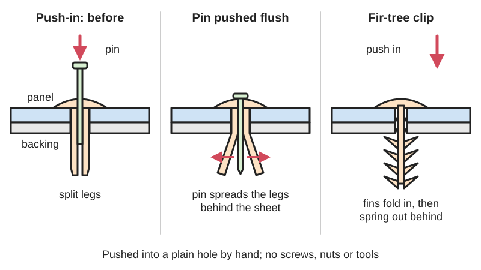
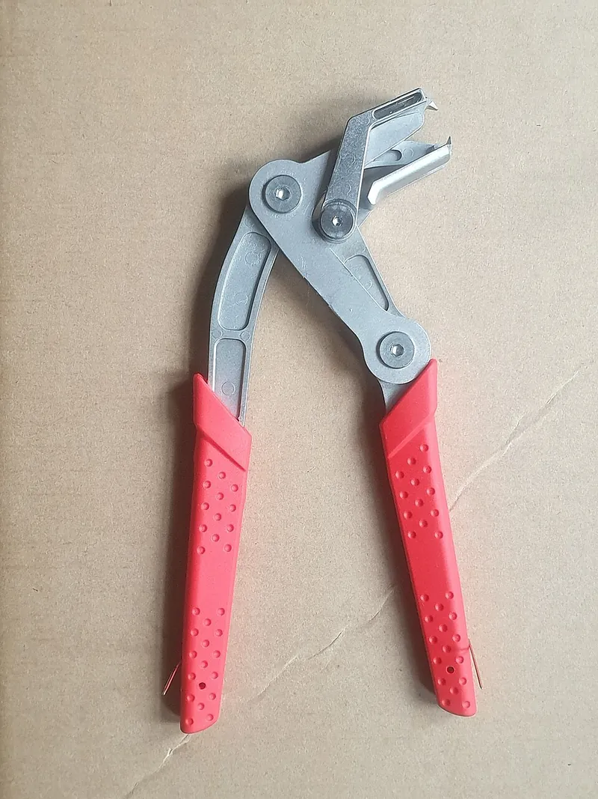

<figure class="eoc-pic eoc-pic-main"><figcaption>Diagram drawn for the encyclopaedia from the research notes. ⚑ Needs confirming: a drawing can simplify or get details wrong; a real photo or a better diagram is welcome.</figcaption></figure>
<figure class="eoc-pic"><figcaption><strong>Photo.</strong> <a href="https://commons.wikimedia.org/wiki/File:RFID_Rivet_Tag.jpg">RFID Rivet Tag</a> by GDpost, <a href="https://creativecommons.org/licenses/by-sa/3.0">CC BY-SA 3.0</a>, from Wikimedia Commons.</figcaption></figure>

A plastic pin that you push into a plain hole from one side, where springy fins or spreading legs grip behind or inside the hole, so panels and trim can be fixed in seconds without screws, nuts or tools.

**In plain words:** A plastic pin you push into a hole with your thumb and it grips: either its stem is covered in springy fins like a little pine tree that fold back going in and catch, or it has split legs that a centre pin spreads apart. The black clips that hold car door panels, bumpers and wheel-arch liners. **Proper term:** Push-in plastic rivet (push rivet; ribbed-shank 'fir-tree' clip).

**Also called:** push rivet / push-in rivet / plastic rivet / nylon rivet; push-type retainer / push retainer / push pin clip / push clip (automotive two-piece type with a centre pin); trim clip / panel clip / body clip / retainer clip / retaining clip; Christmas tree clip / fir tree clip / pine tree clip / Xmas tree clip (one-piece ribbed type; WCL writes 'Christmas Tree(R) Clips', so the name may be a registered trademark); barbed rivet (Accu) / fin clip (ASSEMBLY magazine) / ribbed-shank push-in rivet (McMaster-Carr); drive rivet / drive-pin rivet (two-piece: a pin driven into a slotted body spreads it); snap rivet (two-piece: the halves lock with an annular snap) and [ratchet](../glossary.md#ratchet) rivet (two-piece with serrated teeth; McMaster's 'two-piece push-in rivets with adjustable shank'); pop pin, push-to-lock clip (automotive slang, per Pliersman).

## How it works

Fir-tree clips: the stem carries rows of angled fins pointing back towards the head. Pushing the clip into the hole folds the fins in; once they pass through (or inside a blind hole) they spring back out, and because they slope the 'wrong' way for coming out they resist being pulled back (ASSEMBLY; McMaster-Carr: angled ribs 'slide in easily and prevent pull out'). Because several rows of fins are spaced along the stem, one clip grips a range of panel thicknesses, and in soft materials it can grip a blind hole (WCL). Push-type retainers: the body has split legs; you push it into the hole, then push the centre pin flush (or pre-assemble it to the first click and push the whole clip in), which wedges the legs apart behind the panel (Printables 24596; Pliersman: 'the pin insert goes inside the rivet and expands the stem'); levering the pin back out lets the legs relax so the rivet can be pried out (Pliersman). Drive rivets work the same way but the pin is driven with a hammer, and snap or ratchet rivets are two halves pushed together from both sides of the panel (ASSEMBLY; McMaster-Carr).

## Parts

Single piece (ribbed fir-tree clip) or a few parts (two-piece push-type retainer, drive rivet, snap or ratchet rivet). In plain words: a head (flat, domed or countersunk, sometimes with a foam or rubber skirt); a stem (shank) covered in angled fins, or split into legs; on two-piece types, a centre pin that is pushed down into the split stem, or a washer or cap that snaps onto the stem from the back. The parts being joined only need a hole.

## Everyday examples

- Car interiors and bodywork: door panels, upholstery, radiator shrouds, wheel-arch liners and under-engine covers (ASSEMBLY; Printables 1810800 replaces a Toyota underbody rivet)
- Appliances and electronics: back panels, heat-sink mounting and cable routing (ASSEMBLY)
- The black plastic rivet holding the gear cover plate inside a Yamaha K-340 cassette deck (Wikimedia Commons photo)
- The two-part plastic push rivets supplied to blank off spare holes in the Original Prusa enclosure (Printables 341553)

## When to use it

Use it to fix thin panels, trim, liners, covers, foam, fabric or cable clips to sheet metal, plastic or wood through a plain drilled or punched hole, especially when you can only reach one side, want no visible screws or nuts, and want fitting to take seconds with no tools. It is also the easy way to replace missing car clips, to close spare holes, and to hold parts that you may need to remove occasionally.

## When not to use it

Avoid it for structural or heavy loads, for parts that must be exactly positioned, for joints that are taken apart often (they wear out after two or three removals), and for sealed or waterproof joints. Use screws with well nuts or rivet nuts for blind holes that need frequent removal, metal blind (pop) rivets for permanent strong sheet joints, quarter-turn fasteners for service panels opened often, or a split snap pin or [cantilever](../glossary.md#cantilever) snap for printed parts you design yourself. Avoid PLA printed versions anywhere hot, such as under a car.

## Details

- **What it does (jobs):**
  - join and hold: fixes panels, trim, liners, covers, upholstery and cable clips to a panel or frame through a plain hole
- **Movement:** none
- **Directions it can move (degrees of freedom):** 0: once fitted the parts are held, though a slightly loose fit lets them shift a little
- **Special behaviour:**
  - none: it simply holds. Two-piece push-type retainers can be released by lifting the centre pin (usually with a forked tool), after which the body lifts out whole (Pliersman)
- **How it holds:**
  - shape (the parts interlock; [form-fit](../glossary.md#form-fit--force-fit--material-bond)): fins or spread legs catch behind the far side of the hole
  - friction or clamping (force-fit): in blind holes and soft materials the fins grip the hole wall instead of catching behind it (WCL)
  - spring force (a spring or springy part presses it in place): the springy fins or legs press outward against the hole
- **Input and output:** not applicable: it is a holding joint
- **Power:** passive (no power needed)
- **Load:** Light. Holds panels and trim against pulling off, vibration and sideways shifting ([shear](../glossary.md#peel-vs-shear) is carried by the stem in the hole). Pull-out force examples: about 31 lb (about 140 N) for a fastener in 0.197 in (5 mm) holes in HDPE panels 0.08-0.402 in thick, and about 175 lb (about 780 N) for larger fasteners in particle board (ASSEMBLY). Not for structural joints.
- **Play and precision:** Noticeable: the fins tolerate a range of hole sizes and thicknesses, so they don't locate parts precisely and the panel may shift slightly in its hole. Use a separate locating pin if parts must line up exactly.
- **Taking it apart:** semi-permanent (can be undone but may damage parts): they are pulled or pried out with a forked tool, but fins get chewed and centre pins snap; McMaster says the one-piece ribbed type is popped out with a tool, and the two-piece washer type is removed by prying apart or cutting. Drive rivets whose pin breaks the bottom of the body, and ratchet rivets, are effectively permanent (ASSEMBLY)
- **How often it can be reused:** a few times: 'You can pull them out and reuse them two or three times. After that, the fins get boogered up, and they don't retain as well' (ASSEMBLY, 2008); a printed replacement's designer rates his push rivets 'single or maybe two-use', like the official ones (Printables 24596)
- **Sealing:** none: the rivet fills the hole but doesn't seal it; some versions have a foam or rubber skirt under the head ⚑ [uncertain]
- **Adjustable:** no, but it adapts: the finned stem grips a range of panel thicknesses (WCL lists grip ranges from 0.035-0.070 in up to 1.520-2.290 in, depending on size), and two-piece ratchet rivets fit different stack thicknesses, with excess shank clipped off (McMaster-Carr; ASSEMBLY)
- **Access needed:** one side only (blind) for one-piece fir-tree clips and two-piece push-type retainers; both sides for two-piece snap or ratchet rivets that use a washer or cap on the back (McMaster: the washer type needs access to both surfaces)
- **Materials:** Usually nylon 6 or nylon 6/6; also polyethylene, polypropylene, thermoplastic elastomer (TPE) and acetal copolymer (ASSEMBLY). They join sheets of metal, plastic, composite, rubber, wood, foam, fibre board, upholstery and particle board (ASSEMBLY; Accu). Printed replacements: PETG, ABS, ASA or nylon (nylon preferred; Printables 24596 and 1209513), or TPU for flexible fir-tree trim clips (Printables 1243486).
- **Heat, cold, water and wear:** Nylon push-in rivets are rated about -40 to 63 degrees C (McMaster-Carr) or 0 to 85 degrees C for Heyco's nylon 6/6 clips; nylon absorbs moisture, which changes its size (McMaster-Carr) and its springiness (DuPont Table 10.06 gives different strain limits dry and at 50% relative humidity). Plastic springs under constant load [creep](../glossary.md#creep) and relax (DuPont, p. 36), so clips slowly lose grip on a panel they are squeezing. Printed PLA deforms from road heat under a car; use PETG or a filament rated above about 69 degrees C (Printables 1810800). Old clips go [brittle](../glossary.md#brittle--ductile) with heat and age, which is why they often snap on removal ⚑ [uncertain].

## Making it

- **Ways to make or get it:**
  - off-the-shelf part: the usual choice; assortments of automotive sizes are cheap
  - injection moulding: how commercial rivets are made (usually nylon)
  - 3D print (FDM): replacements and custom sizes (many models on Printables), in PETG, ABS, ASA, nylon or TPU
  - 3D print (SLS or MJF nylon): suits snap features in general (Hubs) ⚑ [uncertain: no printed push-rivet example found]
- **Printing it in one piece (print in place):** no: one-piece clips print as a single solid part, and two-piece push rivets are printed as a body and a separate pin, then assembled (Printables 1511900 and 24596)
- **Tools:** None to fit: push with your thumb (McMaster-Carr); drive rivets have their pin tapped in with a hammer (ASSEMBLY). To remove: trim-clip pliers or a forked pry tool (McMaster lists prying tools with flat forked jaws, gripping tools and 30 and 80 degree bent-nose versions for awkward spots). A flat screwdriver works but presses on one point of the pin head and tends to break it (Pliersman)
- **Difficulty:** easy: buy an assortment and push them in; printing replacements is moderate, because the small springy legs need tough filament, fine layers and the right print orientation

### 3D printing tips

Measure first: the hole diameter, the total thickness of the panels (the grip range) and the head size you need; copy the original part's numbers if you are replacing a car clip (e.g. Printables 1511900 is based on the dimensions of a Honda 6 mm clip). Orientation: print a two-piece rivet body standing on its head with the legs pointing up, and print the pin lying on its flat side so its layers run along its length (Printables 1511900); many designers give the pin flat sides for this. Design: splitting the stem in only one place makes a stronger stem, a slightly pre-spread stem stays in the hole even before the pin goes in, and a positive catch keeps the pin from backing out (Printables 1511900). Some printed ribbed rivets have a centre hole for a steel split pin or a stainless screw to stiffen them (Printables 1209513). Settings: 100% [infill](../glossary.md#infill), fine layers (0.1-0.12 mm) and at least 3 [perimeters](../glossary.md#perimeters) (Printables 1511900, 1209513, 24596). Material: PETG, ABS, ASA or nylon; nylon is closest to the original clips (Printables 24596). Don't use PLA under a car or near engines: road heat can deform it; choose PETG or anything that handles more than about 69 degrees C (Printables 1810800). Fir-tree clips with thin fins work well in TPU, printed slowly (20-30 mm/s) with 3 walls and no supports; hard filaments make the fins too rigid (Printables 1243486). If slotted legs are too stiff in nylon, use the version without slots (Printables 24596). Typical failures: legs snap off in the hole (print orientation, too brittle a material, too small a hole), fins too stiff to enter or too soft to hold (change material or fin thickness), the pin head breaks when removing (use a forked tool, not a screwdriver).

### Buying one (off-the-shelf parts)

Search: 'push rivet', 'push-type retainer', 'trim clip assortment', 'panel clip', 'Christmas tree clip' or 'fir tree clip', 'ribbed shank push-in rivet', 'drive rivet', 'snap rivet', 'two-piece push-in rivet with washer', 'nylon rivet'. Removal tools: 'trim clip pliers', 'push pin remover', 'panel clip pliers', 'trim removal tool'. Related hardware: 'well nut' and 'rivet nut' (for screws into blind holes), 'blind rivet' (metal pop rivet).

## Rules of thumb

- Hole size: 'A hole size anywhere from 1/8 to 3/4 inch is good', with 1/4 to 3/8 inch the optimum; undersized holes stop the fastener working and oversized ones 'defeat the purpose' (ASSEMBLY, 'Fastening: Christmas Trees Ain't Just for December', 2008).
- Reuse: about two or three removals before the fins stop retaining well (ASSEMBLY, 2008).
- Pull-out force examples: about 31 lb from 0.197 in holes in HDPE panels (0.08-0.402 in thick); about 175 lb for larger fasteners in particle board (ASSEMBLY, 2008).
- Nylon ribbed-shank push-in rivets: temperature range -40 to 145 degrees F (-40 to 63 degrees C); nylon absorbs moisture from the air, which changes its dimensions; catalogue ranges cover material 0.03 to 2 in thick and holes 0.125 to 0.394 in (McMaster-Carr, Christmas tree clips).
- Nylon 6/6 slotted-leg push-in fasteners are rated 0 to 85 degrees C (32 to 185 degrees F) and cover panels up to 0.25 in (6.4 mm) (Heyco HEYClip).
- Match the fastener to both the hole diameter and the total panel thickness (grip range); ribbed clips are made in grip ranges from about 0.035-0.070 in to 1.520-2.290 in and hole sizes 0.120-0.315 in (WCL Christmas Tree clips).
- Printed 6 mm push rivet that works: 6 mm hole, 14.1 mm head, one split in the stem, pin printed on its side, PETG at 0.12 mm layers and 100% infill (Printables 1511900).
- Printed automotive push pin: 8 mm hole, 5 mm grip, 20 mm flange, PETG or nylon, 0.20 mm layers, 3 perimeters, 100% infill (Printables 24596).

## Common failures

The centre pin head snaps off when you try to lift it with a screwdriver (Pliersman): use trim-clip pliers or a forked tool that lifts evenly around the head. The pin is pushed right through and lost inside a panel ⚑ [uncertain]: on push-through types, push only as far as needed to release the legs. Fins get chewed and the clip no longer holds after two or three removals (ASSEMBLY): replace it. Wrong size: an undersized hole won't let it enter, and an oversized hole or too-thin panel means the fins don't bite (ASSEMBLY); match hole size and grip range. Old or cold nylon clips crack: replace with new ones. Printed clips deform in heat (PLA) or snap at the legs (wrong orientation or brittle filament).

## Safety

Low hazard. Clips and centre pins are small enough to be a choking hazard for young children. When removing car trim, prying with a screwdriver can slip and scratch paint or cut hands; a forked trim tool is safer ⚑ [uncertain]. Centre pins pushed in too far can fall inside door cavities ⚑ [uncertain: from a search-result summary, source page not opened].

## Related

- Snap pin (split-leg push-in pin): the same squeeze-through-a-hole idea as a separate peg for joining printed parts; usually fitted through a hole with a far side you can reach
- Cantilever snap fit: the hook is moulded onto one of the parts instead of on a separate fastener
- Blind rivet (pop rivet): a metal rivet set from one side with a tool that pulls a mandrel; permanent and much stronger
- Blind threaded fixings (rivet nut, well nut): give a screw thread in a blind hole, for parts that are removed often
- Quarter-turn fastener: a stud that locks a panel with a quarter turn; made for panels opened again and again
- Heat staking: a plastic post melted into a rivet head; permanent
- Cable tie mounts and edge clips: similar push-in stems used to route cables
- Cardboard screws and rivets (box rivets): reusable plastic rivet halves pressed together from both sides through punched holes in corrugated cardboard

## Make it yourself

- [6mm Push Rivet / Panel Clip, by avionix (URL from Printables API, page not opened)](https://www.printables.com/model/1511900-6mm-push-rivet-panel-clip): A printable two-piece push rivet for 6 mm holes with a single-split stem, side-printed pin and positive pin retention; scalable (read through the Printables API) *(licence: Creative Commons Attribution (CC BY))*
- [Push-In Rivets with Ribbed Shank, by Michael Hathaway (URL from Printables API, page not opened)](https://www.printables.com/model/1209513-push-in-rivets-with-ribbed-shank): Printable ribbed-shank (fir-tree) push-in rivets with STEP file, plus versions with a centre hole for a steel split pin or screw (read through the Printables API) *(licence: Creative Commons Attribution-ShareAlike (CC BY-SA))*
- [Parametric plastic rivet family, by LuluX (URL from Printables API, page not opened)](https://www.printables.com/model/210655-parametric-plastic-rivet-family): Three parametric Fusion 360 plastic rivet designs (male and female parts) for joining sheets of plastic, plywood, metal or fabric; PETG preferred (read through the Printables API) *(licence: Creative Commons Attribution-NonCommercial-ShareAlike (CC BY-NC-SA))*
- [Automotive Trim Clip Assortment (TPU Only), by Matt Richardson (URL from Printables API, page not opened)](https://www.printables.com/model/1243486-automotive-trim-clip-assortment-tpu-only): Fir-tree style trim clips in 3 stem widths and 6 head sizes, designed to be printed in flexible TPU (read through the Printables API) *(licence: Creative Commons Attribution-NonCommercial (CC BY-NC))*
- [Push Pin Clip / Push Rivet / Retaining Clip (Nissan, Infiniti), by Scottmi (URL from Printables API, page not opened)](https://www.printables.com/model/24596-push-pin-clip-push-rivet-retaining-clip-nissan-inf): A printable two-piece automotive push-type retainer for 8 mm holes, with notes on materials and fitting (read through the Printables API) *(licence: Creative Commons Attribution (CC BY))*

## Pictures, videos and models

- [Plastic bodywork rivet pulling pliers (Wikimedia Commons, photo by Andy Dingley)](https://commons.wikimedia.org/wiki/File:Plastic_bodywork_rivet_pulling_pliers.jpg): Photo of the hand tool made for releasing and removing the plastic rivets used on car bodywork *(licence: CC BY-SA 4.0)*
- [Yamaha K-340 transport, side view, plastic rivet (Wikimedia Commons)](https://commons.wikimedia.org/wiki/File:Yamaha_K-340_transport_-_side_view_-_plastic_rivet.jpg): Photo of a reusable black plastic rivet holding a gear cover plate inside a cassette deck *(licence: CC0 1.0 (public domain dedication))*
- [Christmas Tree Clips (McMaster-Carr)](https://www.mcmaster.com/products/christmas-tree-clips/): Catalogue drawings and specifications of ribbed-shank push-in rivets, two-piece adjustable push-in rivets with washers, and rivet removal tools *(licence: link only)*
- [Fastening: Christmas Trees Ain't Just for December (John Sprovieri, ASSEMBLY magazine, 2008)](https://www.assemblymag.com/articles/85900-fastening-christmas-trees-ain-t-just-for-december): Trade-magazine article describing Christmas tree (fin) clips, arrow clips, snap rivets, ratchet rivets and drive-pin rivets, with hole sizes, pull-out forces and reuse *(licence: link only)*
- [How to remove "Automotive Push Clips" without braking them - FAST & EASY! (DIY with Michael Borders)](https://www.youtube.com/watch?v=pQbeatWr4SQ): Video showing how to remove automotive push clips without breaking them ⚑ [uncertain: title and channel checked with YouTube oEmbed; video content not viewed] *(licence: YouTube standard licence; link only)*

## Needs confirming

⚑ marks something nobody has confirmed yet: a fact the research could not confirm from a source, a finder value that is a best guess, or an open point from the research notes. Corrections are welcome (see `research/needs-confirming.md`).

- ⚑ 7 sentences on this page marked [uncertain].
- ⚑ Finder value `threaded` = no (best guess): set by Claude (R33) as the follow-up answer after the check gave this entry the answer before it

## Sources

- <https://www.assemblymag.com/articles/85900-fastening-christmas-trees-ain-t-just-for-december>
- <https://www.mcmaster.com/products/christmas-tree-clips/>
- <https://www.wclco.com/plastic-components/panel-fasteners/panel-fasteners-ribbed-shank/christmas-tree-clips-single-head/>
- <https://accu-components.com/us/shop/precision-components/rivets/plastic-rivets/barbed-rivets>
- <https://www.heyco.com/products/heyware/circuit-board-supports/heyclip-nylon-push-in-fasteners/>
- <https://pliersman.com/automotive-push-pin-pliers/>
- <https://www.distrupol.com/General_Design_Principles_for_Engineering_Polymers.pdf>
- <https://www.hubs.com/knowledge-base/how-design-snap-fit-joints-3d-printing/>
- <https://en.wikipedia.org/wiki/Rivet>
- <https://commons.wikimedia.org/wiki/File:Plastic_bodywork_rivet_pulling_pliers.jpg>
- <https://commons.wikimedia.org/wiki/File:Yamaha_K-340_transport_-_side_view_-_plastic_rivet.jpg>
- <https://www.youtube.com/watch?v=pQbeatWr4SQ (title verified via YouTube oEmbed)>
- <https://www.printables.com/model/1511900-6mm-push-rivet-panel-clip (read via https://api.printables.com/graphql/)>
- <https://www.printables.com/model/1209513-push-in-rivets-with-ribbed-shank (read via https://api.printables.com/graphql/)>
- <https://www.printables.com/model/210655-parametric-plastic-rivet-family (read via https://api.printables.com/graphql/)>
- <https://www.printables.com/model/1243486-automotive-trim-clip-assortment-tpu-only (read via https://api.printables.com/graphql/)>
- <https://www.printables.com/model/24596-push-pin-clip-push-rivet-retaining-clip-nissan-inf (read via https://api.printables.com/graphql/)>
- <https://www.printables.com/model/1810800-car-plastic-underbelly-rivet (read via https://api.printables.com/graphql/)>
- <https://www.printables.com/model/341553-original-prusa-enclosure-push-rivet (read via https://api.printables.com/graphql/)>
- <https://api.printables.com/graphql/>
