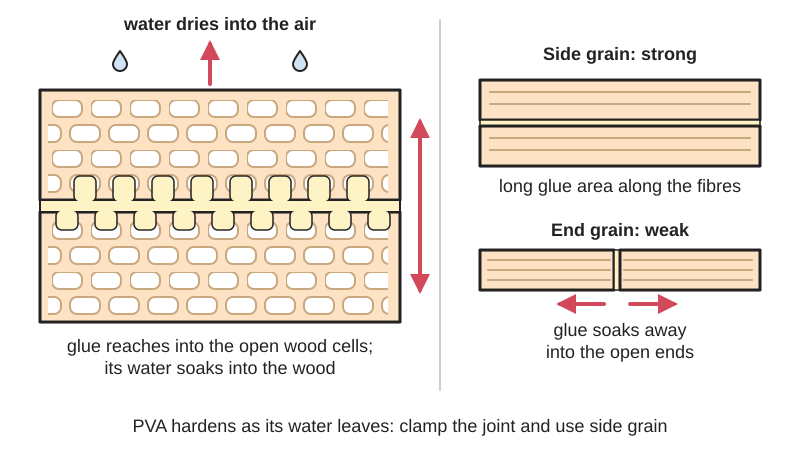
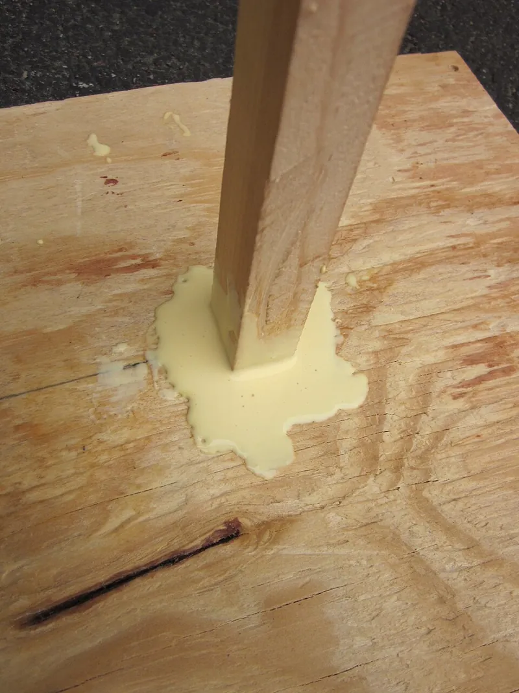
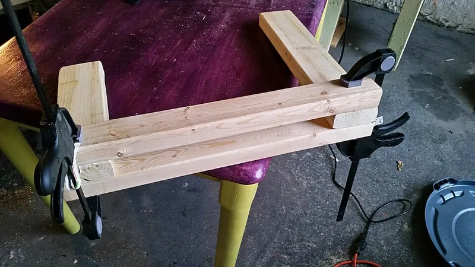

<figure class="eoc-pic eoc-pic-main"><figcaption>Diagram drawn for the encyclopaedia from the research notes. ⚑ Needs confirming: a drawing can simplify or get details wrong; a real photo or a better diagram is welcome.</figcaption></figure>
<figure class="eoc-pic"><figcaption><strong>How it works.</strong> <a href="https://commons.wikimedia.org/wiki/File:Using_wood_glue.JPG">Using wood glue</a> by Amirreza Saharkhiz, <a href="https://creativecommons.org/licenses/by-sa/3.0">CC BY-SA 3.0</a>, from Wikimedia Commons.</figcaption></figure>
<figure class="eoc-pic"><figcaption><strong>Photo.</strong> <a href="https://commons.wikimedia.org/wiki/File:Wood_glue_and_clamping_the_pieces_before_screwing_them_together.jpg">Wood glue and clamping the pieces before screwing them together</a> by Own work, <a href="https://creativecommons.org/licenses/by-sa/4.0">CC BY-SA 4.0</a>, from Wikimedia Commons.</figcaption></figure>

A water-based glue of plastic particles suspended in water that soaks into wood, paper, card and other porous materials and hardens as the water is absorbed and evaporates, giving strong, cheap, non-toxic joints for indoor woodwork, with yellow and water-resistant grades for tougher jobs.

**In plain words:** The everyday white or yellow bottle glue that cleans up with water, soaks into wood, paper or card, and dries as the water leaves, making wood joints that are often stronger than the wood around them. **Proper term:** Polyvinyl acetate (PVA, PVAc) emulsion wood glue, including aliphatic resin (yellow) glue and cross-linking PVA.

**Also called:** PVA glue; PVAc glue; polyvinyl acetate emulsion (Wikipedia 'Polyvinyl acetate'; FPL Wood Handbook ch.10); white glue; school glue; hobby and craft glue (Wikipedia 'Wood glue'); yellow glue; carpenter's glue; aliphatic resin glue (Wikipedia 'Wood glue'); wood glue; woodworking glue; joiner's glue ⚑ [uncertain: common usage]; cross-linking PVA; Type II glue; Type I (waterproof) wood glue; D2, D3, D4 wood glue (Titebond; FPL Wood Handbook ch.10; IVK EN 204 leaflet); brand names beginners search for (brands): Titebond Original, II and III (Titebond); Elmer's Carpenter's Wood Glue (Rockler); Lepage (Wikipedia 'Wood glue'); Ponal (Printables model name); not to be confused with PVA (polyvinyl alcohol) water-soluble 3D-printing support filament, a different polymer (Wikipedia 'Polyvinyl acetate': 'Not to be confused with Polyvinyl alcohol'); tacky glue: a thick, fast-grabbing PVA craft glue that sticks on contact ('A PVA Glue (polyvinyl acetate white glue) with a thick, fast-grabbing formula', Aleene's glossary); Aleene's Original Tacky Glue (brand); fabric glue (only some are PVA: Aleene's (brand) says fabric glues are made with acrylic instead, which is more water-resistant and flexible than PVA and holds up better in the wash, Aleene's FAQ; solvent-based fabric adhesives are covered under Elastomeric solvent glue).

## How it works

The glue is tiny particles of polyvinyl acetate plastic dispersed in water (an emulsion). When spread on wood, the water soaks into the wood and evaporates, so the glue thickens until the particles merge into a continuous, slightly flexible plastic film (FPL Wood Handbook ch.10: 'cold-setting waterborne wood adhesives lose water by absorption and evaporation'). Clamping pressure squeezes the glue into a thin film and pushes it into the open cells of the wood, where it 'interlocks several cells deep', which is why it grips porous materials so well and non-porous ones poorly (FPL Wood Handbook ch.10; thisTOthat: 'All PVAs are designed to work on porous materials only'). Yellow (aliphatic resin) glue grabs faster and is a bit more heat- and water-resistant than white; cross-linking grades also react chemically as they dry, which makes them more water-resistant (Wikipedia 'Wood glue'; FPL Table 10-1).

## Parts

Single piece (a one-part liquid used straight from the bottle); used with clamps, and some industrial D4 grades add a separate hardener (2K PVA, 100 parts glue to 5 parts hardener) (European Wood Review; AkzoNobel).

## Everyday examples

- White school glue for paper and card crafts (Wikipedia 'Wood glue': 'white glue', 'school glue')
- The glue in furniture joints, cabinets and doors (FPL Table 10-1: 'Furniture; flush doors ... general purpose in home and shop')
- Wooden cutting boards, birdhouses, planters and outdoor furniture made with water-resistant yellow glue (Titebond II and III product pages; Titebond FAQ)
- Laser-cut plywood boxes and models glued at the finger joints ⚑ [uncertain: common maker practice]

## When to use it

Use PVA for almost any indoor wood-to-wood joint that fits well and can be clamped: furniture, boxes, cabinets, edge-glued panels, laminations, dowel and biscuit joints, and for paper, card, cork, leather and fabric onto wood (FPL Table 10-1; Rockler; Titebond Original). It is cheap, one-part, non-toxic, cleans up with water and makes side-grain joints stronger than the wood (Wikipedia 'Wood glue'; Titebond). Choose yellow (aliphatic) glue for faster grab and better sanding, white glue when you need more sliding time, a longer-open-time or Type I grade for big or complicated glue-ups, and Type II/D3 or Type I/D4 grades for kitchens, bathrooms, cutting boards and covered outdoor projects (Wikipedia; Titebond; European Wood Review).

## When not to use it

Not for gaps or poorly fitting joints: use epoxy or polyurethane glue (Rockler; Wikipedia 'Wood glue'). Not for plastics, metal or glass, or for 3D prints to each other: use cyanoacrylate, epoxy, solvent welding or contact adhesive (Prusa). Not for joints under constant heavy load, such as bent laminations that want to spring back or shelves carrying weight on the glue alone, because PVA [creeps](../glossary.md#creep): use urea-formaldehyde (which 'does not creep'), epoxy or mechanical fasteners (Wikipedia 'Wood glue'; FPL). Not for boats below the waterline, continuous submersion or exposed structural outdoor work: use epoxy or resorcinol (Titebond III limitations; Wikipedia; Wood by Wright found all PVAs, even Type I, 'did very poorly' in its exterior test). Not for joints you may need to take apart cleanly later, such as musical instruments and antique repairs: use hide glue, which can be undone with heat and moisture (Wikipedia 'Wood glue'; Woodcraft). Not for end-grain butt joints without joinery (FPL).

## Details

- **What it does (jobs):**
  - glue or bond: the standard glue for wood-to-wood joints, panels, laminations, veneers, paper, card and other porous materials (FPL Table 10-1; Rockler)
  - join and hold: holds wood joinery (dowels, biscuits, mortise and tenon, finger joints) permanently once the joint is clamped (Rockler) ⚑ [uncertain: joint types from general knowledge]
- **Movement:** none: a rigid joint (the glue film itself stays slightly flexible, Wikipedia 'Wood glue')
- **Directions it can move (degrees of freedom):** 0: the glued parts are locked together once the glue has set
- **Special behaviour:**
  - none: it has none of the listed behaviours. Its own tricks: it cleans up with water while wet; white glue stays slippery for a while so parts can be slid into line, while yellow glue grabs faster (Wikipedia 'Wood glue'); and the bond can be softened with heat or steam to take a joint apart (Titebond FAQ)
- **How it holds:**
  - [material bond](../glossary.md#form-fit--force-fit--material-bond) (glue, solvent or melting): the dried glue film sticks to both faces and locks into the pores of the wood (FPL Wood Handbook ch.10)
- **Input and output:** not applicable
- **Power:** passive (no power needed): it sets at room temperature as water leaves; heat, radio-frequency or hot-press systems are only used in factories to speed it up (FPL Wood Handbook ch.10; Titebond II page)
- **Load:** medium to heavy in [shear](../glossary.md#peel-vs-shear) on long-grain (side-grain) wood joints: manufacturer tests to ASTM D905 on hard maple give about 3,550-4,000 psi (24-28 MPa) at room temperature, with much of the break in the wood itself (Titebond Original 3,600 psi, 77% wood failure; White 3,550 psi; II 3,750 psi; III 4,000 psi) (Titebond product pages), and Wood by Wright's 32-glue test found PVA long-grain joints stood up 'very nicely' to far more expensive epoxies (Popular Woodworking, 2018). Weak on [end grain](../glossary.md#end-grain): glued end-grain butt joints reach only about 25% of the wood's tensile strength even with special techniques (FPL Wood Handbook ch.10). Weak under long-term load and heat: PVA joints 'yield under continued stress' (creep) (FPL Table 10-1; Wikipedia). Manufacturers state it is not for structural or load-bearing applications (Titebond).
- **Play and precision:** not applicable (nothing moves). It needs close-fitting, flat joints: PVA is a poor gap filler, and a 'gap-filling puddle will shrink as it dries' (Rockler; Woodcraft). The standard EN 205 test joint uses a 0.1 mm glue line (IVK leaflet).
- **Taking it apart:** semi-permanent (can be undone but may damage parts): heating the joint with a heat gun or hair dryer, or steam from an iron, weakens yellow and water-resistant PVA glues so joints can be separated (Titebond FAQ); dried squeeze-out is scraped or sanded off (Titebond). Re-gluing is hard because most glues, including PVA and epoxy, don't stick well to old cured PVA, so it must be cleaned off to bare wood first (Wikipedia 'Wood glue').
- **How often it can be reused:** once: the glue can't be reused; to redo a joint, clean the old glue off down to bare wood and apply fresh (Wikipedia 'Wood glue')
- **Sealing:** none: it is not a sealant, and ordinary white and yellow glues are 'not intended for exterior use or where moisture is likely' (Titebond Original and White). Water-resistant grades resist water but are still 'not for continuous submersion or for use below the waterline' (Titebond II and III).
- **Adjustable:** no once set. While wet, parts can be slid into line within the open assembly time (about 3-10 minutes, depending on grade), and white glue gives more slip than yellow (Titebond; Wikipedia 'Wood glue').
- **Access needed:** not applicable: glue is spread on the joint faces before the parts are put together and clamped
- **Materials:** Bonds well: wood (softwood and hardwood), plywood, hardboard, particleboard and MDF, veneer, paper, card, cork, leather, cloth and 'most other porous materials' (Titebond Original; FPL Table 10-1; thisTOthat). Also plastic laminates to wood in industry (FPL Table 10-1). Poor or no bond: non-porous materials such as metal, glass and most plastics, including 3D prints in PLA, PETG and ABS (Prusa: PVA/wood glues are 'probably not strong enough for most plastics'); painted, stained or sealed wood, where the bond is only as strong as the paint (Titebond FAQ); oily or tannin-rich woods such as teak and ipe unless freshly planed or wiped with acetone (Titebond FAQ); wood wetter than about 16% moisture, where it may not dry at all (Titebond FAQ); old cured PVA (Wikipedia 'Wood glue'). Acidic grades (pH 2.5-3.0) can corrode metal (Titebond II and III).
- **Heat, cold, water and wear:** Heat: PVA is a thermoplastic that softens as it warms (its glass transition is about 30-45 °C, Wikipedia 'Polyvinyl acetate'); after a night at 150 °F (66 °C) Titebond's ASTM D905 strengths fall from 3,550-4,000 psi to 1,600-1,750 psi for white, yellow and Type II glue and to 800 psi for Type I, with almost no wood failure (Titebond product pages), so avoid hot cars, radiators and sunny dark surfaces for loaded joints. Water: ordinary white and yellow glues are for dry interiors only; cross-linked grades resist water but none is for continuous submersion, and uncross-linked PVA 'often fail[s] after exposure to wet-dry cycling' (FPL; Titebond). Creep: joints slowly yield under constant load, worse with heat and moisture (FPL Table 10-1; Wikipedia). Cold: apply above the chalk temperature (about 45-55 °F / 7-13 °C depending on grade); cold makes no significant difference to cured joints (FPL; Titebond). Freezing: keep the liquid from freezing; Titebond says freezing may only thicken it and it is freeze-thaw stable, while thisTOthat warns freezing ruins PVA, so check the bottle. Storage: about 2 years, below 75 °F (24 °C) (Titebond). UV: ⚑ [uncertain: no data found; glue lines are normally shielded by wood and finish].

## Making it

- **Ways to make or get it:**
  - woodwork: its main use, for joinery, edge-joined panels, laminations and veneering (FPL Table 10-1; Rockler)
  - laser cut: gluing finger-jointed plywood or MDF boxes and panels ⚑ [uncertain: common maker practice, no specific source opened]
  - CNC: gluing routed wood and plywood parts ⚑ [uncertain: same as above]
  - paper, card and model making: white 'school glue' and 'hobby and craft' glue (Wikipedia 'Wood glue')
  - 3D print (FDM): only for fixing prints to porous materials such as wood, cork, fabric or paper, or for printed glue-up tools; not for gluing plastic to plastic (Prusa)
- **Printing it in one piece (print in place):** no: it is a glue, not a printed part
- **Tools:** The glue bottle, a brush, roller or notched spreader to spread an even film (about 6 mil / 0.15 mm, Titebond), clamps (bar, F, pipe or band clamps) to press joints together, a damp cloth for wet squeeze-out, and a scraper or sandpaper for dried glue (Titebond product pages). A jointer, plane or sander to freshen the surfaces just before gluing (FPL Wood Handbook ch.10).
- **Difficulty:** easy: no mixing, water cleanup and cheap. The skills are spreading an even film, working within the [open time](../glossary.md#open-time), and clamping evenly (FPL Wood Handbook ch.10; Titebond).

### 3D printing tips

1) Don't use PVA wood glue to join plastic prints to each other: Prusa's gluing guide lists 'PVA/wood glues (probably not strong enough for most plastics)'; use cyanoacrylate, epoxy or solvent welding instead (see those entries). 2) Gluing a print to wood, cork, fabric or card: PVA grips the porous side well but only holds the plastic side mechanically, so roughen the print's face with coarse sandpaper, add holes or grooves for the glue to key into, or use epoxy or contact cement for these mixed joints ⚑ [uncertain: reasoning from how PVA bonds (FPL) and Prusa's note]. 3) PVA wood glue is not the same as the water-soluble 'PVA' support filament (polyvinyl alcohol); don't confuse the two (Wikipedia 'Polyvinyl acetate'). 4) Printed glue-up tools work well: toothed glue spreaders (Mario M's parametric FreeCAD spreader with 1.5, 2.5 and 3.5 mm teeth), rollers with a TPU tyre (blecheimer's textured roller; goldon's roller with a glue tank, PLA or PETG body and TPU roller) and glue-bottle holders are popular models. 5) Wet PVA can be wiped off PLA and PETG tools, and dried glue usually peels off smooth plastic, which is why printed spreaders and cauls are practical ⚑ [uncertain: maker experience, not tested in a source]. 6) Use printed glue test pieces (MethodicalMaker; iqless) if you want to check for yourself how weakly PVA holds a given filament compared with other glues.

### Buying one (off-the-shelf parts)

Search for: 'PVA wood glue', 'white glue' or 'school glue' (general and paper), 'yellow glue' / 'aliphatic resin glue' / 'carpenter's glue' (faster grab, better sanding), 'water-resistant wood glue' / 'ANSI Type II' / 'D3 wood glue' (outdoor furniture under cover, cutting boards), 'waterproof wood glue' / 'ANSI Type I' / 'D4 wood glue' (outdoor, damp), 'extended open time wood glue' for big glue-ups, 'dark wood glue' for dark woods, and 'cold press veneer glue' (Titebond and AkzoNobel product ranges; European Wood Review). Accessories: glue rollers and spreaders, glue bottles with fine or biscuit/dowel tips, bar, F, pipe and band clamps, clamping cauls.

## Rules of thumb

- Make close-fitting, flat joints: PVA is not a gap filler (Rockler; Woodcraft), and the standard EN 205 test joint uses only a 0.1 mm glue line (IVK leaflet).
- Plane, joint or sand the wood within 24 hours before gluing for a clean, easily wetted surface; bonding within minutes of surfacing can be noticeably better (FPL Wood Handbook ch.10).
- Glue wood that is dry: about 12% moisture content is the usual specification (FPL Wood Handbook ch.10); above 10% slows drying and above about 16% the glue may not dry at all (Titebond FAQ).
- Spread a film of about 6 mil (0.15 mm), i.e. roughly 250 square feet per US gallon (Titebond product pages).
- Assemble within the open time: about 3-5 minutes for cross-linking yellow (Type II), 4-6 minutes for yellow aliphatic, about 5 minutes for white and 8-10 minutes for Type I glue at 70 °F / 50% RH (Titebond product pages).
- Clamp firmly but not too hard: about 100-150 psi (0.7-1.0 MPa) for softwoods, 125-175 psi for medium woods and 175-250 psi (1.2-1.7 MPa) for hardwoods (Titebond); FPL gives 0.7 MPa (100 psi) for low-density up to 1.7 MPa (250 psi) for the densest woods, and warns that too much pressure squeezes out the glue and leaves a starved joint (FPL Wood Handbook ch.10).
- Keep an unstressed joint clamped for 30-60 minutes; a stressed joint (bent or sprung parts) for 24 hours; and don't load a new joint for at least 24 hours (Titebond FAQ). Water-based glues can take about 24 hours to [cure](../glossary.md#cure) before machining (Titebond FAQ).
- Don't glue below the 'chalk temperature' of the glue, air and wood: about 50 °F (10 °C) for white and ordinary yellow glue, 55 °F (13 °C) for Type II and 45-47 °F (7-8 °C) for Type I (Titebond product pages).
- Don't rely on end-grain butt joints: they reach only about 25% of the wood's tensile strength; use a scarf joint with a slope of 1 in 12 or flatter, finger joints, or joinery that turns end grain into side grain (FPL Wood Handbook ch.10).
- Choose water resistance by where the piece will live (EN 204 classes): D1 dry interiors (wood below about 15% moisture), D2 occasional high humidity or brief water, D3 frequent short contact with water or outdoors under cover, D4 frequent long exposure to water or outdoors with a protective finish (European Wood Review; IVK leaflet). In US terms, ANSI/HPVA Type II passes three 4-hour soak and 120 °F bake cycles; Type I passes boiling tests (Titebond FAQ).
- Don't thin it with more than about 5% water (Titebond FAQ).
- Joints made with ordinary wood glues keep their strength indefinitely if the wood stays below about 15% moisture and at temperatures comfortable for people; some adhesives deteriorate if kept above 38 °C (100 °F) for long periods (FPL Wood Handbook ch.10).

## Common failures

1) Starved joint: too much clamping pressure, too little glue, or glue soaking into end grain leaves too little in the joint; spread both faces and clamp moderately (FPL Wood Handbook ch.10). 2) Glue skinned over before assembly: open time exceeded, so it doesn't transfer and leaves a thick, weak line; work faster or use a longer-open-time grade (FPL; Titebond). 3) Gappy joint fails: PVA doesn't fill gaps and shrinks as it dries (Rockler; Woodcraft). 4) End-grain joint snaps (FPL). 5) Chalky, white, weak glue line: glued below the glue's chalk temperature, e.g. in an unheated winter workshop (Titebond; European Wood Review). 6) Joint slides or opens over months under constant load (creep), or lets go in heat (FPL; Wikipedia; Titebond). 7) Delamination outdoors or in the wet: wrong grade (FPL; Wood by Wright). 8) Won't bond: painted, sealed, oily or wet wood, old glue residue, or a non-porous material (Titebond FAQ; Wikipedia). 9) Blotches after staining: squeeze-out left on the surface, since the glue does not take stain; remove it wet or sand it off (Wikipedia 'Wood glue'; Titebond). 10) Sunken glue lines: the board was planed or sanded before the moisture from the glue had evened out (Titebond FAQ). 11) Parts slip out of line under the clamps: white glue is slippery before it grabs; use yellow glue, cauls or a pin (Wikipedia). 12) Glue has gone thick and stringy or turned to an orange gel in the bottle: it is past its useful life (Titebond FAQ).

## Safety

Low hazard: water-based, with no harmful fumes, and meets ASTM D4236 for arts and crafts (Titebond FAQ; thisTOthat: 'only toxic to ingest'). Some grades are labelled as eye and skin irritants, so avoid eye contact and prolonged skin contact and keep it from children (Titebond Original, II and White caution statements). Type II and III yellow glues are approved for indirect food contact (cutting boards) (Titebond FAQ). Acidic grades (pH 2.5-3.0) can corrode steel and cause rust or dark stains near metal (Titebond II and III). Dried glue on clothes is permanent, especially water-resistant grades, so rinse it out while wet (Titebond FAQ). Sanding dried glue and wood makes fine dust: use dust extraction or a mask ⚑ [uncertain: general advice].

## Related

- Hide glue (animal glue): the traditional wood glue; doesn't creep and can be undone with heat and moisture, so it is used for instruments and antiques
- Polyurethane glue (foaming moisture-cure glue): waterproof, foams to fill gaps and bonds more materials, but messier and needs moisture to cure
- Two-part epoxy: gap-filling, waterproof and bonds metal and plastics; better for poor fits and boats, but costlier and won't stick to cured PVA
- Cyanoacrylate (superglue): sets in seconds for small repairs and plastics; [brittle](../glossary.md#brittle--ductile) and low in peel
- Contact adhesive (contact cement): for large sheets such as plastic laminate and veneer where clamping is awkward; bonds instantly but creeps and is weaker than PVA on wood
- Hot-melt adhesive (glue gun): fast, gap-filling but weak and heat-sensitive; for temporary holds and crafts
- Elastomeric solvent glue (flexible craft glue): stays rubbery and bonds non-porous and dissimilar materials that PVA can't
- Dowel and biscuit joints, and Butt and lap wood joints: the joinery that PVA is usually used with
- Glued joint design (butt, lap and scarf joints; peel vs shear): how to shape a joint so the glue is loaded in shear on side grain
- Liquid seam sealant (anti-fray liquid, e.g. Fray Check (brand)): a colourless liquid dabbed on buttonholes, seams and cut edges that stops fabric fraying by reinforcing the fibres (Prym Fray Check product description); it seals an edge rather than joining two parts
- Iron-on fusible web: a dry sheet or tape of heat-activated glue ironed between two layers of fabric to bond them, an alternative to liquid fabric glue for hems and patches

## Make it yourself

- [Glue spreader Parametric (FreeCad) (Mario M, Printables) (URL from Printables API, page not opened)](https://www.printables.com/model/86892-glue-spreader-parametric-freecad): Parametric toothed glue spreader with 1.5, 2.5 and 3.5 mm triangular teeth; the FreeCAD file lets you set tooth size, spacing and body size. Read through the Printables public API. *(licence: Public domain (Creative Commons Public Domain))*
- [Textured Glue Roller (blecheimer, Printables) (URL from Printables API, page not opened)](https://www.printables.com/model/1065435-textured-glue-roller): Printable glue roller for spreading wood glue over large panels, with an exchangeable TPU95 roller, PLA inlay and PETG snap-on handle. Read through the Printables public API. *(licence: CC BY-NC-SA (Creative Commons Attribution-NonCommercial-ShareAlike))*
- [Wood glue roller with glue tank (goldon, Printables) (URL from Printables API, page not opened)](https://www.printables.com/model/1450540-wood-glue-roller-with-glue-tank): A 36 mm wide wood glue roller with a built-in glue tank, running on two 608 bearings; PLA handle and tank, TPU roller. Read through the Printables public API. *(licence: CC BY-NC (Creative Commons Attribution-NonCommercial))*
- [Glue strength test pieces (MethodicalMaker, Printables) (URL from Printables API, page not opened)](https://www.printables.com/model/236948-glue-strength-test-pieces): Printable specimens for comparing glues in torque, shear and tension with a hanging scale; useful to see how weakly PVA holds printed plastic compared with CA or epoxy. Read through the Printables public API. *(licence: CC BY (Creative Commons Attribution))*

## Pictures, videos and models

- [Wood glue and clamping the pieces before screwing them together.jpg (Boohyabuddha, Wikimedia Commons, 2014)](https://commons.wikimedia.org/wiki/File:Wood_glue_and_clamping_the_pieces_before_screwing_them_together.jpg): A woodworking assembly with wood glue applied and the parts clamped *(licence: CC BY-SA 4.0)*
- [Using wood glue.JPG (Amirreza Saharkhiz, Wikimedia Commons, 2012)](https://commons.wikimedia.org/wiki/File:Using_wood_glue.JPG): Wood glue being applied in woodworking *(licence: CC BY-SA 3.0)*
- [Pva wood glue.jpg (Victuallers, Wikimedia Commons, 2014)](https://commons.wikimedia.org/wiki/File:Pva_wood_glue.jpg): A bottle of PVA wood glue *(licence: CC BY-SA 3.0)*
- [The Great Glue Test | What Is The Best Wood Glue | Results | Wood By Wright Extra (YouTube)](https://www.youtube.com/watch?v=ZoaTZY5cSQE): Load-cell tests of 32 glues on long-grain, end-grain, gap-filling and exterior joints, summarised by Popular Woodworking (title and channel checked via YouTube oEmbed; not watched) *(licence: link only (standard YouTube licence))*
- [Wood Handbook chapter 10: Wood adhesives: bond formation and performance (Frihart and Hunt, USDA Forest Products Laboratory, FPL-GTR-282, 2021)](https://research.fs.usda.gov/treesearch/62250): Diagrams of glue penetration into wood, glue-line thickness and pressure (Fig. 10-5), edge-grain and end-grain joints (Figs 10-6, 10-7), and Table 10-1 comparing adhesive types *(licence: US government work (public domain in the US))*

## Needs confirming

⚑ marks something nobody has confirmed yet: a fact the research could not confirm from a source, a finder value that is a best guess, or an open point from the research notes. Corrections are welcome (see `research/needs-confirming.md`).

- ⚑ 9 sentences on this page marked [uncertain].
- ⚑ Research note: *PVA wood glue* (223): Aleene's says fabric glues are acrylic-based, not PVA, so 'fabric glue' is an alias with that caveat.

## Sources

- <https://en.wikipedia.org/wiki/Wood_glue>
- <https://en.wikipedia.org/wiki/Polyvinyl_acetate>
- <https://research.fs.usda.gov/treesearch/62250>
- <https://research.fs.usda.gov/download/treesearch/62250.pdf>
- <https://www.titebond.com/resources/use/all/faqs>
- <https://www.titebond.com/product/glues/d4d28015-603f-4dfc-a7d9-f684acc71207>
- <https://www.titebond.com/product/glues/2ef3e95d-48d2-43bc-8e1b-217a38930fa2>
- <https://www.titebond.com/product/glues/e8d40b45-0ab3-49f7-8a9c-b53970f736af>
- <https://www.titebond.com/product/glues/c944de78-f0a8-4180-b75e-026994aba708>
- <https://www.klebstoffe.com/wp-content/uploads/2020/04/Interpretation_DIN_EN_204-205_EN.pdf>
- <https://revistadinlemn.ro/en/2026/06/24/adeziv-lemn-d2-d3-d4-cum-alegi-dupa-expunerea-la-apa>
- <https://woodadhesives.akzonobel.com/en/adhesive-technologies/polyvinyl-acetate>
- <https://www.thistothat.com/glue/pva.shtml>
- <https://www.rockler.com/learn/understanding-wood-glue>
- <https://www.woodcraft.com/blogs/sanding-finishing/complete-guide-to-woodworking-glues>
- <https://blog.prusa3d.com/the-great-guide-to-gluing-and-assembling-3d-prints_44908/>
- <https://www.popularwoodworking.com/editors-blog/the-great-glue-test-wood-by-wright/>
- <https://www.youtube.com/watch?v=ZoaTZY5cSQE>
- <https://commons.wikimedia.org/wiki/File:Wood_glue_and_clamping_the_pieces_before_screwing_them_together.jpg>
- <https://commons.wikimedia.org/wiki/File:Using_wood_glue.JPG>
- <https://commons.wikimedia.org/wiki/File:Pva_wood_glue.jpg>
- <https://api.printables.com/graphql/ (models 86892, 1065435, 1450540, 236948, 32037)>
- <https://aleenes.com/blogs/glossary/tacky-glue>
- <https://aleenes.com/blogs/glossary/polyvinyl-acetate-glue>
- <https://aleenes.com/a/faq>
- <https://www.coolcrafting.co.uk/product/prym-fray-check/>
