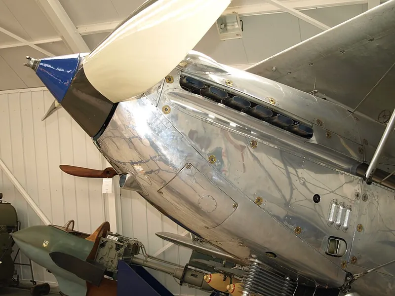

*Picture: [RRKestrelHind.JPG](https://commons.wikimedia.org/wiki/File:RRKestrelHind.JPG) by Nimbus227, Public domain, from Wikimedia Commons.*

A captive stud in a removable panel whose spiral slot (or cross pin) rides over a spring or cam in a receptacle on the frame, so a quarter turn pulls the panel tight and snaps it into a locked position that vibration can't undo.

**In plain words:** A button-headed stud in a removable panel that you turn a quarter of the way round to lock the panel on, and a quarter back to let it go. **Proper term:** Quarter-turn fastener (turnlock fastener, Dzus-type spiral cam fastener).

**Also called:** Dzus fastener / Dzus button (brand, now Southco; the inventor's name is pronounced 'zoose'); turnlock or turn-lock fastener; 1/4-turn fastener / quarter-turn panel fastener; quick-action, quick-opening or quick-access panel fastener; stressed panel fastener (heavy-duty versions that carry structural loads); cowl or cowling fastener (aircraft); spiral cam fastener / spring-and-button fastener; Camloc (brand, cross-pin and cam receptacle type); Airloc (brand, cross-pin type); Dzus Dart (brand, plastic version).

## How it works

The stud is pushed through the panel and frame holes until its tip meets the receptacle. In the Dzus type a wire spring stretches across the hole, and turning the stud makes the spiral slot in its tip act like a cam, drawing the spring up the slot and pulling the panel tight against the frame. At the end of the quarter turn the spring clicks past a bump into a recess, an [over-centre](../glossary.md#over-centre) lock, so vibration tends to push it back into the locked position rather than undo it. In Camloc and Airloc types a cross pin through the stud rides up a cam in the receptacle, compressing a spring to give a set clamping force, then hits a stop and drops into a locking dip ([detent](../glossary.md#detent)). Turning back the other way releases it.

## Parts

A few parts: a stud (a button with a slotted, hex, wing, knob or bail head, and either a spiral slot or a cross pin in its shank); a grommet or retainer that keeps the stud captive in the removable panel; and a receptacle fixed behind the frame (a steel wire spring riveted across a hole for the Dzus type, or a spring-steel or cam-shaped receptacle for Camloc and Airloc types). Options: an ejector spring that pops the stud out when unlocked, and wear washers.

## Everyday examples

- the round buttons holding body panels on race cars and karts
- engine cowlings and inspection panels on light aircraft
- plastic trim and trunk panels in cars, and guards on lawn tractors
- removable side panels on electronics racks, machines and 3D-printer enclosures

## When to use it

For flat panels, covers and access doors that must come off often and quickly, especially on things that vibrate (vehicles, aircraft, machines, printer enclosures). The stud stays in the panel so nothing gets lost, a row of them shares the load, and they don't shake loose the way plain screws can.

## When not to use it

Not for joining round parts end to end (use a bayonet mount or interrupted thread). Not for heavy structural joints unless you buy rated heavy-duty (stressed panel) types; otherwise use bolts. Not where you need an adjustable clamping force or a seal on its own (use screws with a gasket, or draw latches). Where a single panel must open with no tool at all, choose wing or bail heads, a draw latch or a quarter-turn cam latch.

## Details

- **What it does (jobs):**
  - join and hold: holds removable panels, covers, cowlings and access doors onto a frame
  - lock, and release by hand: a quarter turn locks and a quarter turn back releases, with no loose parts to lose
- **Movement:** rotate, a quarter turn (about 90°); the stud also moves a little along its axis as the cam pulls the panel tight
- **Directions it can move (degrees of freedom):** 0 when locked (the panel is clamped to the frame). While fastening, the stud turns and moves a little along its axis, following the cam, so 1 guided movement.
- **Special behaviour:**
  - quick-release (a quarter turn on or off, and the stud stays captive in the panel)
  - over-centre (the spring or cross pin rides over a bump into a recess at the end of the turn and stays there; Wikipedia calls it an over-centre lock)
  - [self-locking](../glossary.md#self-locking) (holds under panel loads and vibration; small disturbances push it back into the locked position instead of loosening it)
  - hand-release only (it only opens when someone turns the stud back the other way)
- **How it holds:** shape (the spring wire or cross pin sits in a recess in the stud's slot or the receptacle's cam; [form-fit](../glossary.md#form-fit--force-fit--material-bond)), with spring force (the spring supplies the clamping force and holds the lock)
- **Input and output:** not applicable
- **Power:** passive (no power needed)
- **Load:** light to medium per fastener, used in rows: Southco's small series is rated at a maximum static load of 440 N (100 lb) each. Strong in [shear](../glossary.md#peel-vs-shear) across the panel and against the panel lifting off; heavy-duty 'stressed panel' versions carry structural loads (FAA). Weak or unreliable if the stud length doesn't suit the panel thickness.
- **Play and precision:** small: the [preload](../glossary.md#preload) pulls the panel tight so it doesn't rattle. Floating receptacles tolerate some [misalignment](../glossary.md#misalignment) between panel and frame holes (FAA); rigid ones need well-aligned holes. It locates the panel only roughly; use pins or dowels if exact positioning matters.
- **Taking it apart:** tool-free quick release: wing, knob and bail heads turn by hand; slotted, recessed or hex heads need a quarter turn with a screwdriver, Dzus key or hex key, but nothing comes loose
- **How often it can be reused:** many times: designed for panels opened often, and Camloc-type springs are made for a high number of cycles (Howmet via HFS Industrial); springs weaken and head slots wear with heavy use (forum reports) ⚑ [uncertain]; Airloc cross pins must be replaced, never reused, once removed from a stud (FAA)
- **Sealing:** none: it only clamps a panel; add a gasket under the panel for dust or water resistance (Southco's stud-length formulas include a compressed gasket in the total material thickness)
- **Adjustable:** no: the clamping force is set by choosing the stud length for the total material thickness; racers sometimes bend Dzus springs with pliers to change the tension ⚑ [uncertain: community practice, forum source]
- **Access needed:** one side only (blind) to open and close; fitting a rivet-on receptacle needs the back of the frame, but press-in and snap-in receptacles can be fitted blind from the front
- **Materials:** Studs and springs of cadmium-plated or stainless steel, aluminium grommets, high-carbon steel receptacles (FAA); plastic versions with acetal receptacles and glass-filled nylon studs (Southco Dzus Dart). Panels: sheet aluminium or steel, fibreglass, polycarbonate, plywood or printed plastic. Printed versions: PETG or tougher.
- **Heat, cold, water and wear:** Plated or stainless steel versions suit vibration, weather and engine-bay heat; they were designed for high-vibration aircraft and helicopter panels. Springs weaken and head slots wear with repeated use, and fibreglass panels wear thin under the heads; a nylon washer under the head helps (forum reports) ⚑ [uncertain]. Printed PETG parts should stay below about 80 °C and PLA softens above about 60 °C (Prusa). Plastic (acetal and nylon) versions have lower temperature and load limits than steel ⚑ [uncertain: no figure found].

## Making it

- **Ways to make or get it:**
  - off-the-shelf part: the usual choice (studs, receptacles and retainers bought as a set in the right length)
  - sheet metal: the panels and frames they usually fasten
  - 3D print (FDM): printed studs and receptacles in PETG or tougher plastics for light panels, enclosures and replacement parts
  - laser cut: acrylic, polycarbonate or plywood panels drilled or cut for the studs
  - CNC: machining the panels and fixing holes
- **Printing it in one piece (print in place):** no: the stud and receptacle are printed separately and the stud is pushed through the panel ⚑ [uncertain: no [print-in-place](../glossary.md#print-in-place) version was found]
- **Tools:** To use: none, or a flat screwdriver, Dzus key or hex key. To fit: a drill (and a file to fit holes), a riveter for rivet-on receptacles and sometimes a grommet or press tool; snap-in, clip-on and press-in receptacles fit without rivets.
- **Difficulty:** easy to fit bought ones (drill holes, rivet or snap in the receptacle, pick the right stud length); moderate to print your own, because the thin cam sections break if printed with the layers the wrong way

### 3D printing tips

Orientation matters most. One maker who reverse-engineered plastic Dzus Dart parts in PETG first printed the receptacles with the cam face upward, and they broke at both ends in use because layer adhesion across the thin section was poor; printing them on their side ran the extrusion lines along the stress and worked much better. Print the stud standing on its head; both parts needed supports (McSail, Printables 1537263). The originals were acetal receptacles and glass-filled nylon studs, so use PETG, PETG-CF, nylon or PC rather than PLA. For a simple printed panel stud, another maker used PETG with 4 [perimeters](../glossary.md#perimeters) and 0.2 mm layers, put the Z seam at the head away from the high-stress end, and drilled 3 mm polycarbonate panels at 9/32 in (about 7.1 mm), then filed the holes oval until the studs just pressed through so they stay captive when the panel is off (John S, Printables 12418). Match the stud length to the total thickness of panel, frame and any gasket, because too short a stud won't lock and too long a stud won't clamp. A steel wire spring across the hole (as in the Dzus type) is far more durable than a printed spring ⚑ [uncertain: design suggestion, not tested]. If you print the springy part, keep it flexing within the layers, not across them, and [fillet](../glossary.md#chamfer--fillet) its root (Hubs).

### Buying one (off-the-shelf parts)

Quarter-turn fastener studs (slotted, oval, flush, wing, hex-recess, knob and bail heads; standard or self-ejecting), receptacles (rivet-on spring, snap-in, clip-on, press-in, weld-on; rigid or floating), retainers and grommets, ejector springs, wear washers, Dzus keys and installation tools. McMaster-Carr sells quarter-turn captive panel screws with rivet-mount, clip-on and press-fit receptacle nuts in steel or acetal. Search terms: 'quarter-turn fastener', 'Dzus button and spring', 'Camloc 4002 receptacle', 'Airloc fastener', 'quarter-turn captive panel screw', 'race car body fasteners'.

## Rules of thumb

- A quarter turn clockwise locks the stud; it can only be unlocked by turning it anticlockwise (FAA Airframe and Powerplant Mechanics General Handbook, via avstop.com, http://avstop.com/ac/apgeneral/turnlockfasteners.html).
- Dzus stud markings give body diameter in sixteenths of an inch and length in hundredths of an inch, measured from the head to the bottom of the spring hole; Airloc studs are stamped with the total material thickness they lock, in thousandths of an inch (same FAA source).
- Never reuse an Airloc cross pin once it has been removed from the stud; fit a new one (same FAA source).
- Choose the stud length from the total material thickness (panel + frame + compressed gasket or gap + washer allowances); each stud length covers a band of only about 1.27 mm (0.05 in) (Southco Dzus Dart D1 catalogue pages, https://media.southco.com/media/static/Literature/D1.en.pdf).
- Southco small-series quarter-turn fasteners are rated at a maximum static load of 440 N (100 lb); add 0.8 mm to the panel thickness when using an ejector spring and 0.5 mm for a wear washer (Southco catalogue pages hosted by Aircraft Spruce, https://www.aircraftspruce.com/catalog/pdf/fastener%20literature.pdf).
- In cross-pin types, a turn of about 90° makes the pin ride up a cam to apply a controlled preload, then reach a positive stop and drop into a locking detent (Howmet Camloc, via HFS Industrial, https://www.hfsindustrial.com/news/post/how-quarter-turn-fasteners-work).

## Common failures

(1) Stud too short for the panel stack, so it barely engages and can break or pop out; measure the total material thickness and pick the right length (karting forum reports of short studs breaking). (2) Weak or bent springs and worn stud slots, so the panel rattles; replace the spring or stud ⚑ [uncertain: forum reports]. (3) [Brittle](../glossary.md#brittle--ductile) or over-hardened heads cracking when struck. (4) Panel holes wearing oval in fibreglass or plastic; add a grommet or wear washer. (5) Misaligned holes stop it engaging; use floating receptacles. (6) Printed parts snapping across thin layers; print with the layers along the stress.

## Safety

On vehicles and aircraft, a stud that isn't fully turned can let a panel come loose and fly off; check every fastener clicks fully into its locked position ⚑ [uncertain: general caution, no incident source opened]. Ejector springs pop the stud out when released. Don't use light-duty panel fasteners to carry structural or safety-critical loads.

## Related

- Bayonet mount (push-and-twist lock): the same short-twist idea, but joining two round parts end to end
- Interrupted-screw lock (breech lock): partial thread for a large, heavily loaded round plug
- Captive panel screw: a screw that stays in the panel but needs several turns
- Quarter-turn cam latch: a knob turns a tongue behind the frame rather than pulling a stud into a spring ⚑ [uncertain: not checked on an opened page]
- Quick-release pin (ball-lock pin): a push-button pin through aligned holes instead of a turning stud
- Draw latch (over-centre latch): pulls a lid or panel tight with a lever, fully tool-free
- Hang-on mounts (keyhole slot): the panel hangs on heads and lifts off, with no locking action

## Make it yourself

- [Quick Release Fastener - Dzus Dart replacement by McSail (Printables 1537263; details read via the Printables public API) (URL from Printables API, page not opened)](https://www.printables.com/model/1537263-quick-release-fastener-dzus-dart-replacement-as-on): Printable copies of a plastic quarter-turn stud, receptacle and retainer (reverse-engineered Dzus Dart parts for lawn tractor guards), printed in PETG, with notes on print orientation *(licence: CC BY-NC)*
- [3030 Quarter Turn Fastener by John S (Printables 12418; URL seen in search results, details read via the Printables public API)](https://www.printables.com/model/12418-3030-quarter-turn-fastener): Printed quarter-turn stud for holding 3 mm polycarbonate panels onto 3030 aluminium extrusion, for a 3D-printer enclosure; PETG, no supports *(licence: CC BY)*
- [Fixing screw for a bajonett fastener by H3dSprint (Printables 354565; details read via the Printables public API) (URL from Printables API, page not opened)](https://www.printables.com/model/354565-fixing-screw-for-a-bajonett-fastener): Printed PETG stud that fits standard Camloc 2600/2700-series receptacles, used to hold a plexiglass window against a rubber seal *(licence: CC BY-NC)*

## Pictures, videos and models

- [Dzus fastener, from US Patent 1955740 (Wikipedia file page)](https://en.wikipedia.org/wiki/File:Dzus_fastener,_from_US_Patent_1955740.png): Patent drawing of the original Dzus fastener: the stud with its spiral slot and the wire spring across the hole *(licence: Public domain in the US (US patent drawing))*
- [RRKestrelHind.JPG (Wikimedia Commons, Nimbus227, 2008)](https://commons.wikimedia.org/wiki/File:RRKestrelHind.JPG): Photo of the engine cowling on a 1930s Hawker Hind biplane with rows of Dzus fasteners *(licence: Public domain (released by the author))*
- [Clever Hardware Design: Quarter-Turn Dzus Fasteners (Core77, Rain Noe, 2022)](https://www.core77.com/posts/112210/Clever-Hardware-Design-Quarter-Turn-Dzus-Fasteners): Photos of different quarter-turn heads (driver, wing, pivoting bail, self-ejecting) and an embedded installation video *(licence: link only)*
- [US1955740 Fastening device (William Dzus, 1934; Google Patents)](https://patents.google.com/patent/US1955740): Full patent drawings and text explaining how the spiral slots act as cams on the wire spring *(licence: link only (US patent drawings are generally public domain))*
- [D1 Dzus Dart quarter-turn fasteners catalogue pages (Southco)](https://media.southco.com/media/static/Literature/D1.en.pdf): Dimensioned drawings of plastic studs, receptacles (rivet-on, snap-in, clip-on) and retainers, with stud-length tables *(licence: link only)*

## Needs confirming

⚑ marks something nobody has confirmed yet: a fact the research could not confirm from a source, a finder value that is a best guess, or an open point from the research notes. Corrections are welcome (see `research/needs-confirming.md`).

- ⚑ 10 sentences on this page marked [uncertain].

## Sources

- <https://en.wikipedia.org/wiki/Dzus_fastener>
- <https://en.wikipedia.org/wiki/File:Dzus_fastener,_from_US_Patent_1955740.png>
- <https://commons.wikimedia.org/wiki/File:RRKestrelHind.JPG>
- <https://patents.google.com/patent/US1955740>
- <http://avstop.com/ac/apgeneral/turnlockfasteners.html (turnlock fastener section of the FAA Airframe and Powerplant Mechanics General Handbook, figures 6-17 to 6-20; appears to be AC 65-9A [uncertain which edition])>
- <https://www.hfsindustrial.com/news/post/how-quarter-turn-fasteners-work>
- <https://www.aircraftspruce.com/catalog/pdf/fastener%20literature.pdf (Southco quarter-turn catalogue pages 269-286)>
- <https://media.southco.com/media/static/Literature/D1.en.pdf>
- <https://media.southco.com/media/static/Literature/81-82-85.en.pdf>
- <https://www.mcmaster.com/products/quarter-turn-fasteners/>
- <https://www.core77.com/posts/112210/Clever-Hardware-Design-Quarter-Turn-Dzus-Fasteners>
- <https://4cycle.com/karting/threads/dzus-fasteners-breaking.21312/>
- <https://www.hubs.com/knowledge-base/how-design-snap-fit-joints-3d-printing/>
- <https://help.prusa3d.com/article/pla_2062>
- <https://help.prusa3d.com/article/petg_2059>
- <https://www.printables.com/model/1537263-quick-release-fastener-dzus-dart-replacement-as-on (read via https://api.printables.com/graphql/)>
- <https://www.printables.com/model/12418-3030-quarter-turn-fastener (read via https://api.printables.com/graphql/)>
- <https://www.printables.com/model/354565-fixing-screw-for-a-bajonett-fastener (read via https://api.printables.com/graphql/)>
- <https://api.printables.com/graphql/>
