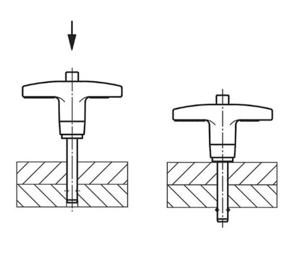

<figure class="eoc-pic eoc-pic-main"><figcaption><strong>Diagram.</strong> <a href="https://commons.wikimedia.org/wiki/File:Kugelsperrbolzen_Funktionsprinzip.tif">Kugelsperrbolzen Funktionsprinzip</a> by HEINRICH KIPP WERK KG Heubergstraße 2 72172 Sulz am Neckar, <a href="https://creativecommons.org/licenses/by-sa/4.0">CC BY-SA 4.0</a>, from Wikimedia Commons.</figcaption></figure>

A pin that slides through lined-up holes in two or more parts and locks itself there with small spring-controlled balls, holding the parts together (and in line) until someone presses the button on its handle and pulls it out, with no tools.

**In plain words:** A metal pin with a button on its handle and two little balls near its tip: push it through lined-up holes and the balls pop out on the far side, so it can't slide back out until you press the button. **Proper term:** Ball lock pin (positive-locking quick-release pin).

**Also called:** quick-release pin (QR pin); ball-lock pin / ball lock pin; push-button quick-release pin; positive-locking pin / positive lock pin; [self-locking](../glossary.md#self-locking) pin (catalogue wording); rapid-release pin (JW Winco catalogue wording); Ball-Lok pin (Avibank (brand)); Kugelsperrbolzen (German); T-handle, L-handle, ring-handle, button-handle or knob-handle quick-release pin (named after the handle); single-acting pin (release by pushing the button) and double-acting pin (release by pushing or pulling the handle); NAS1333-NAS1346 (single-acting) and MIL-P-23460 (double-acting) pins (US aerospace/military standards); quick-release axle (the same idea used as a wheelchair wheel axle); Bimini top pin (name used for marine quick-release pins sold for boat covers); [detent](../glossary.md#detent) pin / ball detent pin (the simpler push-pull cousin: a spring-loaded ball, no button, not positively locked).

## How it works

The shank is hollow and an inner rod (spindle) runs down its middle. A spring holds the rod so that its full-thickness part sits right behind the balls and pushes them out through holes near the tip; in this state the balls can't be pushed back in, so the pin can't be pulled out (positive locking). Pressing the button pushes the rod forward until a groove lines up with the balls, so the balls can drop inwards and the pin slides in or out freely; letting go of the button springs the rod back and pushes the balls out again beyond the far face of the parts (Carr Lane data sheet: 'the center spindle forward to allow the locking balls to retract into a [radial](../glossary.md#axial--radial) groove'). A double-acting version also releases when you pull the handle ('Pulling on the handle releases the balls and removes the pin in one motion', Carr Lane). The simpler detent pin has no button: a spring pushes a ball straight out, it holds only by spring force and friction, and a firm pull pops it out (Pivot Point).

## Parts

A small assembly that acts as one unit: a hollow, precision-ground shank (pin body); two (sometimes four) hardened steel balls sitting in holes near the tip; an inner rod (spindle) with a narrow groove; a spring; a push button; and a handle (T, L, ring, button or knob). Often supplied with a split ring for a lanyard or retaining cable, and sometimes used with a receiving bushing (receptacle).

## Everyday examples

- Wheelchair wheels that come off with a push of the button in the middle of the hub (quick-release axle pins with two balls)
- Gym machines, stage lighting and audio rigging, and pop-up displays, where parts are set up and taken down often (Wixroyd)
- Boat-cover (Bimini top) and deck fittings held by stainless quick-release pins
- Aircraft ground equipment and military vehicle hatches and cargo racks (AFT)

## When to use it

Use a ball lock pin when parts must be joined strongly but taken apart often and quickly by hand: removable hinge pins, swappable robot or rig modules, folding frames and stands, jigs and fixtures that must go back in exactly the same place, adjustable legs with a row of holes, wheels and axles that come off for transport. It is ideal where the load is sideways across the pin ([shear](../glossary.md#peel-vs-shear)) and where the pin must not fall out on its own from vibration.

## When not to use it

Don't use it to hold a pull along the pin (tension): its pull-out strength is a small fraction of its shear strength, so use a bolt, a threaded rod or a rated four-ball lifting pin instead. Don't use it where holes can't be made accurately or don't line up well (use a clamp, a bolt through a slot, or an indexing plunger). For light-duty printed projects a printed snap pin, or a hitch pin and R-clip, is cheaper. For a joint that never comes apart, a bolt or rivet is simpler. For a joint that needs to click into set positions while moving, use an indexing plunger. Avoid it in very dirty places unless it is a sealed design (AFT).

## Details

- **What it does (jobs):**
  - join and hold: pins two or more parts together through lined-up holes
  - lock, and release by hand: it stays locked until the button is pressed, then pulls straight out
  - line parts up exactly: the precision-ground shank also works as a removable locating (alignment) pin
  - let it move (turn, slide or bend): used as a removable hinge or pivot pin, the parts can swing around it
- **Movement:** none: it holds parts still. When used as a removable hinge or clevis pin, the joined parts can rotate around it (rotate)
- **Directions it can move (degrees of freedom):** 1 with a single pin: the parts can still swing around the pin like a hinge. 0 when two pins, or one pin plus a flat stop, are used. Along the pin there is a little end float, because the grip length has to be at least as long as the stack of parts.
- **Special behaviour:**
  - quick-release: press the button and pull; no tools, and it goes back in the same way
  - hand-release only (locks under load, releases when a person operates it): the balls can't retract until the button moves the inner rod, so pulling on the pin or vibration won't free it (Pivot Point: 'the balls cannot retract'); the push-pull detent pin does NOT have this behaviour
- **How it holds:**
  - shape ([form-fit](../glossary.md#form-fit--force-fit--material-bond)): the solid pin fills the holes and carries sideways (shear) loads; the balls, sticking out past the far face, stop it sliding out
  - spring force: a spring holds the inner rod in the locked position; in a plain detent pin the spring pushes the ball directly and the pin is held only by spring force and friction
- **Input and output:** not applicable
- **Power:** passive (no power needed)
- **Load:** Heavy in shear (a force trying to slice across the pin), weak along its length. Carr Lane data: a 1/4 in steel pin carries 4,000 lbf in double shear but only 230 lbf pull-out; a 6 mm pin 17,500 N in double shear but 890 N pull-out (values given with a 2:1 safety factor). Ganter GN 113.5 stainless pins: about 21 kN (6 mm), 38 kN (8 mm) and 60 kN (10 mm) double-shear breaking strength. Twisting around the pin is not resisted (it is round). Use it for sideways loads, not to hold a pull along the pin, except special four-ball lifting pins (Runsom).
- **Play and precision:** Small: the shank is precision ground slightly under its nominal size (for example 4.92-4.96 mm for a 5 mm pin, Fixtureworks; -0.04/-0.08 mm, Ganter) and the hole is nominal to +0.1 mm (Carr Lane) or H11 (Ganter), so there is a few hundredths to under 0.2 mm of sideways play. It returns parts to the same place each time, but tolerates almost no [misalignment](../glossary.md#misalignment): the holes must line up before the pin will go in. Along the pin there is end float if the stack is thinner than the grip length.
- **Taking it apart:** tool-free quick release: press the button and pull it out
- **How often it can be reused:** many times: designed for joints that are taken apart often (sold as a replacement for cotter pins 'where frequent removal is necessary', Teknipart), but springs weaken and balls deform after many cycles (AFT)
- **Sealing:** none: dirt, sand, grease or metal shavings can get into the hollow shank and jam the balls (AFT); sealed designs exist for dirty places
- **Adjustable:** no, as a rule: the grip length is fixed. Adjustable-grip-length pins exist (Avibank, Halder list them), and a row of holes lets you choose between set positions (step adjustment).
- **Access needed:** one side only (blind): the pin is inserted and released from the handle side; you don't need to reach the far side, but there must be open space (or a receptacle with room) beyond the far face for the tip and balls. Avibank sells receptacles for blind applications.
- **Materials:** Shank: heat-treated 4130 alloy steel (zinc or cadmium plated), 17-4PH stainless steel, 303/304 stainless or titanium; balls 440C stainless steel; spring 302 or 17-7PH stainless or music wire; handles anodised aluminium, stainless steel or plastic (polyamide knobs rated to 80 °C, Ganter) (Carr Lane; Fixtureworks; Ganter; Halder). It pins together metal plates, tubes, brackets and clevises, and wood or 3D-printed parts if the holes are accurate and preferably lined with a metal bushing.
- **Heat, cold, water and wear:** Salt water, hydraulic fluid, jet fuel and big temperature swings corrode and degrade pins, so marine-grade stainless steel or titanium are used there (AFT). Sand, grit, grease and swarf in the shank can jam the balls (AFT). Plastic knob handles are rated to about 80 °C (Ganter GN 113.5). Positive-locking pins resist vibration, but an improperly locked pin can work loose under sideways forces (AFT). Printed parts around the pin soften above about 60 °C in PLA (Prusa).

## Making it

- **Ways to make or get it:**
  - off-the-shelf part: the pin is almost always bought
  - CNC or metalwork: drilling and reaming the holes, or machining a bushing (receptacle), for the pin
  - 3D print (FDM): brackets, hinges and modules that a bought pin passes through; also printed look-alike 'quick-release pins' that hold by springy tension instead of balls
  - woodwork: through-holes in wooden parts, ideally lined with a metal bushing (Wixroyd suggests 'locating flanges or bushings' where a part has no suitable hole)
- **Printing it in one piece (print in place):** no: a real ball lock pin needs steel balls, a spring and a precise inner rod, so it is bought. Printed 'quick-release pins' on Printables are one-piece pins that hold by tension (Hellforge Actual's MMS pins) rather than a ball lock.
- **Tools:** None to insert or remove. To fit: a drill and ideally a reamer (or a bought bushing) to make holes of the right size; optionally a lanyard or retaining cable so the pin can't be lost.
- **Difficulty:** easy to fit, hard to make: buy the pin; fitting only needs accurately drilled or reamed holes and a stack thickness that matches the pin's grip length. The ball-and-spindle mechanism itself needs small, precise, hardened parts.

### 3D printing tips

1) Buy the pin and print the parts it goes through. Carr Lane recommends a hole from exactly the nominal size to +0.1 mm (metric) or +0.004 in (inch), for example 6.0-6.1 mm for a 6 mm pin; Ganter specifies H11. FDM prints vertical holes undersized, so Hubs recommends printing the hole undersized and drilling it to size; a hand reamer or a pressed-in metal bushing gives a longer-lasting, accurate hole. 2) Print important holes with their axis vertical: horizontal holes sag at the top unless the bridge is under about 5 mm (Hubs). 3) Design the stack thickness around a pin you can buy. Grip length is measured from under the handle to the top of the locking balls (Fixtureworks), and standard lengths run from about 1/2 to 6 in or 10 to 100 mm, so the combined thickness of your parts must be just under it or the balls stay inside the hole and don't lock. 4) Leave space beyond the far face for the tip and balls to pop out, for example a [counterbore](../glossary.md#counterbore--countersink) or open pocket. 5) Put the pin in double shear where you can (a fork on one part either side of a tongue on the other) and give the printed lugs plenty of [perimeters](../glossary.md#perimeters) around the hole, because the plastic is far weaker than the steel pin. 6) A ball lock pin makes a secure, removable hinge pin for printed parts: Sean Kane's Prusa enclosure-lid hinge remix uses 3/16 in (4.8 mm) marine 'Bimini top' quick-release pins with a 22 mm usable length, because they are 'less likely to work their way out'. 7) If you print a look-alike pin instead, print it lying flat: Hellforge Actual warns 'Printing Vertical Makes Them Weak', and 3DS3 recommends at least 5 walls, at least 50% cubic or gyroid [infill](../glossary.md#infill) and printing flat with build-plate supports; Hubs warns printed pins under 5 mm diameter are all perimeter and weak, so use a metal pin there. 8) Printed parts around the pin [creep](../glossary.md#creep) and soften with heat: PLA deforms above about 60 °C, and PETG suits use below about 80 °C (Prusa). 9) Add an eye or hole for a lanyard so the pin stays with the part.

### Buying one (off-the-shelf parts)

Ball lock pins (quick-release pins) with T-handle, L-handle, ring handle, button handle, domed or mushroom knob; single-acting (push button) and double-acting (push or pull) types; heavy-duty, adjustable-grip-length and four-ball lifting pins; marine stainless and titanium versions (catalogue search terms: 'ball lock pin', 'quick-release pin', 'positive locking pin', 'Kugelsperrbolzen'; e.g. McMaster-Carr 'quick-release pins', Ganter GN 113 series, Carr Lane, Halder, Avibank Ball-Lok (brands)). Detent pins (push-pull, spring-loaded ball). Receptacles, liners and bushings for the mating hole; end caps; lanyards, ball chains and retaining cables (e.g. GN 111 series). Wheelchair quick-release axles. Aerospace-standard pins to NAS1333-NAS1346 (single-acting) and MIL-P-23460 (double-acting).

## Rules of thumb

- Hole size: nominal to nominal +0.004 in for inch pins (1/4 in pin: 0.2500-0.2540 in) and nominal to +0.1 mm for metric pins (6 mm pin: 6.0-6.1 mm) (Carr Lane ball lock pin technical information, Harcourt copy).
- Ganter GN 113.5: location bore H11; the pin itself is 0.04-0.08 mm under nominal (Ganter GN 113.5 data sheet).
- Pull-out strength is only a small fraction of shear strength: a 1/4 in steel pin is rated 4,000 lbf double shear but 230 lbf pull-out; 1/2 in: 16,000 lbf vs 1,160 lbf; values quoted with a 2:1 safety factor (Carr Lane data). Load pins sideways, not along their length.
- Pins with grip lengths over 8 in are not heat treated (to keep them straight), and their double shear strength drops by about 20-50% (Carr Lane strength data page).
- Grip length is measured from the bottom of the handle to the top of the locking balls, and must match the total thickness of the parts being pinned (Fixtureworks catalogue).
- Ganter GN 113.5 stainless pins, double-sided shear breaking strength to DIN 50141: about 14 kN (5 mm), 21 kN (6 mm), 38 kN (8 mm), 60 kN (10 mm), 87 kN (12 mm); Ganter calls these values theoretical and indicative only.
- Choose a positive-locking ball lock pin over a detent pin when the joint sees higher axial loads or significant vibration, or when accidental disengagement is not acceptable (Pivot Point).
- In FDM prints, pins under 5 mm diameter are made only of perimeters and are weak: drill a hole and fit an off-the-shelf pin instead (Hubs FDM design guide).

## Common failures

1) Not fully engaged, giving a false sense of security (AFT): check that the balls are visible past the far face. 2) Debris in the shank jamming the balls (AFT): clean pins that are used often and choose sealed pins in dirty places. 3) Corrosion (AFT): use stainless steel or titanium outdoors and near salt water. 4) Wear and [fatigue](../glossary.md#fatigue): weak or broken springs and deformed balls after many cycles (AFT): inspect and replace. 5) ⚑ [uncertain] Grip length too long or too short for the stack: the balls stay inside the hole, or the joint rattles; measure the stack and choose the grip length to match. 6) Holes too tight (the pin binds) or worn oversize (the joint rattles and the balls can slip back through): size the holes to the maker's [tolerance](../glossary.md#tolerance), and use bushings in soft materials such as plastic or wood. 7) Overloading along the pin's length (pull-out far below shear rating, Carr Lane).

## Safety

A pin that is not fully engaged can look locked when it isn't (AFT): check that the balls have popped out beyond the far face and give it a tug. Don't use an ordinary ball lock pin for lifting or other pulls along its length. Published strengths are breaking strengths or include a safety factor depending on the maker (Carr Lane quotes a 2:1 safety factor; Ganter gives breaking strength and calls it indicative only), so add your own margin. Tie it on with a lanyard so a dropped pin doesn't get lost or become loose debris (AFT). ⚑ [uncertain] Keep fingers out of the gap while lining up holes on heavy parts.

## Related

- Detent pin (ball detent pin): a spring pushes a ball straight out, with no button; it holds by spring force and friction and pulls out with enough force, so it is lighter duty and not positively locked (Pivot Point)
- Snap pin (split-leg push-in pin, rabbit clip): a printable pin whose springy legs hold it in; cheaper but weaker, and pops out under a firm pull
- Tool-free fasteners (hitch pin and R-clip): a plain pin kept in by a separate spring clip; very cheap, but you need both hands and the clip can be lost
- Clevis joint (fork-and-pin joint): the fork-and-tongue joint that a quick-release pin is often used in
- Indexing plunger (pull-knob index pin): a spring-loaded pin fixed to one part that drops into holes to lock set positions; it stays attached and isn't pulled right out
- Ball detent (spring plunger): a spring-loaded ball that gives a click or light hold; the same ball idea but not a pin through holes
- Spring button lock (snap button, push-button tube lock): a spring button that pops through holes in telescoping tubes
- Temporary sheet fastener (Cleco-type spring pin): a spring pin for holding sheets together temporarily before riveting
- Quick couplers for tubes and hoses (sleeve lock): use the same trapped-ball idea, but a sliding sleeve instead of a button locks the balls
- Bayonet mount and quarter-turn fastener: other tool-free locks that twist instead of using a pin through holes
- Locating pins and hole-and-slot: fixed pins for alignment only, with no locking

## Make it yourself

- [Original Prusa Enclosure Lid Hinge for Quick Release Locking Pin (Sean Kane, Printables) (URL from Printables API, page not opened)](https://www.printables.com/model/1253863-original-prusa-enclosure-lid-hinge-for-quick-relea): Printed hinge parts redesigned so a bought 3/16 in (4.8 mm) marine quick-release pin with a 22 mm usable length becomes a removable hinge pin; a practical example of designing printed parts around a ball lock pin *(licence: GNU GPL v3.0)*
- [T-Handle Quick Release Pin (Michael Hathaway, Printables) (URL from Printables API, page not opened)](https://www.printables.com/model/1207840-t-handle-quick-release-pin): A 'working' T-handle quick-release pin model with a STEP file included, useful as CAD reference; ⚑ [uncertain] whether it reproduces the full ball-and-spindle mechanism or prints as a working part *(licence: CC BY-SA)*
- [M8 or 5/16" Quick-Release Pin (3DS3, Printables)](https://www.printables.com/model/919287-m8-or-516-quick-release-pin): A printable stand-in for a stainless quick-release pin (at least 5 walls, at least 50% infill, printed flat with build-plate supports); ⚑ [uncertain] its locking method is not described, and it is not a steel ball lock *(licence: GNU GPL v3.0)*
- [MMS/Picatinny Quick Release Pins (Hellforge Actual, Printables) (URL from Printables API, page not opened)](https://www.printables.com/model/213156-mmspicatinny-quick-release-pins): Printed push pins that are 'held in by tension' and release with a moderate push, from a modular mounting system that began in school robotics competitions; must be printed horizontally. A light-duty printable alternative, not a ball lock *(licence: CC BY-NC)*

## Pictures, videos and models

- [Quick Release Ball Lock Pin. How it works. 3D Printed Cutaway Model / Animation (Jay Gould, YouTube)](https://www.youtube.com/watch?v=GPmNklsSE7w): A 3D-printed cutaway model and animation showing the balls, inner rod and button of a ball lock pin locking and releasing (title and channel verified via YouTube oEmbed) *(licence: link only (standard YouTube licence))*
- [Kugelsperrbolzen Funktionsprinzip (Wikimedia Commons, by Heinrich Kipp Werk KG)](https://commons.wikimedia.org/wiki/File:Kugelsperrbolzen_Funktionsprinzip.tif): Diagram of how a ball lock pin works (German labels), used on the German Wikipedia article 'Kugelsperrbolzen' *(licence: CC BY-SA 4.0)*
- [How Do Ball Lock Pins Work? The Ultimate Guide (Carr Lane Mfg.)](https://www.carrlane.com/engineering-resources/technical-information/manual-workholding/ball-lock-pin-technical-information): Illustrated explanation of single- and double-acting pins, handle styles (ring, T, L), materials and strength tables *(licence: link only)*
- [Halder Ball Lock Pins (Erwin Halder, YouTube)](https://www.youtube.com/watch?v=qLTZiNngk9c): Manufacturer video of ball lock pins being used for quick fastening, locking and adjusting *(licence: link only (standard YouTube licence))*
- [How Quick- Release Detent Pins are made (Pivot Point Incorporated, YouTube)](https://www.youtube.com/watch?v=fgiiHIQu9Sk): How the simpler push-pull detent pin is made and how its spring-loaded ball is kept in the pin, for comparison *(licence: link only (standard YouTube licence))*

## Needs confirming

⚑ marks something nobody has confirmed yet: a fact the research could not confirm from a source, a finder value that is a best guess, or an open point from the research notes. Corrections are welcome (see `research/needs-confirming.md`).

- ⚑ 4 sentences on this page marked [uncertain].
- ⚑ Finder value `mounts_on` = rail, extrusion or grid (best guess): carried over from the finder's old rule on entry names (R33), for "What is it going onto?" under "Hold two things together > Something onto a wall, desk, bar, tripod, rail or grid"

## Sources

- <https://www.harcourt.co/overview_documents/Ball%20Lock%20Pins%20Technical%20Info.pdf>
- <https://www.carrlane.com/engineering-resources/technical-information/manual-workholding/ball-lock-pin-technical-information>
- <https://www.carrlane.com/engineering-resources/technical-information/ball-lock-pins-engineering-application/ball-lock-pin-strength-data>
- <https://www.fixtureworks.com/store/pc/catalogpdfs/Quick_Release_Pins_Fasteners.pdf>
- <https://www.elesa-ganter.com/siteassets/PDF/EN/GN%20113.5.pdf>
- <https://www.pivotpins.com/products/quick-release-pins.html>
- <https://www.avibank.com/products/ball-lok-quick-release-pins/>
- <https://aft.systems/common-problems-with-ball-lok-pins-and-how-to-avoid-them/>
- <https://aft.systems/different-types-of-avibank-ball-lok-pins-in-military-and-aerospace-applications/>
- <https://www.jwwinco.com/en-us/products/3.1-Indexing-locking-blocking-with-pins-and-ball-shaped-elements/Rapid-release-pins>
- <https://www.wixroyd.com/wx/pageid/ball-lock-pins-from-wixroyd>
- <https://www.teknipart.co.uk/tp/pageid/quick-release-pins>
- <https://www.halderusa.com/PM/Standard-Parts/Machine-and-Fixture-Elements/Ball-Lock-Pins>
- <https://www.runsom.com/blog/guide-to-quick-release-pins/>
- <https://livingspinal.com/quick-release-axle-pins-for-wheelchairs/>
- <https://de.wikipedia.org/wiki/Kugelsperrbolzen>
- <https://commons.wikimedia.org/wiki/File:Kugelsperrbolzen_Funktionsprinzip.tif>
- <https://www.hubs.com/knowledge-base/how-design-parts-fdm-3d-printing/>
- <https://help.prusa3d.com/article/pla_2062>
- <https://help.prusa3d.com/article/petg_2059>
- <https://help.prusa3d.com/article/modeling-with-3d-printing-in-mind_164135>
- <https://api.printables.com/graphql/>
- <https://www.youtube.com/oembed?url=https://www.youtube.com/watch?v=GPmNklsSE7w&format=json>
- <https://www.youtube.com/watch?v=GPmNklsSE7w>
- <https://www.youtube.com/watch?v=qLTZiNngk9c>
- <https://www.youtube.com/watch?v=fgiiHIQu9Sk>
