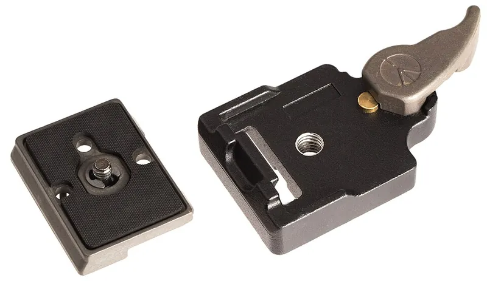

*Picture: [Arca Swiss Profile.svg](https://commons.wikimedia.org/wiki/File:Arca_Swiss_Profile.svg) by Phiarc, [CC BY-SA 4.0](https://creativecommons.org/licenses/by-sa/4.0), from Wikimedia Commons.*

A two-part mount in which a plate or rail with bevelled (dovetail) edges is trapped and squeezed by a matching clamp, so a camera, light, sight or instrument can be locked on in the same position in seconds and released by hand.

**In plain words:** A small plate screwed under a camera (or any gadget) with sloping edges that slides or drops into a matching clamp, where a knob or lever locks it; open the knob or lever and the gadget lifts or slides straight off. **Proper term:** Quick-release plate and dovetail clamp (Arca-Swiss-type quick-release system).

**Also called:** quick-release plate (QR plate), camera plate, tripod plate; Arca-Swiss plate / Arca-type / Arca-compatible plate (named after Arca-Swiss (brand), now a de-facto standard); F38 plate (38 mm-wide Arca-type plate); dovetail plate, dovetail bar, dovetail rail; quick-release clamp, dovetail clamp, grabber plate, receiver (tripod-head side); saddle (telescope-mount side); lever-release clamp / screw-knob clamp; L-bracket and lens plate (lens foot) (Arca-type plates for turning the camera or holding a long lens); RC2 / 200PL drop-in plate (Manfrotto (brand) system); DIN 4503 quick-release plate (square plates with sloping sides used by some tripod makers); Vixen-style (V-series) and Losmandy-style (D-series) telescope dovetail bars (brand-derived standards); Picatinny rail (MIL-STD-1913, also STANAG 4694 'NATO accessory rail'); NATO rail and NATO clamp (camera-rig version); Weaver rail; 11 mm and 3/8 in dovetail (air-rifle and rimfire scope rails); accessory shoe / cold shoe (camera shoe without electrical contacts; ISO 518 size) and hot shoe (with flash contacts).

## How it works

The plate's two long edges are bevelled like a dovetail (45° on Arca-type plates, Wikipedia 'Tripod head'). The clamp has a fixed jaw and a moving jaw with matching sloped faces. Turning the knob (a screw) or flipping the lever pushes the moving jaw in; the sloped faces act like wedges, squeezing the plate sideways and pulling it down onto the clamp's flat base, so it can't lift, slide or wobble. Loosen the jaw and the plate slides out along its length or lifts out; safety stops at the plate's ends catch it if the clamp is only slightly loose ('the plate moves freely within the channel and comes to a stop at the safety pins', Arca-Swiss USA). Drop-in systems such as the RC2 plate have two bevelled edges and are held by a lever that is 'secured once the QPR is in place, by a secondary smaller lever' (Talk Photography forum). Picatinny and Weaver rails reverse the parts: a long bevelled rail with cross slots sits on the gun or rig, the accessory's clamp grips it, and the clamp's locking screw passes through a slot so the accessory can't slide (Wikipedia 'Weaver rail mount'). A cold shoe is the simplest version: a flat foot slides into a channel with inward lips and is held by leaf-spring friction, sometimes plus a clamping screw or sliding clamp (Wikipedia 'Hot shoe'). Wikipedia describes the shoe as 'an angled metal bracket', shaped like an upside-down, squared-off U, and most have leaf springs under its two 'teeth'; a hot shoe is the same bracket with a metal contact in the middle that fires a flash, and its size is set by ISO 518:2006.

## Parts

A few parts: the plate (a bar with bevelled long edges, usually with a camera screw such as a 1/4-20 UNC D-ring screw); the clamp body with one fixed jaw and one moving jaw; a knob screw or cam lever that closes the moving jaw; and often safety stops (screws or pins at the ends of the plate). Drop-in systems add a sprung latch lever and a second safety catch. Rails (Picatinny, NATO, Weaver) are long plates fixed to the gun or rig, with the clamp on the accessory. A cold shoe is just a channel with two inward lips and a leaf spring.

## Everyday examples

- The plate under a camera that clicks or clamps onto a tripod head
- The rail on top of a telescope tube, or under it, that clamps into the mount
- The slotted Picatinny rail on airsoft guns and foam-dart blasters for adding sights, lights and grips (Wikipedia)
- The cold shoe on top of a camera or phone rig for a microphone or small light

## When to use it

Use it when a device must be moved between supports quickly and go back in exactly the same place: cameras between a tripod, slider and gimbal; lights, microphones and monitors on rigs; sensors and cameras on robots or test fixtures; telescopes on mounts; accessories on a rail anywhere along its length. It is a good choice when you want to slide an item along to balance it, and for fixed-orientation mounting that won't twist the way a single screw can.

## When not to use it

Avoid it for permanent structural joints (bolt them). Don't rely on a friction-only screw clamp with no safety stops where knocks or vibration could slide the plate out. Avoid mixing brands with lever clamps. Avoid printed plastic mounts for heavy or expensive equipment, or under constant load for long periods (antonok). For hanging things on a wall, a French cleat or keyhole slot is simpler; for a quick twist-on joint, use a bayonet mount; for tilting and aiming, add a ball head; for positions that repeat to a very high [accuracy](../glossary.md#repeatability--accuracy), use a [kinematic coupling](../glossary.md#kinematic-coupling).

## Details

- **What it does (jobs):**
  - join and hold: mounts a camera, light, sensor, sight or instrument on a support
  - lock, and release by hand: a knob or lever locks and frees it without tools
  - line parts up exactly: the plate goes back in the same place and at the same angle every time
  - let it move (turn, slide or bend): with the clamp loosened, the plate or accessory slides along the rail to balance it or reposition it
- **Movement:** none when locked; with the clamp loosened (but the plate still trapped under the jaws) it can slide along the rail to a new position (slide)
- **Directions it can move (degrees of freedom):** 0 when clamped. 1 when the clamp is loosened but the plate is still captured: it can slide along the rail but not lift or twist.
- **Special behaviour:**
  - quick-release: flick a lever or turn a knob a little and the plate comes out; no tools
  - self-aligning or self-centring: the sloping jaws pull the plate down and against the fixed jaw, so it seats in the same place each time; Picatinny slots are evenly spaced (10.01 mm centres), so accessories go back to the same slot
  - hand-release only (locks under load, releases when a person operates it): pulling on the camera doesn't open the clamp; drop-in systems add a second catch so the main lever can't be flicked open by accident
- **How it holds:**
  - shape ([form-fit](../glossary.md#form-fit--force-fit--material-bond)): the bevelled edges are trapped under the jaws' sloping lips, so the plate can't lift out even if the clamp is a bit loose; safety stops or a bolt in a rail cross-slot stop it sliding out
  - friction or clamping (force-fit): the jaws squeeze the plate so it can't slide or rock; along the rail, a screw clamp without stops holds by friction only
  - spring force: cold-shoe leaf springs, and the sprung latch levers of drop-in clamps
- **Input and output:** not applicable
- **Power:** passive (no power needed)
- **Load:** Light to medium, depending on size: cameras, lenses, lights, sights, sensors and telescopes. Strong against lifting off and twisting (the jaws trap the plate); sliding along the rail is resisted only by clamp friction plus any stops or cross-slot bolts. Wider bars carry more: telescope Losmandy-style D bars are about 3 in wide for heavier scopes, while Vixen-style V bars are about 44 mm wide (Farpoint Astro). Printed cold-shoe feet are very weak ('very light duty even when printed 100% [infill](../glossary.md#infill)', burtworks). A printed PETG Arca clamp holds consumer cameras such as a Sony A6400 and Canon 700D without failure for years (Ag.3).
- **Play and precision:** None when clamped: the wedge action takes up all play, and safety stops or a lip give a repeatable end position. How much variation it tolerates depends on the clamp: screw-knob clamps can take up small width differences, while lever-release clamps have 'much lower [tolerances](../glossary.md#tolerance)' and are 'only guaranteed to be compatible with plates from the same brand' (Wikipedia 'Tripod head'; Ulanzi). Weaver-rail accessories fit Picatinny rails but not always the other way round (Wikipedia 'Picatinny rail').
- **Taking it apart:** tool-free quick release: the clamp opens by hand; the plate itself stays screwed to the camera or device (with a D-ring screw, coin or hex key)
- **How often it can be reused:** many times: made for constant on and off use; metal plates and clamps last years, but printed jaws, knob threads and cold-shoe springs wear, and printed compliant clamps can sag
- **Sealing:** none
- **Adjustable:** yes: loosen the clamp and slide the plate along it to balance a camera and lens or reposition an accessory (long plates and rails). Picatinny accessories move in 10.01 mm slot steps (Wikipedia). Screw-knob clamps also adjust to small differences in plate width (Wikipedia 'Tripod head').
- **Access needed:** one side only (blind): the plate slides in from the end or drops in from above, and the knob or lever is on the side of the clamp; the plate's own screw needs access to the underside of the camera
- **Materials:** Plates and clamps: machined aluminium, with 1/4-20 hex screws for Arca-type plates (Wikipedia 'Tripod head'); often a rubber or cork pad on top to grip the camera. Rails: aluminium, steel or both (Wikipedia 'Picatinny rail'). Cold shoes: metal or plastic. DIY versions: PETG or PLA prints (Ag.3; nmattia; Catja), or milled aluminium.
- **Heat, cold, water and wear:** PLA softens above about 60 °C and degrades under UV light, and PETG is suitable to about 80 °C (Prusa), so printed camera mounts shouldn't be left in hot cars or strong sun. Printed compliant clamps can sag over time under load (antonok). Cold shoes rely on leaf-spring friction (Wikipedia 'Hot shoe'), so they can loosen as the springs wear. ⚑ [uncertain] Sand and grit on the dovetail faces stop the plate seating fully; wipe the faces before clamping.

## Making it

- **Ways to make or get it:**
  - 3D print (FDM): Arca-type plates, clamps, adapters, Picatinny rails and clamps, cold-shoe mounts
  - CNC: machined aluminium plates, clamps and rails
  - off-the-shelf part: plates, clamps, L-brackets, rails, NATO clamps, cold-shoe adapters and camera screws
- **Printing it in one piece (print in place):** partly: a plate prints in one piece (with a bought or printed camera screw), and there is a [print-in-place](../glossary.md#print-in-place) quick-release Picatinny mount (FileForge) and a one-piece compliant Arca clamp that uses springy plastic instead of a screw (antonok), but most printed clamps need a bolt, nut and spring (Ag.3)
- **Tools:** None to clamp or release. A coin, hex key or D-ring screw to fix the plate to the camera. DIY printed clamps need a few bolts and nuts: the Strong Arca Swiss Clamp uses one M6x80 hex bolt, one M6 nut, two 3.5x50 wood screws cut to length and a pen spring, plus a file and a saw.
- **Difficulty:** moderate: a plate is easy to print (its 45° edges print without supports) or to mill, but it must closely match commercial clamps; a clamp needs stiff jaws and a screw or cam. For heavy or expensive gear, buy metal clamps.

### 3D printing tips

1) Plates: nmattia prints the Arca plate upside down (as supplied) with no supports and says the settings are 'not very important'; a printed camera screw needs 0.2 mm layers or smaller, 100% infill, printed flat. 2) Bevels: 45° faces print without supports, because FDM can usually print [overhangs](../glossary.md#overhang--bridging) up to 45° (Hubs). 3) Clamps: orient the jaws so their [layer lines](../glossary.md#layer-lines) run across the clamping stress, so tightening doesn't pull the layers apart; Ag.3's Strong Arca Swiss Clamp uses PETG, 0.2 mm layers, 8 [perimeters](../glossary.md#perimeters), 50% infill, no supports, a washer to spread the knob's load across the moving jaw, and two mounting bolts that also hold the body together if it delaminates. 4) Compliant (screwless) clamps: antonok's one-piece PETG clamp is printed 'as a single extrusion' so 'all spring forces are applied orthogonally to the layer lines'; the spring sizes suit a 0.6 mm nozzle and PETG and need retuning for other nozzles or materials, and it shouldn't be left engaged long term because the plastic can sag. 5) Other plate standards: Catja's Velbon plate (square, 42x42 mm base with a 30° slope, described as DIN 4503) prints without supports and is best in PETG with extra perimeters. 6) Picatinny rails: use a parametric model (e.g. Bike Cyclist's OpenSCAD rail and clamp) and keep the standard slot size (5.23 mm wide, 10.01 mm centres, 3.00 mm deep, Wikipedia); that model [chamfers](../glossary.md#chamfer--fillet) the slot edges 'to avoid unprintably thin corners'. 7) Cold shoes: the foot is only about 2 mm thick (ISO 518), so printed feet snap easily: burtworks calls theirs 'very light duty even when printed 100% infill' and prints spares; K2_Kevin uses 0.16-0.2 mm layers, 4 perimeters, 50% infill and a captive 1/4-20 nut rather than a printed thread. 8) Test-fit printed plates in the actual clamp: screw-knob clamps forgive small width errors, while lever clamps may not. 9) Add safety stops (screw heads or bumps at both ends) so a loose clamp can't drop the plate. 10) Heat: PLA softens above about 60 °C (Prusa), so a PLA camera mount in a hot car can [creep](../glossary.md#creep); PETG is suitable to about 80 °C.

### Buying one (off-the-shelf parts)

Arca-type quick-release plates (universal plates, lens plates, L-brackets), Arca-type clamps (screw-knob, lever-release, dual-channel), and Arca-type plate-and-clamp sets for phones and action cameras; drop-in plate systems (e.g. Manfrotto RC2 / 200PL (brand)); DIN 4503 plates; telescope dovetail bars and saddles (Vixen-style V, about 44 mm; Losmandy-style D, about 3 in); Picatinny/Weaver rails and rail clamps; NATO rails and NATO clamps for camera cages; cold-shoe mounts, cold-shoe to 1/4-20 adapters, hot-shoe covers; camera screws in 1/4-20 UNC and 3/8-16 UNC (D-ring screws) and 3/8-16 to 1/4-20 reducing bushings.

## Rules of thumb

- Arca-type plates are 38 mm wide with a 45° dovetail on each side (Wikipedia 'Tripod head'; Ulanzi gives 38.1 mm). Arca-Swiss also makes a 26 mm system for monoballFix plates and view-camera monorails (Arca-Swiss USA).
- Lever-release clamps have much tighter tolerances than screw clamps and are only guaranteed with same-brand plates (Wikipedia 'Tripod head'), so use screw-knob clamps for mixed or home-made plates (Ulanzi).
- Stop plates rotating and falling out: use plates with a lip or flange, two screws on lens feet, and small stops on the plate that run in grooves on the clamp (Wikipedia 'Tripod head').
- Camera threads: 1/4-20 UNC on most consumer cameras, and 3/8-16 UNC on larger professional gear, which often takes a removable 1/4-20 adapter (ISO 1222, via Wikipedia 'Tripod (photography)'). Arca-type plates fix to the camera with 1/4-20 screws; tripod heads usually sit on a 3/8-16 screw.
- Picatinny (MIL-STD-1913) slot: 0.206 in (5.23 mm) wide, centres 0.394 in (10.01 mm) apart, 0.118 in (3.00 mm) deep (Wikipedia 'Picatinny rail'). Weaver slots are 0.180 in (4.57 mm) wide with inconsistent spacing, so Weaver accessories fit Picatinny rails but not always the reverse (Wikipedia 'Weaver rail mount').
- Camera accessory shoe (ISO 518:2006): the channel is 18.6 mm (+0.2/-0) wide and 2 mm (+0.15/-0) high inside, with 12.5 mm (+0.4/-0) between the two lips (Wikipedia 'Hot shoe').
- Telescope dovetails: Vixen-style (V) about 44 mm wide, Losmandy-style (D) about 3 in wide; the two are not interchangeable (Farpoint Astro).
- FDM overhangs up to about 45° print without supports, so 45° dovetails print cleanly (Hubs).
- ⚑ [uncertain] DIN 4503 square plates: 42x42 mm (nominally 44x44 mm) base with a 30° slope, according to one maker's measurements (Catja, Printables model 360003); not checked against the standard itself.

## Common failures

1) Plate from one brand not seating in another brand's lever clamp, only touching on its edges (Ulanzi; Wikipedia): use a screw-knob clamp or matched parts. 2) Plate twisting on its single camera screw: use a plate with an anti-twist lip or flange, or two screws (Wikipedia). 3) Clamp loosening and the plate sliding out: fit safety stops (Wikipedia; Arca-Swiss USA). 4) Printed clamp jaws cracking or splitting along layer lines: print with the layers across the stress and use a washer to spread the load (Ag.3), and replace any cracked part. 5) Printed cold-shoe feet snapping (burtworks): print spares, use PETG, or use a metal shoe. 6) Printed compliant clamps sagging over time (antonok). 7) Weaver-sized accessories being loose, or Picatinny ones not fitting, on the other rail type (Wikipedia). 8) ⚑ [uncertain] Knob clamps working loose under vibration: check tension and use stops.

## Safety

The main hazard is expensive gear falling: seat the plate fully, tighten the clamp, and give it a tug before letting go. A mismatched plate can 'touch in a way that seems secure for a moment' without being properly clamped (Ulanzi). Keep safety stops fitted (Wikipedia 'Tripod head'; Arca-Swiss USA). Antonok advises against trusting a plastic mount with 'your heaviest, most expensive camera'. ⚑ [uncertain] Lever clamps can pinch fingers as they snap shut.

## Related

- Dovetail slide with gib strip (dovetail ways): the same bevelled shape used to guide a sliding machine part, adjusted by a tapered strip instead of clamped quickly
- Sliding dovetail (woodworking): the same shape as a permanent or knock-down wood joint
- Hang-on mounts (keyhole slot, French cleat): also bevel-hooked, but held by gravity instead of a clamp
- Eccentric cam lever (cam clamp): the lever mechanism inside many lever-release clamps
- Aluminium-extrusion connectors (T-slot nuts and brackets): accessories clamp anywhere along a profiled rail, but with tools
- Bayonet mount (push-and-twist lock): tool-free and repeatable too, but twist-on rather than slide-in (e.g. camera lenses)
- Kinematic coupling (balls in V-grooves): repeats position far more exactly, for precision instruments
- DIN-rail clip (top-hat rail snap mount): snaps modules onto a standard rail without a clamp
- Magnet joint (embedded magnets, magnetic catch): even quicker for light items, but weaker and less positive
- Modular grid mounting systems (pegboard, Gridfinity-style grids): many fixed positions instead of one sliding rail
- Tripod and stand screw mount: the single 1/4-20 or 3/8-16 camera screw that fixes a plate to the camera, and the plain alternative when quick swapping isn't needed
- Clamp-on accessory mount for bars, poles and edges: for fixing a plate, clamp or shoe to a bar, pole, desk edge or camera-rig rod (15 mm rod clamps) rather than to a threaded hole

## Make it yourself

- [Strong Arca Swiss Clamp (Ag.3, Printables)](https://www.printables.com/model/251614-strong-arca-swiss-clamp): A printed Arca-type screw clamp (PETG, 8 perimeters) using an M6 bolt, nut and pen spring, designed with layer lines across the clamping stress; takes Peak Design and other Arca-style plates *(licence: CC BY-NC)*
- [Arca-Swiss Quick Release plate (with screw) (nmattia, Printables)](https://www.printables.com/model/654666-arca-swiss-quick-release-plate-with-screw): A printable Arca-type plate that takes a 1/4-20 screw, or a printed screw (100% infill) *(licence: CC BY-NC)*
- [Compliant Arca-Swiss quick-release clamp (antonok, Printables) (URL from Printables API, page not opened)](https://www.printables.com/model/1258735-compliant-arca-swiss-quick-release-clamp): A one-piece screwless Arca clamp that grips with a springy printed flexure ('hook and pull'); FreeCAD source included *(licence: Creative Commons Public Domain (as labelled on Printables))*
- [Parametric NATO/Picatinny Rail and Clamp (Bike Cyclist, Printables) (URL from Printables API, page not opened)](https://www.printables.com/model/53215-parametric-natopicatinny-rail-and-clamp): OpenSCAD generator for Picatinny/NATO rails with any number of slots, plus a matching female clamp (Weaver-compatible) *(licence: CC BY-NC)*
- [Quick release Picatinny rail mount (Print-In-Place) (FileForge, Printables) (URL from Printables API, page not opened)](https://www.printables.com/model/465579-quick-release-picatinny-rail-mount-print-in-place): A quick-release rail clamp that prints fully assembled, with no extra parts *(licence: CC BY-SA)*
- [Tripod Mounts: Cold Shoe and Ram Ball Mounts with 1/4 20 Thread (K2_Kevin, Printables) (URL from Printables API, page not opened)](https://www.printables.com/model/228915-tripod-mounts-cold-shoe-and-ram-ball-mounts-with-1): Printable cold-shoe mounts with a printed thread or a captive 1/4-20 nut, plus a blank base for your own accessory mounts *(licence: CC BY-SA)*

## Pictures, videos and models

- [Arca Swiss Profile (Wikimedia Commons, by Phiarc)](https://commons.wikimedia.org/wiki/File:Arca_Swiss_Profile.svg): Cross-section drawing of the de-facto standard Arca-Swiss quick-release plate profile (made in FreeCAD), used in the Wikipedia 'Tripod head' article *(licence: CC BY-SA 4.0)*
- [Picatinny rail (Wikipedia)](https://en.wikipedia.org/wiki/Picatinny_rail): Dimensioned cross-section and side-view drawings of the MIL-STD-1913 rail, with its recoil grooves *(licence: text CC BY-SA 4.0; check each image's own licence on Commons)*
- [Hot shoe (Wikipedia)](https://en.wikipedia.org/wiki/Hot_shoe): Photos of camera hot shoes and an older cold shoe (Minolta SRT101), with the ISO 518 dimensions *(licence: text CC BY-SA 4.0; check each image's own licence on Commons)*
- [The Arca-Swiss quick release mounting system. (Wimberley Inc, YouTube)](https://www.youtube.com/watch?v=9G27wH-xhRg): A maker of tripod heads demonstrating Arca-Swiss plates and clamps and their advantages *(licence: link only (standard YouTube licence))*
- [Arca Swiss - What is it? Plus Quirks, Pros, and Cons (Marcus Hutsell, YouTube)](https://www.youtube.com/watch?v=4ESNT3DTDMs): Explanation of the Arca-Swiss standard, compatibility quirks, and the pros and cons of lever and knob clamps *(licence: link only (standard YouTube licence))*

## Needs confirming

⚑ marks something nobody has confirmed yet: a fact the research could not confirm from a source, a finder value that is a best guess, or an open point from the research notes. Corrections are welcome (see `research/needs-confirming.md`).

- ⚑ 4 sentences on this page marked [uncertain].

## Sources

- <https://en.wikipedia.org/wiki/Tripod_head>
- <https://en.wikipedia.org/wiki/Tripod_(photography)>
- <https://en.wikipedia.org/wiki/Dovetail_rail>
- <https://en.wikipedia.org/wiki/Picatinny_rail>
- <https://en.wikipedia.org/wiki/Weaver_rail_mount>
- <https://en.wikipedia.org/wiki/Hot_shoe>
- <https://commons.wikimedia.org/wiki/File:Arca_Swiss_Profile.svg>
- <https://arca-swiss-usa.com/pages/quick-release>
- <https://www.ulanzi.com/blogs/knowledges/arca-swiss-compatibility-f38-plates>
- <https://www.talkphotography.co.uk/threads/quick-release-plate-confusion.709757/>
- <https://farpointastro.com/pages/telescope-dovetails>
- <https://www.hubs.com/knowledge-base/how-design-parts-fdm-3d-printing/>
- <https://help.prusa3d.com/article/pla_2062>
- <https://help.prusa3d.com/article/petg_2059>
- <https://api.printables.com/graphql/>
- <https://www.youtube.com/oembed?url=https://www.youtube.com/watch?v=9G27wH-xhRg&format=json>
- <https://www.youtube.com/oembed?url=https://www.youtube.com/watch?v=4ESNT3DTDMs&format=json>
