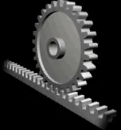

*Picture: [Rack and pinion animation.gif](https://commons.wikimedia.org/wiki/File:Rack_and_pinion_animation.gif) by OSHA Directorate of Technical Support and Emergency Management, Public domain, from Wikimedia Commons.*

A round gear (the pinion) meshes with a straight toothed bar (the rack), so every turn of the pinion moves the rack by the distance round the pinion's [pitch](../glossary.md#pitch) circle, turning rotation into straight-line motion or straight-line motion back into rotation.

**In plain words:** A gear wheel that meshes with a straight bar of teeth: turning the wheel slides the bar along (or makes the wheel roll along a fixed bar), and pushing the bar turns the wheel. **Proper term:** Rack and pinion (gear rack and pinion).

**Also called:** gear rack / toothed rack / linear gear; rack drive / rack-and-pinion drive; rack and pinion steering (cars); rack railway / cog railway (a train's cog wheel climbs a toothed rail laid between the rails); helical rack (slanted teeth, meshes with a helical pinion); round rack (teeth cut round a round bar); arcuate rack / gear sector (a curved rack, really a slice of a large gear); double rack and pinion (one pinion between two racks, as in pneumatic valve [actuators](../glossary.md#actuator)); [stroke](../glossary.md#stroke) doubler (pinion running between a fixed rack and a moving rack); CP rack (circular pitch rack, sized so travel per turn is a round number); linear servo (a hobby servo turning a pinion on a rack); Zahnstangengetriebe (German).

## How it works

The pinion's teeth mesh with the rack's teeth just like two gears, except that the rack behaves like a gear with an infinitely large radius, so its teeth have straight (flat) sides while the pinion's are curved (involute) (KHK; Wikipedia). Each turn of the pinion moves the rack by the length of the pinion's pitch circle: travel per turn = pi x pitch diameter = pi x module x number of teeth (Gear Solutions). Either part can be the fixed one: a fixed pinion shaft slides the rack (car steering, drill-press feed), while a fixed rack lets a motor-driven pinion drive itself along it (sliding gates, CNC gantries, rack railways). The rolling teeth waste little energy, so it also works backwards: pushing the rack turns the pinion (it is back-drivable).

## Parts

A few parts: the pinion (a spur or helical gear) on a shaft with bearings, the rack (a straight bar of teeth, which can be several bars joined end to end), a guide that keeps the rack or the moving carriage straight and at the right distance from the pinion (a slot, rails or rollers), and a knob, handle or motor that turns the pinion.

## Everyday examples

- Car steering: turning the steering wheel spins a pinion that slides the steering rack left and right (Wikipedia)
- A drill press or arbor press: the feed handle turns a pinion that lowers the quill (Wikipedia)
- A sliding electric gate: the motor's pinion runs along a toothed rack fixed to the gate (Wikipedia)
- Mountain rack railways such as the Pilatus Railway, which climbs 48% slopes with cog wheels on a rack between the rails (Wikipedia)

## When to use it

Use it when you need fast, efficient straight-line motion from a turning shaft (or the reverse), especially over long distances: gantries and long axes, sliding doors and gates, lifting slides that are held by a motor or brake, steering, feed handles, camera and telescope focusers, and model demonstrators. It is simple, stiff along the travel, can be any length (racks join end to end), and its travel per turn is easy to calculate. Two racks on one pinion make a neat way to move two parts equally in opposite directions.

## When not to use it

Avoid it when the load must stay put with the power off or the handle released, because it back-drives: use a lead screw with a fine lead or a worm drive, or add a brake. Avoid it for very fine, backlash-free positioning on a budget: a lead screw with an anti-backlash nut or a ball screw is easier to make precise. Don't use it where the frame cannot hold the pinion firmly against the rack (the teeth will skip); a timing belt is often simpler for light, long, fast moves. For extensions with several stages, robot builders prefer belt- or cable-driven slides, because a rack and pinion is essentially single-stage (gm0).

## Details

- **What it does (jobs):**
  - change the kind of motion: rotation into straight-line motion, or straight-line motion into rotation
  - change speed or turning force: a small pinion gives a strong push but little travel per turn; a large pinion gives fast travel but less push
  - let it move (turn, slide or bend): it drives and positions a slide or carriage along a straight path of almost any length
- **Movement:** rotate+slide: the pinion turns and the rack slides in a straight line; travel is limited only by the rack's length, and racks can be joined end to end (industrial systems can be longer than 200 ft, per linearmotiontips)
- **Directions it can move (degrees of freedom):** 1: the rack's position is tied to the pinion's angle, so there is one independent motion; the guide has to stop every other movement
- **Special behaviour:**
  - motion conversion (e.g. rotary to linear): the pinion's rotation becomes straight-line travel of the rack, and pushing the rack turns the pinion
  - self-aligning or self-centring (double-rack version only): one pinion between two opposite racks drives them equal distances in opposite directions (Wikipedia), so two jaws, doors or arms stay centred as they open and close
  - none of the holding behaviours: it is not [self-locking](../glossary.md#self-locking), so a load on the rack can drive it backwards
- **How it holds:**
  - not a holding joint (it moves or passes on motion): it passes on motion and does not hold a position by itself
  - shape (the parts interlock; [form-fit](../glossary.md#form-fit--force-fit--material-bond)): the meshing teeth interlock, so the rack can only move if the pinion turns
- **Input and output:** Rotation -> straight-line motion (or the reverse). Travel per pinion turn = pi x pitch diameter = pi x module x teeth; e.g. module 2.5 with 20 teeth has a 50 mm pitch diameter and moves 157.08 mm per turn, while a CP10 (10 mm circular pitch) 20-tooth pinion moves exactly 200 mm per turn (Gear Solutions). Push on the rack = pinion [torque](../glossary.md#torque) / pitch radius (the smaller the pinion, the stronger the push). Efficiency: high, like other spur and helical gears: KHK lists 98.0-99.5% for parallel-axis gears, Machine Design quotes up to 98.5% for industrial rack sets, and HUANGYAN920's rack-and-pinion page gives 90-97%. Shaft arrangement: the pinion's shaft is square (at 90 degrees) to the rack's travel and set at a fixed mounting distance = height of the rack's pitch line + pinion pitch radius (KHK). Back-drivable: yes: it works in both directions (Wikipedia contrasts this with a worm drive, which is usually one-way), so a vertical or sloping load will run down by itself unless something holds it.
- **Power:** passive (no power needed); turned by hand (knob, [crank](../glossary.md#crank), feed handle) or by a motor. If a motor loses power the rack and pinion does not hold: a vertical or sloping load can run down unless there is a brake, a self-locking stage (such as a worm gearbox) or a counterweight
- **Load:** Light to heavy depending on size and material: steel industrial racks drive heavy machine gantries, and rack railways climb slopes of up to 48% (Pilatus Railway, Wikipedia), while printed and small plastic racks are light duty. Strong along the rack (push and pull go straight through the teeth). Weak against anything that pushes the pinion away from the rack: the sloping tooth faces create a separating force, and helical racks also push sideways by up to one third of the drive force (linearmotiontips), so a flimsy mount lets the teeth jump out of mesh (gm0 warns that poor support causes mesh failure, and that the Tetrix kit rack fails under medium to high stress). Long unsupported racks also bend.
- **Play and precision:** Small to noticeable [backlash](../glossary.md#backlash): there is always a gap between the teeth, so a little travel is lost whenever the direction reverses (Gear Solutions), and KHK says never to run at zero backlash. [Accuracy](../glossary.md#repeatability--accuracy) depends mainly on the pitch error of the teeth and on keeping the mounting distance constant along the whole rack (linearmotiontips; KHK); high-grade ground racks reach a cumulative pitch error of +/-12 micrometres over 500 mm, and two preloaded pinions working against each other can cancel backlash (Machine Design). Printed racks have noticeably more play. It tolerates little [misalignment](../glossary.md#misalignment): precision drives need the rack aligned within about 25 micrometres (Machine Design), and a rack that is not parallel to its guide gives backlash that changes along the travel, or binds.
- **Taking it apart:** removable: the rack is screwed (and often dowel-pinned) to its base and the pinion comes off its shaft or is moved out of mesh, so either can be replaced on its own
- **How often it can be reused:** many times: it can be taken apart and re-meshed repeatedly; the limit is tooth wear, and the mounting distance (and so the backlash) must be set again after each reassembly
- **Sealing:** none: the teeth are open to the air and dirt; nothing about the mesh seals
- **Adjustable:** yes: the rack can be stopped anywhere along its travel by turning the pinion; the backlash (gap between teeth) is adjusted by moving the pinion shaft or motor closer to or further from the rack (KHK); special tapered racks and pinions adjust it by sliding the pinion along its shaft (1 mm of [axial](../glossary.md#axial--radial) movement changes the backlash by 0.05 mm on KHK's tapered sets)
- **Access needed:** not applicable: the rack is screwed down along its length and the pinion sits on a shaft in a frame, reached wherever the frame opens
- **Materials:** Racks: steel (cut, or induction-hardened and ground for precision), stainless steel, brass and plastics; McMaster-Carr lists brass, plastic, stainless steel and steel racks in modules 0.5-2.5 (diametral pitch 6-64) with 14.5 or 20 degree pressure angles. Self-lubricating plastic racks and 3D-printing materials such as iglidur (igus, brand) need no grease and resist wear. Pinions: steel, brass or plastic. Printed gears: EngineerDog ranks nylon > PLA > ABS > PETG for hobby FDM gears (nylon wears best but absorbs moisture; PLA is stiff but heat-limited).
- **Heat, cold, water and wear:** Printed PLA parts soften above about 60 C and degrade in UV light, so keep them out of hot cars and sunlight; PETG copes to about 80 C (Prusa). Metal teeth need lubricating (KHK's start-up checklist asks whether proper [lubrication](../glossary.md#lubrication) has been supplied), while self-lubricating plastic racks such as iglidur run dry (igus). Vibration can shift racks unless they are dowel-pinned (KHK). ⚑ [uncertain] Open teeth collect dust and grit, which speeds up wear, and plastic racks under a constant load may [creep](../glossary.md#creep) over time.

## Making it

- **Ways to make or get it:**
  - off-the-shelf part: metal and plastic spur or helical gear racks with matching pinions, bought by module (metric) or diametral pitch (inch)
  - 3D print (FDM): racks and pinions for models, light-duty slides, focusers, linear servo actuators and [print-in-place](../glossary.md#print-in-place) demonstrators
  - 3D print (SLS powder): igus prints racks and pinions from wear-resistant iglidur powder
  - CNC: industrial racks are cut by hobbing (Wikipedia) or milling, and precision racks are ground
- **Printing it in one piece (print in place):** yes: print-in-place rack and pinion demonstrators exist, e.g. SilentYetiDesigns' print-in-place rack-and-pinion box lid (twist the gear once after printing to break it free); most printed racks and pinions are printed as separate parts and assembled on a shaft and guide
- **Tools:** Hex keys or spanners for the rack screws and the pinion's [set screw](../glossary.md#set-screw) or clamp; a drill and dowel pins to lock racks in place (KHK drills rack and base together); a short spare rack used as a joining gauge when butting racks end to end (KHK); grease for metal teeth (self-lubricating plastic racks such as iglidur run dry)
- **Difficulty:** easy: racks and pinions print flat without supports and free tools (e.g. BOSL2's rack()) draw correct teeth; the harder part is a straight, rigid guide that holds the pinion at the right distance all along the rack

### 3D printing tips

1) Orientation: print the rack lying on its side so the tooth outline is traced by continuous [perimeters](../glossary.md#perimeters), and print the pinion flat with its axle vertical; Jan-E.de printed both 'on the side to have the teeth as perimeters' in PLA at 0.2 mm layers with no supports. 2) Get the tooth shape right: rack teeth have straight sides (a rack is a gear of infinite radius, KHK). Jan-E.de's first rack copied curved pinion teeth onto a straight bar and had to be redrawn, so use a generator: BOSL2's rack() meshes with any gear of the same pitch (or module) and pressure angle, and a helical rack needs a pinion of the opposite hand. 3) Add [clearance](../glossary.md#clearance): BOSL2's backlash setting thins the teeth (it recommends putting the backlash on the larger part if the pinion is very small, to avoid weakening its teeth), or move the pinion slightly further from the rack. Jan-E.de used 0.1 mm clearance between rack and pinion teeth and for the slide and shaft hole, with 0.2 mm versions for looser printers. 4) Make teeth chunky: EngineerDog suggests a 25 degree pressure angle for printed gears, at least 13 teeth at 20 degrees or 9 at 25 degrees on the pinion, a face width of 3-5 x the circular pitch, and backing walls over the tooth faces; tiny teeth often print with gaps inside even at 100% [infill](../glossary.md#infill). 5) Material: nylon wears best, PLA is stiff but softens above about 60 C, PETG copes to about 80 C (Prusa); grease helps loaded plastic gears (EngineerDog). 6) Build a stiff guide: the main failure is the pinion being pushed away so the teeth skip (gm0), so hold the rack in a slot or on rollers directly behind the mesh. 7) Long racks: print in sections and join them using a short rack meshed across the joint as a gauge; make the joint pitch slightly short rather than long, as KHK advises for metal racks, because a long joint pitch binds. 8) For a quick demonstrator, try a print-in-place model first, then move to separate parts with a proper guide.

### Buying one (off-the-shelf parts)

Metal spur gear racks, plastic spur gear racks and helical gear racks with matching spur and helical gears (McMaster-Carr categories; also round racks); precision CP (circular pitch) racks and pinions, ground racks, and tapered racks and pinions with adjustable backlash (KHK (brand)); self-lubricating plastic racks and gears (igus iglidur (brand)); rack-and-pinion steering racks; double-rack pneumatic rack-and-pinion rotary actuators for pipeline valves (Wikipedia); sliding-gate opener racks and motors; Tetrix (brand) rack and pinion kits for FTC robotics (gm0).

## Rules of thumb

- Travel per pinion turn = pi x pitch diameter = pi x module x teeth. Module 2.5 with 20 teeth: 157.08 mm per turn, 5.73 turns for 900 mm; CP10 with 20 teeth: exactly 200 mm per turn (Gear Solutions, Brian Dengel, 2018).
- Mounting distance = height of the rack's pitch line + pitch radius of the pinion; keep it constant along the whole rack (KHK CP racks and pinions catalogue). Example: a module 2.5, 20-tooth pinion sits with its centre 25 mm above the rack's pitch line (Gear Solutions).
- Rack and pinion must share the same module (or pitch) and pressure angle, and a helical rack needs a pinion of the opposite hand (BOSL2 gears.scad; KHK).
- Never run at zero backlash; backlash comes from thinning the teeth of the rack and pinion or from increasing the mounting distance (KHK; BOSL2 gears.scad).
- When joining racks, give the joint a minus pitch [tolerance](../glossary.md#tolerance) (KHK: -0.05 to -0.25 mm for CP2.5, -0.1 to -0.3 mm for CP5, -0.1 to -0.4 mm for CP10), set it with a short gauge rack meshed across the joint, and dowel-pin racks by drilling rack and base together (KHK).
- Mounting surface flatness and squareness: 0.01 mm for ground racks, 0.05 mm for cut racks; mounting distance tolerance H7 for ground and H8 for cut racks (KHK).
- Helical racks produce side forces of up to one third of the linear force, so size the guide and bearings for it (linearmotiontips).
- Parallel-axis (spur and helical) gearing, which includes racks, runs at 98.0-99.5% efficiency (KHK gear types table).
- Printed gears: 25 degree pressure angle, pinion of at least 13 teeth at 20 degrees or 9 at 25 degrees, face width 3-5 x circular pitch (EngineerDog).

## Common failures

1) Teeth skip or jump when the pinion is pushed away from the rack: stiffen the mount and support the rack right behind the mesh (gm0). 2) Binding at the joint between rack sections because the pitch across the joint is too long: set it with a gauge rack and a slightly short joint (KHK). 3) Tight spots or play that change along the travel because the rack isn't parallel to the guide: keep the mounting distance constant (KHK). 4) Lost motion when reversing (backlash): compensate in software, use a spring-loaded or preloaded pinion, or two pinions working against each other (Machine Design; Gear Solutions). 5) Worn or broken teeth on printed parts: use larger teeth, a 25 degree pressure angle, nylon and grease (EngineerDog). 6) Rough, notchy meshing because the rack teeth were drawn curved instead of straight (Jan-E.de's model). 7) The load running down when unpowered: add a brake, worm stage or counterweight.

## Safety

The point where the pinion runs into the rack is an in-running nip point that can catch fingers, hair or clothing (OSHA machine guarding eTool); KHK advises a safety cover over exposed gears and not touching them while they turn. Because it back-drives, a raised load, carriage or gate can run down when a motor loses power or a handle is released. Motor-driven racks (gates, gantries) push hard and can crush someone between the moving part and a fixed one.

## Related

- Lead screw and nut: slower, pushes much harder for the same motor, and a fine lead holds its position by itself; rack and pinion is faster, more efficient and back-drivable
- Worm drive: a large speed reduction that usually can't be driven backwards; a worm can also drive a rack directly
- Timing belt and pulley: cheap, long, fast straight-line motion with lower [stiffness](../glossary.md#stiffness) and force
- Linear [ratchet](../glossary.md#ratchet) (toothed bar and [pawl](../glossary.md#pawl)): a toothed bar with a catch that lets it move only one way, as in cable ties and some jacks
- Gear sector and rack (arcuate rack): a slice of a large gear, used where only part of a turn is needed
- Intermittent (part-toothed) pinion between two racks: turns steady rotation into back-and-forth motion of the rack frame (507 Mechanical Movements no. 114)
- Stroke doubler: a pinion running between a fixed rack and a moving rack moves the second rack twice as far as the pinion (507 Mechanical Movements no. 118)
- Scotch yoke and slider-crank: turn continuous rotation into back-and-forth sliding with a fixed stroke, where a rack and pinion gives any travel

## Make it yourself

- [Rack and Pinion Gear - Educational Model (Jan-E.de, Printables)](https://www.printables.com/model/792603-rack-and-pinion-gear-educational-model): Large, sturdy classroom rack and pinion with crank and bracket; prints without supports, racks supplied with 0.1 mm and 0.2 mm tooth clearance *(licence: CC BY-NC)*
- [BOSL2 gears.scad: rack() and rack2d() (OpenSCAD library source)](https://raw.githubusercontent.com/BelfrySCAD/BOSL2/master/gears.scad): Parametric straight, helical and herringbone racks with backlash, clearance and pressure-angle settings that mesh with the library's spur and helical gears *(licence: BSD 2-Clause)*
- [Print in place Rack and Pinion Lid (SilentYetiDesigns, Printables) (URL from Printables API, page not opened)](https://www.printables.com/model/955011-print-in-place-rack-and-pinion-lid-box-file-availa): A box lid whose sliding panels are driven by a rack and pinion, printed already assembled *(licence: CC BY-NC-ND)*
- [Rack and Pinion Steering (Tooks, Printables) (URL from Printables API, page not opened)](https://www.printables.com/model/229023-rack-and-pinion-steering): Simplified working model of car rack-and-pinion steering with steering wheel, column, universal joints and wheels; 0.5 mm tolerances, some gluing *(licence: CC BY)*

## Pictures, videos and models

- [Rack and pinion animation.gif (Wikimedia Commons, from OSHA's Machine Guarding eTool)](https://commons.wikimedia.org/wiki/File:Rack_and_pinion_animation.gif): Looping animation of a pinion turning and driving a rack sideways *(licence: Public domain (US government work, OSHA))*
- [Rack and pinion (Wikipedia)](https://en.wikipedia.org/wiki/Rack_and_pinion): Definition, animation, and photos of uses: canal lock gate gear, sliding gate, car steering, rack railway wheelset, double-rack pneumatic valve actuator, crossbow cranequin *(licence: Text CC BY-SA 4.0; images per file on Commons)*
- [507 Mechanical Movements no. 113: circular into rectilinear motion by rack and pinion](https://507movements.com/mm_113.html): Animated version of Brown's 1868 engraving of a rack and pinion (see also nos. 114 and 118 for a part-toothed pinion with two racks and a stroke doubler) *(licence: Book public domain; website animation link only)*
- [Rack pinion mechanism 1 (Nguyen Duc Thang, YouTube channel thang010146; title verified via YouTube oEmbed)](https://www.youtube.com/watch?v=9hI85qZ5zKA): CAD animation of a pinion driving a rack *(licence: link only)*
- [HUANGYAN920 Mechanical: interactive animations (entries 'RACK-PINION' no. 28 and 'RACK-VERTICAL' no. 77)](https://huangyan920.github.io/Mechanical/): Adjustable browser animations of a pinion driving a horizontal rack and a vertical lifting rack *(licence: MIT)*

## Needs confirming

⚑ marks something nobody has confirmed yet: a fact the research could not confirm from a source, a finder value that is a best guess, or an open point from the research notes. Corrections are welcome (see `research/needs-confirming.md`).

- ⚑ 1 sentence on this page marked [uncertain].
- ⚑ Finder value `usual_process` = off-the-shelf part (best guess): first-listed process is off-the-shelf, but `print_in_place` is yes

## Sources

- <https://en.wikipedia.org/wiki/Rack_and_pinion>
- <https://commons.wikimedia.org/wiki/File:Rack_and_pinion_animation.gif>
- <https://en.wikipedia.org/wiki/Rack_railway>
- <https://khkgears.net/new/gear_knowledge/gear_technical_reference/gear_types_terminology.html>
- <https://khkgears.net/pdf/2023/cp-racks-and-pinions.pdf>
- <https://gearsolutions.com/departments/tooth-tips/converting-to-linear-motion-using-rack-and-pinion/>
- <https://www.machinedesign.com/mechanical-motion-systems/article/21831764/how-do-rack-and-pinion-drives-stack-up-against-other-linear-motion-systems>
- <https://www.linearmotiontips.com/top-10-considerations-when-applying-rack-and-pinion-systems/>
- <https://gm0.org/en/latest/docs/common-mechanisms/linear-motion-guide/rack-and-pinion.html>
- <https://www.osha.gov/etools/machine-guarding/introduction/hazardous-motions-actions>
- <https://engineerdog.com/2017/01/07/a-practical-guide-to-fdm-3d-printing-gears/>
- <https://www.igus.com/info/3d-printed-rack-pinion>
- <https://www.mcmaster.com/products/gear-racks/>
- <https://help.prusa3d.com/article/pla_2062>
- <https://help.prusa3d.com/article/petg_2059>
- <https://raw.githubusercontent.com/BelfrySCAD/BOSL2/master/gears.scad>
- <https://raw.githubusercontent.com/BelfrySCAD/BOSL2/master/LICENSE>
- <https://507movements.com/mm_113.html>
- <https://507movements.com/mm_114.html>
- <https://507movements.com/mm_118.html>
- <https://www.youtube.com/watch?v=9hI85qZ5zKA>
- <https://huangyan920.github.io/Mechanical/>
- <https://www.printables.com/model/792603-rack-and-pinion-gear-educational-model>
- <https://api.printables.com/graphql/>
