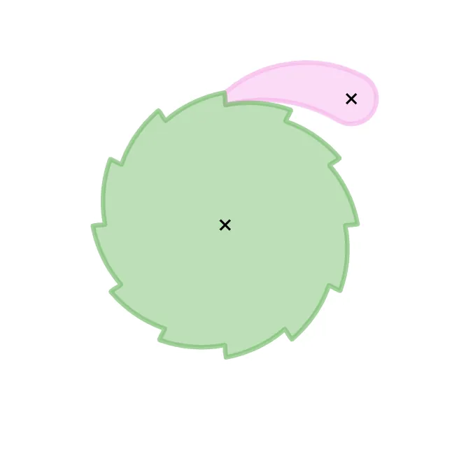

*Picture: [Ratchet Gear and Pawl.gif](https://commons.wikimedia.org/wiki/File:Ratchet_Gear_and_Pawl.gif) by Arglin Kampling, [CC BY-SA 4.0](https://creativecommons.org/licenses/by-sa/4.0), from Wikimedia Commons.*

A toothed wheel with a spring-held catch ([pawl](../glossary.md#pawl)) that lets the wheel turn freely one way with a click and locks it against turning back, used to hold winches and reels, to step a wheel round one tooth at a time, and, with a switchable pawl, in reversible tools such as socket wrenches.

**In plain words:** A wheel with saw-like teeth and a hinged catch that clicks over the teeth when the wheel turns one way and jams against them when it tries to turn back, so the wheel only turns one way; flip or switch the catch and it works the other way round. **Proper term:** [Ratchet](../glossary.md#ratchet) and pawl (ratchet wheel and pawl, ratchet gearing); called a reversible (reversing) ratchet when the pawl can be switched to lock the other direction.

**Also called:** ratchet; ratchet wheel and pawl / pawl and ratchet; ratchet gear / ratchet gearing (Machinery's Handbook); click and ratchet wheel ('click' is an old word for the pawl; Durley: 'a ratchet or click (sometimes called a pawl)'); [detent](../glossary.md#detent) (Machinery's Handbook: 'a pawl or detent'); running ratchet (turns one way only) vs stationary or locking ratchet (pawl stops both directions), Reuleaux's terms used by Durley; reversible ratchet / reversing ratchet / bi-directional ratchet; double-pawl or dual-pawl ratchet; fine-tooth ratchet (socket wrenches); ratchet feed (a pawl on a rocking lever that steps the wheel round); pawl [freewheel](../glossary.md#freewheel) (the usual bicycle freewheel: spring-loaded pawls in a toothed drum); Sperrklinke (German for the pawl, from the Wikimedia Commons file 'Sperrklinke Schema.svg'); cliquet (French, from the Commons file 'Roue libre cliquet.svg'); 棘轮机构 (Chinese, ratchet mechanism; 双向棘轮 = reversible ratchet, from the HUANGYAN920 mechanism library).

## How it works

The teeth are lopsided: one side of each tooth is a gentle slope and the other is steep. Turned the free way, the pawl slides up each gentle slope and a spring snaps it down behind the tooth, which makes the click; turned the other way, the pawl tip meets a steep face and jams, so the wheel stops (Wikipedia 'Ratchet (device)'). The steep face is angled so that the load pulls the pawl deeper into the tooth rather than pushing it out (Machinery's Handbook), and something must always press the pawl in: a spring, the pawl's weight, or a springy pawl (Durley). A reversible ratchet uses teeth that can be caught from either side and a pawl you can flip, turn half a turn, or swap for a second pawl facing the other way, which is what the little lever on a socket wrench does (Machinery's Handbook; Wikipedia 'Socket wrench').

## Parts

A few parts: a ratchet wheel (a disc with lopsided, saw-like teeth), a pawl (a pivoting catch), a pivot pin or screw, something to keep the pawl pressed in (a small spring, the pawl's own weight, or a pawl that is itself springy) and a frame. A reversible ratchet adds either a double-ended pawl or two pawls plus a selector switch or lever. A ratchet that drives (a ratchet feed) adds a rocking lever carrying the driving pawl, with a second, fixed pawl to hold the wheel while the lever swings back.

## Everyday examples

- A socket wrench (ratchet spanner): the small lever on the head switches which way it clicks (reversible ratchet)
- A ratcheting screwdriver or a ratcheting bit driver
- A hand winch, boat trailer winch or come-along (ratchet lever hoist) that holds the load while you rest
- A bicycle freewheel (most use spring-loaded pawls in a toothed ring) and the anti-reverse click in fishing reels and yacht winches

## When to use it

Use a ratchet and pawl when something should turn one way but never slip back: winding a winch, reel or spool, holding a lifted load while you reposition your hand, or tightening something step by step. It is also the simplest way to turn a back-and-forth lever into one-way stepped rotation (a ratchet wrench, a ratchet feed or a counter), and it gives an audible, felt click at each tooth. Choose the reversible version when you need to tighten and loosen with the same tool, as on socket wrenches and screwdrivers. It is cheap, easy to understand, easy to print, and you can release it on purpose by lifting the pawl.

## When not to use it

Avoid it when you need to hold at any angle with no slip-back (it only holds at tooth positions): use a friction brake, a [sprag](../glossary.md#sprag) clutch or a roller clutch (one-way bearing), which lock almost instantly with no [backlash](../glossary.md#backlash), or a worm drive. Avoid it where the clicking noise, wear or bounce at high speed are a problem (a vendor explainer puts the practical limit for ordinary spring-loaded pawls at a few hundred rpm, Firgelli): use a sprag or roller clutch. For a linear strip use a linear ratchet, and for a one-piece printed part with no pins or springs use a compliant (flexure-pawl) ratchet. Don't rely on a home-made ratchet to hold people or heavy loads overhead; use rated hardware.

## Details

- **What it does (jobs):**
  - stop it moving back (one-way): the main job, e.g. holding a winch drum or hoist so the load can't run back
  - click into set positions: the wheel can only stop at a tooth, so it moves and holds in steps of one tooth
  - change the kind of motion: a pawl on a rocking lever turns back-and-forth movement into one-way, step-by-step rotation (ratchet feed, ratchet wrench)
  - tighten and hold tension: wind a reel, strap or cable tighter and it stays tight
  - lock, and release by hand: lifting the pawl by hand frees the wheel to run back
- **Movement:** rotate: unlimited turning in the free direction; in the locked direction it can only [creep](../glossary.md#creep) back up to one tooth spacing before it catches. A reversible ratchet lets you choose which direction is free.
- **Directions it can move (degrees of freedom):** 1: the wheel can only turn about its own axle, and the pawl limits that turning to one direction (the pawl's own small swing is an internal motion, not a way for the parts to move apart)
- **Special behaviour:**
  - one-way (moves freely one way, locks the other): the defining behaviour; the wheel turns one way with a click and jams against the pawl the other way
  - indexing (clicks into set positions): it holds only at tooth positions, so it moves in steps; a pawl on a rocking lever can step a wheel round a set number of teeth each [stroke](../glossary.md#stroke) (Machinery's Handbook, ratchet feed)
  - hand-release only (locks under load, releases when a person operates it): lifting the pawl lets the wheel run back, as on a winch or reel release
  - tensioning (takes up slack and holds): winding a drum or reel and letting the pawl hold each gain
  - motion conversion (e.g. rotary to linear): a rocking lever with a pawl gives one-way, intermittent rotation
  - reversible: in a reversible ratchet a selector (flip-over pawl, turned plunger pawl, or a switch that lifts one of two pawls) swaps the free and locked directions
- **How it holds:**
  - shape (the parts interlock; [form-fit](../glossary.md#form-fit--force-fit--material-bond)): the pawl tip butts against the steep tooth face
  - spring force (a spring or springy part presses it in place): a spring, gravity or a springy pawl keeps the pawl in the teeth; the mechanism must be 'force-closed' in this way (Durley)
- **Input and output:** Used as a stop: rotation one way passes freely, rotation the other way is blocked; it is not back-drivable in the locked direction (the only way back is to lift the pawl). Used as a drive (ratchet feed or ratchet wrench): back-and-forth swinging of a lever -> one-way, stepped rotation of the wheel; each stroke advances a whole number of teeth, so the smallest step is 360 degrees divided by the number of teeth, and two pawls of different length offset by half a tooth halve that step (Machinery's Handbook). Shafts: the lever or frame and the wheel share one axle (in line). Efficiency: little is lost apart from the pawl dragging and clicking over the teeth in the free direction ⚑ [uncertain].
- **Power:** passive (no power needed). If a motor drives through a ratchet and stops, the pawl keeps holding the load.
- **Load:** Light to heavy depending on size and material: steel ratchet wheels are sized with a formula used for crane ratchets (Machinery's Handbook), while a well-designed PLA print has reached about 30 N·m in a ratcheting wrench (Hackaday on Gladius's design). It is strong against turning in the locked direction, where the tooth is loaded in bending and [shear](../glossary.md#peel-vs-shear) and the pawl mostly in compression; the pawl pivot pin carries almost the whole reaction force (Firgelli, vendor explainer). The free direction carries no load. Weak points are the pawl pivot, tooth tips and, in prints, [layer lines](../glossary.md#layer-lines).
- **Play and precision:** noticeable: it can slip back by up to one tooth spacing before the pawl catches (this backward slip is called backlash; Wikipedia 'Ratchet (device)'). Once caught it returns to the same tooth very repeatably; spring-blade indexing ratchets can position to about a tenth of a degree (RoyMech). The pawl and wheel must stay in the same plane; small side float is fine as long as the pawl tip stays fully on the tooth face ⚑ [uncertain].
- **Taking it apart:** removable: the wheel is keyed, pinned or clamped to its shaft and the pawl sits on a pin or screw, so it can be taken apart and refitted (NotesandSketches describes the wheel keyed to the shaft)
- **How often it can be reused:** effectively unlimited: it is built to click thousands of times; the limit is wear of the tooth faces, pawl tip and pivot, not taking it apart
- **Sealing:** none: the teeth and pawl are open to dirt. Tool heads such as socket wrenches enclose the mechanism, which keeps most dirt out but does not seal it ⚑ [uncertain].
- **Adjustable:** No fine adjustment: it can only hold at tooth positions. Finer steps come from more teeth, or from two or more pawls of different lengths offset by a fraction of a tooth (Machinery's Handbook); 'dual-pawl' socket wrenches click twice per tooth (Wikipedia 'Socket wrench').
- **Access needed:** not applicable: it is built into a mechanism (a winch, reel, tool head or gearbox) rather than joining two panels
- **Materials:** Hardened steel wheels and pawls for hoists, winches and hand tools (pawl tips are hardened; Firgelli, vendor explainer); brass and steel in clocks; moulded acetal (POM, 'Delrin' (brand)) and nylon for plastic ratchets, often with moulded-in springs (DuPont design guide); 3D prints in PLA for demos and PETG, ASA or nylon for use; springs in spring steel, because plastic springs that stay loaded relax (DuPont).
- **Heat, cold, water and wear:** Printed plastics soften with heat: PLA starts to give at about 60 °C, PETG about 80 °C, ASA about 110 °C (CNC Kitchen), so a PLA ratchet in a hot car may deform. Plastic springs and springy pawls lose force if they stay loaded ([stress relaxation](../glossary.md#stress-relaxation), DuPont), and PLA creeps most under constant load (thrinter creep test), so a printed pawl held flexed may stop snapping in fully. Dirt, ice or thick grease can stop the pawl dropping into the teeth ⚑ [uncertain]. Steel ratchets rust outdoors unless greased or stainless ⚑ [uncertain]. Vibration or very light loads can make a driven wheel jump ahead (RoyMech).

## Making it

- **Ways to make or get it:**
  - 3D print (FDM): demos, fidget toys and light-to-medium duty tools, including [print-in-place](../glossary.md#print-in-place) and reversible designs
  - 3D print (resin): small, fine-toothed ratchets ⚑ [uncertain]
  - laser cut: the wheel and pawl are flat 2D profiles, so they can be cut from plywood or acrylic for models and toys ⚑ [uncertain]
  - CNC: steel ratchet wheels are milled with an angled cutter or hobbed with a special hob (Machinery's Handbook)
  - woodwork: large wooden ratchet wheels for toys, clock models and winches ⚑ [uncertain]
  - off-the-shelf part: ratchet wheels, pawls, pawl springs, and complete ratchet winches, hoists and wrenches
- **Printing it in one piece (print in place):** yes (with springy printed pawls) / partly (classic pivoting pawl): print-in-place ratchets exist, e.g. joeDAcoolGUY's bi-directional ratchet screwdriver and a print-in-place 1/4-inch bit ratchet on Printables, which use springy printed parts and about 0.3 mm gaps. The classic layout with a pivoting pawl prints as separate parts and needs an added pivot screw and a metal spring (e.g. the 'Ratchet and Pawl Demo' needs an M3 screw and an extension spring).
- **Tools:** Usually a screwdriver or hex key for the pawl pivot screw and frame, and sometimes [circlip](../glossary.md#circlip) pliers for retaining clips; print-in-place printed ratchets need none, only a firm first twist to break the parts free
- **Difficulty:** easy to moderate: easy to print a working demo (a wheel, a pawl, an M3 screw and a small spring); moderate to make one that carries real [torque](../glossary.md#torque), because the tooth angle, pawl position, spring and print orientation all have to be right

### 3D printing tips

1) Get the tooth and pawl geometry right first: make the locking face of each tooth steep (nearly pointing at the wheel centre) and place the pawl pivot so that a line drawn at right angles to the locking face passes between the wheel centre and the pawl pivot; then the load pulls the pawl in instead of throwing it out (Machinery's Handbook; for a pawl that pulls rather than pushes, the line must pass outside the pivot). A vendor explainer suggests a locking face of about 80-90 degrees to the tangent, with 85 degrees as a safe default (Firgelli). 2) Print the wheel and pawl lying flat (axle vertical), so the teeth and the pawl are loaded along the layers, not across them; prints are stronger in one direction, like wood (Prusa), and springy arms should not be built standing up in Z (Hubs). 3) For strength, use many [perimeters](../glossary.md#perimeters) or solid parts: a PLA ratcheting wrench reached about 30 N·m by slicing parts to be almost entirely perimeters (Hackaday on Gladius's design); Owenberry's 1/4-inch drive ratchet was printed in PETG at 100% [infill](../glossary.md#infill). 4) Tooth size matters more than tooth count: in joeDAcoolGUY's tests the real failure mode was tooth flex and too little engagement length, and a 6 mm thick pawl on a 22 mm ratchet ring worked. 5) [Clearances](../glossary.md#clearance): start at 0.3 mm for parts that must move (Prusa); joeDAcoolGUY used 0.3 mm for free-moving parts and 0.15 mm where he wanted controlled friction. Watch for [elephant's foot](../glossary.md#elephants-foot) on small parts, which can jam the mechanism (Martin Rigatoni's reversible screwdriver notes, via the Printables API). 6) Springs: use a small metal spring (an extension spring, or half a pen spring as in Owenberry's design) to hold the pawl in; printed springs that stay loaded relax over time (DuPont), and one maker withdrew a printed ratchet screwdriver because it 'suffers from creep so doesn't last' (Printables API, model 82837). Springy printed pawls are fine for occasional light use, in PETG or nylon rather than PLA. 7) Use a metal screw or pin as the pawl pivot and don't clamp it tight; the 'Ratchet and Pawl Demo' says to leave the M3 screw slightly loose so the pawl can swing. 8) Reversible ratchets: the selector has to be guided or pushed from both sides, otherwise friction jams it once everything is enclosed (joeDAcoolGUY). 9) Print-in-place parts may need a firm first twist to break them free, and a little lubricant (silicone spray or light oil) makes the click smoother. 10) Material: PLA starts to soften at about 60 °C, PETG at about 80 °C and ASA at about 110 °C (CNC Kitchen), so don't leave a PLA ratchet in a hot car.

### Buying one (off-the-shelf parts)

Search terms: 'ratchet wheel' or 'ratchet gear', 'pawl', 'ratchet and pawl set', 'pawl spring' (usually a small [torsion](../glossary.md#torsion) or extension spring), 'shoulder screw' or 'dowel pin' for the pivot, 'retaining ring' or 'E-clip'. Complete products that contain one: 'ratchet wrench' or 'socket wrench' (reversible, with 'fine-tooth' and 'dual-pawl' versions), 'ratcheting screwdriver', 'hand winch' with ratchet, 'ratchet lever hoist' (come-along), fishing-reel anti-reverse, and pawl-type bicycle freewheels. Silent, pawl-free alternatives are sold as 'one-way clutch', 'sprag clutch' or 'one-way needle bearing'.

## Rules of thumb

- Pawl position: the locking face should be placed so that a line at right angles to it passes between the wheel centre and the pawl pivot when the pawl pushes the wheel (or the wheel pushes the pawl); when the pawl pulls, that line should fall outside the pawl pivot. Then the pawl stays engaged under load (Machinery's Handbook, 27th ed., 'Shape of Ratchet Wheel Teeth', p. 2089).
- Tooth [pitch](../glossary.md#pitch) for a steel ratchet holding a hanging load: P = sqrt(F·M / (L·S·N)), where P = circular pitch at the tips, M = turning moment, L = face width (wheel thickness), N = number of teeth, S = safe stress (steel: 2500 psi / 17 MPa with shock, 4000 psi / 28 MPa without), F = 50 for 12 teeth or fewer, 35 for 12-20 teeth, 20 for over 20 teeth; used for crane ratchets (Machinery's Handbook p. 2089; also on Engineers Edge citing the 29th edition).
- Finer steps without weaker teeth: use several pawls whose lengths differ by a fraction of the tooth pitch; two pawls differing by half a pitch halve the step (Machinery's Handbook p. 2089). Rob Ives also notes two pawls reduce the stop-start motion.
- Resolution and backlash: the wheel can only hold every 360°/N (N = number of teeth), so it may slip back up to one tooth before catching (Wikipedia 'Ratchet (device)'); dual-pawl socket wrenches click twice per tooth (Wikipedia 'Socket wrench').
- The pawl must always be pressed into the teeth ('force-closed'): by a spring, by its own weight, or by making the pawl itself a spring; and its shape must be such that the tooth pressure does not throw it out of gear (Durley, Kinematics of Machines, ch. IX, p. 230).
- At light loads a driven ratchet wheel can jump ahead past the intended tooth; add a brake or detent, or watch the load (RoyMech 'Ratchets').
- Plastic ratchets with moulded-in springs work well 'providing the springs are not held in the loaded position for a long period of time'; springs under constant load or [deflection](../glossary.md#deflection) should be spring steel (DuPont 'General Design Principles for Engineering Polymers', pp. 36 and 47).
- Moving printed parts need at least about 0.3 mm clearance as a starting point (Prusa knowledge base).
- For springy ([flexure](../glossary.md#flexure)) pawls: don't build them standing up in Z, and add a [fillet](../glossary.md#chamfer--fillet) at the root of at least half the arm thickness (Hubs snap-fit guide).
- Vendor guidance (not a standard): make the locking face 80-90 degrees to the tangent, 85 degrees by default, and keep the pawl pivot pin snug, because pivot wear shifts the engagement angle (Firgelli 'Pawl' explainer).

## Common failures

1) The pawl skips or is pushed out under load, because the locking face or pivot position is wrong (the load pushes the pawl out instead of pulling it in) or the pivot is worn: follow the Machinery's Handbook rule and keep the pivot snug. 2) The pawl doesn't drop in (it floats over the teeth) because the spring is too weak or has relaxed, the pawl is sticky, or dirt and grease are in the way: use a metal spring and keep it clean. 3) Tooth tips round over, chip or snap, or, in prints, shear off along layer lines: make teeth larger rather than more numerous (joeDAcoolGUY), print flat with many perimeters. 4) The wheel overshoots at light load (RoyMech): add a detent or light brake. 5) Too much slip-back (backlash) for the job: use finer teeth or several offset pawls, or a sprag or roller clutch. 6) Reversible selectors jam or sit halfway: guide the selector from both sides (joeDAcoolGUY) and add a detent so it snaps to each position ⚑ [uncertain]. 7) Print-in-place parts are fused: increase clearance (about 0.3 mm) and check elephant's foot.

## Safety

A ratchet holding a load stores that load's energy: lifting the pawl on a loaded winch, hoist or reel lets the load run back and can spin the handle or drop the load, so take the weight first ⚑ [uncertain]. The pawl and teeth form a pinch point for fingers. Pawl springs can fly out when a mechanism is opened. A worn or badly shaped ratchet can skip under load, so home-made or printed ratchets must never be used for lifting people or holding loads overhead.

## Related

- Linear ratchet (cable-tie ratchet): the same idea on a straight toothed strip, so it slides one way instead of turning
- Face ratchet (star ratchet): the teeth are on the faces of two spring-pressed discs, so every tooth engages at once instead of one pawl
- Compliant ratchet (flexure pawl): the pawl is a springy printed arm, so there are no pins or separate springs
- Sprag clutch and roller clutch (one-way bearing): one-way locking by wedging, silent and with almost no backlash, but no audible click and no step positions
- Wrap-spring clutch: a coiled spring grips a shaft one way; smooth, silent, one-way
- Ratchet-tooth torque limiter: similar sloped spring-loaded teeth, but shaped so they slip when the torque gets too high
- Ball detent / indexing detent: clicks into positions and holds both ways, but can be pushed through with enough force
- Escapement: a ratchet-like wheel released one tooth at a time to control speed (clocks)
- Worm drive: holds a load at any position ([self-locking](../glossary.md#self-locking)), not just at teeth, but is slow and inefficient
- Geneva drive: another way to get step-by-step rotation, with smooth locked dwell between steps

## Make it yourself

- [Ratchet and Pawl Demo (PatricktheBiosteamist, Printables)](https://www.printables.com/model/478921-ratchet-and-pawl-demo): Educational ratchet wheel and pivoting pawl; prints without supports and needs an M3 screw (14-18 mm) as the pivot and an extension spring. Details read through the Printables public API because the web page blocks automated access. *(licence: CC BY-NC-SA)*
- [Print in place Bi-Directional Ratchet Screwdriver (joeDAcoolGUY, Printables)](https://www.printables.com/model/1656899-print-in-place-bi-directional-ratchet-screwdriver): Fully print-in-place reversible (left/right/lock) ratchet handle for 1/4-inch hex bits, about 0.3 mm clearances, 0.2 mm layers; the designer's blog (https://dev.joesturge.com/p/3d-print-in-place-a-design-journey/) explains the design lessons *(licence: CC BY)*
- [1/4" Drive Ratchet (Owenberry, Printables)](https://www.printables.com/model/618449-14-drive-ratchet): Working reversible 1/4-inch drive ratchet wrench printed in PETG at 100% infill, with a direction toggle, two M3 screws and nuts, and two small springs (a pen spring cut in half) *(licence: CC BY-NC)*
- [Print in Place 1/4" Bit Ratchet (Drunken_Makerer, Printables)](https://www.printables.com/model/481178-print-in-place-14-bit-ratchet): Keychain print-in-place bit ratchet in PLA+ with 60-degree internal overhangs and no supports; you change direction by moving the bit to the other side *(licence: CC BY-NC)*
- [3D Printed Ratchet & Pawl | How to Design One Yourself (YouTube, CAD with Jordan)](https://www.youtube.com/watch?v=xHbz4figcLM): Video tutorial on designing a printable ratchet and pawl in CAD *(licence: link only (standard YouTube licence))*
- [HUANGYAN920 MECH ENGINE (RATCHET / REVERSIBLE-RATCHET entries)](https://huangyan920.github.io/Mechanical/): Browser simulator where you can change the tooth count and geometry of a ratchet and a reversible ratchet and watch them run *(licence: MIT)*

## Pictures, videos and models

- [Ratchet Gear and Pawl.gif (Wikimedia Commons, by Arglin Kampling)](https://commons.wikimedia.org/wiki/File:Ratchet_Gear_and_Pawl.gif): Animation of a ratchet wheel (green) and pawl (pink): the wheel turns one way while the pawl clicks over the teeth and blocks it the other way *(licence: CC BY-SA 4.0)*
- [Ratchet Drawing Animation.gif (Wikimedia Commons, drawing by Dr. Schorsch, animated by MichaelFrey)](https://commons.wikimedia.org/wiki/File:Ratchet_Drawing_Animation.gif): Labelled animated drawing of a ratchet: 1) gear, 2) pawl, 3) base *(licence: CC BY-SA 3.0)*
- [Reversible ratchet mechanism (YouTube, MechMotions)](https://www.youtube.com/watch?v=nZH5rEpd2_4): Animation of a reversible ratchet in which the pawl is switched to change the locked direction *(licence: link only (standard YouTube licence))*
- [MECH ENGINE mechanism library (HUANGYAN920) - search 'RATCHET', 'REVERSIBLE-RATCHET', 'DOUBLE-RATCHET' or 'INTERNAL-RATCHET'](https://huangyan920.github.io/Mechanical/): Interactive, adjustable simulations of a ratchet, a reversible ratchet, a double-pawl ratchet and an internal ratchet (labels in Chinese with English names) *(licence: MIT (code on GitHub))*
- [Ratchet and pawl (NotesandSketches)](https://www.notesandsketches.co.uk/Ratchet.html): School-level diagrams of a ratchet wheel keyed to a shaft, showing the permitted rotation and how the pawl stops reverse rotation *(licence: link only (no licence stated))*

## Needs confirming

⚑ marks something nobody has confirmed yet: a fact the research could not confirm from a source, a finder value that is a best guess, or an open point from the research notes. Corrections are welcome (see `research/needs-confirming.md`).

- ⚑ 10 sentences on this page marked [uncertain].

## Sources

- <https://en.wikipedia.org/wiki/Ratchet_(device)>
- <https://en.wikipedia.org/wiki/Socket_wrench>
- <https://en.wikipedia.org/wiki/Freewheel>
- <https://commons.wikimedia.org/wiki/Category:Ratchets>
- <https://commons.wikimedia.org/wiki/File:Ratchet_Gear_and_Pawl.gif>
- <https://commons.wikimedia.org/wiki/File:Ratchet_Drawing_Animation.gif>
- <https://theswissbay.ch/pdf/Books/Survival/Workshop/Machining%20and%20Machinery/Machinery's%20Handbook%20(27.8)/26663_yl.pdf>
- <https://www.engineersedge.com/calculators/ratchet_type_gear_design_15333.htm>
- <https://ecommons.cornell.edu/server/api/core/bitstreams/809167fc-7cef-4c99-a0a1-60a708dede4f/content>
- <https://www.distrupol.com/General_Design_Principles_for_Engineering_Polymers.pdf>
- <https://roymech.org/Useful_Tables/Cams_Springs/Ratchets.html>
- <https://www.robives.com/mechanism/ratchet/>
- <https://www.notesandsketches.co.uk/Ratchet.html>
- <https://wiki.dtonline.org/index.php/Ratchet>
- <https://www.firgelliauto.com/blogs/mechanisms/pawl>
- <https://huangyan920.github.io/Mechanical/>
- <https://raw.githubusercontent.com/HUANGYAN920/Mechanical/main/README.md>
- <https://www.youtube.com/watch?v=nZH5rEpd2_4>
- <https://www.youtube.com/watch?v=xHbz4figcLM>
- <https://www.printables.com/model/478921-ratchet-and-pawl-demo>
- <https://www.printables.com/model/1656899-print-in-place-bi-directional-ratchet-screwdriver>
- <https://www.printables.com/model/618449-14-drive-ratchet>
- <https://www.printables.com/model/481178-print-in-place-14-bit-ratchet>
- <https://api.printables.com/graphql/>
- <https://dev.joesturge.com/p/3d-print-in-place-a-design-journey/>
- <https://hackaday.com/2022/10/15/a-3d-printed-ratchet-that-can-really-take-the-torque/>
- <https://help.prusa3d.com/article/modeling-with-3d-printing-in-mind_164135>
- <https://www.hubs.com/knowledge-base/how-design-snap-fit-joints-3d-printing/>
- <https://www.cnckitchen.com/blog/comparing-pla-petg-amp-asa-feat-prusament>
- <http://thrinter.com/creep-abs-pla-petg-alloy-910/>
