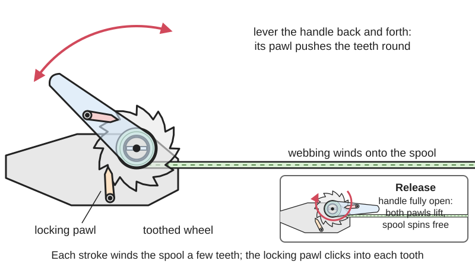
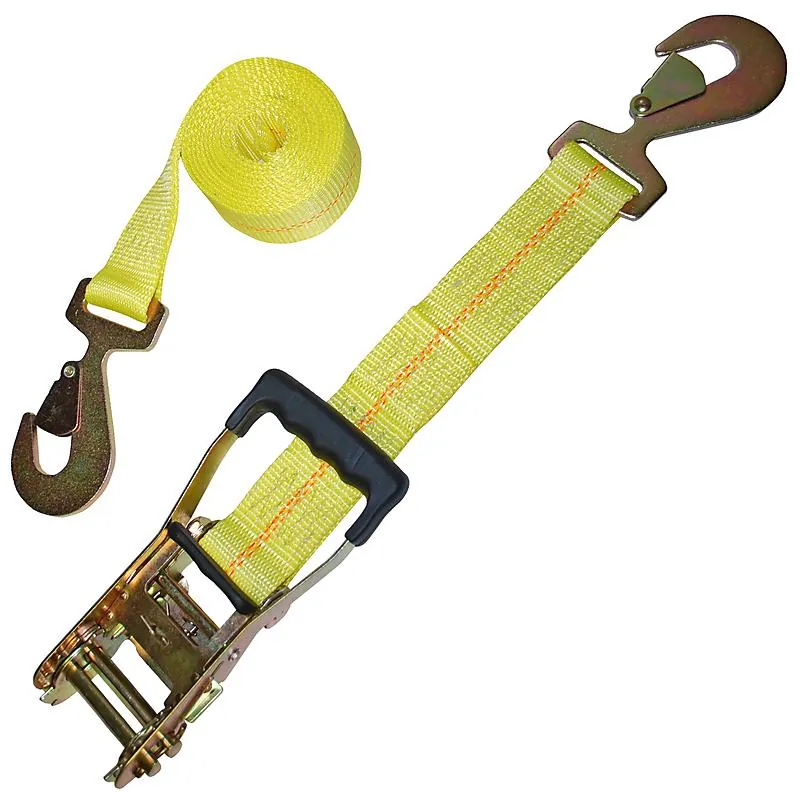
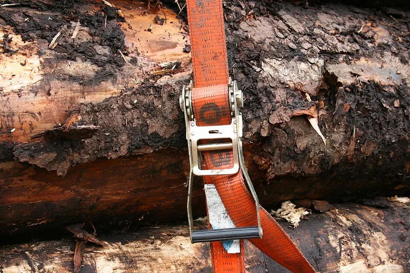

<figure class="eoc-pic eoc-pic-main"><picture><source media="(prefers-reduced-motion: reduce)" srcset="../media/drawn/ratchet-tie-down-strap.svg"></picture><figcaption><strong>Animation.</strong> Diagram drawn for the encyclopaedia from the research notes. ⚑ Needs confirming: a drawing can simplify or get details wrong; a real photo or a better diagram is welcome.</figcaption></figure>
<figure class="eoc-pic"><figcaption><strong>How it works.</strong> <a href="https://commons.wikimedia.org/wiki/File:Ergo_Ratsche_mit_langem_Hebel..jpg">Ergo Ratsche mit langem Hebel.</a> by SpanSet1966, <a href="https://creativecommons.org/licenses/by-sa/4.0">CC BY-SA 4.0</a>, from Wikimedia Commons.</figcaption></figure>
<figure class="eoc-pic"><figcaption><strong>Photo.</strong> <a href="https://commons.wikimedia.org/wiki/File:Custom_made_tie_down_strap.jpg">Custom made tie down strap</a> by DustinMoving, <a href="https://creativecommons.org/licenses/by-sa/4.0">CC BY-SA 4.0</a>, from Wikimedia Commons.</figcaption></figure>
<figure class="eoc-pic"><figcaption><strong>Photo.</strong> <a href="https://commons.wikimedia.org/wiki/File:L%C3%BCdenscheid_-_Bahnhof_Br%C3%BCgge_03_ies.jpg">Lüdenscheid - Bahnhof Brügge 03 ies</a> by Frank Vincentz, <a href="https://creativecommons.org/licenses/by-sa/3.0">CC BY-SA 3.0</a>, from Wikimedia Commons.</figcaption></figure>

A webbing strap whose loose end threads through a slotted spool in a steel [ratchet](../glossary.md#ratchet): levering the handle back and forth winds the webbing onto the spool a tooth at a time to put a strong, locked-in tension on a load, and pulling a release catch and swinging the handle fully open frees the spool.

**In plain words:** A strap with a hinged lever on it: pump the lever and it winds the strap onto a little slotted reel, a click at a time, pulling the strap really tight over a load; pull a catch and flip the lever wide open to let it go. **Proper term:** Ratchet tie-down strap (ratchet strap; ratchet buckle; web lashing with ratchet tensioner).

**Also called:** ratchet strap / ratchet tie-down / ratchet tie down strap; lashing strap / ratchet lashing (UK and Europe); web lashing assembly (the term used by EN 12195-2 and Wikipedia); cargo strap / tie-down strap / load strap; ratchet buckle / ratchet tensioner / tensioning ratchet (the mechanism on its own); push (pressure) ratchet versus pull ratchet / long-lever 'ergo' ratchet (Konnex; SpanSet); loop strap (one-piece, endless) and two-piece strap (fixed end plus loose end) (Wikipedia 'Web lashing assembly'; SpanSet); Spanngurt mit Ratsche / Ratschen-Spanngurt (German); ErgoABS (SpanSet brand; long-lever pull ratchet that lets tension off gradually).

## How it works

You pull the loose end of the webbing through the slot in the spool until it lies taut against the load. Each time you lever the handle up and back, a [pawl](../glossary.md#pawl) on the handle pushes the ratchet wheels round a few teeth, winding the webbing onto the spool and onto itself; meanwhile a spring-loaded locking pawl on the frame drops into the teeth so the spool cannot turn back, and you hear it click (US 6,524,041; Wikipedia 'Ratchet (device)'). The first 1.5 turns of webbing wrapped on itself grip by friction, so the strap can't slide out of the slot, but more than 3 turns start to crush it (SpanSet). Closing the handle flat locks it. To release, you pull the release catch and swing the handle right through about 180 degrees to its stop; a cam lifts both pawls clear of the teeth, the spool spins freely and the tension lets go, often with a jolt (SpanSet; US 5,271,606).

## Parts

A small assembly that acts as one unit: a U-shaped steel frame (bracket) fixed to a short 'fixed end' of webbing; a slotted spool (slotted spindle or mandrel) with a ratchet wheel on each side; a hinged handle (ratchet lever) carrying a spring-loaded drive pawl; a spring-loaded locking pawl or slider on the frame; a release catch (function slider); the long 'loose end' of webbing; and end fittings such as J hooks, S hooks, flat hooks, snap hooks or E-track fittings (SpanSet; US 6,524,041; Wikipedia 'Web lashing assembly').

## Everyday examples

- Strapping furniture, a motorbike or a kayak onto a trailer, van or roof rack
- Cargo on lorries, pallets and in containers (Wikipedia 'Web lashing assembly')
- Makers using a ratchet strap as a band clamp to pull a glued frame or box tight (Printables 'Picture Frame Wood Box Assembly Corner Clamp Ratchet Strap Repair Clamp')

## When to use it

When you need a strong, locked-in pull on a strap: holding a load down on a trailer, van or roof rack, stopping cargo sliding, bundling long items, or as a band clamp for large glue-ups. It gives far more tension than a cam buckle and holds it without knots, and releases in seconds.

## When not to use it

Never for lifting: lashing straps are marked 'not for lifting' and have the wrong safety factor, so use rated lifting slings (LoadLok; Tensys; SpanSet). Not for stopping a moving load (SpanSet). Avoid over-tightening fragile items such as boats, bikes or cardboard boxes; a cam buckle strap limits the tension to what you can pull by hand. For frequent quick adjustments use a cam buckle or ladder lock; for a permanent tensioned line use a turnbuckle; for chains use a load binder ⚑ [uncertain]. In diagonal lashing, tighten only enough to remove slack rather than pre-tensioning hard (SpanSet).

## Details

- **What it does (jobs):**
  - tighten and hold tension: pulls a strap hard round or over a load and keeps it tight
  - stop it moving back (one-way): the ratchet lets the spool wind in but not unwind
  - lock, and release by hand: closed, it stays locked; a catch and a full swing of the handle let it go
  - join and hold: ties a load to a trailer, roof rack, pallet or vehicle anchor points
- **Movement:** rotate: the spool turns one way in small steps while the handle swings back and forth (up to about 180 degrees to release); once closed nothing moves
- **Directions it can move (degrees of freedom):** 1 while tightening: the spool turns one way relative to the frame; 0 when the handle is closed and locked
- **Special behaviour:**
  - one-way (moves freely one way, locks the other): the spool can only wind the webbing in; a locking pawl stops it unwinding
  - tensioning (takes up slack and holds): winds up slack and puts a large pre-tension on the strap, e.g. about 350 daN from a 50 daN hand force on a common push ratchet (Tensys; Konnex)
  - hand-release only (locks under load, releases when a person operates it): it only lets go when you pull the release catch and swing the handle to the open stop (SpanSet)
  - quick-release: release takes seconds and needs no tools, though the tension comes off with a jolt unless the ratchet has a gradual-release feature (SpanSet ABS system)
- **How it holds:**
  - shape (the parts interlock; [form-fit](../glossary.md#form-fit--force-fit--material-bond)): pawls sit in the ratchet-wheel teeth so the spool can't turn back
  - friction or clamping (force-fit): the webbing wound 1.5-3 turns onto itself round the slotted spool grips by friction so it can't pull out of the slot (SpanSet)
  - spring force (a spring or springy part presses it in place): springs keep the pawls pressed into the teeth
- **Input and output:** Back-and-forth handle [strokes](../glossary.md#stroke) -> stepwise rotation of the spool -> straight pull on the webbing ([oscillating](../glossary.md#oscillating) lever to one-way rotation to linear). Force gain: a standard hand force of 50 daN on the handle gives a standard tension force (STF) of typically about 350 daN on a 50 mm push ratchet, roughly 7:1, and up to about 800 daN with long-lever pull ratchets, roughly 16:1 (Konnex; Tensys). EN 12195-2 puts the STF between 0.1 and 0.5 times the strap's lashing capacity (Konnex). Efficiency: not given in the sources found ⚑ [uncertain]. Spool axis sits across the strap. Back-drivable: no; the locking pawl stops the spool unwinding until you release it.
- **Power:** passive (no power needed)
- **Load:** Heavy for its size. A typical 50 mm lorry strap has a minimum breaking force of 5,000 daN and a lashing capacity (LC, the safe straight pull) of 2,500 daN, a 2:1 safety factor (Tensys; Konnex); 25 mm straps are much lighter, with a hand force of 25 daN (SpanSet). US rules give synthetic webbing a working load limit by width if unmarked: 1 3/4 in 1,750 lb, 2 in 2,000 lb, 3 in 3,000 lb, 4 in 4,000 lb (eCFR 49 CFR 393.108). Strong only in a straight pull along the webbing; weak against cuts on sharp edges, crushing, knots and twisting, and hooks must not be loaded on their tips (SpanSet).
- **Play and precision:** not applicable: it does not locate parts. Tension rises in small steps of one ratchet tooth, the webbing stretches a little under load (its elongation is printed on EN 12195-2 labels; LoadLok), and tension falls as the load settles (SpanSet).
- **Taking it apart:** tool-free quick release: pull the release catch, swing the handle fully open and pull the webbing out of the slot
- **How often it can be reused:** many times: the ratchet lasts for years with cleaning and light [lubrication](../glossary.md#lubrication), but the webbing is withdrawn when damaged, e.g. cuts deeper than 10% of the width at the edge, damaged stitching or heat damage, and hooks when widened by more than 5% (SpanSet)
- **Sealing:** none
- **Adjustable:** Yes: length by pulling more or less webbing through the spool's slot before ratcheting, and tension by the number of handle strokes. It should be re-checked and re-tensioned after a short drive and during the trip because the load settles (SpanSet).
- **Access needed:** not applicable: it wraps round or over the load and hooks to anchor points; you need room to swing the handle
- **Materials:** Webbing of polyester (most common; blue EN label), polyamide or nylon (green label) or polypropylene (brown label) (SpanSet; Tensys). Ratchet frame, spool, handle and pawls of pressed steel, usually zinc-plated; end fittings of steel (J hooks, S hooks, D hooks, E-track fittings, flat hooks, snap hooks) (Wikipedia 'Web lashing assembly'; SpanSet); the zinc plating is ⚑ [uncertain]. Printed versions exist for light straps (Printables 'Strap Ratchet').
- **Heat, cold, water and wear:** Polyester and polyamide webbing is fine from -40 to +100 degrees C and polypropylene up to +80 degrees C (SpanSet). Acids, alkalis and other chemicals weaken webbing; rinse and ask the maker (SpanSet). Store straps clean, dry, ventilated and out of direct sunlight, because UV weakens webbing over time (SpanSet advises keeping straps out of direct sunlight; that UV is the reason is ⚑ [uncertain]). Vibration and the load settling reduce tension on the road, so re-check after a short distance (SpanSet). Ratchets rust and stiffen unless cleaned and lightly lubricated at the sprockets, but never where the webbing wraps, or it can slip (SpanSet).

## Making it

- **Ways to make or get it:**
  - off-the-shelf part: complete ratchet straps, loose ratchet buckles and webbing sold by width and lashing capacity
  - 3D print (FDM): light-duty strap ratchets and cord ratchet tensioners (Printables models), plus accessories such as corner protectors, winders and strap clips
- **Printing it in one piece (print in place):** no: printable strap ratchets are printed as separate parts that snap together (Printables 'Strap Ratchet no supports snaps together mountable') or are joined with a bolt and a rubber band as the spring (Printables 'Paracord Tensioner/Ratchet')
- **Tools:** none: tightened and released by hand; bars or levers to add force must not be used (SpanSet; Konnex)
- **Difficulty:** hard to make safely at home: rated cargo straps use hardened steel ratchets and tested, labelled webbing, so buy them; printed ratchets are only suitable for light jobs such as bag or bundle straps (Printables 'Strap Ratchet no supports snaps together mountable')

### 3D printing tips

1) Only print ratchets for light loads such as bags, bundles, garden ties or model work; for cargo on a vehicle use a labelled steel ratchet strap (SpanSet; eCFR 393.108). 2) Use a strong, heat-tolerant plastic (PETG, ABS or ASA) with many walls: PLA softens in a hot car (Printables 'Ratchet strap reel', which recommends at least PETG with 4 walls and 5 top and bottom layers). 3) Orient the spool and pawls so the loads run along the layers, since prints are stronger in one direction (Prusa); a spool printed standing up can snap between layers when it bends ⚑ [uncertain]. 4) Give moving parts about 0.3 mm [clearance](../glossary.md#clearance) to start with and adjust (Prusa). 5) Use a metal bolt as the spool axle and pivot, and a small spring or rubber band to push the pawl into the teeth (Printables 'Paracord Tensioner/Ratchet' uses an M3 bolt and a loom band). 6) Size the spool's slot and posts for your webbing's width and thickness; the 'Strap Ratchet' designer lengthened the spool posts for longer or thicker straps. 7) Wind at least about 1.5 turns but no more than about 3 turns, as on steel ratchets (SpanSet). 8) Round every edge the webbing wraps over so it isn't cut, but keep the gripping edges crisp where they must bite: the 'Strap tensioner - load optimized' deliberately has no [chamfers](../glossary.md#chamfer--fillet) on its biting edges and was load-tested to 120 kg in PLA and PETG (Printables). 9) Add a latch that holds the handle closed so it can't flip open by accident (US 6,524,041 describes accidental release when the handle isn't secured); whether printed latches hold is ⚑ [uncertain].

### Buying one (off-the-shelf parts)

Ratchet strap (ratchet tie-down) in widths such as 25, 35, 50 and 75 mm ⚑ [uncertain]; loose ratchet buckles (push or pull ratchets); long-handle 'ergo' pull ratchets; loop (endless) straps; webbing (polyester); end fittings such as J hooks, S hooks, D hooks, flat hooks, snap hooks and E-track fittings (Wikipedia 'Web lashing assembly'; SpanSet); edge (corner) protectors and protective sleeves; anti-slip mats; tension force indicators (SpanSet); cam buckle straps for lighter loads.

## Rules of thumb

- Keep at least 1.5 and at most 3 turns of webbing on the slotted spool: fewer can let the webbing slip, more starts to crush it; SpanSet's gradual-release (ABS) ratchets need at least 2 turns (SpanSet lashing instructions).
- Standard hand force (SHF) on the handle is 50 daN (25 daN for 25 mm webbing); never add a bar or lever (SpanSet; LoadLok; Konnex).
- Standard tension force (STF) must lie between 0.1 and 0.5 times the lashing capacity (LC); e.g. a 50 mm ratchet with a 50 kN breaking strength has LC 25 kN and an STF between 250 and 1,250 daN (Konnex).
- Typical STF: about 350 daN for a 5,000 daN x 50 mm push-up ratchet strap, and about 500 daN with 'ergo' ratchets that pull down to tension (Tensys); long-lever pull ratchets reach up to about 800 daN (Konnex).
- Use the LC (straight-pull rating) for direct lashing and the STF for tie-down (friction) lashing; at least two straps are needed to lash a load down (SpanSet; LoadLok).
- US: the aggregate working load limit of the tie-downs must be at least half the weight of the cargo, counting half the WLL for a tie-down from the vehicle to the cargo (eCFR 49 CFR 393.106); unmarked synthetic webbing is rated 2,000 lb for 2 in width (393.108).
- An edge is 'sharp' for webbing if its radius is smaller than the webbing's thickness; use edge protectors there (SpanSet).
- Withdraw a strap if its edge is cut more than 10% of its width, its stitching is damaged, it is heat-deformed, or a hook has opened by more than 5% (SpanSet).
- Polyester and polyamide straps can be used from -40 to +100 degrees C; polypropylene straps up to +80 degrees C (SpanSet).

## Common failures

1) Webbing slips out because fewer than 1.5 turns are wound, or jams and is crushed because more than 3 turns are wound (SpanSet). 2) Webbing cut on a sharp edge: use edge protectors (SpanSet). 3) Twisted or knotted webbing, which loses strength (SpanSet). 4) Handle left open or not locked, so the strap is released by accident (US 6,524,041). 5) Strap loosens on the road as the load settles; re-tension (SpanSet). 6) Rusty or seized ratchet, worn sprockets, a deformed slotted spool or locking slider: clean and lightly lubricate, and withdraw a damaged ratchet (SpanSet). 7) Hooks opened or bent by tip loading (SpanSet). 8) Missing or unreadable label, so the strap's rating is unknown and it must not be used (LoadLok; SpanSet). 9) Over-tightening crushes or cracks the cargo ⚑ [uncertain].

## Safety

The tension is released with a jolt when the ratchet opens; stand clear and make sure the load is stable before releasing (SpanSet). Never use a bar or extension on the handle (SpanSet). Never use it for lifting (LoadLok; SpanSet). Keep fingers out of the handle and spool while ratcheting, as they are pinch points ⚑ [uncertain]. A hook or strap that slips or breaks under tension can whip back ⚑ [uncertain]. Hook open hooks from the inside outwards so they can't drop out of the anchor, and watch for overhead cables when throwing straps over tall loads (SpanSet).

## Related

- Cam buckle (webbing cam buckle): hand-pull tightening held by a toothed cam; quicker and gentler, but much lower tension
- Ladder lock buckle (tension lock, tri-glide): slotted buckles that hold webbing by friction with no moving parts
- Ratchet and pawl (incl. reversible ratchet): the one-way mechanism inside the buckle
- Capstan and windlass (hand winch): a crank-driven rope drum, the larger relative of the ratchet spool
- Ratcheting reel closure (dial lacing system): a small ratchet that winds a lace onto a spool, released by hand
- Linear ratchet (cable-tie ratchet): a toothed strip that tightens one way, usually permanent
- Turnbuckle: tightens a rod or cable with a screw; slower but compact and permanent
- Tensioning and adjustable hitches: the trucker's hitch, a rope knot giving a pulley-like pull to tension a rope without hardware (Wikipedia 'Web lashing assembly' see-also)
- Bungee cord: elastic tie-down with little force and a snap-back hazard (Wikipedia 'Bungee cord')
- Wire-rope terminations: wire-rope clips, thimbles and crimped sleeves, for tie-downs and lashings made of steel cable instead of webbing

## Make it yourself

- [Strap Ratchet no supports snaps together mountable (neotoy, Printables) (URL from Printables API, page not opened)](https://www.printables.com/model/1756442-strap-ratchet-no-supports-snaps-together-mountable): Printable snap-together strap ratchet with a spool and locking key; about 2 hours and 70 g of filament *(licence: Open Community License v1)*
- [Paracord Tensioner/Ratchet (Mountainstorm, Printables) (URL from Printables API, page not opened)](https://www.printables.com/model/1306457-paracord-tensionerratchet): Enclosed ratchet tensioner for paracord with a latch-open release; needs M3 bolts and a small rubber band as the pawl spring *(licence: Public domain (CC0))*
- [Ratchet wire tensioner Hex (Vivishka, Printables) (URL from Printables API, page not opened)](https://www.printables.com/model/723778-ratchet-wire-tensioner-hex): Tiny ratchet spool tensioner for Kevlar string, fishing line or fine wire, turned with a 1/4 in hex socket; lifts about 5 kg *(licence: CC BY-SA)*
- [Strap tensioner - load optimized (HD_Creator, Printables) (URL from Printables API, page not opened)](https://www.printables.com/model/121221-strap-tensioner-load-optimized): Printable 25 mm and 20 mm friction strap tensioner (not a ratchet), load-tested to 120 kg in PLA and PETG; useful to compare with a ratchet *(licence: Public domain (CC0))*

## Pictures, videos and models

- [SpanSet General Operating Instructions: handling of lashing straps (PDF)](https://www.spanset.com/legacy-uploads/cms-files/uk/lashing-instructions.pdf): Labelled drawings of the slotted shaft, ratchet lever, function slider and bracket, plus threading, tensioning, locking and releasing steps *(licence: link only)*
- [Ergo Ratsche mit langem Hebel (Wikimedia Commons, uploaded by SpanSet1966)](https://commons.wikimedia.org/wiki/File:Ergo_Ratsche_mit_langem_Hebel..jpg): Photo of a long-lever pull ratchet on a lashing strap *(licence: CC BY-SA 4.0)*
- [How to Thread, Tighten, and Release a Ratchet Buckle Strap (Strapworks, YouTube)](https://www.youtube.com/watch?v=txtfapPi5yw): Video demonstration of threading the webbing through the spool, ratcheting it tight and releasing it *(licence: link only (standard YouTube licence))*
- [Web lashing assembly (Wikipedia)](https://en.wikipedia.org/wiki/Web_lashing_assembly): Article with photos of a ratchet tie-down strap, a custom-made strap and a strap securing a pallet *(licence: text CC BY-SA 4.0; images per file)*
- [Label Explanation (LoadLok)](https://loadlok.com/pages/label-explanation): Annotated EN 12195-2 strap label explaining LC, SHF, STF, elongation and 'not for lifting' *(licence: link only)*

## Needs confirming

⚑ marks something nobody has confirmed yet: a fact the research could not confirm from a source, a finder value that is a best guess, or an open point from the research notes. Corrections are welcome (see `research/needs-confirming.md`).

- ⚑ 10 sentences on this page marked [uncertain].
- ⚑ Finder value `connects` = strap, cord or fabric (best guess): worked out from its name, but joining parts is not one of its two main jobs
- ⚑ Finder value `clicks` = clicks (best guess): the text uses both clicking and silent words
- ⚑ Finder value `one_way_kind` = clicks (best guess): carried over from the finder's old rule on entry names (R33), for "Is clicking OK?" under "Control a movement > Move one way only > Turns"
- ⚑ Finder value `tightens` = strap, cord or rope (best guess): carried over from the finder's old rule on entry names (R33), for "What are you tightening?" under "Tighten something, or take up slack"
- ⚑ Finder value `tension_hold` = ratchet, winch or screw (best guess): carried over from the finder's old rule on entry names (R33), for "How should it hold?" under "Tighten something, or take up slack > A strap, lace, cord or rope"

## Sources

- <https://en.wikipedia.org/wiki/Web_lashing_assembly>
- <https://en.wikipedia.org/wiki/Ratchet_(device)>
- <https://en.wikipedia.org/wiki/Bungee_cord>
- <https://www.spanset.com/legacy-uploads/cms-files/uk/lashing-instructions.pdf>
- <https://konnex.group/en/products/terminology-in-cargo-securing/>
- <https://loadlok.com/pages/label-explanation>
- <https://www.tensysdirect.com/news/post/what-do-ratchet-strap-label-terms-mean>
- <https://www.ecfr.gov/api/renderer/v1/content/enhanced/current/title-49?part=393&section=393.108>
- <https://www.ecfr.gov/api/renderer/v1/content/enhanced/current/title-49?part=393&section=393.106>
- <https://patents.google.com/patent/US6524041B1/en>
- <https://www.freepatentsonline.com/5271606.html>
- <https://commons.wikimedia.org/wiki/Category:Tie_down_straps>
- <https://commons.wikimedia.org/wiki/File:Ergo_Ratsche_mit_langem_Hebel..jpg>
- <https://www.youtube.com/watch?v=txtfapPi5yw>
- <https://help.prusa3d.com/article/modeling-with-3d-printing-in-mind_164135>
- <https://api.printables.com/graphql/>
