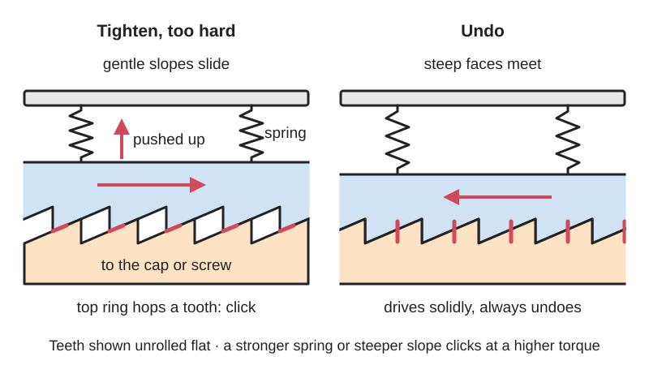
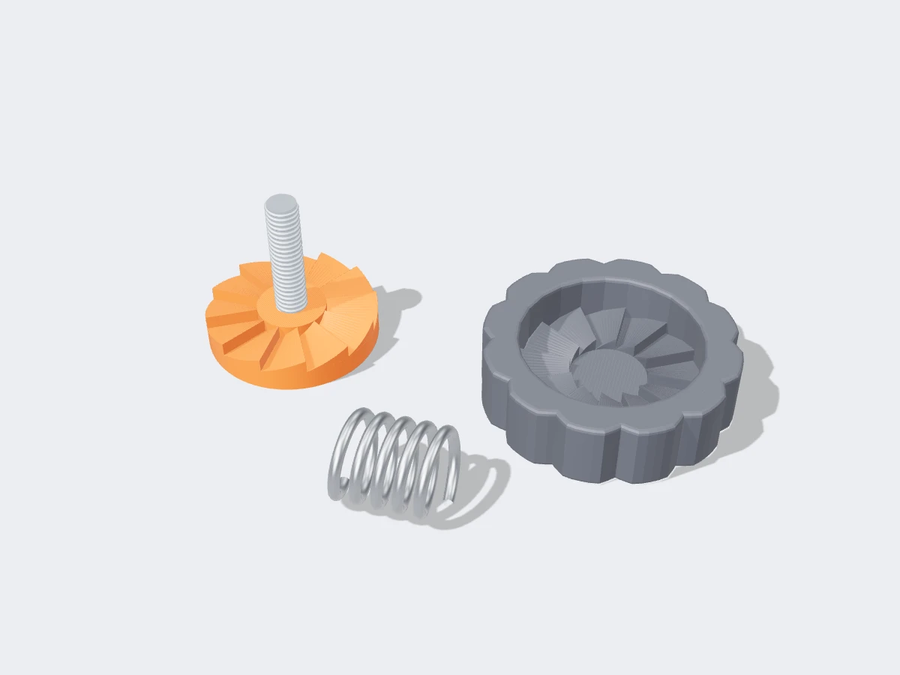

<figure class="eoc-pic eoc-pic-main"><picture><source media="(prefers-reduced-motion: reduce)" srcset="../media/drawn/ratchet-tooth-torque-limiter.svg"></picture><figcaption><strong>Animation.</strong> Diagram drawn for the encyclopaedia from the research notes. ⚑ Needs confirming: a drawing can simplify or get details wrong; a real photo or a better diagram is welcome.</figcaption></figure>
<figure class="eoc-pic"><figcaption><strong>Render.</strong> A 3D model made for the encyclopaedia, not a photo: a stand-in until a good real photo is found. ⚑ Needs confirming: a model can simplify or get details wrong; a real photo is welcome.</figcaption></figure>

Two rings of sloped teeth, pressed together by a spring, pass on your turning effort until a set tightness is reached, then ride over each other with a click so the cap, knob or screw cannot be over-tightened.

**In plain words:** A cap, knob or screwdriver handle that turns the part until it is tight enough, then just clicks and slips so you cannot over-tighten it, but still grips firmly when you undo it. **Proper term:** Ramp-tooth (saw-tooth) torque-limiting clutch, also called a cam-over [torque](../glossary.md#torque) limiter.

**Also called:** clicking torque limiter; cam-over clutch / cam-over torque limiter; saw-tooth (sawtooth) clutch; crown-tooth torque limiter (teeth arranged like a crown gear); torque-override cap / torque-limiting fuel cap / 'clicking gas cap'; torque-limiting knob / torque limiting clamping knob; torque-limiting screwdriver / torque-limiting driver / fixed-torque driver; [ratchet](../glossary.md#ratchet) stop or friction thimble (on a micrometer); tooth-type safety clutch; slip clutch (used loosely for this type); VTD torque limiting knob (Elesa+Ganter, brand).

## How it works

Two toothed rings face each other and a spring pushes them together. When you turn, the sloped sides of the teeth press on each other, and part of that push tries to force the rings apart along the axis. Below the set torque the spring wins and everything turns together. Above it, the rings are pushed apart by one tooth height, the teeth ride over each other and snap into the next gap with a click (cam-over), so no more torque reaches the part. The teeth are usually lopsided: gently sloped on the tightening side and steep on the other side, so turning the other way meets flat walls that drive positively and the cap or screw can always be undone. A steeper slope or a stronger spring raises the torque at which it clicks.

## Parts

A few parts: a driving part with sloped teeth (the knob shell, cap shell or handle), a driven part with matching teeth (a ratchet wheel or lower shank attached to the cap, screw or bit), a spring pressing them together (wave washer, coil spring or disc spring), and often an adjuster (screw, nut or spacer) that sets the spring force, plus a clip or screw holding it together.

## Everyday examples

- a car fuel cap that clicks when it is tight enough
- the ratchet stop (friction thimble) on the end of a micrometer, which slips at a set torque so every measurement uses the same pressure
- torque-limiting screwdrivers and disposable drivers packed with medical implants
- torque-limiting clamping knobs on lab machines and sharpening jigs

## When to use it

When a person tightens something by hand and must not over-tighten it: caps with a rubber seal (fuel, radiator, bottles), small screws in plastic, carbon or electronics, clamping knobs on jigs and lab kit, measuring tools, and printer nozzles. Also when you want the click as feedback that the right tightness has been reached, and when the part must still come off easily (lopsided teeth give a solid grip in the undo direction). Cheap, compact, needs no power, and resets itself at once.

## When not to use it

Not for continuous slipping under power: the teeth hammer and wear, so for a motor drive that may jam use a ball-detent torque limiter (clean disengagement, can trip a switch) or a friction slip clutch (smooth, silent slip). Not where you need an accurate, certified torque on safety-critical bolts: use a calibrated torque wrench or screwdriver. Not where torque must be limited equally in both directions with a solid undo grip at the same time; that needs symmetric teeth or a ball or friction design. Printed versions are not for more than a few Nm.

## Details

- **What it does (jobs):**
  - slip or let go when overloaded: clicks and slips once a set tightness is reached
  - tighten and hold tension (to a set level): tightens a cap, clamp knob or screw to the same tightness every time, so a seal or part is not crushed
- **Movement:** rotate: unlimited turns of the knob or handle; inside, the toothed ring also slides along the axis by about one tooth height each time it clicks
- **Directions it can move (degrees of freedom):** 1 in use (rotation about the axis). Inside, the spring-loaded toothed ring also moves a short way along the axis during each click, but that movement is tied to the rotation, not independent.
- **Special behaviour:**
  - torque-limiting (slips or clicks at a set force/torque): passes torque up to a limit set by the spring and tooth slope, then clicks and slips
  - one-way (moves freely one way, locks the other): with lopsided teeth it slips only in the tightening direction and drives solidly in the undoing direction, so the part can always be removed
  - indexing (clicks into set positions): each slip ends with the teeth dropping into the next gap, giving the audible and felt click that tells you the limit is reached
  - [fail-safe](../glossary.md#fail-safe--fail-secure) or breakaway: it resets itself instantly, with nothing to replace after an overload
- **How it holds:** shape (the sloped teeth interlock; [form-fit](../glossary.md#form-fit--force-fit--material-bond)) held together by spring force (a spring presses the toothed rings into each other); friction on the tooth slopes adds to the torque it can carry
- **Input and output:** Continuous rotation -> the same rotation at 1:1 until the set torque, then the output stops while the input keeps clicking round. Nearly lossless while engaged (a solid tooth drive) ⚑ [uncertain: no efficiency figure published]. In line ([coaxial](../glossary.md#coaxial)). Back-drivable: yes; below the limit it behaves like a solid coupling, and in the undo direction lopsided teeth drive positively with no limit.
- **Power:** passive (no power needed)
- **Load:** light (hand torques). Examples: disposable medical drivers about 1 to 100 ounce-inches (about 0.007 to 0.7 Nm); clamping knobs 2, 3, 4 or 6 Nm; printed hobby drivers about 0.1 to 3 Nm. Strong in the undo direction (steep tooth faces); in the tightening direction it can never carry more than its set torque. Weak spots are tooth tips wearing or chipping and the spring losing force.
- **Play and precision:** small play: a little [backlash](../glossary.md#backlash) between the tooth flanks and some [axial](../glossary.md#axial--radial) float. Trip torque repeats well on metal-mechanism products (e.g. unchanged over 60,000 cycles in one maker's test) but depends on friction, [lubrication](../glossary.md#lubrication) and wear; printed plastic versions vary with filament brand and print settings. It needs the two toothed rings to be coaxial on one shaft and does not tolerate [misalignment](../glossary.md#misalignment).
- **Taking it apart:** removable: the cap or knob screws on and off by hand (tool-free), and the limiter inside is a unit held by a clip or screw that can be taken apart for service; moulded fuel caps are usually not meant to be opened ⚑ [uncertain]
- **How often it can be reused:** many times: one maker's torque-limiting knobs were tested to 60,000 tightening cycles with unchanged torque values; disposable medical torque-limiting drivers are made for single or limited use
- **Sealing:** none by itself. In a fuel or radiator cap the separate [O-ring](../glossary.md#o-ring) gasket seals; the limiter stops that gasket being crushed by over-tightening
- **Adjustable:** depends on the design: fixed-torque caps, knobs and disposable drivers are set at the factory; adjustable screwdrivers change the spring [preload](../glossary.md#preload) with a screw, nut, cap or spacer (more preload = higher click torque). Some patent designs also allow the torque to be set by changing tooth slope.
- **Access needed:** one side only (blind): you turn it from the outside; a cap goes on the end of a filler neck or bottle, and a driver goes on the head of a screw
- **Materials:** Teeth: rigid, heat-stable plastics (acetal/POM, nylon) in moulded caps, or hardened steel in industrial knobs. Knob bodies: glass-fibre reinforced polyamide (PA). Springs: steel wave washers, coil springs or disc springs. Medical drivers: moulded plastic bodies. Printed versions: PETG, ABS or nylon toothed plates with a metal coil spring; PLA is too [brittle](../glossary.md#brittle--ductile) and deforms under steady spring pressure.
- **Heat, cold, water and wear:** Heat: plastic spring fingers relax and stop working near hot engines, which is why rigid, heat-stable teeth and a metal wave washer were used in a fuel-cap patent. Printed PLA softens and deforms above about 60 °C, while PETG is fine below about 80 °C. Fuel caps: the rubber gasket hardens and cracks from petrol, heat and weather, and dirt or sand on the threads spoils the seal. Wear: every click rubs the tooth slopes, so the torque drifts as plastic teeth wear or as grease dries or gets dirty ⚑ [uncertain: no drift figures for plastic versions]. Water or vibration: no specific limits found ⚑ [uncertain].

## Making it

- **Ways to make or get it:**
  - 3D print (FDM): toothed clutch plates plus a bought metal spring
  - 3D print (resin) ⚑ [uncertain: resin teeth may chip]
  - CNC (metal toothed rings for durable tools)
  - off-the-shelf part: torque-limiting knobs, caps and screwdrivers
- **Printing it in one piece (print in place):** no: the two toothed plates, the handle/housing and the adjuster are printed separately and assembled with a bought metal spring, because a printed spring left permanently preloaded slowly loses force
- **Tools:** none to use. Assembly: screwdriver, [circlip](../glossary.md#circlip) pliers or a snap fit; adjustable versions need a screwdriver, hex key or spacer to set the spring force
- **Difficulty:** easy to moderate: two printed saw-tooth discs, a metal spring and a screw make a working limiter, but getting a known, repeatable torque needs calibration (a weight on an arm) and re-checking as plastic teeth wear

### 3D printing tips

A proven layout is Printables 30226 'Torque Limiting Screw Driver' (public domain): two printed handle halves, two printed saw-tooth clutch plates and a coil spring, taking any 1/4 in hex bit, with a spacer that adds spring preload to raise the maximum torque. Its author says it is best for low torques. Material: several printed torque tools recommend PETG. One maker found PLA too brittle and prone to deforming under pressure and printed with 5 walls, 5 top and bottom layers and 30% [infill](../glossary.md#infill) ('Tunable torque wrench', Printables 115459). Others recommend PETG, ABS or nylon, printed with a 0.4 mm nozzle, 3 [perimeters](../glossary.md#perimeters) and 0.2 mm layers ('TORQUEY', Printables 1244374). Tooth faces: print the plates flat with the teeth facing up and use fine layers, because the sloped faces come out as small steps that change the click torque. Sand off burrs and grease the teeth; the tunable wrench author also sands the gears and adds grease. Spring: use a metal spring, not a printed one. DuPont's design guide warns that moulded plastic springs in ratchets and torque-limiting gears must not stay in the loaded position for long periods. One printed-wrench author also says to back the preload off to zero when the tool is stored. Calibrate: fit an arm, hang a known weight and loosen the spring until it just slips; torque = weight force x arm length. The tunable wrench's arm gives 0.5 Nm per 1 kg. Expect the torque to vary with filament brand and print settings. Test each print against a real torque tool before trusting it.

### Buying one (off-the-shelf parts)

Torque-limiting clamping knobs (e.g. Elesa+Ganter VTD, brand: 2, 3, 4 or 6 Nm, thread M5-M12); cam-over torque screwdrivers and fixed-torque (preset) drivers; disposable torque-limiting drivers (medical); torque-limiting fuel/radiator caps (vehicle-specific); micrometers with a ratchet stop. Hardware for DIY: compression springs, wave springs (wave washers), disc springs (Belleville washers), 1/4 in hex bits and bit holders, thrust washers.

## Rules of thumb

- Click torque rises with spring force, tooth radius and tooth steepness. Wedge rule: tangential force to push a spring-loaded part up a slope = spring force x tan(ramp angle + friction angle), so torque is about spring force x mean tooth radius x tan(ramp angle + friction angle). The same form is given for [detents](../glossary.md#detent) as F_release = F_spring x tan(alpha/2 + phi) (https://www.firgelliauto.com/blogs/mechanisms/detent). A patent confirms that making the torque-transmitting tooth face steeper raises the force needed to skip the teeth (US8757035B2, https://patents.google.com/patent/US8757035B2/en).
- Make the teeth lopsided: a sloped face for limited tightening and an upright face for a positive drive when removing, so a cap can always be undone (Stant torque-override cap patent US5110003A, https://patents.google.com/patent/US5110003).
- Spread the load over many teeth, with as many driven teeth as drive teeth, to reduce [fatigue](../glossary.md#fatigue) on each tooth (US5110003A, https://patents.google.com/patent/US5110003).
- Do not rely on plastic spring fingers held in constant preload: they relax, especially when warm. The Stant patent replaced flexible polymer fingers with rigid teeth and a wave-washer spring (US5110003A), and DuPont advises that plastic ratchet springs should not be left in the loaded position for long and that an extra metal spring is used where torque must be held for a long time (DuPont General Design Principles, Module I, printed pages 47-48, https://www.distrupol.com/General_Design_Principles_for_Engineering_Polymers.pdf).
- A cam-over tool re-slips every time you try to go past the set torque, so it cannot be over-tightened by pushing harder, unlike a click wrench that only signals (Mountz, https://blog.mountztorque.com/a-guide-to-torque-wrench-delivery-mechanisms/).
- Commercial reference points: disposable medical drivers are about 1 to 100 ounce-inches and are set by the depth of a locking screw (US7762164B2, https://patents.google.com/patent/US7762164B2/en); clamping knobs have been tested to 60,000 cycles with unchanged torque (https://www.elesa-ganter.com/en/www/clamping-knobs--torque-limiting-knobs--vtd).

## Common failures

(1) Teeth wear or round off, so it clicks early or slips at a lower torque; use harder materials (acetal, nylon, steel), more teeth and grease. (2) The spring relaxes, especially plastic spring fingers or springs left preloaded in storage, so the torque falls; use metal springs and store adjustable tools at zero preload. (3) It will not click at all (broken [pawl](../glossary.md#pawl), jammed teeth or debris); clean it or replace the unit. (4) Cross-threading or a damaged gasket makes a cap feel wrong or leak even though it clicks. (5) Tooth chips in brittle prints (PLA, some resins); use PETG or nylon with more walls. (6) Torque set too low for the job, like the printed nozzle wrench that let filament leak; calibrate against a real torque tool.

## Safety

A clicking limiter is not a calibrated tool. Printed ones vary with filament and print settings, and one maker found that a printed nozzle wrench did not tighten enough and let filament leak. Use a calibrated tool for safety-critical fasteners such as brakes and structural bolts. A fuel cap that no longer clicks may leak fuel vapour and trigger a check-engine light, so replace it. Adjustable versions store some spring energy, so open them carefully. Otherwise no special hazards are known.

## Related

- Ball-detent torque limiter: steel balls in dimples instead of teeth; smoother, more accurate, and can disengage fully and trip a switch, but has more parts
- Friction slip clutch: spring-pressed friction discs slip smoothly and silently at any angle, with no clicks, but wear and heat up when slipping
- Face ratchet (star ratchet): the same saw-tooth face rings, but designed to drive one way and [freewheel](../glossary.md#freewheel) the other rather than to limit torque
- Ratchet and pawl: one-way catch; the Wikipedia 'pawl and spring' torque limiter is a close cousin where a sprung pawl leaves a notch at overload
- Compliant slip hub / flexing-fin torque wrench: one-piece printed hubs whose springy fins snap over a lip, with no separate spring
- [Shear](../glossary.md#peel-vs-shear) pin: breaks at overload and must be replaced; does not reset
- Push-and-turn child-resistant cap: also uses ratchet teeth that slip, but to stop opening unless pushed, not to limit tightness
- Click-type torque wrench: only signals the set torque (click and small [deflection](../glossary.md#deflection)) and does not stop you going further

## Make it yourself

- [Torque Limiting Screw Driver by Oaklandishh (Printables 30226; details read via the Printables public API)](https://www.printables.com/model/30226-torque-limiting-screw-driver): Printable adjustable hex-bit driver: 2x handle halves and 2x saw-tooth clutch plates with a coil spring, plus a spacer to raise the spring force; demo video 'TorqueDriverUse' at https://www.youtube.com/watch?v=Fa3U4Y24wLA *(licence: Creative Commons Public Domain)*

## Pictures, videos and models

- [Safety clutch 7 (Nguyen Duc Thang, YouTube channel thang010146; title confirmed via YouTube oEmbed and his catalogue)](https://www.youtube.com/watch?v=ynfwLNaXU08): CAD animation of a torque limiter made from a cylinder cut at an angle: a spring clamps the angled faces together and they ride apart under overload *(licence: link only)*
- [Torque Limiting Screw Driver by Oaklandishh (Printables 30226)](https://www.printables.com/model/30226-torque-limiting-screw-driver): CAD section image showing two saw-tooth clutch plates pressed by a spring inside a printed screwdriver handle, plus a proof-of-concept photo *(licence: Creative Commons Public Domain)*
- [US5110003A - Torque-override cap (Stant, 1992)](https://patents.google.com/patent/US5110003): Patent drawings of a clicking fuel cap: shell with drive teeth, ratchet wheel with sloped driven teeth, and wave-washer spring *(licence: link only (patent document))*
- [US7762164B2 - Torque-limiting device (ECA Medical Instruments, 2010)](https://patents.google.com/patent/US7762164B2/en): Patent drawings of a disposable torque-limiting driver with crown-gear teeth on upper and lower shanks and a spring *(licence: link only (patent document))*
- [VTD Torque limiting knobs (Elesa+Ganter product page)](https://www.elesa-ganter.com/en/www/clamping-knobs--torque-limiting-knobs--vtd): Product photos and data for clamping knobs that click and release at 2-6 Nm when tightening and unlock when turned anticlockwise *(licence: link only)*

## Needs confirming

⚑ marks something nobody has confirmed yet: a fact the research could not confirm from a source, a finder value that is a best guess, or an open point from the research notes. Corrections are welcome (see `research/needs-confirming.md`).

- ⚑ 5 sentences on this page marked [uncertain].

## Sources

- <https://en.wikipedia.org/wiki/Torque_limiter>
- <https://en.wikipedia.org/wiki/Torque_screwdriver>
- <https://en.wikipedia.org/wiki/Micrometer_(device)>
- <https://patents.google.com/patent/US5110003>
- <https://patents.google.com/patent/US8757035B2/en>
- <https://patents.google.com/patent/US7762164B2/en>
- <https://www.elesa-ganter.com/en/www/clamping-knobs--torque-limiting-knobs--vtd>
- <https://www.elesa.com/en/elesab2bstoreoc/torque-limiting-knobs--1>
- <https://blog.mountztorque.com/a-guide-to-torque-wrench-delivery-mechanisms/>
- <https://engineerfix.com/why-wont-my-gas-cap-click/>
- <https://www.firgelliauto.com/blogs/mechanisms/detent>
- <https://www.distrupol.com/General_Design_Principles_for_Engineering_Polymers.pdf>
- <https://cs448m.github.io/lectures/machines/doc/3.pdf>
- <https://www.youtube.com/watch?v=ynfwLNaXU08 (verified via YouTube oEmbed)>
- <https://www.youtube.com/watch?v=Fa3U4Y24wLA (verified via YouTube oEmbed)>
- <https://www.printables.com/model/30226-torque-limiting-screw-driver (read via https://api.printables.com/graphql/)>
- <https://api.printables.com/graphql/ (Printables models 30226, 115459 'Tunable torque wrench', 1244374 'TORQUEY', 30074 'Overcomplicated Variable Torque Wrench Ratchet', 242447 and 188754 nozzle torque wrenches)>
- <https://help.prusa3d.com/article/pla_2062>
- <https://help.prusa3d.com/article/petg_2059>
