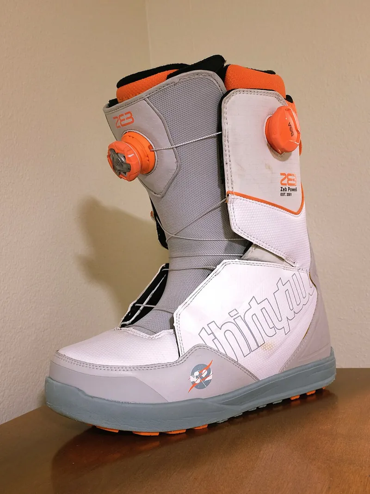

<figure class="eoc-pic eoc-pic-main"><figcaption><strong>Photo.</strong> <a href="https://commons.wikimedia.org/wiki/File:ThirtyTwo_snowboard_boot.jpg">ThirtyTwo snowboard boot</a> by WillisMoon, <a href="https://creativecommons.org/licenses/by/4.0">CC BY 4.0</a>, from Wikimedia Commons.</figcaption></figure>

A knob on a small reel that you turn to wind in a thin lace and pull two sides of a shoe, boot, brace or bag together; springy catches ([pawls](../glossary.md#pawl)) click over [ratchet](../glossary.md#ratchet) teeth so it cannot unwind by itself, and it releases when you pull the knob up or turn it backwards.

**In plain words:** A turn-to-tighten knob that winds a thin lace onto a small hidden reel, clicks as it tightens, holds tight by itself, and lets go only when you pull the knob out or turn it back by hand. **Proper term:** Reel-based closure (ratcheting reel lacing system, dial lacing system).

**Also called:** dial lacing system; reel lacing / reel-based lacing system; reel-based closure system; rotary closure; ratchet dial closure; lace reel; cable reel closure; micro-adjust dial; ratchet dial fit adjuster (on helmets); ratcheting shoelace tensioner (maker term); BOA (brand), BOA Fit System (brand), 'Boa laces' / 'Boa dial' (brand used as a generic name).

## How it works

Turning the knob turns the spool, which winds the lace in through holes in the housing and pulls the two sides of the opening together (rotary motion turned into a straight pull). Springy catches (pawls) ride over sloped ratchet teeth inside the housing, which makes the clicks; when you stop, lace tension tries to turn the spool back but the catches drop into the teeth and block it, so it stays tight with no effort (a one-way ratchet). To loosen, some knobs are lifted or pulled out, which uncouples the spool so the lace pays out all at once; others turn backwards, and ramps on the knob push the catches out of the teeth one click at a time (incremental release). In the patented design examined, three flexible pawl arms on the spool sit in about 33 triangular notches in the housing wall.

## Parts

A small assembly that acts as one unit: base/housing with a ring of ratchet teeth and lace holes, a spool (reel) that the lace winds onto, 2-3 springy catches (pawls, often flexible plastic arms moulded onto the spool or knob), a knob (dial) with drive lugs, a centre screw or clip, the lace itself (coated steel cable, polymer cable or cord) and low-friction lace guides on the far side of the opening.

## Everyday examples

- snowboard boots with one or two dials (one for the shin, one for the forefoot)
- cycling and golf shoes with a dial instead of laces
- medical braces and orthoses with a dial
- bike helmet fit dials at the back of the head, which use the same click-and-hold ratchet idea

## When to use it

When you want quick, even, repeatable tightening with one hand and no knots, and release in one movement: shoes, boots, braces, splints, helmet cradles, prosthetic sockets, bag and backpack compression, or tying down a bundle. Also good for fine tension adjustment of a cord over a long travel, such as winding up a tendon in a printed prosthetic hand. Useful for people who find tying laces hard (a maker designed a printed version for one-handed use).

## When not to use it

Not for heavy or safety-critical loads such as lifting, tie-downs, climbing or load securing: use a ratchet strap, winch or rated hardware instead. Not where the lace would rub on sharp or abrasive edges (snowboard edges fray steel laces), unless you add guides. Not where an accidental knock on a pull-to-release knob would be dangerous; choose a turn-back (incremental) release or a latch. For a simple fixed-tension closure, a buckle, cam cleat or cord lock is simpler. If the tension must never exceed a limit (medical use), use a reel with a built-in tension limiter.

## Details

- **What it does (jobs):**
  - tighten and hold tension: winds in a lace and keeps it tight
  - stop it moving back (one-way): the ratchet stops the lace unwinding by itself
  - lock, and release by hand: stays locked under load until you pull the knob up or turn it back
  - join and hold: pulls two edges of a shoe, boot, brace, helmet cradle or bag together
- **Movement:** multiple: the knob and spool rotate (unlimited turns, one way only while locked) and the lace slides through its guides as it winds in; pull-to-release knobs also move a few millimetres along their axis to unlock
- **Directions it can move (degrees of freedom):** 1 in normal use: the spool turns about one axis and the lace travel is tied to that turn. Pull-to-release knobs add a second, on/off [axial](../glossary.md#axial--radial) movement that uncouples the spool.
- **Special behaviour:**
  - tensioning (takes up slack and holds): each turn winds more lace onto the spool
  - one-way (moves freely one way, locks the other): turns freely to tighten, blocked from unwinding by the pawls
  - hand-release only: lace tension cannot open it; only a person pulling the knob or turning it back releases it
  - [self-locking](../glossary.md#self-locking) (won't back-drive): the load on the lace cannot turn the knob backwards
  - indexing (clicks into set positions): tension changes in small repeatable click steps
  - quick-release: pull-to-release knobs dump all the tension at once
  - motion conversion (rotary to linear): turning the knob becomes a straight pull on the lace
  - torque-limiting (some designs only): patented versions add a slipping clutch so the lace cannot be over-tightened, e.g. for medical braces
- **How it holds:** shape (the pawls interlock with the ratchet teeth; [form-fit](../glossary.md#form-fit--force-fit--material-bond)), with spring force (the pawls' own springiness) keeping them engaged
- **Input and output:** Input: rotation of the knob -> output: straight-line pull on the lace (rotary to linear). Lace taken in per knob turn = spool circumference; per click = spool circumference / number of ratchet teeth (about 33 teeth in one patented design). Simple designs have no gearing (1 knob turn = 1 spool turn) ⚑ [uncertain whether some commercial reels add internal gearing]. Efficiency: not published ⚑ [uncertain]; lace friction in the guides is the main loss, which is why low-friction guides and coated laces are used. Knob and spool are in line ([coaxial](../glossary.md#coaxial)). Back-drivable: no, lace tension cannot unwind the spool while the pawls are engaged.
- **Power:** passive (no power needed). Motorised 'powered lacing' shoes exist but are a different type (see related).
- **Load:** light to medium. Enough for shoes, boots, braces, helmets and bag compression straps. A maker's fully 3D-printed PLA reel held about 45 lb (about 200 N) in a weight test. Strong along the lace pull (taken by the pawls in the teeth); weak where the lace rubs over a sharp edge (it frays and snaps) and, on pull-to-release knobs, against an accidental upward knock of the knob. Load ratings of commercial reels were not found ⚑ [uncertain].
- **Play and precision:** small: tension can only be set to the nearest tooth (one click) and there is a little springback as the pawl settles into its notch. Repeatable enough that the same number of clicks gives much the same fit. Tolerates plenty of [misalignment](../glossary.md#misalignment) because the lace is flexible and runs through guides; the knob itself must turn on its own axis.
- **Taking it apart:** tool-free quick release: the lace is released by hand without tools (pull the knob or turn it back); the reel housing itself is sewn, riveted or screwed onto the item and is semi-permanent
- **How often it can be reused:** many times: tightening and releasing is its everyday job; the lace is the wearing part and is replaced when it frays (repair kits exist), while the dial is covered by a lifetime guarantee on the product it is fitted to according to one retailer
- **Sealing:** none (it closes an opening in a shoe, brace or bag but does not seal anything)
- **Adjustable:** yes: tension can be changed at any time in small click steps. Two-way (bi-directional) dials loosen one click at a time by turning back; pull-to-release dials release all at once and must be re-tightened.
- **Access needed:** one side only (blind): operated from the outside; the base is fixed to the outer surface, and the lace is routed through guides on the item
- **Materials:** Housing, spool and knob: moulded plastics in commercial reels ⚑ [uncertain which grades]. Lace: stranded stainless steel cable (e.g. 7x7) coated with a slippery plastic such as nylon or PTFE, single-strand nitinol wire, multi-strand polymer cable, or textile laces. Guides: low-friction polymer or metal tubes. Maker versions: PLA or PETG/ABS/ASA for the body, PA12 (nylon) for the springy click part, 0.8-1 mm UHMWPE (Dyneema) or UV-resistant cord for the lace.
- **Heat, cold, water and wear:** Printed reels: PLA softens and deforms above about 60 °C (a hot car or a boot by a heater) and degrades in UV light, while PETG handles up to about 80 °C and outdoor use (Prusa material guides). Cord: one maker chose UV-resistant 1 mm cord for shoes. Steel laces fray and snap when a sharp steel edge rubs them, for example a snowboard edge resting on the boot on a chairlift. Dirt, sand, ice and cold may stop the pawls engaging ⚑ [uncertain: not confirmed on an opened page]. Lace tension will not [creep](../glossary.md#creep) undone through the ratchet, but plastic parts held under constant tension can slowly creep ⚑ [uncertain for specific reels].

## Making it

- **Ways to make or get it:**
  - 3D print (FDM): the whole reel can be printed; pawls/click ring in PA12 or PETG
  - off-the-shelf part: replacement reel and lace kits
  - injection moulding (how commercial reels are made; not a home process)
- **Printing it in one piece (print in place):** no: printed as separate parts (base, spool, click/pawl ring, spacer, spring, knob) and assembled with a centre M3 screw; some designs glue the pawls in separately for strength
- **Tools:** none to use. Fitting: needle and thread, rivets or small screws (M3 screw and nut or [heat-set insert](../glossary.md#heat-set-insert) on printed versions). Lace replacement: small pliers and a replacement lace kit
- **Difficulty:** moderate: fully printable designs exist and work, but they need fine layers, a tough springy material for the pawls (nylon/PA12 or PETG), a strong lace anchored inside the spool and protection where the cord rubs; buying a replacement dial and lace kit is easier for footwear

### 3D printing tips

Proven printed designs: (1) Noel Swede's 'BOA style ratchet' (Printables 818537, CC BY) is fully printed in PLA, held about 45 lb in a weight test, and winds over 40 inches of 0.8 mm Dyneema (UHMWPE) cord. It needs a 0.4 mm nozzle and 0.2 mm or 0.1 mm layers (the author warns not to use 0.25 mm). The pawls are printed separately and glued in to make them stronger. The cap is held by an M3x10 screw in a heat-set insert, and pieces of 1/16 in welding wire act as [detents](../glossary.md#detent) that keep the cap down and as wear strips where the cord rubs over an edge. (2) MakerT's 'One-Hand Ratchet Lace Closure' (Printables 1743611, CC BY) turns to tighten and pulls to release. It was tested with a PA12 (nylon) click mechanism, PLA for the other parts and 1 mm UV-resistant cord. Recommended settings: 0.16 mm layers, 3-4 [perimeters](../glossary.md#perimeters), 20-40% [infill](../glossary.md#infill), Arachne on, supports only where needed. PETG, ABS or ASA are suggested for better durability. The click part is glued into its grooves one lip at a time with CA glue, so test that the glue works on your filament first. The lace is knotted and mechanically anchored inside the spool, so it does not rely on friction. Check that the M3 screw slides freely through the spacer and base and only threads into its captured nut. General advice: fine teeth and a small spool give finer adjustment. A prosthetic-hand builder found that only 5-6 clicks over the full range was too coarse, and that the cable bound up when released under tension. The fix was a larger ratchet wheel with more teeth and a smaller pull radius. Put the springy pawls in a tough material (PA12/PETG) rather than PLA, which Prusa describes as breaking into shards on impact. PLA also softens above about 60 °C and degrades in UV, so use PETG (fine below about 80 °C) or ASA for footwear and outdoor gear. Round off or reinforce every edge the lace passes over.

### Buying one (off-the-shelf parts)

Replacement dial/reel kits (search 'lace reel replacement kit', 'dial lacing replacement kit', 'BOA replacement kit' (brand)); coated stainless-steel lace cable; lace guides; UHMWPE (Dyneema) or braided polyester cord 0.8-1 mm; M3 screws, M3 nuts and M3 heat-set inserts for printed versions; helmet fit/retention ratchet dials sold as spares ⚑ [uncertain availability as a generic part].

## Rules of thumb

- Lace pulled in per click = spool circumference / number of ratchet teeth; one patented reel uses about 33 triangular notches (about 100 degree notch angle) and three flexible pawl arms (Boa Technology patent US8468657B2, https://patents.google.com/patent/US8468657B2/en). Worked example, illustrative only: a 10 mm spool with 33 teeth gives about 1 mm of lace per click.
- Too few clicks over the working range makes fine adjustment impossible: a printed tendon ratchet with 5-6 clicks from open to closed was too coarse, and the fix was more teeth and a smaller pull radius (https://hackaday.io/project/162231-hintha-modular-prosthetic-hand/log/156107-prototype-version-01-review-part-2-ratchet-system).
- Use a slippery lace in slippery guides: the patent examples use stranded stainless-steel cable (e.g. 7x7) coated with nylon or PTFE, running through tube-like guides of lubricious polymer or metal (https://patents.google.com/patent/US20120246974A1/en).
- Make the knob need a push to engage before it turns, so that it is not knocked loose by accident during wear (https://www.snowandrock.com/expert-advice-and-inspiration/buying-guides/what-is-the-boa-fit-system.html).
- Where people can over-tighten (for example braces for diabetic patients), add a tension-limiting slip clutch to the reel (Boa Technology patent US9629417B2, https://patents.google.com/patent/US9629417B2/en).
- A printed PLA reel with 0.8 mm Dyneema held about 45 lb (about 200 N); reinforce where the cord rubs, using metal wire as in that design (https://www.printables.com/model/818537-boa-style-ratchet, read via the Printables API).

## Common failures

(1) The lace frays and snaps, mostly where it rubs a sharp edge; carry a spare lace kit, as reels are designed to be serviced. (2) The pawls wear, crack or lose their spring, so the knob slips back or will not click; on printed versions make the pawls from nylon/PETG and glue them in as separate parts. (3) The knob pops off or releases by accident; use push-to-engage knobs, detents or a screw-held cap. (4) Coarse adjustment (too few clicks) or binding when released under load; use more, finer teeth and a smaller spool radius. (5) The lace slips at its anchor; anchor it mechanically inside the spool (knot in a pocket) rather than by friction. (6) Guides with high friction give uneven tension; use low-friction guides and coated lace.

## Safety

Over-tightening can cut off blood flow. A reel patent points out that for diabetic patients in braces this can lead to serious complications, which is why tension-limiting reels exist. A snapped steel lace leaves stiff wire ends that may scratch ⚑ [uncertain]. Pull-to-release knobs can release suddenly if caught on something, so don't use them where a sudden release is dangerous. Keep fingers out of the lace path while winding. Small parts are a choking risk for young children.

## Related

- Ratchet and pawl: the basic one-way mechanism inside the reel, without the spool and lace
- Ratchet strap / linear ratchet (cable tie): also tightens and holds, but the ratchet acts on a strap or toothed strip, not on a wound lace
- Winch or capstan with pawl: the same wind-up-and-hold idea at much higher loads
- Spring-return reel (constant-force spring reel): winds cord back in automatically instead of holding it locked
- Cam cleat / cord lock: holds a cord at any position by pinching it, with no winding or clicking
- Friction slip clutch / ratchet-tooth [torque](../glossary.md#torque) limiter: some reels include one so they cannot be over-tightened
- Quick-lace pull cord with locking slider (as on some snowboard boots): pull by hand and lock, with no dial
- Motorised (powered) self-lacing shoes: a motor does the winding
- Lacing: the cord threaded back and forth through rows of holes or eyelets that a reel winds in; on its own, lacing is pulled tight by hand and tied

## Make it yourself

- [BOA style ratchet by Noel Swede (Printables 818537; details read via the Printables public API because the page blocks bots)](https://www.printables.com/model/818537-boa-style-ratchet): Fully 3D-printed dial reel in PLA with glued-in pawls and a pull-the-cap release, used to cinch a hiking backpack; tested to about 45 lb with 0.8 mm Dyneema cord *(licence: Creative Commons Attribution (CC BY))*
- [One-Hand Ratchet Lace Closure by MakerT (Printables 1743611; details read via the Printables public API)](https://www.printables.com/model/1743611-one-hand-ratchet-lace-closure): Printable shoe closure you turn to tighten and pull to release, designed for one-handed use; PA12 click mechanism, PLA body, M3 hardware, 1 mm cord *(licence: Creative Commons Attribution (CC BY))*
- [Ratchet Wheel For Laces (Hackaday.io)](https://hackaday.io/project/196195-ratchet-wheel-for-laces): Student-style build log of a lace ratchet inspired by snowboard boot dials: base, ratchet wheel, spool and rod, released by lifting a hook; prototyped in cardboard, then wood, then 3D print *(licence: ⚑ [uncertain])*

## Pictures, videos and models

- [ThirtyTwo snowboard boot.jpg (Wikimedia Commons, by WillisMoon, 2024)](https://commons.wikimedia.org/wiki/File:ThirtyTwo_snowboard_boot.jpg): Photo of a snowboard boot with two dial lace reels: the front dial tightens the shin area and the side dial tightens the forefoot *(licence: CC BY 4.0 (reuse with credit))*
- [US8468657B2 - Reel based lacing system (Boa Technology, 2013)](https://patents.google.com/patent/US8468657B2/en): Patent drawings of the housing with ratchet notches, the spool with flexible pawl arms, and the knob, with a step-by-step explanation of tightening and release *(licence: link only (patent document; drawings shown on Google Patents))*
- [Tightening and loosening boa closure (Singletracks Mountain Biking, YouTube; title confirmed via YouTube oEmbed)](https://www.youtube.com/watch?v=A1jLRv8jieQ): Video demonstration of tightening a dial closure by turning it and releasing it *(licence: link only)*
- [Boa reel - extracting the wire (Luxue, YouTube; title confirmed via YouTube oEmbed)](https://www.youtube.com/watch?v=9vak_WRQgYg): Video of a reel from a snowboard boot being opened to pull out the lace wire *(licence: link only)*
- [Hintha modular prosthetic hand - Prototype v0.1 review part 2: ratchet system (Hackaday.io)](https://hackaday.io/project/162231-hintha-modular-prosthetic-hand/log/156107-prototype-version-01-review-part-2-ratchet-system): Photos and write-up of a 3D-printed cable ratchet inspired by dial closures, including what went wrong (coarse clicks, binding on release) and the redesign *(licence: link only ⚑ [uncertain])*

## Needs confirming

⚑ marks something nobody has confirmed yet: a fact the research could not confirm from a source, a finder value that is a best guess, or an open point from the research notes. Corrections are welcome (see `research/needs-confirming.md`).

- ⚑ 10 sentences on this page marked [uncertain].

## Sources

- <https://patents.google.com/patent/US8468657B2/en>
- <https://patents.google.com/patent/US20120246974A1/en>
- <https://patents.google.com/patent/US9629417B2/en>
- <https://en.wikipedia.org/wiki/Snowboard>
- <https://commons.wikimedia.org/wiki/File:ThirtyTwo_snowboard_boot.jpg>
- <https://www.snowandrock.com/expert-advice-and-inspiration/buying-guides/what-is-the-boa-fit-system.html>
- <https://ride.shimano.com/blogs/technologies/boa%E2%93%A1-fit-system-dial-everything-you-want-to-know>
- <https://theskimonster.com/blogs/posts/how-to-fix-a-boa-dial-and-lace-on-your-snowboard-boots>
- <https://hackaday.io/project/162231-hintha-modular-prosthetic-hand/log/156107-prototype-version-01-review-part-2-ratchet-system>
- <https://hackaday.io/project/196195-ratchet-wheel-for-laces>
- <https://www.printables.com/model/818537-boa-style-ratchet (read via https://api.printables.com/graphql/)>
- <https://www.printables.com/model/1743611-one-hand-ratchet-lace-closure (read via https://api.printables.com/graphql/)>
- <https://api.printables.com/graphql/>
- <https://www.youtube.com/watch?v=A1jLRv8jieQ (verified via YouTube oEmbed)>
- <https://www.youtube.com/watch?v=9vak_WRQgYg (verified via YouTube oEmbed)>
- <https://help.prusa3d.com/article/pla_2062>
- <https://help.prusa3d.com/article/petg_2059>
