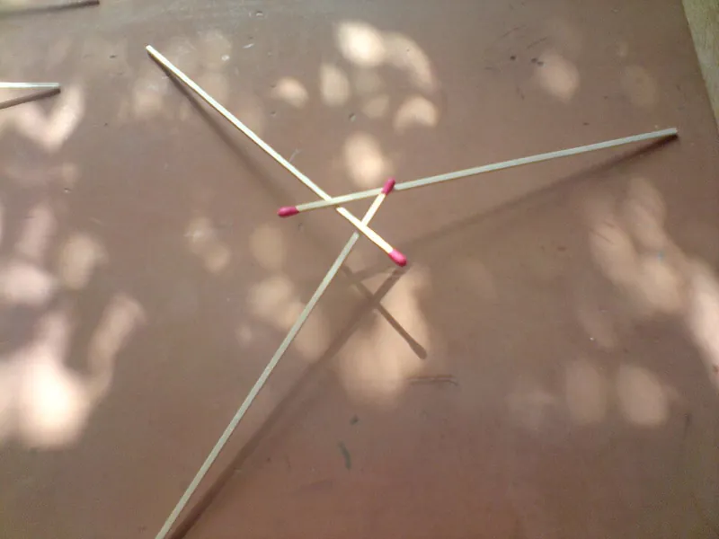

<figure class="eoc-pic eoc-pic-main"><figcaption><a href="https://commons.wikimedia.org/wiki/File:Three_stick_reciprocal_frame.JPG">Three stick reciprocal frame</a> by PeterEastern (talk), <a href="https://creativecommons.org/licenses/by-sa/3.0">CC BY-SA 3.0</a>, from Wikimedia Commons.</figcaption></figure>

A reciprocal frame is a closed ring of three or more sticks or beams in which each one rests on the next and carries the one before. Together they span a roof or a gap with no central support, held by their own weight and friction, or by simple ties.

**In plain words:** Sticks or beams laid in a ring so that each one rests on the next and holds up the one before. Together they prop each other up with no post in the middle and, in the simplest version, no glue, nails or string, like the woven popsicle-stick 'Leonardo bridge'. **Proper term:** Reciprocal frame (self-supporting structure of mutually supporting beams).

**Also called:** reciprocal frame, RF, reciprocal frame structure, reciprocal framework, reciprocal roof (Wikipedia 'Reciprocal frame'; STRUCTURE magazine); Mandala roof (Wikipedia 'Reciprocal frame'); nexorade (term used by Baverel; STRUCTURE magazine); Hebelstabwerk (German; title of Thönnissen's book cited by STRUCTURE magazine); Leonardo bridge, da Vinci bridge, Leonardo da Vinci's self-supporting bridge, da Vinci popsicle-stick bridge (Wikipedia 'Da Vinci's self supporting bridge'; Science City); Da Vinci dome, a dome of sticks in reciprocal units (Song et al., 'Reciprocal Frame Structures Made Easy', 2013); the three-knife puzzle: three knives that hold each other up in the air, first published in 1624 (ProofWiki, citing van Etten); not to be confused with the Leonardo Bridge Project's 'da Vinci Bridge' in Ås, Norway, a laminated-timber arch based on Leonardo's Golden Horn design (Wikipedia 'Leonardo bridge').

## How it works

Each member is supported at its outer end (on the ground, a wall or a riverbank), and its inner end rests on the middle of the next member, while the member before rests on it in turn. So every member both supports, and is supported by, its neighbours, and none is more important than the others (STRUCTURE magazine; Wikipedia). A load anywhere is shared round the whole ring to the outer supports, mainly through bending and [shear](../glossary.md#peel-vs-shear) in the members (STRUCTURE). In the stick 'Leonardo bridge' the sticks are woven over and under each other, and their own weight and any load press the crossings together, so friction holds them with 'no nails, dowels, or ropes' (Wikipedia 'Da Vinci's self supporting bridge'); STRUCTURE notes that Leonardo's timbers had no cuts or notches. Because the ring is closed, removing one member usually makes the whole frame collapse (STRUCTURE; Wikipedia).

## Parts

A few parts, up to a large assembly: at least three similar straight members (sticks, poles or beams) laid in a closed ring, called an RF unit; big roofs, domes and bridges repeat the unit as a grid (Wikipedia; STRUCTURE magazine; Song et al. 2013). Optional extras: notches, ties (rope or wire), nails or bolts at the crossings, a wall or ring beam for the outer ends, and a temporary central prop while building (Wikipedia; The Year of Mud).

## Everyday examples

- The woven popsicle-stick 'Leonardo da Vinci bridge' built in school STEM sessions and at science centres (Science City; Wikipedia)
- The old table puzzle of making three knives hold each other up between glasses, first published in 1624 (ProofWiki, citing van Etten's Récréations Mathématiques)
- Turf-roofed roundhouses whose roof poles spiral round a central opening, such as That Roundhouse in Pembrokeshire, Wales (Wikipedia 'That Roundhouse'; Wikipedia 'Reciprocal frame' gallery)
- Self-supporting timber footbridges built to Leonardo's design, e.g. in Karby, Denmark, and in Freiburg, Germany (Wikimedia Commons)

## When to use it

Use it when you want to span a space with members shorter than the span: a roof over a round building, a garden pavilion or a small footbridge (STRUCTURE magazine; Wikipedia). It is a good choice when you have only short or reclaimed timber, since current research uses short re-used timbers (STRUCTURE). Use it when you want something that goes up quickly with simple two-member connections; a complex frame was put up in Copenhagen in 15 minutes by hand (STRUCTURE). It also suits a temporary or demonstration structure that assembles and comes apart without tools or fixings, as in Leonardo's military bridge, STEM lessons and printed models (Wikipedia; Science City). It is also chosen for its striking spiral look (STRUCTURE).

## When not to use it

Don't rely on a friction-only frame where it can be knocked, pushed sideways or shaken. It topples under side loads and can come apart under vibration (Science City; Wikipedia), so tie or bolt the crossings, or choose a truss, an arch or a conventional beam-and-post structure. Avoid a single closed ring where failure of one member would be dangerous, because the whole frame collapses; add redundancy or use a structure with alternative load paths (STRUCTURE magazine; Wikipedia). Avoid it where [deflection](../glossary.md#deflection) must be small, because reciprocal frames deform more than similar-span conventional structures (STRUCTURE). For joining just two or three members at one point, use a cross-halving or Japanese interlocking joint instead.

## Details

- **What it does (jobs):**
  - join and hold: joins short members into a roof, floor, bridge or dome that spans further than any single member could (STRUCTURE magazine; Wikipedia)
  - lock, and release by hand: a friction-only stick bridge is assembled without tools and comes apart when one piece is lifted out (Wikipedia 'Da Vinci's self supporting bridge')
- **Movement:** none: a static structure that only works while every member stays in place
- **Directions it can move (degrees of freedom):** 0 when assembled and loaded: each member is trapped between the member it rests on, the member resting on it and its outer support. A lightly loaded stick bridge is only held by friction, so a knock or a sideways push can free the members (Science City).
- **Special behaviour:**
  - [self-locking](../glossary.md#self-locking) (holds under load, won't back-drive): in the Leonardo stick bridge, extra weight presses the crossings together harder, so 'the more weight on the bridge, the stronger it becomes' (Open Culture; Wikipedia: held together by compressive forces from its own weight and friction)
  - quick-release: Leonardo's bridge was meant to be set up in minutes and 'collapsed by removing any single piece' (Wikipedia 'Da Vinci's self supporting bridge', citing Geddes 2016)
- **How it holds:**
  - shape (the parts interlock; [form-fit](../glossary.md#form-fit--force-fit--material-bond)): the over-and-under weave traps each stick, and in timber roofs notches stop members sliding off each other (Wikipedia; STRUCTURE magazine; The Year of Mud)
  - friction or clamping (force-fit): self-weight and load press the crossings together; friction-only bridges have no other fixing, and roofs add wire or rope lashings, nails or bolts at the crossings (Wikipedia; The Year of Mud; Milkwood)
- **Input and output:** not applicable
- **Power:** passive (no power needed)
- **Load:** Light for stick and printed models, up to heavy for timber roofs and footbridges. Strong under downward loads spread over the frame. Weak against sideways pushes, which can topple a stick bridge (Science City: 'lateral force (from the sides) may cause it to topple'), and against vibration near its natural frequency, which makes a friction bridge shake itself apart (Wikipedia, citing Bucolo et al. 2020). The members work mainly in bending and shear, so a reciprocal frame deflects more than a conventional structure of similar span (STRUCTURE magazine). A simple closed ring 'is only as strong as the weakest element' (Wikipedia). A model of 77 wooden sticks 3 mm thick could carry a book (Song et al. 2013).
- **Play and precision:** not applicable for locating parts. When building, small errors add up round the ring: the last member has to go on top of the one before and under the first, which can be a very tight squeeze, and uneven spacing gives a lopsided central opening (The Year of Mud). Precisely cut notches give firmer contact at the crossings (STRUCTURE magazine).
- **Taking it apart:** tool-free quick release for friction-only stick bridges and models, which come apart when a piece is lifted out (Wikipedia). Removable for lashed or bolted timber roofs, but only with the frame propped first, because taking out one member can drop the rest (STRUCTURE magazine) ⚑ [uncertain].
- **How often it can be reused:** effectively unlimited for loose sticks and printed or wooden model kits; a few times for lashed or bolted timber frames; once where members are notched to fit and nailed ⚑ [uncertain]
- **Sealing:** none
- **Adjustable:** Only while building: the rise of the frame, the size of the central opening and the span are set by member length, number of members, where each member rests on the next (engagement length) and how high the first member is propped (STRUCTURE magazine; Song et al. 2013; The Year of Mud). Once the ring is closed it can't be adjusted without propping it and taking it apart.
- **Access needed:** not applicable: members are laid on top of each other from above; full-size roofs are built from the wall top or a ladder round a temporary central prop
- **Materials:** Mostly timber: roundwood poles, sawn beams or glulam (STRUCTURE magazine; Wikipedia). Steel has also been used, e.g. tubular steel in the Rokko-Shidare observatory, and in principle concrete (STRUCTURE). For models: jumbo popsicle sticks (Science City), 3 mm wooden sticks (Song et al. 2013), or 3D-printed PLA beams (Printables 'Exercise model for reciprocal frameworks'). Any stiff, straight member with enough friction where members cross will work ⚑ [uncertain].
- **Heat, cold, water and wear:** Vibration: a friction-held Leonardo bridge 'tends to disassemble when subjected to frequencies close to its resonant frequency' (Wikipedia, citing Bucolo et al. 2020). Wind and sideways knocks can topple light stick structures (Science City). Long-term load: timber [creep](../glossary.md#creep) must be allowed for, and deformations are larger than in conventional frames because there are many timber connections (STRUCTURE magazine). Wet, icy or very smooth surfaces should reduce friction at the crossings and at the feet ⚑ [uncertain]; STRUCTURE notes that ordinary friction on a paved street was enough to stabilise one frame. Outdoor timber and lashings need the usual protection from rot ⚑ [uncertain]. Printed PLA models soften in hot sun and can creep under constant load ⚑ [uncertain].

## Making it

- **Ways to make or get it:**
  - woodwork: roundwood poles or sawn timber for roofs and footbridges; craft sticks, pencils or dowels for models (Wikipedia; The Year of Mud; Science City)
  - 3D print (FDM): identical printed sticks or beams for Leonardo bridges and reciprocal grids (Printables models 685468, 844202, 485402, 906462)
  - CNC: precise notches cut with 3D cutting tools for good contact in timber reciprocal roofs (STRUCTURE magazine)
  - laser cut: flat notched sticks for models ⚑ [uncertain]
  - off-the-shelf part: craft (popsicle) sticks, dowels, poles
- **Printing it in one piece (print in place):** no: each member is printed separately and the ring is assembled by hand. The printable models are printed flat without supports (Printables 'Exercise model for reciprocal frameworks').
- **Tools:** None for a friction stick bridge or model: 'no tools are needed for assembly' (Wikipedia 'Da Vinci's self supporting bridge'). For a roof: a saw, a chisel or axe for notches, heavy-gauge wire or rope for lashing, a drill and long spike nails or bolts for secondary rafters, and a braced temporary central prop called a 'charlie stick' (The Year of Mud; Milkwood).
- **Difficulty:** easy for stick or printed models: you only need identical sticks, a flat stable surface and patience (Science City). Moderate to hard full size: shaping the overall form needs geometry or parametric tools, building needs a braced temporary prop, and the outward push on the walls must be resisted (STRUCTURE magazine; The Year of Mud; Wikipedia).

### 3D printing tips

1) Print the sticks flat with no supports. One educational reciprocal-grid model used PLA, 0.3 mm layers and 15% [infill](../glossary.md#infill); its gaps are small enough to bridge, and flipping the beams helps if bed adhesion is poor, because the end gaps start as small islands (Printables 'Exercise model for reciprocal frameworks', CC BY-NC). 2) Print plenty of identical pieces: Felix van der Spek's Leonardo bridge needs part 1 ten times and part 2 five times, and can be scaled to any size (Printables 'Leonardo da Vinci's bridge'). 3) Proportions: for the Leonardo bridge, a height-to-length ratio of about 0.30 was the best compromise between efficiency and ease of crossing (Lamberti et al. 2024, Ciência e Natura). 4) Shallow notches or saddles where members cross keep smooth printed sticks from sliding, but notches weaken a member, so keep them shallow (STRUCTURE magazine discusses notches in timber) ⚑ [uncertain]. 5) Build round a temporary prop, such as a cup or block holding the first stick at the right height, then slide the last stick over the previous one and under the first, as full-size builders do (Wikipedia; The Year of Mud). 6) Choose clockwise or anticlockwise and keep to it; the exercise model shows both, plus a checkerboard mix of the two (Printables 906462). 7) For a model that stays assembled on display, PLA beams under constant load may sag over time; a permanent model can be glued ⚑ [uncertain].

### Buying one (off-the-shelf parts)

For models: jumbo craft (popsicle) sticks, pencils, straws, dowels or skewers (Science City). Full size: roundwood poles, sawn timber or glulam beams (Wikipedia; STRUCTURE magazine), heavy-gauge wire, rope or sisal lashing, long spike nails or bolts for the crossings, and a forked pole as the temporary prop (The Year of Mud; Milkwood). Ready-made 'da Vinci bridge' STEM kits are sold ⚑ [uncertain].

## Rules of thumb

- At least three members are needed to close the basic ring, the RF unit (Wikipedia; STRUCTURE magazine; Song et al. 2013).
- Leonardo bridge: for 4-7 m wooden bridges, a height-to-length ratio of about 0.30 was the best compromise; taller is more efficient but harder to walk over (Lamberti et al. 2024, Ciência e Natura).
- Roofs work best at low [pitch](../glossary.md#pitch), where little outward thrust reaches the ring beam and most of the load goes straight down (Wikipedia).
- Engagement length (how far along each member the next one rests) controls the balance of shear and bending and, with member length, the rise of the frame. Eccentricity (the vertical offset between member centrelines at a crossing) also matters: the smaller it is, the more the frame behaves like an ordinary beam grid (STRUCTURE magazine).
- Each connection joins only two members. Notches give good contact but reduce section strength, so check shear there (STRUCTURE magazine).
- Build round a temporary central support holding the first member; the last member goes on top of the previous one and under the first; tie the crossings, then remove the support (Wikipedia). Leave the prop a little long, because the roof may settle when it comes out (The Year of Mud).
- Add redundancy, such as doubled rafters, several interconnected units or stiffer joints, so that one failed member doesn't bring down the whole frame (STRUCTURE magazine; Wikipedia gallery).

## Common failures

The whole frame collapses when one member is removed, slips or breaks; add ties, notches or redundant members (STRUCTURE magazine; Wikipedia). It topples or shakes apart from a sideways knock or vibration; move the bridge as little as possible once built, and tie the crossings for anything permanent (Science City; Wikipedia). The last member won't fit because of accumulated error; lever it into place with extra hands (The Year of Mud). The central opening is lopsided because spacing at the wall was uneven; use a guide disc for the opening and space the rafters evenly (The Year of Mud). Walls get pushed out by the roof's outward thrust; keep the pitch low and resist the thrust with a ring beam (Wikipedia; The Year of Mud reader comment). There is excessive sag over time from timber creep and soft connections (STRUCTURE). Notches cut too deep weaken members in shear (STRUCTURE). Members slide off each other in 'all-down' or mixed arrangements, which are used to follow a curved surface; these are not self-supporting and the rods must be tied (Song et al. 2013).

## Safety

Collapse is the main hazard: in a simple closed ring all members depend on each other, so removing or breaking one usually brings the whole frame down (STRUCTURE magazine; Wikipedia). Never stand on or under a friction-only frame, and treat full-size Leonardo bridges and roofs as engineered structures needing proper design (STRUCTURE: robustness and progressive collapse are 'essential issues'). Roof building involves heavy poles (roughly 5 in diameter in The Year of Mud's roof) lifted overhead: brace the temporary prop and have someone watch it while the first rafters go up (The Year of Mud). Reciprocal roofs push outwards on their walls, especially at steeper pitches, so walls need a ring beam or buttressing (Wikipedia; a reader comment on The Year of Mud). Small models are low risk, though sticks spring apart when the frame collapses.

## Related

- Cross-halving slot joint (egg-crate joint): two members interlock at a single notched crossing; a reciprocal frame shares load round a ring of many members resting on each other
- Japanese interlocking joints: lock two or three members at one node with complex cut shapes; reciprocal frame crossings are simple two-member contacts
- Zollinger frame (lamella roof): short timbers joined at their mid-points in one plane to form diamonds; STRUCTURE magazine calls it a type of reciprocal frame with a more direct, compression-dominated load path
- Arch, as in the 'da Vinci Bridge' in Ås, Norway: carries load in compression along a curve and needs strong abutments, whereas reciprocal frame members work mainly in bending
- Tab-and-slot joint and finger joint: ways to make a printed or laser-cut stick model permanent instead of friction-held
- Tensegrity: also self-supporting, but its struts don't touch each other and are held in place only by tensioned cords or chains, whereas reciprocal frame members rest on each other
- Pole lashings: square, diagonal or shear lashings that tie the crossings of a pole reciprocal frame so they can't slip apart

## Make it yourself

- [Exercise model for reciprocal frameworks (alecs.form, Printables) (URL from Printables API, page not opened)](https://www.printables.com/model/906462-exercise-model-for-reciprocal-frameworks): Identical printable beams for building clockwise, anticlockwise and mixed reciprocal grids, with supports that lift the grid to show it carrying load; PLA, no supports. Read through the Printables public API. *(licence: CC BY-NC (Creative Commons Attribution-NonCommercial))*
- [Leonardo da Vinci's bridge (Felix van der Spek, Printables) (URL from Printables API, page not opened)](https://www.printables.com/model/685468-leonardo-da-vincis-bridge): Printable stick set for the self-supporting bridge (part 1 x10, part 2 x5) with a storage box; scale to any size. Read through the Printables public API. *(licence: CC BY-NC (Creative Commons Attribution-NonCommercial))*
- [Leonardo da Vinci's self-supporting bridge (Gordyt47, Printables) (URL from Printables API, page not opened)](https://www.printables.com/model/844202-leonardo-da-vincis-self-supporting-bridge): Printable self-supporting bridge model, printed in PLA at 0.2 mm with 15% infill and no supports. Read through the Printables public API. *(licence: CC BY-NC (Creative Commons Attribution-NonCommercial))*
- [Sticks to build Da Vinci's bridge (Kaje, Printables) (URL from Printables API, page not opened)](https://www.printables.com/model/485402-sticks-to-build-da-vincis-bridge): Simple printable sticks for building Leonardo's bridge or other self-supporting shapes. Read through the Printables public API. *(licence: Public domain (Creative Commons Public Domain))*
- [Da Vinci Popsicle Stick Bridge (Science City at Union Station, Kansas City)](https://sciencecity.unionstation.org/2020/04/06/da-vinci-popsicle-stick-bridge/): Science-centre activity: weave jumbo popsicle sticks into a self-supporting bridge with no fasteners or glue *(licence: link only)*

## Pictures, videos and models

- [Three stick reciprocal frame.JPG (Wikimedia Commons, by PeterEastern, 2009)](https://commons.wikimedia.org/wiki/File:Three_stick_reciprocal_frame.JPG): Photo of the simplest reciprocal frame: three sticks, each resting on the next in a closed triangle *(licence: CC BY-SA 3.0)*
- [Longer reciprocal frame bridge.JPG (Wikimedia Commons, by PeterEastern, 2009)](https://commons.wikimedia.org/wiki/File:Longer_reciprocal_frame_bridge.JPG): Photo of a longer stick bridge built from repeated reciprocal units *(licence: CC BY-SA 3.0)*
- [Leonardo da Vinci bridge Karby.jpg (Wikimedia Commons, by Cntrading, built by Martin Benthin, 2011)](https://commons.wikimedia.org/wiki/File:Leonardo_da_Vinci_bridge_Karby.jpg): Full-size self-supporting timber bridge built to Leonardo's design in Karby, Denmark *(licence: Free Art License (FAL))*
- [Pont autoportant de Vinci.png (Wikimedia Commons, Leonardo da Vinci, Codex Atlanticus)](https://commons.wikimedia.org/wiki/File:Pont_autoportant_de_Vinci.png): Leonardo's own sketch of the self-supporting bridge from the Codex Atlanticus *(licence: Public domain)*
- [The MAGIC behind Da Vinci's Self Supporting Bridge! (YouTube, Sabin Civil Engineering)](https://www.youtube.com/watch?v=5l4I-caLoxY): Animated explanation of how the woven bridge locks itself under load (title and channel checked via YouTube oEmbed; summarised by Open Culture) *(licence: link only (standard YouTube licence))*

## Needs confirming

⚑ marks something nobody has confirmed yet: a fact the research could not confirm from a source, a finder value that is a best guess, or an open point from the research notes. Corrections are welcome (see `research/needs-confirming.md`).

- ⚑ 10 sentences on this page marked [uncertain].

## Sources

- <https://en.wikipedia.org/wiki/Reciprocal_frame>
- <https://en.wikipedia.org/wiki/Da_Vinci's_self_supporting_bridge>
- <https://en.wikipedia.org/wiki/Leonardo_bridge>
- <https://en.wikipedia.org/wiki/That_Roundhouse>
- <https://www.structuremag.org/article/reciprocal-frame-structures/>
- <http://www.cse.cuhk.edu.hk/~cwfu/papers/recipframe/download/paper.lowres.pdf>
- <https://periodicos.ufsm.br/cienciaenatura/article/view/86798>
- <https://www.openculture.com/2024/12/the-ingenious-engineering-of-leonardo-da-vincis-self-supporting-bridge-explained.html>
- <https://sciencecity.unionstation.org/2020/04/06/da-vinci-popsicle-stick-bridge/>
- <https://theyearofmud.com/2008/11/26/how-to-build-a-reciprocal-roof-frame/>
- <https://www.milkwood.net/2013/07/15/roundhouse-build-making-a-reciprocal-roof/>
- <https://proofwiki.org/wiki/Arrange_3_Knives_to_Rest_on_Tips_of_Handles>
- <https://commons.wikimedia.org/wiki/File:Three_stick_reciprocal_frame.JPG>
- <https://commons.wikimedia.org/wiki/File:Longer_reciprocal_frame_bridge.JPG>
- <https://commons.wikimedia.org/wiki/File:Leonardo_da_Vinci_bridge_Karby.jpg>
- <https://commons.wikimedia.org/wiki/File:Pont_autoportant_de_Vinci.png>
- <https://commons.wikimedia.org/wiki/File:Da_vinci_bridge.jpg>
- <https://www.youtube.com/watch?v=5l4I-caLoxY>
- <https://api.printables.com/graphql/>
