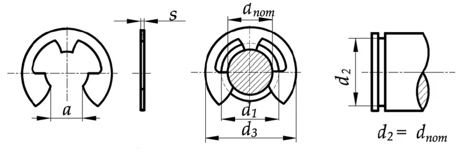

*Picture: [Sicherungsring auf Welle mit Wellennut.png](https://commons.wikimedia.org/wiki/File:Sicherungsring_auf_Welle_mit_Wellennut.png) by HobbyAstronaut, [CC0](http://creativecommons.org/publicdomain/zero/1.0/deed.en), from Wikimedia Commons.*

A springy steel ring or clip that snaps into a groove on a shaft or inside a hole, so that the part left sticking out forms a removable shoulder that stops wheels, bearings, gears or pins sliding along or falling out.

**In plain words:** A springy steel ring with a gap, or a flat E-shaped clip, that snaps into a groove cut round a rod or inside a hole. The part that sticks out of the groove makes a little step that stops a wheel, bearing, gear or pin sliding off. **Proper term:** Retaining ring ([circlip](../glossary.md#circlip)).

**Also called:** circlip (from 'circle' + 'clip'), C-clip, snap ring, 'Jesus clip' (slang) (Wikipedia 'Circlip'); external circlip or shaft ring (DIN 471) and internal circlip or bore/housing ring (DIN 472); inch series to ASME B18.27; British BS 3673-4 (Wikipedia 'Retaining ring'; RoyMech circlip index); Seeger ring or Seeger circlip: today's lug-type ring comes from a 1928 Seeger-Orbis patent (Seeger is a brand, often used as a generic name in Europe) (Wikipedia 'Retaining ring'); E-clip, E-ring, E-type circlip, retaining washer for shafts (DIN 6799; German 'Sicherungsscheibe'); Benzing ring or Benzing washer (after its inventor Hugo Benzing; brand) (Wikipedia 'Circlip' and 'Retaining ring'; Wikimedia Commons 'ARFISA 02 lock washer.svg'); Other shapes a beginner may meet: crescent ring or C-ring, poodle ring or Klip (wide 'ears'), bowed E-ring, bevelled ring, inverted ring, reinforced or heavy-duty ring, interlocking two-piece ring, side-mount ring (Rotor Clip Ultimate Retaining Ring Guide; Wikipedia 'Retaining ring'; McMaster-Carr); spiral retaining ring or coiled ring, e.g. Spirolox (brand, Smalley) (Wikipedia 'Retaining ring'; Smalley blog); push-on retaining ring, toothed push-on ring, [self-locking](../glossary.md#self-locking) ring, grip ring: types that need no groove (Rotor Clip white paper; McMaster-Carr); Truarc or Waldes Truarc (brand; old US trade name for retaining rings, still used for part numbers) (Rotor Clip part search; Wikimedia Commons 'Internal Snap Ring.jpg').

## How it works

The ring is made a little smaller than the groove (for a shaft) or a little larger (for a bore), so you have to spring it open or squeeze it to fit it, and it then snaps back and grips the groove (Wikipedia 'Circlip': sized for an [interference fit](../glossary.md#interference-fit) and 'elastically deformed' to install or remove). The part of the ring that sticks out of the groove acts as a shoulder: anything pushed along the shaft hits the ring, and the ring passes that push into the side wall of the groove (Rotor Clip Ultimate Retaining Ring Guide). The shaft or the retained part can still turn, because the ring only stops movement along the axis (Wikipedia 'Circlip'). A tapered-section circlip gets wider away from the gap, so it stays round and touches the groove nearly all the way round; an E-clip is pushed on from the side and touches the bottom of the groove with its three prongs (Smalley tapered-section blog; Rotor Clip guide p.19).

## Parts

Single piece: one spring-steel ring. Main shapes: a tapered-section circlip with two lugs with holes for pliers; an E-shaped clip with three prongs that pushes on from the side; a coiled spiral ring with no lugs; and a toothed push-on ring for shafts with no groove (Rotor Clip Ultimate Retaining Ring Guide; Wikipedia 'Retaining ring'). It needs a groove of the right size cut in the shaft or bore (except the push-on and self-locking types), and usually a pair of circlip pliers or an E-clip applicator to fit it.

## Everyday examples

- The ring that holds the single sprocket on a bicycle's rear hub (Wikipedia 'Circlip' diagram)
- The clips that stop the rotating cutters of a paper shredder walking off their shaft (Rotor Clip guide p.18)
- The small clips on each end of the gudgeon pin in a motorbike or lawnmower piston (a Printables fitting tool exists for KTM pistons) ⚑ [uncertain: lawnmower example not checked]
- The E-clip on the end of a robot-kit or toy axle, or on the shaft of a window blind (gm0; Rotor Clip guide p.31)

## When to use it

Use a retaining ring when you need a cheap, compact, removable 'step' on a round shaft or in a round hole: to stop a wheel, pulley, gear or lever sliding off an axle, to hold a bearing in its housing, or to stop a hinge or clevis pin falling out. It takes up far less room than a nut on a threaded end or a pinned collar, needs only a simple groove, and 'will not require periodic re-torquing as a nut and bolt might' (Rotor Clip FAQ). E-clips suit small shafts where you can reach the groove from the side, lug-type circlips suit heavier [thrust loads](../glossary.md#thrust-load), and spiral rings suit places where lugs would get in the way or you want 360° contact (Rotor Clip guide; Smalley blog). Use bowed rings when parts must be held without rattle (Rotor Clip white paper).

## When not to use it

Don't use one when the part must be set at any position along the shaft: use a shaft collar with a [set screw](../glossary.md#set-screw) or clamp instead (gm0). Avoid it when you can't cut an accurate groove (e.g. a hardened shaft or thin tube): use a push-on ring on soft shafts, or a collar (Rotor Clip white paper). Don't rely on a plastic groove for real loads: in 3D prints an annular snap fit, a snap pin or a screw with a washer into a [heat-set insert](../glossary.md#heat-set-insert) is often easier. Don't use it when the parts must be clamped tight with no play: use a nut, or a bowed or bevelled ring (Rotor Clip white paper). Don't use it where the joint must come apart often without tools: use a hitch pin and R-clip or a quick-release pin. For very high speed or heavy vibration, plain E-clips can come off; use reinforced E-rings, interlocking rings or lug-type circlips (Rotor Clip FAQ; Rotor Clip guide p.23).

## Details

- **What it does (jobs):**
  - join and hold: stops a part sliding along or off a shaft, or out of a hole, e.g. keeps a wheel on an axle, a bearing in its housing or a pin in a hinge; it can replace a nut on a threaded end, or a cotter pin and washer (Rotor Clip FAQ; Wikipedia 'Circlip')
  - let it move (turn, slide or bend): the retained wheel, gear or lever can usually still turn on the shaft; the ring only blocks sliding along it (Wikipedia 'Circlip')
  - tighten and hold tension (bowed and bevelled rings only): they press the parts together to take up end play (the small amount the parts can slide along the shaft) (Rotor Clip white paper)
  - stop it moving back (one-way) (toothed push-on rings only): they slide onto a plain shaft one way, and their prongs dig in if pushed back (Rotor Clip white paper)
- **Movement:** none along the shaft: it blocks sliding. When it keeps a wheel, pulley or lever on an axle, the joint as a whole is 'rotate' (unlimited turning), because the ring does not stop rotation (Wikipedia 'Circlip').
- **Directions it can move (degrees of freedom):** Usually 1 (turning about the shaft is left free) when a ring on each side, or a ring plus a fixed shoulder, traps the part. One ring blocks sliding in one direction only, so a second ring, a step in the shaft or a spacer is needed to stop the other direction. A little end play remains unless a bowed or bevelled ring is used (Rotor Clip white paper).
- **Special behaviour:**
  - none for a plain circlip or E-clip: it is simply a removable shoulder
  - tensioning (bowed rings): a curved ring is flattened as it goes in and then presses on the part like a spring, taking up end play and reducing rattle and vibration (Rotor Clip white paper p.3; Wikipedia 'Retaining ring')
  - self-locking (bevelled rings): a ring with a 15° bevelled edge wedges between the sloped groove wall and the part, so it 'cannot back out, even under load' and leaves no play (Rotor Clip white paper p.4)
  - one-way (toothed push-on and self-locking rings): the prongs dig lightly into a plain shaft, so the ring 'can be moved, therefore, in one direction only' and most must be destroyed to remove them (Rotor Clip white paper p.4)
- **How it holds:**
  - shape (the parts interlock; [form-fit](../glossary.md#form-fit--force-fit--material-bond)): the ring sits in a groove and blocks the part mechanically; the load goes through the ring into the groove wall (Rotor Clip Ultimate Retaining Ring Guide)
  - spring force (a spring or springy part presses it in place): the ring's own springiness keeps it seated in the groove; a reinforced E-ring 'grips the groove bottom with 3-5 times the [radial](../glossary.md#axial--radial) force' of a plain E-ring (Rotor Clip white paper p.3)
  - friction or clamping (force-fit) (push-on and self-locking rings only): with no groove, the ring holds by its prongs biting into, or gripping, a plain shaft (Rotor Clip white paper p.4; Rotor Clip guide p.30)
- **Input and output:** not applicable
- **Power:** passive (no power needed)
- **Load:** Medium to heavy along the shaft (thrust); it carries no sideways or twisting load, which the shaft and bore take. Example metric external circlips (DIN 471, first-estimate figures, RoyMech): 10 mm shaft: ring 4.0 kN, groove 1.0 kN; 20 mm shaft: ring 17.1 kN, groove 5.0 kN. The groove figures assume a groove material yield strength of 200 N/mm² and a sharp-cornered retained part, with no safety factor. Large rings take far more: Rotor Clip makes rings for thrust loads 'well in excess of 260,000 lbs' (Rotor Clip FAQ). E-clips and other side-fitted rings wrap less of the groove and 'accommodate less force' than lug-type circlips (Rotor Clip guide p.17). The capacity drops sharply if the retained part has a [chamfer](../glossary.md#chamfer--fillet) or rounded corner where it touches the ring (Rotor Clip white paper p.2).
- **Play and precision:** Small but noticeable end play with a standard ring: the groove is slightly wider than the ring (e.g. DIN 471 for a 10 mm shaft: 1.00 mm ring in a groove at least 1.10 mm wide; RoyMech), and the retained parts' [tolerances](../glossary.md#tolerance) add up. Bowed rings take up the play with spring force, and bevelled rings take it up rigidly (Rotor Clip white paper). The ring locates only along the shaft, so it does nothing for sideways or angular alignment. The groove walls should be square to the axis and the depth kept to specification (Rotor Clip white paper).
- **Taking it apart:** removable: circlips with lug holes come off with circlip pliers, E-clips with a screwdriver or applicator, and spiral rings with a flat blade in the removal notch (Wikipedia 'Retaining ring'; Smalley blog). Some types are semi-permanent: lugless tamper-proof rings and most push-on and self-locking rings 'are permanent once installed and can not be easily removed' (Rotor Clip guide pp.16, 30).
- **How often it can be reused:** a few times. Sources differ: Wikipedia calls retaining rings 'for one time use only', while Smalley says spiral rings 'can often be reused' depending on how hard they were stretched, if inspected first and replaced when bent, and that small rings with no removal notch are destroyed on removal (Wikipedia 'Retaining ring'; Smalley 'Ask the Expert' blog). An over-stretched ring stays open and no longer grips the groove (Rotor Clip FAQ).
- **Sealing:** none: there is a gap in the ring and it is not meant to seal.
- **Adjustable:** no for standard rings: the groove fixes the position (gm0: unlike shaft collars, retaining rings 'cannot be moved along the shaft'). Bowed rings take up small variations in part length on their own; a 'grip ring' can be moved along a plain shaft with pliers and re-used (Rotor Clip white paper). Thin shim washers can take up end play.
- **Access needed:** end of a tube or shaft for lug-type circlips and spiral rings, which slide over the end of the shaft or into the mouth of the bore. E-clips and other side-mount rings go on from the side, so they only need side access to the groove: McMaster lists side-mount rings for 'when you can't access the ends of a shaft' (McMaster-Carr retaining rings). Leave room for the pliers.
- **Materials:** Usually carbon spring steel (SAE 1060-1090), with stainless steel (e.g. PH 15-7Mo, 17-7, 302, 420) and beryllium copper for corrosion, heat or non-magnetic, electrically conductive uses (Rotor Clip guide p.37; Smalley standard materials). Finishes include oil, phosphate, zinc plating with chromate, and passivation (Wikipedia 'Retaining ring'). The grooved shaft or housing is normally metal (steel, stainless, aluminium, brass). A groove in a plastic or 3D-printed part holds much less, because the groove's capacity is proportional to the groove material's yield strength (Rotor Clip load formula; RoyMech notes), so use it only for light loads. Push-on and grip rings need soft, unhardened shafts (Rotor Clip white paper; Rotor Clip guide p.34). Plastic retaining rings exist for light loads ⚑ [uncertain: only seen in supplier listings, not in a design guide].
- **Heat, cold, water and wear:** Plain carbon spring steel rusts: Smalley says it 'is suited for use in a protected environment, as it corrodes if not oiled and sealed from the elements'; use zinc-plated or stainless rings outdoors and beryllium copper in sea water (Smalley standard materials; Rotor Clip guide p.37). Heat: stainless 17-7 keeps its spring properties up to 650 °F (about 340 °C) (Smalley), and Rotor Clip's PH 15-7Mo stainless has the 'highest temperature limit of standard materials (900° F)' (about 480 °C) (Rotor Clip guide p.37). In practice the plastic or aluminium part will fail long before the ring does. Vibration and high speed can shake plain E-clips out of their grooves (Rotor Clip FAQ). A groove in a plastic part slowly [creeps](../glossary.md#creep) under a constant load ⚑ [uncertain: general plastics behaviour, no figure found].

## Making it

- **Ways to make or get it:**
  - off-the-shelf part: the rings are always bought (stamped from strip or coiled from flat wire) (Rotor Clip)
  - CNC: the groove is cut on a lathe (or CNC lathe) with a grooving or parting tool; bores need an internal grooving tool
  - 3D print (FDM): a groove can be printed into a shaft, pin or bore for a metal E-clip or circlip in a lightly loaded part, and simple circlips and E-clips can be printed in plastic (Printables DIN 471 and DIN 6799 models; plusAlpha Designs video)
- **Printing it in one piece (print in place):** no: the ring is a separate part. A metal ring is fitted into a printed groove after printing, and printed clips are printed flat on their own and snapped on afterwards.
- **Tools:** Circlip pliers (also called snap-ring or retaining-ring pliers) whose tips fit the lug holes: external pliers open the ring, internal pliers close it; Smalley recommends pliers to DIN 5254 (external) and DIN 5256 (internal) with a stop screw so you can't over-stretch the ring (Smalley tapered-section blog; Wikipedia 'Circlip'). E-clips have no holes and are pushed on with an applicator, or with ordinary pliers in the field, and levered off with a flat screwdriver (Rotor Clip guide p.26; Wikipedia 'Circlip'). Spiral rings go in by hand and come out with a screwdriver (Smalley blog). Push-on rings are pushed on with a simple tube (Rotor Clip guide p.35). Wear safety glasses (Rotor Clip FAQ). Cutting the groove needs a lathe with a grooving tool, unless you buy grooved shafting.
- **Difficulty:** easy to moderate: easy when you buy grooved shafts or pins and an assortment of circlips with a pair of pliers (gm0: robotics teams buy goBILDA shafting with an E-clip already fitted); moderate when you have to cut your own groove, which needs a lathe and the groove diameter and width from the ring's standard (Rotor Clip white paper; RoyMech).

### 3D printing tips

1) Two approaches: fit a real steel circlip or E-clip into a groove designed into the print (best), or print the clip itself for light, low-value jobs. Printables has ready-made printable DIN 471 (shaft) and DIN 472 (bore) circlip sets and a parametric Fusion 360 DIN 6799 E-clip whose inner and outer diameters, width and thickness you set yourself (Printables models by JBoe and St. Luck). 2) Size the groove from the standard's table, not by guesswork: e.g. for a 10 mm shaft (DIN 471) the groove is 9.6 mm in diameter and at least 1.10 mm wide for a 1.00 mm ring (RoyMech). Then add your printer's [clearance](../glossary.md#clearance): an Original Prusa is 'accurate to at least 0.2 mm' and Prusa suggests starting at 0.3 mm for parts that must move (Prusa knowledge base). 3) Keep the groove at least three groove-depths from the end of the shaft or bore (Rotor Clip edge-margin rule; RoyMech's DIN table uses the same 3:1 ratio) and in plastic give it more, because the thin lip of plastic beyond the groove is what [shears](../glossary.md#peel-vs-shear) off ⚑ [uncertain: extra margin for plastic is general practice, not from a tested source]. 4) Orientation: 'like wood, FFF prints are stronger in one direction than another' (Prusa). A shaft printed standing up has its groove wall held only by layer bonding, so an axial load tries to split the layers there. Printing the shaft lying down, or using a metal shaft, keeps the load inside each layer ⚑ [uncertain: reasoning from layer anisotropy, not from a test]. 5) For a printed bore that holds a bearing with an internal circlip, the groove is a small [overhang](../glossary.md#overhang--bridging) inside the hole; keep it shallow and test-fit, or seat the bearing against a printed shoulder and use the circlip only on the side that takes little load ⚑ [uncertain: general printing practice]. 6) Printed clips: JBoe recommends PLA, PETG or ABS/ASA, 0.1-0.2 mm layers, 100% [infill](../glossary.md#infill), 3 [perimeters](../glossary.md#perimeters), no supports (Printables DIN 471 model). Print them flat so that the ring bends within its layers. Plastic is far less springy than spring steel, so a printed clip grips its groove weakly and PLA ones may crack when spread open; PETG or nylon is more forgiving ⚑ [uncertain: general material behaviour]. 7) Under a constant push, a plastic groove wall slowly creeps and the ring can walk out; for real loads use a metal shaft with a machined groove, or pick a joint designed for plastic, such as an annular snap fit or a snap pin (see Related).

### Buying one (off-the-shelf parts)

Search catalogues for: 'external circlip DIN 471' or 'external retaining ring' (shafts); 'internal circlip DIN 472' or 'internal retaining ring' (bores); 'E-clip DIN 6799', 'E-ring' or 'retaining washer'; 'spiral retaining ring' (Spirolox, brand); 'push-on retaining ring', 'self-locking retaining ring' or 'grip ring' (no groove needed); 'bowed E-ring' and 'bevelled retaining ring' (take up end play); 'crescent ring', 'poodle ring', 'interlocking ring' and 'high-load' or 'reinforced' rings (e.g. Rotor Clip SHR) (Rotor Clip guide; McMaster-Carr; Wikipedia 'Retaining ring'). Inch sizes follow ASME B18.27 and often use Truarc-style part numbers (Wikipedia; Rotor Clip). Cheap metric circlip and E-clip assortment boxes are sold by general hardware suppliers. Tools: 'internal circlip pliers', 'external circlip pliers', 'convertible circlip pliers' (DIN 5254 / DIN 5256 types with a stop screw, Smalley), 'E-clip applicator' and dispenser (Rotor Clip). For chamfered parts, a 'support washer DIN 988' behind the ring restores its grip (Smalley external circlip installation guide). Ready-grooved shafting and pins are sold for robotics (e.g. goBILDA REX shafting with E-clip, brand, via gm0).

## Rules of thumb

- Edge margin: put the groove at least 3 × the groove depth from the end of the shaft or bore; then the groove will take the ring's full rated load (Rotor Clip 'Ultimate Retaining Ring Guide', p.63: 'When y/d > 3, the groove will withstand the maximum thrust load'). RoyMech's DIN 471 table uses the same ratio (e.g. 10 mm shaft: groove depth t = 0.2 mm, minimum edge distance n = 0.6 mm).
- Groove size examples, DIN 471 external circlips (RoyMech): 3 mm shaft: ring 0.40 mm thick, groove Ø2.8 mm × 0.50 mm wide; 8 mm shaft: ring 0.80 mm, groove Ø7.6 mm × 0.90 mm; 10 mm shaft: ring 1.00 mm, groove Ø9.6 mm (-0.11 mm) × 1.10 mm; 20 mm shaft: ring 1.20 mm, groove Ø19.0 mm × 1.30 mm. So the groove is about 0.1 mm wider than the ring thickness.
- The groove is usually the weak link: for a 10 mm DIN 471 ring RoyMech gives 1.0 kN for the groove against 4.0 kN for the ring, and for 20 mm, 5.0 kN against 17.1 kN, assuming a groove material yield strength of 200 N/mm², sharp corners and no safety factor (RoyMech notes). Rotor Clip's groove formula is proportional to the groove material's yield strength (Pg = Gf·Ds·d·π·σy / (K1·Fs)), so a softer groove material holds proportionally less (Rotor Clip guide p.63).
- Give the ring a sharp-cornered part to push against: a chamfer or radius on the retained part levers the ring out of its groove and 'compromise[s] thrust capacity'. Use a reinforced ring or a DIN 988 support washer in that case (Rotor Clip white paper pp.1-2; Smalley external circlip installation guide).
- Don't over-stretch external rings: Rotor Clip suggests setting the pliers' stop by opening the ring over a pin gauge 1% larger than the shaft diameter, wearing safety goggles (Rotor Clip FAQ).
- Choose side-fitted E-clips for light thrust loads and big shoulders, and lug-type circlips for high thrust. If an E-clip flies off at speed or in vibration, the reinforced E-ring fits the same groove (Rotor Clip guide pp.17, 20; Rotor Clip FAQ).
- Stamped rings have a rounded side and a sharp, burred side, so they have a right way round; Wikipedia says the load should pass into the groove through the rounded side. Coiled spiral rings have no 'wrong side' (Wikipedia 'Circlip'; Smalley 'Ask the Expert') ⚑ [uncertain: which way round is right depends on the maker's instructions; sources word this differently].

## Common failures

1) Ring pops out under load: rings 'most often fail due to [deflection](../glossary.md#deflection)', especially when the retained part has a chamfer or rounded edge that levers the ring out of the groove (Rotor Clip white paper). Use a sharp-cornered part, a support washer or a reinforced ring. 2) Groove lip shears off or the groove wall squashes: the groove is too close to the end, or the groove material is too soft (Rotor Clip edge-margin rule; RoyMech). 3) Ring loose in its groove after fitting: it was over-stretched or over-squeezed during fitting and has taken a permanent set (Smalley external circlip installation guide; Rotor Clip FAQ). Use pliers with a stop and fit a new ring. 4) Stamped ring fitted the wrong way round, so its square edge rides up the groove edge and springs out (Wikipedia 'Circlip'). 5) E-clip comes off at speed or in vibration (Rotor Clip FAQ). 6) Wrong groove size: too shallow a groove leaves too little grip; too wide a groove gives play (Rotor Clip white paper; RoyMech). 7) Rusted rings snap or seize (Smalley). 8) The ring flies off and is lost while being fitted (Smalley blog).

## Safety

The ring stores spring energy while you spread or squeeze it and can fly off the pliers at high speed; Smalley calls this 'a safety hazard' and Rotor Clip says to use 'safety goggles' (Smalley blog; Rotor Clip FAQ). Stamped rings have sharp, burred edges (Wikipedia 'Circlip'). E-clips are tiny and easily lost or swallowed by small children ⚑ [uncertain: general advice]. If a ring holding a wheel, pedal or brake part comes out in use, the part can fall off, so check that it is fully seated in the groove.

## Related

- Annular snap fit: a ring-shaped bump and groove moulded or printed into the parts themselves, with no separate clip; better for plastic-only parts
- Snap pin (split-leg push-in pin, rabbit clip): a printed or plastic pin with springy barbed legs that clips into a hole; the 3D-printing way to retain a pivot
- Spring-steel push-on fasteners (push nut, speed nut): push-on rings are the same idea; they grip a plain shaft with no groove but are hard to remove
- Shaft-to-hub joints and rigid couplings (key, set screw, D-flat, clamp hub): a set-screw or clamp shaft collar can be placed anywhere along the shaft, but can slip
- Thread-locking hardware (nylon-insert nut, lock washer, split pin): a split pin through a cross-hole in a shaft or clevis pin does the same job without a groove
- Tool-free fasteners (thumbscrew, wing nut, hitch pin and R-clip): an R-clip in a cross-hole is the tool-free way to keep a pin in
- Quick-release pin (ball-lock pin): a pin held by spring balls that comes out by pressing a button
- Wave and disc springs (compact axial springs): often used under a retaining ring to [preload](../glossary.md#preload) a bearing, as bowed rings do
- Ordinary screw joint (bolt and nut, machine screw): a nut on a threaded shaft end also retains parts, but is bulkier and can loosen

## Make it yourself

- [Circlip DIN 471 - various sizes (JBoe, Printables; URL from search results, page not opened; details read through the Printables API)](https://www.printables.com/model/1209954-circlip-din-471-various-sizes): Printable external circlips to DIN 471 for 3-70 mm shafts, with suggested print settings (PLA/PETG/ABS/ASA, 100% infill, no supports); the same author has DIN 472 internal and Seeger AK/JK sets *(licence: CC BY-NC (Creative Commons Attribution-NonCommercial))*
- [Parametric Circlip / Retaining Clip DIN 6799 (St. Luck, Printables; URL from search results, page not opened; details read through the Printables API)](https://www.printables.com/model/1096141-parametric-circlip-retaining-clip-din-6799): Parametric Fusion 360 model of a DIN 6799 E-clip: change the inner and outer diameters, width and thickness to suit your shaft; STL examples of common sizes included *(licence: CC BY (Creative Commons Attribution))*
- [3D Print Design Concept: Snap Ring & Bore (Fusion 360) (plusAlpha Designs, YouTube; title confirmed via oEmbed, not watched)](https://www.youtube.com/watch?v=sv_xUyv75G4): Video on designing a snap-ring groove in a bore for a 3D-printed part in Fusion 360 *(licence: link only (YouTube))*
- [C-Clip E-Clip (Customizable) (MakerWorld; URL from search results, page not opened because MakerWorld blocks automated access)](https://makerworld.com/en/models/2058037-c-clip-e-clip-customizable): Customisable printable C-clip and E-clip model ⚑ [uncertain: contents not checked] *(licence: ⚑ [uncertain: not checked])*

## Pictures, videos and models

- [Sicherungsring auf Welle mit Wellennut.png (HobbyAstronaut, Wikimedia Commons, 2023)](https://commons.wikimedia.org/wiki/File:Sicherungsring_auf_Welle_mit_Wellennut.png): Simple drawing of a circlip on a shaft next to the shaft's groove: what a retaining ring and its groove look like *(licence: CC0 1.0 (public domain dedication))*
- [Axial Rings.jpg (Wikimedia Commons)](https://commons.wikimedia.org/wiki/File:Axial_Rings.jpg): A collection of the most common axially fitted retaining rings (internal and external circlips with lug holes, inverted, bowed and other types) *(licence: Public domain (marked on Commons as ineligible for copyright))*
- [Internal Snap Ring.jpg (AZTommy, Wikimedia Commons, 2017)](https://commons.wikimedia.org/wiki/File:Internal_Snap_Ring.jpg): Cross-section diagram of how to orient a stamped internal snap ring in its groove (rounded and sharp edges) *(licence: CC BY-SA 4.0)*
- [Snapring or circlip extraction from bicycle hub.svg (Seans Potato Business, Wikimedia Commons, 2007)](https://commons.wikimedia.org/wiki/File:Snapring_or_circlip_extraction_from_bicycle_hub.svg): Diagram of levering a circlip off a bicycle rear hub, where it holds a single sprocket, with a flat screwdriver *(licence: GFDL 1.2 or CC BY-SA 4.0/3.0/2.5/2.0/1.0 (multi-licensed))*
- [Snap Ring, Circlip, C-Clip, Retaining Ring Pliers - The Basics (KC Tool, YouTube; title confirmed via oEmbed, not watched)](https://m.youtube.com/watch?v=yeIKHEYoSfA): Video introduction to internal and external retaining rings and the pliers used to fit and remove them *(licence: link only (YouTube))*

## Needs confirming

⚑ marks something nobody has confirmed yet: a fact the research could not confirm from a source, a finder value that is a best guess, or an open point from the research notes. Corrections are welcome (see `research/needs-confirming.md`).

- ⚑ 11 sentences on this page marked [uncertain].
- ⚑ Finder value `clicks` = clicks (best guess): one-way or indexing, but neither clicking nor silent named; defaulted to clicks

## Sources

- <https://en.wikipedia.org/wiki/Circlip>
- <https://en.wikipedia.org/wiki/Retaining_ring>
- <https://www.rotorclip.com/wp-content/uploads/2023/03/UltimateRetainingRingGuide.pdf>
- <https://www.rotorclip.com/wp-content/uploads/2023/03/whitepaper_ring_selection_rotor_clip.pdf>
- <https://www.rotorclip.com/retaining-rings/retaining-rings-faqs/>
- <https://www.rotorclip.com/post/radial-retaining-rings-e-clips-c-clips-and-more/>
- <https://www.smalley.com/sites/default/files/pdf/2021_Circlip_Installation_External_Final.pdf>
- <https://www.smalley.com/blog/tapered-section-retaining-ring-circlip-what-it-advantages-and-installationremoval>
- <https://www.smalley.com/blog/smalley-spirolox-retaining-ring-vs-stamped-circlip>
- <https://www.smalley.com/blog/ask-expert-part-number-issues-and-spirolox-retaining-ring-reusability-0>
- <https://www.smalley.com/blog/ask-expert-installing-retaining-rings-and-laminar-seal-ring-application>
- <https://www.smalley.com/materials/standard>
- <https://roymech.org/Useful_Tables/Circlips/Circlips_External.html>
- <https://roymech.org/Useful_Tables/Circlips/index.html>
- <https://gm0.org/en/latest/docs/common-mechanisms/power-transmission/shaft-retention.html>
- <https://www.mcmaster.com/products/retaining-rings/>
- <https://help.prusa3d.com/article/modeling-with-3d-printing-in-mind_164135>
- <https://commons.wikimedia.org/wiki/Category:Circlips>
- <https://commons.wikimedia.org/wiki/File:Sicherungsring_auf_Welle_mit_Wellennut.png>
- <https://commons.wikimedia.org/wiki/File:Axial_Rings.jpg>
- <https://commons.wikimedia.org/wiki/File:Internal_Snap_Ring.jpg>
- <https://commons.wikimedia.org/wiki/File:Snapring_or_circlip_extraction_from_bicycle_hub.svg>
- <https://commons.wikimedia.org/wiki/File:ARFISA_02_lock_washer.svg>
- <https://api.printables.com/graphql/ (models 1209954 and 1096141)>
- <https://www.youtube.com/oembed (titles of yeIKHEYoSfA and sv_xUyv75G4)>
