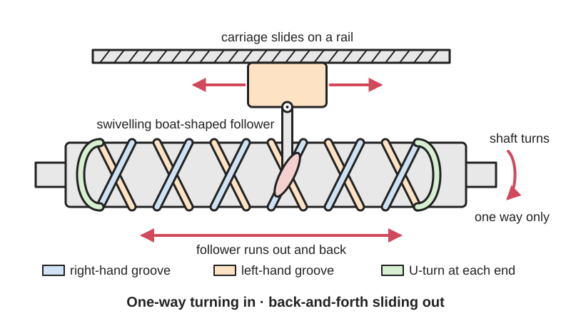

<figure class="eoc-pic eoc-pic-main"><figcaption>Diagram drawn for the encyclopaedia from the research notes. ⚑ Needs confirming: a drawing can simplify or get details wrong; a real photo or a better diagram is welcome.</figcaption></figure>

A shaft with a right-hand and a left-hand spiral groove crossing each other and joined at the ends, so a swivelling follower in the groove runs back and forth along the shaft while the shaft keeps turning one way, which is how fishing reels and winders lay line evenly across a spool.

**In plain words:** A rod with two spiral grooves cut in opposite directions that cross each other in a diamond pattern; a little swivelling tooth riding in the groove travels to one end, turns round and comes back, over and over, while the rod keeps turning the same way. **Proper term:** Reversing screw (self-reversing screw, diamond screw, level-wind screw).

**Also called:** self-reversing screw / self-reversing lead screw; diamond screw / diamond thread screw / diamond groove shaft; level-wind screw / levelwind screw / level winder screw; reverse spooling screw; right-and-left-hand screw nut traverse; worm gear / worm shaft (fishing-reel repair name for the level-wind shaft); traverse screw; Kreuzgewindespindel / Umkehrspindel (German); [pawl](../glossary.md#pawl) / level-wind pawl / shoe / follower blade (the part that rides in the groove).

## How it works

Two spiral (helical) grooves with the same lead but opposite hand are cut along the same shaft, so they cross each other many times, and at each end they join in a smooth U-turn. The follower sits in the groove and is free to swivel in its carriage. As the shaft turns, the groove pushes the follower along like a nut on a screw; at the end it runs round the U-turn, swivels to line up with the opposite-hand groove, and is pushed back the other way, all without the shaft changing direction. The follower is long and slim along the groove (a blade, boat or lens shape rather than a round pin), so at each crossing it bridges the gap and keeps following its own groove instead of jumping into the other one.

## Parts

A few parts: the grooved shaft (the diamond screw), a follower (pawl, shoe or blade) that sits in the groove and can swivel, a carriage or line guide holding the follower, a guide rod or rail that stops the carriage turning with the shaft, end bearings, and gears, a chain or belt that turn the screw in step with the spool.

## Everyday examples

- The line guide on a baitcasting fishing reel that slides left and right as you wind, driven by a crossed-groove worm shaft and a small pawl (the 'level wind')
- Level winders on winch and net drums, from fishing boats to offshore winches that spool wire rope thousands of metres long
- 3D-printer filament respooling winders such as the popular printed Pastamatic
- Yarn and thread winding on textile machines, and cable winding in cranes (Bornemann)

## When to use it

Use it to wind line, cable, hose, rope, yarn or filament evenly onto a spool, or anywhere you need a steady back-and-forth sliding motion with a fixed [stroke](../glossary.md#stroke) from a shaft that only turns one way. It needs no electronics, switches or reversing motor, cannot slip, and stays in step with the spool automatically if it is geared from the same drive. It also makes a great printable kinetic toy or demonstrator (marble lifts, walkers).

## When not to use it

Avoid it when the stroke or [pitch](../glossary.md#pitch) must change, for example for different spool widths or line sizes: use a rolling-ring (threadless ball screw) traverse with adjustable end stops and pitch, or a stepper-driven lead screw with end switches. It is not for precise positioning or holding loads (use a lead screw), nor for heavy shock loads where the crossing points would chip. For a short back-and-forth stroke where uneven speed doesn't matter, a [crank](../glossary.md#crank) (slider-crank or Scotch yoke) or a cam is simpler.

## Details

- **What it does (jobs):**
  - change the kind of motion: continuous one-way rotation into steady back-and-forth straight-line motion that reverses by itself
  - line parts up exactly: guides line, cable, hose or filament so it is laid evenly across a spool (level winding)
- **Movement:** rotate+slide: the shaft turns continuously one way while the follower and carriage slide back and forth; the stroke is fixed by the length of the grooved section
- **Directions it can move (degrees of freedom):** 1: the follower's position along the shaft is tied to the shaft's rotation; the follower also swivels in its carriage, but only to track the groove
- **Special behaviour:**
  - motion conversion (rotary to linear): continuous one-way rotation becomes back-and-forth sliding that reverses automatically at each end, with no clutch, switch or reversing motor
- **How it holds:**
  - shape ([form-fit](../glossary.md#form-fit--force-fit--material-bond)): the follower is trapped in the groove, so the carriage is tied positively to the shaft's rotation and cannot slip (unlike a rolling-ring drive)
  - not a holding joint (it moves or passes on motion): its job is to drive the traverse
- **Input and output:** Continuous one-way rotation -> back-and-forth straight-line traverse of the follower, parallel to the shaft (in line), reversing automatically at each end, with a fixed stroke equal to the grooved length. Travel per screw turn = the groove lead; for level winding the drum-to-screw gear or sprocket ratio is chosen so the guide moves about one line diameter per spool turn (e.g. Bruncione's printed guide for 3/4 in garden hose uses a 6.5 mm step). Speed is steady along the stroke apart from a short slow-down and turn at each end. Efficiency: a sliding follower, so broadly like a lead screw with a steep lead ⚑ [uncertain]. Back-drivable: ⚑ [uncertain] pushing the carriage does not reliably turn the shaft, particularly near the reversing ends.
- **Power:** passive (no power needed): usually driven from the same crank, motor or drum that turns the spool, so it stays in step automatically; if the drive stops, the carriage simply stops where it is
- **Load:** Light to medium: the follower normally only pushes a line guide sideways. It is positive (it can't slip), but the small follower tip and the sharp points where the grooves cross are the weak spots. Heavy steel versions guide wire rope thousands of metres long on offshore winches (Bornemann). Side loads should be taken by a separate guide rod or rail, not by the screw.
- **Play and precision:** Play: small; the follower tip must fit the groove precisely (Mike's Reel Repair), and it wears. [Repeatability](../glossary.md#repeatability--accuracy): good, because it cannot slip and the carriage position is always tied to the shaft angle. The carriage pauses briefly at each end while the follower turns round. [Misalignment](../glossary.md#misalignment): the shaft must be parallel to the carriage guide or the follower binds ⚑ [uncertain].
- **Taking it apart:** removable: the follower lifts out of the groove or the carriage slides off, and the shaft comes out of its end bearings
- **How often it can be reused:** many times: the follower (pawl) is the main wear part and is replaceable (Kolstrand supplies a spare pawl with its level winds)
- **Sealing:** none: the grooves are open to dirt, which is why grit and sand are a main cause of sticking in fishing-reel level winds
- **Adjustable:** no, as a rule: the stroke and the lead are fixed by the groove shape; the traverse rate relative to the spool can only be changed by changing the gear or sprocket ratio between drum and screw (Wikipedia 'Wire rope spooling technology'), and a different line size may need a different screw (Bruncione)
- **Access needed:** end of a tube or shaft: the shaft is fitted into end bearings and the follower is dropped into the groove through the carriage
- **Materials:** Industrial level-winder screws: stainless steels, alloy steels, Inconel or titanium (Bornemann); stainless-steel diamond screws on fishing-boat level winds (Kolstrand). Fishing reels: a metal worm shaft with a small metal pawl, and line guides lined with ceramics such as silicon carbide on premium reels (Mike's Reel Repair). Printed: PETG (chuyskywalker; Bruncione suggests PETG with carbon fibre is best), PLA or PLA+ for light duty (juh; Pastamatic), Tough PLA for small precise screws (gzumwalt).
- **Heat, cold, water and wear:** Dirt, sand and salt in the open grooves cause sticking and wear, so fishing reels need regular cleaning and light [lubrication](../glossary.md#lubrication) (Mike's Reel Repair); marine and offshore screws are made of stainless steel, Inconel or titanium (Bornemann; Kolstrand). Printed PLA screws soften above about 60 C (Prusa). ⚑ [uncertain] Grease in the grooves collects grit, so use a light film and clean it often.

## Making it

- **Ways to make or get it:**
  - 3D print (FDM): the grooved shaft and the follower, printed upright
  - off-the-shelf part: machined self-reversing screws and level-wind screw and pawl sets
  - CNC: turned and milled in steel for winches and industrial winders
- **Printing it in one piece (print in place):** no: the screw, follower and carriage are printed separately, then assembled with bearings and a guide rod, and the follower is dropped into the groove
- **Tools:** Screwdriver or hex keys for the carriage and end-bearing screws (e.g. two M3 bolts in chuyskywalker's printed level winder); for fishing reels, reel-cleaning degreaser, a small brush and light oil or grease. No special tools.
- **Difficulty:** moderate: it prints in one piece without supports if printed upright with fine layers, but the crossing grooves and end U-turns must be accurate and the follower must swivel freely; drawing the groove path in CAD is the hard part, so start from an existing model

### 3D printing tips

1) Print the screw standing upright: all of juh's parts print upright, and Bruncione prints his hose screw vertically at 0.2 mm with a 10 mm brim and slowed to 30 mm/s, with no supports. 2) Fine layers help the groove [overhangs](../glossary.md#overhang--bridging): 0.12 mm (chuyskywalker; juh says 0.12 mm or less lets the spindle overhangs print without support), or 0.1 mm layers with a 0.25 mm nozzle for a small screw (gzumwalt). 3) Cool well: use part cooling from two or more sides, or the steep overhangs sag as they solidify (juh). 4) Long screws: split them into sections. juh's fischertechnik screw uses two end pieces (27.4 mm of travel) plus any number of 30 mm middle pieces; IrishUkulele found the Pastamatic screw hard to print cleanly and split it, joining the sections with slightly non-square hex connectors so they only fit one way and stay aligned. 5) Material: PETG for working winders (chuyskywalker; Bruncione, with PETG-CF better), PLA+ is fine for a filament winder (Pastamatic); print the driven spindle with 100% concentric [infill](../glossary.md#infill) (Pastamatic). 6) Follower: make it a round disc or pin that can rotate freely in the carriage, carrying a slim tooth that fits the groove; it must 'turn' at each end to follow the return path (chuyskywalker). Make the tooth long along the groove so it bridges each crossing (see rules_of_thumb). 7) Support the screw on ball bearings (two 608s in chuyskywalker's design; Pastamatic uses fourteen 608s in total) and run the carriage on a separate smooth rod or linear bearing (Bruncione) so the follower only pushes. 8) [Clearances](../glossary.md#clearance): prefer generous clearances and simple mechanisms (Pastamatic's design goal), then trim, file and polish the groove and follower until they run smoothly (gzumwalt). 9) Match the lead to what you wind: Bruncione's 6.5 mm step suits 3/4 in garden hose, and other sizes need a different step. 10) Keep printed winders away from heat: PLA softens above about 60 C (Prusa).

### Buying one (off-the-shelf parts)

Self-reversing screws / level winder screws / reverse spooling screws made to order (Bornemann (brand), Abssac (brand)); levelwind screw and pawl sets (Rempco (brand)); complete diamond-screw level winds for winch and net drums (Lebus (brand), Kolstrand (brand)); replacement level-wind worm shafts, pawls and line guides for baitcasting reels; 608 skate bearings, stainless steel guide rods and linear bearings for printed winders; rolling-ring traverse units (Uhing (brand)) as the adjustable alternative.

## Rules of thumb

- Make the follower long along the groove so it straddles each crossing: a follower that bridges the intersections won't jump from one groove into the opposite-hand groove under load (US patent 3779094, background). Nguyen Duc Thang's crossed-groove cam animation uses pins with an elliptical section, long axis along the groove, so they run stably through the crossings.
- The follower must be free to swivel so it can turn round at each end and follow the return groove (chuyskywalker's round-disc pawl).
- For even side-by-side layers, the guide should move about one line diameter per spool turn, so that wraps lie without gaps (Samson Rope: wind evenly, without spaces across the drum); the rate is set by the chain-and-sprocket (or gear) ratio between drum and lead screw (Wikipedia 'Wire rope spooling technology').
- The sharp points where the grooves cross are the weak spot: on dual-threaded level-wind screws they can fracture under vibration and make the follower reverse early, causing a miswrap (US patent 10640346B2, which uses two single-thread screws to avoid them). Print in a tough material such as PETG.
- Print upright, at 0.12 mm layers or finer, with strong cooling, to print the grooves without supports (juh; chuyskywalker).
- Keep the grooves clean and lightly lubricated: dirt build-up causes sticking and binding, and the pawl is a critical wear item whose tip must fit the groove (Mike's Reel Repair).

## Common failures

1) Sticking or binding from dirt build-up, and a worn pawl: clean, lightly lubricate and replace the pawl (Mike's Reel Repair; Kolstrand ships a spare pawl). 2) The follower jumping into the other groove at a crossing and reversing early: use a longer, slimmer follower that straddles the crossings (US3779094); chipped crossing points on dual-thread screws cause early reversal and miswraps (US10640346B2). 3) Printed grooves rough or sagging so the follower catches: print upright at fine layers with good cooling, or split the screw into sections (juh; IrishUkulele). 4) Follower jamming at the ends because it can't swivel round the U-turn: make sure it rotates freely in the carriage ⚑ [uncertain]. 5) Line piling up or leaving gaps: the traverse rate doesn't match the line size, so change the [gear ratio](../glossary.md#gear-ratio) or use a screw with a different lead (Bruncione; Wikipedia 'Wire rope spooling technology').

## Safety

⚑ [uncertain] The turning screw and the moving carriage are pinch points, and on winches the level wind moves under heavy cable load, so keep fingers and loose clothing clear while it runs. Drill-driven printed winders should be started slowly (the Pastamatic instructions say to accelerate slowly). Otherwise none known.

## Related

- Rolling-ring drive (threadless ball screw): also reverses automatically (by flipping the bearing tilt at end stops) and its stroke and pitch can be adjusted, but it is friction-driven and can slip
- Lead screw and nut: one-way travel per direction of rotation; the motor must reverse to come back
- Right- and left-hand screws with switched half-nuts (507 Mechanical Movements No. 110): the old way to traverse thread guides on spooling frames, reversed by a lever
- Twin opposite-turning single-thread screws with a shoe that swaps between them (US10640346B2): avoids the weak crossing points of a diamond screw
- [Cam and follower](../glossary.md#cam-and-follower) (barrel cam): a groove round a drum can make any motion pattern, including pauses, within one turn
- Slider-crank and Scotch yoke: back-and-forth motion from a crank, but the speed varies along the stroke
- Half nut (split nut): a nut that can be disengaged from a screw

## Make it yourself

- [Level Winder (Diamond Screw) by chuyskywalker (Printables) (details read through the Printables API)](https://www.printables.com/model/418881-level-winder-diamond-screw): Small printable diamond-screw level winder demonstrator with a rotating round pawl, Fusion 360 source included; needs two 608 bearings and two M3 bolts *(licence: Creative Commons Public Domain)*
- [Pastamatic - Filament Spool Winder (level winder with self reversing leadscrew) by GekoPrime (Printables) (URL from Printables API, page not opened)](https://www.printables.com/model/466883-pastamatic-filament-spool-winder-for-bambu-lab-x1c): Very popular drill-driven filament respooler built around a printed self-reversing lead screw; prints on one plate, uses 14 x 608 bearings, Fusion and STEP files provided *(licence: CC BY-NC-SA)*
- [Self-reversing screw for fischertechnik / Umkehrspindel fuer fischertechnik by juh (Printables) (details read through the Printables API)](https://www.printables.com/model/215741-self-reversing-screw-for-fischertechnik-umkehrspin): Extendable self-reversing screw made of two end pieces and any number of 30 mm middle pieces, with detailed print tips *(licence: CC BY-NC-SA)*
- [Self reversing guide screw for cables, hoses etc. by Bruncione (Printables) (URL from Printables API, page not opened)](https://www.printables.com/model/153612-self-reversing-guide-screw-for-cables-hoses-etc): Scalable printed hose and cable guide with a 6.5 mm-step self-reversing screw for 3/4 in garden hose, running on stainless rods and a linear bearing *(licence: CC BY-NC)*
- [70mm Level Winding Device utilizing Diamond Ball Screw (includes CAD links) by JawzX (Thingiverse) (page is JavaScript-only; details from search results)](https://www.thingiverse.com/thing:3510009): Printed level winder whose follower is three 4.5 mm steel BBs running in a diamond-screw groove, like a self-reversing ball screw *(licence: ⚑ [uncertain] not visible)*

## Pictures, videos and models

- [Seilwinde-Kreuzgewindespindel.jpg (Wikimedia Commons, by Alfons Kifmann)](https://commons.wikimedia.org/wiki/File:Seilwinde-Kreuzgewindespindel.jpg): Photo of a winch drum with a screw level winder (a crossed-thread spindle guiding the rope) *(licence: CC BY-SA 3.0 DE)*
- [Barrel cam for reverse 180 deg. rotation 2 (Nguyen Duc Thang, thang010146, YouTube)](https://www.youtube.com/watch?v=-PhB19njbCc): CAD animation of a shaft with two crossed helical grooves, with elliptical pins that keep following their own groove through the crossings *(licence: link only)*
- [Automatic Rewinder Makes Kite Retrieval A Breeze (Hackaday, 2019)](https://hackaday.com/2019/08/21/automatic-rewinder-makes-kite-retrieval-a-breeze/): Article with videos of a 3D-printed, drill-powered kite-line reel that uses a self-reversing screw to wind the string evenly *(licence: link only)*
- [Abssac Self Reversing Screw (video, Abssac)](https://www.abssac.co.uk/video/Abssac+Self+Reversing+Screw/21/): Video of a machined self-reversing screw whose nut carries a follower blade matched to the groove *(licence: link only)*
- [507 Mechanical Movements No. 110: spooling-frame traverse (507movements.com)](https://507movements.com/mm_110.html): Animated historic drawing of a roller with right- and left-hand threads and two half-nuts that move a thread guide back and forth *(licence: book public domain (1868); website animation link only)*

## Needs confirming

⚑ marks something nobody has confirmed yet: a fact the research could not confirm from a source, a finder value that is a best guess, or an open point from the research notes. Corrections are welcome (see `research/needs-confirming.md`).

- ⚑ 7 sentences on this page marked [uncertain].

## Sources

- <https://www.bornemann-gewindetechnik.de/en/products/self-reversing-thread/>
- <https://patents.google.com/patent/US3779094A/en>
- <https://patents.google.com/patent/US10640346B2/>
- <https://patents.google.com/patent/US3552682A/en>
- <https://en.wikipedia.org/wiki/Wire_rope_spooling_technology>
- <https://en.wikipedia.org/wiki/Fishing_reel>
- <https://commons.wikimedia.org/wiki/File:Seilwinde-Kreuzgewindespindel.jpg>
- <https://www.mikesreelrepair.com/blog/the-levelwind-system-in-baitcasting-reels-a-detailed-technical-examination/>
- <https://kolstrand.com/kolstrand-automatic-diamond-screw-level-wind-for-gillnet-drum/>
- <https://www.lebus-intl.com/products/20075/Diamond-Screw-Levelwinds>
- <https://www.samsonrope.com/resources/arborist/winding-rope-on-a-winch>
- <https://www.abssac.co.uk/video/Abssac+Self+Reversing+Screw/21/>
- <https://507movements.com/mm_110.html>
- <https://507movements.com/mm_151.html>
- <https://hackaday.com/2019/08/21/automatic-rewinder-makes-kite-retrieval-a-breeze/>
- <https://www.youtube.com/watch?v=-PhB19njbCc>
- <https://cs448m.github.io/lectures/machines/doc/2.pdf>
- <https://help.prusa3d.com/article/pla_2062>
- <https://www.printables.com/model/418881-level-winder-diamond-screw>
- <https://www.printables.com/model/215741-self-reversing-screw-for-fischertechnik-umkehrspin>
- <https://api.printables.com/graphql/>
- <https://www.thingiverse.com/thing:3510009>
