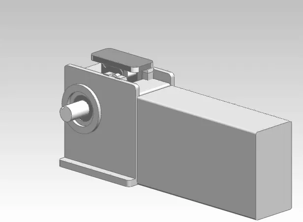

*Picture: [Rigid Chain Actuator.gif](https://commons.wikimedia.org/wiki/File:Rigid_Chain_Actuator.gif) by User:Catsquisher, Public domain, from Wikimedia Commons.*

A motor-driven sprocket feeds out a chain whose links can bend only one way, and as they leave the housing they lock into a stiff bar that can push and pull a load; running backwards draws the chain in, where it bends again and coils or folds into a small magazine.

**In plain words:** A chain that goes stiff as it comes out of its box, so a motor can push things with it (such as opening a window) as well as pull them back, and then the chain folds or coils away small inside the box. **Proper term:** Rigid chain [actuator](../glossary.md#actuator) (push-pull chain actuator), including the zip chain (interlocking double chain).

**Also called:** push chain / rigid pushing chain; push-pull chain actuator; linear chain actuator; electric chain actuator; column-forming chain actuator / rigid-chain lifting column; chain window opener / window chain actuator (single or double chain); zip chain / interlocking chain actuator (two chains that zip together back to back); Zip Chain Actuator, Zip Chain Lifter (Tsubaki (brand)); LinkLift, ChainLift (Serapid (brand) rigid-chain lifting columns); chain rammer (historic gun-loading version).

## How it works

Each link has a shoulder that butts against the next link, so the chain can bend to one side only. As the sprocket feeds the chain out, the housing's guides turn the links straight and their shoulders lock together into a rigid bar that resists both pushing and pulling, while at their pivots the links still hinge like an ordinary chain (Serapid). The push point on the end link sits off the pivot line, so the load itself presses the shoulders together and keeps them locked (linearmotiontips). Reversing the motor draws the chain back in, where the shoulders separate and it coils away. In the zip-chain version two chains mesh back to back like a zipper, forming a column that needs no side guide and resists buckling better (Wikipedia; Tsubaki).

## Parts

A small assembly that acts as one unit: special chain links with shoulders or hooks (or two chains that interlock), a sprocket (pinion) on a motor-driven shaft, a housing with guides that straighten and lock the links, a magazine where the loose chain coils or folds, and an end fitting that bolts to the load; usually a gearmotor, limit switches and a controller as well.

## Everyday examples

- Motorised window and skylight openers: a chain slides out of a slim box on the frame and pushes the window open (WindowMaster; TOPP)
- Theatre stage, orchestra-pit and seating lifts that rise on rigid-chain columns (Wikipedia; Serapid video)
- Scissor lift tables driven by a rigid chain instead of a hydraulic cylinder (Wikipedia)
- Shell rammers in warship guns and tank autoloaders, the chain's original use (Wikipedia)

## When to use it

Use it when you need a long push-and-pull [stroke](../glossary.md#stroke) but have little room for the actuator when retracted, e.g. a window, hatch or skylight opener, a lift platform or a long horizontal pusher. A cylinder or screw is at least as long as its stroke even when closed, while the chain coils or folds away. It works in any orientation (lifting, horizontal or hanging; Tsubaki), needs no hydraulic oil that could leak, and industrial zip chains are fast (up to 1000 mm/s).

## When not to use it

Avoid it where the pushed part isn't guided or there are side loads: a single chain sags or buckles, so use a zip (double) chain, add guide rails, or use a lead screw or rack and pinion. Avoid it for fine, stiff positioning, because the links have play; use a ball or lead screw on linear guides. For short strokes where length when retracted doesn't matter, an ordinary lead-screw linear actuator is simpler and cheaper. Don't fit window units outside in rain and snow (TOPP ACK4), and don't use them for continuous duty.

## Details

- **What it does (jobs):**
  - change the kind of motion: a motor's rotation becomes a straight push and pull
  - let it move (slide): a long telescoping stroke from a small housing, like a stiff tape measure made of chain
  - hold or release using power: motorised opening and closing of windows, skylights, hatches and lift platforms
- **Movement:** slide: the chain end moves in a straight line (the sprocket turns inside the housing); strokes from about 100 mm (window openers) to several metres (industrial lifting columns)
- **Directions it can move (degrees of freedom):** 1: the chain end's position along its path is tied to the sprocket's rotation, so there is one independent motion
- **Special behaviour:**
  - motion conversion (rotary to linear): the sprocket's rotation becomes a straight push or pull, like a rack and pinion with a rack that folds away
  - none of the holding behaviours by itself: it is a rack-and-pinion type drive, so holding position relies on the gearmotor or a brake; Tsubaki uses a brake motor to hold loads, and Serapid says its lifting columns maintain position with no drift
- **How it holds:**
  - shape ([form-fit](../glossary.md#form-fit--force-fit--material-bond)): link shoulders, notches or interlocking teeth lock the links into a column, and the sprocket teeth mesh with the link rollers
  - not a holding joint (it moves or passes on motion): it drives a load; its position is held by the motor or brake
- **Input and output:** Sprocket rotation -> straight push and pull. Speed: about 17-27 mm/s for a window opener (TOPP ACK4), up to 200 mm/s for Serapid ChainLift columns, and up to 1000 mm/s for Tsubaki zip chains. Thrust: 300 N for a typical window opener (TOPP ACK4); 400-2000 N rated for Tsubaki's standard Zip Chain Actuators (up to 38.2 kN in larger sizes); lifting columns over 10 tonnes (Wikipedia). Shaft arrangement: crossed (the drive shaft lies across the chain's line of travel, as in a rack and pinion). Rough efficiency: not stated in the makers' pages found ⚑ [uncertain]. Back-drivable: in principle yes, like a rack and pinion, unless the gearmotor or a brake holds it ⚑ [uncertain].
- **Power:** powered in practice (usually an electric motor; the chain mechanism itself is passive). If power is lost it stays where it is when the gearmotor or brake holds it (Tsubaki holds loads with a brake motor); window openers are driven by 24 V DC or 230 V gearmotors ⚑ [uncertain whether every model holds against a strong wind or push when unpowered]
- **Load:** Light (window openers, a few hundred newtons) to very heavy (industrial lifting columns over 10 tonnes; Wikipedia). Strong in push and pull along the chain. Weak sideways: a single chain can sag or bend under side load and over long unsupported strokes (window chains may curve up or down with the window's weight and wind; TOPP ACK4), so industrial lifts guide the platform along the whole travel with at least two guides (Serapid). Zip (double) chains resist buckling better and can take some side load without a guide at the end (Wikipedia).
- **Play and precision:** Simple and printed chains have noticeable play: [clearances](../glossary.md#clearance) between the teeth make a printed zip beam 'a bit floppy' (Hackaday), and window chains flex; the ACK4's limit switch is accurate to about +/-1 cm. Industrial columns position repeatably to within millimetres (Serapid). They tolerate little [misalignment](../glossary.md#misalignment): the chain end must line up with its bracket (TOPP ACK4), and lift drives must be square, fixed without play and perfectly vertical (Serapid).
- **Taking it apart:** removable: the housing bolts to the frame and the chain's end fitting bolts or pins to the moving part (window sash, platform or carriage)
- **How often it can be reused:** many times: it is fitted once but runs for many cycles (Tsubaki expects about 4000 km of travel); brackets can be unbolted and refitted
- **Sealing:** none: the chain and the slot it comes out of are open; window units have IP55-rated electrics (TOPP ACK4), which protects the motor housing, not the chain
- **Adjustable:** yes: the chain can stop anywhere along its stroke; the stroke end is set with adjustable limit switches (e.g. 10-40 cm on the TOPP ACK4), and servo-driven zip chains can stop at many points precisely (Tsubaki)
- **Access needed:** not applicable: it is a bolted-on actuator; you need to reach the housing's mounting face and the bracket on the moving part (for windows, both from the room side)
- **Materials:** Mostly steel links, pins and rollers (Wikipedia); stainless steel chains on some window openers; stainless steel and special surface or heat treatments on request for industrial columns (Serapid). A non-metal cousin, the rigid belt actuator, uses reinforced plastic belts (Wikipedia). Hobby versions: PLA links with solid (all-perimeter) walls (Printables PCN145), or LEGO chain links wedged with half pins (Eurobricks).
- **Heat, cold, water and wear:** Window units: -5 to +50 C, IP55 electrics, short-time duty, and must not be installed on the outside of the window exposed to rain or snow or in explosive atmospheres (TOPP ACK4). Wind, snow and hinge friction add to the force needed and must stay within the rating (TOPP ACK4). Industrial rigid-chain columns are made for harsh conditions such as clean rooms, dust, heat, humidity and radiation, with ATEX-certified versions (Serapid); zip chains are grease-lubricated, so there is no oil to leak (Tsubaki). Printed chains in PLA soften above about 60 C (Prusa).

## Making it

- **Ways to make or get it:**
  - off-the-shelf part (window chain openers; industrial zip-chain and rigid-chain actuators and lifting columns)
  - 3D print (FDM): demonstration push chains and zip-chain mechanisms, plus sprockets, guides and housings
  - sheet metal: industrial links are made of facing steel side plates joined by cross-pins with rollers (Serapid)
- **Printing it in one piece (print in place):** no: links, pins, plates and clips are printed separately and assembled (e.g. PCN145); the sprocket, guide and magazine are separate parts too
- **Tools:** Screwdriver, hex keys and spanners for the brackets; electrical tools for wiring the motor supply and switches; grease for industrial chains. Printed demo chains: none (pins and clips press in).
- **Difficulty:** hard to make one that pushes real loads: the links need tight clearances, strong pins and a good guide, so buy a window chain actuator or an industrial unit; moderate to print a demonstration push chain or zip-chain toy

### 3D printing tips

1) Start with a demo: FH's PCN145 fully printable push chain (14.5 mm [pitch](../glossary.md#pitch), 13.3 mm rollers) prints in PLA, and the maker suggests raising the perimeter count on the inner link so it prints solid, with no [infill](../glossary.md#infill), to carry more load; links and pins, and plates and locking clips, are the same height so they print in batches. 2) Keep the tooth and shoulder clearances small: gzumwalt's printed zip-chain beams were floppy until he reduced the clearances (Hackaday). 3) Put the push point above the pivot line on the end link, so the load presses the shoulders together (linearmotiontips). 4) Wedge the links: in a LEGO version, half pins on every second link wedge the links together to make the chain rigid (Eurobricks). 5) Guide the chain where it bends and support the load: the LEGO builder found guiding the coiled chain tricky, and even steel window chains sag with load, so use short strokes or add a guide rail. 6) Add end-of-stroke stops or limit switches and set the stroke a little shorter than the mechanism's real limits (TOPP ACK4). 7) PLA softens above about 60 C (Prusa), so keep printed chains away from motors and heat.

### Buying one (off-the-shelf parts)

Electric chain window openers / window chain actuators (24 V DC or 230 V; single or double chain; strokes about 150-1000 mm and forces about 200-400 N in retailer listings); industrial Zip Chain Actuators and Zip Chain Lifters (Tsubaki (brand)); rigid-chain push-pull actuators and LinkLift / ChainLift lifting columns (Serapid (brand)); rigid belt actuators (a plastic-belt version); helical band actuators (Spiralift (brand)) for tall stage lifts; for DIY builds: roller chain and sprockets, gearmotors, limit switches and window-actuator brackets.

## Rules of thumb

- The stored chain is only as long as the stroke plus a few links left in the drive; unlike an ordinary chain loop it doesn't need to be twice the stroke (Serapid).
- Guide the load, not just the chain: except for scissor lift tables, lifting-column platforms need external guides along the whole travel, at least two of them (Serapid).
- Total thrust Ft = weight force + guide friction + acceleration forces + external forces; for strokes over 3 m add the weight of the chain strands too (Serapid).
- Friction coefficient for typical rigid-chain setups is between 0.05 and 0.5 (linearmotiontips).
- Window force: F = 0.54 x P x (C / H) for top- or bottom-hung windows and F = 0.54 x P for skylights and domes, where P is the moving part's weight (N), C the opening stroke and H the window height (TOPP ACK4 instructions).
- About 40 mm of chain is used up [bridging](../glossary.md#overhang--bridging) the window profile, so a 265 mm chain gives about 225 mm of clear opening; longer chains need bigger links and a bigger housing (WindowMaster).
- Window openers run in short bursts: the ACK4 is rated S2 (short-time duty, 2-3 minutes) for -5 to +50 C (TOPP ACK4); regularly used 240 V actuators tend to overheat, so 24 V DC is preferred (WindowMaster).
- Tsubaki's standard Zip Chain Actuators: 400-2000 N rated thrust, 300-2000 mm stroke, up to 1000 mm/s, expected life about 4000 km of travel, and can be mounted lifting, horizontal or hanging (Tsubaki).
- Serapid ChainLift [lubrication](../glossary.md#lubrication): every 13,000 cycles in the first year, then every 50,000 cycles or yearly (Serapid lifting column catalogue).

## Common failures

1) Sagging or buckling of a long, unguided chain, especially with side loads or wind; guide the load, shorten the stroke or use a zip chain (Serapid; TOPP ACK4; Wikipedia). 2) Floppy printed chains from loose tooth clearances (Hackaday). 3) Binding or stalling when the chain end is not in line with its bracket or the stroke is set longer than the window can open; align it and set the stroke a few centimetres short of the mechanical limits (TOPP ACK4). 4) Motor overheating from frequent use of short-duty units (WindowMaster; TOPP ACK4). 5) Wear from missed lubrication on industrial chains (Serapid). 6) The coiled chain jamming in its magazine if poorly guided (Eurobricks LEGO build).

## Safety

Crushing and trapping: fingers or hands can be caught between a closing window sash and its frame. If the window is less than 2.5 m above the floor and can be worked by an untrained user or a remote control, the instructions require an emergency stop or safety system that prevents crushing or dragging of body parts (TOPP ACK4); keep children away. Lifts and platforms carry heavy loads that must be held by the drive or a brake; never stand under a platform held only by the actuator.

## Related

- Rack and pinion: the same gear-on-a-toothed-bar drive, but the rack is rigid and as long as the stroke
- Rigid belt actuator: two plastic belts with blocks that zip into a column; lighter loads, non-metallic (Wikipedia)
- Helical band actuator (Spiralift (brand)): steel bands that wind into a tall tube-shaped column for stage lifts (Wikipedia)
- Lead screw and nut / ball screw actuators: stiffer and more precise, but at least as long as their stroke when retracted
- Scissor [linkage](../glossary.md#linkage) (scissor lift): another way to fold a long lift into a small height; often driven by a rigid chain
- Tape-spring hinge (measuring-tape fold): a curved steel strip that is stiff when straight and flexible when flattened, like a tape measure
- Cable carrier (drag chain): also a chain that bends one way only, but it just carries cables and can't push a load
- Bowden cable (push-pull cable): pushes and pulls through a guiding tube, over short distances
- Chain and sprocket drive: an ordinary chain loop, which can only pull

## Make it yourself

- [PCN145 - Fully Printable Push Chain (FH, Printables)](https://www.printables.com/model/1351303-pcn145-fully-printable-push-chain): Fully printable push chain inspired by window actuators that bends one way around a sprocket and is stiff when pushing; 14.5 mm pitch, Fusion 360 source files included *(licence: CC BY-SA)*
- [Rigid Chain Screw Actuator (ttsalo, Thingiverse) (appeared in search results; page needs JavaScript and was not read)](https://www.thingiverse.com/thing:2362604): Printable 'screw of theoretically unlimited length' that assembles and disassembles itself from chain-like parts, suggested as a printer Z lifter together with a guiding linkage *(licence: ⚑ [uncertain])*
- [[MOC] Rigid Chain Actuator (ord, Eurobricks forum, 2022)](https://www.eurobricks.com/forum/forums/topic/191071-moc-rigid-chain-actuator/): LEGO Technic rigid chain actuator inspired by a window opener, with half pins on every second link that wedge the chain rigid *(licence: not stated)*

## Pictures, videos and models

- [Rigid Chain Actuator.gif (Wikimedia Commons, by Catsquisher)](https://commons.wikimedia.org/wiki/File:Rigid_Chain_Actuator.gif): Animation (40 frames) of a rigid chain actuator based on Serapid's LinkLift lifting column, showing the chain's links forming a column as they are driven out *(licence: Public domain)*
- [Rigid chain actuator (Wikipedia)](https://en.wikipedia.org/wiki/Rigid_chain_actuator): The animation above, a 1972 interlocking-chain patent drawing, a 1908 chain rammer patent drawing, and a history of single, double and triple-chain designs *(licence: Text CC BY-SA 4.0; images per file on Commons)*
- [Stage Lifts - www.serapidusa.com (SERAPID, YouTube)](https://www.youtube.com/watch?v=usO_aH9afVE): Video of rigid-chain columns raising stage lift platforms *(licence: link only)*
- [3D Printed Rigid Chain Mechanism by gzumwalt #shorts (MaDi Studios, YouTube)](https://www.youtube.com/watch?v=c8Nv4Bas8Ow): Short video of gzumwalt's printed zip-chain mechanism extending and retracting *(licence: link only)*
- [3D Printed Rigid Chain Mechanism (Hackaday, 2020)](https://hackaday.com/2020/12/08/3d-printed-rigid-chain-mechanism/): Article with video of gzumwalt's printed two-chain zip beam and a snake-in-a-basket automaton built on it *(licence: link only)*

## Needs confirming

⚑ marks something nobody has confirmed yet: a fact the research could not confirm from a source, a finder value that is a best guess, or an open point from the research notes. Corrections are welcome (see `research/needs-confirming.md`).

- ⚑ 4 sentences on this page marked [uncertain].
- ⚑ Finder value `power_source` = electricity (source uncertain): `power` is marked ⚑ [uncertain] here: "…rake motor); window openers are driven by 24 V DC or 230 V gearmotors ⚑ [uncertain whether every model holds aga…"
- ⚑ Finder value `power_loss` = keeps its last state (source uncertain): `power` is marked ⚑ [uncertain] here: "…rake motor); window openers are driven by 24 V DC or 230 V gearmotors ⚑ [uncertain whether every model holds aga…"

## Sources

- <https://en.wikipedia.org/wiki/Rigid_chain_actuator>
- <https://en.wikipedia.org/wiki/Rigid_belt_actuator>
- <https://en.wikipedia.org/wiki/Helical_band_actuator>
- <https://en.wikipedia.org/wiki/Linear_actuator>
- <https://commons.wikimedia.org/wiki/File:Rigid_Chain_Actuator.gif>
- <https://www.motiontech.com.au/wp-content/uploads/2021/05/MT-Serapid-Vertical-Chains-Technology-210319.pdf>
- <https://api-serapid.mcn-info.com/uploads/page/17/doc-17.pdf>
- <https://www.ustsubaki.com/resources/knowledge-center/about-zip-chain-actuators/>
- <https://en.tt-net.tsubakimoto.co.jp/tecs/pdct/sad/pdct_sad_3zca.asp>
- <https://tsubaki.eu/products/mechanical-components/zip-chain-actuators/>
- <https://www.linearmotiontips.com/basics-rigid-chain-actuators/>
- <https://www.timotion.com/en/news-and-articles/electric-window-actuators-for-automation>
- <https://www.windowmaster.com/products/actuators-and-accessories/window-actuators/>
- <https://www.windowo.com/chain-actuators>
- <https://www.lpwindowcontrols.co.uk/wp-content/uploads/2018/05/TOPP-chain-actuator-ACK4-instructions.pdf>
- <https://hackaday.com/2020/12/08/3d-printed-rigid-chain-mechanism/>
- <https://www.youtube.com/watch?v=usO_aH9afVE>
- <https://www.youtube.com/watch?v=c8Nv4Bas8Ow>
- <https://www.eurobricks.com/forum/forums/topic/191071-moc-rigid-chain-actuator/>
- <https://www.printables.com/model/1351303-pcn145-fully-printable-push-chain>
- <https://www.thingiverse.com/thing:2362604>
- <https://help.prusa3d.com/article/pla_2062>
- <https://api.printables.com/graphql/>
