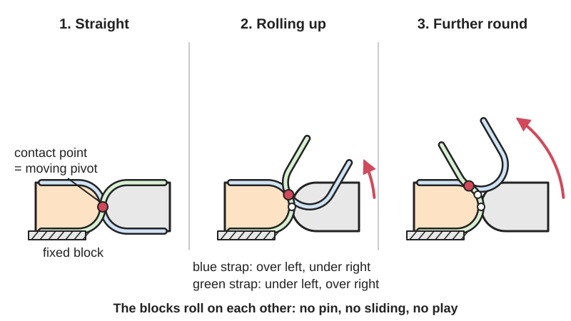
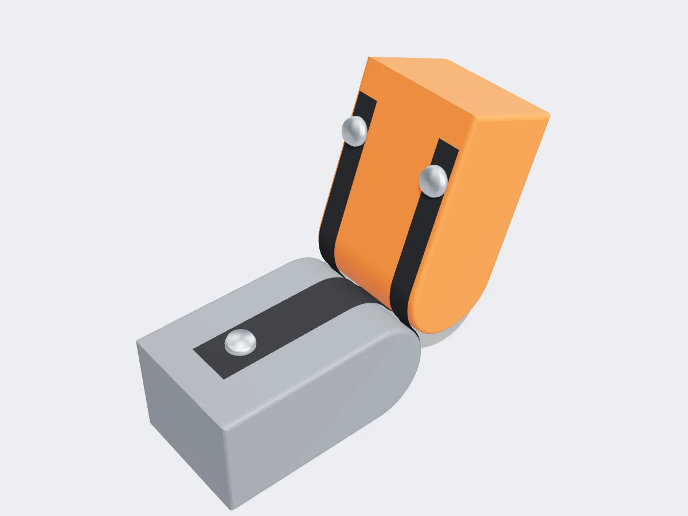

<figure class="eoc-pic eoc-pic-main"><picture><source media="(prefers-reduced-motion: reduce)" srcset="../media/drawn/rolling-contact-joint.svg"></picture><figcaption><strong>Animation.</strong> Diagram drawn for the encyclopaedia from the research notes. ⚑ Needs confirming: a drawing can simplify or get details wrong; a real photo or a better diagram is welcome.</figcaption></figure>
<figure class="eoc-pic"><figcaption><strong>Render.</strong> A 3D model made for the encyclopaedia, not a photo: a stand-in until a good real photo is found. ⚑ Needs confirming: a model can simplify or get details wrong; a real photo is welcome.</figcaption></figure>

Two curved blocks held against each other by thin crossed straps, bands or cords, so that they roll over each other without sliding, giving a smooth, low-friction hinge with no pin and no play.

**In plain words:** A hinge made of two rounded blocks tied together by crossed straps, so the blocks roll over each other instead of turning on a pin, like the flipping wooden blocks of a Jacob's ladder toy. **Proper term:** Rolling-contact joint (compliant rolling-contact element, CORE).

**Also called:** rolling contact joint (RCJ); compliant rolling-contact element (CORE); compliant rolling-contact joint (CRJ); developable or deployable CORE (D-CORE, the version made from one flat sheet); rolling hinge; rolamite hinge (wheels held together by wires or bands; name used by Watt and Pellegrino); Jacob's-ladder hinge or ribbon hinge (the toy's crossed ribbons act as a double hinge); double hinge (each block is hinged to the next at either end); ligament joint or crosswise-ligament rolling joint (robot fingers and prosthetic hands); rolling-contact knee or rolling knee joint (prosthetics and braces); Rubik's Magic mechanism (the puzzle uses the same crossed-strand principle); magic wallet (a two-panel Jacob's ladder) ⚑ [uncertain].

## How it works

Each strap is fixed to one block, wraps around that block's curved face, crosses the line where the two blocks touch and wraps the other block the opposite way; at least one more strap crosses in the other direction. Because the straps are taut and hardly stretch, the blocks cannot slide apart or skid over each other, so the only motion left is rolling, a bit like two gears without teeth (Nature Communications 2018; PNAS 2026). Rolling means there is no rubbing, so friction and wear are very low and no oil is needed (Watt and Pellegrino 2002, describing Hillberry and Hall's 1976 rolling hinge). Unlike a pin hinge, the pivot point moves along with the line of contact as it rolls (BYU CMR), and in a Jacob's ladder the crossed ribbons let each block act as if hinged to its neighbour at either end (Wikipedia).

## Parts

A few parts: two curved blocks (cams or rolling surfaces) and two or more thin flexible straps, bands, wires, cords or ribbons wrapped crosswise between them, plus the anchors that fix each strap end (clamps, screws, crimps, glue or interference-fit holes). In the CORE, CRJ and D-CORE versions the straps and cam faces are cut or printed as flat layers that are then flexed, stacked and pinned or glued together.

## Everyday examples

- Jacob's ladder toy: wooden blocks joined by crossed ribbons that appear to cascade down (Wikipedia)
- Rubik's Magic puzzle: tiles joined by crossed strands that fold in two directions (Wikipedia)
- Magic wallet that opens both ways and 'moves' a banknote under its straps ⚑ [uncertain]
- Robot fingers and prosthetic knee designs (research and open-source robot hands such as ETH's Faive Hand)

## When to use it

Use a rolling-contact joint when you want a smooth, silent, low-friction hinge with no play and no [lubrication](../glossary.md#lubrication), for example robot fingers, prosthetic or exoskeleton knees that should follow a natural moving pivot, animatronic legs, toys and fold-out panels. It suits small, compact joints because the joint is part of the structure itself (Hackaday 2024), it can take large side and [radial](../glossary.md#axial--radial) loads for its size (BYU CMR), and it can be tuned: non-circular faces let you program the path or leverage (PNAS 2026), and stretched straps can add a built-in return spring or several stable positions.

## When not to use it

Avoid it where you need a fixed pivot axis, such as a shaft carrying a gear or a pointer that must rotate about one point (BYU CMR); use a pin hinge, knuckle hinge or ball bearing instead. Avoid it where the joint will be pulled apart, since only the straps resist that; a clevis or pin joint is stronger in tension. For simple one-piece printed hinges a [living hinge](../glossary.md#living-hinge), [flexure](../glossary.md#flexure) hinge or [print-in-place](../glossary.md#print-in-place) pin hinge is easier to make. Where cords may stretch or loosen and nobody will re-tension them, a pin joint can be more reliable (ORCA hand paper).

## Details

- **What it does (jobs):**
  - let it move (turn, slide or bend): a low-friction hinge with no pin, bearing or lubrication
  - store energy: versions whose straps stretch as the blocks roll act as a built-in return spring, e.g. the BYU CORE Bearing designed for a prosthetic knee
  - click into set positions: research versions with stretched or unequal straps have two or more stable positions (Halverson, Howell and Magleby 2010; PNAS 2026)
  - change speed or turning force: tendon-driven versions with non-circular rolling surfaces and pulleys can vary their leverage along the travel (PNAS 2026)
- **Movement:** rotate (by rolling): the range depends on how far the straps wrap; an ideal compliant rolling-contact joint can turn almost 360 degrees (Nature Communications 2018), while robot-finger versions add end stops to limit travel (Laschkewitsch). The pivot point moves as it rolls rather than staying fixed (BYU CMR)
- **Directions it can move (degrees of freedom):** 1: rolling rotation. The crossed straps stop the blocks from sliding apart or skidding, leaving only rolling. With stretchy ligaments some designs deliberately allow a little sideways and twisting give (PNAS 2026)
- **Special behaviour:**
  - [fail-safe](../glossary.md#fail-safe--fail-secure) or breakaway (gives way instead of breaking): in 3D-printed robot hands an overloaded rolling-contact joint can dislocate (pop apart) instead of breaking (ORCA hand paper, 2025)
  - indexing (clicks into set positions): multi-stable versions with specially stretched or shaped straps rest in two or more positions (Halverson et al. 2010; PNAS 2026)
  - none in the basic free-rolling hinge: its main benefits are very low friction and no [backlash](../glossary.md#backlash) rather than a special action
- **How it holds:**
  - not a holding joint (it moves or passes on motion): it is a hinge; the tension in the crossed straps presses the two curved faces together and keeps them rolling without slipping (Watt and Pellegrino 2002; BYU CMR)
- **Input and output:** not applicable for a plain hinge. In tendon-driven robot fingers a pull on a tendon turns the joint, and optimised non-circular surfaces and pulleys varied the tip speed from near zero to about 4 times the average of a circular joint (PNAS 2026). Back-drivable: yes, it rolls freely both ways
- **Power:** passive (no power needed); robot and prosthetic versions are driven by tendons and motors, but the joint itself needs no power
- **Load:** light to medium. Strong when the blocks are pushed together (the curved faces bear on each other) and sideways: printed versions are 'surprisingly stable under sideways loads' (Printables 'Roll gelenk' model, translated), BYU's CORE Bearing has 'high resistance to radial loads', and ETH's Faive robot hand with rolling-contact joints held up to 10 kg in a power grasp (Toshimitsu et al. 2023). Weak in pulling the blocks apart, which is resisted only by the straps (Nature Communications 2018)
- **Play and precision:** Play: none when the straps are taut; the curved faces 'roll on each other without play' (Printables 'Roll gelenk', translated) and rolling-contact joints reduce backlash compared with bearings and gears (PNAS 2026). [Repeatability](../glossary.md#repeatability--accuracy): good while the straps stay tight, but cord ligaments can loosen over time (ORCA hand paper). [Misalignment](../glossary.md#misalignment): the axis of rotation moves as it rolls, so it is a poor choice where a fixed axis is required (BYU CMR); stretchy ligaments allow some deliberate off-axis give (PNAS 2026)
- **Taking it apart:** removable: straps held by screws, crimps or knots can be undone and re-tensioned (Watt and Pellegrino 2002); versions whose strap tabs are glued, like the printed D-CORE, are semi-permanent (BYU CMR)
- **How often it can be reused:** many times when the straps are screwed or tied on ⚑ [uncertain]; glued or pressed-in straps may not survive taking apart
- **Sealing:** none
- **Adjustable:** yes in some designs: Watt and Pellegrino's rolling hinge tensions its wires with a screw and lock nut; in printed or glued versions the strap length is fixed by the design
- **Access needed:** not applicable: the joint is built as a unit with straps anchored on both blocks, then fixed to the parts it connects
- **Materials:** Blocks: 3D-printed plastic such as PETG (Printables 'Roll gelenk'), acetal (Delrin) plate (Watt and Pellegrino 2002), laser-cut PTFE (Teflon) sheet (Nature Communications 2018 prototypes) or wood (Jacob's ladder toy). Straps: ribbon or tape (toys), metal bands (Hillberry and Hall's rolling hinge; the Rolamite uses an S-shaped metal strip), 1 mm nylon-coated stainless-steel wire (Watt and Pellegrino 2002), nylon monofilament (Laschkewitsch), Dyneema fishing line (Hackaday 2024), elastic ligaments (PNAS 2026), or thin flexures printed or cut in the same sheet as the cams (BYU D-CORE, CORE Bearing)
- **Heat, cold, water and wear:** Printed plastic straps and flexures relax (lose tension) over time, faster when warm; BYU warns its printed CORE Bearing's thin segments are very susceptible to [stress relaxation](../glossary.md#stress-relaxation), especially while warm. Cord ligaments can loosen over time (ORCA hand paper). Nylon line can absorb water and stretch ⚑ [uncertain]. Grit between the rolling faces would make it rough or skid ⚑ [uncertain]. Metal bands and wires resist [creep](../glossary.md#creep) and heat better than printed plastic straps ⚑ [uncertain].

## Making it

- **Ways to make or get it:**
  - 3D print (FDM): blocks with grooves and anchor holes for cord ligaments (robot fingers), or thin-strap layers that are stacked and pinned together (Printables 'Roll gelenk')
  - 3D print (resin): possible for small precise cams ⚑ [uncertain]
  - laser cut: cams and straps cut as flat layers from sheet, e.g. Teflon sheet (Nature Communications 2018) or the one-sheet D-CORE (BYU CMR)
  - CNC: traditionally machined rolling surfaces (PNAS 2026 notes 3D printing, moulding and machining)
  - woodwork: Jacob's ladder toys from wooden blocks and ribbon
  - off-the-shelf part: cord, fishing line, wire rope or metal strip for the straps
- **Printing it in one piece (print in place):** partly: printed versions usually need assembly, either stacking printed strap-and-cam layers and pressing in axles (Printables 'Roll gelenk'), folding and gluing a flat D-CORE (BYU CMR), or threading cord ligaments (Laschkewitsch). BYU's CORE Bearing fidget appears to print as one ready-to-use part ⚑ [uncertain]
- **Tools:** Depends on the build: none for a ribbon toy; pliers to press in pins or axles (Printables 'Roll gelenk' model); a screwdriver and crimping tool for wire or band anchors (Watt and Pellegrino 2002); superglue for the tabs of BYU's printed D-CORE
- **Difficulty:** moderate: the blocks are easy to print or cut, but the straps must be exactly the right length, evenly tensioned and firmly anchored, and thin cord tends to slip at its anchors (Laschkewitsch; Nature Communications 2018)

### 3D printing tips

Orient the part so the thin straps lie flat and their layers run along the strap, and keep layer seams off the thin bands: the maker of the PETG 'Roll gelenk' model (0.2 mm layers) warns the bands will not last long if seams sit on them (Printables 1039873, translated). Watch that print orientation does not put [layer lines](../glossary.md#layer-lines) across the cord anchors, which weakened anchoring in Laschkewitsch's printed finger joint; he used interference-fit holes to grip nylon monofilament, found finer line slipped, and needed guide rails and end stops to limit rotation. Give strap anchors a generous rounded [fillet](../glossary.md#chamfer--fillet) where the strap leaves the block, because a sharp corner concentrates stress and starts cracks (Kapy Academy explainer, uncited) ⚑ [uncertain]. Let thin printed flexures cool fully before flexing them: BYU warns that the thin compliant segments of its CORE Bearing are very susceptible to stress relaxation, especially while warm, and lose their springiness if worked too soon; a standard 0.4 mm nozzle is enough, and printing from the STEP file avoids faceted curves. For BYU's D-CORE, a drop of superglue on each tab keeps the flexures secure. Keep the rolling faces convex so the straps stay taut and the faces keep contact (PNAS 2026). Tough, springy filaments such as PETG are the usual choice for printed straps; PLA is stiffer but more [brittle](../glossary.md#brittle--ductile) and creeps under steady tension (Kapy Academy, uncited) ⚑ [uncertain]. For higher loads use cord ligaments (nylon monofilament, Dyneema) or metal bands rather than printed straps.

### Buying one (off-the-shelf parts)

No single catalogue part; builders use: braided UHMWPE fishing line ('Dyneema (brand)'), nylon monofilament fishing line, nylon-coated stainless-steel wire rope with crimped sleeves (ferrules), spring-steel shim or strip for bands ⚑ [uncertain], grosgrain or cotton ribbon for toys ⚑ [uncertain], acetal (Delrin) or PTFE sheet for laser-cut cams, and [set screws](../glossary.md#set-screw) with lock nuts for tensioning (Watt and Pellegrino 2002).

## Rules of thumb

- Keep straps thin compared with the cam radius: the bending stress in a band wrapped around a radius R is about E x t / (2R) (E = [stiffness](../glossary.md#stiffness) of the band material, t = band thickness), so stress rises with thickness and falls with radius (Lee and Jung 2012, bending formula); thin straps also cut the joint's stiffness, friction and [hysteresis](../glossary.md#hysteresis) (Nature Communications 2018)
- Worked example from a tested joint: laser-cut PTFE layers 3.175 mm thick, cam radius 50 mm and strap thickness 0.6 mm, i.e. cam radius about 83 times strap thickness (Nature Communications 2018)
- An ideal joint has almost no turning resistance and a range of almost 360 degrees only if the straps are exactly the right length (neither slack nor stretched), perfectly straight before assembly, wrapped on perfectly circular cams, and roll without slipping (Nature Communications 2018)
- Rolling surfaces must be convex so the ligaments stay taut and the faces keep in contact; use gear teeth instead if you need non-convex faces (PNAS 2026)
- Running the bands on a smaller radius than the rolling surface increases the force pulling the two halves together, and making some band surfaces smaller than others creates a return (restoring) moment (Hillberry and Hall 1976, as summarised by Watt and Pellegrino 2002)
- Pretension wires enough that the rolling wheels stay in compressive contact at all times; a tested hinge used 1 mm nylon-coated stainless-steel wire on 28.1 mm radius acetal wheels with screw-and-lock-nut tensioning (Watt and Pellegrino 2002)
- If your design needs a fixed axis of rotation, a CORE is likely impractical, because its axis moves as it rolls (BYU CMR)

## Common failures

Straps or cords slipping at their anchors, especially thin monofilament; fix with interference-fit holes, crimps or clamps (Laschkewitsch). Straps loosening over time, giving play or letting the joint dislocate; add a tensioning screw (Watt and Pellegrino 2002; ORCA hand paper). Thin printed bands cracking at layer seams or where they leave the block; move seams away and round the corners (Printables 'Roll gelenk'; Kapy Academy ⚑ [uncertain]). Binding when the rolling profile does not match the strap geometry (Laschkewitsch). Printed flexures losing springiness from stress relaxation if flexed while warm (BYU CORE Bearing). Extra friction and hysteresis when straps are too thick for the cam radius or stretched too much (Nature Communications 2018; PNAS 2026).

## Safety

The rolling faces close together like a pinch point, so keep fingers out of larger joints ⚑ [uncertain]. Cut metal strip used for bands has very sharp edges (Naked Scientists, on cut tape-measure steel). Tensioned wires or bands store energy and can whip if an anchor lets go ⚑ [uncertain].

## Related

- Knuckle (butt) hinge or pin-in-hole pivot: a fixed axis and simple to make, but it rubs, needs [clearance](../glossary.md#clearance) and so has some play
- Flexure hinge (notch, leaf-spring or cross-axis pivot): bends instead of rolling; one piece, but limited to small angles and its stiffness rises with angle
- Living hinge: a single thin flexing strip; simplest one-piece fold, but weak and short-lived in most 3D-printing plastics
- Rolamite: the linear cousin, with two rollers held in a channel by an S-shaped tensioned metal strip, used as a very low-friction bearing (Wikipedia)
- Tape-spring hinge: a curved strip that folds and snaps straight; Watt and Pellegrino combined tape springs with a wire-wrapped rolling hinge to guide the fold
- Geared hinge: uses gear teeth instead of crossed straps to stop the two halves slipping (PNAS 2026 mentions teeth as an alternative)
- Capstan cable drive: also wraps cable around drums without slipping, but to transmit rotation rather than to form a hinge
- Virtual-pivot [linkage](../glossary.md#linkage) (remote centre of motion): another way to get a pivot that is not at a physical pin
- Mechanical metamaterial mechanism: whole lattices can be built from compliant rolling-contact joints (compliant rolling-contact architected materials, Nature Communications 2018)

## Make it yourself

- [Developable Compliant Rolling-Contact Element (D-CORE) (BYU CMR, Printables)](https://www.printables.com/model/598201-developable-compliant-rolling-contact-element-d-co): Printable developable CORE hinge made flat with two mounts; tabs can be secured with superglue; includes background, applications and references. Read through the Printables public API *(licence: CC BY-NC)*
- [CORE Bearing (BYU CMR, Printables)](https://www.printables.com/model/1752131-core-bearing): Fidget-spinner-like bearing made of three COREs arranged like planet gears, giving rotation with a built-in return spring; designed for a prosthetic knee; printing advice on stress relaxation. Read through the Printables public API; link listed on BYU's Maker Resources page *(licence: CC BY-NC)*
- [Roll gelenk / rolling contact joints (Studi_Ha, Printables) (URL from Printables API, page not opened)](https://www.printables.com/model/1039873-roll-gelenk-rolling-contact-joints): Simplified knee-like rolling-contact joint from stacked PETG layers with thin integral bands and press-in axles; assembly steps explain how the bands wrap the radii; STEP files included (description in German) *(licence: CC BY)*
- [Jacobs Ladder Toy (Print-in-Place Model) (MeasureOnce, Printables) (URL from Printables API, page not opened)](https://www.printables.com/model/510296-jacobs-ladder-toy-print-in-place-model): Print-in-place Jacob's ladder toy with 0.4 mm joint clearance (do not scale); imitates the toy's flipping action, but whether it uses true rolling contact or printed pin joints is not stated ⚑ [uncertain] *(licence: CC BY-NC)*
- [Maker Resources (BYU Compliant Mechanisms Research)](https://compliantmechanisms.byu.edu/maker-resources): Index of BYU's free printable compliant mechanisms on Thingiverse and Printables, including the D-CORE and CORE Bearing *(licence: per model (BYU models are CC BY-NC))*

## Pictures, videos and models

- [Jacob's Ladder 2.jpg (Wikimedia Commons, from Scientific American 1889)](https://commons.wikimedia.org/wiki/File:Jacob%27s_Ladder_2.jpg): Engraving of the mechanism of a Jacob's ladder: three blocks shown transparent and pulled apart with their crossed tapes labelled a and b *(licence: Public domain)*
- [Jacob's Ladder toy demonstration (Wikimedia Commons video)](https://commons.wikimedia.org/wiki/File:Jacob%27s_Ladder_toy_demonstration.ogv): Video clip of a Jacob's ladder toy in use, blocks flipping over on their ribbon hinges *(licence: CC BY-SA 3.0)*
- [Compliant rolling-contact architected materials for shape reconfigurability (Nature Communications, 2018)](https://www.nature.com/articles/s41467-018-07073-5): Open-access paper with a figure of a compliant rolling-contact joint built from four half-cylinder layers and straps, lattices of such joints, and supplementary movies of prototypes changing shape *(licence: CC BY 4.0)*
- [Stealing biology for tiny robots (Breaking Taps, YouTube)](https://www.youtube.com/watch?v=TQiLLcumqDw): Video on designing small robot legs with rolling contact joints restrained by Dyneema line (as described by Hackaday; title and channel confirmed via YouTube oEmbed, video not watched) *(licence: link only)*
- [Rolamite.svg (Wikimedia Commons)](https://commons.wikimedia.org/wiki/File:Rolamite.svg): Diagram of a Rolamite: two rollers in a channel held by an S-shaped tensioned band, the linear relative of the rolling-contact joint *(licence: CC BY-SA 3.0)*

## Needs confirming

⚑ marks something nobody has confirmed yet: a fact the research could not confirm from a source, a finder value that is a best guess, or an open point from the research notes. Corrections are welcome (see `research/needs-confirming.md`).

- ⚑ 16 sentences on this page marked [uncertain].
- ⚑ Finder value `reuse_cycles` = many times (source uncertain): `reuse_cycles` is marked ⚑ [uncertain] here: "many times when the straps are screwed or tied on ⚑ [uncertain];…"
- ⚑ Finder value `connects` = lid, door or cover (best guess): worked out from its name, but joining parts is not one of its two main jobs
- ⚑ Finder value `overload_response` = not applicable (best guess): listed as torque-limiting or breakaway, but no overload behaviour matched
- ⚑ Finder value `clicks` = clicks (best guess): the text uses both clicking and silent words

## Sources

- <https://www.nature.com/articles/s41467-018-07073-5>
- <https://www.ebi.ac.uk/europepmc/webservices/rest/PMC12890850/fullTextXML>
- <http://www.its.caltech.edu/~sslab/PUBLICATIONS/Tape-spring%20rolling%20hinges%202002.pdf>
- <https://www.printables.com/model/598201-developable-compliant-rolling-contact-element-d-co>
- <https://www.printables.com/model/1752131-core-bearing>
- <https://www.printables.com/model/1039873-roll-gelenk-rolling-contact-joints>
- <https://www.printables.com/model/510296-jacobs-ladder-toy-print-in-place-model>
- <https://api.printables.com/graphql/>
- <https://compliantmechanisms.byu.edu/maker-resources>
- <https://en.wikipedia.org/wiki/Jacob%27s_ladder_(toy)>
- <https://en.wikipedia.org/wiki/Rolamite>
- <https://en.wikipedia.org/wiki/Rubik%27s_Magic>
- <https://commons.wikimedia.org/wiki/File:Jacob%27s_Ladder_2.jpg>
- <https://commons.wikimedia.org/wiki/File:Jacob%27s_Ladder_toy_demonstration.ogv>
- <https://commons.wikimedia.org/wiki/File:Rolamite.svg>
- <https://hackaday.com/2024/05/17/emulating-biology-for-robots-with-rolling-contact-joints/>
- <https://www.youtube.com/watch?v=TQiLLcumqDw>
- <https://alaschke.com/projects/rolling-contact-joint/>
- <https://arxiv.org/pdf/2504.04259>
- <https://arxiv.org/pdf/2308.02453>
- <https://www.scirp.org/html/4-1860054_22195.htm>
- <https://kapycad.com/en/academy/machines/rolling-contact-joint>
- <https://www.thenakedscientists.com/get-naked/experiments/snap-bracelets-tape-measures-bistable-structures>
