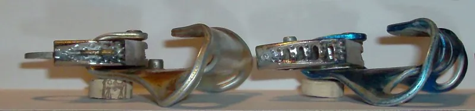
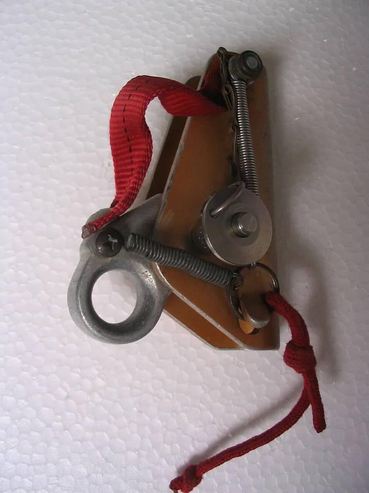

<figure class="eoc-pic eoc-pic-main"><figcaption><strong>Photo.</strong> <a href="https://commons.wikimedia.org/wiki/File:Petzl_Ascenders_(On_Rope).jpg">Petzl Ascenders (On Rope)</a> by Climber.Ben.Johnson, <a href="https://creativecommons.org/licenses/by-sa/4.0">CC BY-SA 4.0</a>, from Wikimedia Commons.</figcaption></figure>
<figure class="eoc-pic"><figcaption><strong>How it works.</strong> <a href="https://commons.wikimedia.org/wiki/File:Gibbs_Ascender.jpg">Gibbs Ascender</a> by Aglsilva at English Wikipedia, Public domain, from Wikimedia Commons.</figcaption></figure>
<figure class="eoc-pic"><figcaption><strong>How it works.</strong> <a href="https://commons.wikimedia.org/wiki/File:Ascenders-cams.jpg">Ascenders-cams</a> by Luca Bergamasco, <a href="https://creativecommons.org/licenses/by/3.0">CC BY 3.0</a>, from Wikimedia Commons.</figcaption></figure>

A clamp with a spring-loaded, toothed, off-centre lever (cam) that slides up a rope in one direction but pinches the rope against its frame and locks when pulled the other way; used in pairs to climb a rope, to stop a hauled load slipping back, and on safety lines.

**In plain words:** A clamp that clips onto a rope and slides up it freely, but a spring-loaded toothed lever bites and locks onto the rope as soon as it is pulled downwards. **Proper term:** Cam rope clamp (rope grab; ascender).

**Also called:** ascender; rope clamp, rope grab; jumar, to jumar, jugging (from the Jümar, brand, sold from 1958); jammer, top jammer, chest jammer (caving); handled ascender; chest or ventral ascender (e.g. Croll, brand); mini or emergency ascender (e.g. Tibloc, Ropeman, brands); lever-cam ascender (e.g. Gibbs ascender, brand); progress capture device (PCD); progress-capture pulley (e.g. Micro Traxion, brand); fall arrester, guided-type fall arrester, back-up device (rope access and industrial fall protection); prusiker, brake-blocker (older caving terms, CavingUK); bloqueur (French), Seilklemme or Steigklemme (German); rope cam lock (maker term for light-duty printed versions).

## How it works

The rope runs through a channel between the frame and a cam: a lever on a pivot whose face is off-centre (eccentric), so the gap narrows as the cam swings down. A light spring keeps the cam's teeth touching the rope. Sliding the clamp up drags the teeth upwards, which swings the cam open, so it glides; when the load pulls the clamp down, the rope drags the teeth the other way, the cam swings shut and pinches the rope against the frame, and the harder the pull, the harder it pinches. CavingUK sums it up: an eccentric cam clamps the rope 'when it moves through them in one direction, and release[s] it in the other', while the small teeth and spring just make sure the cam starts to turn reliably. To move it down or take it off you unload it and hold the cam open by hand.

## Parts

A small assembly that acts as one unit: a frame (shell) with a channel for the rope; a cam (a toothed lever on a pivot pin, usually with a self-cleaning slot so mud and ice can escape); a spring that holds the cam against the rope; a safety catch that stops the cam opening by accident; holes for carabiners; and on handled ascenders a moulded grip (Petzl ASCENSION, BASIC). Minimal versions (Petzl Tibloc) are just a bent stainless-steel body with teeth that uses a carabiner as the other jaw. Lever-cam types (Gibbs) have no spring and are held on by a clevis pin. Industrial fall arresters add a locking roller, a roller cam and a 'gravity lock' that stops them being fitted upside down (3M DBI-SALA).

## Everyday examples

- Climbers, cavers and rope-access workers 'jumaring' up a fixed rope with a pair of ascenders (Wikipedia; CavingUK)
- The rope grab on a roofer's or tower climber's vertical safety line, which follows the worker and locks if they fall (3M DBI-SALA)
- Progress capture in a crevasse-rescue or hauling pulley system, e.g. a Tibloc as the 'tractor' (Alpinesavvy)
- A printed cam lock holding the haul-up line while raising a long wire antenna (Printables 'light rope cam lock')

## When to use it

When a rope must be climbed, hauled or held in one direction by a device that clips on anywhere, grips at once and slides the other way without being undone: ascending a fixed rope, capturing progress in a pulley hauling system, backing up a worker on a vertical lifeline (with a certified fall arrester), or on a smaller scale holding a hoist, haul or guy line while you reposition. Mechanical ascenders are 'faster, safer, and easier to use' than friction knots (Wikipedia).

## When not to use it

Not where it could be shock-loaded by a fall: toothed cams can cut the sheath at about 5-7 kN (Kane 2011; McCullar); use a certified fall arrester or a dynamic belay. Not as the only thing holding a person: use two, or a backup (Petzl). Not on ropes outside the rated diameter or construction, or on flat webbing (use a cam buckle). Not where the load must be lowered under control (use a descender) or held at high static load on a boat (use a rope clutch or jammer). For light lines that need quick, frequent release, a cam cleat or cord lock is simpler; for a soft grab that slips before it damages the rope, use a Prusik or other friction hitch.

## Details

- **What it does (jobs):**
  - stop it moving back (one-way): slides up a rope and locks against being pulled down
  - lock, and release by hand: open the cam with a thumb (after the safety catch) to move it down or take it off
  - tighten and hold tension: as the progress-capture part of a hauling system it holds each gain while you reset the pull
  - join and hold: gives a quick attachment point anywhere along a rope
- **Movement:** slide: it moves along the rope in one direction only, with no fixed steps (stepless); the cam itself only rocks a little on its pivot
- **Directions it can move (degrees of freedom):** 1 along the rope, and only in the free direction while the cam is engaged; the cam turns on its own pivot (1). The clamp can also turn around the rope, which doesn't affect the grip.
- **Special behaviour:**
  - one-way (moves freely one way, locks the other): slides up the rope, locks when pulled down
  - [self-locking](../glossary.md#self-locking) (holds under load, won't back-drive): the load swings the cam tighter; Petzl says that once an ascender is on the rope and loaded it is nearly impossible to make it disengage or slip
  - hand-release only (locks under load, releases when a person operates it): you must unload it and open the cam by hand to move it down; Petzl warns that 'unlocking under load requires skill in pulley hauling systems'
  - quick-release: a safety catch lets you fit or remove it anywhere on the rope with one hand, even with gloves (Petzl ASCENSION)
  - tensioning (takes up slack and holds): as a progress-capture device it keeps each length of rope gained in a haul
- **How it holds:**
  - friction or clamping ([force-fit](../glossary.md#form-fit--force-fit--material-bond)): the cam pinches the rope against the frame, harder as the load rises
  - spring force (a spring or springy part presses it in place): a spring keeps the cam touching the rope so it catches straight away
  - shape (the parts interlock; form-fit): partly, because the small teeth bite into the rope's sheath so the cam turns instead of slipping
- **Input and output:** not applicable: it holds a rope rather than passing motion on (back-drivable: no while the cam is engaged)
- **Power:** passive (no power needed)
- **Load:** Medium, as a steady pull along the rope only. Climbing ascenders are rated for one person: the EN 12841 type B test uses a 140 kg mass for the Petzl ASCENSION, BASIC and CROLL on ropes above 10 mm (Petzl). The limit is usually the rope, not the device: toothed cams start to tear the rope's sheath at a few kilonewtons (1 kN is about 100 kg-force): 6.5 kN on 13 mm kernmantle according to Petzl (quoted by Kane 2011), 5.3-6.4 kN for a Petzl BASIC on 11 mm rope in slow-pull tests (McCullar, USFA), and about 6-7 kN for a Tibloc (HowNOT2 tests, reported by Alpinesavvy). A single 8 mm Prusik loop held about 14 kN in the same USFA study. Weak against shock loads (falls) and against pulls from the side that can lever the rope out.
- **Play and precision:** Small in normal use: the spring keeps the teeth on the rope so the cam bites almost at once, after a little rope stretch and cam travel ⚑ [uncertain: no source gives an amount]. Under a shock load it can slide a long way while stripping the sheath: in drop tests with an 86 kg mass on arborist ropes the arrest distance was more than 2 m in 57 of 67 tests (Kane 2011). Each clamp fits a set rope diameter range (Petzl ASCENSION 8-13 mm; BASIC and TIBLOC 8-11 mm) and needs a round kernmantle rope (static EN 1891 or dynamic EN 892, Petzl notice).
- **Taking it apart:** tool-free quick release: open the safety catch and cam to put it on or take it off anywhere along the rope, but only when it is unloaded (Petzl); lever-cam (Gibbs) types come off by pulling out a clevis pin (CavingUK)
- **How often it can be reused:** effectively unlimited grip-and-release cycles; what wears is the teeth (worn teeth are one of Petzl's listed causes of slipping), the spring and the frame. A fall-arrest device that has held a fall or impact must be taken out of service (3M DBI-SALA).
- **Sealing:** none: nothing makes it seal
- **Adjustable:** yes: stepless; slide it up to any point on the rope, or open the cam (when unloaded) to move it down
- **Access needed:** not applicable: it opens and clips onto the rope anywhere along its length, so no free end is needed (a Gibbs needs its pin removed, and some fall arresters are threaded on)
- **Materials:** Frame: aluminium alloy; cam: stainless steel for better corrosion resistance, with a self-cleaning slot; plus plastic, rubber and nylon for grips and catches (Petzl ASCENSION: aluminium, stainless steel, plastic, rubber, nylon; BASIC: aluminium, stainless steel, nylon); Tibloc: all stainless steel (Petzl). Industrial rope grabs are corrosion-resistant metal (3M). Ropes: kernmantle static or dynamic rope within the rated diameter (Petzl notice); in drop tests toothed ascenders cut or stripped several arborist climbing ropes that are not kernmantle (Kane 2011). Printed light-duty versions: PETG, carbon-fibre PETG or PC-CF with metal bolts (Printables).
- **Heat, cold, water and wear:** Mud, ice and grit can stop the cam biting: Petzl cams have a self-cleaning slot for 'frozen or dirty ropes', yet Petzl lists 'excessive mud or ice on the rope' and 'worn teeth' among causes of slipping, and lever-cam ascenders 'often fail to grip on muddy ropes' (CavingUK). A stainless-steel cam resists corrosion better (Petzl BASIC). Store industrial rope grabs 'in a cool, dry, clean environment out of direct sunlight' and inspect them for corrosion (3M). Synthetic ropes weaken with UV and age ⚑ [uncertain]. Printed versions: PETG suits outdoor use below about 80 °C, ASA resists UV up to 93 °C, and PLA has low UV and heat resistance (Prusa).

## Making it

- **Ways to make or get it:**
  - off-the-shelf part: certified ascenders, rope clamps, progress-capture pulleys and fall arresters (Petzl, Kong, CMC, 3M DBI-SALA and others)
  - 3D print (FDM): light-duty cam locks for cord and rope, assembled with metal screws (Printables 'light rope cam lock' in PETG with M4 screws; 'Rocker Rope Grab' in PC-CF with an M6 bolt)
  - CNC: aluminium frames and cams, as on commercial devices ⚑ [uncertain: no DIY build documented]
  - sheet metal: a bent, toothed steel body like the Tibloc ⚑ [uncertain: no DIY build documented]
- **Printing it in one piece (print in place):** no: working printed versions are a printed body, toothed cam and anvil held together with metal screws or bolts as pivots (Printables 446750 and 212537). A geared-roller cam lock prints its main body in one piece but still needs its roller and knob fitted (Printables 1491121).
- **Tools:** none: it clips on by hand; a locking carabiner and a sling, foot loop or lanyard connect it to a harness or load (Petzl, Alpinesavvy)
- **Difficulty:** moderate for light jobs (a printed toothed cam, a bolt as the pivot and a serrated anvil work for antenna, tarp and hoist lines); hard and never advisable for anything that holds people, so buy a certified one

### 3D printing tips

1) Never use a printed rope grab for people: Wiseone's design says 'NOT INTENDED AS A LIFE SAFETY DEVICE!' and interactive3 warns not to support people or anything heavy above people or animals. 2) Use metal pivots: Nikdfish's light rope cam lock uses stainless M4 cap screws (about 18-20 mm); Wiseone's Rocker Rope Grab is held by an M6 x 25 mm bolt with [threadlocker](../glossary.md#threadlocker) or a nylon-insert lock nut. 3) Make the anvil stiff: Nikdfish offers a 'beefier' version 'to help deal with heavy loads causing anvil flex & over rotation of the cam'; he printed PETG with 6 walls and 6 top and bottom layers. Wiseone printed PC-CF at 0.2 mm layers and 100% [infill](../glossary.md#infill), no supports. 4) Size it to one rope: Nikdfish's works for 3-7 mm line; Wiseone makes separate parts for 9 mm and 11 mm, spaced differently, and notes that kernmantle grips best because 'lesser grade rope can compress too much under load and potentially slip'. 5) Tune the grip: Nikdfish offers coarse- and fine-tooth cams and smooth or serrated anvils, so print both and test with your line; interactive3 prints in carbon-fibre PETG because the rough surface helps grab the rope. 6) Print the cam lying flat, with its pivot hole vertical, so the teeth are traced by the outer walls and the pull runs along the layers rather than splitting them (FFF prints are stronger in one direction, Prusa) ⚑ [uncertain: orientation not stated by these designers]. 7) Give the pivot about 0.3 mm [clearance](../glossary.md#clearance) so the cam swings freely (Prusa's starting value for moving parts), and make sure a spring, elastic or gravity keeps the cam touching the rope or it may not bite ⚑ [uncertain]. 8) Outdoors use PETG (below about 80 °C) or ASA (UV-resistant, up to 93 °C) rather than PLA, which has low UV and heat resistance (Prusa). 9) Typical failures: anvil flex, cam over-rotation, teeth wearing smooth, and rope too thin or too soft for the gap.

### Buying one (off-the-shelf parts)

Handled ascenders (left- and right-hand), chest (ventral) ascenders, compact rope clamps (e.g. Petzl BASIC), mini emergency rope clamps (e.g. Tibloc, Ropeman, brands), progress-capture pulleys (e.g. Micro Traxion, Pro Traxion, brands), lever-cam ascenders (Gibbs, brand), rescue rope grabs (e.g. Rescucender, PMI/SMC Grip, brands), and industrial rope grabs or fall arresters for vertical lifelines. Look for EN 567 (mountaineering rope clamps), EN 12841 type B (rope-access ascenders; type A is the back-up device), NFPA 1983/2500 (rescue) or ANSI Z359.15 (vertical lifelines and fall arresters). Accessories: locking carabiners (rounded oval or HMS for the older Tibloc, Alpinesavvy), foot loops, lanyards, keeper cords.

## Rules of thumb

- Match the rope to the clamp: Petzl ASCENSION 8-13 mm, BASIC 8-11 mm, TIBLOC 8-11 mm (Petzl product pages), on kernmantle static (EN 1891) or dynamic (EN 892) rope (Petzl ASCENSION/BASIC notice).
- Rated for one person: the EN 12841 type B test uses a 140 kg mass for ASCENSION, BASIC and CROLL on ropes above 10 mm (Petzl, 'Using a single rope clamp?').
- Toothed cams damage the rope far below the rope's own strength: sheath cut at 6.5 kN on 13 mm rope (Petzl, quoted by Kane 2011); in slow pulls a Petzl BASIC desheathed 11 mm rope at 5.26-6.43 kN (series averages 5.6-5.9 kN) and in five pulls the BASIC itself broke at about 5.3-6.0 kN, a PMI/SMC Grip at about 7-9 kN on 11 mm and 10-11 kN on 12.5 mm, while a single 8 mm Prusik held about 14 kN (McCullar, 'Study of Breaking Strengths of Selected Progress Capture Devices', USFA).
- Keep slack out and never shock-load it: in drop tests with an 86 kg mass, ascenders on arborist ropes slid more than 2 m in 57 of 67 tests and some ropes were cut; ascenders are type B positioning devices, not type A fall arresters (Kane 2011, Arboriculture & Urban Forestry 37(4)).
- Always use two: 'A single ascender is not trustworthy; it is recommended to use two ascenders together and/or to use a backup belay system' (Petzl).
- Rescue standard test loads: ascenders are held for 30 s at 5 kN (technical use) or 11 kN (general use) under NFPA 1983 (as summarised by McCullar, USFA).
- Some rescue rope grabs are meant to slip before they damage the rope: the Rescucender holds about 4 kN on 11.1 mm rope and then begins to slip 'much like a Prusik' (Smith, quoted by McCullar, USFA).
- In a hauling system a carabiner used as the pulley is only about 50% efficient, while a progress-capture pulley such as the Petzl Micro or Pro Traxion is rated about 90% (Alpinesavvy).
- Industrial rope grab on a vertical lifeline: one user of 130-310 lb (59-140 kg), free fall at most 5 ft (1.52 m) under ANSI or 6 ft (1.83 m) under OSHA, an energy-absorbing lanyard of 2.5 ft (0.76 m) or less (ANSI), average arrest force 900 lbf (4 kN), on a 5/8 in (16 mm) rope lifeline with at least 5,000 lbf (22.2 kN) breaking strength (3M DBI-SALA user instructions 5902188).

## Common failures

Slips: rope too thin, icy or muddy, teeth worn smooth, or the cam held open by a hand, strap or branch (Petzl). Comes off the rope: safety catch opened while climbing, or the device moved while unloaded (Petzl). Rope damaged or cut: a fall or shock load onto a toothed cam (Kane 2011), or teeth catching only part of the sheath, which the Tibloc avoids by pressing the carabiner against the rope (Petzl). Won't release: it is loaded; take the load off first, which may need a hauling system (Petzl notice). Frame bends after repeated impacts (Kane retired test ascenders when the frame beside the cam bent). Printed versions: the anvil flexes and the cam over-rotates under heavy load (Nikdfish, Printables).

## Safety

This is life-safety equipment: learn it from a qualified instructor (Petzl; Alpinesavvy). A single ascender can come off the rope while unloaded or moving: the safety catch can open by accident, branches, pack straps or clothing can hold the cam open, and a carabiner can open by rubbing (Petzl), so always stay connected by two points. Keep slack out between clamp and anchor: a fall onto a toothed cam can strip the sheath or cut the rope (Kane 2011). Replace any fall-arrest device that has held a fall (3M). Printed rope grabs are 'NOT INTENDED AS A LIFE SAFETY DEVICE' (Wiseone, Printables) and must not hold people or anything heavy above people or animals (interactive3, Printables). Fingers can be pinched between cam and frame ⚑ [uncertain].

## Related

- Tensioning and adjustable hitches: friction hitches such as the Prusik knot, a cord loop that grips when loaded and slides when relaxed; slower, but slips and fuses rather than shredding the rope, and held about 14 kN in the USFA tests
- Cam cleat: two toothed cams side by side hold a rope pulled through them; mounted in place instead of riding along the rope
- Clam cleat (grooved V-cleat): a grooved V with no moving parts that jams a rope
- Cam buckle (webbing cam buckle): the same toothed-cam idea for flat straps
- Binding-plate lock (tilting friction plate): a tipped plate wedges on a rod or bar instead of a cam on a rope
- [Sprag](../glossary.md#sprag) clutch: wedge-shaped sprags lock between two rings in one direction, the rotary cousin of the cam
- [Ratchet](../glossary.md#ratchet) and [pawl](../glossary.md#pawl): one-way action with fixed teeth and steps, instead of stepless friction
- Inertia-locking reel (seat-belt lock): locks a strap when it is jerked, rather than whenever it is pulled one way
- Pulley system (block and tackle): the rope grab is the progress-capture part of most hauling systems
- Cord lock (spring toggle) and guy-line slider: much lighter ways to hold a thin cord at any point

## Make it yourself

- [light rope cam lock by Nikdfish, Printables](https://www.printables.com/model/446750-light-rope-cam-lock): A printed toothed cam pressing 3-7 mm line against an anvil, with coarse or fine teeth and smooth or serrated anvils, assembled with M4 screws; used to hold haul lines while raising a wire antenna. Details read through the Printables public API; the URL appeared in search results. *(licence: CC BY-NC-SA)*
- [Rocker Rope Grab by Wiseone, Printables](https://www.printables.com/model/212537-rocker-rope-grab): A printed rocker-type rope grab for tethering tools to a 9 mm or 11 mm kernmantle safety line, held together by an M6 bolt; printed in PC-CF; explicitly not for protecting people. Details read through the Printables public API; the URL appeared in search results. *(licence: CC BY-NC)*
- [Automatic Rope Cam Lock - Cord Tensioner by interactive3, Printables (URL from Printables API, page not opened)](https://www.printables.com/model/1491121-automatic-rope-cam-lock-cord-tensioner): A one-sided rope lock with a geared rolling cam that wedges a 10 mm rope (scalable down to 5 mm cord); body prints in place, roller and knob are added; printed in carbon-fibre PETG *(licence: CC BY-NC-SA)*

## Pictures, videos and models

- [Ascenders-cams.jpg, Wikimedia Commons, photo by Luca Bergamasco](https://commons.wikimedia.org/wiki/File:Ascenders-cams.jpg): Close-up of the toothed cams of two chest ascenders (Petzl Croll and Kong Cam Clean) *(licence: CC BY 3.0)*
- [Petzl Ascenders (On Rope).jpg, Wikimedia Commons, photo by Climber.Ben.Johnson](https://commons.wikimedia.org/wiki/File:Petzl_Ascenders_(On_Rope).jpg): A Petzl Ascension handled ascender clipped onto a rope *(licence: CC BY-SA 4.0)*
- [Tibloc3.jpg, Wikimedia Commons, photo by brain_bug](https://commons.wikimedia.org/wiki/File:Tibloc3.jpg): A Petzl Tibloc mini ascender with a rope in it: toothed body plus carabiner as the second jaw *(licence: Public domain (released by the author))*
- [Gibbs Ascender.jpg, Wikimedia Commons (Alan Silva collection, 1978 Gibbs ascender)](https://commons.wikimedia.org/wiki/File:Gibbs_Ascender.jpg): A springless lever-cam ascender: shell, cam and pin *(licence: Public domain (released by the author, Aglsilva))*
- [Tibloc as self-blocking pulley (Mountaineering Methodology, YouTube)](https://www.youtube.com/watch?v=6K3F-_qWpNU): A Tibloc used as a progress-capture 'self-blocking pulley' in a haul ⚑ [uncertain: title and channel confirmed through YouTube's oEmbed data; the video itself was not watched] *(licence: YouTube standard licence; link only)*

## Needs confirming

⚑ marks something nobody has confirmed yet: a fact the research could not confirm from a source, a finder value that is a best guess, or an open point from the research notes. Corrections are welcome (see `research/needs-confirming.md`).

- ⚑ 8 sentences on this page marked [uncertain].
- ⚑ Finder value `connects` = strap, cord or fabric (best guess): worked out from its name, but joining parts is not one of its two main jobs

## Sources

- <https://en.wikipedia.org/wiki/Ascender_(climbing)>
- <https://www.cavinguk.co.uk/info/verticalterminologypart-ascender>
- <https://www.petzl.com/US/en/Operators/Rope-clamps/ASCENSION>
- <https://www.petzl.com/US/en/Professional/Rope-clamps/BASIC>
- <https://www.petzl.com/INT/en/Operators/Rope-Clamps/TIBLOC>
- <https://www.petzl.com/US/en/Professional/Using-a-single-rope-clamp->
- <https://www.bmi.gv.at/202/Alpinpolizei/files/Petzl_ASCENSION_BASIC.pdf>
- <https://auf.isa-arbor.com/content/37/4/180>
- <https://apps.usfa.fema.gov/pdf/efop/efo49199.pdf>
- <https://www.alpinesavvy.com/blog/petzl-tibloc-everything-you-need-to-know>
- <https://caisafety.com/docs/rope-grab/IFU_5902188_ANSI_Rope-Grab.pdf>
- <https://commons.wikimedia.org/wiki/Category:Ascenders>
- <https://commons.wikimedia.org/wiki/File:Ascenders-cams.jpg>
- <https://commons.wikimedia.org/wiki/File:Ascenders-open.jpg>
- <https://commons.wikimedia.org/wiki/File:Petzl_Ascenders_(On_Rope).jpg>
- <https://commons.wikimedia.org/wiki/File:Jumar_rope_ascender.png>
- <https://commons.wikimedia.org/wiki/File:Tibloc3.jpg>
- <https://commons.wikimedia.org/wiki/File:Gibbs_Ascender.jpg>
- <https://commons.wikimedia.org/wiki/File:Basic_ouvert.jpg>
- <https://www.youtube.com/watch?v=6K3F-_qWpNU>
- <https://www.youtube.com/oembed?url=https://www.youtube.com/watch?v=6K3F-_qWpNU&format=json>
- <https://api.printables.com/graphql/>
- <https://www.printables.com/model/446750-light-rope-cam-lock>
- <https://www.printables.com/model/212537-rocker-rope-grab>
- <https://help.prusa3d.com/article/modeling-with-3d-printing-in-mind_164135>
- <https://help.prusa3d.com/article/pla_2062>
- <https://help.prusa3d.com/article/petg_2059>
- <https://help.prusa3d.com/article/asa_1809>
