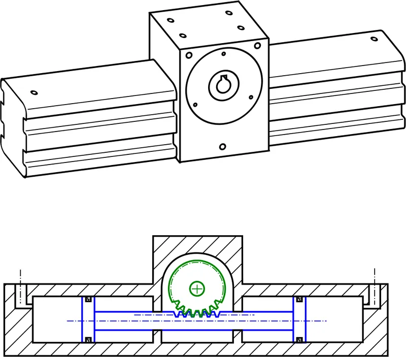
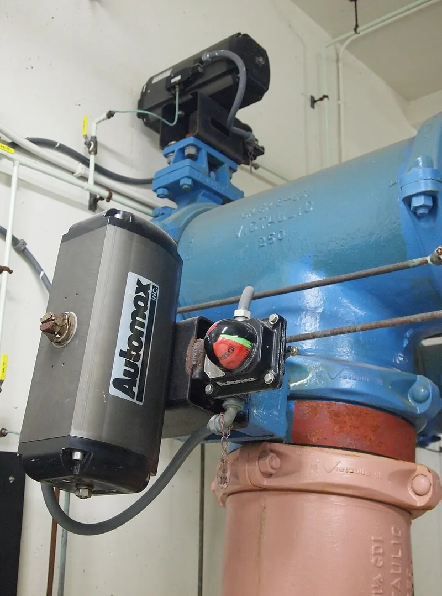

<figure class="eoc-pic eoc-pic-main"><picture><source media="(prefers-reduced-motion: reduce)" srcset="../media/drawn/rotary-air-actuator.svg"></picture><figcaption><strong>Animation.</strong> Diagram drawn for the encyclopaedia from the research notes. ⚑ Needs confirming: a drawing can simplify or get details wrong; a real photo or a better diagram is welcome.</figcaption></figure>
<figure class="eoc-pic"><figcaption><strong>Diagram.</strong> <a href="https://commons.wikimedia.org/wiki/File:Verin_rotatif_principe.svg">Verin rotatif principe</a> by Cdang, <a href="https://creativecommons.org/licenses/by-sa/3.0">CC BY-SA 3.0</a>, from Wikimedia Commons.</figcaption></figure>
<figure class="eoc-pic"><figcaption><strong>Photo.</strong> <a href="https://commons.wikimedia.org/wiki/File:Pneumatic_Rack_and_Pinion_Actuators.JPG">Pneumatic Rack and Pinion Actuators</a> by Z22, <a href="https://creativecommons.org/licenses/by-sa/3.0">CC BY-SA 3.0</a>, from Wikimedia Commons.</figcaption></figure>

A compact unit that turns compressed air or oil pressure into back-and-forth rotation of an output shaft through a set angle, either with a vane swinging in a round chamber or with pistons driving a rack and pinion; it is the turning cousin of the air cylinder and is widely used to open and close quarter-turn valves.

**In plain words:** A sealed box with an air pipe at each side and a shaft sticking out: let compressed air into one side and the shaft swings round to a stop (often a quarter or half turn); let air into the other side and it swings back. Inside, either a paddle swings round a round chamber, or pistons push toothed bars that turn a gear on the shaft. **Proper term:** Rotary [actuator](../glossary.md#actuator) (pneumatic or hydraulic; vane type or rack-and-pinion type).

**Also called:** pneumatic rotary actuator, hydraulic rotary actuator, fluid power rotary actuator (Wikipedia 'Rotary actuator'; Tameson); vane actuator, vane-type rotary actuator, single-vane and double-vane actuator (Tameson; Power & Motion); rack-and-pinion actuator, single-rack and double-rack actuator, limited rotation cylinder (Tameson); quarter-turn actuator, part-turn actuator, valve actuator (Tameson; ISO 5211 as described by Tameson); spring-return (single-acting) and double-acting rotary actuator (Tameson); scotch-yoke actuator (Tameson); spiral-shaft or helical rotary actuator, chain-and-sprocket rotary actuator (Power & Motion); rotary cylinder, swing cylinder, [oscillating](../glossary.md#oscillating) actuator ⚑ [uncertain]; vacuum actuator, vacuum wiper motor (old cars) (Wikipedia 'Rotary actuator'); pneumatic stepper motor, MR-safe pneumatic stepper motor (University of Twente; Printables 218779); verin rotatif (French) (Wikimedia Commons file name).

## How it works

In a vane actuator a paddle (vane) fixed to the shaft divides a round chamber in two; air or oil let into one side pushes on the vane and turns the shaft until the vane reaches the stop, and feeding the other side turns it back (Wikipedia 'Rotary actuator'; Tameson). In a rack-and-pinion actuator the air pushes a piston whose rod is a toothed rack, and the rack turns a gear (pinion) on the output shaft; two opposed racks on either side of the pinion double the [torque](../glossary.md#torque) and take up the [backlash](../glossary.md#backlash) (Tameson; Power & Motion). A spring-return (single-acting) version uses air to turn one way and springs to turn back, while a double-acting version uses air both ways (Tameson). A pneumatic stepper motor has two or more cylinders whose toothed pistons engage a gear in turn; switching the air in a set sequence moves the gear on by a fixed step each time, like an electric stepper motor (Printables 218779; University of Twente). Scotch-yoke actuators use a pin in a slot instead of a rack and are the heavy-duty valve type (Tameson); spiral-shaft and chain-and-sprocket types also exist (Power & Motion). Old cars used a quarter-turn vane actuator run by engine intake vacuum to drive the windscreen wipers (Wikipedia 'Rotary actuator').

## Parts

A small assembly that acts as one unit. Rack-and-pinion type: body, one or two pistons with racks machined into them, a pinion on the output shaft, end caps (holding spring cartridges in spring-return versions), piston seals and guides, shaft bearings, travel-stop adjusting screws, ports and a position indicator (Tameson). Vane type: a round chamber with a fixed stop, a vane on the shaft with seals round its edge, ports and a [stroke](../glossary.md#stroke) adjuster (Tameson; Power & Motion). A printed pneumatic stepper motor: housing, two toothed pistons, a gear on a shaft, four silicone seals and tubes (Printables 218779).

## Everyday examples

- Grey or blue boxes on top of ball and butterfly valves on factory and water pipes, which open and close them automatically (Wikimedia Commons photo; Tameson)
- Windscreen wipers on cars up to about 1960, driven by engine vacuum through a quarter-turn vane actuator (Wikipedia 'Rotary actuator')
- Turnover stations, swinging stops and swing-clear clamps on factory production lines (Power & Motion)
- Air-powered animatronic figures, which use pneumatic actuators for small movements (Wikipedia 'Animatronics')

## When to use it

Use a rotary air actuator when you already have compressed air and need a strong, quick back-and-forth turn between two set positions: opening and closing quarter-turn ball and butterfly valves, flipping or turning parts over, swinging gates, stops and clamps out of the way, or turning a gripper (Tameson; Power & Motion). It gives a lot of torque for its size, survives hazardous and explosive atmospheres where sparks are a risk, and needs little maintenance (Tameson; Power & Motion). Choose spring-return where a valve or arm must go to a safe position if the air fails (Tameson). Printed pneumatic stepper motors suit places where electric motors and metal are not allowed, such as MRI scanners, high-voltage switchgear or nuclear plants, and are cheap to prototype (University of Twente).

## When not to use it

For continuous rotation use an air motor, hydraulic motor or electric motor instead (Power & Motion). For precise positions in mid-travel, or in a small project with no compressor, an electric RC servo or stepper motor is simpler (Wikipedia 'Rotary actuator') ⚑ [uncertain]. For a straight push use an air cylinder. For very heavy or fast-swinging loads without cushioning, the stopping energy can damage the actuator, so add shock absorbers or pick a bigger unit (SMC selection guide). Avoid vane types where leaks matter, since their seals leak more than piston types (Wikipedia 'Rotary actuator').

## Details

- **What it does (jobs):**
  - change the kind of motion: turns air or oil pressure (a straight push on a piston or vane) into a limited turn of a shaft (Wikipedia 'Rotary actuator'; Tameson)
  - hold or release using power: opens and closes valves, swings clamps, gates and stops in and out of the way (Tameson; Power & Motion)
  - let it move (turn, slide or bend): drives an arm, flap or turnover table back and forth between two end positions (Power & Motion)
  - click into set positions: multi-position rack-and-pinion actuators stop at intermediate positions, and pneumatic stepper motors move in fixed steps (Tameson; Printables 218779)
- **Movement:** rotate, back and forth through a set angle: single-vane up to about 280 degrees, double-vane about 90-100 degrees (Tameson; Power & Motion); rack-and-pinion commonly a quarter or half turn, and up to five turns depending on rack length (Tameson; Power & Motion); pneumatic stepper motors rotate without limit in small steps (Printables 218779)
- **Directions it can move (degrees of freedom):** 1: the output shaft turns about its own axis between two end stops
- **Special behaviour:**
  - motion conversion: pressure becomes rotation; in the rack-and-pinion type a straight piston stroke becomes a turn (Tameson; Wikipedia 'Rack and pinion')
  - [fail-safe](../glossary.md#fail-safe--fail-secure) or breakaway: a spring-return actuator turns back to its spring position (spring-closed or spring-open) if air or power is lost, which is why it is used on valves that must shut (or open) in a failure (Tameson)
  - indexing: some rack-and-pinion actuators stop at several positions by controlling the pressure at their ports (Tameson); a pneumatic stepper motor moves in fixed steps of 360/(4 x teeth) degrees (Printables 218779)
  - torque-limiting: the torque depends on the supply pressure, so setting the pressure sets the maximum twist it can apply ⚑ [uncertain]
- **How it holds:**
  - powered hold: it holds its position or torque only while pressure is kept on it through a valve (Tameson)
  - spring force: a spring-return actuator's springs hold it in its rest position without air (Tameson)
- **Input and output:** Compressed air (or hydraulic oil, or vacuum) switched by a valve -> back-and-forth rotation through a set angle. Torque: vane types from a fraction of a newton-metre to hundreds; rack-and-pinion from a few N m to thousands; scotch-yoke from thousands to hundreds of thousands (Tameson). Power & Motion gives air rack-and-pinion units up to 200,000 lb-in and hydraulic ones up to 15,000,000 lb-in at up to 3,000 psi. Rack-and-pinion units give a nearly constant torque through the stroke (Tameson), unlike a cylinder pushing a lever, which gives half the torque or less near the ends of a 90-degree swing (Power & Motion). Efficiency: rack-and-pinion has 'fairly high mechanical efficiency' (Tameson) [no figure found]. Shaft arrangement: the output shaft is at right angles to the piston and rack in rack-and-pinion types, and is the vane's own axis in vane types. Back-drivable: a hydraulic actuator with its ports blocked resists, but an overrunning load causes damaging pressure spikes, so cross-port relief valves are fitted (Power & Motion); an air actuator can be forced back if the load torque exceeds the air torque ⚑ [uncertain]. Pneumatic stepper motors: printed designs up to 3.7 N m, 320 steps per second, free of backlash (University of Twente)
- **Power:** powered: needs compressed air or gas (often 'clean, dry' air from a central compressor), or pressurised oil, switched by a valve (Tameson); old wiper actuators ran on engine vacuum (Wikipedia). When power or pressure is lost: a spring-return actuator returns to its rest position; a double-acting actuator has 'a lack of a defined position' and stays roughly where it is (Tameson). Vacuum wipers slowed to a crawl when the engine's vacuum dropped (Wikipedia 'Rotary actuator')
- **Load:** Medium to heavy torque for its size (Tameson); see input_output for ranges. Small printed pneumatic steppers give about 0.25-0.55 N m (Printables 218779). The shaft takes twisting load well, but side and end loads on the shaft must stay within the maker's allowable load or an outside bearing must carry them (SMC selection guide). Stopping a heavy or long swinging load is the hard part: the load's kinetic energy must stay within the actuator's allowance or it is damaged (SMC selection guide)
- **Play and precision:** Rack-and-pinion units have gear backlash that grows with wear; double-rack units cancel it and give zero backlash at each end of travel and better stop [accuracy](../glossary.md#repeatability--accuracy) (Tameson). End positions against stops are repeatable; stopping exactly in mid-travel with air is difficult because air is springy, so use multi-position units, valves or a servo ⚑ [uncertain]. Printed pneumatic stepper motors are free of backlash (University of Twente). [Misalignment](../glossary.md#misalignment) between actuator and valve is taken up by the standard ISO 5211 drive interface (Tameson) ⚑ [uncertain]
- **Taking it apart:** removable: bolted to the valve or machine through a standard flange and drive (ISO 5211 for valves) and connected with threaded or push-in fittings; a NAMUR (VDI/VDE 3845) face lets a [solenoid](../glossary.md#solenoid) valve bolt straight on (Tameson)
- **How often it can be reused:** effectively unlimited cycles in normal use, though seals and gears wear and rack-and-pinion units develop backlash as they wear (Tameson). Printed PLA stepper gears 'may wear out and eventually break down after prolonged use' (Printables 218779). It can be unbolted and refitted many times
- **Sealing:** airtight or pressure: piston seals or seals round the vane edge, plus shaft seals. Vane actuators need several sliding seals whose joints tend to leak more than piston types (Wikipedia 'Rotary actuator'); rack-and-pinion units with fluid round the pinion need a high-pressure shaft seal (Power & Motion). Printed steppers use laser-cut or hand-cut silicone rubber seals (University of Twente; Printables 218779, 44562)
- **Adjustable:** yes: end positions with travel-stop screws or a vane stroke adjuster (Tameson); vane types need external stops or a stroke-limiting package (Power & Motion); adjustable end cushions on rack-and-pinion and spiral types (Power & Motion); speed with meter-out or meter-in flow controls (Power & Motion); torque by changing the supply pressure (Tameson)
- **Access needed:** end of a tube or shaft: the output shaft or drive socket couples to the end of the valve stem or driven shaft
- **Materials:** Commercial bodies are usually aluminium or steel with rubber seals ⚑ [uncertain]. Printed pneumatic steppers: PLA housings, polycarbonate or PETG gears and pistons, silicone rubber seals, nylon screws or clips, so they are completely metal-free (University of Twente; Printables 218779)
- **Heat, cold, water and wear:** Needs clean, dry compressed air (Tameson). Suited to hazardous and explosive atmospheres when piloted by air rather than electric switches (Tameson; Power & Motion). Plastic pneumatic steppers are metal-free, so they work inside MRI scanners and around high voltages (University of Twente). Reed and proximity position switches may malfunction with high vibration or strong electromagnetic fields (HSE HSG39 para 121, said of cylinders). Vacuum-powered versions lose power when the vacuum falls (Wikipedia 'Rotary actuator'). PLA printed gears wear and break under prolonged use (Printables 218779). Seal life in heat and cold depends on the seal rubber ⚑ [uncertain].

## Making it

- **Ways to make or get it:**
  - off-the-shelf part: vane, rack-and-pinion and scotch-yoke rotary actuators, mostly sold for valve automation (Tameson)
  - 3D print (FDM): pneumatic stepper motors such as the M-45 (Printables 218779)
  - 3D print (resin or other high-resolution printing): miniature steppers such as the T-8 need a high-resolution printer such as a Stratasys Objet (Printables 44562)
  - laser cut: silicone seals and some parts of research pneumatic steppers (University of Twente; Printables 44562)
- **Printing it in one piece (print in place):** no: printed pneumatic steppers are printed as housing, pistons and gear, then assembled with cut silicone seals, tubes, glue and screws (Printables 218779)
- **Tools:** spanners and hex keys for the mounting bolts and travel-stop screws, a tube cutter and push-in or threaded fittings for the air lines (Tameson). Printed steppers also need a seal cutter, cyanoacrylate glue with activator, clamps and a drill to open up the tube holes (Printables 218779)
- **Difficulty:** moderate to hard: buy one, since sealing a vane or rack piston against air pressure needs accurate parts. Printed pneumatic stepper motors are possible but fiddly (gluing the covers is 'the most risky part ... you have only one chance', and the tiny T-8 is 'for advanced users only') (Printables 218779, 44562)

### 3D printing tips

Based on the M-45 and T-8 printed pneumatic stepper motors (Printables 218779, 44562) and the University of Twente paper: 1) Print the housing in PLA at 0.15 mm layers (including the first layer), 100% [infill](../glossary.md#infill) to minimise leaks, and enable ironing on all top surfaces. 2) Print the gear and pistons in polycarbonate or PETG: stronger and lower friction than PLA, so more torque (up to 0.4-0.5 N m). 3) Gear tooth count trades step size against strength: 17 teeth is the practical limit with a 0.4 mm nozzle; 17-tooth PLA gears work up to 2 bar (0.25 N m) but wear; 13-tooth polycarbonate gears handle 0.55 N m at 5 bar. 4) Grind the flat faces of the pistons so they slide without rubbing, and open the axle hole to 4.8-4.9 mm if needed. 5) Cut 1 mm silicone rubber seals (about 12 x 10 mm) with a printed seal cutter and check they are square; fit the larger face towards the air chamber. 6) Use 3 mm OD tubing; drill the holes to 3 mm, slide a tube fixer over them and glue with cyanoacrylate and activator. 7) Before gluing the covers, put petroleum jelly round the seals and pistons, keep glue off the sliding parts, clamp, then run at low pressure first. 8) Miniature versions need very sharp triangular teeth, so print at the highest resolution; rounded teeth may not work (T-8). 9) Drive it with two 5/2-way valves and a microcontroller (an Arduino and the PneumaticStepper library are suggested). 10) Commercial vane and rack actuators are not worth printing; never hold high air pressure in a printed part ⚑ [uncertain]

### Buying one (off-the-shelf parts)

Single-vane and double-vane rotary actuators; single-rack and double-rack (rack-and-pinion) actuators, spring-return or double-acting, including multi-position types; scotch-yoke valve actuators (Tameson); spiral-shaft (helical) and chain-and-sprocket rotary actuators (Power & Motion); compact rotary tables and rotary actuators with internal shock absorbers (SMC (brand) series such as CRB, CRQ2, MSQ) (SMC selection guide). Accessories: ISO 5211 mounting kits and drive adaptors, NAMUR (VDI/VDE 3845) solenoid valves, limit-switch boxes and position indicators, external shock absorbers, flow controls, cross-port relief valves for hydraulics (Tameson; Power & Motion; SMC). For printed steppers: 3 mm OD polyurethane tube (e.g. Festo (brand) PUN-H-3X0,5), 5/2-way or 3/2-way solenoid valves, LEGO Technic (brand) axles (Printables 218779)

## Rules of thumb

- Rotation limits: single-vane about 280 degrees, double-vane about 90-100 degrees with roughly double torque (Tameson; Power & Motion); rack-and-pinion up to five turns depending on rack length (Power & Motion)
- Vane actuators have no effective internal cushioning or rotation limit, so add external stops or a stroke-limiting package (Power & Motion)
- A cylinder pushing a lever is limited to 90 degrees or less and gives half the torque or less at the start and end of a 90-degree swing; use a rotary actuator for larger angles or accurate stopping (Power & Motion)
- Force at the end of an arm = output torque / arm length (Power & Motion, clamp-arm example)
- Size the torque with margins: static load x 1, resistance load (gravity or friction against the turn) x 3 to 5, inertial load x 10, adding them when both apply (SMC selection guide)
- Check the load's kinetic energy E = 1/2 x I x w^2 against the actuator's allowable energy, and add a shock absorber if it is higher; the moment of inertia grows with the square of the radius, so a long arm with a small mass can still damage the actuator (SMC selection guide)
- Keep the turning time within the maker's range (stated per 90 degrees); running too slowly causes [stick-slip](../glossary.md#stick-slip) or stalling (SMC selection guide)
- Choose double-rack units for zero backlash at the ends and higher stop accuracy, and single-rack units for light, compact jobs (Tameson)
- Spring-return actuators save air and fail to a known position; double-acting ones give better control and faster cycling (Tameson)
- In hydraulic circuits fit cross-port relief valves set at or above the system relief setting but below the actuator's maximum pressure (Power & Motion)
- Pneumatic stepper step size = 360 / (4 x gear teeth) degrees for a two-cylinder design (Printables 218779)

## Common failures

1) Growing backlash from worn rack and pinion gears, which spoils positioning: use double-rack units (Tameson). 2) Leaks past vane seals, which are more troublesome than piston seals (Wikipedia 'Rotary actuator'). 3) Damage from stopping too much kinetic energy at the end of travel: check the energy and add shock absorbers or cushions (SMC selection guide; Power & Motion). 4) Stick-slip or stalling when set to turn too slowly (SMC selection guide). 5) Bearing and shaft damage from side loads beyond the allowable load: support the load with an outside bearing (SMC selection guide). 6) Undersized torque for valves with friction or gravity loads: apply the 3-5x and 10x margins (SMC selection guide). 7) Printed steppers: air leaks from poorly fitting seals, jammed pistons from glue or rough faces, worn PLA gears (Printables 218779).

## Safety

1) Crush and pinch points: arms, flaps and clamps swing suddenly and with force; check for people and objects in the path before turning on the air (FRC Zero). 2) Sudden start: an exhausted double-acting actuator can accelerate violently when air returns; use a soft-start valve (HSE HSG39 para 120). 3) Trapped air: if a pipe to a locked actuator is undone, air on the other side can expand and move it 'which could lead to injury'; vent all pressure before working on it (HSE HSG39 paras 139 and 169). 4) Springs: spring-return units contain preloaded springs; guard against sudden release of trapped springs when dismantling (HSE HSG39 para 169). 5) Shock loads from stopping a heavy swinging load can break the actuator (SMC selection guide; HSE HSG39 para 118 says the same of cylinders). 6) Never point compressed air at skin and wear safety glasses (FRC Zero). 7) Hydraulic versions: overrunning loads cause pressure spikes (fit cross-port relief valves; Power & Motion), and leaks can inject oil through the skin (HSE hydraulic injection bulletin). 8) Never store high pressure in a printed part ⚑ [uncertain].

## Related

- Air or hydraulic cylinder: gives a straight push; with a lever it can turn up to about 90 degrees but with uneven torque (Power & Motion)
- Rack and pinion: the gear mechanism inside the rack-and-pinion actuator, here driven by air pistons
- Scotch yoke (motion conversion): the pin-and-slot mechanism inside heavy-duty valve actuators (Tameson)
- Servo horn and [spline](../glossary.md#spline) hub (RC servo): the electric equivalent for small projects, with easy mid-position control
- Shut-off valve (ball valve, butterfly valve): the quarter-turn valves these actuators most often drive
- Switching valve (directional control valve, solenoid valve): what switches the air to each side
- Soft pneumatic bending actuator and pneumatic artificial muscle: soft air-powered movers that bend or pull instead of turning a shaft
- Bellows and inflatable actuators: rubber or fabric air movers that can also swing a hinge
- Geneva drive and other indexing mechanisms: give stepped rotation mechanically, as the pneumatic stepper does with air
- Gear pump (gerotor) run as a hydraulic motor: gives continuous rotation from fluid flow instead of a limited swing

## Make it yourself

- [M-45 multipurpose pneumatic stepper motor (Vincent Groenhuis, Printables) (URL from Printables API, page not opened)](https://www.printables.com/model/218779-m-45-multipurpose-pneumatic-stepper-motor): Printable two-cylinder pneumatic stepper motor, 45 x 40 x 15 mm, up to about 0.5 N m, with a LEGO Technic-compatible shaft and an optional rack for linear stepping; detailed print, seal and gluing instructions *(licence: CC BY-NC-SA)*
- [Pneumatic stepper motor: T-8 (Vincent Groenhuis, Printables) (URL from Printables API, page not opened)](https://www.printables.com/model/44562-pneumatic-stepper-motor-t-8): Tiny 8 x 8 x 5.5 mm printable pneumatic stepper with 0.2 mm steps, for high-resolution printers and advanced users *(licence: CC BY-NC-SA)*

## Pictures, videos and models

- [Verin rotatif principe.svg (Cdang; Wikimedia Commons)](https://commons.wikimedia.org/wiki/File:Verin_rotatif_principe.svg): Diagram of the principle of a rack-and-pinion rotary actuator: a hydraulic cylinder whose rack turns a gear (teeth partly drawn); used on the Wikipedia 'Rotary actuator' article *(licence: GFDL 1.2+ or CC BY-SA 1.0/2.0/2.5/3.0)*
- [Pneumatic Rack and Pinion Actuators.JPG (Z22; Wikimedia Commons)](https://commons.wikimedia.org/wiki/File:Pneumatic_Rack_and_Pinion_Actuators.JPG): Photo of two pneumatic rack-and-pinion actuators with solenoid valves controlling two valves on a large water pipe *(licence: CC BY-SA 3.0)*
- [Pneumatic Rotary Actuator - How They Work (Tameson)](https://tameson.com/pages/pneumatic-rotary-actuators): Figures of rack-and-pinion (single and double rack), scotch-yoke and vane actuators, including the inside of a vane actuator's chamber *(licence: link only)*
- [Book 2, Chapter 19: Rotary actuators (Power & Motion / Hydraulics & Pneumatics)](https://www.powermotiontech.com/technologies/other-technologies/article/21882754/book-2-chapter-19-rotary-actuators): Cutaway drawings of single- and double-vane, rack-and-pinion, spiral-shaft and chain-and-sprocket rotary actuators, plus example machines and circuits *(licence: link only)*
- [High-Performance Pneumatic Stepper Motors (Vincent Groenhuis, YouTube)](https://www.youtube.com/watch?v=BBG-8ZSOmdY): Video of 3D-printed pneumatic stepper motors running, linked from the T-8 model page *(licence: link only)*

## Needs confirming

⚑ marks something nobody has confirmed yet: a fact the research could not confirm from a source, a finder value that is a best guess, or an open point from the research notes. Corrections are welcome (see `research/needs-confirming.md`).

- ⚑ 10 sentences on this page marked [uncertain].
- ⚑ Finder value `power_source` = compressed air, liquid, suction (best guess): `power` names several power sources, and not all may apply
- ⚑ Finder value `power_loss` = not applicable (best guess): `power` mentions losing power, but none of the three outcomes
- ⚑ Finder value `overload_response` = not applicable (best guess): listed as torque-limiting or breakaway, but no overload behaviour matched

## Sources

- <https://en.wikipedia.org/wiki/Rotary_actuator>
- <https://en.wikipedia.org/wiki/Rack_and_pinion>
- <https://en.wikipedia.org/wiki/Animatronics>
- <https://tameson.com/pages/pneumatic-rotary-actuators>
- <https://tameson.com/pages/pneumatic-rotary-rack-and-pinion-actuators>
- <https://www.powermotiontech.com/technologies/other-technologies/article/21882754/book-2-chapter-19-rotary-actuators>
- <https://www.smcworld.com/catalog/SMC-HP-PDF/ro_actuator_select-en.pdf>
- <https://research.utwente.nl/en/publications/rapid-prototyping-high-performance-mr-safe-pneumatic-stepper-moto/>
- <https://www.hse.gov.uk/pubns/priced/hsg39.pdf>
- <https://www.hse.gov.uk/safetybulletins/hydraulic-injection-injury.htm>
- <https://www.frczero.org/pneumatics/pneumatic-safety/>
- <https://commons.wikimedia.org/wiki/File:Verin_rotatif_principe.svg>
- <https://commons.wikimedia.org/wiki/File:Pneumatic_Rack_and_Pinion_Actuators.JPG>
- <https://commons.wikimedia.org/wiki/Category:Rotary_actuators>
- <https://www.youtube.com/watch?v=BBG-8ZSOmdY>
- <https://api.printables.com/graphql/>
- <https://www.printables.com/model/218779-m-45-multipurpose-pneumatic-stepper-motor>
- <https://www.printables.com/model/44562-pneumatic-stepper-motor-t-8>
