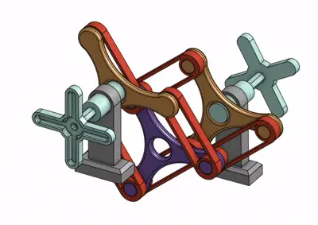
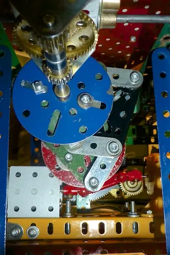
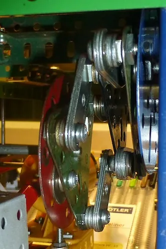

<figure class="eoc-pic eoc-pic-main"><picture><source media="(prefers-reduced-motion: reduce)" srcset="../media/schmidt-coupling.still.webp"></picture><figcaption><strong>Animation.</strong> <a href="https://commons.wikimedia.org/wiki/File:SchmidtCouplingGif.gif">SchmidtCouplingGif</a> by Saturnautics, <a href="https://creativecommons.org/licenses/by-sa/4.0">CC BY-SA 4.0</a>, from Wikimedia Commons.</figcaption></figure>
<figure class="eoc-pic"><figcaption><strong>Photo.</strong> <a href="https://www.flickr.com/photos/61132483@N00/8201590232">Meccanograph Schmidt coupling 2</a> by Elsie esq., <a href="https://creativecommons.org/licenses/by/2.0/">CC BY 2.0</a>, from Flickr via Openverse.</figcaption></figure>
<figure class="eoc-pic"><figcaption><strong>Photo.</strong> <a href="https://www.flickr.com/photos/61132483@N00/8201589874">Meccanograph Schmidt coupling</a> by Elsie esq., <a href="https://creativecommons.org/licenses/by/2.0/">CC BY 2.0</a>, from Flickr via Openverse.</figcaption></figure>

A coupling made of three discs linked in series by sets of equal parallel bars, which passes rotation at exactly constant speed between two parallel shafts that are far out of line, even while that offset changes.

**In plain words:** Three discs in a row joined by little linking bars, so a motor shaft can drive another shaft that sits well off to one side (centimetres away, not just a fraction of a millimetre) at exactly the same speed and angle; the second shaft can even move sideways while it runs. **Proper term:** Schmidt coupling (Schmidt offset coupling).

**Also called:** Schmidt offset coupling / offset coupling; parallel-offset coupling; parallel-link coupling; three-disc link coupling; Schmidt coupler (maker usage, e.g. on Printables); Schmidt-Kupplung (German; also the registered name of SCHMIDT-KUPPLUNG GmbH (brand), whose series are Standard S, Power Plus P and Offset Plus V); Zero-Max Schmidt Offset Coupling (brand), L200 and L300 series; Schmidt Inline coupling and Schmidt 5-D coupling (brand, Zero-Max): related versions for small offsets.

## How it works

Each pair of neighbouring discs is joined by three equal links whose pivots sit 120° apart on circles of the same size, so every link forms a parallelogram with the discs (a parallel-crank [linkage](../glossary.md#linkage)): the two discs must always turn to exactly the same angle, yet their centres are free to be apart (Wikipedia). The centre disc has no bearing of its own; Schmidt's key discovery was that it 'could in fact assume its own center of rotation' between the two shafts (Wikipedia). Turning force passes through the links as balanced pushes and pulls, so the shaft bearings feel no side load (ABSSAC; Zero-Max). Because the links fix only the angle and not the distance, the offset can be set anywhere between a minimum and a maximum of about twice the link length, and can even change while running, without any change in speed or phase (Wikipedia; Schmidt-Kupplung).

## Parts

A small assembly that acts as one unit: an input disc (on hub 1), a free-floating centre disc, an output disc (on hub 2), and two layers ('link levels') of three equal-length links, with a bearing and pin at every link end: 3 discs, 6 links and 12 pivots, plus the two hubs that clamp or key onto the shafts (Wikipedia; Schmidt-Kupplung catalogue).

## Everyday examples

- Printing presses, where rollers must stay exactly in step (in register) while the spacing between them is adjusted (Zero-Max; Schmidt-Kupplung)
- Roll-forming, laminating, corrugated-cardboard and paper-making machines (ABSSAC)
- Coating rollers that lift to handle different material thicknesses, or that can be changed without stopping the machine (Schmidt-Kupplung)
- 3D-printed desk demonstrators and fidget models shared on Printables and Thingiverse

## When to use it

Use it when two parallel shafts must turn at exactly the same speed and angle but sit well out of line (far more than an Oldham or flexible coupling can take), when the offset has to change while running (adjustable, lifting or tensioning rollers), when there is little length between the shaft ends (Offset Plus V can take a 275 mm offset in a coupling only 284 mm long, ABSSAC), or when you must avoid side loads on bearings. It also makes a satisfying teaching model for parallelogram linkages.

## When not to use it

Avoid it when the shafts are in line or nearly so (it must not run at zero offset; use a jaw, beam or Oldham coupling), when the offset is small and fixed (an Oldham coupling or an Inline Schmidt coupling is simpler), when the shafts meet at an angle (use a pair of universal joints or a flexible shaft), or when a fixed offset can be bridged more cheaply by a belt, chain or gear pair (a gear pair reverses the direction). Printed versions are for light loads and demonstrations only.

## Details

- **What it does (jobs):**
  - join and hold: connects two parallel shafts so they turn together at exactly the same speed and angle
  - let it move (turn, slide or bend): lets the two shafts sit far apart sideways, and lets one shaft move sideways while running, e.g. a coating roller that lifts to take thicker material without stopping the machine (Schmidt-Kupplung)
- **Movement:** multiple: the whole coupling rotates continuously, while the output shaft may also shift sideways in any direction within the permitted offset range (e.g. 6-23 mm for the smallest Schmidt-Kupplung S 35), at rest or while running
- **Directions it can move (degrees of freedom):** Between the two shafts: 2 (the output shaft can shift sideways in both directions across the discs), while the turning itself is locked 1:1. Commercial couplings also accept a little end movement (about 1 mm) and tilt (0.5-0.8°) (Schmidt-Kupplung technical data). Inside, the centre disc floats with 2 sideways freedoms of its own, fixed by the geometry except when the shafts are in line.
- **Special behaviour:**
  - none of the listed behaviours: its special trick, passing rotation at exactly constant speed and phase across a large, changeable sideways offset without loading the shaft bearings sideways (Wikipedia; Schmidt-Kupplung; Zero-Max), is not in this list. It does not slip, click, lock or release. Its floating centre disc does centre itself, but only while the shafts are offset: in line, the disc has no fixed position (Schmidt-Kupplung)
- **How it holds:**
  - not a holding joint (it moves or passes on motion): it passes rotation from one shaft to another
  - shape (the parts interlock; [form-fit](../glossary.md#form-fit--force-fit--material-bond)): [torque](../glossary.md#torque) passes through pinned links and bearings, so the discs cannot slip relative to each other
  - friction or clamping (force-fit): the end hubs are usually clamped onto the shafts (Schmidt-Kupplung clamping hubs) or keyed and set-screwed (Zero-Max hubs)
- **Input and output:** Continuous rotation -> the same continuous rotation (1:1), at constant angular velocity and with no phase shift at any offset (Wikipedia; Schmidt-Kupplung). Shaft arrangement: parallel and offset (never exactly in line). Efficiency: high, since the only losses are in the needle-bearing pivots ⚑ [uncertain: no efficiency figure published]. Back-drivable: yes; either shaft can drive the other.
- **Power:** passive (no power needed)
- **Load:** Medium to heavy torque: Schmidt-Kupplung sizes carry 35 to 6,610 N·m (ABSSAC), and Zero-Max L200/L300 offset couplings 637 to 459,000 lbf·in (about 72 N·m to 52 kN·m) (Zero-Max table). Strong in twist, and it puts no side load on the shaft bearings (Zero-Max; Schmidt-Kupplung). Weak against end movement and tilt: about 1 mm [axial](../glossary.md#axial--radial) and 0.5-0.8° angular [misalignment](../glossary.md#misalignment) (Schmidt-Kupplung table). Torque capacity mainly depends on bearing size, number of bearings and their radius (Zero-Max).
- **Play and precision:** Small play: precision needle bearings give very low rotational play (Schmidt-Kupplung), and Zero-Max offers Low and Ultra Low [Backlash](../glossary.md#backlash) models; it is torsionally stiff (7 kN·m/rad for the smallest Schmidt-Kupplung S 35). The output keeps exactly the same angle as the input at any offset, so it suits timing and registration drives. Misalignment: very large parallel offset (e.g. 6-23 mm for S 35, up to 275 mm for the largest Offset Plus V (ABSSAC)), but only about 1 mm end float and 0.5-0.8° tilt, and never zero offset.
- **Taking it apart:** removable: commercial couplings clamp onto the shafts with clamping hubs (several screws, e.g. M6 at 12 N·m on the smallest Schmidt-Kupplung sizes), or bolt to flanges or keyed hubs, and come off by loosening them (Schmidt-Kupplung installation instructions; Zero-Max hub data)
- **How often it can be reused:** many times: it comes off and goes back on as one unit; what wears out is the pivot bearings with running hours, and Zero-Max treats the needle bearings' B-10 life as the coupling's life
- **Sealing:** none: the links and discs are open; only the needle bearings have built-in seals (Schmidt-Kupplung material list), and the maker recommends a metal cover to shield the coupling from heat, dust, sand and solvents
- **Adjustable:** yes: the offset can be changed at rest or while running under load, anywhere within the permitted range (Schmidt-Kupplung); the length between shaft ends is set when installing
- **Access needed:** end of a tube or shaft: each end hub fits over a shaft end and is clamped or keyed there; leave clear space round it for the links' swing diameter and room for a grease gun
- **Materials:** Commercial: steel discs (St52-3), steel links, hardened steel bolts, needle roller bearings and grease (Schmidt-Kupplung). Maker versions: printed PLA discs and links with pins, screws or 608 ball bearings and 8 mm steel shafts (Printables models).
- **Heat, cold, water and wear:** Commercial couplings are all steel with greased needle bearings; shield them from direct heat, dust, sand and solvents with a metal cover, and regrease at intervals that shorten with speed (Schmidt-Kupplung). The coupling is dynamically balanced and absorbs radial vibration (Schmidt-Kupplung; Zero-Max), but running near in-line causes severe vibration (Wikipedia). No temperature limits were found ⚑ [uncertain]. Printed PLA versions soften above about 60 °C (Prusa).

## Making it

- **Ways to make or get it:**
  - 3D print (FDM): popular desk demonstrators and light drives (e.g. Ringarn67's and Maltese Canuck's models on Printables)
  - laser cut: the discs and links are flat plates, so they suit sheet cutting ⚑ [uncertain: no laser-cut example checked]
  - CNC: steel or aluminium discs and links with bearings
  - off-the-shelf part: Schmidt-Kupplung (brand) and Zero-Max (brand) offset couplings
- **Printing it in one piece (print in place):** no: the discs and links are printed flat as separate parts and joined with pins, screws or bearings (both Printables examples clip or pin together) ⚑ [uncertain: no [print-in-place](../glossary.md#print-in-place) version was found, though the flat layered design might allow one]
- **Tools:** Hex keys and a torque wrench for the hub clamp screws or flange bolts; a grease gun with the specified grease for regreasing (Schmidt-Kupplung). Printed versions: pins, screws or small bearings, perhaps a drill or reamer to true the pivot holes, and a dab of glue for loose clip-together parts (Maltese Canuck, Printables).
- **Difficulty:** moderate: the discs and links print flat without supports, but it needs 12 accurate pivots with equal link lengths and hole spacings, plus pins or bearings; a printed one is a demonstrator or light drive, so buy one for real torque

### 3D printing tips

1) Print the discs and links flat on the bed; they are flat plates, so no supports are needed (Maltese Canuck: PLA, no supports, 3 walls, 55% [infill](../glossary.md#infill)). 2) The three links in each layer must be exactly the same length, with their holes equally spaced on equal circles 120° apart; otherwise the parallelograms fight each other and bind ⚑ [uncertain: reasoning from the geometry]. Schmidt-Kupplung stresses that 'All coupling elements for a level must be installed in parallel'. 3) Pivots: printed holes come out undersized, so give pins [clearance](../glossary.md#clearance) (Ringarn67 scaled his links to 104% for a looser fit on the pins, printed at 0.20 mm layers and added a 3 mm brim on the pins); for a working drive use steel pins, screws with bushes, or small ball bearings at all 12 pivots. 4) Lubricate the rubbing surfaces, e.g. with graphite from a pencil (Maltese Canuck) or grease. 5) Support the input and output shafts rigidly and parallel, e.g. 8 mm steel shafts in 608 bearings (Maltese Canuck), because the coupling itself tolerates almost no tilt (0.5-0.8° in commercial ones, Schmidt-Kupplung). 6) Keep the shafts at least the minimum offset apart and below the maximum: never let the links of the two layers lie parallel (fully stretched) or the shafts come into line, or the middle disc wobbles (Schmidt-Kupplung; Wikipedia). 7) Make the links extra thick round the holes, where plastic links are weakest ⚑ [uncertain]. 8) PLA is fine for a demonstrator but softens above about 60 °C (Prusa); use PETG or nylon for a working drive.

### Buying one (off-the-shelf parts)

Search for 'Schmidt coupling', 'Schmidt offset coupling', 'Schmidt-Kupplung' (brand; Standard S, Power Plus P and Offset Plus V series), 'Zero-Max Schmidt offset coupling' (brand; L200/L300 series, e.g. L230C), 'parallel offset coupling'. For small offsets: 'Schmidt Inline coupling' (L400) and '5-D coupling' (L500) (brand, Zero-Max), or an 'Oldham coupling'. For home-made versions: 608 ball bearings, 8 mm steel shafts, dowel pins or shoulder screws, small flanged bearings, clamping hubs or shaft collars, and grease or graphite.

## Rules of thumb

- Never run the shafts in line: at zero offset the centre disc 'would have no definite position in space but would be stimulated to its own movement', so every size has a minimum required offset (Schmidt-Kupplung catalogue 2022, p. 8-10); at high speed, near-in-line shafts cause 'extreme vibration' (Wikipedia).
- Never run in the fully stretched ('extended') position, where the links of one layer lie parallel to those of the other (Schmidt-Kupplung catalogue p. 10).
- The maximum offset is about twice the length of the links (Wikipedia).
- Example sizes: the smallest Schmidt-Kupplung S 35 carries 35 N·m (65 N·m peak), needs at least 6 mm offset, allows up to 23 mm, runs to 3,100 rpm, and takes 1 mm end movement and 0.8° tilt (Schmidt-Kupplung technical data, p. 15). Zero-Max's smallest L230C works from 0.437 in (11 mm) to 1.575 in (40 mm) offset, carries 637 lbf·in (72 N·m) and runs to 2,500 rpm (Zero-Max Schmidt catalogue, p. 6).
- In both catalogues the minimum offset is roughly a quarter of the maximum (6/23 mm, 13/50 mm and 50/190 mm for Schmidt-Kupplung sizes; 0.437/1.575 in for Zero-Max L230C) [our calculation from the catalogue tables].
- If the output shaft travels along a straight line, the usable travel ('maximum linear range') is about 2 × √(maximum offset² − minimum offset²), e.g. about 45 mm for the S 35 [our calculation; it matches the catalogue values]. Zero-Max: to use all of it, the line must pass the fixed shaft at the minimum offset, with the travel centred.
- Size it by torque, speed and bearing life: Schmidt-Kupplung multiplies the drive torque by a performance factor (from speed and desired life) and a load factor from 1.0 (uniform) to 2.25 (heavy shocks) (catalogue p. 12); Zero-Max takes the needle bearings' B-10 life as the coupling's life (catalogue p. 5).
- Regrease at intervals that shorten as speed rises, only with the specified grease (mixing greases shortens life); the smallest sizes are lubricated for life (Schmidt-Kupplung p. 22-23).
- For small misalignments (about 0.06 in parallel, ±0.5° angle), Zero-Max's Inline Schmidt coupling, with two pairs of parallel links 90° apart, is used instead; it does create side loads, which Zero-Max charts as a percentage of coupling weight rising with offset and speed (Zero-Max catalogue p. 8, 11).
- Install it as a complete unit, with all links of a layer parallel, onto clean, dry, burr-free shaft ends, and allow for shaft growth with heat (Schmidt-Kupplung installation instructions, p. 21).

## Common failures

1) Severe vibration from running with the shafts too close to in line (Wikipedia; Schmidt-Kupplung). 2) Jamming or overload when pushed to the fully stretched position beyond maximum offset (Schmidt-Kupplung). 3) Worn pivots and needle bearings from missed regreasing or mixed greases; Schmidt-Kupplung replaces whole link elements rather than single bearings. 4) Extra wear and side loads when the shafts are tilted or pushed together beyond the small angular and axial limits (Zero-Max notes excess misalignment introduces sideloads that cause vibration and bearing failure; Schmidt-Kupplung table). 5) Printed versions: binding from unequal link lengths or hole spacing, pins too tight (Ringarn67 enlarged his links by 4%), clip-together parts working loose (Maltese Canuck suggests a dab of glue), and pivot holes wearing oval ⚑ [uncertain].

## Safety

The links swing round a bigger circle than the discs (the 'swing diameter'), creating pinch and entanglement points; guard it like any rotating equipment (Zero-Max: 'Rotating equipment must be guarded'). The coupling can come apart when lifted or carried, and parts can fall off (Schmidt-Kupplung). Near in-line running at speed, the centre disc can oscillate violently (Wikipedia).

## Related

- Oldham coupling: three discs with sliding tongue-and-groove slots; simpler and cheaper, but only for small offsets, and it slides rather than pivots
- Double universal joint (two Hooke's joints on a middle shaft): can bridge an offset, but Zero-Max notes it causes radial forces at the joints and needs a lot of sideways space
- Schmidt Inline and 5-D couplings (brand, Zero-Max): two pairs of parallel links 90° apart for small offsets; the 5-D also takes ±5° of tilt
- Flexible drive shaft: carries rotation round bends and large offsets, but twists under load so the output lags and is not exactly in step
- Belt, chain or gear drive: bridges a fixed offset cheaply; gears reverse the direction, and changing the offset needs a tensioner or swinging arm
- Jaw coupling and flexible beam coupling: for nearly in-line shafts only
- Parallelogram (four-bar) linkage: the same principle of two [cranks](../glossary.md#crank) joined by an equal link, which is unstable at its fold-over point unless braced (Wikipedia 'Antiparallelogram'); the Schmidt coupling's three links per layer act as the bracing ⚑ [uncertain: our interpretation]

## Make it yourself

- [Schmidt-Coupling (Ringarn67, Printables) (URL from search results; details via Printables API)](https://www.printables.com/model/64462-schmidt-coupling): Printed PLA Schmidt coupling made 'just to understand how it works'; links scaled to 104% for a looser fit on the pins, 0.20 mm layers, 3 mm brim on the pins; Fusion 360 file included *(licence: Creative Commons Public Domain (as listed on Printables))*
- [Schmidt Coupler (Maltese Canuck, Printables) (URL from Printables API, page not opened)](https://www.printables.com/model/1698993-schmidt-coupler): Basic clip-together Schmidt coupler with 8 mm input and output shafts for 608 bearings; printed in PLA without supports; pencil graphite suggested as lubricant *(licence: CC BY (Creative Commons Attribution))*
- [Schmidt Coupling by Dagaz (Thingiverse) (page opened but its content did not load; title from search results)](https://www.thingiverse.com/thing:4640046): 3D-printed Schmidt coupling project described in search results as transmitting constant angular velocity during dynamic radial displacement of the output shaft ⚑ [uncertain: details not seen on the page] *(licence: ⚑ [uncertain: licence not seen])*

## Pictures, videos and models

- [SchmidtCouplingGif.gif (Wikimedia Commons, by Saturnautics)](https://commons.wikimedia.org/wiki/File:SchmidtCouplingGif.gif): Animated CAD model of a Schmidt coupling, made in Onshape, showing the discs and links turning while offset (used in the Wikipedia article) *(licence: CC BY-SA 4.0)*
- [Schmidt coupling (Nguyen Duc Thang, thang010146, YouTube)](https://www.youtube.com/watch?v=ARs3y3i0enE): Colour-coded CAD animation of rotation passed between parallel shafts, with the centre link disc turning without a fixed bearing while both shafts move (description from Thang's '2100 Animated Mechanical Mechanisms' catalogue) *(licence: link only (standard YouTube licence))*
- [Zero-Max Schmidt Offset Coupling (zeromaxmotioncontrol, YouTube)](https://www.youtube.com/watch?v=zVt1tvD7rqk): Manufacturer's video on Schmidt offset couplings and how they allow large shaft displacement while keeping constant angular velocity (per its YouTube description; video content not checked frame by frame) *(licence: link only (standard YouTube licence))*
- [What is a Schmidt Offset Coupling? (Design World, YouTube)](https://www.youtube.com/watch?v=iZUC5Q2kp8E): Introduction to the coupling's parts, how it works and where it is used *(licence: link only (standard YouTube licence))*
- [Schmidt-Kupplung catalogue 2022, English (SCHMIDT-KUPPLUNG GmbH)](https://www.schmidt-kupplung.com/fileadmin/user_upload/Download/Kataloge_pdf/Katalog_SchmidtKupplung_2022_englisch_ansicht_.pdf): Photos and diagrams of the three discs and two link levels, the minimum-offset rule, the forbidden in-line and extended positions, and the path of the centre disc *(licence: link only (manufacturer's copyright))*

## Needs confirming

⚑ marks something nobody has confirmed yet: a fact the research could not confirm from a source, a finder value that is a best guess, or an open point from the research notes. Corrections are welcome (see `research/needs-confirming.md`).

- ⚑ 10 sentences on this page marked [uncertain].

## Sources

- <https://en.wikipedia.org/wiki/Schmidt_coupling>
- <https://commons.wikimedia.org/wiki/File:SchmidtCouplingGif.gif>
- <https://en.wikipedia.org/wiki/Antiparallelogram>
- <https://s3.amazonaws.com/www.motionusa.com/zero-max/Schmidt_Couplings.pdf>
- <https://www.saddlebrookcontrols.com/wp-content/uploads/8-Zero-Max-Schmidt-Couplings.pdf>
- <https://www.schmidt-kupplung.com/fileadmin/user_upload/Download/Kataloge_pdf/Katalog_SchmidtKupplung_2022_englisch_ansicht_.pdf>
- <https://www.zero-max.dk/en/schmidt-couplings/>
- <https://www.abssac.co.uk/p/Schmidt+Couplings/Schmidt+Offset+Coupling/48/>
- <https://www.youtube.com/watch?v=ARs3y3i0enE>
- <https://www.youtube.com/watch?v=zVt1tvD7rqk>
- <https://www.youtube.com/watch?v=iZUC5Q2kp8E>
- <https://www.youtube.com/watch?v=ubtz8d0qGQ4>
- <https://wiki.dtonline.org/index.php/2100_Animated_Mechanical_Mechanisms>
- <https://api.printables.com/graphql/>
- <https://www.printables.com/model/64462-schmidt-coupling>
- <https://www.thingiverse.com/thing:4640046>
- <https://help.prusa3d.com/article/pla_2062>
