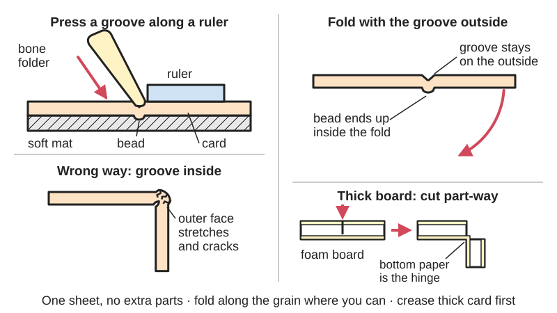
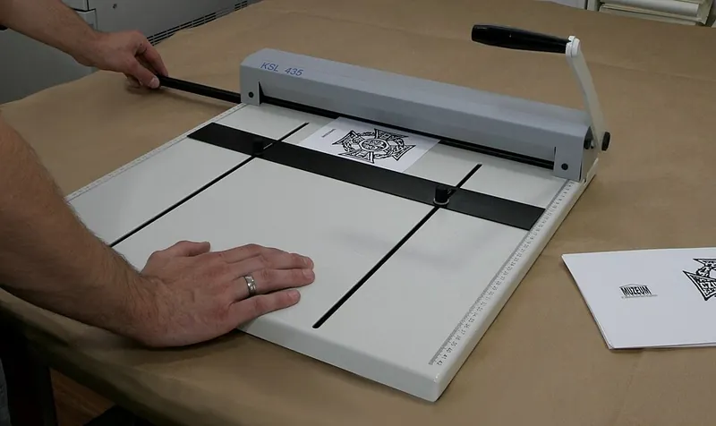

<figure class="eoc-pic eoc-pic-main"><picture><source media="(prefers-reduced-motion: reduce)" srcset="../media/drawn/score-and-fold-hinge.svg"></picture><figcaption><strong>Animation.</strong> Diagram drawn for the encyclopaedia from the research notes. ⚑ Needs confirming: a drawing can simplify or get details wrong; a real photo or a better diagram is welcome.</figcaption></figure>
<figure class="eoc-pic"><figcaption><strong>How it works.</strong> <a href="https://commons.wikimedia.org/wiki/File:Urz%C4%85dzenie_do_r%C4%99cznego_bigowania_(przegniatania).jpg">Urządzenie do ręcznego bigowania (przegniatania)</a> by TextPartner, <a href="https://creativecommons.org/licenses/by-sa/3.0">CC BY-SA 3.0</a>, from Wikimedia Commons.</figcaption></figure>

A pressed (scored) or half-cut line that makes a sheet of paper, card, cardboard or foam board bend cleanly and accurately in one place, so the sheet folds into a box, card or model and the fold keeps working as a hinge.

**In plain words:** A line pressed or lightly cut into paper or card so it folds neatly in exactly that place, and the fold itself then works as the hinge, like the spine of a greeting card, the flaps of a cereal box or the folds of a paper model. **Proper term:** Score-and-fold hinge (scored crease, creasing).

**Also called:** scored crease, score line, fold line (craft and print terms; Briar Press forum 'How to fold paper?'); creasing, crease line (the packaging-industry word for pressing fold lines into paperboard and corrugated board; Wikipedia 'Corrugated fiberboard'; Beex and Peerlings 2009); fold marks (Canon Creative Park papercraft guide); score and fold (foam-board and model-making name for a cut part-way through the board; Fold 'N Fly; Core77); half-cut score or kiss-cut score (a knife or blade cut that only 'kisses' the top of the sheet; Briar Press forum) ⚑ [uncertain: 'kiss-cut' is mainly a label-cutting term]; paper-skin hinge (foam board where the uncut paper face is left as the hinge; Model Aviation 'PAP-E') ⚑ [uncertain: informal name]; card hinge, paper hinge ⚑ [uncertain: informal names]; [mountain fold](../glossary.md#mountain-fold--valley-fold) and valley fold (the two directions a scored line can be folded; Wikipedia 'Yoshizawa-Randlett system'); Fold-Roller (Makedo, brand): a rolling creaser for cardboard, a search term only.

## How it works

Pressing a line into the sheet with a blunt tool (or pressing the sheet into a groove) crushes and partly separates the fibres or layers along that line, so the sheet is much easier to bend there than anywhere else and folds exactly on the line. Research on packaging board found that a good crease contains some splitting between the layers (delamination) to lower the bending [stiffness](../glossary.md#stiffness), and that a crease that is too shallow lets the top layer crack when folded (Beex and Peerlings 2009). The extra material pushed up by the score should end up as a small bead on the inside of the fold, so the outside is stretched less; that is why the score lines on a flattened cereal box are on the outside (Briar Press forum, 'Geoffrey'). In thick board you can instead cut part-way through one face, leaving the other face as a thin bendable hinge (Fold 'N Fly; GCA Cards). Paper bends more easily along its grain, and corrugated card bends more easily along its [flutes](../glossary.md#flute), so the fold direction matters (Briar Press; Adafruit 'Cardboard Fundamentals'; Make:).

## Parts

Single piece: the sheet itself, with a dented or part-cut line where it should bend. Nothing is added; the fold is then held at its angle by something else (glue tabs, tape, tucks or the shape it is folded into).

## Everyday examples

- A folded greeting card or invitation, scored down the middle (Briar Press forum)
- A cereal or cracker box: open it out flat and the scored fold lines show on the outside (Briar Press forum)
- The flaps of a cardboard shipping box, which bend on score lines pressed in at the factory (Wikipedia 'Corrugated box design': regular slotted container)
- Printable paper models, whose fold lines are scored with an empty ballpoint pen before folding (Canon Creative Park)

## When to use it

Use it whenever paper, card, cardboard or foam board must fold in a precise place: greeting cards, envelopes, booklet covers, gift and storage boxes, papercraft and architectural models, cardboard prototypes and furniture, foam-board model planes, and pop-up cards. It costs nothing, needs no extra parts and keeps the part in one piece, so folded boxes and models line up accurately. Use it as a hinge for lids, flaps and covers that are opened now and then, and use folded ribs and folded brackets to stiffen cardboard builds.

## When not to use it

Avoid relying on a plain card fold for a lid or door that is opened many times a day or carries weight (use a tape hinge on top of it, a cloth or tape strip, a split-pin pivot or a real knuckle hinge). It cannot be used on wood, metal, rigid plastic or 3D prints: use a [living hinge](../glossary.md#living-hinge) for printed and moulded plastic, [kerf](../glossary.md#kerf) bending for plywood and acrylic, and the V-groove fold for a neat folded corner in foam board, EVA foam or plywood. Avoid folding heavy card across the grain without scoring, which cracks (Briar Press). Where the fold must survive damp or outdoor use, card is a poor choice altogether.

## Details

- **What it does (jobs):**
  - let it move (turn, slide or bend): the scored line lets a flap, cover, lid or card fold open and shut without a separate hinge
  - line parts up exactly: scoring puts every fold of a box, card or paper model in exactly the right place so the edges meet (Canon Creative Park: make fold marks before cutting out the parts)
  - join and hold: the folded sides stay joined because they are still one sheet; the fold's angle is held by glue, tabs or tape
- **Movement:** flex: folds by bending along the line, from flat to fully folded back on itself (about 180 degrees), as in a folded greeting card. There is no pin, so the fold line is slightly rounded and moves a little as it bends.
- **Directions it can move (degrees of freedom):** 1: folding about the scored line. Thin paper can also twist and buckle near the fold, so a single crease is not a stiff, exact pivot.
- **Special behaviour:**
  - none: a scored crease simply folds; it does not lock, click or limit force. (A deliberately weakened crease, made by perforating, is used so a flattened fold pops back up easily in pop-up cards; GCA Cards.)
- **How it holds:**
  - not a holding joint (it moves or passes on motion): it only lets the sheet bend in the right place; the sides stay attached because they are the same sheet, and glue tabs, tape, tucks or slots hold the folded shape
- **Input and output:** not applicable
- **Power:** passive (no power needed)
- **Load:** Light. The fold carries only what the card itself can carry: it bends freely about the line and is weakest against tearing along the fold, especially where it starts at an edge. A crease made by half-cutting is only about half as strong as the board (GCA Cards). In corrugated card, folds made across the flutes give stronger brackets and corners (Makedo 'Connections and joints'). Folded ribs and triangular folded strips add a lot of stiffness to a weak cardboard panel (Makedo).
- **Play and precision:** No play (nothing slides), but it is not an exact pivot. How accurately parts meet depends on how accurately the lines are scored: score along a ruler and before cutting the parts out (Canon Creative Park). Unscored folds across the grain are 'difficult to fold accurately' (Briar Press). Thick board shifts dimensions: a foam-board score-and-fold adds about one board thickness (about 5 mm) to the outside size, so allow for it when drawing the part (Fold 'N Fly; Core77).
- **Taking it apart:** permanent: the fold is part of the sheet and can only be removed by cutting it apart. The sheet can usually be unfolded flat again (cartons and corrugated boxes are shipped flat and folded up later; Wikipedia 'Folding carton', 'Corrugated box design').
- **How often it can be reused:** not applicable to taking apart. Fold life (how many times it can be opened and shut) is limited and depends on the paper: paper testers measure 'folding endurance' as the number of double folds before the strip breaks, and the result depends on [grain direction](../glossary.md#grain-direction), fibre type and thickness (Wikipedia 'Folding endurance', ISO 5626, TAPPI T 511). A half-cut crease is only about half as strong as the board (GCA Cards). Plenty for a card or box opened now and then; a lid opened many times a day will wear through along the fold ⚑ [uncertain: no cycle figure found for craft card].
- **Sealing:** none: a fold is not a seal; boxes are sealed by tape, glue or tucked flaps.
- **Adjustable:** No: the fold line is fixed once scored, and the fold angle is set by whatever holds it (tabs, glue, tape, slots). Papercrafters nudge slightly misplaced creases into line with a fingernail during assembly (Gedelgo, 'Stuff You Might Want to Know About Papercraft', DeviantArt).
- **Access needed:** one side only (blind): the score or half-cut is made from one face, then the sheet is folded; no access to the other side is needed
- **Materials:** Suits: paper, card stock and paperboard (folding boxboard is a grade made to be scored and bent without breaking, and multi-ply board creases and folds better than single-ply; Wikipedia 'Paperboard'); mat board and chipboard (Core77); corrugated cardboard (Adafruit; Make:); paper-faced foam board, where the uncut paper face is the hinge (Fold 'N Fly; Model Aviation 'PAP-E'). Paper of about 170 gsm and under folds well by hand, but heavier card and board need a scored indent (GCA Cards). Does not suit: wood, metal, glass, rigid plastic sheet and 3D prints (use a living hinge, kerf bending or a pin hinge instead); EVA foam and thick foam sheets use the V-groove fold instead.
- **Heat, cold, water and wear:** Water is the main enemy: damp paper curls along its grain (Briar Press) and wet cardboard goes soft enough to mould (Make:), so creases and folded shapes lose their stiffness in damp air or rain; seal cardboard with shellac if it must resist water (Make:). Repeated folding gradually weakens the line (Wikipedia 'Folding endurance'). Paper and card burn, so keep folded models away from flames and heat sources ⚑ [uncertain: general knowledge, no source opened]. No vibration or UV figures found.

## Making it

- **Ways to make or get it:**
  - hand scoring: a blunt tool along a ruler, or a scoring board with grooves (Canon Creative Park; Adafruit; Printables scoring boards)
  - half-cutting with a craft knife for thick board, mat board and foam board (Core77; GCA Cards; Fold 'N Fly)
  - industrial creasing: a steel creasing rule presses the board into a matching channel (creasing matrix), often in the same die that cuts the box blank (Wikipedia 'Corrugated fiberboard'; CITO creasing-matrix calculator); letterpress printers use the same creasing matrix on the press (Briar Press)
  - cutting machines and plotters: fold lines can be cut as dashed (perforated) lines; the Tabgen Inkscape extension draws tabs with dashed score lines (Tabgen README)
  - 3D print (FDM): not for the hinge itself, but useful for printing the tools (scoring boards, bone folders, rolling creasers)
  - not suited: CNC, sheet metal and woodwork use other fold methods (see Kerf bending and V-groove fold)
- **Printing it in one piece (print in place):** no: this is a fold in paper or card, not a printed joint. The printed equivalent is a living hinge (a thin printed web).
- **Tools:** A blunt scoring tool and a ruler: a bone folder (Wikipedia 'Bone folder'), a dried-up ballpoint pen or stencil pen (Canon Creative Park), a knitting needle or a pointed dowel (Adafruit), a darning needle (PlanetJune), the back of scissors or a screen-door beader (Model Aviation 'PAP-E'), or a tri-edge architect's ruler (Make:). Optional: a scoring board with grooves, a rolling creaser for cardboard, or a rotary paper trimmer set to just 'kiss' the paper (Briar Press). For half-cut scores in thick board or foam board: a sharp craft knife, a metal ruler and a cutting mat (Fold 'N Fly; Adafruit).
- **Difficulty:** easy: needs only a ruler and a blunt point, and it is the first skill in card making, papercraft and cardboard building. Getting crisp, crack-free folds in heavy card takes a little practice with grain direction and scoring depth.

### 3D printing tips

The hinge itself is not printed, but a printer makes good scoring tools. 1) Scoring board: a flat plate with parallel grooves; one maker printed a 245 x 235 mm board with a brim and a hotter-than-usual bed to stop the corners lifting, and runs a small crochet hook along the grooves (Printables 'Scoring board' by regei). Smaller 200 x 200 mm boards with parallel and angled grooves print quickly (Printables 'Scoring Boards (Parallel and Angled)'). 2) Bone folder: print it lying flat on its flat bottom with no supports; one design prints in PLA at 0.1 mm layers with 5% [infill](../glossary.md#infill) (Printables 'Easy Print Bone Folder'). 3) Rolling creaser for cardboard: a printed wheel on a home-made bearing filled with 6 mm airsoft BBs (Printables 'Cardboard Scoring Roller'). 4) Keep tool edges rounded and smooth so they dent rather than cut; sand away layer ridges on the working edge ⚑ [uncertain: general advice, no source]. 5) If you want a printed part that folds, use a living hinge instead.

### Buying one (off-the-shelf parts)

Bone folder (also 'folding bone', made of bone, Teflon (PTFE), plastic or wood; Japanese bamboo folders; Wikipedia 'Bone folder'); scoring board (card-making scoring board with grooves) ⚑ [uncertain: product name only]; paper/card scoring and creasing machine and rotary paper trimmer (Briar Press); channel creasing matrix for printing presses (Briar Press); rolling creaser such as the Makedo Fold-Roller (brand; Makedo); self-healing cutting mat, metal ruler and craft knife or utility knife with snap-off or #11 blades for half-cuts (Adafruit; Fold 'N Fly; Model Aviation 'PAP-E'). Board to search for: 'folding boxboard', 'card stock', 'mat board', 'chipboard', 'E-flute' or 'C-flute corrugated board', 'foam board' (Wikipedia 'Paperboard'; Adafruit).

## Rules of thumb

- Paper of about 170 gsm and under can be folded by hand, more easily with the grain; heavier board needs a pressed indent first (GCA Cards '3D Cards for GCSE Graphic Products Courses - Creasing').
- Fold so the bead of the crease ends up inside the fold: press the score into what will become the outside of the fold, then fold the raised ridge back on itself, as on any flattened cereal box where the scores show on the outside and the bulges on the inside (Briar Press forum 28385; GCA Cards: 'Fold the board with the indent channel facing outwards').
- Fold parallel to the paper grain where you can. Four ways to find the grain: dampen the sheet (it curls along the grain), roll it gently each way (softer along the grain), fold it unscored (smooth edge with the grain, broken and flaky against it), or tear it each way (straighter tear with the grain); a 1 in (25 mm) strip cut each way droops less in the grain direction (Briar Press forum 28385). Grain is also marked on the packet as long grain or short grain.
- A crease that is too shallow lets the top layer crack when folded; a good crease includes some splitting between layers (Beex and Peerlings 2009, International Journal of Solids and Structures 46(24)).
- Half-cut scores: cut no more than halfway through the board; the result is neat but only about half as strong (GCA Cards). In foam board, cut through the top paper and some of the foam but not the bottom paper; the outside size then grows by about one board thickness, about 5 mm (Fold 'N Fly). Cut thick board in two or three light passes rather than one deep one (Fold 'N Fly; Model Aviation 'PAP-E').
- Corrugated card: it bends easily along the flutes and needs a hard crease or score across them (Adafruit; Make:); fold across (perpendicular to) the flutes for strong, structural corners and brackets (Makedo).
- Folded ribs to stiffen cardboard: score three lines across the flutes of a patch and fold it into a rib or triangle over the weak area; keep each folded face at least 40 mm wide (Makedo 'Connections and joints').
- Cardboard rebate corner: measure in from the edge by the thickness of the piece to be joined, trim away one face layer and the flutes there while leaving the outer face, then glue the other panel into the step (Adafruit 'Cardboard Fundamentals').
- Score all fold lines before cutting the parts out, along a ruler (Canon Creative Park); run the creasing tool along the line a few times (Adafruit); on foam board press gently on the first pass and more firmly on the second (Model Aviation 'PAP-E').
- Industrial creasing matrix (for reference): channel depth about equal to board thickness and channel width = 1.5 x board thickness + creasing-rule width, for board 0.2-1.65 mm thick (CITO creasing-matrix calculator, which says the values are a guide only).
- Corrugated flute sizes: A 4.8 mm, B 3.2 mm, C 4.0 mm, E 1.6 mm, F 0.8 mm; Wikipedia says C flute is the most common in boxes, while Adafruit says A flute; Make: also calls everyday box board 4 mm C-flute (Wikipedia 'Corrugated fiberboard'; Adafruit; Make:).

## Common failures

Cracked or flaky folds: from folding heavy stock without scoring, folding against the grain, or a crease too shallow for the board; score first, fold with the grain and press the score in more deeply (Briar Press; Beex and Peerlings 2009). Wavy or misplaced folds: score along a ruler, before cutting the part out (Canon). Corrugated card buckling beside the line instead of on it: give it a hard crease when folding across the flutes (Make:). Half-cut too deep, cutting right through: use several light passes (Fold 'N Fly). Foam-board paper hinge tearing: spread hot glue into the foam part of the crease to make a rubbery hinge (Flite Test 'FT Old Fogey'). Rough stair-step outside corner on foam board: cover it with tape, or use a bevelled fold (see V-groove fold) (Fold 'N Fly). Parts too big after folding thick board: allow for board thickness in the layout (Fold 'N Fly; Core77). Printed lines showing at folds in papercraft: assemble the model inside out by swapping mountain and valley folds (Gedelgo, DeviantArt).

## Safety

Half-cutting uses sharp blades: use a metal ruler and press it down firmly, keep your fingers out of the knife's path and cut away from yourself (Adafruit); keep the knife's motion away from your hands, including the hand holding the ruler, and be aware of where the blade will go if it slips, cap the knife when not in use, never cut on your lap, and supervise children (Fold 'N Fly). Canon's papercraft guide repeats 'Avoid cutting your fingers.' Hot glue used to reinforce a crease can cause serious burns (Fold 'N Fly).

## Related

- Living hinge: the same 'bend in one place' idea in moulded or 3D-printed plastic, a thinned web rather than a scored sheet
- Kerf bending (laser-cut living hinge): rows of cuts that let stiff plywood or acrylic bend; for materials that cannot simply be scored
- V-groove fold: a V or square strip cut out of the back of foam board, EVA foam or plywood so the face skin folds into a neat glued corner; the next step up from a plain score-and-fold in thick sheet
- Origami mechanisms: whole fold patterns (waterbomb, Kresling) used as mechanisms; each fold in them is a score-and-fold hinge
- Parallel-fold and V-fold pop-ups: pop-up card mechanisms built from scored folds
- Glued tab joint: the usual way to hold folded card parts together; tabs are folded on scored lines
- Adhesive tape joint and tape hinge: a strip of tape across a gap or over a worn fold to make a tougher, longer-lasting hinge
- Folding box closures: tuck flaps and lock bottoms that hold a scored and folded box shut
- Slot-in model hinge and knuckle hinge: separate hinges for model-plane control surfaces and for doors and lids that must last

## Make it yourself

- [Scoring board (regei, Printables) (URL from Printables API, page not opened)](https://www.printables.com/model/1123522-scoring-board): A 245 x 235 mm printable scoring board with parallel grooves and numbering every 10 mm, for neat folds in paper and card stock. Read through the Printables public API. *(licence: CC BY-SA (Creative Commons Attribution-ShareAlike))*
- [Scoring Boards (Parallel and Angled) (CloudedCat, Printables) (URL from Printables API, page not opened)](https://www.printables.com/model/1719617-scoring-boards-parallel-and-angled): A set of 200 x 200 mm scoring boards with parallel and angled grooves for card and envelope making. Read through the Printables public API. *(licence: CC BY-NC (Creative Commons Attribution-NonCommercial))*
- [Easy Print Bone Folder (WoodenDavid, Printables) (URL from Printables API, page not opened)](https://www.printables.com/model/9906-easy-print-bone-folder): A flat-bottomed bone folder that prints without supports (PLA, 0.1 mm layers, 5% infill). Read through the Printables public API. *(licence: CC BY (Creative Commons Attribution))*
- [Cardboard Scoring Roller (SINGH DESIGN, Printables) (URL from Printables API, page not opened)](https://www.printables.com/model/1637396-cardboard-scoring-roller): A hand-held creasing wheel for corrugated cardboard, with a printed bearing filled with 6 mm airsoft BBs. Read through the Printables public API. *(licence: Standard Digital File License (not Creative Commons))*
- [Parametric Cardboard Box Template Maker (basquepunk, Printables) (URL from Printables API, page not opened)](https://www.printables.com/model/1233463-parametric-cardboard-box-template-maker): An OpenSCAD box template generator that exports the flat box outline with its bending (fold) lines as SVG or DXF for cutting by hand or machine. Read through the Printables public API. *(licence: CC BY-NC (Creative Commons Attribution-NonCommercial))*

## Pictures, videos and models

- [Bonefolders.jpg (Wikimedia Commons, by Ratbasket at English Wikipedia)](https://commons.wikimedia.org/wiki/File:Bonefolders.jpg): Photo of three bone folders, two shaped and oiled, about 15-17.5 cm long *(licence: Public domain)*
- [Blank RSC.svg (Wikimedia Commons, by Life of Riley)](https://commons.wikimedia.org/wiki/File:Blank_RSC.svg): Flat cut-out (blank) of a regular slotted cardboard box showing the score lines where the flaps and sides fold, the slots and the glued manufacturer's joint *(licence: Public domain)*
- [Origami symbol valley fold.svg (Wikimedia Commons, by Sarnitskiy Grigory)](https://commons.wikimedia.org/wiki/File:Origami_symbol_valley_fold.svg): The standard dashed-line and arrow symbol for a valley fold, as used in fold diagrams (the mountain fold is drawn dash-dot); used on Wikipedia 'Yoshizawa-Randlett system' *(licence: Public domain)*
- [Cardboard Fundamentals (Adafruit Learning System)](https://learn.adafruit.com/cardboard-fundamentals?view=all): Photos of corrugated board grain and flute types, creasing with a dried-out pen, cutting safely against a metal ruler, and the rebate-style 90-degree cardboard corner *(licence: link only (page images partly from Wikimedia Commons, CC BY-SA 3.0))*
- [Connections and Joints: How to use Flanges, Tabs and Patches (Makedo Resource Hub)](https://hub.make.do/at-home/maker-tips/connections-and-joints-how-to-use-flanges-tabs-patches): Photos of folding cardboard brackets across the flutes, folded flanges for tubes, and flat and triangular folded ribs that stiffen a cardboard panel *(licence: link only (copyright Makedo))*

## Needs confirming

⚑ marks something nobody has confirmed yet: a fact the research could not confirm from a source, a finder value that is a best guess, or an open point from the research notes. Corrections are welcome (see `research/needs-confirming.md`).

- ⚑ 7 sentences on this page marked [uncertain].
- ⚑ Finder value `connects` = lid, door or cover (best guess): worked out from its name, but joining parts is not one of its two main jobs

## Sources

- <https://en.wikipedia.org/wiki/Bone_folder>
- <https://briarpress.org/28385>
- <https://research.tue.nl/en/publications/an-experimental-and-computational-study-of-laminated-paperboard-c/>
- <https://makezine.com/article/craft/working-with-cardboard-tips-cut-fold-mold-papier-mache/>
- <https://learn.adafruit.com/cardboard-fundamentals?view=all>
- <https://hub.make.do/at-home/maker-tips/connections-and-joints-how-to-use-flanges-tabs-patches>
- <https://creativepark.canon/event/howtomake/en/index.html>
- <https://en.wikipedia.org/wiki/Corrugated_fiberboard>
- <https://en.wikipedia.org/wiki/Corrugated_box_design>
- <https://en.wikipedia.org/wiki/Folding_carton>
- <https://en.wikipedia.org/wiki/Paper_model>
- <https://en.wikipedia.org/wiki/Paperboard>
- <https://en.wikipedia.org/wiki/Folding_endurance>
- <https://en.wikipedia.org/wiki/Yoshizawa%E2%80%93Randlett_system>
- <https://www.foldnfly.com/lounge/foam-core-tools-techniques.php>
- <https://library.modelaviation.com/article/pap-e>
- <https://www.flitetest.com/articles/FT_Old_Fogey_Scratch_Build>
- <https://www.gca.cards/3d-cards-for-gcse-graphic-products-courses-creasing/>
- <https://www.core77.com/posts/80048/Modelmaking-Basics-Tips-for-Working-With-Cardboard-Matboard-and-Chipboard>
- <https://cito.de/en/IT/boxline/rillzurichtungen/cito-abakus_online/karton>
- <https://www.planetjune.com/blog/paper-models/>
- <https://www.deviantart.com/gedelgo/journal/Stuff-You-Might-Want-to-Know-About-Papercraft-528533435>
- <https://inkscape.org/fr/gallery/item/27672/readme.txt>
- <https://commons.wikimedia.org/wiki/File:Bonefolders.jpg>
- <https://commons.wikimedia.org/wiki/File:Blank_RSC.svg>
- <https://commons.wikimedia.org/wiki/File:Origami_symbol_valley_fold.svg>
- <https://api.printables.com/graphql/>
