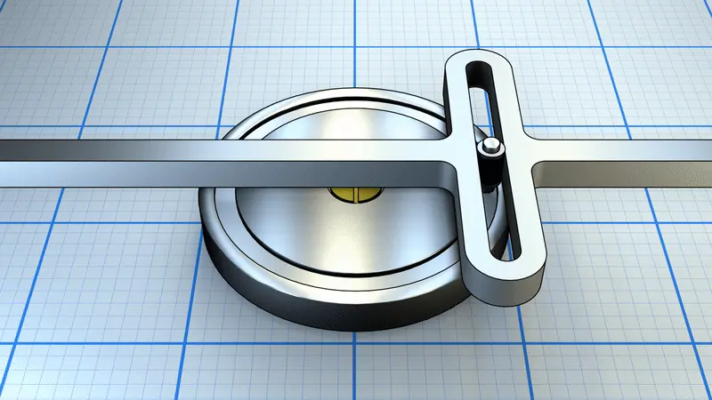
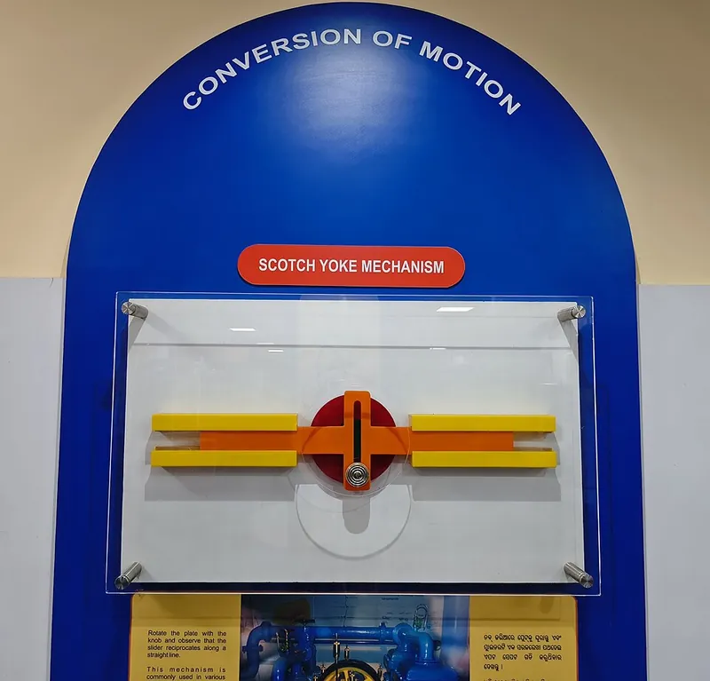
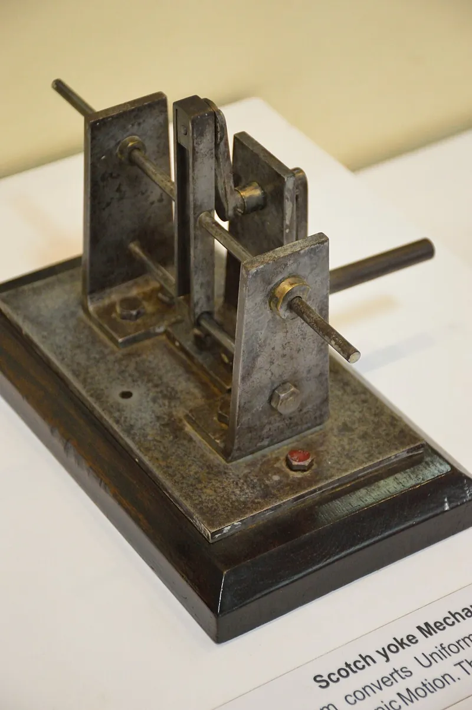

<figure class="eoc-pic eoc-pic-main"><picture><source media="(prefers-reduced-motion: reduce)" srcset="../media/scotch-yoke.still.webp"></picture><figcaption><strong>Animation.</strong> <a href="https://commons.wikimedia.org/wiki/File:Yugo_Escoc%C3%A9s_-_Scotch_yoke_animation.gif">Yugo Escocés - Scotch yoke animation</a> by Gussisaurio, <a href="https://creativecommons.org/licenses/by-sa/4.0">CC BY-SA 4.0</a>, from Wikimedia Commons.</figcaption></figure>
<figure class="eoc-pic"><figcaption><strong>How it works.</strong> <a href="https://commons.wikimedia.org/wiki/File:Scotch_Yoke_Mechanism.jpg">Scotch Yoke Mechanism</a> by Aliva Sahoo, <a href="https://creativecommons.org/licenses/by-sa/4.0">CC BY-SA 4.0</a>, from Wikimedia Commons.</figcaption></figure>
<figure class="eoc-pic"><figcaption><strong>Photo.</strong> <a href="https://commons.wikimedia.org/wiki/File:Scotch_Yoke_Mechanism_-_NMST_-_IIT_Kharagpur_-_West_Midnapore_2015-09-28_4601.JPG">Scotch Yoke Mechanism - NMST - IIT Kharagpur - West Midnapore 2015-09-28 4601</a> by Biswarup Ganguly, <a href="https://creativecommons.org/licenses/by/3.0">CC BY 3.0</a>, from Wikimedia Commons.</figcaption></figure>

A pin on a turning wheel ([crank](../glossary.md#crank)) slides along a slot in a bar that is guided to move only in a straight line, so steady turning becomes a smooth back-and-forth push whose position follows a perfect sine wave; it can also work the other way round.

**In plain words:** A wheel with a peg near its edge; the peg sits in a straight slot cut across a bar that can only slide, so as the wheel turns, the peg drags the bar smoothly back and forth. **Proper term:** Scotch yoke (slotted-link mechanism).

**Also called:** slotted link mechanism (Wikipedia); sine mechanism (Nguyen Duc Thang's name for it in his animations; 正弦机构 in Chinese); crank with a slotted yoke: 507 Mechanical Movements no. 93 describes it as a 'crank-wrist working in a slotted yoke, thereby dispensing with the [oscillating](../glossary.md#oscillating) connecting-rod or pitman'; yoke drive / Scotch-yoke drive; Scotch yoke [actuator](../glossary.md#actuator) (the quarter-turn valve actuator version, where a piston drives a pin in a pivoted slotted yoke); yugo escocés (Spanish; Mecapedia); double-slider chain, Scotch-yoke inversion (the same chain also gives the elliptical trammel and the Oldham coupling; MechSimulator).

## How it works

The crank turns and carries its pin round in a circle. The pin sits in a slot that runs across the yoke's direction of travel, so the pin slides freely along the slot while pushing the yoke with only the in-line part of its movement. The yoke therefore moves back and forth by exactly twice the pin's distance from the centre ([stroke](../glossary.md#stroke) = 2r), and its position is x = r x cos(angle): pure simple harmonic motion, fastest in the middle of the stroke and easing to a stop at each end (Wikipedia; MechSimulator). Pushing the yoke can also turn the crank (as in the Bourke engine and in valve actuators), but at the two ends of the stroke a push gives no turning force (dead centres), so a flywheel or a limited swing is needed.

## Parts

A few parts: a crank (a disc or arm) on a shaft carrying an off-centre pin, often fitted with a small roller or a sliding block; a yoke (a bar or frame with a straight slot at right angles to its travel); guides or linear bearings that let the yoke slide in one straight line only; a frame holding the crank shaft and the guides.

## Everyday examples

- Electric jigsaws and [reciprocating](../glossary.md#reciprocating) saws, where a pin on a crank plate drives a slotted yoke attached to the blade holder (background of Bosch patent US6357125B1)
- Quarter-turn valve actuators on oil and gas pipelines, its most common industrial use (Wikipedia)
- Some unusual engines (the Bourke engine), steam engines, water pumps and old tide-predicting machines (Wikipedia)
- Printed desk toys and classroom mechanism models (Printables)

## When to use it

Use it when a motor or hand crank should drive something smoothly back and forth in a straight line, especially in a small space. The output is a clean sine wave, the stroke is set simply by the pin's distance from the centre, it has one joint fewer than a crank and connecting rod, and the push stays in line with the travel, so there is no angled connecting rod pushing the slider sideways (Wikipedia). Good for shakers, stirrers, saw or file drives, small pumps, animated models, and sine-wave motion for demonstrations or test rigs. It also works the other way round when a straight push must give a limited swing with extra force at the ends, as in valve actuators.

## When not to use it

Avoid it for fast, long-running or heavily loaded machines, where the pin rubbing in the slot wears quickly and wastes power (Wikipedia): use a slider-crank (crank and connecting rod), which has only pin joints. Avoid it when the output must stop and wait at the ends (use a [cam and follower](../glossary.md#cam-and-follower), or a curved-slot yoke), when you need a long stroke from a small mechanism (use a rack and pinion, a belt or a lead screw), or when you need to stop anywhere and hold position under load (use a lead screw, a linear actuator or a servo).

## Details

- **What it does (jobs):**
  - change the kind of motion: turns steady rotation into smooth straight-line back-and-forth motion, or back-and-forth pushing into rotation
  - let it move (turn, slide or bend): the crank turns, the pin slides in the slot and the yoke slides in its guides
- **Movement:** rotate+slide: the crank rotates continuously (unlimited turns) and the yoke slides back and forth over a stroke of twice the crank radius; in quarter-turn valve actuators the arrangement is reversed and a straight push swings the slotted yoke through about 90 degrees
- **Directions it can move (degrees of freedom):** 1: once the crank angle is set, the yoke's position is fixed (x = r x cos angle). DMG-Lib lists the 3-link version as having one degree of freedom, and Wikipedia's mobility formula gives 1 for a single loop of four one-freedom joints (the 4-link version with a sliding block)
- **Special behaviour:**
  - motion conversion (e.g. rotary to linear): rotation becomes straight-line back-and-forth motion that is an exact sine wave (simple harmonic motion), with no connecting rod swinging to the side (Wikipedia)
  - variants add other behaviours: a curved (arc-shaped) slot makes the yoke pause (dwell) at one end or in the middle (Nguyen Duc Thang, 'Sine mechanism of curved slot 1'), and a crank whose pin radius can be changed adjusts the stroke (Thang, 'Scotch yoke of adjustable output stroke length'; Bosch reciprocating-saw patent US6357125B1)
- **How it holds:**
  - not a holding joint (it moves or passes on motion): it converts rotation into straight-line motion; the pin is kept in the slot by shape ([form-fit](../glossary.md#form-fit--force-fit--material-bond))
- **Input and output:** Continuous rotation -> straight-line back-and-forth (reciprocating) motion, or the reverse. One full out-and-back stroke per crank turn; stroke = 2 x crank radius. Position x = r cos(angle), speed v = -r w sin(angle), acceleration a = -r w^2 cos(angle), so top speed r w is at mid-stroke and the highest acceleration r w^2 is at the ends where the speed is zero (MechSimulator; Five Flute). Efficiency: no reliable figure found ⚑ [uncertain]; losses come mostly from the pin sliding in the slot and the yoke sliding in its guides, which is why heavier versions put a roller or bearing on the pin (Five Flute; Hamilton Sundstrand patent US10088056B2). Shaft arrangement: the crank shaft is at right angles to the plane in which the yoke slides. Back-drivable: yes, pushing the yoke turns the crank (Bourke engine, steam engines, valve actuators; Wikipedia), except exactly at the two ends of the stroke (dead centres). As a quarter-turn valve actuator (piston pushing a pin in a pivoted slotted yoke) it gives a 90-degree swing with the [torque](../glossary.md#torque) highest at both ends and lowest in the middle, a 'U-shaped' torque curve (Instrumentation Blog).
- **Power:** passive (no power needed); usually driven by a motor or hand crank, or by a piston in actuators and engines. If power is lost it simply stops where it is; it does not lock, and a load pushing on the yoke can turn the crank back except at the ends of the stroke
- **Load:** Light to heavy depending on how it is built: printed demos move light loads, while steel versions drive pipeline valve actuators and even forging presses (Nguyen Duc Thang's 'Sine mechanism 3: Press' notes presses of this kind giving 2,500 tons at 40 strokes per minute). Weak points: the pin and slot, which touch along a line and wear quickly under high contact pressure (Wikipedia; Five Flute), and the yoke's guides, which take sideways forces and tilting (moment) loads (Five Flute). Strong along the line of travel; weak against twisting the yoke in its guides.
- **Play and precision:** Noticeable unless built carefully: any [clearance](../glossary.md#clearance) between the pin and the slot shows up as lost motion ([backlash](../glossary.md#backlash)) each time the push reverses at the ends of the stroke, and clearance in the guides lets the yoke rock; one printed design with loose pin [tolerances](../glossary.md#tolerance) rattled and fell apart unless glued (WayTooManyHobbies, Printables). The end positions repeat exactly every turn because the stroke is set by the geometry. The yoke guides must be parallel to the travel and the crank shaft square to the slot; it tolerates little [misalignment](../glossary.md#misalignment) ⚑ [uncertain].
- **Taking it apart:** removable: the crank, yoke, guides and pins are held by screws, axles or snap fits and can be taken apart
- **How often it can be reused:** many times: taking it apart does not harm it; its life is limited by wear of the pin and slot, not by assembly
- **Sealing:** none: it is an open mechanism; enclosed industrial versions (valve actuators, engines) seal their housing, not the yoke itself
- **Adjustable:** Usually no: the stroke is fixed by the crank radius. Special versions let the pin's distance from the centre be changed with a screw or slot to adjust the stroke (Thang, 'Scotch yoke of adjustable output stroke length'); Bosch's jigsaw patent US6357125B1 switches between a long stroke (about 2 in) for soft materials and a short one (about 1 in) for hard ones by reversing the motor.
- **Access needed:** not applicable: it is a mechanism built in a frame, reached wherever the frame opens
- **Materials:** Steel cranks, pins and yokes in engines, saws and valve actuators, often with a roller or ball bearing on the pin so it rolls rather than slides (Hamilton Sundstrand patent US10088056B2) ⚑ [uncertain: specific alloys not found]. PLA and PETG for printed demos and light hobby drives (gzumwalt, WayTooManyHobbies and Sidpatchy all printed theirs in PLA). Plywood or acrylic for hand-cranked models ⚑ [uncertain].
- **Heat, cold, water and wear:** Printed PLA softens above about 60 °C and degrades in UV light, so use PETG or ASA near heat or outdoors (Prusa). Grit or dust in the slot and guides speeds up wear and needs cleaning and fresh lubricant ⚑ [uncertain]. The mechanism's own shaking grows with the square of speed, and loose clearances rattle (WayTooManyHobbies).

## Making it

- **Ways to make or get it:**
  - 3D print (FDM): many free printable demos; the parts print flat without supports (gzumwalt, WayTooManyHobbies)
  - laser cut: ⚑ [uncertain] the crank, yoke and frame are flat shapes that would suit acrylic or plywood; no tested example was opened
  - woodwork: ⚑ [uncertain] hand-cranked wooden automata use it; no tested example was opened
  - CNC: for metal versions; the slot and guides are milled
  - off-the-shelf part: complete Scotch-yoke valve actuators are sold for pipelines; for hobby builds buy the bearings, pins, roller (track roller or cam follower) and guide rods or rails
- **Printing it in one piece (print in place):** no: printed as separate parts (crank, yoke, base, pins or axle) and snapped, screwed or pinned together (gzumwalt, Sidpatchy, WayTooManyHobbies); no [print-in-place](../glossary.md#print-in-place) version was found ⚑ [uncertain]
- **Tools:** A screwdriver or hex key for the frame, motor mount and axle screws; none for snap-together printed demos (Sidpatchy's model snaps together, and WayTooManyHobbies' version stays together without glue); a little grease or oil for the slot and guides
- **Difficulty:** easy: it prints as a few flat parts with no supports and goes together with a pin or screw; the only fiddly part is getting the slot and guide clearances right so it slides freely without rattling

### 3D printing tips

1) Print the crank disc, yoke and base flat on the bed; they need no supports (gzumwalt printed his at 0.15 mm layers, 20% [infill](../glossary.md#infill), no supports). 2) Clearances: start with at least 0.3 mm between moving parts (Prusa) and up to 0.5 mm for FDM (Hubs); Sidpatchy's snap-together yoke uses 0.5 mm throughout so that it 'should print on any printer'. Too loose and it rattles: WayTooManyHobbies made the clearance the one adjustable parameter in his OpenSCAD file so you can tune it to your printer. 3) Pins: small printed round pins are fragile and need loose tolerances (WayTooManyHobbies); use a metal screw or dowel, or a thick printed threaded axle (gzumwalt uses a printed M8 x 1.25 thread, cleaned up with a tap and die). 4) Make the parts that take the load denser: WayTooManyHobbies prints the yoke and main shaft at 50% rectilinear infill and everything else at 20%. 5) Cut slot friction: fit a small ball bearing on the crank pin as a roller (IridiumTimekeeping's display model uses a 624zz bearing, 13 mm outside, 4 mm bore), or use a sliding block; Five Flute says a bare pin in a slot is only enough for small, light, low-torque uses. Add a little grease. 6) Guide the yoke on long guides so it cannot tilt and jam: keep the pushing force within about twice the guide bearing's length (igus 2:1 rule); smooth steel rods with linear bearings, or a long printed channel, both work. 7) FDM parts are weakest between layers (Prusa), so orient the crank and pin so the pin is not snapped off along a layer line ⚑ [uncertain: best orientation not tested]. 8) PLA is fine for indoor demos; use PETG or ASA if it gets warm or sits in sunlight (Prusa). 9) For a gentle motorised demo, gzumwalt gears an N20 gear motor down 12:24 to about 15 rpm, a 4-second cycle.

### Buying one (off-the-shelf parts)

Crank pin: shoulder screw (shoulder bolt), dowel pin or machine screw. Roller on the pin: small ball bearing (e.g. 624zz or 608zz) or a track roller / cam follower (threaded-stud type). Crank shaft support: sleeve bearings (bushings), flanged sleeve bearings or ball bearings. Yoke guides: linear ball bearings on smooth rods, plain linear bearings, or a guide rail and carriage. Drive: gear motor (e.g. N20 gear motor) or DC motor with gears. Retaining rings ([circlips](../glossary.md#circlip)) and lock nuts. Industrial complete units: pneumatic or hydraulic Scotch-yoke valve actuators (quarter-turn). Names as used in the McMaster-Carr catalogue.

## Rules of thumb

- Stroke = 2 x crank radius, always, and yoke position x = r cos(angle), i.e. pure simple harmonic motion (MechSimulator Scotch yoke simulator; Wikipedia 'Scotch yoke').
- Top speed = r x w at mid-stroke; highest acceleration = r x w^2 at the ends of the stroke, where the speed is zero (MechSimulator; Five Flute). Because inertia forces grow with the square of speed, run heavy yokes slowly.
- Slot length >= 2r + pin (or roller) diameter + a little clearance, because the pin moves r either side of the middle of the slot as the crank turns (follows from stroke = 2r; MechSimulator).
- A bare pin in a slot is fine for small, light, low-torque uses; for heavier loads use a roller bearing on the pin, a pinned slider (sliding block) or linear bearings, and plan for [lubrication](../glossary.md#lubrication) (Five Flute). A pin free to roll along the slot 'greatly reduces wear' compared with a sliding pin (Hamilton Sundstrand patent US10088056B2).
- Guide the yoke so the driving force or load acts no further from the guide bearing than about twice the bearing's length, or it may bind or chatter (igus '2:1 rule' for plain linear bearings).
- Printed moving parts: start with at least 0.3 mm clearance (Prusa) or 0.5 mm (Hubs, FDM interlocking parts) and tune with a test print.
- As a quarter-turn actuator, torque is highest at both ends of the 90-degree swing, where valves need it to break free or seat; Instrumentation Blog quotes roughly 20% more breakaway torque than a same-size rack-and-pinion actuator ⚑ [uncertain: blog figure, not checked against a manufacturer].

## Common failures

1) The slot wears and the clearance grows because the pin slides under high contact pressure (Wikipedia), giving a knock each time the motion reverses: use a roller or sliding block on the pin, a hard metal pin and lubrication (Five Flute; Hamilton Sundstrand patent). 2) The yoke jams or chatters in its guides because the guides are too short for where the force acts, or not parallel (igus 2:1 rule): lengthen the guides and keep the pin close to them. 3) Printed pins break, or the assembly rattles and falls apart, because loose printed-pin tolerances were needed (WayTooManyHobbies): use metal pins or screws and tune the clearance. 4) When the yoke is the input (engine style), it can stop at a dead centre at the end of the stroke: add a flywheel ⚑ [uncertain for small printed builds]. 5) Side loads twist the yoke and wear seals or piston rings in piston-driven versions (Hamilton Sundstrand patent; Five Flute).

## Safety

Motor-driven versions have pinch and [shear](../glossary.md#peel-vs-shear) points where the yoke runs in its guides and where the pin passes the ends of the slot; keep fingers clear and add a guard ⚑ [uncertain]. In tools such as jigsaws the moving blade is the main hazard. No special hazards for small hand-cranked demos.

## Related

- Slider-crank (crank and connecting rod): does the same job with only pin joints, so it wears less and is used in almost all engines, but its motion is not a pure sine wave and the angled rod pushes the slider sideways (Wikipedia)
- Cam and follower: can give almost any motion shape, including pauses at the ends, instead of a fixed sine wave
- Quick-return mechanism (Whitworth, crank and slotted lever): also a crank pin in a slot, but the slotted lever swings so the return stroke is faster than the working stroke
- Rack and pinion: turns rotation into straight motion that keeps going one way and can be much longer, instead of a fixed back-and-forth stroke
- Lead screw and nut: slow, strong straight-line motion that holds its position
- Oldham coupling: another use of the same double-slider chain, passing rotation between offset parallel shafts (MechSimulator)
- Reuleaux-triangle yoke (507 Mechanical Movements no. 135): a triangular cam in a square yoke that makes the yoke rest briefly at each end of its stroke

## Make it yourself

- [A Simple 3D Printed Scotch Yoke Mechanism (gzumwalt, Printables)](https://www.printables.com/model/357815-a-simple-3d-printed-scotch-yoke-mechanism): Motorised classroom model (N20 gear motor, AAA battery pack) with about +-15 mm travel; printed in PLA at 0.15 mm layers, no supports; video at youtube.com/watch?v=YWAfiqB5z5o *(licence: CC BY-NC-SA)*
- [Another Scotch Yoke (WayTooManyHobbies, Printables)](https://www.printables.com/model/314698-another-scotch-yoke): Hand-turned Scotch yoke with an OpenSCAD file whose clearance value can be tuned; parts hold together without glue *(licence: CC BY-NC)*
- [Scotch Yoke, M.M. #93 (Sidpatchy, Printables) (URL from Printables API, page not opened)](https://www.printables.com/model/319576-scotch-yoke): Press-fit, snap-together Scotch yoke based on 507 Mechanical Movements no. 93, designed with 0.5 mm tolerances throughout *(licence: CC BY)*
- [Reuleaux Triangle Scotch Yoke, M.M. #135 (Sidpatchy, Printables) (URL from Printables API, page not opened)](https://www.printables.com/model/319574-reuleaux-triangle-scotch-yoke): Variant with a Reuleaux-triangle cam that makes the yoke pause at each end, plus a normal wheel to compare *(licence: CC BY)*
- [Scotch Yoke and Double-Slider Chain simulator (MechSimulator)](https://mechsimulator.com/tools/scotch-yoke/): Interactive simulator with adjustable crank radius and speed, live position, speed and acceleration graphs, and an overlay comparing it with a slider-crank *(licence: link only (no licence stated))*
- [Mechanical mechanism library (HUANGYAN920, web app; listed as 正弦机构, 'sine mechanism')](https://huangyan920.github.io/Mechanical/): Browser library of 257 parametric mechanism animations, including the Scotch yoke, slider-crank and four-bar, with sliders to change dimensions and export to SVG or PNG *(licence: MIT (per the GitHub README))*

## Pictures, videos and models

- [Scotch yoke animation.gif (Wikimedia Commons, by BRoys)](https://commons.wikimedia.org/wiki/File:Scotch_yoke_animation.gif): Simple animated Scotch yoke: a crank pin sliding in the slot of a yoke that moves back and forth *(licence: CC BY-SA 2.5)*
- [Yugo Escocés - Scotch yoke animation.gif (Wikimedia Commons, by Gussisaurio)](https://commons.wikimedia.org/wiki/File:Yugo_Escocés_-_Scotch_yoke_animation.gif): Larger, clearer animation of a Scotch yoke converting rotation into straight-line motion (used on Wikipedia) *(licence: CC BY-SA 4.0)*
- [507 Mechanical Movements, No. 93: crank motion with the crank-wrist working in a slotted yoke](https://507movements.com/mm_093.html): 1868 drawing, with an animated version, of the Scotch yoke *(licence: Book public domain; website animation link only)*
- [Scotch yoke of adjustable output stroke length (Nguyen Duc Thang, YouTube thang010146)](https://www.youtube.com/watch?v=0QwDy1lSFa0): CAD animation of a Scotch yoke whose stroke can be changed by moving the crank pin *(licence: link only (standard YouTube licence))*
- [Scotch Yoke Mechanism with eccentric disc (DMG-Lib, model from Politehnica University Timisoara)](https://www.dmg-lib.org/dmglib/handler?mcdsc=2613025): A real steel teaching model (1975) with interactive animations, CAD model, videos and drawings *(licence: link only (no licence stated))*

## Needs confirming

⚑ marks something nobody has confirmed yet: a fact the research could not confirm from a source, a finder value that is a best guess, or an open point from the research notes. Corrections are welcome (see `research/needs-confirming.md`).

- ⚑ 12 sentences on this page marked [uncertain].
- ⚑ Research note: *Scotch yoke* and *Slider-crank*: their `uncertain` lists missed some marked fields; fixed on 2026-09-29 (lists only; no text changed).

## Sources

- <https://en.wikipedia.org/wiki/Scotch_yoke>
- <https://en.wikipedia.org/wiki/Linkage_(mechanical)>
- <https://www.mecapedia.uji.es/pages/mecanismo_de_yugo_escoces.html>
- <https://commons.wikimedia.org/wiki/Category:Scotch_yokes>
- <https://commons.wikimedia.org/wiki/File:Scotch_yoke_animation.gif>
- <https://commons.wikimedia.org/wiki/File:Yugo_Escocés_-_Scotch_yoke_animation.gif>
- <https://507movements.com/mm_093.html>
- <https://507movements.com/mm_135.html>
- <https://www.dmg-lib.org/dmglib/handler?mcdsc=2613025>
- <https://mechsimulator.com/mechanisms/>
- <https://mechsimulator.com/tools/scotch-yoke/>
- <https://www.fiveflute.com/guide/how-to-design-a-scotch-yoke-mechanism/>
- <https://patents.google.com/patent/US10088056B2/en>
- <https://patents.google.com/patent/US6357125B1/en>
- <https://www.instrumentationblog.in/scotch-yoke-vs-rack-and-pinion-actuator/>
- <https://www.igus.com/company/linear-guides-the-2-1-rule-ca>
- <https://help.prusa3d.com/article/modeling-with-3d-printing-in-mind_164135>
- <https://help.prusa3d.com/article/pla_2062>
- <https://www.hubs.com/knowledge-base/how-design-interlocking-joints-fastening-3d-printed-parts/>
- <https://www.mcmaster.com/products/cam-followers/>
- <https://www.mcmaster.com/products/linear-bearings/>
- <https://www.mcmaster.com/products/shoulder-bolts/>
- <https://www.mcmaster.com/products/sleeve-bearings/>
- <https://api.printables.com/graphql/>
- <https://www.printables.com/model/357815-a-simple-3d-printed-scotch-yoke-mechanism>
- <https://www.printables.com/model/314698-another-scotch-yoke>
- <https://www.youtube.com/watch?v=0QwDy1lSFa0>
- <https://www.youtube.com/watch?v=VALy2PlBuM4>
- <https://www.youtube.com/watch?v=VPZO7txZIZU>
- <https://www.youtube.com/watch?v=TZR7ccjy9VQ>
- <https://www.youtube.com/watch?v=YWAfiqB5z5o>
- <https://cs448m.github.io/lectures/machines/doc/2.pdf>
- <https://huangyan920.github.io/Mechanical/>
- <https://raw.githubusercontent.com/HUANGYAN920/Mechanical/main/README.md>
