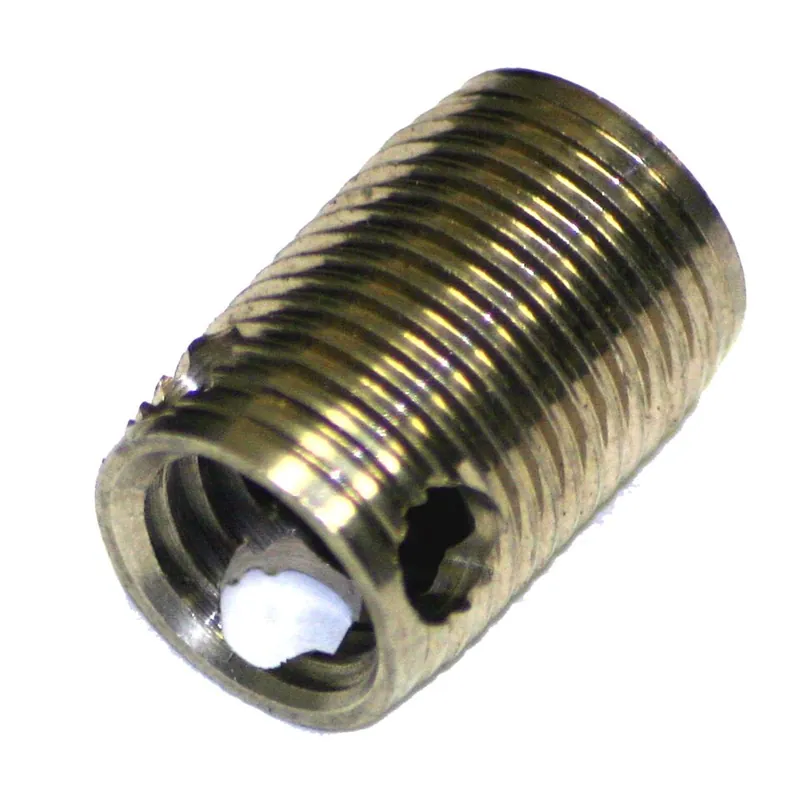

<figure class="eoc-pic eoc-pic-main"><figcaption><strong>Photo.</strong> <a href="https://commons.wikimedia.org/wiki/File:Taplok_Insert.jpg">Taplok Insert</a> by Sjgroovpin, <a href="https://creativecommons.org/licenses/by-sa/3.0">CC BY-SA 3.0</a>, from Wikimedia Commons.</figcaption></figure>

A threaded sleeve or a diamond-section wire coil that is screwed into a drilled or tapped hole to give soft, [brittle](../glossary.md#brittle--ductile) or worn material a strong, reusable machine-screw thread.

**In plain words:** A metal sleeve with a thread on the outside and a thread on the inside (or a little coil of springy wire) that you screw into a hole, so soft or crumbly material gets a strong metal thread that a bolt can go in and out of many times, or so a stripped thread can be repaired. **Proper term:** Screw-in threaded insert (helical wire thread insert and self-tapping insert).

**Also called:** threaded insert, threaded bushing or insert nut (the general names; Wikipedia 'Threaded insert'); externally threaded insert (Wikipedia); helical insert, wire thread insert or screw thread insert (STI) (Wikipedia; NASA RP-1228); thread repair insert, thread repair coil or thread coil (CNC Kitchen; Hackaday); Heli-Coil or HELICOIL (brand), Recoil (brand), KATO (brand) helical inserts (Wikipedia); self-tapping insert or self-tapping threaded insert, sometimes sold as a 'thread adapter' (Wikipedia; Hackaday 2024); thread-forming insert, e.g. Speedsert (brand) (NASA RP-1228); Tap-Lok (brand) self-tapping friction-locking insert (Wikipedia); E-Z LOK (brand) inserts anchored with a thread-locking adhesive (Wikipedia; E-Z LOK); solid bushing insert, key-locking insert or Keensert (brand) (NASA RP-1228; Wikipedia); TIME-SERT (brand) thin-walled solid bushing insert (Wikipedia); screw-in insert nut or threaded insert for wood, with hex or slotted drive (Wikipedia; E-Z LOK).

## How it works

The insert has a bigger, coarser outside thread than the screw it takes, so it spreads the load over much more of the soft material: NASA's manual gives the example of a 10-32 screw getting the hold of a 5/16-18 thread (NASA RP-1228). A helical insert is a coil of diamond-section wire that screws into a hole tapped with a special oversize tap; the coil is made slightly oversize so it springs outward and grips, and its inside forms a normal thread for the screw; the driving tang is then snapped off (Wikipedia; NASA RP-1228). A self-tapping insert has a tapered, slotted or sharp outside thread that cuts or forms its own thread in a plain drilled hole as it is screwed in, then stays put by friction, a nylon patch, adhesive or keys (Wikipedia; NASA RP-1228). Solid bushing inserts are screwed into a tapped hole and locked by keys hammered in, by adhesive, or by expanding the bottom threads (Wikipedia).

## Parts

A few parts: the insert (a solid sleeve threaded inside and out, often with cutting slots, keys, a locking patch or adhesive; or a coil of diamond-section stainless wire with a driving tang), the hole (drilled, and for helical or solid inserts tapped with a matching tap), and the screw that later goes into it. Fitting needs a drive tool: a screwdriver, hex key, a bolt and jam nut, or for helical inserts a special installation mandrel and tang break-off tool, usually sold together in a kit with the drill and tap (Wikipedia; E-Z LOK; CNC Kitchen).

## Everyday examples

- A spark-plug hole in an engine repaired with a helical insert after the thread was stripped by over-tightening or cross-threading (Wikipedia 'Threaded insert')
- Wire thread coils fitted in an aluminium bike frame so the bolts don't wear or seize in the soft metal (CNC Kitchen)
- Screw-in insert nuts in flat-pack furniture, cabinets and speaker enclosures, so parts can be bolted together and taken apart (Wikipedia; E-Z LOK)
- Inserts in light-alloy aircraft parts, so small high-strength screws can be used to save weight (NASA RP-1228)

## When to use it

Use a screw-in insert to repair a stripped thread in metal (the classic use of helical inserts); to give soft metals such as aluminium or magnesium, wood, plywood or MDF a thread that won't wear out as screws go in and out; and to put metal threads into resin (SLA/MSLA) prints and other thermosets, where [heat-set inserts](../glossary.md#heat-set-insert) can't be melted in (Wikipedia; NASA RP-1228; SPIROL; CNC Kitchen). Helical inserts suit repairs because they need the least enlargement of the hole (NASA RP-1228). Self-tapping inserts are handy when you have no insert tap: they cut or form their own thread in a drilled hole (Wikipedia).

## When not to use it

In thermoplastic FDM prints (PLA, PETG, ABS), use a heat-set insert or a nut trap instead: a helical insert gave no improvement over screwing straight into the plastic in CNC Kitchen's tests. In very thin sheet, where there's not enough depth for a thread, use a rivet nut or other blind threaded fixing. In very brittle resins, glue an insert in or use a press-in insert rather than forcing threads in (Formlabs; SPIROL). For a part that is screwed together only once, a self-tapping screw is simpler. In plastics, ceramics and rubber that are moulded, a moulded-in insert holds better than a self-tapping or threaded one (NASA RP-1228). For a quick wood repair without tools, a hammer-in (barbed) insert nut is faster but holds less ⚑ [uncertain].

## Details

- **What it does (jobs):**
  - join and hold: gives a soft, brittle or damaged part a strong, reusable metal thread so another part can be bolted on and taken off again; also repairs stripped threads
- **Movement:** none
- **Directions it can move (degrees of freedom):** 0: once fitted the insert can't move, and the screw clamps the parts together rigidly
- **Special behaviour:**
  - [self-locking](../glossary.md#self-locking) (holds under load, won't back-drive): only for screw-locking versions; helical inserts come with a deformed (crimped) coil that grips the screw (NASA RP-1228), and some solid inserts have a nylon patch; plain free-running inserts don't lock the screw
  - none otherwise: it just provides a strong thread
- **How it holds:**
  - shape (the parts interlock; [form-fit](../glossary.md#form-fit--force-fit--material-bond)): the insert's outside thread interlocks with the thread tapped or cut into the hole
  - friction or clamping (force-fit): helical coils are slightly oversize and spring out against the hole (NASA RP-1228); Tap-Lok-type self-tapping inserts lock by friction (Wikipedia); the screw then clamps the parts
  - material bond (glue, solvent or melting): adhesive-anchored inserts (E-Z LOK) and inserts glued in with epoxy in printed parts (Printables self-tapping insert cut-outs)
- **Input and output:** not applicable
- **Power:** passive (no power needed)
- **Load:** medium to heavy in metal and wood, light to medium in plastic prints. Strong in pull-out and twist because the large outside thread spreads load (NASA RP-1228). In soft metals such as aluminium they give stronger threads than tapping the base metal directly (Wikipedia). In FDM prints a helical insert gave no gain: CNC Kitchen's M3 tests in PETG held 120 kg pull-out against 118 kg for a screw straight into plastic, and both stripped at 1 Nm, while a heat-set insert took 3 Nm. In resin, SPIROL rates self-tapping inserts a 'viable alternative' to press-in inserts but with limited back-out [torque](../glossary.md#torque).
- **Play and precision:** small: the insert gives a normal metal thread with ordinary screw [clearance](../glossary.md#clearance). The main precision issue is getting it in straight; a self-tapping insert that starts crooked or cross-threads stays crooked (Printables self-tapping insert cut-outs: 'take care getting the thread started to avoid crossthreading').
- **Taking it apart:** semi-permanent: the insert is meant to stay in, but can come out: helical inserts with an extraction tool ⚑ [uncertain], adhesive-locked E-Z LOK inserts with a bolt extractor or by heating above 149 °C (300 °F) (E-Z LOK); key-locked and TIME-SERT inserts are permanent (Wikipedia). The screw in it is removable many times.
- **How often it can be reused:** many times: the screw can be put in and taken out many times without wearing the soft parent material, which is the point of fitting it (Wikipedia; E-Z LOK wood inserts 'allow for multiple assembly and disassembly cycles'). The insert itself is usually fitted once.
- **Sealing:** none: it does not seal; fluid can pass along the threads unless a thread sealant or adhesive is used ⚑ [uncertain]
- **Adjustable:** no: it is a fixed threaded anchor; any adjustment comes from the screw or the parts being joined
- **Access needed:** one side only (blind): the insert is screwed in from the open face of the hole, and the screw goes in from the same side
- **Materials:** Helical inserts: stainless steel or phosphor bronze wire (Wikipedia); E-Z Coil inserts are 18-8 stainless (E-Z LOK). Solid and self-tapping inserts: steel, stainless steel, brass or aluminium; wood inserts also zinc alloy (E-Z LOK). They suit soft or weak parent materials: aluminium, zinc die-castings, magnesium, wood, plastic (Wikipedia), cast iron (E-Z LOK), plywood, MDF and particleboard (E-Z LOK 'Finserts'), and thermoset (resin) prints, where heat-set inserts can't be melted in (SPIROL; CNC Kitchen). Thread-forming (non-cutting) inserts only work in softer materials (NASA RP-1228). Brittle, low-stretch resins can crack when threads are forced into them (Formlabs, for self-tapping screws). In thermoplastic FDM prints a heat-set insert is usually the better choice (CNC Kitchen).
- **Heat, cold, water and wear:** Stainless helical coils tolerate heat well; E-Z LOK rates its 18-8 stainless E-Z Coil inserts to 800 °F (about 427 °C) and says the stainless resists corrosion. Adhesive-anchored inserts lose grip when heated above about 149 °C (300 °F) (E-Z LOK). Stainless coils in aluminium help prevent seizing and corrosion between dissimilar metals (CNC Kitchen) ⚑ [uncertain] (CNC Kitchen states this without detail). In printed parts the host plastic is the limit: PLA gives at about 60 °C, PETG at 80 °C and ASA at 110 °C (CNC Kitchen), and adhesive-free self-tapping inserts in a part that is taken apart often may slowly unscrew (SPIROL). Under vibration use a screw-locking insert (deformed coil) or a locking patch (NASA RP-1228).

## Making it

- **Ways to make or get it:**
  - off-the-shelf part: the insert is always bought, usually as a kit with its drill, tap and tools
  - 3D print (resin): self-tapping or glued inserts are a main option, because thermoset resin can't take heat-set inserts (SPIROL; CNC Kitchen)
  - 3D print (FDM): possible (screwed into a printed or modelled threaded hole), but heat-set inserts usually perform better (CNC Kitchen; SPIROL)
  - CNC: thread repair and wear-resistant threads in aluminium and other soft metals (Wikipedia; CNC Kitchen)
  - woodwork: screw-in insert nuts for knock-down furniture, cabinets and speaker boxes (Wikipedia; E-Z LOK)
- **Printing it in one piece (print in place):** partly: the part prints with a plain or modelled threaded hole, and the bought insert is screwed in afterwards
- **Tools:** Drill and the drill size specified for the insert. Helical inserts: a matching insert (STI) tap, an installation mandrel or winding tool, and a tang break-off tool, normally bought as one kit (Wikipedia: 'sold in kits with matched taps and insert tools'; CNC Kitchen). Solid metal-thread inserts: a standard tap matching the insert's outside thread, then a screwdriver, a bolt and jam nut or a drive tool (E-Z LOK). Self-tapping inserts: a drive tool or a bolt with a washer or jam nut (Printables self-tapping insert cut-outs). Wood insert nuts: a hex key or screwdriver (Wikipedia; E-Z LOK). Key-locking inserts also have keys that are hammered in after the insert is fitted (Wikipedia; NASA RP-1228).
- **Difficulty:** moderate: needs the exact drill size and, for helical and solid inserts, a matching tap and installation tool kit; getting it started straight and flush takes care. Screw-in wood insert nuts are easy.

### 3D printing tips

1) Resin (SLA/MSLA) prints are thermosets, so heat-set inserts don't melt in: a hot insert does nothing for a while, then the resin crumbles (CNC Kitchen). Use a press-in insert (most effective), a self-tapping insert (a viable alternative with lower back-out torque, but slow to fit and may unscrew from a part that is taken apart often), or a heat-set insert glued in with thick superglue or epoxy (SPIROL; CNC Kitchen). 2) Model the insert's outside thread into the print instead of relying on the insert to cut it: one designer shares threaded STEP cut-outs for M4-M10 self-tapping inserts plus a test block, then screws the insert in with a bolt and washer and a little epoxy (Printables 'Self Tapping Thread Insert Cut-out STEP Files'). In CNC Kitchen's resin tests, threads printed in the model held about twice the load of tapped threads in a notch-sensitive tough resin (106 kg against 55 kg), probably because the tap leaves notches. 3) Brittle resins can crack when threads are forced into them; Formlabs warns this for self-tapping screws in low-stretch resins and advises eye protection, and a self-tapping insert loads the hole the same way ⚑ [uncertain] (for inserts specifically). Prefer tough or durable resins. 4) Resin parts tend to fail by bursting rather than thread [shear](../glossary.md#peel-vs-shear), because thread forces push outward on the hole (CNC Kitchen), so give the insert plenty of surrounding material; SPIROL recommends a solid [boss](../glossary.md#boss) at least 1.5 times the insert's outer (knurl) diameter, with the full benefit at 2 times, and more than 50% [infill](../glossary.md#infill) for FDM (written for press-in and heat-set inserts, but the same logic applies). 5) Printed hole sizes vary: about ±0.1 mm for SLA and ±0.3-0.5 mm for desktop FDM (SPIROL), so print a test block or drill the hole to size. 6) In FDM thermoplastic prints, a helical (Helicoil-type) insert added nothing over screwing straight into the plastic in CNC Kitchen's tests, so use heat-set inserts or nut traps instead unless you need a metal thread for wear. 7) Start the insert square and slowly to avoid cross-threading, and drive it flush with a bolt and washer or jam nut (Printables cut-out files).

### Buying one (off-the-shelf parts)

Helical inserts: search 'helical insert', 'wire thread insert', 'screw thread insert (STI)' or 'thread repair kit' (Heli-Coil/HELICOIL, Recoil, KATO (brands)); available free-running or screw-locking, and in several lengths; kits include the drill, STI tap, installation tool and tang break-off tool (Wikipedia; CNC Kitchen; NASA RP-1228). Solid and self-tapping inserts: 'self-tapping insert', 'thread-forming insert', 'key-locking insert' (Keensert (brand)), 'solid bushing insert' (TIME-SERT (brand)), 'Tap-Lok' and 'Speedsert' (brands), and adhesive-anchored E-Z LOK (brand) inserts. Wood: 'threaded insert for wood' or 'insert nut' with hex or slotted drive (E-Z LOK E-Z Knife for hardwood, E-Z Hex for softwood, Finserts for MDF and particleboard). Catalogue pages to check sizes: E-Z LOK threaded inserts for metal https://www.ezlok.com/threaded-inserts-for-metal, for wood https://www.ezlok.com/threaded-inserts-for-wood and for plastic https://www.ezlok.com/threaded-inserts-for-plastic.

## Rules of thumb

- A helical insert needs its own oversize tap, not an ordinary tap of the screw size: drill, tap with the insert tap, wind the coil in with the installation tool, then break off the tang (Wikipedia 'Threaded insert'; CNC Kitchen; NASA RP-1228).
- The insert's outside thread is nominally about 1/8 in (3 mm) larger in diameter than its inside thread, so a 10-32 screw gets the holding area of a 5/16-18 thread (NASA RP-1228, 'Inserts').
- For repairing a stripped thread, a wire thread insert needs the least hole enlargement; a solid bushing insert is preferred where there is room (NASA RP-1228).
- Thread-forming self-tapping inserts make no chips but only work in softer materials (NASA RP-1228).
- For a screw-in wood insert nut, drill the hole as deep as the insert plus any length of bolt that will go past its end (Wikipedia 'Threaded insert').
- In hardwood use a slightly larger [pilot hole](../glossary.md#pilot-hole) to avoid splitting; softwoods split more easily if inserts are fitted badly (E-Z LOK, threaded inserts for wood).
- In SLA resin: press-in inserts are the most effective, self-tapping inserts a viable alternative with lower back-out torque, expansion inserts the weakest (SPIROL 'Inserts for 3D Printed Assemblies').
- Give inserts in prints a solid boss at least 1.5x the insert's outer (knurl) diameter (full benefit at 2x) and over 50% infill in FDM (SPIROL, written for press-in and heat-set inserts).
- In M3 PETG tests a helical insert held the same as a plain screw (pull-out 120 kg against 118 kg; both stripped at 1 Nm), while a heat-set insert took 3 Nm (CNC Kitchen).
- E-Z LOK's adhesive-anchored metal inserts are ready for a screw 3-5 minutes after fitting and can be released by heating above 149 °C (300 °F) (E-Z LOK, threaded inserts for metal).

## Common failures

1) Insert doesn't hold because the hole was tapped with an ordinary tap instead of the matching insert tap, or drilled the wrong size: use the kit's drill and tap (Wikipedia; CNC Kitchen) ⚑ [uncertain] (failure description not tested in a source opened). 2) Cross-threaded or crooked insert: start it square and slowly, using a bolt and washer or a proper driver (Printables self-tapping insert cut-outs). 3) Resin part cracks or bursts: use tough resin, more wall around the hole, a modelled thread, or a glued or press-in insert (CNC Kitchen; Formlabs; SPIROL). 4) Insert comes out with the screw: self-tapping inserts may thread out of parts that are taken apart often, so lock them with adhesive or epoxy (SPIROL; Printables cut-outs). 5) Wood splits: use the right pilot hole, slightly larger in hardwood, and the right insert type for the wood (E-Z LOK). 6) No strength gain in FDM prints: the helical insert's wider but shorter thread shears the same area of plastic as a plain screw (CNC Kitchen). 7) Screw loosens under vibration: use a screw-locking insert with a deformed coil (NASA RP-1228).

## Safety

Brittle resin prints can crack or burst when a thread is forced into them, throwing fragments; wear eye protection (Formlabs advises this for self-tapping screws in brittle resins; CNC Kitchen's resin samples 'exploded' when overloaded). Drilling and tapping metal throws sharp chips; wear eye protection ⚑ [uncertain]. Make sure the broken-off tang of a helical insert is removed from the hole, especially in an engine, where a loose piece of metal can cause damage ⚑ [uncertain].

## Related

- Heat-set threaded insert: melted into thermoplastic prints with a soldering iron; strongest choice in FDM, but can't be used in resin or other thermosets
- Press-fit and expanding inserts (tap-in insert): pushed in cold and held by barbs or expansion; SPIROL rates press-in inserts the most effective choice in SLA resin
- Self-tapping screw into plastic (thread-forming screw): screws straight into the part; simplest, but the plastic thread wears out after a few uses
- [Captive nut](../glossary.md#captive-nut) pocket (nut trap): an ordinary nut in a printed pocket; strong and cheap if the pocket can be reached
- Blind threaded fixings (rivet nut, well nut): for thin sheet and tube walls, fitted from one side
- Printed screw thread: the thread printed straight into the part; in CNC Kitchen's tests, modelled threads in resin were stronger than tapped ones
- Ordinary screw joint (bolt and nut): the baseline; the insert turns a weak hole into the 'nut'
- Threadlocking hardware and anaerobic [threadlocker](../glossary.md#threadlocker): lock the screw in the insert against vibration

## Make it yourself

- [Self Tapping Thread Insert Cut-out STEP Files (SlingBow Mk. L, Printables) (URL from Printables API, page not opened)](https://www.printables.com/model/904819-self-tapping-thread-insert-cut-out-step-files): Threaded STEP cut-outs for M4-M10 self-tapping inserts (taking M2-M6 bolts) to subtract from your own model, plus a tolerance test block; fitting notes: drive with a bolt and washer, a little epoxy, start carefully to avoid cross-threading. Read through the Printables public API. *(licence: CC0 (Creative Commons Public Domain))*
- [Helicoil Insert Installation Tool (M6) (dniclas, Printables) (URL from Printables API, page not opened)](https://www.printables.com/model/1741421-helicoil-insert-installation-tool-m6): A printable installation mandrel for M6 helical inserts with a 1/4 in hex shank and a knob; the designer suggests scaling it for other sizes. Read through the Printables public API. *(licence: BSD)*
- [Helicoil insert tool (manpres2, Printables) (URL from Printables API, page not opened)](https://www.printables.com/model/1399428-helicoil-insert-tool): A simple printed tool for winding helical inserts in, made to repair motorcycle mirror mounts. Read through the Printables public API. *(licence: CC BY)*

## Pictures, videos and models

- [HELICOIL Plus thread insert (Wikimedia Commons, uploaded by Boellhoff)](https://commons.wikimedia.org/wiki/File:Helicoil_plus.jpg): Photo of a helical wire thread insert, the diamond-section stainless coil with its driving tang *(licence: attribution only (use for any purpose with attribution to the copyright holder))*
- [Tap-Lok threaded insert (Wikimedia Commons, by Sjgroovpin)](https://commons.wikimedia.org/wiki/File:Taplok_Insert.jpg): Photo of a self-tapping solid insert with cutting edges on its outside thread *(licence: CC BY-SA 3.0)*
- [TIME-SERT threaded insert (Wikimedia Commons, by Crimson5unEarth)](https://commons.wikimedia.org/wiki/File:TIME-SERT_thread_insert.gif): Image of a thin-walled solid bushing insert for tapped holes *(licence: GFDL 1.2+ / CC BY-SA 3.0)*
- [Rampamuffe: screw-in insert nut for wood (Wikimedia Commons, by Daniel Alexander Patrik Wigger)](https://commons.wikimedia.org/wiki/File:Rampamuffe_(klein).jpg): Photo of a screw-in threaded insert nut with a coarse outside thread for wood *(licence: GFDL 1.2+ / CC BY-SA 3.0)*
- [These threaded inserts aren't made for 3D prints (but work amazingly well) (YouTube, Made with Layers (Thomas Sanladerer))](https://www.youtube.com/watch?v=lYXTiJo_FQQ): Video testing M5 rivet nuts, wood hex inserts, helical inserts, self-tapping inserts and T-nuts in 3D prints (as described by Hackaday, 'Alternate Threaded Inserts for 3D Prints', 2024); title confirmed via YouTube oEmbed, video not watched *(licence: link only (standard YouTube licence))*

## Needs confirming

⚑ marks something nobody has confirmed yet: a fact the research could not confirm from a source, a finder value that is a best guess, or an open point from the research notes. Corrections are welcome (see `research/needs-confirming.md`).

- ⚑ 8 sentences on this page marked [uncertain].
- ⚑ Finder value `removability` = semi-permanent (source uncertain): `removability` is marked ⚑ [uncertain] here: "…to stay in, but can come out: helical inserts with an extraction tool ⚑ [uncertain], adhesive-locked E-Z LOK ins…"
- ⚑ Research note: *Screw-in threaded insert*: helical insert lengths (1d, 1.5d, 2d) are left out because Böllhoff's HELICOIL PDFs were blocked. CNC Kitchen found a helical insert in PETG held no better than a plain screw (120 kg against 118 kg); worth a note in the published entry.

## Sources

- <https://en.wikipedia.org/wiki/Threaded_insert>
- <https://ntrs.nasa.gov/api/citations/19900009424/downloads/19900009424.pdf>
- <https://www.cnckitchen.com/blog/helicoils-threaded-insets-and-embedded-nuts-in-3d-prints-strength-amp-strength-assessment>
- <https://www.cnckitchen.com/blog/how-to-use-threaded-inserts-in-resin-3d-prints>
- <https://www.cnckitchen.com/blog/comparing-pla-petg-amp-asa-feat-prusament>
- <https://www.spirol.com/assets/files/inserts-for-3d-printed-assemblies-us.pdf>
- <https://formlabs.com/blog/adding-screw-threads-3d-printed-parts/>
- <https://www.ezlok.com/threaded-inserts-for-metal>
- <https://www.ezlok.com/threaded-inserts-for-wood>
- <https://www.ezlok.com/threaded-inserts-for-plastic>
- <https://hackaday.com/2024/04/15/alternate-threaded-inserts-for-3d-prints/>
- <https://hackaday.com/2025/01/11/comparing-ways-to-add-threads-to-your-3d-prints/>
- <https://www.youtube.com/watch?v=lYXTiJo_FQQ>
- <https://commons.wikimedia.org/wiki/File:Helicoil_plus.jpg>
- <https://commons.wikimedia.org/wiki/File:Taplok_Insert.jpg>
- <https://commons.wikimedia.org/wiki/File:TIME-SERT_thread_insert.gif>
- <https://commons.wikimedia.org/wiki/File:Rampamuffe_(klein).jpg>
- <https://api.printables.com/graphql/>
