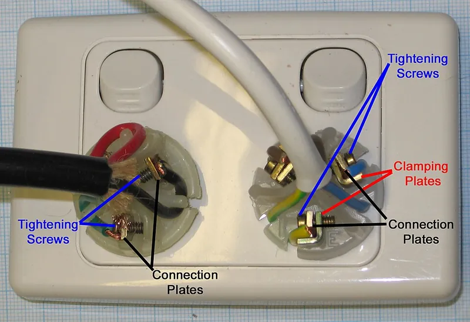
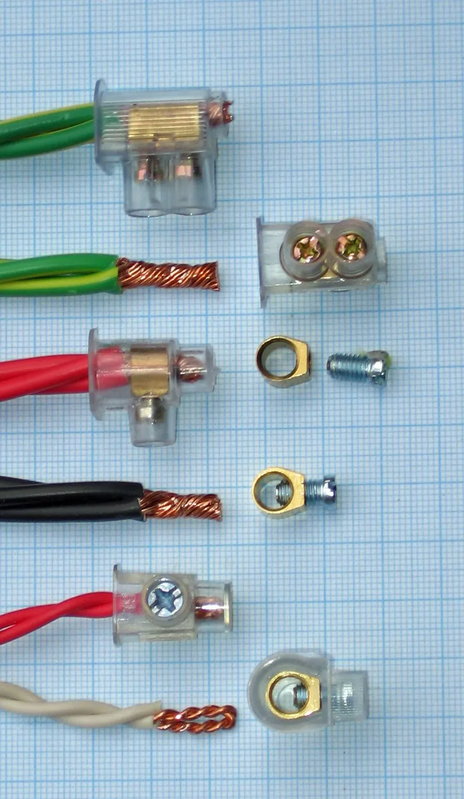
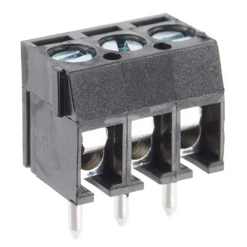

<figure class="eoc-pic eoc-pic-main"><figcaption><strong>Photo.</strong> <a href="https://commons.wikimedia.org/wiki/File:Screw_Terminals._Basic_and_Compression_Types..jpg">Screw Terminals. Basic and Compression Types.</a> by Fredquint, <a href="https://creativecommons.org/licenses/by-sa/3.0">CC BY-SA 3.0</a>, from Wikimedia Commons.</figcaption></figure>
<figure class="eoc-pic"><figcaption><strong>How it works.</strong> <a href="https://commons.wikimedia.org/wiki/File:Australian_Set_Screw_Connectors.jpg">Australian Set Screw Connectors</a> by Fredquint, <a href="https://creativecommons.org/licenses/by-sa/4.0">CC BY-SA 4.0</a>, from Wikimedia Commons.</figcaption></figure>
<figure class="eoc-pic"><figcaption><strong>Photo.</strong> <a href="https://www.flickr.com/photos/41898857@N04/16538538203">Screw Terminals 3.5mm Pitch (3-Pin)</a> by SparkFunElectronics, <a href="https://creativecommons.org/licenses/by/2.0/">CC BY 2.0</a>, from Flickr via Openverse.</figcaption></figure>

A screw terminal holds a stripped wire (or a crimped ring, fork or ferrule) by tightening a screw onto it, either under the screw head, under a clamping plate or with a [set screw](../glossary.md#set-screw) in a metal tube; it is the cheap, reusable way to land wires on boards, power supplies, barrier strips and connector strips and to undo them later with a screwdriver.

**In plain words:** A small metal clamp with a screw in it: you push a stripped wire into a hole or under a plate and tighten the screw to pinch it, and undo the screw to free it again; rows of them sit on circuit boards, power supplies and plastic connector strips. **Proper term:** Screw terminal (screw terminal block, barrier strip, connector strip).

**Also called:** terminal block, terminal board, terminal strip (Wikipedia 'Electrical connector'); barrier strip, barrier terminal block: pairs of screws on metal strips separated by raised insulating 'barriers', often used with crimped ring or spade lugs (Wikipedia 'Screw terminal', 'Electrical connector'); connector strip, chocolate block, choc block (UK nicknames; the first ones, made by GEC in the 1950s in brown plastic, 'were said to resemble a small bar of chocolate', Wikipedia 'Screw terminal'); luster terminal (Wikimedia Commons caption); kroonsteen (Dutch, Printables 32652); PCB terminal block, PCB screw terminal: a block with pins soldered into a circuit board (Wikipedia 'Screw terminal'; Same Sky TB001-500); pluggable terminal block, two-piece terminal block, Euroblock ('European-style terminal block'), Phoenix connector, Combicon (Phoenix Contact, brand) (Wikipedia 'Euroblock'); clamping-plate (compression) screw terminal versus basic screw-head terminal (Wikimedia Commons 'Screw Terminals. Basic and Compression Types'; Wikipedia 'Screw terminal'); set-screw terminal, pressure connector (set-screw type) (Wikipedia 'Screw terminal'; OSHA 29 CFR 1910.303(c)(2)); busbar: a long terminal strip with several screws on one metal bar, used to share power (Wikipedia 'Screw terminal', 'Busbar'); earth (grounding) screw: often green, with a toothed washer (Wikipedia 'Screw terminal'); Chocbox (brand): a snap-shut box enclosing a connector strip (Wikipedia 'Chocbox').

## How it works

Turning the screw drives it, or a plate it pushes, against the wire, squeezing the strands between metal surfaces so they touch over a large area; when properly tightened 'the connections are physically and electrically secure because they firmly contact a large section of wire' (Wikipedia 'Screw terminal'). There are three common layouts: the wire wrapped clockwise under the screw head, so tightening pulls it in; the wire slid between a clamping plate and the terminal body, so the screw presses the plate; or a set screw in the side of a metal tube, as in connector strips (Wikipedia 'Screw terminal'). The joint is only good while the screw stays tight: vibration, poor tightening or soft metal that slowly flows under pressure ([creep](../glossary.md#creep)) let it loosen, the resistance rises and the joint heats, which makes it loosen further (Wikipedia 'High resistance connection').

## Parts

A few parts per way: a metal body (a tube, box clamp or plate of tinned copper alloy or brass), a steel screw, often a separate clamping plate, an insulating housing or barrier strip, and on PCB types pins for soldering; e.g. Same Sky TB0014-500 lists tin-plated copper-alloy contacts, a zinc-plated steel screw, a nickel-plated copper-alloy clamp and a PA66 nylon housing. Pluggable types add a plug and a matching board header (Wikipedia 'Euroblock'); connector strips are brass tubes 'loosely encased in an insulating block with a set screw at each end' (Wikipedia 'Screw terminal').

## Everyday examples

- The screw terminals inside wall switches, sockets and light fittings, and the plastic connector strips ('chocolate blocks') used to join light fittings (Wikipedia 'Screw terminal')
- Green or blue screw terminals on Arduino shields, motor drivers, LED power supplies and 3D-printer boards (SparkFun 'Connector Basics'; Hackaday 2018)
- Barrier strips and terminal strips in alarm panels, public-address speaker wiring and building control systems (Wikipedia 'Screw terminal')
- The green earth screw with a toothed washer on equipment cases (Wikipedia 'Screw terminal')
- Green plug-in 'Euroblock' connectors on audio and control equipment (Wikipedia 'Euroblock')

## When to use it

When you want a cheap, compact, reusable way to land loose wires on a board, power supply or panel and change them later with only a screwdriver: 'Screw terminals provide a good solution' for connecting bare, unterminated wire to a circuit, and suit 'situations in which a connection should be capable of supporting multiple different connecting devices' (SparkFun 'Connector Basics'). They cover a huge current range ('a fraction of an ampere up to several hundred amperes', Wikipedia) and need no matching plug on the wire. Use ring lugs on a barrier strip where the joint mustn't slip off even if it loosens; a pluggable Euroblock when the wired plug should come off as a unit (Wikipedia 'Euroblock'); and a busbar-style strip to share one supply among many wires (Wikipedia 'Screw terminal').

## When not to use it

Not where it vibrates or heats and cools a lot unless you can check it: screws loosen (Wikipedia 'Screw terminal'; SparkFun); a Spring-clamp wire connector works 'better in environments with a lot of vibrations' (SparkFun), and crimped joints don't loosen. Not for plugging and unplugging often: screw connections are 'uncommon for portable equipment, where wires are repeatedly connected and disconnected' (Wikipedia); use a plug-and-socket connector. Not where many connections must fit in a small space: 'The screw mechanism limits the minimum physical size of a terminal' (Wikipedia). Not with solder-tinned stranded wire (Wikipedia). Not in a UK mains joint that will be hidden: 'chocolate blocks are no longer approved for connections that are not accessible for inspection (such as under floors)' (Wikipedia 'Screw terminal'; BS 7671 reg. 526.3 in IET Wiring Matters 2012); a crimp or an MF-marked maintenance-free connector is used there. Not where fingers or tools could touch live screws unless covered (Wikipedia 'Electrical connector').

## Details

- **What it does (jobs):**
  - join and hold: lands a wire on a board, device or panel, or joins wires in a connector strip or barrier strip, and can be undone with a screwdriver; the finder reaches it through the 'electrical connections' family
- **Movement:** none
- **Directions it can move (degrees of freedom):** 0: the clamped wire can't move while the screw is tight.
- **Special behaviour:**
  - none: it simply clamps. (Pluggable Euroblock versions add a plug, so a whole row of wires can be unplugged at once and 'quickly disconnected from or connected to the electronic device', Wikipedia 'Euroblock'.)
- **How it holds:**
  - friction or clamping ([force-fit](../glossary.md#form-fit--force-fit--material-bond)): the screw squeezes the wire against metal (Wikipedia 'Screw terminal')
  - shape (the parts interlock; form-fit): a crimped ring terminal round the screw can't slide off, while a fork can once the screw is loose; SparkFun: 'the ring terminal provides a more reliable connection', but 'you would need to completely remove the screw' to fit it (SparkFun 'Working with Wire'; Wikipedia 'Electrical connector')
- **Input and output:** not applicable
- **Power:** passive (no power needed)
- **Load:** Electrical: up to about 30 A for the small PCB terminal blocks, barrier strips and connector strips makers use (e.g. Same Sky TB001-500: 15 A under UL and 24 A under IEC; TB0014-500: 12 A UL / 15 A IEC), although the type as a whole covers 'a fraction of an ampere up to several hundred amperes' (Wikipedia 'Screw terminal'); rated for mains when the block is certified for it (these PCB blocks: 300 V UL / 250 V IEC; screw terminals are used throughout building wiring, Wikipedia), but mains work must follow local law, see safety_notes. Mechanical: medium hold against a pull while tight, weak once loose; vibration loosens it ('Vibration or corrosion can cause a screw connection to deteriorate over time', Wikipedia 'Screw terminal'; 'they can come undone fairly easily', SparkFun 'Connector Basics').
- **Play and precision:** not applicable
- **Taking it apart:** removable: undo the screw with a screwdriver; 'The terminals easily can be re-used in the field, allowing for the replacement of wires or equipment, generally with standard hand tools' (Wikipedia 'Screw terminal').
- **How often it can be reused:** many times: the terminal can be re-used (Wikipedia 'Screw terminal'), but cut and strip a fresh wire end, or fit a new ferrule, if the old end has been squashed ⚑ [uncertain: general practice, no source opened].
- **Sealing:** none: open terminals, and screw terminals 'are generally not very well protected from contact with persons or foreign conducting materials' (Wikipedia 'Electrical connector'); enclose them, e.g. in a connector-strip box such as Chocbox (brand) (Wikipedia 'Chocbox') or a printed cover.
- **Adjustable:** yes: the screw can be re-tightened and the wire changed at any time; the clamping force depends on how tightly it is done up (Wikipedia 'Screw terminal').
- **Access needed:** one side only: you need to reach the screw heads with a screwdriver and the wire entries with the wire; in UK fixed mains installations screw connectors must also stay reachable afterwards for servicing (Wikipedia 'Screw terminal').
- **Materials:** Body and clamp: tin-plated copper alloy or brass, nickel-plated clamp, zinc-plated steel screw, PA66 nylon housing rated UL94 V-0 (Same Sky TB0014-500, TB001-500). Wire: solid copper wire can be clamped bare; stranded wire should have a crimped ferrule so the strands can't splay or bridge to the next terminal (Wikipedia 'Screw terminal'; Hackaday 2018), and barrier strips take crimped ring or spade lugs (Wikipedia 'Electrical connector'). Never tin stranded wire with solder before clamping: 'the soft metal will cold flow, resulting in a loose connection and possible fire hazard' (Wikipedia 'Screw terminal'). Each block takes a set wire range, e.g. 26-14 AWG (0.2-2.5 mm²) or 22-12 AWG (Same Sky); 'wires that are too small can be as big a problem as wires that are too big' (SparkFun 'Connector Basics'). Aluminium wire needs terminals 'identified for the material of the conductor' (OSHA 29 CFR 1910.303(c)(1)).
- **Heat, cold, water and wear:** Heat: typical PCB blocks are rated −40 to 105 °C (Same Sky); a loose terminal heats itself, and such 'glowing connections' 'can generate temperatures above 1000 °C (1800 °F) and can ignite most flammable materials' (Wikipedia 'High resistance connection'). Vibration and thermal cycling are the main weakness: 'Terminal screws loosened by vibration, improper tightening or other causes offer increased resistance to the current, with consequent heating and potential thermal creep, which will cause the termination to loosen further' (Wikipedia 'High resistance connection'). Creep: solder-tinned wire 'will cold flow' (Wikipedia 'Screw terminal'); oxidised aluminium wire suffers the same creep at terminations (Wikipedia 'High resistance connection'). Water and corrosion: not sealed, and corrosion degrades the joint over time (Wikipedia 'Screw terminal'). Printed holders and covers: PLA softens above 60 °C (Prusa 'PLA').

## Making it

- **Ways to make or get it:**
  - off-the-shelf part: PCB terminal blocks, barrier strips, connector strips and busbars are bought
  - 3D print (FDM): printed covers, mounts, strain-relief clamps and enclosures for bought terminals; simple printed hobby terminal blocks that use a metal screw, nut and washers also exist (Printables 308134, 164503)
- **Printing it in one piece (print in place):** no: the metal parts carry the current; printed parts are separate housings, covers or clamps.
- **Tools:** A screwdriver of the right type and size: 'a flat-blade screwdriver, a cross-blade screwdriver, hex key, Torx key, or other tool' (Wikipedia 'Screw terminal'), ideally a [torque](../glossary.md#torque) screwdriver set to the datasheet value (e.g. 0.5 N·m for small M3 PCB terminals, Same Sky); wire strippers; a ferrule crimper for stranded wire (Wikipedia; Hackaday 2018); a ring/fork terminal crimper for barrier strips (Wikipedia 'Electrical connector').
- **Difficulty:** easy: needs only a screwdriver and wire strippers, but a lasting joint needs the right wire size, a ferrule on stranded wire and the right tightness.

### 3D printing tips

1) Buy the terminal and print around it. A printed housing under a constantly tight screw creeps (a printed clamp holder's designer warns that 'creep may be an issue, especially with PLA', Printables 1364964), and commercial terminal housings are flame-rated nylon (PA66, UL94 V-0, Same Sky), which ordinary filament isn't ⚑ [uncertain: flammability of printing filaments not checked on an opened page]. 2) If you print a hobby terminal block, make the current path all metal: one Printables design uses 'M3 Screws 7mm', an M3 nut and two M3 washers per way and says it 'is for hobby use' (Printables 308134); keep such blocks to low-voltage, low-current wiring. 3) Print covers that stop fingers and loose wires touching live screws; one connector-strip cover is made tight on the cable on purpose to give 'stress/pull relieve on the actual screw terminal itself' (Printables 32652). 4) Print cable clamps so a tug or a moving cable never reaches the terminal, as in heated-bed cable clamps for printers with screw-terminal beds (Printables 84842). 5) Use PETG, ABS or ASA near power supplies, heated beds and warm terminals: PLA 'gets soft and deforms at temperatures over 60 °C' (Prusa knowledge base 'PLA'). 6) Leave screwdriver access and a view of each wire entry, and line printed wire holes up with the terminal holes. 7) In 3D printers, fit ferrules to stranded heated-bed and power wires and tighten firmly: 'melted terminal blocks are a common complaint with many DIY 3D printer kits' (Hackaday 2018), and Prusa's guide warns that 'Loose or incorrect connections can lead to printer malfunction or pose a serious fire hazard' (Prusa CORE One heatbed guide).

### Buying one (off-the-shelf parts)

PCB screw terminal blocks in 2.54, 3.5, 5 and 10 mm [pitch](../glossary.md#pitch) that clip together side by side for longer rows (SparkFun 'Connector Basics'; Same Sky TB001-500 'interlocking (side)'); pluggable terminal blocks (Euroblock, 'Phoenix connector') with plug and board header (Wikipedia 'Euroblock'); barrier strips used with crimped ring or spade terminals (Wikipedia 'Electrical connector'); connector strips (chocolate blocks) and connector-strip boxes such as Chocbox (brand) (Wikipedia); DIN-rail screw terminal blocks; busbars and earth bars (Wikipedia 'Screw terminal', 'Busbar'); wire-end ferrules and crimp ring/fork terminals; torque screwdrivers. Search terms: 'PCB terminal block 5 mm', 'barrier terminal strip', 'pluggable terminal block', 'connector strip', 'busbar terminal block'.

## Rules of thumb

- Tighten to the datasheet torque: small M3 PCB terminal blocks are typically specified at 0.5 N·m (Same Sky TB001-500 and TB0014-500); 'Verifying adequate tightening torque requires calibrated installation tools and proper training' (Wikipedia 'Screw terminal').
- Strip only as much as the clamp holds: 5-6 mm for these 5 mm-pitch PCB blocks (Same Sky), so no bare wire shows outside and no insulation sits under the clamp.
- Stay within the wire range printed on the block (e.g. 26-14 AWG / 0.2-2.5 mm² for Same Sky TB0014-500; 22-12 AWG for TB001-500); a thin wire 'may be cut through by the over-tightening of the screw', which is 'less likely to occur when a wire is clamped between two plates' (Wikipedia 'Screw terminal').
- A wire under a screw head must be 'wound' in the tightening direction, 'usually clockwise', 'so that the conductors are not forced outwards when the screw is tightened' (Wikipedia 'Screw terminal').
- Stranded wire: crimp on a ferrule; never tin it with solder (Wikipedia 'Screw terminal'; Hackaday 2018). For barrier strips, a ring lug is the most secure (the screw must come out to fit it); a fork lug fits with the screw only loosened (SparkFun 'Working with Wire'; Wikipedia 'Electrical connector').
- Typical 5 mm-pitch PCB screw terminal ratings: 300 V and 12-15 A under UL, 250 V and 15-24 A under IEC, −40 to 105 °C (Same Sky TB0014-500, TB001-500); check the datasheet of the actual part.
- Where wires keep working loose on a board, 'A small dab of hot glue can address this without being too difficult to remove later' (SparkFun 'Connector Basics').

## Common failures

Working loose from vibration or heat cycling, then overheating or melting (Wikipedia 'High resistance connection'; Hackaday 2018). Not tightened enough at fitting time: 'Screw connectors sometimes come loose if not done up tightly enough at fitting time' (Wikipedia 'Screw terminal'). Over-tightened: a thin wire cut through, especially under a plain screw head (Wikipedia); a stripped screw thread ⚑ [uncertain: general caution]. Stranded wire splaying, so some strands miss the clamp or touch the next terminal (Wikipedia; IET Wiring Matters 2012: 'ensure all the strands are clamped in the connector'). Solder-tinned wire creeping loose (Wikipedia). Wire wound the wrong way under a screw head and squeezed out (Wikipedia). Wire too thin or too thick for the terminal (SparkFun). A fork lug sliding out of a loosened barrier-strip screw, where a ring lug would have stayed (SparkFun 'Working with Wire'). Cable pulled or levered so the terminal loosens; fix the cable so there is no 'appreciable mechanical strain on the terminations' (IET Wiring Matters 2012, quoting BS 7671 reg. 522.8.5). Wire working out of a PCB terminal: SparkFun suggests a small dab of hot glue.

## Safety

LOOSE MEANS HOT: a loose or poorly made terminal heats up and can start a fire, and 'fuses and Residual Current Devices (RCDs) are unable to disconnect the electrical supply because they cannot detect a HRC' (Wikipedia 'High resistance connection'); Prusa warns that loose power connections 'pose a serious fire hazard' (Prusa CORE One heatbed guide), and Hackaday reports melted terminal blocks on DIY 3D printers from stranded wire jammed in without ferrules (Hackaday 2018). NEVER TIN wire ends before clamping: solder creeps and the joint loosens and heats (Wikipedia 'Screw terminal'). SCREWS LOOSEN WITH VIBRATION: check them, or choose spring terminals (Wikipedia; SparkFun). STRAY STRANDS can bridge to the next terminal and short it; ferrules prevent 'the [bridging](../glossary.md#overhang--bridging) of terminals' (Wikipedia 'Screw terminal'). EXPOSED METAL: screw terminals are poorly protected against touch (Wikipedia 'Electrical connector'): cover them and switch off before touching. MAINS: this entry gives no mains wiring steps, and mains work must follow local law. In England, electrical installation work in homes must meet Part P of the Building Regulations and some of it must be notified (Approved Document P, 2013 edition). UK wiring rules (BS 7671 reg. 526.3) require 'Every connection shall be accessible for inspection, testing and maintenance' apart from listed exceptions, so screw connector strips must stay reachable, and the IET notes screw-terminal junction boxes 'can be used where they are accessible' (IET Wiring Matters, Spring 2012). In US workplaces OSHA requires terminals 'identified for the material of the conductor' and 'properly installed and used' (29 CFR 1910.303(c)(1)).

## Related

- Spring-clamp wire connector (lever connector, push-in wire connector): a spring sets the force; tool-free and better against vibration
- Wire-end ferrule (bootlace ferrule, end sleeve): the crimped sleeve to fit on stranded wire before it goes into a screw terminal
- Crimp terminals (ring, fork and spade terminals, blade quick-disconnect): what goes under the screws of a barrier strip
- Binding post and banana plug (test-lead connector, crocodile clip): a screw-cap terminal made for test leads and quick changes
- Twist-on wire connector (wire nut): joins wires by twisting a threaded cap over them
- Crimped butt splice (crimp splice connector): a permanent splice with no screw to loosen
- Wire-to-board plug connectors (pin header and crimp housing): pluggable alternative for small signal wires
- DIN-rail clip (top-hat rail snap mount): how rail-mounted terminal blocks are fixed
- Ordinary screw joint (bolt and nut, machine screw): the same screw clamping used mechanically; the same vibration-loosening advice applies
- Shaft-to-hub joints (set screw): the set-screw clamping idea used on shafts

## Make it yourself

- [Terminal Block (Kazmar, Printables) (URL from Printables API, page not opened)](https://www.printables.com/model/308134-terminal-block): Simplified printed terminal block, extendable by copying terminals; each way uses an M3 screw, nut and two washers so the current path is metal; 'for hobby use' *(licence: Creative Commons Attribution-NonCommercial)*
- [Terminal Block / Wire Connector (Feat. optional cable relief and bridging) (Raschmaschine, Printables) (URL from Printables API, page not opened)](https://www.printables.com/model/164503-terminal-block-wire-connector-feat-optional-cable-): Printed screw terminal block modelled on a power-supply terminal, with clip-on cable relief and bridging between terminals using 1.5 mm² solid copper wire *(licence: Creative Commons Attribution-NonCommercial-ShareAlike)*
- [Kroonsteen (Luster / Screw terminal) Cover (Printables) (URL from Printables API, page not opened)](https://www.printables.com/model/32652-kroonsteen-luster-screw-terminal-cover): Printed covers for connector strips in several sizes, tight on the cable to give pull relief to the screw terminal *(licence: Creative Commons Attribution-NonCommercial-ShareAlike)*
- [Prusa Lack Enclosure Heatbed Cable Clamp - 60 Degree, for Screw Terminal Heatbed and Textile (Butterworth Design, Printables) (URL from Printables API, page not opened)](https://www.printables.com/model/84842-prusa-lack-enclosure-heatbed-cable-clamp-60-degree): Printed cable clamp that keeps the moving heated-bed cable from pulling on its screw-terminal connections *(licence: Creative Commons Attribution)*

## Pictures, videos and models

- [Screw Terminals. Basic and Compression Types..jpg (Wikimedia Commons, by Fredquint)](https://commons.wikimedia.org/wiki/File:Screw_Terminals._Basic_and_Compression_Types..jpg): A basic terminal with wires held under the screw heads beside a clamping-plate (compression) terminal with wires held between plates *(licence: CC BY-SA 3.0)*
- [Terminal Blocks 01CJC.png (Wikimedia Commons, by C J Cowie)](https://commons.wikimedia.org/wiki/File:Terminal_Blocks_01CJC.png): Screw terminals as individual board connectors, a barrier strip with set screws, and a barrier strip with spade and ring lugs fitted *(licence: CC BY-SA 3.0 or GFDL 1.2+)*
- [BarrierStrip.jpg (Wikimedia Commons, by Leonard G.)](https://commons.wikimedia.org/wiki/File:BarrierStrip.jpg): A barrier strip with screw terminals separated by raised insulating barriers *(licence: CC Sharealike 1.0 (retired licence))*
- [Connector Basics, section 'Screw Terminals' (SparkFun Learn)](https://learn.sparkfun.com/tutorials/connector-basics/all): Photos of 3.5 mm-pitch PCB screw terminals showing the wire entry, retention screw and the modular side connectors that gang blocks together *(licence: CC BY-SA 4.0)*
- [To Ferrule Or Not To Ferrule? (Hackaday, 2018)](https://hackaday.com/2018/04/12/to-ferrule-or-not-to-ferrule/): Cross-section and comparison images (credited to Weidmüller) of stranded wire in a terminal with and without a ferrule *(licence: link only)*

## Needs confirming

⚑ marks something nobody has confirmed yet: a fact the research could not confirm from a source, a finder value that is a best guess, or an open point from the research notes. Corrections are welcome (see `research/needs-confirming.md`).

- ⚑ 3 sentences on this page marked [uncertain].
- ⚑ Finder value `load_max` = light (best guess): electrical entry whose mechanical load has no light/medium/heavy band; set to light
- ⚑ Finder value `wire_use` = to a board or terminal (best guess): carried over from the finder's old rule on entry names (R33), for "What are you connecting?" under "Connect wires or power"
- ⚑ Finder value `plugs_in` = no (best guess): carried over from the finder's old rule on entry names (R33), for "Will you unplug it often?" under "Connect wires or power > A wire to a board, terminal or device"

## Sources

- <https://en.wikipedia.org/wiki/Screw_terminal>
- <https://en.wikipedia.org/wiki/Electrical_connector>
- <https://en.wikipedia.org/wiki/Euroblock>
- <https://en.wikipedia.org/wiki/Chocbox>
- <https://en.wikipedia.org/wiki/Busbar>
- <https://en.wikipedia.org/wiki/High_resistance_connection>
- <https://learn.sparkfun.com/tutorials/connector-basics/all>
- <https://learn.sparkfun.com/tutorials/working-with-wire/all>
- <https://hackaday.com/2018/04/12/to-ferrule-or-not-to-ferrule/>
- <https://www.sameskydevices.com/product/resource/tb001-500.pdf>
- <https://www.sameskydevices.com/product/resource/tb0014-500.pdf>
- <https://help.prusa3d.com/wp-content/uploads/generated/printer-maintenance_247_guide_246701_en_2026-06-26.pdf>
- <https://help.prusa3d.com/article/pla_2062>
- <https://electrical.theiet.org/media/1534/accessibility-of-connections-and-maintenance-free-junction-boxes.pdf>
- <https://assets.publishing.service.gov.uk/government/uploads/system/uploads/attachment_data/file/441872/BR_PDF_AD_P_2013.pdf>
- <https://www.osha.gov/laws-regs/regulations/standardnumber/1910/1910.303>
- <https://commons.wikimedia.org/wiki/File:Screw_Terminals._Basic_and_Compression_Types..jpg>
- <https://commons.wikimedia.org/wiki/File:Terminal_Blocks_01CJC.png>
- <https://commons.wikimedia.org/wiki/File:BarrierStrip.jpg>
- <https://api.printables.com/graphql/>
