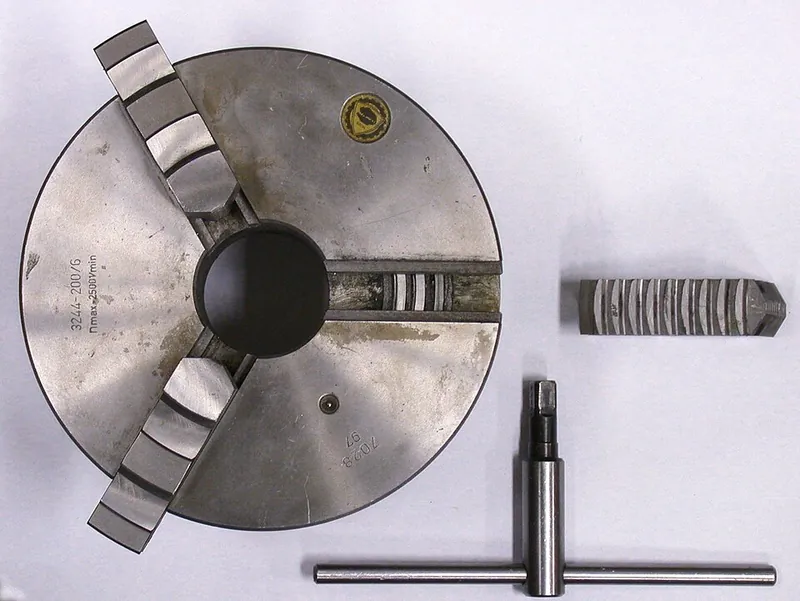

<figure class="eoc-pic eoc-pic-main"><figcaption><strong>Photo.</strong> <a href="https://commons.wikimedia.org/wiki/File:ThreeJawChuckKey.jpg">ThreeJawChuckKey</a> by Glenn McKechnie, <a href="http://creativecommons.org/licenses/by-sa/3.0/">CC BY-SA 3.0</a>, from Wikimedia Commons.</figcaption></figure>

A plate with a spiral groove (or spiral slots) that, when turned, moves three or more jaws in or out by exactly the same amount, so they clamp a round or hexagonal part and centre it in one movement.

**In plain words:** A round clamp with three (or more) jaws that all slide in or out together when you turn one ring or key, because a spiral groove on a hidden plate pushes on the back of every jaw at once, so whatever round thing it grips ends up right in the middle; the chuck on a metal or wood lathe. **Proper term:** Scroll mechanism: self-centring scroll chuck (spiral scroll plate driving [radial](../glossary.md#axial--radial) jaws); simple form: spiral-slot (eccentric-slot) cam plate.

**Also called:** self-centring chuck, self-centering chuck, scroll chuck, universal chuck, three-jaw chuck (Wikipedia 'Chuck (engineering)'); scroll plate, scroll gear, spiral scroll, spiral rack (Wikipedia; Thang 'Three-jaw self-centering chuck 1'); geared scroll chuck (turned by a bevel pinion and chuck key) and lever scroll chuck (turned with tommy bars) (Woodworker's Journal; EB1911 figures); four-jaw scroll chuck (woodturning), four-jaw and six-jaw self-centring chucks (Woodworker's Journal; Wikipedia); adjust-true or 'exact-adjust' chuck: a scroll chuck with screws to fine-tune centring; GripTru (brand), Setrite (brand, Pratt Burnerd) (Wikipedia; Pratt Burnerd); spiral-slot plate, cam plate with eccentric slots (Thang 'Three-jaw self-centering chuck 4'); Dreibacken-Spannfutter, Dreibackenfutter (German for three-jaw chuck; Wikimedia Commons file '3-Backen-Futter-800.jpg').

## How it works

Each jaw can only slide straight in or out along its slot, and teeth on its underside sit in the spiral on the scroll plate. Turning the scroll makes the spiral slide past the teeth like a very flat screw thread, so every jaw is pushed in (or pulled out) at the same time. Because the spiral is an Archimedean spiral, the gap between one turn and the next is the same everywhere ('any ray from the origin intersects successive turnings of the spiral in points with a constant separation distance'; Wikipedia 'Archimedean spiral'), so all the jaws move the same distance for each turn and stay the same distance from the centre: a round part is centred automatically (Wikipedia 'Chuck (engineering)'). On geared chucks a small bevel pinion turned by the key drives a bevel gear on the back of the scroll for extra leverage (Thang; Woodworker's Journal). The jaws must be put into their slots in a set order so each one meets the spiral at the right point (Sherline; Woodworker's Journal).

## Parts

A small assembly that acts as one unit: a body with radial slots (jaw ways), a flat scroll plate with a spiral ridge on its face, three (or four or six) jaws with curved teeth on their backs that engage the spiral, and a way to turn the scroll: a knurled ring or tommy-bar holes on simple chucks, or one to three bevel pinions turned by a chuck key and meshing with a bevel gear on the back of the scroll on geared chucks (Wikipedia 'Chuck (engineering)'; EB1911 Figs 39-40; Thang part 4 p. 67; Sherline). Woodturning chucks use two-piece jaws: a bottom jaw that engages the scroll and a screw-on top jaw that can be swapped (Woodworker's Journal). The simplest printed form is a plate with three spiral or eccentric slots that push pins on three sliding jaws (Thang 'Three-jaw self-centering chuck 4').

## Everyday examples

- the three-jaw chuck on a metal lathe, tightened with a T-shaped chuck key (Wikipedia 'Chuck (engineering)')
- the four-jaw chuck on a wood lathe that holds a bowl blank (Woodworker's Journal)
- printed scroll-chuck holders for painting miniatures (C-Series Scroll Chuck, Printables)
- not the drill chuck: the jaws of a keyed drill chuck are moved along a [taper](../glossary.md#taper) by a threaded ring, not by a scroll (Wikipedia 'Chuck (engineering)')

## When to use it

When you need to grip round or hexagonal parts of different sizes quickly and have them come out centred without measuring: holding work on a lathe, centring a bowl blank, gripping a rod or tube in a fixture, or a printed holder that grips cylindrical objects of varying size. It is the 'fast, good enough' choice that saves setting-up time (Sherline: self-centring chucks 'will usually get the job done, saving a machinist much time and effort').

## When not to use it

Not for irregular, square-ish or off-centre work: use an independent four-jaw chuck, which can also hold a part deliberately off-centre (Wikipedia). Not when you need the last few hundredths of a millimetre: use a [collet](../glossary.md#collet), an independent-jaw chuck or an adjust-true chuck (Wikipedia; Setrite). Not for thin-walled tubes that would be squashed by three jaws: use a six-jaw chuck or a collet (Wikipedia). Not for small drill bits in a hand drill: use a drill chuck or collet. Not, in printed form, for heavy cutting or high speeds.

## Details

- **What it does (jobs):**
  - join and hold: clamps a round, hexagonal or (with four jaws) square part, gripping it from outside or, with the jaws reversed or expanding, from inside a bore or recess (Wikipedia; Pratt Burnerd; Woodworker's Journal)
  - line parts up exactly: centres the part on the axis automatically, to within about 0.08-0.13 mm on ordinary chucks (Sherline; Wikipedia)
  - change the kind of motion: turns the rotation of a key or ring into equal straight-line (radial) movement of several jaws at once
- **Movement:** multiple: the scroll plate rotates and the jaws slide straight in or out (radially). Example ranges: a 2.5 in Sherline four-jaw self-centring chuck holds about 2-30 mm with the jaws normal and 8-56 mm with them reversed (Sherline); a 125 mm Setrite three-jaw chuck covers 1.5-124 mm with different jaw positions (Pratt Burnerd)
- **Directions it can move (degrees of freedom):** 1: one turn of the scroll moves all the jaws together, so the jaw set has a single degree of freedom (in/out). Once clamped, the workpiece has 0 [degrees of freedom](../glossary.md#degrees-of-freedom) relative to the chuck
- **Special behaviour:**
  - self-aligning or self-centring: all jaws close by the same amount, so a round or hexagonal part ends up on the centre line without measuring (Wikipedia 'Chuck (engineering)')
  - motion conversion: rotary input to equal radial movement of three or more jaws
  - [self-locking](../glossary.md#self-locking) (holds under load) ⚑ [uncertain]: in practice a tightened scroll holds its grip while the part is turned or cut, but no opened source states the scroll is self-locking; and an untightened scroll can be turned by inertia when the spindle starts, opening or closing the jaws (Sherline; Woodworker's Journal)
- **How it holds:** friction or clamping (force-fit): the jaws squeeze the part and friction carries the turning and cutting forces. Inside the chuck the jaw teeth interlock with the spiral (shape, [form-fit](../glossary.md#form-fit--force-fit--material-bond)). Woodturners also grip by shape, expanding the jaws into a dovetail-shaped recess cut in the bowl base (Woodworker's Journal)
- **Input and output:** Rotation of a key, pinion, knurled ring or tommy bar -> rotation of the scroll -> equal radial travel of every jaw. Jaw travel per scroll turn equals the [pitch](../glossary.md#pitch) of the spiral, the same at every radius (Wikipedia 'Archimedean spiral'). Force: a 125 mm Pratt Burnerd Setrite chuck takes a maximum input [torque](../glossary.md#torque) of 52 N m and produces a total jaw force of 24.1 kN (Setrite manual). Shaft arrangement on geared chucks: the key and pinion are at right angles to the chuck axis and drive the scroll through bevel gears (intersecting axes; Thang; EB1911 Fig. 40). Back-drivable: yes when unloaded: starting the lathe can turn an untightened scroll and open or close the jaws (Sherline; Woodworker's Journal). Once tightened, clamping and cutting forces do not unwind it in normal use ⚑ [uncertain: inferred from normal use, not stated in an opened source]. Efficiency: low, with a lot of sliding friction ⚑ [uncertain: no figure found]
- **Power:** passive (no power needed): turned by hand with a key, ring or tommy bars. Powered self-centring chucks can use a different mechanism, e.g. a wedge pulled by a pneumatic cylinder (Thang 'Three-jaw self-centering chuck 3')
- **Load:** Heavy for metal chucks: a 125 mm Setrite chuck clamps with a total of 24.1 kN, and larger sizes with up to 73.5 kN (Setrite manual). Strong in radial grip and in turning (by friction); weakest when the part sticks out a long way (it can be levered out, so support long work with a tailstock centre) or is gripped on too short a step or too small a diameter (Setrite manual). Printed or spiral-slot plate versions are light duty: Thang notes his eccentric-slot cam chuck 'should be used only for operation of light cutting force'
- **Play and precision:** small: there is some [backlash](../glossary.md#backlash) between jaw teeth and scroll (Setrite manual), and centring is good but not perfect: Wikipedia gives about +/-0.005 in (0.125 mm) total indicator reading for a typical three-jaw chuck (marked 'citation needed' there), and Sherline specifies an allowable runout of 0.003 in (0.076 mm) or less. 'Self-centering chucks will never duplicate the [accuracy](../glossary.md#repeatability--accuracy) that can be attained with jaws that are moved independently' (Sherline). Even-numbered jaws need truly round or square stock: on an oval part one jaw does not grip (Sherline), and imperfectly round work can 'teeter' between opposite jaws (Wikipedia). It cannot correct an offset: use an independent four-jaw chuck or an adjust-true chuck for that
- **Taking it apart:** removable: loosen with the key or ring and the part comes out; the jaws can be wound out of the scroll, removed and reversed; the whole chuck screws or bolts onto the spindle (Sherline; Pratt Burnerd)
- **How often it can be reused:** effectively unlimited clamping cycles, but wear and damage slowly reduce centring accuracy; gripping parts that are not uniform along their length can strain the jaws and permanently impair accuracy (Wikipedia 'Chuck (engineering)'), and replacement jaws are less accurate than the original set ground in the chuck (Setrite manual)
- **Sealing:** none: chips, swarf and dust get into the scroll, so it needs regular cleaning and [lubrication](../glossary.md#lubrication) (Sherline; Pratt Burnerd; Woodworker's Journal)
- **Adjustable:** Yes: it grips any size within its range by turning the scroll; the jaws can be reversed for larger work; woodturning chucks take different top jaws and a screw-chuck insert (Sherline; Woodworker's Journal). Adjust-true chucks have screws that shift the chuck body so a part can be trued to within 0.013 mm, or 0.005 mm if set for each part (Setrite manual; Wikipedia mentions GripTru (brand))
- **Access needed:** end of a tube or shaft: the part is gripped on its end (outside diameter) or from inside a bore or recess; the chuck itself is mounted on the end of a spindle
- **Materials:** Metal chucks: steel bodies with scrolls of tough alloy steel, hardened and ground (Setrite manual). Woodturning chucks: metal bodies with swappable top jaws shaped for wood, because metalworking jaws 'mar wood egregiously' (Woodworker's Journal). Printed versions: ordinary FDM plastics such as PLA for light work (mdkendall's 2.5 in chuck is 'fully printable'; Printables). Grips metal, wood, plastic and more; soft or thin-walled parts can be crushed or distorted, which is why six-jaw chucks are used for thin-walled tubing and plastics (Wikipedia)
- **Heat, cold, water and wear:** Swarf, chips and dust: they get into the scroll and jaw ways and make it stiff and inaccurate; clean and lubricate regularly (Sherline; Setrite; Woodworker's Journal). Rust: keep steel chucks lightly oiled and stored wrapped (Sherline). Speed: centrifugal force at high speed can throw out jaws or the workpiece, so keep below the marked maximum speed (Setrite). Wood movement: green or drying wood shrinks and can loosen its grip ⚑ [uncertain: general woodturning knowledge, not from an opened page]. Printed plastic chucks: plastic [creeps](../glossary.md#creep) under constant clamping and softens with heat, so grip falls off over time ⚑ [uncertain: general behaviour of printed plastics].

## Making it

- **Ways to make or get it:**
  - off-the-shelf part: lathe chucks, woodturning chucks and mini-lathe chucks are the normal choice
  - 3D print (FDM): light-duty scroll chucks, chuck vises and holders (e.g. mdkendall's 2.5 in chuck, C-Series Scroll Chuck on Printables)
  - laser cut: a flat plate with spiral or eccentric slots driving pins on sliding jaws, as in Thang's cam-plate chuck ⚑ [uncertain: a plausible flat-part build, no tested laser-cut design found]
  - CNC: metal scroll plates, jaws and bodies, and machining soft jaws to fit a part
- **Printing it in one piece (print in place):** no: printed scroll chucks are printed as separate parts (housing, scroll plate, jaws, [circlip](../glossary.md#circlip) or screws) and assembled, inserting the jaws in order (mdkendall, Printables). A [print-in-place](../glossary.md#print-in-place) self-centring vise exists, but it uses a two-start screw, not a scroll (Alterity Design, Printables)
- **Tools:** A chuck key (square-ended T-handle) for geared chucks, tommy bars for lever and knurled-ring chucks, a hex key for jaw screws and mounting bolts; a brush and lubricant for cleaning (Pratt Burnerd; Sherline; Woodworker's Journal). Printed chucks: tommy bars or M3 screws, a needle file and a circlip (mdkendall; Charleszard on Printables)
- **Difficulty:** easy to use: buy a ready-made chuck. Moderate to print a working light-duty one: tested designs print without supports, but the jaws and teeth may need filing to fit (mdkendall). Hard to make an accurate metal one at home: the scroll and jaws must be hardened and ground

### 3D printing tips

1) Start from a tested model: mdkendall's 2.5 in (63 mm) three-jaw chuck prints 'in the orientation shown with no [support material](../glossary.md#support-material)', with [chamfers](../glossary.md#chamfer--fillet) so the [overhangs](../glossary.md#overhang--bridging) bridge cleanly (Printables). 2) [Clearance](../glossary.md#clearance): that model uses 0.2 mm clearance between all fitting parts; clean up tight jaws or teeth with a needle file (mdkendall). 3) Print the jaws flat with a small brim (2 mm worked) so the teeth do not lift (mdkendall). 4) Use a true Archimedean spiral (constant spacing between turns) and give the jaw teeth the same spacing, so every jaw moves the same distance (Wikipedia 'Archimedean spiral'). 5) Mark jaws and slots (A, B, C) and insert in order: turn the scroll until its leading tip is about to appear in a slot, feed in jaw A, turn to capture it, then B, then C; reversed jaws go in C-B-A (mdkendall; Sherline does the same with numbered jaws). 6) Give it something to turn with: tommy-bar holes (4 mm on mdkendall's chuck), screws that lock the scroll once set (Charleszard's 48 mm remix), or a bevel pinion and ring gear for more force, as on geared metal chucks (Woodworker's Journal). 7) Add a stop so jaws cannot run off the end of the spiral and fall out; Nova woodturning chucks use a stop screw for this (Woodworker's Journal). 8) Keep it light duty: Thang warns that even a metal eccentric-slot cam chuck is only for light cutting forces. A printed spiral is also weaker and springier than a hardened steel one, and plastic parts slowly creep and loosen under constant clamping ⚑ [uncertain: general behaviour of printed plastics, not tested on these models]. 9) A dry lubricant or wax helps the scroll turn smoothly (Woodworker's Journal recommends paste wax or a dry lubricant on wood chucks).

### Buying one (off-the-shelf parts)

Three-jaw self-centring lathe chuck (scroll chuck, universal chuck) with chuck key; four-jaw and six-jaw self-centring chucks; adjust-true chucks (Setrite (brand, Pratt Burnerd), GripTru (brand)); reversible hard jaws, two-piece jaws and soft top jaws; back plates and adaptor plates for the spindle nose (Pratt Burnerd; Wikipedia). Woodturning four-jaw scroll chucks, lever or gear-driven, with interchangeable jaws and screw-chuck inserts: Nova (brand, Teknatool), Oneway Stronghold and Talon (brands), Vicmarc VM150 (brand), Barracuda (brand, Penn State Industries) (Woodworker's Journal). Mini-lathe chucks, e.g. Sherline 2.5 in and 3.1 in four-jaw self-centring chucks (Sherline). Spring-loaded, self-ejecting chuck keys (WorkSafe New Zealand).

## Rules of thumb

- Woodturning scroll chucks: 'never extend the jaws more than one-third out of the chuck', or they can lose engagement with the scroll (Ernie Conover, Woodworker's Journal, https://www.woodworkersjournal.com/four-jaw-scroll-chucks/).
- Metal chucks: don't let the jaws project beyond the chuck body, don't exceed the clamping range, grip on the largest possible diameter, and support long or heavy parts between centres (Pratt Burnerd Setrite manual, https://prattburnerd.com/wp-content/uploads/2022/01/PBA-Setrite-Manual-2021.pdf).
- Expect about 0.08-0.13 mm of runout from an ordinary scroll chuck: Sherline allows 0.003 in (0.076 mm) or less (https://sherline.com/wp-content/uploads/2015/01/1075inst.pdf); Wikipedia quotes +/-0.005 in (0.125 mm) TIR, unsourced (https://en.wikipedia.org/wiki/Chuck_(engineering)). For better, use a collet, an independent four-jaw chuck or an adjust-true chuck (0.013 mm repeat, Setrite manual).
- Speed: never exceed the maximum speed marked on the chuck body, because centrifugal force can throw out parts or the workpiece (Setrite manual); Sherline's small chucks are not designed for use above 3,000 rpm (Sherline).
- Force: a 125 mm Setrite chuck gives a total jaw force of 24.1 kN at its maximum input torque of 52 N m; don't extend the key handle or use a power wrench (Setrite manual, https://prattburnerd.com/wp-content/uploads/2022/01/PBA-Setrite-Manual-2021.pdf).
- Jaw count: three jaws for round and hexagonal stock; four self-centring jaws only for truly round or truly square stock (Sherline, https://sherline.com/wp-content/uploads/2015/01/1075inst.pdf).
- Printed chuck: 0.2 mm clearance between fitting parts, jaws printed flat with a 2 mm brim (mdkendall, https://www.printables.com/model/133491-25inch-three-jaw-chuck).

## Common failures

1) Off-centre grip because the jaws were put in the wrong slots or out of order: the jaws and jaw ways are numbered, so reinstall in sequence (Setrite; Sherline; Woodworker's Journal). 2) Lost accuracy from wear, dirt or strain: gripping non-uniform work 'can strain the jaws and permanently impair accuracy' (Wikipedia); clean, lubricate and don't over-tighten with an extended key (Setrite). 3) Work slipping or being pulled out: too short a gripping step, too small a diameter, long overhang or too little tightening; grip longer and support with a tailstock (Setrite). 4) One jaw not gripping on a four-jaw chuck because the stock is oval or rectangular (Sherline). 5) Binding when refitting jaws: back the scroll off slightly and wiggle the jaw, never force it (Sherline). 6) Printed chucks: jaw teeth skipping or stripping, the plate flexing, and grip loosening as plastic creeps; keep loads light.

## Safety

Never leave the chuck key in the chuck: if the lathe starts it is flung out (Setrite manual; WorkSafe New Zealand recommends spring-loaded keys that eject themselves and interlocked chuck guards). A spinning chuck catches loose clothing, gloves, jewellery and long hair: tie hair back and don't wear gloves, rings or loose sleeves at a lathe (WorkSafe New Zealand; CCOHS). Jaws wound too far out can lose engagement with the scroll, and starting the lathe then causes 'a very dangerous ballistic event'; protruding jaws can also cut you (Woodworker's Journal; Setrite). Don't start the spindle unless the jaws are tightened, because the scroll can open the jaws as the spindle accelerates (Sherline). Never exceed the marked maximum speed, and support long work so it can't be levered out (Setrite).

## Related

- Collet (and keyless chuck): a slotted sleeve squeezed by a cone; more accurate and grips all round, but each collet fits only a narrow size range
- Independent four-jaw chuck: each jaw has its own screw, so it holds irregular or deliberately off-centre work and can be trued exactly, but setting up is slow (Wikipedia)
- Drill chuck (keyed or keyless): three jaws moved along a taper by a threaded sleeve rather than by a scroll (Wikipedia)
- Iris mechanism: blades or pins driven by a turning ring also close evenly towards the centre, but to make an opening rather than to clamp
- Self-centring vise with a left- and right-hand screw: two jaws closing equally on a part (Thang 'Self-centering fixture 1b'; a print-in-place example by Alterity Design)
- Wedge (power) chuck: jaws closed by a wedge pulled by a pneumatic cylinder instead of by a scroll (Thang 'Three-jaw self-centering chuck 3')
- Self-centring cone and socket (taper locator): centres a part by a cone instead of by jaws
- Rack-and-pinion and screw-driven self-centring chucks: other ways to move several jaws together (Thang 'Three-jaw self-centering chuck 2')

## Make it yourself

- [2.5inch Three Jaw Chuck (mdkendall, Printables)](https://www.printables.com/model/133491-25inch-three-jaw-chuck): Fully printable 63 mm three-jaw scroll chuck with reversible jaws, M14 x 1 mm mounting thread for Unimat-style and '8-in-1' mini lathes, 0.2 mm clearances, tommy-bar holes; no supports needed *(licence: CC BY-SA)*
- [C-Series Scroll Chuck (ThatRobHuman, Printables) (URL from Printables API, page not opened)](https://www.printables.com/model/992137-c-series-scroll-chuck): Small printed three- or four-jaw scroll chuck used to hold larger miniatures in a ball vise; bill of materials and step-by-step PDF included *(licence: CC BY-SA)*
- [Self-Centering 48mm Chuck for Mini Lathe (Charleszard, Printables) (URL from Printables API, page not opened)](https://www.printables.com/model/352130-self-centering-48mm-chuck-for-mini-lathe): 48 mm remix of mdkendall's chuck for toy mini lathes; holds round objects up to about 40 mm; M3 screws lock the scroll plate once set *(licence: CC BY-NC-SA)*
- [Functional 3-Jaw Chuck Vise (N00dle, Printables) (URL from Printables API, page not opened)](https://www.printables.com/model/743872-functional-3-jaw-chuck-vise): Printed three-jaw chuck vise in which a toothed plate turns to drive three jaw runners; designer recommends 0.12 mm layers or finer *(licence: CC BY-NC)*

## Pictures, videos and models

- [ThreeJawChuckKey.jpg (Glenn McKechnie, Wikimedia Commons)](https://commons.wikimedia.org/wiki/File:ThreeJawChuckKey.jpg): Photo of a three-jaw self-centring chuck with one jaw removed and turned over to show the teeth that engage the scroll plate, and the chuck key *(licence: CC BY-SA 3.0)*
- [EB1911 - Tool - Fig 39.png: Scroll Chuck, ungeared (Encyclopaedia Britannica 1911, Wikimedia Commons)](https://commons.wikimedia.org/wiki/File:EB1911_-_Tool_-_Fig_39.png): Labelled drawing of a simple scroll chuck: knurled body with the scroll on its face and jaws with sectional scroll teeth, turned with a tommy bar *(licence: Public domain)*
- [EB1911 - Tool - Fig 40.png: Combination Geared Scroll Chuck (Encyclopaedia Britannica 1911, Wikimedia Commons)](https://commons.wikimedia.org/wiki/File:EB1911_-_Tool_-_Fig_40.png): Labelled drawing of a geared scroll chuck: pinions driving a circular rack with the scroll on its face, plus screws to move the jaws independently *(licence: Public domain)*
- [Three-jaw self-centering chuck 1 (thang010146, YouTube)](https://www.youtube.com/watch?v=0ERIZeZhckw): CAD animation of a bevel pinion turning the scroll (spiral rack) so all three jaws move together (title and channel confirmed via YouTube oEmbed; described in Thang's PDF part 4 p. 67; video not watched) *(licence: link only)*
- [Three-jaw self-centering chuck 4 (thang010146, YouTube)](https://www.youtube.com/watch?v=zzcj0-C6Njo): CAD animation of the simple spiral-slot version: a cam plate with three eccentric slots moving three jaws (title and channel confirmed via YouTube oEmbed; described in Thang's PDF part 4 p. 68; video not watched) *(licence: link only)*

## Needs confirming

⚑ marks something nobody has confirmed yet: a fact the research could not confirm from a source, a finder value that is a best guess, or an open point from the research notes. Corrections are welcome (see `research/needs-confirming.md`).

- ⚑ 7 sentences on this page marked [uncertain].
- ⚑ Research note: *Scroll mechanism*: Wikipedia's ±0.125 mm three-jaw runout is itself "citation needed"; the entry leads with Sherline's 0.003 in. The Setrite manual's speed column has no unit, so its numbers were left out.

## Sources

- <https://en.wikipedia.org/wiki/Chuck_(engineering) (read as raw wikitext)>
- <https://en.wikipedia.org/wiki/Archimedean_spiral (read as raw wikitext)>
- <https://cs448m.github.io/lectures/machines/doc/4.pdf (Nguyen Duc Thang, 2700 Animated Mechanical Mechanisms part 4, pp. 67-68, section 28.2 'Mechanisms for clamping and centering workpieces'; Stanford course-site copy)>
- <https://www.youtube.com/watch?v=0ERIZeZhckw (title and channel confirmed via YouTube oEmbed)>
- <https://www.youtube.com/watch?v=zzcj0-C6Njo (title and channel confirmed via YouTube oEmbed)>
- <https://prattburnerd.com/wp-content/uploads/2022/01/PBA-Setrite-Manual-2021.pdf (Pratt Burnerd America, Setrite Self Centering Scroll Chucks manual, 2021)>
- <https://sherline.com/wp-content/uploads/2015/01/1075inst.pdf (Sherline, 4-Jaw Self-Centering Chucks P/N 1075, 1076, 1076C and 1078 instructions)>
- <https://www.woodworkersjournal.com/four-jaw-scroll-chucks/ (Ernie Conover, 'Four-Jaw Scroll Chucks', Woodworker's Journal)>
- <https://www.worksafe.govt.nz/topic-and-industry/machinery/metal-turning-lathes/ (WorkSafe New Zealand, Metal turning lathes)>
- <https://www.ccohs.ca/oshanswers/safety_haz/metalworking/lathes.html (CCOHS, Metalworking Machines - Lathes)>
- <https://commons.wikimedia.org/wiki/File:ThreeJawChuckKey.jpg>
- <https://commons.wikimedia.org/wiki/File:EB1911_-_Tool_-_Fig_39.png>
- <https://commons.wikimedia.org/wiki/File:EB1911_-_Tool_-_Fig_40.png>
- <https://commons.wikimedia.org/wiki/File:3-Backen-Futter-800.jpg (file title used for the German alias)>
- <https://api.printables.com/graphql/ (Printables API: models 133491, 992137, 352130, 743872, 946636)>
