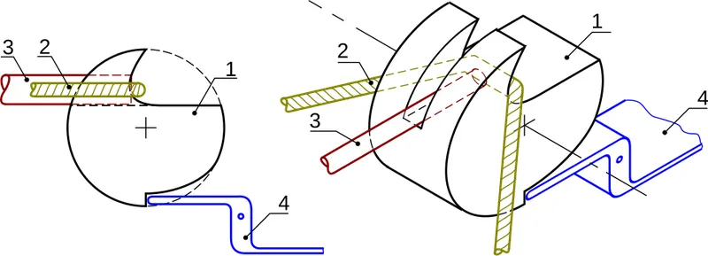

*Picture: [Noix corde carreau arbalette.svg](https://commons.wikimedia.org/wiki/File:Noix_corde_carreau_arbalette.svg) by Christophe Dang Ngoc Chan (Cdang (talk)), [CC BY-SA 3.0](https://creativecommons.org/licenses/by-sa/3.0), from Wikimedia Commons.*

A small hooked catch (the sear) holds a part that is loaded by a big spring, band or weight, and a trigger lever pulls the catch off with a light touch, releasing all the stored energy in an instant.

**In plain words:** A tiny catch that holds back a strong spring or stretched band, so that a light touch on a trigger lets it all go at once. **Proper term:** Sear and trigger (trip mechanism, trip latch, catch-and-trigger release).

**Also called:** trigger mechanism / trigger release; trip release / trip latch / trip mechanism (circuit breakers); catch and trigger / latch and cocking lever ('snap motion' in Nguyen Duc Thang's catalogue); sear (the catch itself); the notch it sits in is called the 'bent' in British usage; nut and trigger lock / rolling nut (medieval crossbows); nuji, 'crossbow mechanism' (ancient Chinese bronze three-piece trigger); bait pedal / treadle trigger / trip (mousetraps and snap traps); release hook / releasing grip (heavy lifting); hair trigger (a very light, sensitive release).

## How it works

The main spring pushes the loaded part against the sear's small hooked face. The faces are shaped so that this big push points almost straight into the sear's pivot, so it barely tries to turn the sear; the sear is held in place by its own light spring and by friction. The trigger is a long lever, so a small finger force at its end makes a larger force at the sear, enough to slide the sear off the notch. The moment the contact slips past the edge, nothing holds the loaded part and it snaps free (Wikipedia, Sear; Crossbow Building Wiki). Adding a second lever stage, or a roller at the contact, cuts the needed force further, which is how circuit breakers release a large stored spring with a small [solenoid](../glossary.md#solenoid) (US 5,508,487; US 5,713,459).

## Parts

A few parts: (1) the frame or stock; (2) the loaded part that stores or holds the energy (a hammer, striker, mousetrap bar, crossbow nut, catapult arm or hook jaw) with a notch or ledge; (3) the sear, a small catch that sits in that notch; (4) the trigger, a lever that moves the sear (sometimes the trigger is the sear); (5) light springs that push the sear and trigger back into place; (6) the main energy store (coil or [torsion](../glossary.md#torsion) spring, rubber band, bow). Some designs add an extra lever between trigger and sear to lighten the pull, like the three-piece Chinese bronze lock (hook, sear, trigger).

## Everyday examples

- A spring mousetrap: a hold-down bar keeps the wire striker cocked by resting on a small catch on the bait pedal, and 'the slightest pressure on the trigger' releases it (US 528,671, Hooker, 1894)
- A crossbow: the rotating nut holds the drawn string and the trigger lets it roll free (Wikipedia, Crossbow)
- A household circuit breaker: stored spring energy opens the contacts when the trip latch is released by a bimetal strip or solenoid (Wikipedia, Circuit breaker)
- Toy catapults, rubber-band guns and slingshots with a trigger (many printable examples on Printables)

## When to use it

Use it when you need to hold a big stored force steady for a while and then let it go instantly and on demand, with only a light touch: traps, launchers (glider and bungee plane launchers, catapults, slingshots, rubber-band toys), drop and release mechanisms (servo payload drops), kinetic art and chain-reaction machines, and safety trips that must let go automatically when something happens.

## When not to use it

Avoid it when the load should be released slowly or controllably: use a brake, damper, winch or lead screw instead. Avoid printed plastic sears for large forces or for holding cocked for long periods, because the small catch [creeps](../glossary.md#creep), wears and can fire by itself; use hardened metal faces. Never use a home-made release to hold loads over people; use rated, certified release hooks. Where accidental release is dangerous, add a separate safety catch. If you only need a lid or door to stay shut, a simple latch or [over-centre](../glossary.md#over-centre) catch is safer, because it does not store energy.

## Details

- **What it does (jobs):**
  - lock, and release by hand: holds a loaded part until someone (or something) pulls the trigger
  - store energy: keeps a spring, band or bow loaded and ready
  - hold or release using power: servo- or solenoid-tripped versions let a small electric [actuator](../glossary.md#actuator) release a large load
- **Movement:** multiple: the sear and trigger pivot (rotate) through a few degrees; the released part then swings or slides freely (a mousetrap bar rotates about half a turn; a crossbow nut rotates; a plunger slides)
- **Directions it can move (degrees of freedom):** 1 per lever: the trigger, the sear and the loaded part each swing about their own pivot pin. While cocked, the chain is locked (0); after release the loaded part is free to move in its one direction
- **Special behaviour:**
  - hand-release only (locks under load, releases when a person operates it): it holds the full stored force until the trigger is pulled
  - quick-release: release is instant, with no unwinding or unscrewing
  - [self-locking](../glossary.md#self-locking) (holds under load, won't back-drive): only when the catch faces are shaped correctly; if they slope the wrong way the load pushes the sear out and it fires by itself (Crossbow Building Wiki)
  - [fail-safe](../glossary.md#fail-safe--fail-secure) or breakaway: trip devices use it to let go automatically, for example a mousetrap's bait pedal or a circuit breaker's trip latch released by a bimetal strip or solenoid when a fault occurs (Wikipedia, Circuit breaker)
- **How it holds:**
  - shape (the parts interlock; [form-fit](../glossary.md#form-fit--force-fit--material-bond)): the sear's hook sits in a notch on the loaded part
  - friction or clamping (force-fit): friction at the contact helps hold the sear in and sets how hard the trigger feels
  - spring force (a spring or springy part presses it in place): light springs keep the sear and trigger engaged
- **Input and output:** Not a motion transmission. It works as a force amplifier and time-release: a small, short trigger movement releases a large stored force. The trigger's lever ratio and any extra lever stages set how light the pull is; for industrial releasing grips one engineering blog quotes a trigger [linkage](../glossary.md#linkage) ratio of 8:1 to 15:1 and trigger force = load x tan(sear angle + friction angle) / lever ratio ⚑ [uncertain: single commercial source]. Back-drivable: no while cocked, provided the catch faces are shaped correctly.
- **Power:** passive (no power needed) in traps, crossbows and toys. Powered versions use a servo, solenoid or bimetal strip to move the sear, e.g. a servo-released bungee plane launcher (Printables 413432) and circuit breakers (Wikipedia). If power fails, a servo- or solenoid-tripped sear normally stays latched, because the spring and friction hold it and the actuator is only needed to release ⚑ [uncertain: depends on design]
- **Load:** Light to heavy, depending on material: hardened steel sears hold crossbows of hundreds of pounds and industrial loads; printed plastic versions suit rubber-band toys and small launchers (a PET-printed launcher trigger was tested at 10 kg pull, Printables 413432; the printed Chinese crossbow-trigger model 'is unlikely to carry any real load'). Strong in the direction the load pushes into the hook; weak if the faces are chipped, rounded or loaded from the side, and the small contact area sees very high contact stress.
- **Play and precision:** Not a locating joint. The trigger usually moves a little before release ('creep'), more with deeper engagement (Wikipedia, Sear). Release timing is repeatable if the faces are hard and clean, but wear, dirt and grease change the feel over time.
- **Taking it apart:** tool-free quick release: it is a release mechanism; you re-cock (reset) it by hand or with a cocking lever
- **How often it can be reused:** many times: it is re-cocked after each release, but the small contact faces wear; a mild-steel crossbow trigger bearing on a hardened nut wore badly 'within a few hundred shots' at about 300 lb draw (Crossbow Building Wiki)
- **Sealing:** none
- **Adjustable:** Sometimes: better designs let you change how deep the sear overlaps the notch or how much the faces slope, which changes trigger weight and 'creep' (Wikipedia, Sear: larger sear engagement gives more creep, shorter gives a crisper release). Simple printed or wooden versions are not adjustable; you file or reprint the faces.
- **Access needed:** not applicable: it is a mechanism worked by its trigger, which can be placed wherever a finger, a string pull or an actuator can reach
- **Materials:** Hardened steel for the contact faces in serious uses (crossbow nuts and triggers; industrial release hooks quote HRC 50-55 faces ⚑ [uncertain: single commercial source]); cast bronze in ancient Chinese crossbow locks; horn or antler nuts with a steel insert where the trigger bears, in medieval crossbows (Crossbow Building Wiki); spring steel wire and wood in mousetraps (US 528,671); PLA, PETG or PET for printed toys and demonstrators. It is a mechanism, not a way of joining materials.
- **Heat, cold, water and wear:** Dirt, rust and old grease raise friction, so the trigger gets heavier or the sear fails to release; cold grease can double the trigger pull (FIRGELLI blog, 2026) ⚑ [uncertain]. Plastic catches and springs creep under constant load (DuPont, pp. 36-37), so a printed mechanism left cocked may slowly deform, jam, or let go on its own. Heat speeds up creep and softens PLA ⚑ [uncertain: no temperature figure verified]. Shocks, drops and vibration can jolt a shallow or worn sear off its notch.

## Making it

- **Ways to make or get it:**
  - 3D print (FDM): the usual maker method for toys, catapults, slingshots and demonstrators
  - 3D print (resin): possible for small demonstrators, but [brittle](../glossary.md#brittle--ductile) resins may chip at the sharp catch edge ⚑ [uncertain]
  - CNC or laser cut: flat metal sears and triggers can be cut from plate (the 'Basic Trigger Mechanism for Releasing a String' is suggested for a CNC laser, plasma or wire EDM, Printables 1784755)
  - woodwork: crossbow stocks and wooden traps, with metal or horn contact parts
  - sheet metal: mousetrap hold-down bars and catches are bent wire and pressed sheet
  - off-the-shelf part: a spring mousetrap is a ready-made spring, bar and trip; release hooks and RC servos are sold separately
- **Printing it in one piece (print in place):** no in most designs: the housing, sear and trigger print as separate flat parts joined by pins, plus a separate spring or rubber band. One exception is a printed 'walk the plank' mouse trap whose springy latch and plank are a single PLA piece (Printables 132235).
- **Tools:** none to operate or reset; building one needs pivot pins or screws and springs
- **Difficulty:** moderate: easy to print a working toy, but getting a light, reliable release that never fires by itself takes careful shaping of the catch faces, hard contact surfaces and trial and error, and the stored energy makes testing hazardous

### 3D printing tips

Orientation: print the hook, sear and trigger lying flat so the catch edge is built from continuous [perimeters](../glossary.md#perimeters) in the plane of the bed and the load never tries to split layers; the Chinese crossbow-trigger model prints the teeth, sear and trigger flat, and the slingshot trigger model prints each part 'in various orientations (to maximise inter-layer strength)' (Printables 1578360, 1625652). Pins: an integrated pin printed lying flat is weak, so thicken its walls or give it 100% [infill](../glossary.md#infill), or use a metal pin or screw (Printables 1578360; the slingshot uses 2.9 mm screws). [Clearance](../glossary.md#clearance): 0.2 mm on mating faces and pins worked for the crossbow-trigger model, which also adds 1 mm [chamfers](../glossary.md#chamfer--fillet) to avoid [elephant's foot](../glossary.md#elephants-foot); sand the pin holes so parts turn freely (Printables 1578360). Infill: raise infill locally where the load goes in (the slingshot uses 30% gyroid with 40-60% modifiers at the stressed ends; Printables 1625652). Catch faces: shape them so pulling the trigger lets the loaded part move very slightly forward (light pull) rather than backwards (stiff pull), but not so far that it fires by itself (Crossbow Building Wiki). Keep the faces smooth and the edge crisp; a plastic edge rounds off with use, so for strong springs glue in a steel insert (a piece of pin or screw shank) at the contact ⚑ [uncertain: common practice, not from a tested guide]. Springs: use separate light springs for the trigger return and for the sear; one designer found that linking both with one spring made the trigger 'noticeably heavier' (Printables 1625652). Use metal springs or rubber bands for the main energy store; plastic springs left loaded creep and lose force (DuPont, Module I, pp. 36-37). Do not leave a printed mechanism cocked for long, because the plastic catch can creep and either jam or let go. Test at low power first, wear safety glasses, and fire into something soft (Printables 1625652).

### Buying one (off-the-shelf parts)

Search terms: 'torsion spring', 'compression spring', 'extension spring' (sear and trigger returns); 'dowel pin' or 'shoulder bolt' (pivots); 'latex tubing' or 'rubber band' (energy store); 'mouse trap' (a cheap ready-made spring and trip, as used in mousetrap cars); 'release hook', 'quick release hook' or 'cargo hook' (ready-made load-release hooks); 'RC servo' or 'push-pull solenoid' (to trip it electrically).

## Rules of thumb

- Alignment of the catch faces decides the feel: if pulling the trigger drags the string (or hammer) slightly backwards, the pull is very stiff; if it lets it move slightly forwards, the pull is comfortable; taken too far, the crossbow 'may shoot spontaneously' (Crossbow Building Wiki, Designing medieval nut and trigger crossbow locks).
- A long trigger pivoted near its front end gives 'considerable leverage' over the catch (Crossbow Building Wiki); adding a third piece between trigger and nut in the 16th century increased leverage and smoothed the pull (Crossbow Building Wiki, via search listing) ⚑ [uncertain: the 16th-century point was seen only in a search summary].
- When one contact surface is much harder than the other, make the harder one rounded so it does not cut the softer one; better, make both hard (Crossbow Building Wiki).
- Misfires (failure to release) come from friction in the nut's socket, a heavy nut and badly placed nut fingers; fix with a round, loose but stable fit and oil (Crossbow Building Wiki).
- The force to push a catch off a sloped face grows with the slope and friction: force = P x (mu + tan a) / (1 - mu tan a), where P is the force pressing the faces together and a is the face angle (Covestro snap-fit design guide, pp. 12-14; the same wedge rule applies to a sear by analogy). Plastic-on-steel friction coefficients range from about 0.2-0.35 for POM (acetal) to 0.5-0.65 for ABS, and are higher for plastic on the same plastic (Covestro, Table 3, p. 15).
- For heavy industrial releasing grips, one engineering blog recommends a sear holding angle of 3-7 degrees, hardened (HRC 50-55), smooth (Ra 0.8 um) faces and a trigger lever ratio of 8:1 to 15:1, and warns that cold grease can double the trigger pull (FIRGELLI Automations, 'Releasing Grip Mechanism Explained', 2026) ⚑ [uncertain: single commercial source; its angle limits are hard to reconcile with its own formula].
- A two-stage trip latch 'requires less force to move the latch than a simple one stage solid finger design' (US 5,508,487, ABB circuit breaker); a roller at the latch face minimizes friction (US 5,713,459, Eaton).
- Larger sear engagement gives more creep in the trigger pull; shorter engagement gives a crisper release (Wikipedia, Sear (firearm)).
- Plastic is a poor material for any spring that stays loaded or must store energy; 'any spring which will be under a constant load or [deflection](../glossary.md#deflection), or which is required to store energy, should be made of a lower creep material such as metal' (DuPont General Design Principles, Module I, p. 37).

## Common failures

Fires by itself (spontaneous release): too little overlap, faces sloped so the load pushes the sear out, a worn or rounded edge, a weak sear spring, or a knock; restore a crisp edge, increase engagement a little, strengthen the sear spring, and add a safety. Will not release or feels gritty and heavy: faces sloped so the trigger must drag the load back, too much overlap, rough plastic-on-plastic contact, dirt or thick grease; reshape, smooth and lubricate, add leverage or a second stage. Trigger pull creeps upward over time: contact faces wearing or getting dented (FIRGELLI blog). Soft face worn away by a harder one: make the harder face rounded, or harden both (Crossbow Building Wiki). Pivot pins bend or holes wear oval: use metal pins and support both sides. Printed catch deforms while left cocked (creep): do not store it cocked; use metal inserts.

## Safety

Stored energy: treat a cocked mechanism as loaded; keep fingers, face and other people out of the path of whatever it releases, and uncock it before carrying, storing or taking it apart. Wear safety glasses when testing and fire into something soft (Printables 1625652). Mousetraps and strong springs can injure fingers. Add a safety catch that blocks the trigger when needed; ancient Chinese crossbow locks sometimes had one (ATARN), and industrial release hooks use a two-motion safety [detent](../glossary.md#detent) (FIRGELLI blog). Printed parts can shatter under shock. Making or modifying trigger parts for firearms is tightly regulated and illegal in many places; this entry covers traps, toys, launchers and release devices only.

## Related

- [Ratchet](../glossary.md#ratchet) and [pawl](../glossary.md#pawl): a pawl is a similar catch, but it holds one way at every tooth instead of releasing a single stored shot
- Escapement: releases stored energy in small repeated steps instead of all at once
- Over-centre latch (toggle latch): holds by pushing past a [dead point](../glossary.md#dead-point); it clamps rather than releasing stored energy
- Rotary latch (claw latch): a car-door latch whose jaw is held by a pawl that is tripped by a lever or cable, a close cousin
- Ball-lock pin and release pin: you pull a pin to let a load go; simpler, but needs a larger pull under load
- Shear-pin coupling (breakaway link): lets go automatically by breaking at a set load instead of being tripped
- Solenoid or electromagnetic latch: a powered catch that holds or lets go on a signal
- Push-push latch: releases on a second push rather than by a separate trigger

## Make it yourself

- [Ancient Chinese Crossbow Trigger (nuji), by ParableOfTheVase](https://www.printables.com/model/1578360-ancient-chinese-crossbow-trigger-nu-ji-nu-ji): Educational printable model of the three-piece bronze crossbow lock (housing, two-part hook, sear, trigger, pins) that resets by pulling back the hook's spur; 0.2 mm clearances, 1 mm chamfers, parts printed flat; 'unlikely to carry any real load' (read through the Printables API) *(licence: Creative Commons Attribution (CC BY))*
- [Slingshot - lock and load trigger, by Rosti](https://www.printables.com/model/1625652-slingshot-lock-and-load-trigger): A printed slingshot built to explore a light but reliable trigger lock that re-cocks trigger and bolt in one motion, with detailed notes on print orientation, infill modifiers, screws and springs, and safety (read through the Printables API) *(licence: Creative Commons Attribution-NonCommercial-NoDerivatives)*
- [Catapult with trigger, by choosingcolours](https://www.printables.com/model/927796-catapult-with-trigger): A flat-printed toy catapult whose arm locks into a trigger when pulled back and fires when the base is pulled apart; no supports (read through the Printables API) *(licence: Creative Commons Attribution-NonCommercial-ShareAlike)*
- [trigger mechanism for bungee plane launcher, by freedom2000](https://www.printables.com/model/413432-trigger-mechanism-for-bungee-plane-launcher): A servo-released, crossbow-style trigger printed in PET from plastic bottles, tested with a 10 kg pull; needs a metal spring for the lock (read through the Printables API) *(licence: Creative Commons Attribution (CC BY))*
- [One-Piece Mouse Trap, by LoboCNC](https://www.printables.com/model/132235-one-piece-mouse-trap): A single-piece printed 'walk the plank' trap: a springy latch lets the plank tip when the mouse reaches the end, then it resets itself; the spring is tuned for PLA (read through the Printables API) *(licence: Creative Commons Attribution-ShareAlike)*

## Pictures, videos and models

- [Snap motion 1 (Nguyen Duc Thang, thang010146)](https://www.youtube.com/watch?v=7y-Oez0v2l8): CAD animation of a spring-loaded latch holding a cocking lever and releasing it when the latch is moved (Thang, 2700 Animated Mechanical Mechanisms, Part 3, p. 31; title checked with YouTube oEmbed) *(licence: link only)*
- [Noix corde carreau arbalette.svg (Wikimedia Commons), by Christophe Dang Ngoc Chan](https://commons.wikimedia.org/wiki/File:Noix_corde_carreau_arbalette.svg): Labelled diagram of a medieval crossbow lock: the nut, the string, the bolt (quarrel) and the trigger *(licence: GFDL 1.2+ and CC BY-SA 3.0/2.5/2.0/1.0)*
- [Han crossbow trigger mechanism.jpg (Wikimedia Commons), photo by Gary Lee Todd](https://commons.wikimedia.org/wiki/File:Han_crossbow_trigger_mechanism.jpg): Photo of Han dynasty bronze crossbow trigger mechanisms (the three-piece hook, sear and trigger lock) *(licence: CC0 1.0 (public domain))*
- [US 528,671: Mouse trap (William C. Hooker, 1894), Google Patents](https://patents.google.com/patent/US528671A/en): Patent drawings of the classic spring-bar mousetrap: wire spring and jaw, locking bar and hinged bait trigger with its catch *(licence: patent document; link only)*
- [bungee plane launcher trigger mechanism (f2knpw)](https://www.youtube.com/watch?v=WiMVHB2DOCs): A printed crossbow-style trigger for a bungee plane launcher, released by an RC servo (title checked with YouTube oEmbed; linked from Printables 413432) *(licence: YouTube standard licence; link only)*

## Needs confirming

⚑ marks something nobody has confirmed yet: a fact the research could not confirm from a source, a finder value that is a best guess, or an open point from the research notes. Corrections are welcome (see `research/needs-confirming.md`).

- ⚑ 9 sentences on this page marked [uncertain].

## Sources

- <https://en.wikipedia.org/wiki/Sear_(firearm)>
- <https://en.wikipedia.org/wiki/Mousetrap>
- <https://patents.google.com/patent/US528671A/en>
- <https://en.wikipedia.org/wiki/Crossbow>
- <https://crossbow.fandom.com/api.php?action=parse&page=Designing_medieval_nut_and_trigger_crossbow_locks&prop=wikitext&format=json>
- <https://atarn.org/chinese/bjng_xbow/bjng_xbow.htm>
- <https://commons.wikimedia.org/wiki/File:Noix_corde_carreau_arbalette.svg>
- <https://commons.wikimedia.org/wiki/File:Han_crossbow_trigger_mechanism.jpg>
- <https://en.wikipedia.org/wiki/Circuit_breaker>
- <https://patents.google.com/patent/US5508487A/en>
- <https://patents.google.com/patent/US5713459A/en>
- <https://www.firgelliauto.com/blogs/mechanisms/releasing-grip>
- <https://solutions.covestro.com/-/media/covestro/solution-center/brands/downloads/imported/1557218421.pdf>
- <https://www.distrupol.com/General_Design_Principles_for_Engineering_Polymers.pdf>
- <https://cs448m.github.io/lectures/machines/doc/3.pdf>
- <https://www.youtube.com/watch?v=7y-Oez0v2l8 (verified via YouTube oEmbed)>
- <https://www.youtube.com/watch?v=WiMVHB2DOCs (verified via YouTube oEmbed)>
- <https://www.printables.com/model/1578360-ancient-chinese-crossbow-trigger-nu-ji-nu-ji (read via https://api.printables.com/graphql/)>
- <https://www.printables.com/model/1625652-slingshot-lock-and-load-trigger (read via https://api.printables.com/graphql/)>
- <https://www.printables.com/model/927796-catapult-with-trigger (read via https://api.printables.com/graphql/)>
- <https://www.printables.com/model/413432-trigger-mechanism-for-bungee-plane-launcher (read via https://api.printables.com/graphql/)>
- <https://www.printables.com/model/132235-one-piece-mouse-trap (read via https://api.printables.com/graphql/)>
- <https://www.printables.com/model/1784755-basic-trigger-mechanism-for-releasing-a-string (read via https://api.printables.com/graphql/)>
- <https://api.printables.com/graphql/>
