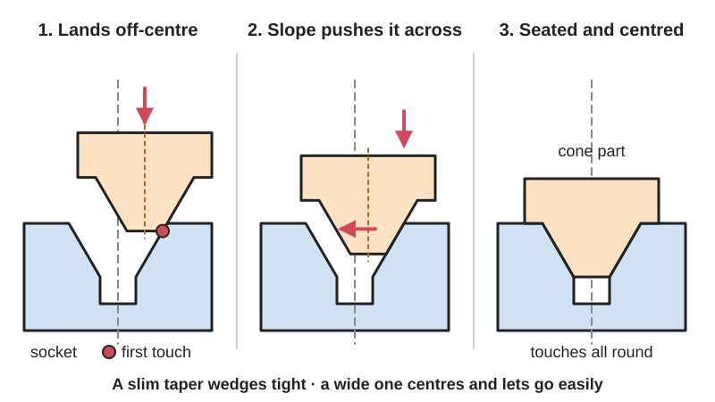

*Diagram drawn for the encyclopaedia from the research notes. ⚑ Needs confirming: a drawing can simplify or get details wrong; a real photo or a better diagram is welcome.*

A cone on one part slides into a matching cone-shaped socket on the other, and the sloping walls push the parts sideways into line so they end up exactly centred on each other.

**In plain words:** A pointed or cone-shaped peg that slides into a matching funnel-shaped hole, so that even if you start a little off-centre the slope steers the two parts into exactly the right place as you push them together. **Proper term:** Self-centring [taper](../glossary.md#taper) locator (cone and socket; tapered or cone locating pin with a lead-in).

**Also called:** cone locator pin, cone-head locating pin, tapered locating pin (Carr Lane and McMaster-Carr catalogue names; McMaster filters locating pins by head type: cone, diamond, round, tapered); bullet-nose pin, bullet-nose locating pin (Carr Lane); centring cone / centering cone (e.g. filament-spool and router-base centring cones on Printables); taper fit, conical fit, tapered joint, conical fit assembly (Creitaru and Grigore 2011); machine taper, Morse taper, self-holding taper, self-releasing (steep, 7/24) taper (Wikipedia 'Machine taper'); lead-in, lead-in [chamfer](../glossary.md#chamfer--fillet), chamfered pin and hole (design-for-assembly term for a short cone on the end of a pin or the mouth of a hole); probe and drogue, docking cone, plug-in funnel (spacecraft docking and connector terms); taper pin (a separate, slightly tapered steel pin driven into a reamed hole to line two parts up; Wikipedia 'Taper pin'); conical seat, e.g. 'lug-centric' conical wheel nuts (Wikipedia 'Lug nut'); standard taper (ST) ground-glass joint; Luer taper / Luer slip (tapered fits that also seal).

## How it works

When the cone meets the socket off-centre, it touches one side first; because that wall is sloped, pushing the parts together makes a sideways force that slides the cone towards the middle (Carr Lane: cone locator pins 'compensate for considerable [misalignment](../glossary.md#misalignment)'; CTE magazine: contact with the tapered nose 'produces a force that tends to straighten and center the holder'). When the cone is fully seated its sloping faces touch all round, so there is no gap left for play and the part is centred and set at a fixed depth (Wikipedia 'Machine taper'). The angle decides what happens next: a shallow taper (a Morse taper is about 1.5 degrees per side) wedges tight and holds by friction, while a steeper one (the 7/24 'steep taper', about 16.6 degrees included) centres the parts but lets go easily and needs a drawbar or clamp to stay in (Wikipedia 'Machine taper'; Creitaru and Grigore 2011). A round cone does not stop the parts turning about its own axis, so a second pin, a flat or a key is added when rotation matters.

## Parts

A few parts, often just two: a male cone (a cone-tipped or bullet-nosed pin, or a tapered shank) and a female socket (a conical hole, funnel, [countersink](../glossary.md#counterbore--countersink) or bushing). Industrial versions add a hardened bushing pressed into the second part and often a second, relieved 'diamond' pin to stop the parts turning (Carr Lane). Something else must usually hold the parts together: gravity, a clamp, a screw or drawbar, a latch or magnet, or the friction of a very shallow 'self-holding' taper (Wikipedia 'Machine taper').

## Everyday examples

- Car wheel nuts with cone-shaped ends that pull the wheel into the centre as they are tightened (Wikipedia 'Lug nut')
- A drill chuck or drill bit pushed into a lathe tailstock or drill press on a Morse taper (Wikipedia 'Machine taper')
- A syringe tip pushed into a needle hub (Luer slip taper) (Wikipedia 'Luer taper')
- Stackable storage bins (Gridfinity) whose chamfered feet drop into a baseplate grid, and filament-spool centring cones (Printables)

## When to use it

Use a cone and socket when two parts must go back together in exactly the same place again and again, especially when you can't see what you are doing, the parts are heavy or come together at an angle, or a robot or machine puts them together: tool changers, removable heads and covers, stacking modules, docking stations, fixtures and jigs (Carr Lane: 'quick assembly of two fixture pieces'; arXiv 2603.04760 self-aligning tool changer). Use a shallow self-holding taper when you want the fit itself to grip, as in machine tools and syringes. A taper is also a good choice in 3D printing because it removes play without needing an exact [clearance](../glossary.md#clearance): the part just sits a little deeper or shallower.

## When not to use it

Don't rely on a round cone alone to stop parts turning: add a second pin, a flat or a key (see [Keying](../glossary.md#keying) and Locating pins and hole-and-slot). Don't use two full cones on the same part unless their spacing is exact; use one cone plus a slot or diamond pin (Carr Lane). Don't use a shallow taper where the parts must separate easily, because it can wedge and stick (Creitaru and Grigore 2011); use a steeper cone or a clamp instead. For the very best [repeatability](../glossary.md#repeatability--accuracy) without [over-constraint](../glossary.md#over-constraint), use a [kinematic coupling](../glossary.md#kinematic-coupling) (balls in a cone, a V-groove and a flat) (Wikipedia 'Kinematic coupling'). For joints that must carry large pull-apart loads, add screws, latches or a bayonet; the cone only locates.

## Details

- **What it does (jobs):**
  - line parts up exactly: centres one part on another and sets how deep it sits, even when you start slightly off
  - join and hold: only when the taper is shallow enough to wedge tight by friction (self-holding tapers such as the Morse taper), or when combined with a clamp, screw, latch or magnet
- **Movement:** none once seated. While engaging, the parts slide along the axis and the slope shifts them sideways into line.
- **Directions it can move (degrees of freedom):** About 1 when fully seated and pressed together: a single round cone stops sideways movement, tilting and going deeper, but the parts can still turn about the cone's axis, and they can be pulled apart unless the taper is self-holding or clamped. Adding a second off-centre pin (usually a relieved 'diamond' pin) or a key removes the turning, giving 0 (Carr Lane bullet-nose pins).
- **Special behaviour:**
  - self-aligning or self-centring: the sloped walls turn a push along the axis into a sideways push that slides the parts into line, so they centre themselves as they close (Carr Lane; CTE magazine)
  - [self-locking](../glossary.md#self-locking) (holds under load, won't back-drive): only for shallow 'self-holding' tapers, which wedge together and stay put by friction until knocked apart with a wedge called a drift (Wikipedia 'Machine taper'; Newman Tools)
  - quick-release: steep 'self-releasing' tapers (7/24) centre accurately but come apart freely once the clamp or drawbar is released, which is why they are used for fast tool changes (Wikipedia 'Machine taper'; CTE magazine)
- **How it holds:**
  - shape (the parts interlock; [form-fit](../glossary.md#form-fit--force-fit--material-bond)): the cone sitting in its socket stops sideways movement and sets the depth
  - friction or clamping (force-fit): self-holding tapers such as the Morse taper, Luer slip syringe tips and ground-glass joints stay together by friction between the cones (Wikipedia 'Machine taper', 'Luer taper', 'Ground glass joint'); steep tapers need a separate clamp or drawbar
  - not a holding joint (it moves or passes on motion): a plain locating cone only positions the parts, and something else (gravity, screws, a latch, magnets) holds them together
- **Input and output:** not applicable
- **Power:** passive (no power needed)
- **Load:** Light to heavy depending on material and size. Strong against sideways ([shear](../glossary.md#peel-vs-shear)) loads and against pushing further in, because the cone seats on its sloped faces. Weak against pulling apart unless it is a self-holding taper or clamped. A round cone gives no resistance to twisting except friction: self-holding tapers transmit turning force by friction (Newman Tools), but a plain locator needs a second pin or key.
- **Play and precision:** none when seated: the cones touch all round, so a taper removes play instead of needing a clearance gap, and returns to the same place very repeatably (Wikipedia 'Machine taper': tools are 'precisely located both concentrically and axially'). Industrial cone locators are rated 'medium-accuracy' because they are designed to catch large starting errors (Carr Lane). Tolerates sideways offset up to about the radius of the cone's mouth and some tilt while engaging; size errors show up as a change in seating depth rather than as looseness. Two rigid cones on the same part will bind if their spacing doesn't match exactly, so use one cone plus a relieved or slotted second locator (Carr Lane).
- **Taking it apart:** tool-free quick release for locating cones and steep self-releasing tapers (just lift or unclamp); removable for self-holding tapers, which need a drift, ejector or a sharp tap to break them free (Wikipedia 'Machine taper'; Newman Tools); ground-glass joints can seize and need solvent, heat or cold to free them (Wikipedia 'Ground glass joint').
- **How often it can be reused:** many times to effectively unlimited for hardened steel locators kept clean; printed plastic cones wear and pick up dents and nicks over time ⚑ [uncertain]
- **Sealing:** none for a locating cone. Precision tapers can seal: Luer slip fittings on syringes are leak-free by friction between the tapers (watertight), and greased ground-glass laboratory joints give a good seal (airtight) (Wikipedia 'Luer taper', 'Ground glass joint'). The seal comes from two accurately matched, smooth cone surfaces pressed together.
- **Adjustable:** no: the cone sets one fixed centred position. The seating depth changes slightly if either cone is made a little too big or too small.
- **Access needed:** not applicable: the parts are simply pushed together along the cone's axis. Self-holding machine tapers need access to a drift slot or ejector to get them apart (Wikipedia 'Machine taper').
- **Materials:** Hardened steel pins with steel bushings for fixtures (Carr Lane); steel for machine tapers; glass for laboratory joints and plastic for Luer fittings (Wikipedia). For home-made locators any printable plastic works: smooth, slippery PLA or PETG centre best, while rubbery TPU grips and stops the cone sliding into the centre (Printables 'Universal Spool Centering Cone', STORM DESIGN). Wood (turned cones) and machined aluminium also work ⚑ [uncertain].
- **Heat, cold, water and wear:** Dirt, chips and dents stop tapers seating: 'All machine tapers are sensitive to chips, nicks (dents), and dirt' and then neither locate accurately nor hold reliably (Wikipedia 'Machine taper'). Thermal expansion changes the fit: a stuck ground-glass joint can be freed by heating the outer part or cooling the inner one, and grease can be washed out by solvents, making glass joints seize (Wikipedia 'Ground glass joint'). Printed plastic cones soften with heat: in CNC Kitchen's test PLA began to give at about 60 °C, PETG at about 80 °C and ASA at about 110 °C. A self-holding taper in plastic may slowly loosen or [creep](../glossary.md#creep) under constant load ⚑ [uncertain].

## Making it

- **Ways to make or get it:**
  - 3D print (FDM): cones and conical sockets print well standing upright; the most common home approach (Printables centring-cone models)
  - 3D print (resin): fine surface for small, accurate cones ⚑ [uncertain]
  - CNC: lathe taper turning or a tapered reamer for accurate male and female cones; drilling and countersinking for simple lead-in cones
  - woodwork: turned cones and countersunk holes ⚑ [uncertain]
  - off-the-shelf part: cone locator pins and bushings, bullet-nose pins, taper pins and reamers, Morse-taper arbors (Carr Lane; McMaster-Carr; Wikipedia 'Taper pin')
- **Printing it in one piece (print in place):** no: the cone and socket are separate parts that are meant to come apart and go back together.
- **Tools:** none to use a locating cone. A drift (wedge) or ejector to release a self-holding machine taper (Wikipedia 'Machine taper'); a taper-pin reamer to prepare holes for steel taper pins (Wikipedia 'Taper pin'); a press or bore to fit industrial cone locators and their bushings, whose shank and bushing outside diameters match so both holes can be bored at once (Carr Lane).
- **Difficulty:** easy: a cone and matching conical hole print well and centre reliably with a generous clearance. Hard only if you need a precision self-holding taper, which has to be ground or reamed accurately, so buy a standard Morse-taper part or taper pin instead.

### 3D printing tips

1) Print cones and conical holes with their axis vertical so every layer is a true circle; the sloped face then shows fine stair-steps, which are smaller on steep-sided (shallow-angle) cones. Check the CAD model has enough facets, because a low-polygon 'circle' prints as a polygon (Prusa 'Modeling with 3D printing in mind'). Variable layer height smooths the slope (Prusa). 2) [Overhangs](../glossary.md#overhang--bridging): a cone pointing up needs no support. A conical socket opening downwards is an overhang; keep each wall within about 45 degrees of vertical (Hubs: overhangs print up to about 45 degrees; Prusa: 45-60 degrees) so no support is needed. 3) Choose the angle for the job: a slimmer cone centres more precisely and more easily, a wider one catches bigger starting errors. One designer threw away several spool-centring cones until he made the cone angle smaller, after which 'centering is now simple and works the first time' (Printables 'Universal Spool Centering Cone', STORM DESIGN). If you do not want the parts to stick, keep the half-angle well above the friction angle of the material (see rules of thumb), because shallow cones wedge tight. 4) Deliberately tight fits: AON3D suggests sloping a diameter by about 2 degrees and adding 0.2 mm crush ribs, so the part slides in easily and tightens only at the end. 5) Clearance: a plain locator can be modelled with zero clearance on the cone because it simply seats a little deeper or shallower; any cylindrical part next to the cone still needs at least 0.3 mm clearance, and FDM parts are only accurate to about 0.2 mm (Prusa). 6) Keep the seam and blobs off the sliding faces: set the Z-seam to the back or into a recess; one router-centring cone adds recesses 'for keeping seams away from faces that need to be smooth' (Printables 'Palm Router Centering Cone Tool', Vincent). 7) Material: use smooth, slippery PLA or PETG, not TPU, which grips and stops the cone sliding into the centre (Printables 'Universal Spool Centering Cone'). 8) [Elephant's foot](../glossary.md#elephants-foot): add a 45-degree chamfer to edges touching the build plate so the first layers don't bulge and jam the fit (Hubs). 9) Instead of thin printed pins, which are weak under about 5 mm diameter (Hubs), use chamfered pins and holes or chamfered fins and slots; chamfers let the features print in several orientations and guide the parts together (Hackaday on Slant 3D's 'Alternative to Pins and Holes'). 10) If you need two locators on one part, make only one a full cone and let the second locate in one direction only (a slot or relieved pin) so the parts do not bind (Carr Lane).

### Buying one (off-the-shelf parts)

Search supplier catalogues for: 'cone locator pins' with matching 'mating bushings' (Carr Lane); 'bullet-nose locating pins' in 'round' and 'diamond' versions (Carr Lane); 'locating pins' by head type cone, diamond, round or tapered, and 'slotted bushings' that stop alignment pins binding (McMaster-Carr); 'taper pins' (1:50 metric, 1:48 inch) with 'taper pin reamers' (Wikipedia 'Taper pin'); 'Morse taper' (MT1, MT2...) arbors, sleeves and drifts (Wikipedia 'Machine taper'); 'conical seat lug nuts' (Wikipedia 'Lug nut'); 'Luer slip' and 'Luer lock' fittings (Wikipedia 'Luer taper').

## Rules of thumb

- Self-holding or self-releasing: a taper locks by friction when its half-angle is smaller than the friction angle (arctan of the friction coefficient); the paper gives the limit as full angle alpha < 2 x arctan(mu) and suggests a safety factor of 1.2-3 above it if the joint must not stick (Creitaru and Grigore, 'Tribological considerations regarding the functional domain determination of the conical fit assembly', Machine Design vol. 3 no. 3, 2011).
- The Morse taper's angle is 'typically 1.49 degrees' per side (about 3 degrees included, roughly 1:20) and it is self-holding; the 7/24 'steep taper' (3.5 in per foot, 16.59 degrees included) is self-releasing and needs a drawbar (Wikipedia 'Machine taper'; CTE magazine 'Understanding tapered spindle connections').
- Self-holding tapers are 'usually 2-3 degrees included angle' (Newman Tools 'Self Holding Tapers').
- Model engineers treat 3.5 in per foot (about 8 degrees per side) as a reliably self-releasing taper and quote 15-20 degrees full angle as a typical range for a taper that locates without locking (Model Engineer forum 'What taper angle to use?'; forum opinion, not a standard).
- Conical wheel-nut seats are normally 60 degrees (45 degrees on some racing wheels) and centre the wheel on the axle as the nuts are tightened (Wikipedia 'Lug nut').
- Other standard tapers for comparison: Luer fittings 6 percent (diameter change per length, not 6 degrees); laboratory ground-glass joints 1:10; metric taper pins 1:50 and inch taper pins 1:48 (Wikipedia 'Luer taper', 'Ground glass joint', 'Taper pin').
- Locate from two holes with one round pin and one relieved 'diamond' pin, which locates in only one direction, so the part does not bind (Carr Lane 'Bullet-Nose Pins').
- FDM parts are accurate to about 0.2 mm; start movable fits at 0.3 mm or more; overhangs print cleanly at 45-60 degrees (Prusa 'Modeling with 3D printing in mind'). Overhangs up to about 45 degrees need no support (Hubs 'How to design parts for FDM 3D printing').
- For a tight printed fit: slope one diameter by about 2 degrees and add 0.2 mm vertical crush ribs (AON3D 'Engineering Fits: How to Design for 3D Printed Assemblies').
- Gridfinity bins drop into their baseplate on slanted, stepped walls with a 0.25 mm gap on every side, which is enough for them to self-centre (Printables 'Gridfinity Specification', grizzie17).

## Common failures

Cone angle wrong for the job: too wide and it doesn't slide into the centre (the spool-cone designer's first cones 'all ended up in the trash'), too shallow and it wedges and sticks (Printables 'Universal Spool Centering Cone'; Creitaru and Grigore 2011). Over-constraint: two cones or two round pins on one part bind if the spacing is slightly off (Carr Lane). Dirt, chips or dents on the cone faces spoil the location and grip (Wikipedia 'Machine taper'). Grippy material such as TPU stops the parts sliding into the centre (Printables 'Universal Spool Centering Cone'). 3D-printing defects: Z-seam blobs, supports or elephant's foot on the sliding faces (Printables 'Palm Router Centering Cone Tool'; Hubs). Tilted entry and jamming: a pin that starts off-centre can twist and wedge in a straight hole instead of sliding in, which lead-in cones and chamfers help prevent (Wikipedia 'Remote center compliance'). Parts can still turn about the axis if nothing else stops them.

## Safety

Keep fingers out of the gap as heavy parts slide together, since the cone pulls them into line suddenly ⚑ [uncertain]. A self-holding tool knocked out of a Morse taper with a drift can drop, so support it as it comes free ⚑ [uncertain]. Don't force a seized glass taper joint, which can break the glass; free it with solvent, gentle warming or cooling instead (Wikipedia 'Ground glass joint' describes these methods).

## Related

- Locating pins and hole-and-slot: straight pins with chamfered tips; more precise sideways fit but less able to catch a bad start
- Kinematic coupling (balls in V-grooves): three balls in a cone-shaped hole, a V-groove and a flat locate a part in all six directions exactly once, giving very high repeatability without binding
- Keying (one-way-only fit): uneven pins or notches that let parts go together only the right way round; often added to a cone locator to stop rotation
- [Elastic averaging](../glossary.md#elastic-averaging) (many-feature alignment): many small, slightly springy features share the job of locating
- Split-part joints for large prints (alignment pins and dowels): pegs and holes, often chamfered, used to line up glued pieces
- Bayonet mount and quick-release plate (dovetail clamp): quick-release joints that often include a centring spigot or cone
- Morse taper, Luer taper and ground-glass joint: standard self-holding tapers that locate, grip and sometimes seal
- Taper pin and dowel pin: separate pins driven into holes in both parts to fix their alignment

## Make it yourself

- [Tapered indexing pin (georgmierau, Printables) (URL from Printables API, page not opened)](https://www.printables.com/model/1720433-tapered-indexing-pin): A simple tapered locating pin, 30 mm tall, 6 mm at the top and 4 mm at the bottom, with an M3 thread to screw into a part. Read through the Printables public API. *(licence: CC BY-NC-SA (Creative Commons Attribution-NonCommercial-ShareAlike))*
- [Universal Spool Centering Cone for Bambu Lab Filament Spool Switcher & Winder (STORM DESIGN, Printables) (URL from Printables API, page not opened)](https://www.printables.com/model/752030-universal-spool-centering-cone-for-bambu-lab-filam): A slim centring cone that centres filament spools with 44-57 mm holes on an axle; the notes explain why a smaller cone angle and slippery PLA or PETG work better than a wide cone or TPU. Read through the Printables public API. *(licence: CC BY-NC-SA (Creative Commons Attribution-NonCommercial-ShareAlike))*
- [Palm Router Centering Cone Tool (Vincent, Printables) (URL from Printables API, page not opened)](https://www.printables.com/model/1130539-palm-router-centering-cone-tool): A cone that fits on a 1/4 inch pin in the router collet and centres the base plate opening (32-44 mm) before the screws are tightened; designed with recesses to keep print seams off the centring faces. Read through the Printables public API. *(licence: CC BY-NC-SA (Creative Commons Attribution-NonCommercial-ShareAlike))*
- [Gridfinity Specification (grizzie17, Printables)](https://www.printables.com/model/417152-gridfinity-specification): An illustrated write-up of the Gridfinity storage standard: 42 x 42 mm grid, slanted stepped baseplate walls and a 0.25 mm gap that lets bins drop in and self-centre. URL found in search results; details read through the Printables public API. *(licence: CC BY (Creative Commons Attribution))*
- [BOSL2 shapes3d.scad: cyl() (OpenSCAD library)](https://raw.githubusercontent.com/BelfrySCAD/BOSL2/master/shapes3d.scad): Makes cylinders and cones (different end radii) with chamfers at a chosen angle, including negative (outward) chamfers for funnel-shaped hole mouths, for modelling tapered pins and matching sockets *(licence: BSD 2-Clause)*

## Pictures, videos and models

- [Morse Taper No 2 (Wikimedia Commons, by DerrickOswald)](https://commons.wikimedia.org/wiki/File:Morse_Taper_No_2.jpg): Photo of a No. 2 Morse taper shank, the classic self-holding machine taper *(licence: Public domain (released by the author))*
- [Original Soyuz probe and drogue docking system (Wikimedia Commons, from NASA RP-1357 'Mir Hardware Heritage', D. S. F. Portree)](https://commons.wikimedia.org/wiki/File:RP1357_p9_Original_Soyuz_probe_and_drogue_docking_system.svg): Diagram of a docking probe entering a receiving cone that guides it into a central socket *(licence: Public domain (NASA work))*
- [Cone Locator Pins (Carr Lane Manufacturing)](https://www.carrlane.com/product/locating-pins/locating-pins/cone-locator-pins): Product photos and drawings of cone-tipped locating pins and their mating bushings used to align two fixture pieces *(licence: link only)*
- [Morse Taper Basics for Woodturners (YouTube, Mike Peace Woodturning)](https://www.youtube.com/watch?v=1yOzPAO4_ds): Video showing how Morse-taper accessories seat in a lathe spindle and tailstock and how they are removed (title and channel checked via YouTube oEmbed; not watched) *(licence: link only (standard YouTube licence))*
- [Alternative to Pins and Holes: Design for Mass Production 3D Printing (YouTube, Slant 3D)](https://www.youtube.com/watch?v=xog9YlMt9UU): Video on chamfered pins, holes, fins and slots that guide 3D-printed parts together (title checked via YouTube oEmbed; summarised by Hackaday) *(licence: link only (standard YouTube licence))*

## Needs confirming

⚑ marks something nobody has confirmed yet: a fact the research could not confirm from a source, a finder value that is a best guess, or an open point from the research notes. Corrections are welcome (see `research/needs-confirming.md`).

- ⚑ 7 sentences on this page marked [uncertain].
- ⚑ Finder value `connects` = any solid parts (best guess): joins parts, but no specific kind of part found; set to any solid parts

## Sources

- <https://www.carrlane.com/product/locating-pins/locating-pins/cone-locator-pins>
- <https://www.carrlane.com/product/locating-pins/locating-pins/bullet-nose-pins>
- <https://www.mcmaster.com/products/locating-pins/>
- <https://ctemag.com/articles/understanding-tapered-spindle-connections/>
- <https://en.wikipedia.org/wiki/Machine_taper>
- <https://en.wikipedia.org/wiki/Taper_pin>
- <https://en.wikipedia.org/wiki/Lug_nut>
- <https://en.wikipedia.org/wiki/Luer_taper>
- <https://en.wikipedia.org/wiki/Ground_glass_joint>
- <https://en.wikipedia.org/wiki/Kinematic_coupling>
- <https://en.wikipedia.org/wiki/Remote_center_compliance>
- <https://www.newmantools.com/tech/taper.htm>
- <http://www.mdesign.ftn.uns.ac.rs/download/v3n3/p10.pdf>
- <https://www.model-engineer.co.uk/forums/topic/what-taper-angle-to-use/>
- <https://arxiv.org/abs/2603.04760>
- <https://hackaday.com/2023/04/29/alternatives-to-pins-and-holes-for-3d-printed-assemblies/>
- <https://www.aon3d.com/applications/engineering-fits-how-to-design-for-3d-printed-assemblies/>
- <https://help.prusa3d.com/article/modeling-with-3d-printing-in-mind_164135>
- <https://www.hubs.com/knowledge-base/how-design-parts-fdm-3d-printing/>
- <https://www.cnckitchen.com/blog/comparing-pla-petg-amp-asa-feat-prusament>
- <https://commons.wikimedia.org/wiki/File:Morse_Taper_No_2.jpg>
- <https://commons.wikimedia.org/wiki/File:RP1357_p9_Original_Soyuz_probe_and_drogue_docking_system.svg>
- <https://raw.githubusercontent.com/BelfrySCAD/BOSL2/master/shapes3d.scad>
- <https://raw.githubusercontent.com/BelfrySCAD/BOSL2/master/LICENSE>
- <https://api.printables.com/graphql/>
- <https://www.printables.com/model/417152-gridfinity-specification>
- <https://www.youtube.com/watch?v=1yOzPAO4_ds>
- <https://www.youtube.com/watch?v=xog9YlMt9UU>
