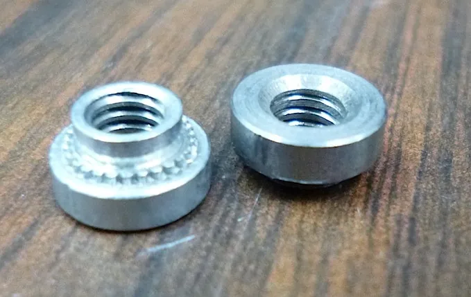

<figure class="eoc-pic eoc-pic-main"><figcaption><strong>Photo.</strong> <a href="https://commons.wikimedia.org/wiki/File:17-SwageNuts.JPG">17-SwageNuts</a> by Douglas W. Jones, <a href="http://creativecommons.org/publicdomain/zero/1.0/deed.en">CC0</a>, from Wikimedia Commons.</figcaption></figure>

A threaded nut, stud or standoff that is pressed into a plain hole in thin sheet metal so the sheet cold-flows into a groove around it, making it a permanent, non-spinning part of the panel that you can then screw into from the other side.

**In plain words:** A special hard metal nut, threaded post or spacer that you squeeze into a plain round hole in thin sheet metal; the soft sheet metal gets pushed into a groove on it, so it stays there for good and gives you a strong screw thread without welding or a loose nut. **Proper term:** Self-clinching fastener (self-clinching nut, stud or standoff).

**Also called:** self-clinching nut; swage nut (Wikipedia 'Swage nut'; Wikipedia 'Nut (hardware)'); PEM nut, PEM stud, PEM standoff, 'PEM hardware' (PEM is a brand and registered trademark of PennEngineering, often used as a generic name) (PEM handbook p.2; SendCutSend); press nut; press-in nut; press fit nut; press fit standoff; self-clinching stud (SendCutSend hardware guidelines); insert hardware; hardware inserts; self-clinching hardware (SendCutSend); flush nut, flush stud, floating nut, blind (closed-end) standoff, concealed-head stud, self-clinching pin, right-angle fastener, sheet-joining fastener, cable-tie mount (variants listed in the PEM handbook p.7); clinch nut: an older idea with a tube that passes through the part and is riveted over on the far side; the swage nut descends from it (Wikipedia 'Swage nut'). History: PennEngineering's founder K.A. Swanstrom started making self-clinching fasteners in 1942 (PEM handbook p.3); Wikipedia credits a 1958 US patent application by Albert Spokes for the swage nut; Specification: National Aerospace Standard NASM45938 (replacing MIL-N-45938) 'Nut, Plain, Clinch (self-clinching, round)' (Wikipedia 'Swage nut'; PEM CL data sheet).

## How it works

You put the fastener's shank into a hole of exactly the specified size and squeeze it in with a press between two parallel flat faces (a punch and an anvil). The hard clinching ring or knurl pushes the softer sheet metal around the hole so it 'cold flows' into the [undercut](../glossary.md#undercut) or back-taper on the shank, locking the fastener in so it can't push out, while the serrations or hex bite into the sheet so it can't spin (PEM handbook pp.4, 15; Wikipedia 'Swage nut'). The fastener itself does not change shape: there is no flaring, crimping or riveting (PEM handbook p.15), and the back of the sheet stays flush (PEM handbook p.3).

## Parts

Single piece: a hard metal part (hardened steel, stainless steel, aluminium or phosphor bronze; PEM handbook p.8) with a head or shoulder, a serrated clinching ring, knurl, ribs or hex head to stop it turning, an undercut or back-tapered shank for the sheet to flow into, and a thread (internal on nuts and standoffs, external on studs) (PEM handbook p.6). It is used with your own screw or nut.

## Everyday examples

- The threaded posts that hold a circuit board off the inside of a metal electronics enclosure (SendCutSend)
- Threaded points on electrical sub-panels and bolted-on access panels where you can't reach behind to hold a nut (SendCutSend)
- The thin sheet-metal chassis of computer, telecom and medical equipment (PEM handbook p.3)

## When to use it

Use a self-clinching fastener when you design a sheet-metal part (bought laser-cut or made at home) that needs strong threads in metal too thin to tap, typically 0.8-3 mm, and you can press it in from both sides before assembly. It is ideal when nobody will be able to reach behind the panel later, when you want no loose nuts, washers or lock washers in the final assembly, and when a component has to be removed and refitted many times (PEM handbook p.4; SendCutSend). Studs make hanging a heavy part easier during assembly, and standoffs give neat, square spacing for circuit boards (SendCutSend). They are an alternative to welded nuts that avoids heat, distortion and damaged coatings, and each one goes in with the same force every time (SendCutSend).

## When not to use it

Don't use it if you can reach only one side (use a blind rivet nut), in hard or [brittle](../glossary.md#brittle--ductile) material, PCBs, plastics or castings (use broaching or flare-mount fasteners, or [heat-set inserts](../glossary.md#heat-set-insert) in prints) (PEM handbook p.13), or in sheet thinner than the fastener's minimum (PEM handbook p.15). If the sheet is thick enough to tap (roughly one bolt diameter in steel or two in aluminium), a tapped hole may be simpler (SendCutSend). If you have no press, a rivet nut and hand setter or an ordinary bolt and nut may be easier (Hobby-Machinist forum). Don't use standoffs where impacts will push them back into the panel; use a stud and nut there (SendCutSend).

## Details

- **What it does (jobs):**
  - join and hold: gives thin sheet metal a strong, permanent, reusable screw thread (nut, stud or standoff) where the sheet is too thin to tap or the back can't be reached later (PEM handbook p.4; SendCutSend)
  - line parts up exactly: standoffs hold a circuit board or panel at a set distance, studs hang and locate a part before it is fastened, and self-clinching pins locate parts (PEM handbook p.7; SendCutSend)
- **Movement:** none: once installed it can neither turn nor slide
- **Directions it can move (degrees of freedom):** 0: the clinched metal stops it pushing out and the serrations stop it rotating (PEM handbook p.6). Floating-nut versions let the threaded part move slightly sideways to find a misaligned screw (PEM handbook p.7).
- **Special behaviour:**
  - none for a plain nut, stud or standoff: it is simply a permanent thread in the sheet
  - self-aligning or self-centring (floating nuts only): a floating threaded element 'compensates for mating hole [misalignment](../glossary.md#misalignment)' (PEM handbook p.7)
  - Its own tricks: it stays captive in the panel, so there are no loose nuts or washers in final assembly (PEM handbook p.4); locking versions with a nylon element or a modified thread resist vibration loosening (PEM handbook p.7; PEM CL data sheet p.6)
- **How it holds:**
  - shape (the parts interlock; [form-fit](../glossary.md#form-fit--force-fit--material-bond)): the sheet cold-flows into the undercut, and the serrated ring, knurl, ribs or hex head are embedded in the sheet so it can't rotate (PEM handbook pp.4, 6)
- **Input and output:** not applicable
- **Power:** passive (no power needed); a hand arbor press or a powered press is used only to install it
- **Load:** medium for thin sheet, with very different strength in different directions. It is strongest when the screw goes in from the side opposite the head, so the load pulls the fastener into the sheet; pushout (the other way) is only about 5-10% of the installation force (PEM handbook pp.5, 9; SendCutSend). Example PEM figures for S-type nuts (-1 shank length): M3 in cold-rolled steel: installation 11.2-15.6 kN, pushout 550 N, torque-out 1.7 N·m; M3 in 5052-H34 aluminium: pushout 400 N, torque-out 1.13 N·m; M5 in steel: pushout 800 N, torque-out 4.5 N·m; M6 in steel: pushout 1,760 N, torque-out 17 N·m (PEM handbook p.5 table). For most good nuts 'the screw will fail before the nut rotates in the material' (PEM handbook p.15). Standoffs are weak against impacts pushing them back into the panel (SendCutSend).
- **Play and precision:** No play once installed; the thread sits exactly where the hole was punched, drilled or laser-cut, and standoffs are 'inherently square' to the panel and all the same length (SendCutSend). Flush studs and standoffs may stand up to 0.015 in (0.38 mm) proud depending on material (SendCutSend hardware guidelines). Tight manufacturing [tolerances](../glossary.md#tolerance) matter: a 0.05 mm variation on a critical dimension 'can make a 20% difference' in performance (PEM handbook p.8).
- **Taking it apart:** permanent for the fastener: it 'become[s] a permanent part of the panel' (PEM handbook p.4). The screw or nut used with it is removable, so the joint it makes is fully removable.
- **How often it can be reused:** once for the fastener itself; the metal thread it provides can be screwed in and out many times, which is why it is chosen where a component 'must be readily replaced' (PEM handbook p.4)
- **Sealing:** none for ordinary through-threaded nuts. Blind (closed-end) types keep dirt out of the threads and stop over-long screws reaching inside (PEM handbook p.7); special 'ingress protection' studs make a watertight seal meeting IPX7 and IPX9K (PEM handbook p.7).
- **Adjustable:** no: position is fixed by the hole. Floating nuts allow a little sideways float to line up with a mating hole (PEM handbook p.7).
- **Access needed:** both sides: the press needs a punch on one side and an anvil on the other (PEM handbook pp.4, 13); only some M6 and larger nuts can be drawn in from one side with an impact wrench (PEM handbook p.15). For one-side access use a blind rivet nut instead (PEM handbook p.13).
- **Materials:** Fasteners are made of hardened carbon steel, 300- and 400-series or precipitation-hardened (A286) stainless steel, aluminium and phosphor bronze (PEM handbook pp.8, 12). The sheet must be ductile and softer than the fastener, generally by about 20 points on the Rockwell B scale (PEM handbook p.4): e.g. aluminium fasteners only into sheet below HRB 50, unhardened steel below HRB 60, 300-series stainless below HRB 70, hardened steel below HRB 80, hardened stainless up to HRB 88 (PEM handbook p.6). Suits 5052 and 6061 aluminium, cold-rolled mild steel, galvanised steel and (with special fasteners) 304/316 stainless (PEM handbook p.6; SendCutSend installs into 5052, 6061 and 7075 aluminium, mild and G90 steel, 304 and 316 stainless, but not 2024 aluminium). Not for brittle or hard materials, PCBs, plastics or castings: PEM offers broaching and flare-mount fasteners for those (PEM handbook p.13).
- **Heat, cold, water and wear:** Metal throughout, so heat, cold, UV and water are not a problem in normal use ⚑ [uncertain: no temperature limit given for plain nuts; nylon-element locking types are likely more limited]. Choose the fastener material and finish for corrosion: zinc-plated steel, passivated stainless or aluminium (PEM CL data sheet p.CL-9). Don't install steel or stainless fasteners in aluminium before anodising, don't install after painting or powder coating, and beware hard-anodising or nitriding, which harden the panel (PEM handbook pp.9, 12). SendCutSend says its zinc-chromate-treated hardware resists corrosion and lets steel fasteners be used in aluminium parts without galvanic worries, while a machinist on Hobby-Machinist warns that steel against aluminium can build white oxide that seizes the screw ⚑ [uncertain: conflicting, depends on finish and environment]. For vibration, use a locking version (nylon element or modified thread) (PEM handbook p.7; PEM CL data sheet p.CL-6).

## Making it

- **Ways to make or get it:**
  - sheet metal: the natural home; the fastener goes into punched, drilled or laser-cut holes in aluminium, steel or stainless sheet from about 0.64-1 mm thick (PEM handbook p.15; PEM CL data sheet)
  - laser cut: online sheet-metal services resize the holes and press the hardware in for you (SendCutSend hardware guidelines); note that laser cutting can locally harden a hole in stainless steel (PEM handbook p.9)
  - CNC: drilled or punched holes in machined or sheet parts
  - off-the-shelf part: always bought, never made
- **Printing it in one piece (print in place):** no: it is a hardened metal part pressed into ductile sheet metal; it can't be printed and is not designed to be pressed into printed plastic.
- **Tools:** A drill, punch or laser cutter for the hole, held to the catalogue size (+0.08 mm / -0) and not deburred or chamfered (PEM handbook p.9); a parallel-acting press with a flat punch and a matching anvil: 'any parallel acting press' works (PEM handbook pp.3, 9), e.g. a hobby arbor press (Hobby-Machinist forum). Never a hammer: a blow does not let the metal flow into the undercut (PEM handbook p.9). Wikipedia notes they can also be pulled in by tightening a screw through the hole, and PEM says some 1/4 in / M6 and larger nuts can be drawn in from one side with an impact-torque wrench (Wikipedia 'Swage nut'; PEM handbook p.15). Then a screwdriver or spanner for the mating screw or nut.
- **Difficulty:** moderate: the fasteners are cheap and install with a hand arbor press, but the hole must be the exact catalogue size, the sheet thick and soft enough, and both sides reachable (PEM handbook pp.4, 9; Hobby-Machinist forum). The easiest route for a hobbyist is to order laser-cut sheet parts with the hardware already pressed in (SendCutSend adds it for 1-2 days' extra lead time).

### 3D printing tips

not applicable: self-clinching needs a ductile metal sheet that cold-flows around the fastener (PEM handbook p.4). For plastics, PCBs and castings PEM itself points to other fasteners (broaching and flare-mount types) (PEM handbook p.13). In 3D prints use a heat-set insert, press-fit or expanding insert, or a [captive nut](../glossary.md#captive-nut) pocket instead (see those entries). If a printed part must attach to sheet metal, put self-clinching studs or nuts in the metal part and screw the print on with washers.

### Buying one (off-the-shelf parts)

Search supplier catalogues for 'self-clinching nut' (types S, SS, CLS, CLSS for steel/aluminium, CLA aluminium, SP for stainless sheet, SMPS/SMPP for thin sheet and close to edges, locking PL/RT/SL types), 'self-clinching stud' (FH flush-head, concealed-head), 'self-clinching standoff' (thru-threaded SO or blind BSO), 'flush nut', 'floating nut', 'self-clinching pin' (PEM CL data sheet; PEM handbook pp.7, 14; letter codes are PEM part names, brand). Also sold as 'press nut', 'press-fit nut', 'press-in standoff' or 'PEM nut' (SendCutSend). Tools: 'arbor press', 'hydraulic insertion press', flat punch and matching anvil for each size (PEM handbook p.9). CAD models are in the SolidWorks Toolbox and the PEM catalogue (SendCutSend).

## Rules of thumb

- Hole size is critical: punch or drill to the catalogue size, +0.08 mm / -0 (+0.003 in), e.g. 4.22 mm for an M3 S/CLS nut and 6.35 mm for an M5 (PEM CL data sheet p.CL-5; PEM handbook p.9). Do not [chamfer](../glossary.md#chamfer--fillet) (max 0.127 mm break) or deburr: that removes the metal needed for the clinch (PEM handbook p.9).
- Minimum sheet thickness depends on the part and shank length: 'generally .030 in / 0.76 mm or .040 in / 1 mm', some types down to 0.2 mm (PEM handbook pp.3, 15); e.g. 0.8 mm for an M3 S nut with shank code 0 and 0.64 mm for the thin-sheet SMPS nut (PEM CL data sheet pp.CL-5, CL-9). Use the longest shank that suits your sheet (PEM CL data sheet).
- Edge distance: respect the minimum hole-centre-to-edge distance, e.g. 4.8 mm for M3, 7.1 mm for M5 and 8.6 mm for M6 S nuts (PEM CL data sheet p.CL-5); too close and the edge bulges or blows out. The value applies to one edge only; near two edges the panel distorts unless supported (PEM handbook p.12).
- Spacing between two fasteners: at least the centre-to-edge distance plus half the diameter of the second hole (PEM handbook p.12). Worked example: a 1/4-20 nut in 0.063 in 5052 aluminium needs 0.340 in to an edge, 0.512 in between centres and 0.425 in to a bend line (SendCutSend).
- Hardness: the sheet must be about 20 Rockwell B points softer than the fastener; use A286 or 400-series stainless fasteners in stainless sheet, never 300-series into stainless (PEM handbook pp.4, 9, 12).
- Pushout resistance is only about 5-10% of the installation force, so always screw in from the side opposite the head so the load pulls the fastener into the sheet (PEM handbook pp.5, 9; SendCutSend).
- Install into the punch side of a punched hole; for sheet 2.29 mm (0.09 in) or thicker this matters because the die side of a punched hole is larger (PEM handbook pp.9-10).
- Order of work: bend first, then install (or punch the hole after bending); install after plating or anodising, but before paint or powder coat (PEM handbook pp.9-10, 12).
- Stop squeezing when the head or shoulder sits flat on the sheet and the clinching ring is fully embedded all round; over-squeezing crushes the head, distorts the thread and buckles the sheet (PEM handbook p.9).

## Common failures

1) Falls out or has poor holding power: not enough force, sheet too hard for the fastener, countersunk, deburred or oversized hole, or a hole locally hardened by punching stainless or laser cutting; seat it fully, use the right fastener material and hole size (PEM handbook p.10). 2) Not square: punch and anvil not parallel or panel tilted during pressing (PEM handbook p.10). 3) Loose near a bend: the sheet was bent after installing, or the hole was punched before bending and went oval (PEM handbook p.10). 4) Tight threads and buckled sheet: over-squeezed (PEM handbook p.11). 5) Cracked or tight threads: shank too long for the sheet (PEM handbook p.11). 6) Edge of panel bulges: too close to the edge or over-squeezed (PEM handbook p.11). 7) Head of a flush stud or standoff 'cups': punch too small, soft or not flat (PEM handbook p.11). 8) Pushed out in service: the screw was put in from the head side so the load pushes the fastener out of the sheet (PEM handbook p.9; SendCutSend). 9) Tried with a hammer: the metal doesn't flow and the fastener doesn't lock (PEM handbook p.9).

## Safety

Installation needs several tonnes of force (e.g. 11-16 kN for an M3 nut in steel, PEM handbook p.5), so keep fingers away from the press punch and anvil ⚑ [uncertain: general press safety advice]. PEM notes the installation 'generates no excess noise or pollution' and needs no special ventilation or safety procedures (PEM handbook p.9). Sheet-metal edges and fresh holes are sharp ⚑ [uncertain: general advice].

## Related

- Blind threaded fixings (rivet nut, well nut): also add a thread to thin sheet, but install from one side with a hand setter; bulge behind the sheet instead of sitting flush
- Clinching (press joining without rivets): uses the same cold flow of sheet metal, but to join two sheets directly with no fastener
- Heat-set threaded insert: the equivalent for 3D-printed plastic, melted in with a soldering iron
- Press-fit and expanding inserts (tap-in insert): knurled inserts pressed into plastic or wood; they grip by friction rather than by metal flowing into an undercut
- Spring-steel push-on fasteners (push nut, speed nut, U-nut): clip onto sheet metal with no press, but hold far less
- Captive nut pocket (nut trap): the 3D-printing way to hold a nut captive
- Ordinary screw joint (bolt and nut): what the self-clinching nut or stud is used to make; a loose nut is simpler if both sides stay reachable

## Make it yourself

- [How to Prep Your File for Hardware Insertion (SendCutSend)](https://sendcutsend.com/guidelines/hardware/): Online laser-cutting service guidelines for ordering sheet-metal parts with PEM nuts, studs and standoffs pressed in; explains hole sizing, edge, bend and spacing limits and load direction, so a hobbyist can try the fasteners without owning a press *(licence: not applicable (commercial service page))*
- [PEM nuts, or something like that for sheet metal (The Hobby-Machinist forum, 2022)](https://www.hobby-machinist.com/threads/pem-nuts-or-something-like-that-for-sheet-metal.102334/): A hobbyist planning to set a self-clinching nut in a 1.2 mm aluminium project box with an arbor press, with replies comparing rivet nuts and hank bushes *(licence: link only (forum post))*

## Pictures, videos and models

- [17-SwageNuts.JPG (Douglas W. Jones, Wikimedia Commons, 2014)](https://commons.wikimedia.org/wiki/File:17-SwageNuts.JPG): Photo of two self-clinching (swage) nuts for 8-32 screws; the narrow undercut just above the serrated clinching ring is visible *(licence: CC0)*
- [The Self Clinching Fastener Handbook (PennEngineering)](https://www.pemnet.com/wp-content/uploads/sites/2/2022/06/self-clinching-fastener-handbook.pdf): Cut-away drawings of a clinched nut, stud and standoff (p.6), the 3-step installation (p.9) and diagrams of edge-distance and spacing problems (p.12) *(licence: link only (manufacturer document))*
- [How to Properly Install Self-Clinching Fasteners (PennEngineering, YouTube; title confirmed via oEmbed, not watched)](https://www.youtube.com/watch?v=flqGnjwf7BI): Manufacturer video on installing into the punch side of the panel *(licence: link only (YouTube))*
- [Basics of How a Clinch Fastener Works (Hess Industries Ltd., YouTube; title confirmed via oEmbed, not watched)](https://www.youtube.com/watch?v=JCB8fTl-A7U): Animated demonstration of the sheet metal flowing into the fastener's undercut *(licence: link only (YouTube))*
- [Proto Tech Tip - Self-Clinching Fasteners (Protocase Inc, YouTube; title confirmed via oEmbed, not watched)](https://www.youtube.com/watch?v=UfnTRo0zyO0): Sheet-metal enclosure maker's short explainer on self-clinching nuts, studs and standoffs *(licence: link only (YouTube))*

## Needs confirming

⚑ marks something nobody has confirmed yet: a fact the research could not confirm from a source, a finder value that is a best guess, or an open point from the research notes. Corrections are welcome (see `research/needs-confirming.md`).

- ⚑ 4 sentences on this page marked [uncertain].

## Sources

- <https://www.pemnet.com/wp-content/uploads/sites/2/2022/06/self-clinching-fastener-handbook.pdf>
- <https://www.pemnet.com/wp-content/uploads/sites/2/2022/06/cldata.pdf>
- <https://www.pemnet.com/products/engineering-guides/self-clinching-fastener-installation-dos-and-donts/>
- <https://en.wikipedia.org/wiki/Swage_nut>
- <https://en.wikipedia.org/wiki/Nut_(hardware)>
- <https://sendcutsend.com/blog/pem-hardware-inserts-in-sheet-metal/>
- <https://sendcutsend.com/blog/hardware-insertion-best-practices/>
- <https://sendcutsend.com/guidelines/hardware/>
- <https://www.hobby-machinist.com/threads/pem-nuts-or-something-like-that-for-sheet-metal.102334/>
- <https://commons.wikimedia.org/wiki/File:17-SwageNuts.JPG>
- <https://www.youtube.com/watch?v=flqGnjwf7BI>
- <https://www.youtube.com/watch?v=JCB8fTl-A7U>
- <https://www.youtube.com/watch?v=UfnTRo0zyO0>
