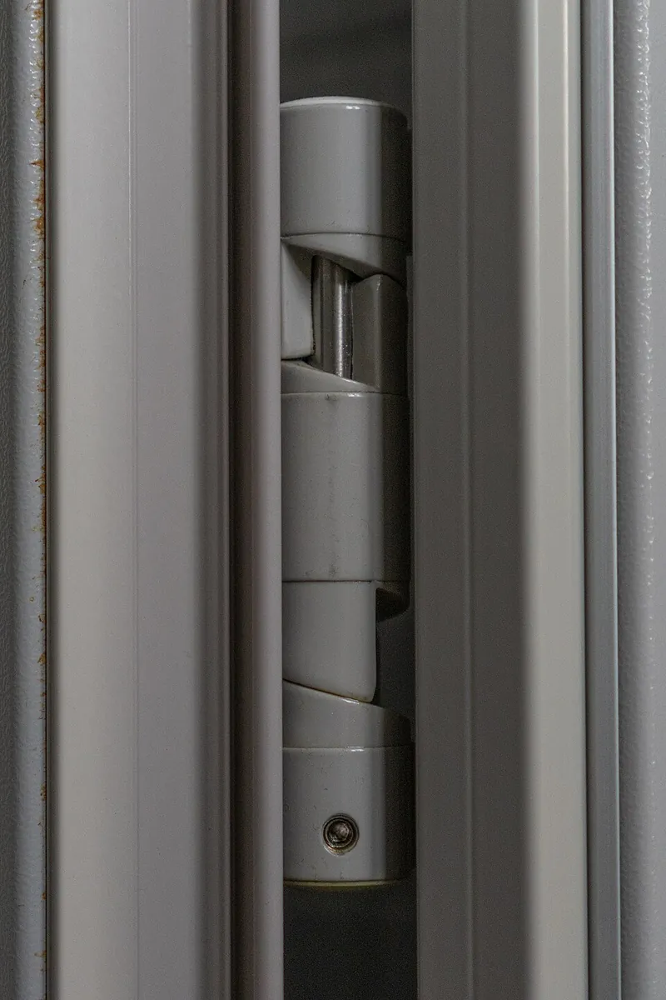

*Picture: [Bommerscharnier.JPG](https://commons.wikimedia.org/wiki/File:Bommerscharnier.JPG) by Sindala, Public domain, from Wikimedia Commons.*

A hinge that stores some of the effort you use to open a door, in a coiled spring or by lifting the door up a sloping knuckle, and gives it back to swing the door shut when you let go.

**In plain words:** A hinge that swings a door, gate or lid shut by itself after you let go, either with a spring hidden in the hinge or with a sloping hinge knuckle that lifts the door as it opens so the door's own weight brings it back down. **Proper term:** Self-closing hinge: spring hinge (spring-loaded hinge) and rising butt hinge (cam-lift hinge).

**Also called:** self-closing hinge; spring hinge / spring-loaded hinge / spring-loaded door hinge; single-action spring hinge (the door swings one way only); double-action spring hinge / double-acting hinge / saloon hinge / cafe door hinge (swings both ways and springs back to the middle; IQS Directory); Bommer hinge (brand; Dutch 'Bommerveerscharnier', a double-acting spring hinge with two axes; Dutch Wikipedia 'Scharnier'); closer hinge / door closer hinge / hydraulic self-closing hinge (a spring hinge with a built-in speed brake or oil damper, e.g. Waterson (brand)); rising butt hinge / rising butt / rising hinge / rise-and-fall hinge (UK names); cam-lift hinge (US name); spring-less self-closing hinge / gravity-closing hinge (descriptive wording, e.g. the Wikimedia Commons photo title); hinge cam riser / door-closing cam (on refrigerator doors); self-closing gate hinge / pool gate hinge.

## How it works

Spring hinge: opening the door winds up a coiled spring in the hinge barrel, and the spring pushes back with a turning force that grows the further it is twisted (a [torsion](../glossary.md#torsion) spring's [torque](../glossary.md#torque) is proportional to its twist; Wikipedia 'Torsion spring'), so when you let go it swings the door shut. The spring is wound a few extra notches while the door is shut ([preload](../glossary.md#preload)) so there is still enough push at the end to close and latch it (Doorware; Family Handyman). Rising butt: the two halves of the knuckle meet on a spiral ramp, so as the door swings open it climbs the ramp and rises a few millimetres; when you let go, the door's own weight slides it back down the ramp, which turns it shut (Cooke Brothers; DoorwaysPlus). Closer hinges add a friction brake or oil damper so the door closes at a controlled speed instead of slamming (Waterson; Wikipedia 'Hinge').

## Parts

A small assembly that acts as one unit. Spring hinge: two leaves whose knuckles form a barrel, a hinge pin, a coiled spring inside the barrel with one end held by one leaf and the other by an adjusting collar at the top, and a small tension pin that locks the collar in one of several holes (Doorware adjustment guide; Wikipedia 'Door closer'). Closer hinges add a speed brake or oil (hydraulic) damper at one end of the barrel and sometimes a hold-open catch (Waterson). Rising butt: just two leaves whose knuckles meet on a sloping spiral face, and a pin (Cooke Brothers; DoorwaysPlus). Maker versions: printed knuckles, a steel pin or bolt and a bought metal torsion spring, or a printed springy arm.

## Everyday examples

- Screen and storm doors that swing shut by themselves (DoorwaysPlus; Wikipedia 'Door closer')
- Swinging cafe, saloon and restaurant-kitchen doors that swing both ways and return to the middle (IQS Directory)
- Pool-fence gates, which must close and latch by themselves (Wikipedia 'Pool fence')
- A fridge door that pulls itself shut once nearly closed, thanks to a cam on the bottom hinge (Printables 'Fridge door hinge cam riser')
- Toilet-cubicle doors and cottage doors on rising butts that lift clear of the carpet (Cooke Brothers)

## When to use it

Use a self-closing hinge when a door, gate or lid should always end up shut without anyone remembering to close it: gates that keep pets or children in, screen doors, cupboard and cabinet doors, access flaps and printer-enclosure doors, and box lids that should snap shut. A spring hinge is the compact choice when there is no room for a separate door closer, and its force can be adjusted; pick a double-action hinge for a door that swings both ways, and a closer hinge (with a speed brake) where slamming matters. Use rising butts on light internal doors that must clear a carpet or uneven floor and should drift shut gently, without visible springs (Cooke Brothers).

## When not to use it

Avoid it where the door or lid should stay open (use a friction hinge, [detent](../glossary.md#detent) hinge or lid stay instead); for heavy or fire-rated doors, which need a rated door closer or listed hardware (rising butts are not accepted on fire doors; DoorwaysPlus, Express Doors Direct, Direct Doors); on busy doors that cycle hundreds of times a day, where cam-lift surfaces wear quickly (DoorwaysPlus); where the closing must be slow and controlled (add a damper, or use a door closer or soft-close hinge); and where small children could trap fingers in a door that closes by itself. For a printed project, don't rely on a plastic spring that is held wound up all the time; use a metal spring (DuPont).

## Details

- **What it does (jobs):**
  - let it move (turn, slide or bend): it is a hinge the door or lid swings on
  - store energy: the spring (or the door lifted up the ramp) stores the opening effort and uses it to close the door
  - slow it, stop it or keep its speed steady: closer hinges have a friction brake or oil damper that sets the closing and latching speed (Waterson)
- **Movement:** rotate: single-action spring hinges swing one way (about 90 to 180 degrees depending on the door), double-action hinges up to 90 degrees each way, 180 degrees in all (IQS Directory). Rising butts: rotate+slide, because the door rises a few millimetres as it swings (Cooke Brothers)
- **Directions it can move (degrees of freedom):** 1: the door can only swing about the pin. In a rising butt the lift is tied to the swing, like a screw thread, so it is still one movement, not two
- **Special behaviour:**
  - self-aligning or self-centring: the hinge always returns the door to one rest position; double-action spring hinges bring the door back to the middle from either side (IQS Directory; Dutch Wikipedia 'Scharnier')
  - motion conversion (e.g. rotary to linear): a rising butt turns part of the swing into a small upward lift, which clears carpets and stores the energy that closes the door (Cooke Brothers)
  - [fail-safe](../glossary.md#fail-safe--fail-secure) or breakaway: only in the sense that the door returns to shut when released, which is why self-closing gates are required round pools (Wikipedia 'Pool fence'); note that a rising butt is not accepted as a fire-door closer (Express Doors Direct; Direct Doors; DoorwaysPlus)
  - indexing (clicks into set positions): only hold-open versions, e.g. Waterson's SB type holds the door open at 85 degrees (Waterson), and fridge-door hinge cams that hold the door partly open and pull it shut once nearly closed (Printables 'Fridge door hinge cam riser')
- **How it holds:**
  - spring force (a spring or springy part presses it in place): the spring keeps pushing the door shut and holds it against its stop
  - shape ([form-fit](../glossary.md#form-fit--force-fit--material-bond)): like any knuckle hinge, the pin through the interlocking knuckles holds the two leaves together
  - not a holding joint (it moves or passes on motion): a rising butt keeps the door shut only by the door's own weight (gravity), which is not a positive hold
- **Input and output:** not applicable (it does not pass motion on to anything else); inside a rising butt the swing is turned into a lift of a few millimetres (Cooke Brothers)
- **Power:** passive (no power needed): the person opening the door supplies the energy
- **Load:** light to heavy depending on size: from small spring hinges for cabinet doors and box lids to commercial door hinges; the most durable self-closing hinges handle doors up to 440 lb (about 200 kg) (Wikipedia 'Door closer'), and Waterson's closer hinges start at 4 x 4 in. Rising butts suit lighter internal doors (Cooke Brothers); US guidance for cam-lift hinges is at least 4 x 4 in for doors up to 200 lb and 4 1/2 x 4 1/2 in for 201 to 400 lb, with a door closer for anything heavier (DoorwaysPlus). Like any hinge it is strong against the door's weight hanging on the pin ([shear](../glossary.md#peel-vs-shear)); its closing force is small and can be overcome by wind or a hand
- **Play and precision:** small, like any butt hinge; the door's closed position is set by the door stop and latch, not by the hinge. All hinges on a door must turn about one line: rising butts must be fitted exactly in line (co-axially) with all hinges sharing the load, or they bind (Era product page), and mixing rising and standard hinges on one door causes binding, uneven wear and poor latching (DoorwaysPlus)
- **Taking it apart:** removable: screwed on like an ordinary hinge, usually set into shallow recesses (mortises) in the door edge and frame
- **How often it can be reused:** many times: can be unscrewed and refitted; springs do wear out, but that can take many years (Family Handyman)
- **Sealing:** none
- **Adjustable:** Spring hinges: yes; the spring tension is changed by turning the adjusting collar at the top of the barrel with a lever tool or hex key and locking it with the pin in the next hole (Doorware; Family Handyman); closer hinges also have separate adjusters for swing speed (from 90 to 20 degrees) and latch speed (from 20 to 0 degrees) (Waterson). Rising butts: no; the closing force comes from the door's weight and the slope of the ramp
- **Access needed:** one side only (blind): the leaves screw into the door edge and the frame, reached with the door open; spring tension is adjusted from the top of the barrel, so spring hinges must be fitted with the adjuster at the top (Doorware)
- **Materials:** Steel, stainless steel, brass and bronze leaves (IQS Directory), with a coiled steel spring inside spring hinges. Stainless steel is preferred for rising (cam-lift) hinges in damp places, because plated steel can pit or flake in the cam area and start to bind (DoorwaysPlus). Maker versions: PETG, ASA or nylon printed knuckles with a steel pin and a metal torsion spring; plastic springs only for light or occasional loads (DuPont design guide, p. 36)
- **Heat, cold, water and wear:** Outdoors or in damp places use stainless steel or other corrosion-resistant hinges; plated steel can pit in a rising hinge's cam area and start to bind (DoorwaysPlus). Hinges squeak and wear without occasional [lubrication](../glossary.md#lubrication) (IQS Directory). A rising butt's closing force is small and inconsistent, so draughts, wind or pressure differences can stop it closing fully (Direct Doors). Printed parts: PLA gives way at about 60 C and PETG at about 80 C (CNC Kitchen); plastic springs held under load [creep](../glossary.md#creep) and lose force over time, faster when warm (DuPont design guide, p. 36; thrinter creep test). Metal springs slowly tire (spring hinges wear out, but that can take many years; Family Handyman).

## Making it

- **Ways to make or get it:**
  - off-the-shelf part: single- and double-action spring hinges, closer hinges, rising butt or cam-lift hinges, self-closing gate hinges, self-closing cabinet hinges
  - woodwork: fitting hinges to doors, gates and box lids (cutting the recesses; easing the top of the door for rising butts)
  - 3D print (FDM): printed knuckles with a metal torsion spring or a printed springy arm ([flexure](../glossary.md#flexure)); printed replacement cams (Printables)
  - 3D print (resin): small box-lid hinges around a metal spring ⚑ [uncertain]
- **Printing it in one piece (print in place):** partly: a [print-in-place](../glossary.md#print-in-place) hinge can have printed springy arms that return it to the centre (Jack's 'Spring hinge' on Printables, public domain), but a hinge that is held wound up all the time needs a metal spring, which means printing the knuckles as separate parts and assembling them round the spring (DuPont design guide, p. 36)
- **Tools:** screwdriver, and a chisel to cut the hinge recesses; for spring hinges a tension lever tool or hex (Allen) key to wind the spring and pliers for the tension pin, where a 2 to 3 in (50 to 75 mm) finishing nail can stand in for the lever tool (Doorware; Family Handyman); for rising butts a plane to bevel (ease) the top edge of the door on the hinge side (Era product page; DIY Doctor forum)
- **Difficulty:** easy to buy and fit (like any hinge, plus setting the spring tension); moderate to make: printing knuckles around a bought torsion spring works well, but a printed plastic spring that is always held wound up slowly loses force (DuPont design guide, p. 36; thrinter creep test); hard to print a rising (cam) hinge that stays smooth and doesn't wear ⚑ [uncertain]

### 3D printing tips

1) Use a metal spring for the closing force. DuPont's design guide says springs under constant load or [deflection](../glossary.md#deflection) should be made of spring steel, because plastics creep and relax (p. 36), and a self-closing hinge's spring stays partly wound even when the lid is shut. PLA creeps most and PETG less (thrinter creep test); the designer of a printed-spring lens cap recommends ASA for the spring for the same reason (Printables 'Camera lens lid with 3D printed springs'). 2) Buy a small torsion spring or wind your own from spring-steel wire on a printed jig (Printables 'Metal Torsion Spring Maker', which uses 2.5 mm stainless rod; wear eye and cut-resistant hand protection). Give each spring leg a slot or hole in its own leaf, and add a stop so the spring is already slightly wound when the lid is shut (preload), so it still pushes at the closed position. 3) Use a steel pin (a bolt, nail or length of rod) through printed knuckles, with at least 0.3 mm [clearance](../glossary.md#clearance) for moving parts (Prusa knowledge base). 4) Orient the knuckles so the spring's twisting load doesn't try to split the layers apart: printed layers bond at only about half of the flat-printed strength (PLA 55% and PETG 46% in CNC Kitchen's hook test). 5) Heat: PLA starts to give way at about 60 C and PETG at about 80 C (CNC Kitchen), and springs creep faster when warm, so avoid PLA near a printer enclosure or in a car. 6) A spring-less (gravity) version needs a helical ramp between the knuckles with smooth, hard, low-friction faces; one maker's printed fridge-door cam failed straight away, and the real cam profile turned out not to be a simple sine curve (Printables 'Fridge door hinge cam riser'). Printing with the hinge axis lying flat puts the ramp faces on the side walls, which print smoother than stepped top surfaces ⚑ [uncertain], and a little grease helps ⚑ [uncertain]. 7) A flexible TPU part can be the spring on a dual-material printer (Printables 'Spring clamp (Print in-place with built in hinge and spring)'), but expect it to be weak.

### Buying one (off-the-shelf parts)

Search for: 'spring hinge', 'single action spring hinge', 'double action spring hinge' or 'cafe door hinge', 'self-closing hinge', 'closer hinge' or 'hydraulic self-closing hinge', 'rising butt hinge' (UK; ordered left- or right-handed, clockwise or anticlockwise closing), 'cam lift hinge' (US), 'self-closing gate hinge' or 'pool gate hinge', 'self-closing cabinet hinge' (a concealed cup hinge with a spring), 'spring-loaded box hinge' ⚑ [uncertain]. Parts for DIY versions: 'torsion spring' (chosen by leg angle, wire size and wind direction), 'music wire' or 'spring steel wire', 'shoulder bolt' or 'clevis pin' for the pivot. Brands a beginner may meet: Waterson, Bommer (brands)

## Rules of thumb

- Spring hinge tension: install with the adjuster at the top, set tension with the door shut, and don't wind more than 3 holes of tension for a door that swings 180 degrees or 4 holes for a 90-degree swing (Doorware single-action spring hinge guide).
- Adjust in small steps and test after each: too loose and the door won't close or latch, too tight and it slams (Family Handyman; Doorware).
- Closer hinge placement (Waterson): the top and bottom hinges 5 in +/- 1/8 in (127 +/- 3 mm) from the door edges; a third hinge goes next to the top one, with pivot centres at least 10.95 in (278 mm) apart; a purely mechanical system uses three hinges.
- Rising butts: all hinges on the door must be rising type, because mixing them with standard hinges causes binding (DoorwaysPlus); they are handed (left or right, clockwise or anticlockwise) (Cooke Brothers; Express Doors Direct).
- Rising butts: place about 150 mm from the top and bottom of the door (Express Doors Direct); three per door is recommended to reduce [warping](../glossary.md#warping--shrinkage) (Era product page).
- Rising butts: the top of the door must be bevelled (eased) on the hinge side so it clears the frame head as it rises (Era product page; Direct Doors); forum advice is a bevel from nothing to about 3 mm or more across the top on the rebate side (DIY Doctor forum, unverified by a manufacturer).
- Cam-lift hinge sizing (DoorwaysPlus): at least 4 x 4 in for doors up to 200 lb, 4 1/2 x 4 1/2 in for 201 to 400 lb, and a door closer for heavier doors; hinge count 2 for doors up to 60 in tall, 3 for 61 to 90 in, 4 for 91 to 120 in.
- Rising butts are not a fire-door closer: UK building regulations don't allow them on fire doors or escape routes (Express Doors Direct), and in the US they are not listed closers under NFPA 80 (DoorwaysPlus).
- Hydraulic closer hinges can be damaged if the door is pushed beyond 120 degrees (Waterson).
- Springs under constant load or deflection should be spring steel; plastics creep and relax (DuPont design guide, p. 36).
- Printed moving parts: start with at least 0.3 mm clearance (Prusa knowledge base).

## Common failures

Spring too loose, so the door stops short of the latch, or too tight, so it slams (Family Handyman); fix by adjusting one notch at a time. Uneven tension between hinges, or a missing tension pin. The door still won't close after adjusting because it is badly hung in the frame (Family Handyman). Rising butts: the door jams against the frame head because the top wasn't bevelled (Era product page; Direct Doors); binding because rising and plain hinges were mixed (DoorwaysPlus); cam faces worn by heavy traffic, or dented by hitting the knuckles with a hammer, which destroys the closing action (DoorwaysPlus). Squeaking and [stiffness](../glossary.md#stiffness) from lack of lubrication (IQS Directory). Printed versions: plastic springs creep and lose their push, and knuckles split along [layer lines](../glossary.md#layer-lines); use a metal spring and a steel pin.

## Safety

A door that closes by itself is a pinch and slam hazard at both the hinge side and the closing edge, especially for small children's fingers; set the tension no higher than needed, or add a damper. When winding a spring hinge, the spring pushes hard on the lever tool or hex key; keep a firm grip and fit the tension pin before letting go (Doorware steps). Don't treat a self-closing hinge as fire-safety hardware unless it is listed or rated for that use (DoorwaysPlus; Direct Doors). A spring-closed lid on a printed box can snap onto fingers.

## Related

- Knuckle hinge (butt hinge): the plain version, which swings freely with no closing force
- Friction hinge: holds a lid at any angle instead of closing it
- Detent hinge (click hinge): clicks into set angles and holds there
- Lid and flap stays: hold a lid or flap open rather than closing it
- Dampers (rotary and linear soft-close dampers): slow a closing door; closer hinges build one in
- Door closer (overhead arm, floor spring): a separate spring-and-oil unit that does the same job for heavier doors (Wikipedia 'Door closer')
- Gas spring: pushes a lid open or holds it up, the opposite job
- Clip-on concealed hinge (cup hinge): cabinet hinges often have a spring that pulls the door shut or holds it fully open (Wikipedia 'Hinge' gallery)
- [Living hinge](../glossary.md#living-hinge): a bent plastic hinge also springs back a little, but can lose force over time (Protolabs)
- Torsion spring and other springs (springs & energy storage family): the spring parts themselves
- Spring-open hinge: the reverse, pushes a lid open (Cooke Brothers lists 'sprung open' hinges)

## Make it yourself

- [Spring hinge (Jack, Printables) (URL from Printables API, page not opened)](https://www.printables.com/model/759250-spring-hinge): A print-in-place hinge with printed springs that returns to the centre position (or can be made bistable); low clearance, so scale up if needed; spray with silicone oil or PTFE. Read through the Printables public API. *(licence: Creative Commons Public Domain (as listed on Printables))*
- [Camera lens lid with 3D printed springs (Enijat, Printables) (URL from Printables API, page not opened)](https://www.printables.com/model/873841-camera-lens-lid-with-3d-printed-springs): A spring-closed lens cap for a 54 mm lens with a printed spring; the designer recommends printing the spring in ASA because it creeps less under constant load. Read through the Printables public API. *(licence: CC BY-NC-SA)*
- [Fridge door hinge cam riser (Ryan Steele, Printables) (URL from Printables API, page not opened)](https://www.printables.com/model/540830-fridge-door-hinge-cam-riser): Customisable OpenSCAD model of the pair of cams on a fridge's lower hinge pin that hold the door open at one point and pull it shut once nearly closed; the designer notes his printed version failed quickly, a useful lesson in cam wear. Read through the Printables public API. *(licence: CC BY)*
- [Metal Torsion Spring Maker (adjective, Printables) (URL from Printables API, page not opened)](https://www.printables.com/model/1004393-metal-torsion-spring-maker): A printed handle-and-jig for bending your own torsion springs from spring-steel or stainless rod, for putting a real metal spring into a printed hinge; warns to wear eye and hand protection. Read through the Printables public API. *(licence: CC BY)*
- [Self Closing Hinge by augustohs (Thingiverse) (page is JavaScript-only; details from a search-engine summary)](https://www.thingiverse.com/thing:2073943): A printable self-closing hinge for bathroom or closet doors ⚑ [uncertain] *(licence: ⚑ [uncertain])*
- [Self Closing Hinge with Lock Position by augustohs (Thingiverse) (page is JavaScript-only; details from a search-engine summary)](https://www.thingiverse.com/thing:2663487): A printable self-closing hinge with 90 degrees of opening and a hold-open position, using a small spring, a 4 mm steel ball and an M5 screw ⚑ [uncertain] *(licence: ⚑ [uncertain])*

## Pictures, videos and models

- [Door hinge with spring less self closing mechanism (Tobias ToMar Maier, Wikimedia Commons)](https://commons.wikimedia.org/wiki/File:Door_hinge_with_spring_less_self_closing_mechanism.jpg): Photo of a rising (spiral-knuckle) hinge on a door in Augsburg; description: the door closes on its own because the hinge has a spiral shape that turns under gravity *(licence: CC0 1.0 (public domain dedication))*
- [Self closer hinge on arch-top (SevenH, Wikimedia Commons)](https://commons.wikimedia.org/wiki/File:Self_closer_hinge_on_arch-top.jpg): Photo of a self-closing (closer) hinge fitted on an arch-top door, used in Wikipedia's 'Door closer' article *(licence: CC BY-SA 4.0)*
- [Bommerscharnier (Sindala, Wikimedia Commons)](https://commons.wikimedia.org/wiki/File:Bommerscharnier.JPG): Close-up photo of a double-acting spring hinge (Bommer type), used in Dutch Wikipedia's hinge article *(licence: Public domain)*
- [Rising Butt Door Hinge Dimensions & Drawings (Dimensions.com)](https://www.dimensions.com/element/rising-butt-door-hinge): Dimensioned drawings of a rising butt hinge open and closed, with typical sizes *(licence: link only)*
- [Self-Closing Door Hinge: How To Adjust (YouTube, 508Homes)](https://www.youtube.com/watch?v=MB7sd8PkYwc): Video on adjusting the spring tension of a self-closing door hinge (title and channel confirmed via YouTube oEmbed; content not viewed) ⚑ [uncertain] *(licence: link only (standard YouTube licence))*

## Needs confirming

⚑ marks something nobody has confirmed yet: a fact the research could not confirm from a source, a finder value that is a best guess, or an open point from the research notes. Corrections are welcome (see `research/needs-confirming.md`).

- ⚑ 10 sentences on this page marked [uncertain].
- ⚑ Finder value `connects` = lid, door or cover (best guess): worked out from its name, but joining parts is not one of its two main jobs

## Sources

- <https://en.wikipedia.org/wiki/Hinge>
- <https://en.wikipedia.org/wiki/Door_closer>
- <https://en.wikipedia.org/wiki/Torsion_spring>
- <https://en.wikipedia.org/wiki/Pool_fence>
- <https://nl.wikipedia.org/wiki/Scharnier>
- <https://www.cookebrothers.co.uk/latest-news/2025/09/30/benefits-of-rising-butt-hinges/>
- <https://www.doorwaysplus.com/blog/our-blog-1/cam-lift-hinges-and-the-self-closing-door-problem-when-the-hinge-does-the-work-instead-of-the-closer-463>
- <https://www.familyhandyman.com/article/how-to-adjust-a-self-closing-spring-hinge-yourself/>
- <https://www.doorware.com/specials/help-center/adjusting-spring-hinges.cfm>
- <https://www.iqsdirectory.com/articles/hinges/spring-hinges.html>
- <https://watersonusa.com/self-closing-hinge/door-closer-mechanism>
- <https://www.directdoors.com/blogs/news/are-there-any-issues-using-rising-butt-hinges>
- <https://www.expressdoorsdirect.co.uk/internal-doors/rising-door-hinges-what-why-and-how>
- <https://forums.diydoctor.org.uk/fitting-rising-butt-hinges-t14286.html>
- <https://www.eraeverywhere.com/default/door-components/entrance-doors/door-hinges/traditional-butt-hinges/rising/rising-door-butt-hinge-right-hand/>
- <https://www.dimensions.com/element/rising-butt-door-hinge>
- <https://commons.wikimedia.org/wiki/Category:Door_hinges>
- <https://commons.wikimedia.org/wiki/File:Door_hinge_with_spring_less_self_closing_mechanism.jpg>
- <https://commons.wikimedia.org/wiki/File:Self_closer_hinge_on_arch-top.jpg>
- <https://commons.wikimedia.org/wiki/File:Bommerscharnier.JPG>
- <https://www.youtube.com/watch?v=MB7sd8PkYwc>
- <https://www.distrupol.com/General_Design_Principles_for_Engineering_Polymers.pdf>
- <http://thrinter.com/creep-abs-pla-petg-alloy-910/>
- <https://www.cnckitchen.com/blog/comparing-pla-petg-amp-asa-feat-prusament>
- <https://help.prusa3d.com/article/modeling-with-3d-printing-in-mind_164135>
- <https://www.protolabs.com/resources/design-tips/how-to-design-3d-printed-hinges/>
- <https://api.printables.com/graphql/>
