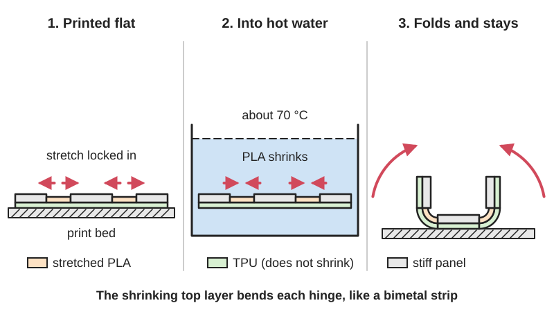

<figure class="eoc-pic eoc-pic-main"><picture><source media="(prefers-reduced-motion: reduce)" srcset="../media/drawn/self-folding-print.svg"></picture><figcaption><strong>Animation.</strong> Diagram drawn for the encyclopaedia from the research notes. ⚑ Needs confirming: a drawing can simplify or get details wrong; a real photo or a better diagram is welcome.</figcaption></figure>

A print made flat on the bed that bends its own hinges into a planned 3D shape when triggered by heat or water, then stays in that shape.

**In plain words:** A flat 3D print that folds itself up into a 3D shape when you drop it in hot water (or wet it), because stretch was 'frozen' into its layers while printing, or because a dissolvable catch was holding a springy hinge open. **Proper term:** Self-folding print (4D printing).

**Also called:** 4D printing or 4D print; self-folding 3D print or self-folding structure; self-morphing or shape-morphing print; shape-shifting print; self-assembling print; active origami (Wikipedia alias of 4D printing); Thermorph (Carnegie Mellon research name for heat-triggered self-folding FDM prints); programming via printing or strain-trapping print (research terms); shape-memory print or shape-memory polymer (SMP) print; hygromorph (moisture-driven versions); dissolvable-lock or water-triggered self-deploying hinge.

## How it works

When a printer lays down PLA, the hot plastic is pulled and stretched and then cools so fast that the stretch is locked in; heating it again above its softening point (glass transition, about 60 to 65 degrees C) lets it relax and shrink along the printing direction (An et al. 2018). If a shrinking PLA layer is printed on top of a layer that doesn't shrink (TPU), the pair bends like a bimetallic strip, and printing faster locks in more stretch and gives a bigger fold, so each hinge's angle can be set by its print speed, direction and length (An et al. 2018; Bodaghi et al. 2019). Dropping the flat print into hot water makes every hinge fold at once into the planned shape, which stays when it cools. In the other version, a hinge made from springy TPU is printed bent open and held there by a lock made of water-soluble PVA; when water dissolves the lock, the spring snaps the hinge to its natural position (Teaching Tech, via Hackaday 2022).

## Parts

Single piece in the heat-triggered form: stiff flat panels joined by hinge strips made of a shrinking (active) layer, usually PLA, on a non-shrinking (constraint) layer, usually TPU. The dissolvable-lock form is a few parts printed together: rigid PLA panels, springy TPU hinges or springs, and water-soluble PVA locks that hold the hinges open.

## Everyday examples

- Heat-shrink tubing, stretched during manufacture so it shrinks to one-half to one-sixth of its diameter when heated (Wikipedia, Heat-shrink tubing)
- Shrink art sheets ('Shrinky Dinks', brand) of pre-stretched polystyrene that shrink to about one-third size in the oven (Wikipedia, Shrinky Dinks)
- A bimetallic strip in a thermostat, which bends when heated because its two layers expand differently, the same bilayer idea (Wikipedia, Bimetallic strip)
- Compressed-sponge 'grow' capsules that expand when their dissolvable shell melts in water, like a dissolvable lock ⚑ [uncertain]

## When to use it

Use a self-folding print to make hollow or curved shapes much faster and with less plastic than printing them in 3D (An et al. report 60 to 87% time savings), to ship or store parts flat and fold them on site, for decorative pieces (flowers, lampshades), educational demonstrations, one-time deployable parts such as a hinge that opens or closes when it gets wet, or moulds and prototypes where exact angles don't matter (An et al. 2018; CMU News 2018; Wikipedia, 4D printing).

## When not to use it

Avoid it where you need exact dimensions or angles (print the 3D shape directly or use a [print-in-place](../glossary.md#print-in-place) hinge with stops), where a joint must move back and forth many times (use a print-in-place hinge or [living hinge](../glossary.md#living-hinge)), for load-bearing parts (use thicker printed parts or proper joints), for parts that will get hot in use (a PLA fold softens and can move again above about 60 degrees C), and if you have no way to print two materials (use a single-material PLA method or a manual fold with a living hinge).

## Details

- **What it does (jobs):**
  - join and hold: flat panels fold up and stay in the finished 3D shape
  - let it move (turn, slide or bend): each hinge bends once, by itself, when triggered
  - store energy: stretch frozen into the layers, or a spring held back by a lock, stores the energy that does the folding
  - hold or release using power: a one-off release triggered by heat or water rather than electricity
- **Movement:** flex: a one-time fold of each hinge when triggered; fold angles can be programmed anywhere from -180 to 180 degrees, and curved folds, twists and coils are possible (An et al. 2018)
- **Directions it can move (degrees of freedom):** 0 once folded (it becomes a fixed shape); during folding each hinge bends about one line (1 each), but the motion can't be steered once started except by holding parts or changing heat
- **Special behaviour:**
  - none (of the listed behaviours): its special trick is that it assembles itself once, when heated or wetted, and PLA versions keep a shape memory, so if a folded part is bent while hot it springs back to its folded shape when reheated (An et al. 2018; Hackaday 2025)
- **How it holds:**
  - shape (the parts interlock; [form-fit](../glossary.md#form-fit--force-fit--material-bond)): once cooled, the folded hinges are frozen in their new shape, and folded panels can wrap or lock around each other
  - spring force (a spring or springy part presses it in place): in the dissolvable-lock version, the TPU spring holds the hinge in its folded position
- **Input and output:** not applicable as a transmission: a one-off stimulus (hot water at about 70 degrees C, or plain water for PVA locks) -> a planned fold
- **Power:** powered, but only once: it needs heat (hot water, a heat gun or oven) or water to trigger the fold. After folding it holds its shape with no energy. If taken out of the hot water early it keeps the partial fold it has reached ⚑ [uncertain]
- **Load:** light: thin self-folded parts are small and flexible at the hinges; a 0.8 mm thick 1:100 model chair held about 350 g with less than 5 degrees of bending, and the authors estimate about 3 mm thickness for a full-size chair (An et al. 2018). Weakest at the hinges, especially if reheated
- **Play and precision:** Play: none (one piece). Precision: low to moderate; gravity, collisions between folding panels and differences between filaments make the finished angles differ from the plan, which researchers fix by holding a central face, changing folding order or tweaking print speed (An et al. 2018). Five printed roses folded consistently (An et al. 2018)
- **Taking it apart:** permanent: once folded it stays folded; PLA versions can be softened with heat and reshaped, but they tend to return to their programmed folded shape when reheated (An et al. 2018)
- **How often it can be reused:** once: the fold happens one time; PLA shape-memory versions can be deformed and recovered a few times with heat (An et al. 2018), and dissolvable locks must be replaced to reset the spring version ⚑ [uncertain]
- **Sealing:** none
- **Adjustable:** no, after folding: the fold angle is programmed at print time by print speed, direction and hinge length (An et al. 2018); it can be partly reshaped by reheating (shape memory) but tends to spring back to its programmed shape
- **Access needed:** not applicable
- **Materials:** PLA (the active, shrinking layer) with TPU (the constraint layer) for Thermorph-style prints (An et al. 2018; CNC Kitchen used dasFilament PLA and Fiberlogy 40D TPU); PLA alone with speed or layer-graded stretch (Bodaghi et al. 2019; Iqbal et al. 2026); ABS and nylon suggested for tougher, hotter-triggered versions (An et al. 2018); PLA, firm TPU and water-soluble PVA for dissolvable-lock hinges (Teaching Tech); water-swelling or shape-memory resins on multi-material industrial printers in research (Wikipedia, 4D printing; MIT Self-Assembly Lab)
- **Heat, cold, water and wear:** PLA versions soften above about 60 to 65 degrees C (An et al. 2018), so a folded PLA part can sag or re-shape in a hot car or dishwasher, and it will try to return to its programmed shape if reheated (shape memory; An et al. 2018). The hot water used for PVA locks can also deform PLA panels (Teaching Tech, via Hackaday 2022). PVA locks can soften in humid air before you want them to ⚑ [uncertain]. Gravity distorts large prints folding in air (An et al. 2018).

## Making it

- **Ways to make or get it:**
  - 3D print (FDM): PLA and TPU heat-triggered hinges; PLA-only speed-programmed prints; PLA, TPU and PVA dissolvable-lock hinges
  - 3D print (resin): shape-memory and water-swelling photopolymers on multi-material industrial printers (research)
- **Printing it in one piece (print in place):** yes: Thermorph-style prints come off the bed as one flat piece and fold when heated (An et al. 2018); partly for dissolvable-lock versions, where Teaching Tech printed the PVA locks separately and fitted them afterwards (Hackaday 2022)
- **Tools:** a pot or tank of hot water and a thermometer (or a heat gun or oven) for heat-triggered prints; a bowl of water for PVA-lock prints; tongs to handle the hot part ⚑ [uncertain]
- **Difficulty:** moderate: single-material PLA versions are easy, but reliable Thermorph folds need PLA and TPU in one print (a multi-material printer or a filament swap) and control of print speed; the dissolvable-lock version needs three materials (PLA, TPU and PVA) or locks printed separately and fitted afterwards

### 3D printing tips

Start from a tested model (CNC Kitchen's Thermorph hinge, rose, ring and snake, which fold in 70 degrees C water; Printables) before designing your own. For each hinge ([actuator](../glossary.md#actuator)), print the PLA lines across the fold line, because the hinge bends in the direction the lines run, and extend the PLA 1 mm into the neighbouring panels so it bonds (An et al. 2018). Use about three PLA layers as the active layer and one TPU layer as the constraint layer; printing the PLA first, on the cool bed, gives a bigger bend than printing it on top of the TPU, and swapping the order flips the fold direction (An et al. 2018). Print hinge PLA fast to lock in more stretch (e.g. 5000 mm/min, up to 9000 mm/min for narrow hinges, versus the usual 3000 mm/min) and print the panels slowly or with a pattern that stays flat (CNC Kitchen used Hilbert-curve fill for stress-free panels; Hackaday 2025). The researchers used a 0.4 mm nozzle, 0.2 mm layers, PLA at 210 and TPU at 230 degrees C (An et al. 2018). For PLA-only folds, faster speeds (20 to 70 mm/s tested) give larger bends and the top layer holds the most stretch (Bodaghi et al. 2019). Trigger in water a little above PLA's softening point: 70 degrees C for about 15 seconds to 2 minutes (An et al. 2018; CNC Kitchen), up to 85 degrees C in Bodaghi's tests. Fold large shapes under water so their weight doesn't distort them, and hold the central panel still (An et al. 2018). For PVA locks, warm water speeds up dissolving, but hot water also softens PLA panels, so shape the locks to dissolve quickly (Teaching Tech, via Hackaday 2022). Keep PVA dry until use, because it absorbs moisture ⚑ [uncertain].

### Buying one (off-the-shelf parts)

None needed; it is made from ordinary filaments: PLA, TPU (e.g. Shore 40D), and water-soluble PVA support filament. A kitchen thermometer and a pot or sous-vide heater help hold the water temperature ⚑ [uncertain].

## Rules of thumb

- Heat PLA above its glass transition (60 to 65 degrees C) but well below its melting point (173 to 178 degrees C) to trigger folding; Thermorph prints were triggered at 70 degrees C for about 2 minutes (roses in 15 seconds) (An et al., CHI 2018)
- Hinge build-up: 1 layer of TPU plus 3 layers of PLA; printing PLA first gives the larger bend (An et al., CHI 2018)
- Faster PLA printing and longer hinges give bigger fold angles; fold angles from -180 to 180 degrees are programmable (An et al., CHI 2018)
- Designs of up to about 40 faces folded well on a 25 x 15 cm bed; the method saved 60 to 87% of print time compared with printing the 3D shape directly (An et al., CHI 2018)
- Thickness for strength: 0.8 mm held about 350 g in a 1:100 chair; about 3 mm is estimated for a full-size load-bearing version (An et al., CHI 2018)
- PLA-only: higher print speed (20 to 70 mm/s) gives larger bending, and pre-strain is highest in the last-printed layer; activation at 85 degrees C water, Tg 66 degrees C (Bodaghi et al., Materials 2019)
- Single-material desktop FDM prints can trap up to 50% tensile strain in chosen areas (Iqbal et al., arXiv 2026)
- Water-swelling printed materials can swell up to 150% while rigid parts set the fold angles (Tibbits and Stratasys, via Wikipedia, 4D printing)

## Common failures

Folds too little or too much because filament brand, fan cooling or print speed differ from the design: test a single hinge first and adjust print speed or hinge length (An et al. 2018). Panels warp or curl as well as the hinges because they were printed fast or with stretch locked in: print panels slowly or with a stress-free fill (Hackaday 2025). Parts sag or collide while folding: fold under water, hold the centre panel, or change the fold order (An et al. 2018). PLA and TPU layers [peel](../glossary.md#peel-vs-shear) apart at the hinge edges: overlap the PLA 1 mm into the panels (An et al. 2018). Small holes appear at the ends of hinges, a side effect of the unfolding method (An et al. 2018). PVA locks dissolve too slowly or the hot water warps PLA: redesign locks to expose more PVA surface (Teaching Tech, via Hackaday 2022).

## Safety

Hot water at 70 to 85 degrees C and heat guns can scald or burn, so use tongs and a heat-proof container ⚑ [uncertain]. The spring-hinge version releases stored spring energy suddenly when the lock dissolves, so small parts may flick or pinch ⚑ [uncertain].

## Related

- Print-in-place hinge: moves freely many times but must be folded by hand
- Living hinge: a thin bending hinge you fold yourself; self-folding hinges are living hinges that fold themselves
- Origami mechanisms (waterbomb, Kresling, thick-panel origami): the fold patterns that self-folding prints often follow
- [Bistable](../glossary.md#bistable) [compliant mechanism](../glossary.md#compliant-mechanism): snaps between two shapes when pushed, repeatedly, instead of changing once when heated
- Mid-print embedding: pausing a print to add parts; the dissolvable-lock version often uses multi-material or separately printed locks
- Heat staking: also uses heat to reshape plastic, but by melting a post into a rivet head rather than releasing stored stretch
- Shape-memory alloy actuators (nitinol wire): metal that changes shape when heated, usable many times, but powered by electricity

## Make it yourself

- [Standard Hinge Thermorph (CNC Kitchen, Printables) (URL from Printables API, page not opened)](https://www.printables.com/model/1207080-standard-hinge-thermorph): Simple self-folding test hinge; put into 70 degrees C water; printed in PLA and 40D TPU *(licence: CC0 (Public Domain))*
- [Rose Flower Thermorph (CNC Kitchen, Printables) (URL from Printables API, page not opened)](https://www.printables.com/model/1207087-rose-flower-thermorph): Flat print that folds into a rose in 70 degrees C water *(licence: CC BY)*
- [Twist Ring Thermorph (CNC Kitchen, Printables) (URL from Printables API, page not opened)](https://www.printables.com/model/1203906-twist-ring-thermorph): Self-twisting ring demonstrator, PLA and TPU, triggered at 70 degrees C *(licence: CC BY)*
- [Snake Thermorph (CNC Kitchen, Printables) (URL from Printables API, page not opened)](https://www.printables.com/model/1207074-snake-thermorph): Self-coiling snake demonstrator, PLA and TPU, triggered at 70 degrees C *(licence: CC0 (Public Domain))*
- [4D printing test piece (Teaching Tech, Printables) (URL from Printables API, page not opened)](https://www.printables.com/model/324474-4d-printing-test-piece): Dissolvable-lock self-assembling piece: PLA body, firm TPU corners and PVA locks; needs a three-material printer *(licence: CC BY)*

## Pictures, videos and models

- [4D Printing - Mobile.gif (Wikimedia Commons)](https://commons.wikimedia.org/wiki/File:4d_printing_-_Mobile.gif): Animation of a 4D-printed object changing shape in reaction to water, used on the Wikipedia article 4D printing *(licence: CC BY 4.0 (Matthew Young))*
- [4D Printing - gripper.jpg (Wikimedia Commons)](https://commons.wikimedia.org/wiki/File:4D_Printing_-_gripper.jpg): Time-lapse photos of a 4D-printed shape-memory gripper grabbing and releasing an object (Ge et al. 2016) *(licence: CC BY 4.0)*
- [Flat to Folded: The Science of Shape-Shifting 3D Prints (CNC Kitchen, YouTube)](https://www.youtube.com/watch?v=5rnD4DyFmNs): Video of PLA and TPU prints folding themselves in hot water, based on Morphing Matter Lab research (title and channel confirmed via YouTube oEmbed; video not watched) *(licence: link only)*
- [4D Printing at home - Self assembling magic (Teaching Tech, YouTube)](https://www.youtube.com/watch?v=yNZ2mqYNLYI): Video of designing PLA, TPU and PVA dissolvable-lock hinges that spring into shape in water (title and channel confirmed via YouTube oEmbed; video not watched) *(licence: link only)*
- [Thermorph (Morphing Matter Lab)](https://morphingmatter.org/projects/thermorph): Project page with animated GIFs of flat prints folding into a rose, boat, chair and bunny *(licence: link only)*

## Needs confirming

⚑ marks something nobody has confirmed yet: a fact the research could not confirm from a source, a finder value that is a best guess, or an open point from the research notes. Corrections are welcome (see `research/needs-confirming.md`).

- ⚑ 9 sentences on this page marked [uncertain].
- ⚑ Finder value `power_source` = liquid, heat (source uncertain): `power` is marked ⚑ [uncertain] here: "…n out of the hot water early it keeps the partial fold it has reached ⚑ [uncertain]…"
- ⚑ Finder value `power_loss` = not applicable (best guess): uses power, but `power` does not say what happens when it is lost
- ⚑ Finder value `tools` = heat gun (source uncertain): `tools_needed` is marked ⚑ [uncertain] here: "…ts; a bowl of water for PVA-lock prints; tongs to handle the hot part ⚑ [uncertain]…"

## Sources

- <https://en.wikipedia.org/wiki/4D_printing>
- <https://morphingmatter.org/s/thermorph.pdf>
- <https://morphingmatter.org/projects/thermorph>
- <https://morphingmatter.org/projects/a-line>
- <https://www.cmu.edu/news/stories/archives/2018/april/self-folding-materials.html>
- <https://hackaday.com/2022/11/29/diy-self-assembling-4d-printing/>
- <https://hackaday.com/2025/02/27/thermorphs-self-folding-3d-prints/>
- <https://pmc.ncbi.nlm.nih.gov/articles/PMC6515691/>
- <https://arxiv.org/abs/2603.27152>
- <https://selfassemblylab.mit.edu/4d-printing>
- <https://commons.wikimedia.org/wiki/File:4d_printing_-_Mobile.gif>
- <https://commons.wikimedia.org/wiki/File:4D_Printing_-_gripper.jpg>
- <https://en.wikipedia.org/wiki/Heat-shrink_tubing>
- <https://en.wikipedia.org/wiki/Shrinky_Dinks>
- <https://en.wikipedia.org/wiki/Bimetallic_strip>
- <https://www.youtube.com/watch?v=5rnD4DyFmNs>
- <https://www.youtube.com/watch?v=yNZ2mqYNLYI>
- <https://api.printables.com/graphql/>
