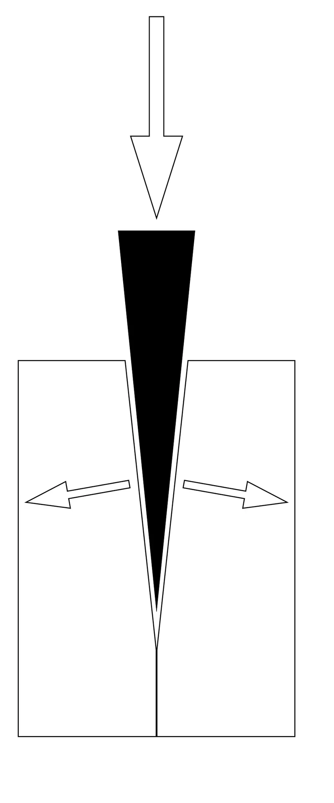
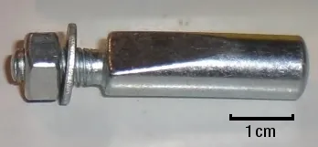
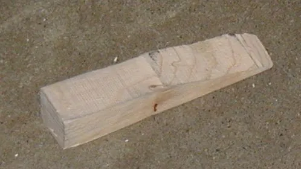

<figure class="eoc-pic eoc-pic-main"><figcaption><strong>Diagram.</strong> <a href="https://commons.wikimedia.org/wiki/File:Wedge-diagram.svg">Wedge-diagram</a> by Iainf 03:12, 8 July 2006 (UTC), Public domain, from Wikimedia Commons.</figcaption></figure>
<figure class="eoc-pic"><figcaption><strong>Photo.</strong> <a href="https://commons.wikimedia.org/wiki/File:Cotter-Pin.jpg">Cotter-Pin</a> by The original: Bukk; Cleanup &amp; change scale indicator: rswarbrick, Public domain, from Wikimedia Commons.</figcaption></figure>
<figure class="eoc-pic"><figcaption><strong>Photo.</strong> <a href="https://commons.wikimedia.org/wiki/File:Wooden_wedge_door_stop.jpg">Wooden wedge door stop</a> by Strait at English Wikipedia, Public domain, from Wikimedia Commons.</figcaption></figure>

A shallow wedge driven into a gap multiplies a light tap into a strong squeeze, and because its slope is gentle, friction stops it sliding back out, so it holds parts tight until it is knocked out again.

**In plain words:** A thin, gently sloping block (wedge) pushed or tapped into a gap so it jams tight and stays there by friction, squeezing the parts together until you knock it back out from the thin end. **Proper term:** [Self-locking](../glossary.md#self-locking) wedge (friction wedge; as a machine part: [taper](../glossary.md#taper) key or cotter).

**Also called:** door wedge / doorstop wedge (Wikipedia 'Doorstop'); shim / tapered shim (Wikipedia 'Shim (spacer)'; flat shims and spacers have their own entry, 'Shims, spacers and standoffs'); folding wedges (a pair of wedges driven towards each other; 'cramping' with folding wedges in old joinery books) (Wikimedia Commons, Cassell's Carpentry; Engineering Statics); wedge clamp / wedge clamping (Fine Woodworking; Printables 'CNC Wedge Clamp'); taper key; gib-head key or 'gip head' key (DIN 6887) (Wikipedia 'Key (engineering)'; MBO Osswald); tangential taper key (pairs of taper keys for heavy [torque](../glossary.md#torque)) (Wikipedia 'Key (engineering)'; Thang 'Wedge mechanism 23'); cotter / cotter pin (British usage; a tapered pin with a flat, e.g. bicycle [crank](../glossary.md#crank) cotter; in the US 'cotter pin' means a split pin instead) (Wikipedia 'Cotter (pin)'); Dutch pin (tapered pin driven into a hole drilled across shaft and hub) (Wikipedia 'Key (engineering)'); wedged tenon, tusk tenon wedge, loose wedge (woodworking) (Popular Woodworking; Woodsmith); quoin (printing), wheel chock (listed under 'See also' on Wikipedia 'Wedge'); Keil (German).

## How it works

Pushing a wedge along its length moves its sloping face sideways only a little, so a light push or tap becomes a much larger sideways squeeze; the [mechanical advantage](../glossary.md#mechanical-advantage) is roughly its length divided by its thickness (Wikipedia 'Wedge'). The squeeze presses the wedge's faces hard against the parts, and friction on those faces resists it sliding back. If the slope is shallow enough (the wedge angle is smaller than the 'friction angle', arctan of the friction coefficient) friction wins and the wedge stays put after you stop pushing: it is self-locking (Wikipedia 'Wedge'; IIT Guwahati ME101 notes). To release it you drive it back from the thin end, pull it by a head, or push it out with another wedge (a drift) (Wikipedia 'Machine taper'; MBO Osswald).

## Parts

Single piece (the wedge) working against the two parts it jams between; folding wedges are a matched pair; a taper key is one tapered bar in a matching tapered keyway in the hub (Wikipedia 'Key (engineering)'); a bicycle cotter is a tapered pin with a flat face, a threaded end, a washer and a nut (Wikipedia 'Cotter (pin)').

## Everyday examples

- A door wedge kicked under a door to hold it open (Wikipedia 'Doorstop')
- A folded card or shim under a wobbly table leg (Wikipedia 'Shim (spacer)')
- The wooden wedge that holds the blade in a traditional hand plane (Fine Woodworking, 'The Versatile Wedge')
- Cottered cranks on older bicycles, and the wedge inside a bicycle quill stem (Wikipedia 'Cotter (pin)'; Wikipedia 'Wedge'; Thang 'Wedge mechanism 19')

## When to use it

Use a wedge when you want a strong, tight hold that is quick to make and can be undone with a tap: knock-down furniture joints (tusk tenons), locking a tenon permanently (glued wedged tenons), clamping awkward or thin glue-ups where ordinary clamps don't fit (Fine Woodworking), taking up an uneven or unknown gap (shims, levelling), holding a door or a part in place temporarily, fixing a hub to a shaft without play in heavy, vibrating machinery (taper keys; MBO Osswald), and gently prising parts apart without damage (Fine Woodworking).

## When not to use it

Avoid it where there is strong vibration or load reversal and nobody will check it, because wedges and cotters can work loose (Sheldon Brown); use a screw with a lock nut or [threadlocker](../glossary.md#threadlocker), or a pin that can't slide. Avoid it where the hub must run exactly centred, because a taper key can push the hub off-centre (Wikipedia 'Key (engineering)'); use a parallel key, a keyless locking bush or a taper-lock bush. Avoid steep wedges in slippery materials (they pop out; Fine Woodworking 1992) and wedging close to the end of wood or thin printed walls (they split; Woodsmith). For something you undo often, a cam lever, toggle clamp or quick-release pin is faster and needs no hammer.

## Details

- **What it does (jobs):**
  - join and hold: jams parts together, e.g. a hub on a shaft with a taper key, a crank on its axle with a cotter, a tenon in a mortise with wedges
  - lock, and release by hand: a door wedge or a tusk-tenon wedge is kicked or tapped in to hold and tapped out to release
  - tighten and hold tension: driving a wedge (or a pair of folding wedges) in further squeezes parts together like a clamp and keeps the pressure on (Fine Woodworking; Engineering Statics)
  - line parts up exactly: shims and adjusting wedges set a gap or level a part, e.g. a wedge that adjusts the gap between a slide and its runway (Thang 'Wedge mechanism 17') and shims under machine feet (Wikipedia 'Shim (spacer)')
- **Movement:** slide: the wedge slides a short way into the gap while it is driven, then nothing moves (none once seated)
- **Directions it can move (degrees of freedom):** 0 once driven home: the wedge and the parts it jams are locked by friction. While fitting, the wedge has 1 (sliding along its taper).
- **Special behaviour:**
  - self-locking (holds under load, won't back-drive): a shallow wedge cannot be pushed back out by the force it is holding, because friction on its faces is bigger than the push-back (Engineering Statics: 'high-friction (self-locking) wedges'; Wikipedia 'Wedge')
  - tensioning (takes up slack and holds): driving it further takes up any gap and adds clamping force, and a loose wedge can be re-tightened with a tap (Woodsmith on tusk tenons)
  - quick-release: simple wedges come out with a kick or a tap from the thin end, with no fasteners to undo (Wikipedia 'Doorstop'; Woodsmith)
- **How it holds:**
  - friction or clamping ([force-fit](../glossary.md#form-fit--force-fit--material-bond)): the wedge itself is held only by friction on its sloping faces, and the parts are held by the squeeze it produces; a taper key transmits force by friction on its inclined faces rather than by shape (MBO Osswald)
  - shape (the parts interlock; form-fit): in a cotter joint, a tusk tenon or a wedged tenon the wedge also blocks the parts from pulling apart, so the joint is locked by shape once the wedge is in (Thang 'Wedge mechanism 21'; Woodsmith; Popular Woodworking)
- **Input and output:** not applicable as a holding joint. As a mechanism, a wedge turns a push along its length into a smaller but stronger sideways movement (mechanical advantage about length / width; Wikipedia 'Wedge'); a self-locking wedge cannot be driven backwards by its load (back-drivable: no), though vibration can walk it out (Sheldon Brown on cotters).
- **Power:** passive (no power needed): it is driven in by hand, a mallet or hammer, and stays by friction
- **Load:** Medium to heavy in the direction it squeezes (a small tap produces a large clamping force; high-friction wedges hold shoring timbers in ships' damage control, per Engineering Statics). Taper keys transmit shaft torque and resist vibration and shock loads (MBO Osswald). Weak against vibration and repeated load reversals, which can loosen it (Sheldon Brown), against being pushed from the thin end, and in wood against splitting of the part it presses on (Woodsmith; Popular Woodworking).
- **Play and precision:** No play once driven: taper keys 'eliminate potential play' compared with plain parallel keys (MBO Osswald). But a taper key can push the hub slightly off-centre on the shaft (Wikipedia 'Key (engineering)'), and the final position depends on how hard it is driven; the angle of a bicycle cotter's flat decides where the crank ends up, so mismatched cotters leave the cranks out of line (Wikipedia 'Cotter (pin)'; Sheldon Brown). Wedges are very tolerant of rough, uneven gaps, which is why shims and wedges are used for levelling (Wikipedia 'Shim (spacer)').
- **Taking it apart:** removable: knocked back out from the thin end, pulled by its head (gib-head key, with a key puller) or pushed out with a drift (Wikipedia 'Machine taper'; MBO Osswald). Glued wedges in wedged through-tenons are effectively permanent (Popular Woodworking).
- **How often it can be reused:** many times for door wedges, folding wedges and tusk-tenon wedges (Woodsmith: tusk tenons can be taken apart); a few times for tightly driven metal cotters and taper keys, which are often damaged on removal (Sheldon Brown: threads mushroom and cotters may have to be drilled out)
- **Sealing:** none
- **Adjustable:** yes: drive it further to tighten or to take up wear or wood [shrinkage](../glossary.md#warping--shrinkage); e.g. a tusk-tenon wedge can be re-tightened with a tap when seasonal wood movement loosens the joint (Woodsmith); wedges can set a gap between a slide and its runway (Thang 'Wedge mechanism 17')
- **Access needed:** both sides: a through wedge, cotter or tusk tenon is driven in from the thick end and knocked out from the thin end. A door wedge or shim needs only one side, and a gib-head taper key is fitted and pulled from the end of the shaft.
- **Materials:** Straight-grained hardwood for joinery wedges, often a contrasting colour (Popular Woodworking); saw-cut surfaces grip better for clamping wedges, smooth surfaces are easier to remove, and oily woods such as teak or lignum vitae make self-lubricating removable wedges (Fine Woodworking 1992); wood, rubber, fabric or plastic door wedges (Wikipedia 'Doorstop'); steel or stainless steel taper keys (MBO Osswald); steel cotters; wood, plastic, metal or even paper shims (Wikipedia 'Shim (spacer)'); TPU for grippy printed door wedges (Printables model 1612035).
- **Heat, cold, water and wear:** Wood shrinks and swells with humidity, so wooden wedges loosen as wood dries and may need re-tapping (Woodsmith); swelling can also make wedges grip harder, as ancient quarrymen used wet wooden wedges to split stone (Wikipedia 'Wedge'). Vibration can walk wedges and cotters loose (Sheldon Brown); a tusk-tenon wedge oriented vertically is less likely to work loose (Woodsmith). Printed plastic wedges [creep](../glossary.md#creep) under constant load (PMC7764475 creep study) and PLA softens above about 60 C (Prusa), so the clamping force fades over time and in heat. Oil or grease on the faces reduces friction and can let a wedge slip out ⚑ [uncertain: general principle, no specific source].

## Making it

- **Ways to make or get it:**
  - woodwork: sawn or bandsawn wedges, wedged and tusk tenons, folding wedges for clamping
  - 3D print (FDM): door wedges, wedge clamps and printed wedge-locked joints (Printables models)
  - CNC: milled wedge clamps and tapered keyways; laser-cut 'hammer joints' with a wedge through a tenon (Printables 'Tenon Wedge Hammer Joint Test' was adapted from a laser-cut design)
  - laser cut: flat wedges and wedged tab joints in sheet material ⚑ [uncertain: no specific design guide found]
  - off-the-shelf part: taper keys (DIN 6887), tapered shims, rubber door wedges, bicycle cotters
- **Printing it in one piece (print in place):** no: the wedge is printed separately and driven in after the other parts are assembled
- **Tools:** None for a door wedge; a mallet or hammer to drive and release most wedges; a drift or punch to drive out a tight one; a key puller for gib-head keys (MBO Osswald); a cotter press or hammer, punch and locking pliers for bicycle cotters (Sheldon Brown). To make wooden wedges: a bandsaw (or saw) and optionally a plane (Fine Woodworking).
- **Difficulty:** easy: a wedge is quick to cut on a bandsaw or print in one piece; matching its angle to a tapered slot (tusk tenon, taper key) takes more care, so moderate for those

### 3D printing tips

1) Keep the slope shallow so it self-locks: the wedge angle must be smaller than the friction angle (arctan of the friction coefficient) (Wikipedia 'Wedge'); for a clamping wedge about 1 in 6 (roughly 9.5 degrees) is a good starting point (Fine Woodworking 1992), and joinery wedges use about 3 to 5 degrees (Popular Woodworking; Woodsmith). 2) Print the wedge lying flat on its broad face so the sloping faces are smooth top and bottom surfaces rather than stair-stepped ⚑ [uncertain: reasoning, not a tested rule]. 3) Test designs are printed in PLA with 2 [perimeters](../glossary.md#perimeters) and 15% gyroid [infill](../glossary.md#infill) and tapped home with a soft hammer (Printables 'Tenon Wedge Hammer Joint Test' by kaje); a strong filament such as carbon-fibre polycarbonate is used for CNC wedge clamps (Printables 'CNC Pivoting Wedge Clamp' by Elphwrkz). 4) Use TPU (about 90A to 95A) for door wedges that must grip the floor; PLA or PETG grip less (Printables 'Flexible TPU Door Stopper'). 5) Expect it to loosen over time: printed PLA parts creep under constant load (PMC7764475 creep study), and PLA softens above about 60 C (Prusa), so a wedge left under constant pressure, or in a hot place, will relax; check and re-tap it, or use PETG or a harder material. 6) Leave plenty of material beyond the slot the wedge presses on, because it pushes hard on the end: woodworkers leave at least 1/2 in of wood beyond a tusk-tenon wedge mortise (Woodsmith) ⚑ [uncertain: the equivalent for printed parts is not tested]. 7) Add small teeth or texture for more grip in soft materials such as cloth (Printables 'Wedge Tensioner / Clamp for Canvas' uses 'strong teeth').

### Buying one (off-the-shelf parts)

Search for: 'taper key' or 'gib head key DIN 6887' (1:100 taper; e.g. MBO Osswald (brand)); 'taper pin'; 'bicycle cotter pin' (cottered cranks); 'tapered shims' or 'shim stock' and 'laminated shims'; 'door wedge' or 'door stop wedge' (rubber); 'folding wedges' or 'timber wedges' (construction); 'plug and feathers' (stone splitting wedges); 'felling wedge'; 'drift' (for knocking out Morse-taper tools); 'key puller'.

## Rules of thumb

- Self-locking condition: a wedge binds (stays put) when its angle is less than the arctangent of the friction coefficient (Wikipedia 'Wedge'). Statics texts show that with friction on both faces a wedge stays in place up to about twice the friction angle (IIT Guwahati ME101 lecture 14), so keeping the angle below arctan(mu) is the safe rule. Example: mu = 0.3 gives arctan(0.3) = about 17 degrees (calculated).
- For clamping with wedges, 'a wedge that rises about 1 in. in 6 in. makes a good choice'; steep wedges give more movement but need more force and are more likely to slip (Blandford, 'Clamping with Wedges', Fine Woodworking #93).
- Wedged through-tenons: a 3-degree taper on the mortise ends and wedges works well, with the taper extending about three-quarters of the way down the mortise (Popular Woodworking, 'Wedged Mortise and Tenon').
- Tusk tenons: wedge and wedge mortise with a matching bevel of about 5 degrees; a loose-wedge (dovetailed) version uses about 10 to 12 degrees; leave at least 1/2 in of solid wood beyond the wedge mortise to avoid splitting (Woodsmith).
- Taper keys (gib-head, DIN 6887) have a 1:100 taper, are driven in with a hammer and hold by friction; sizes run from 4 x 4 x 14 to 50 x 28 x 400 mm for shafts of 10 to 230 mm (MBO Osswald).
- Morse tapers (a self-holding taper, which is a wedge wrapped round a cone) are about 1.49 degrees (roughly 3 degrees included), about 1:20 (Wikipedia 'Machine taper').
- Cotters: hammer in, snug the nut, hammer again and repeat until no more slack appears; don't try to pull them in with the nut alone (it strips the thread); re-tap and re-tighten after about 50 miles of riding (Sheldon Brown, 'Cottered Cranks').

## Common failures

1) Works loose from vibration, wood shrinkage or plastic creep: re-tap it, orient it so gravity and vibration don't push it out (Woodsmith), or add a nut or pin (Sheldon Brown: re-tighten cotters after about 50 miles). 2) Too steep, so it slips out: make the slope shallower or roughen the faces (Fine Woodworking 1992). 3) Splits the part it presses on: leave more material beyond the slot, drill relief holes at the end of saw [kerfs](../glossary.md#kerf) in wedged tenons (Popular Woodworking), and match the wedge angle to the slot so pressure is spread (Woodsmith). 4) Taper key pushes the hub off-centre (Wikipedia 'Key (engineering)'). 5) Mismatched cotters leave cranks out of line (Wikipedia 'Cotter (pin)'). 6) Stuck fast: needs sharp, well-aimed hammer blows, a punch, drilling out or (last resort) heat (Sheldon Brown).

## Safety

Hammering: miss-hits damage parts and hands; hold a punch or drift with locking pliers, not your fingers (Sheldon Brown). Hammered steel ends mushroom and can chip ⚑ [uncertain]. Heating a part to free a stuck cotter weakens it (Sheldon Brown). A wedge holding up a load (shoring, levelling a machine) can release suddenly if knocked or if it slips, dropping the load, so keep clear and block the load before removing it ⚑ [uncertain: general practice]. Driving wedges near the end of wood can split it suddenly (Woodsmith).

## Related

- Taper fit (Morse taper): a wedge wrapped into a cone; self-holding and knocked apart with a drift wedge (Wikipedia 'Machine taper')
- Keyless locking bush (taper-lock bush): tapered rings squeezed by screws instead of hammering, and they keep the hub centred
- Mortise and tenon (wedged, drawbored and tusk tenons): the main joinery use of wedges
- Wedge dowel (click-in grooved dowel): a ready-made furniture fitting that wedges panels together
- Screw thread / lead screw: 'a wedge of considerable length wrapped around a cylinder', self-locking in the same way (Fine Woodworking 1992; IIT Guwahati)
- [Sprag](../glossary.md#sprag) clutch and roller clutch: wedging elements that lock in one direction only
- Binding-plate lock: a tilting plate that wedges on a bar
- Eccentric cam lever: a rotating wedge that clamps and releases by hand without a hammer
- Dovetail slide with gib strip: a tapered strip (a wedge) adjusted to take up play in a slide
- Shims, spacers and standoffs: flat packing of a set thickness that sets a gap by stacking rather than by sliding a taper; tapered shims and folding wedges stay in this entry

## Make it yourself

- [Tenon Wedge Hammer Joint Test (kaje, Printables) (URL from Printables API, page not opened)](https://www.printables.com/model/673039-tenon-wedge-hammer-joint-test): Printed test of a laser-cut style 'hammer joint': a tenon through a hole locked by a wedge tapped down flush; PLA, 2 perimeters, 15% gyroid; Onshape CAD linked *(licence: Creative Commons Attribution (as listed in the Printables API))*
- [CNC Wedge Clamp (Elphwrkz, Printables) (URL from Printables API, page not opened)](https://www.printables.com/model/393687-cnc-wedge-clamp): Low-profile printed wedge clamp for a CNC bed that pushes sideways on the workpiece using two T-track bolts *(licence: Creative Commons Attribution (as listed in the Printables API))*
- [Wedge Tensioner / Clamp for Canvas, Tarpaulin, Cloth (Meister Edel, Printables) (URL from Printables API, page not opened)](https://www.printables.com/model/723184-wedge-tensioner-clamp-for-canvas-tarpaulin-cloth): Two printed parts that slide into each other and clamp thin material harder the further they are pushed together; released by pushing the wedge out from behind *(licence: Creative Commons Attribution-NonCommercial-ShareAlike (as listed in the Printables API))*
- [Flexible TPU Door Stopper / Door Wedge (Felix, Printables) (URL from Printables API, page not opened)](https://www.printables.com/model/1612035-flexible-tpu-door-stopper-door-wedge): Scalable printed door wedge in TPU (about 90A to 95A) with a textured top for grip *(licence: Creative Commons Attribution-NonCommercial-NoDerivatives (as listed in the Printables API))*

## Pictures, videos and models

- [Wedge-diagram.svg (Wikimedia Commons, by Iainf; used on Wikipedia 'Wedge')](https://commons.wikimedia.org/wiki/File:Wedge-diagram.svg): Cross-section of a wedge showing a downward push producing sideways forces on its sloping faces *(licence: Public domain)*
- [Wooden wedge door stop.jpg (Wikimedia Commons, by Strait)](https://commons.wikimedia.org/wiki/File:Wooden_wedge_door_stop.jpg): Photo of a handmade wooden door wedge *(licence: Public domain)*
- [Cassell's Carpentry fig. 369: Cramping floor-boards with dog and folding wedges (Wikimedia Commons)](https://commons.wikimedia.org/wiki/File:Cassells_Carpentry.369_Cramping_Floor-Boards_with_Dog_and_Folding_Wedges.png): Old engraving of a pair of folding wedges driven between a metal dog and a floorboard to squeeze boards together *(licence: Public domain)*
- [Cotter-Pin.jpg (Wikimedia Commons; cropped from 'Keil fuer Tretlager')](https://commons.wikimedia.org/wiki/File:Cotter-Pin.jpg): Photo with scale of a bicycle crank cotter: a tapered pin with a flat face and a threaded end *(licence: Public domain)*
- [Wedge mechanism 22 (Nguyen Duc Thang, YouTube)](https://www.youtube.com/watch?v=6N0YcXU_0vc): CAD animation of a sunk taper key being driven into a matching sloped slot to lock a disc on a shaft (per Thang's catalogue description; title verified) *(licence: link only)*

## Needs confirming

⚑ marks something nobody has confirmed yet: a fact the research could not confirm from a source, a finder value that is a best guess, or an open point from the research notes. Corrections are welcome (see `research/needs-confirming.md`).

- ⚑ 6 sentences on this page marked [uncertain].

## Sources

- <https://en.wikipedia.org/wiki/Wedge>
- <https://en.wikipedia.org/wiki/Key_(engineering)>
- <https://en.wikipedia.org/wiki/Cotter_(pin)>
- <https://en.wikipedia.org/wiki/Machine_taper>
- <https://en.wikipedia.org/wiki/Shim_(spacer)>
- <https://en.wikipedia.org/wiki/Doorstop>
- <https://engineeringstatics.org/Chapter_09-block-and-wedge-friction.html>
- <https://iitg.ac.in/kd/Lecture%20Notes/ME101-Lecture14-KD_DivI.pdf>
- <https://www.mecapedia.uji.es/pages/irreversibilidad.html>
- <https://www.mbo-osswald.de/en/shop/taper-keys-with-gip-head-din-6887>
- <https://www.finewoodworking.com/1992/04/01/clamping-with-wedges>
- <https://www.finewoodworking.com/project-guides/shop-projects/the-versatile-wedge>
- <https://www.popularwoodworking.com/projects/wedged-mortise-and-tenon/>
- <https://www.woodsmith.com/article/loose-wedge-mortise-tenon-joints-basic-tusk-tenon/>
- <https://www.sheldonbrown.com/tooltips/cotters.html>
- <https://pmc.ncbi.nlm.nih.gov/articles/PMC7764475/>
- <https://help.prusa3d.com/article/pla_2062>
- <https://api.printables.com/graphql/>
- <https://commons.wikimedia.org/wiki/File:Wedge-diagram.svg>
- <https://commons.wikimedia.org/wiki/File:Wooden_wedge_door_stop.jpg>
- <https://commons.wikimedia.org/wiki/File:Cassells_Carpentry.369_Cramping_Floor-Boards_with_Dog_and_Folding_Wedges.png>
- <https://commons.wikimedia.org/wiki/File:Cotter-Pin.jpg>
- <https://www.youtube.com/watch?v=6N0YcXU_0vc>
- <https://www.youtube.com/watch?v=Ybm4xZNfA9o>
- <https://www.youtube.com/watch?v=fO-NIQ-YFmA>
- <https://www.youtube.com/watch?v=_I3PPttljC8>
- <https://www.youtube.com/watch?v=pe3wTSXQa2c>
- <https://www.youtube.com/watch?v=qlPg8I8ZB1U>
