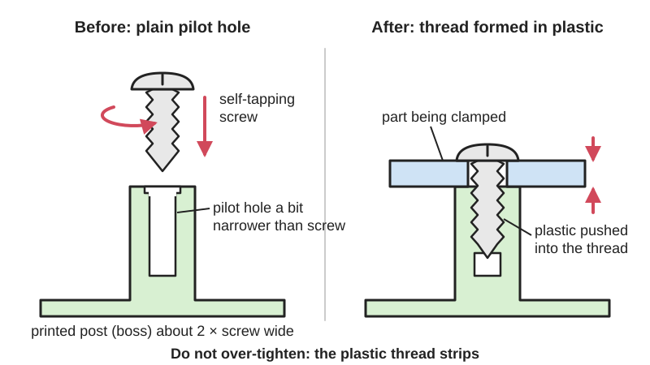
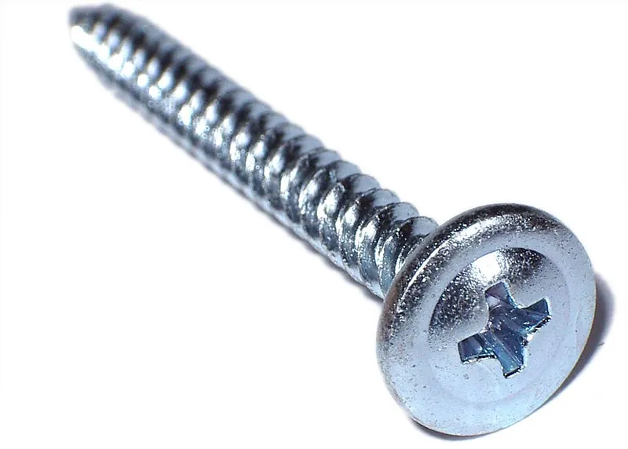

<figure class="eoc-pic eoc-pic-main"><figcaption>Diagram drawn for the encyclopaedia from the research notes. ⚑ Needs confirming: a drawing can simplify or get details wrong; a real photo or a better diagram is welcome.</figcaption></figure>
<figure class="eoc-pic"><figcaption><strong>Photo.</strong> <a href="https://commons.wikimedia.org/wiki/File:Phillips_screw.jpg">Phillips screw</a> by Ssawka at Polish Wikipedia, <a href="http://creativecommons.org/licenses/by-sa/3.0/">CC BY-SA 3.0</a>, from Wikimedia Commons.</figcaption></figure>

A hardened screw with a sharp, widely spaced thread forms or cuts its own mating thread in a plain [pilot hole](../glossary.md#pilot-hole) in plastic, clamping a part on without any nut, insert or tapping, at the cost of a thread that wears each time it is undone.

**In plain words:** A pointed or coarse-threaded metal screw driven straight into a plain, slightly-too-small hole in a plastic or 3D-printed part, so the screw makes its own thread as it goes in; quick and cheap, but the plastic thread wears out if you undo it many times. **Proper term:** Self-tapping screw into plastic (thread-forming or thread-cutting screw for plastics, driven into a pilot hole or screw [boss](../glossary.md#boss)).

**Also called:** self-tapping screw, self-tapper (Wikipedia 'Self-tapping screw'; Hackaday); thread-forming screw (pushes the plastic aside, no chips) and thread-cutting screw (has a cutting flute, removes material) (Wikipedia 'Self-tapping screw'; Assembly Magazine); screw for plastics, plastic screw, PT screw; brand names include EJOT DELTA PT (brand), Plastite (brand) and Taptite (brand) (a trilobular thread-forming screw) (ATF/EJOT brochure; Assembly Magazine; Wikipedia 'Pentalobular screw thread'); sheet-metal screw, PK screw (after Parker-Kalon (brand)), type B (blunt-tip) tapping screw (Wikipedia 'Self-tapping screw'); screwing a machine screw directly into an undersized printed hole ('self tap' hole in BOSL2; 'direct screwing' in CNC Kitchen tests); screw boss (the moulded post with a hole that the screw goes into) (Assembly Magazine; EJOT); lobular or trilobular screw; self-forming thread with three lobes in the hole (Wikipedia 'Pentalobular screw thread'; Hackaday on Thomas Sanladerer); self-drilling screw, Tek (brand) screw: a tapping screw with a fluted drill point that drills its hole, cuts the thread and fastens in one go (Wikipedia 'Self-tapping screw', section 'Self-drilling screws').

## How it works

The pilot hole is smaller than the screw's thread, so as the screw is turned its thread pushes the plastic aside (thread-forming) or shaves it away (thread-cutting) and leaves a matching thread in the hole wall (Wikipedia 'Self-tapping screw'). Screws made for plastics have a narrower thread angle (about 30-48 degrees instead of 60) so they push less outwards on the boss and are less likely to split it (Assembly Magazine). Once the head is down, tightening stretches the screw and clamps the parts together as in any screw joint, but the clamping force is limited by the strength of the plastic thread, which strips if over-tightened (Kolver). Each time the screw is removed and driven again, the plastic thread is worn or a new one is cut, so it gradually loosens (Hubs; Hackaday).

## Parts

A few parts: the screw (usually case-hardened steel, often with a coarse thread and a pointed or blunt tip) and a plain pilot hole in the plastic part, usually in a thick-walled post (screw boss); a washer or large head spreads the load (Wikipedia 'Self-tapping screw'; EJOT/ATF brochure).

## Everyday examples

- Printed project enclosures and camera mounts held together with self-tappers instead of [heat-set inserts](../glossary.md#heat-set-insert) (Hackaday, Jenny List's turret camera project)
- Plastic housings of household appliances such as vacuum cleaners (a Hackaday reader notes Dyson (brand) vacuum cleaners are screwed straight into plastic) ⚑ [uncertain]
- Battery covers and cases of remote controls, toys and small electronics ⚑ [uncertain]
- Screwing into wood (wood screws) and thin sheet metal (sheet-metal screws) uses the same idea (Wikipedia 'Self-tapping screw')

## When to use it

Use it for printed or moulded plastic parts that are put together once, or opened only occasionally (for repair or battery changes): enclosures, lids, brackets, mounting a circuit board or a small motor. It needs no nut, insert, soldering iron or tap, and goes in from one side, so it is the quickest and cheapest way to fasten into plastic (Hubs; Hackaday). Pull-out strength can match heat-set inserts (CNC Kitchen).

## When not to use it

Avoid it when the part will be taken apart often, when you need high tightening [torque](../glossary.md#torque) or clamping force, or when the joint must stay tight at high temperature: use heat-set inserts, a [captive nut](../glossary.md#captive-nut) or a bolt and nut instead (Hubs; CNC Kitchen). Avoid it in thin walls, [brittle](../glossary.md#brittle--ductile) plastics, thermosets and glass-filled plastics that crack (use thread-cutting screws or inserts) (Assembly Magazine), and in load-bearing or safety-critical parts where a stripped thread would be dangerous ⚑ [uncertain].

## Details

- **What it does (jobs):**
  - join and hold: fastens a lid, cover, bracket or circuit board to a plastic or printed part without a nut or insert
  - tighten and hold tension: clamps the parts together, up to what the plastic thread can take (Kolver)
- **Movement:** none: the parts are clamped and don't move.
- **Directions it can move (degrees of freedom):** 0 when tightened.
- **Special behaviour:**
  - none: it simply clamps. (Screws made for plastics resist vibration loosening better than standard ones because of their thread shape, but that is not a special behaviour) (ATF/EJOT brochure)
- **How it holds:**
  - shape (the parts interlock; [form-fit](../glossary.md#form-fit--force-fit--material-bond)): the screw thread sits in the thread it formed in the plastic
  - friction or clamping (force-fit): the tightened screw clamps the parts; a formed thread also grips the screw tightly (Kolver; Assembly Magazine)
- **Input and output:** not applicable
- **Power:** passive (no power needed)
- **Load:** Light to medium. Pull-out can be surprisingly good: M3 screws driven into slightly undersized holes in printed PETG held 118 kg on average, about the same as a heat-set insert (119 kg), and in an earlier PLA test 142 kg (CNC Kitchen). Weak in twisting: the plastic thread stripped at about 1 Nm of tightening torque on M3, against 3-4 Nm for a heat-set insert, though 1 Nm already gives more than 1500 N of clamping force (CNC Kitchen). Clamping force is limited by the plastic's stripping strength and falls over time as the plastic relaxes (Kolver; ATF/EJOT brochure). Bosses next to walls or in corners resist pull-out better than free-standing ones (Assembly Magazine).
- **Play and precision:** No play in the thread once formed. Location of the clamped part depends on its [clearance](../glossary.md#clearance) hole, as for any screw joint. The screw roughly centres itself in its pilot hole ⚑ [uncertain]. A screw driven in at an angle cuts a crooked thread, so drive it straight (Hubs).
- **Taking it apart:** removable, but the plastic thread wears each time: Hubs says self-tapping screws are 'not suited for applications where parts will regularly be assembled/disassembled'; thread-cutting screws 'cannot be installed and removed repeatably' (Assembly Magazine).
- **How often it can be reused:** a few times: CNC Kitchen calls direct screwing 'a viable option if you want to connect something only once'; Thomas Sanladerer uses three-lobed self-forming holes for parts screwed down 'once or twice' (Hackaday 2025). With screws made for plastics and by re-engaging the old thread each time, some makers get more, and Hackaday suggests up to 'a few dozen' times over a part's life may be acceptable (Hackaday 2026) ⚑ [uncertain].
- **Sealing:** none: add a gasket or [O-ring](../glossary.md#o-ring) between the parts if it must seal ⚑ [uncertain].
- **Adjustable:** no: only the tightness can be changed, and re-tightening risks stripping the thread.
- **Access needed:** one side only (blind): the screw is driven into a hole in the far part from the near side.
- **Materials:** Screws: hard steel, often case-hardened, with a thread running the full length (Wikipedia 'Self-tapping screw'). Suitable plastics: tough, ductile thermoplastics suit thread-forming screws (Assembly Magazine: plastics with a flexural modulus up to about 200,000 psi (about 1.4 GPa), or up to 400,000 psi with a larger hole); hard, brittle or glass-filled plastics and thermosets need thread-cutting screws or they crack (Assembly Magazine). Works in FDM prints (PLA, PETG, ABS, nylon, PC) and resin prints (Lost In Tech pilot-hole calculator lists these materials). Related screw types exist for wood (wood screws) and thin sheet metal (sheet-metal screws) (Wikipedia 'Self-tapping screw'). Self-drilling screws have a drill-shaped tip that cuts through both wood and steel, so no pilot hole is needed (USDA FPL Wood Handbook ch. 8); winged versions ream a clearance hole in wood or plastic and their wings break off when they reach metal, so wood can be fixed to steel in one step from one side (Wikipedia 'Self-tapping screw').
- **Heat, cold, water and wear:** Plastic around the screw relaxes and [creeps](../glossary.md#creep), so the clamping force drops over time, faster when warm (Kolver; ATF/EJOT brochure; filamentspecs). In one test an M6 bolt clamping printed PETG lost about 11.5% of its undoing torque in a week at room temperature, PLA about 3% (Amza et al. 2021, bolted joint rather than self-tapper). PLA softens above about 60 °C, so screws in PLA can loosen in a hot car or near a heater (Prusa knowledge base). Vibration can loosen screws in plastic; screws designed for plastics resist this better (ATF/EJOT brochure).

## Making it

- **Ways to make or get it:**
  - 3D print (FDM): the most common maker use; print the pilot hole into the part (Hubs; Hackaday)
  - 3D print (resin): works with correctly sized holes (Lost In Tech calculator includes resin) ⚑ [uncertain]
  - off-the-shelf part: moulded plastic housings with screw bosses, and the screws themselves
  - woodwork: the same idea with wood screws, which are technically self-tapping (Wikipedia 'Self-tapping screw')
  - sheet metal: sheet-metal self-tapping screws in punched or drilled holes (Wikipedia 'Self-tapping screw'); self-drilling (Tek (brand)-type) screws drill their own hole in sheet steel, and some have a sealing washer for fixing roofing sheets to purlins (Wikipedia 'Self-tapping screw')
- **Printing it in one piece (print in place):** no: the screw is added after printing; the printed part only needs a plain pilot hole.
- **Tools:** screwdriver (manual or powered, ideally with a torque limit or clutch); optionally a drill to open the pilot hole to size after printing (Hubs). Industry uses torque-controlled electric screwdrivers at about 300-1000 rpm (Kolver; ATF/EJOT brochure).
- **Difficulty:** easy: design a slightly undersized hole, then drive the screw in; the only skill is finding the right hole size for your printer and material with a quick test print (Hubs; Hackaday).

### 3D printing tips

1) Hole size: printed holes come out undersized, so test first (CNC Kitchen; Hubs). A simple start from Hackaday is to make the lower hole the diameter of the screw's core (shaft without thread) and the upper part's hole big enough for the thread to pass. Screws for plastics are usually given a hole of about 0.8 x the thread diameter (EJOT/ATF brochure). For a machine screw driven straight into a print, BOSL2's 'self tap' hole is the nominal diameter minus about 0.72 x the [pitch](../glossary.md#pitch) (e.g. about 2.64 mm for M3) and has a bevelled top to help the screw start. 2) Depth: give at least 1-1.5 x the screw diameter of thread engagement, more in plastics (Lost In Tech calculator; Field Fastener); moulding guides use 2 x (EJOT) to 2-3 x (Assembly Magazine). 3) Wall: make the wall around the hole at least one screw diameter thick (Hubs), i.e. a boss about 2-3 x the screw diameter across (EJOT; Assembly Magazine); thin walls bulge, split or delaminate (Hubs). 4) Orientation: print the hole vertical (along the Z axis) so [perimeters](../glossary.md#perimeters) wrap around it and the screw's outward push isn't splitting layers apart ⚑ [uncertain]. More perimeters around the hole help; CNC Kitchen's test parts used four perimeters and 100% [infill](../glossary.md#infill). 5) Add a small [counterbore](../glossary.md#counterbore--countersink) or [chamfer](../glossary.md#chamfer--fillet) (about screw diameter) at the entry so the edge doesn't crack and the screw starts straight (EJOT; Assembly Magazine; BOSL2). 6) Three lobes: a hole with three small ribs that the screw forms into lowers the stress on the part (Thomas Sanladerer, via Hackaday). 7) Drive slowly and straight and stop as soon as it is snug; don't use a pointed countersunk head, which wedges the plastic apart (Hubs; Assembly Magazine). 8) To reuse, turn the screw backwards until it drops into the old thread before tightening (Kolver).

### Buying one (off-the-shelf parts)

Thread-forming screws for plastics (e.g. 30-degree 'PT' style or trilobular screws; brands include EJOT DELTA PT (brand), Plastite (brand) and Taptite (brand)) (ATF/EJOT brochure; Assembly Magazine; Wikipedia 'Pentalobular screw thread'); DIN 7981 tapping screws, which a Hackaday reader recommends as a consistent standard to buy; type B (blunt-tip) tapping screws for pilot holes; ordinary M2-M4 machine screws driven into undersized holes (CNC Kitchen; BOSL2); washers or flanged heads to spread the load (Wikipedia 'Self-tapping screw'; ATF/EJOT brochure; Hackaday). For sheet metal and wood to steel: self-drilling screws, with or without a sealing washer, and winged self-drilling screws (Wikipedia 'Self-tapping screw').

## Rules of thumb

- Screws for thermoplastics: pilot hole 0.8 x the screw's nominal diameter (up to 0.88 x for filled or stronger plastics), boss outside diameter 2 x, screw engagement depth 2 x, and a counterbore of 1.05 x diameter at the entry; keep draft in the core hole below 0.5 degrees per side (ATF / EJOT DELTA PT brochure, 2017, p. 11).
- Boss outside diameter 2-3 x the screw thread diameter; thread engagement 2-3 x the screw diameter; add a relief bore equal to the screw's outside diameter; thread-forming screws suit plastics with a flexural modulus up to 200,000 psi (up to 400,000 psi with a larger hole), harder plastics need thread-cutting screws; avoid conical (countersunk and oval) heads (Assembly Magazine 'Beware the Boss', 2004).
- If the screw maker gives no pilot-hole size, aim for 75-80% thread engagement; wall thickness around the hole at least the screw diameter (e.g. 5 mm for M5) (Hubs 'How to assemble 3D printed parts with threaded fasteners').
- Engagement length at least 1 x the screw diameter, 1.5 x recommended for plastics; pilot diameter = major diameter x material factor x engagement correction, divided by your printer's hole [shrinkage](../glossary.md#warping--shrinkage) (Lost In Tech 'FDM pilot hole calculator').
- Thread-forming screws need at least 1-1.5 x the screw diameter engaged even in steel, and more in softer materials such as plastic (Field Fastener 'Rules of Thumb for Thread Engagement').
- For a machine screw driven straight into plastic, make the hole the nominal diameter minus 0.72 x pitch for pitches below 1 mm, minus 0.6 x pitch above 1.5 mm (BOSL2 screws.scad, 'self tap' [tolerance](../glossary.md#tolerance)).
- M3 screw straight into a slightly undersized printed hole: pull-out 118 kg in PETG (142 kg in an earlier PLA test), but it strips at about 1 Nm; a heat-set insert takes 3-4 Nm (CNC Kitchen).
- Tightening torque when fastening into plastic: the lower of 3 x the seating torque or halfway between seating and stripping torque; start at about 300 rpm if the screw maker gives no speed; when re-tightening into an existing thread, turn the screw backwards until it drops into the thread, engage about a quarter turn by hand, and use a lower torque (Kolver 'Fastening into Plastics').
- In wood, type A tapping screws (sheet-metal screws) hold about 10% more against pulling out than wood screws of the same diameter and thread length, from 1.16 times in dense woods such as oak to 1.05 times in light woods such as redwood; tapping screws are commonly used in particleboard, where care is needed not to strip the thread when tightening (USDA FPL Wood Handbook, FPL-GTR-282, ch. 8, pp. 8-10 to 8-11).

## Common failures

Stripped thread from over-tightening or using a power driver without a clutch; stop when snug, or set a torque below the stripping torque (Hackaday; Kolver). Cracked or bulging boss, or layers splitting, from a hole that is too small, a wall that is too thin or a screw that is too aggressive for the plastic; enlarge the hole, thicken the wall, add a counterbore, or use a screw made for plastics (Hubs; Assembly Magazine; EJOT). Loose screw after reassembly because it cut a new thread; turn it backwards until it drops into the old thread first (Kolver; Hackaday comments). Joint slowly loosening from creep and [stress relaxation](../glossary.md#stress-relaxation); use a larger head or washer, lower torque, or an insert (Kolver; filamentspecs). Hole too big so the thread doesn't grip; test-print hole sizes (Hackaday; Lost In Tech).

## Safety

Pointed screw tips can stick out of the far side and scratch or cut ⚑ [uncertain]. A split screw boss or stripped thread can let a part fall off; don't rely on it for anything load-bearing overhead or safety-critical ⚑ [uncertain]. Otherwise none known.

## Related

- Heat-set threaded insert: a brass insert melted into the hole; takes 3-4 times the torque and can be reused many times, but needs a soldering iron
- Captive nut pocket (nut trap): a standard nut in a printed pocket; stronger and reusable, but needs space and access for the nut
- Press-fit and expanding inserts (tap-in insert): metal threads pushed or tapped in cold
- Printed screw thread: threads printed straight into the part; only practical above about M5 (Hubs)
- Ordinary screw joint (bolt and nut, machine screw): the baseline, reusable almost without limit
- Push-in plastic rivet (fir-tree clip, push rivet): no thread at all, pushed in by hand
- Heat staking (melted plastic rivet): a plastic post melted over, permanent
- Blind threaded fixings (rivet nut, well nut): give a reusable thread in thin sheet or panels
- Wood screw: the pointed, coarse-threaded screw for wood, technically self-tapping too; a type A sheet-metal screw holds slightly better in wood (Wood Handbook)

## Make it yourself

- [FDM pilot hole calculator (Lost In Tech)](https://lostintech3d.github.io/fdm-pilothole/pilot_hole_calc.html): Free web tool that works out the pilot-hole size to model for a screw into PLA, PETG, ABS, nylon, PC or resin, with a correction for your printer's hole shrinkage *(licence: ⚑ [uncertain] (not stated on the page))*
- [Metric self tap hole test - M2/M2.5/M3/M4 (1 to 5 mm) (PPat, Printables) (URL from Printables API, page not opened)](https://www.printables.com/model/1338667-metric-self-tap-hole-test-m2m25m3m4-1-to-5-mm): Test print with a range of hole sizes from 1 to 5 mm to find which hole suits M2-M4 screws on your printer; parametric Fusion file included *(licence: Creative Commons Attribution)*
- [Screw hole tests and sizing tests (lostintech, Printables) (URL from Printables API, page not opened)](https://www.printables.com/model/1629282-screw-hole-tests-and-sizing-tests): The 3.5 mm screw test parts used in Lost In Tech's screws-in-3D-prints video *(licence: Creative Commons Public Domain)*
- [BOSL2 screws.scad, screw_hole(tolerance="self tap") (OpenSCAD library)](https://raw.githubusercontent.com/BelfrySCAD/BOSL2/master/screws.scad): Makes a correctly undersized, bevelled hole for driving a machine screw straight into a printed part *(licence: BSD 2-Clause)*

## Pictures, videos and models

- [Screw types.jpg (Wikimedia Commons, by Ssawka)](https://commons.wikimedia.org/wiki/File:Screw_types.jpg): Photo of several screw types including self-drilling and self-tapping screws beside wood screws *(licence: CC BY-SA 3.0)*
- [Závitořezný.png (thread-cutting screw) (Wikimedia Commons, by Juniperbushman)](https://commons.wikimedia.org/wiki/File:Z%C3%A1vito%C5%99ezn%C3%BD.png): Drawing of a thread-cutting self-tapping screw *(licence: CC BY-SA 4.0)*
- [Well, it turns out you CAN use screws in 3D Prints! But... (YouTube, Lost In Tech)](https://www.youtube.com/watch?v=8F4G-OyXHJs): Video comparing screw types for plastics in 3D-printed parts, with thermal-camera shots and torque tests (per Hackaday's write-up; title and channel checked via YouTube oEmbed; not watched) *(licence: link only (standard YouTube licence))*
- [A better way to add threads to your 3D prints (YouTube, Made with Layers (Thomas Sanladerer))](https://www.youtube.com/watch?v=HgEEtk85rAY): Video comparing ways to add threads to prints, including self-tapping screws and three-lobed self-forming holes (per Hackaday's write-up; title and channel checked via YouTube oEmbed; not watched) *(licence: link only (standard YouTube licence))*
- [No Need For Inserts If You're Prepared To Use Self-Tappers (Hackaday, Jenny List, 2025)](https://hackaday.com/2025/09/02/no-need-for-inserts-if-youre-prepared-to-use-self-tappers/): Photo of a printed camera project using self-tappers, and a render and OpenSCAD code for the two-hole design *(licence: link only)*

## Needs confirming

⚑ marks something nobody has confirmed yet: a fact the research could not confirm from a source, a finder value that is a best guess, or an open point from the research notes. Corrections are welcome (see `research/needs-confirming.md`).

- ⚑ 11 sentences on this page marked [uncertain].
- ⚑ Finder value `made_of` = 3D prints, plastic sheet, tube or moulded parts, wood, metal (best guess): proposed from the words in the research text (R37); not yet checked
- ⚑ Research note: *Self-tapping screw into plastic*: `off_the_shelf_parts` is in the entry's `uncertain` list but has no `[uncertain]` marker, so the default report shows it in full (only `--strict` drops it). Check its brand and standard names (EJOT DELTA PT, Plastite, Taptite, DIN 7981) before publishing.

## Sources

- <https://en.wikipedia.org/wiki/Self-tapping_screw>
- <https://en.wikipedia.org/wiki/Pentalobular_screw_thread>
- <https://en.wikipedia.org/wiki/Screw>
- <https://www.hubs.com/knowledge-base/how-assemble-3d-printed-parts-threaded-fasteners/>
- <https://www.cnckitchen.com/blog/helicoils-threaded-insets-and-embedded-nuts-in-3d-prints-strength-amp-strength-assessment>
- <https://www.cnckitchen.com/blog/threaded-inserts-for-3d-prints-cheap-vs-expensive>
- <https://www.assemblymag.com/articles/83662-beware-the-boss>
- <https://www.ejot-atf.com/wp-content/uploads/2017/02/ATFDELTAPT2017LowRes.pdf>
- <https://kolver.com/us/blog-detail/fastening-into-plastics>
- <https://www.fieldfastener.com/blog/2018/03/13/rules-of-thumb-for-thread-engagement>
- <https://hackaday.com/2025/09/02/no-need-for-inserts-if-youre-prepared-to-use-self-tappers/>
- <https://hackaday.com/2025/01/11/comparing-ways-to-add-threads-to-your-3d-prints/>
- <https://hackaday.com/2026/04/10/using-metal-screws-in-plastic-parts/>
- <https://lostintech3d.github.io/fdm-pilothole/pilot_hole_calc.html>
- <https://raw.githubusercontent.com/BelfrySCAD/BOSL2/master/screws.scad>
- <https://www.ebi.ac.uk/europepmc/webservices/rest/PMC8659210/fullTextXML>
- <https://filamentspecs.com/creep-resistance-3d-printed-parts/>
- <https://help.prusa3d.com/article/pla_2062>
- <https://commons.wikimedia.org/wiki/File:Screw_types.jpg>
- <https://commons.wikimedia.org/wiki/File:Z%C3%A1vito%C5%99ezn%C3%BD.png>
- <https://www.youtube.com/watch?v=8F4G-OyXHJs>
- <https://www.youtube.com/watch?v=HgEEtk85rAY>
- <https://api.printables.com/graphql/>
- <https://www.fpl.fs.usda.gov/documnts/fplgtr/fplgtr282/chapter_08_fpl_gtr282.pdf>
- <https://en.wikipedia.org/wiki/Self-drilling_screw>
