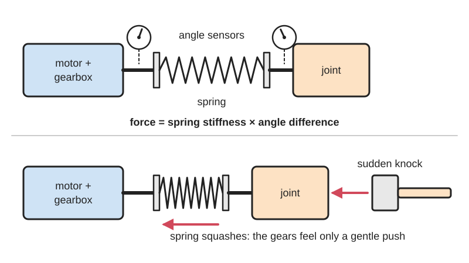
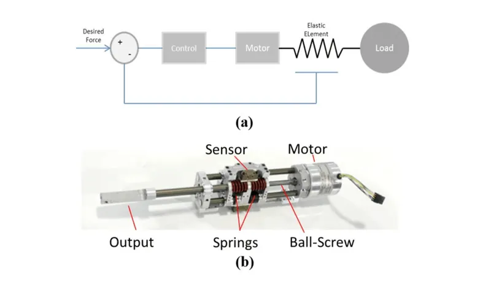

<figure class="eoc-pic eoc-pic-main"><picture><source media="(prefers-reduced-motion: reduce)" srcset="../media/drawn/series-elastic-coupling.svg"></picture><figcaption><strong>Animation.</strong> Diagram drawn for the encyclopaedia from the research notes. ⚑ Needs confirming: a drawing can simplify or get details wrong; a real photo or a better diagram is welcome.</figcaption></figure>
<figure class="eoc-pic"><figcaption><strong>How it works.</strong> <a href="https://commons.wikimedia.org/wiki/File:1-a-Schematic-Diagram-of-Series-Elastic-Actuators-44-b-Series-Elastic-Actuator.png">1-a-Schematic-Diagram-of-Series-Elastic-Actuators-44-b-Series-Elastic-Actuator</a> by Manuel Cestari Soto, <a href="https://creativecommons.org/licenses/by-sa/4.0">CC BY-SA 4.0</a>, from Wikimedia Commons.</figcaption></figure>

A series elastic [actuator](../glossary.md#actuator) drives a joint through a purposely soft spring placed after the gearbox, so the spring absorbs shocks and its measured [deflection](../glossary.md#deflection) tells the controller the force, letting the motor control force instead of just position.

**In plain words:** A spring deliberately put between a motor's gearbox and the part it moves, so knocks are soaked up by the spring, and by measuring how far the spring has twisted or squashed, the robot can tell (and control) how hard it is pushing. **Proper term:** Series elastic actuator (SEA); series-elastic coupling.

**Also called:** SEA; series elasticity / series compliance; compliant actuator / elastic actuator; rotary SEA / linear SEA; series elastic servo / compliant servo actuator (hobby-servo versions); torsion-spring coupling (the spring stage on its own); force-controlled or torque-controlled actuator (what the sensing makes it); variable [stiffness](../glossary.md#stiffness) actuator, VSA (a related version whose spring stiffness can be changed); tendon tensioner with spring (string-driven robot version).

## How it works

The motor and gearbox do not drive the joint directly: 'the motor and gearbox drive a spring, and it's the spring that drives the joint' (Matthew Williamson, in IEEE Spectrum). A spring's force equals its stiffness times how far it is bent or twisted (Hooke's law), so measuring the angle difference across the spring gives the force, and the controller moves the motor to hold the deflection that produces the force it wants (Pratt & Williamson 1995). This turns the hard job of controlling force through noisy, sticky gears into the easier job of controlling a position. The spring also spreads out sudden knocks, lowering the peak force on the gear teeth and giving the controller time to react, and it can store and return energy, as in walking and hopping robots (Hurst & Green).

## Parts

A small assembly that acts as one unit: motor; gearbox (planetary, belt or ball screw); the spring (a [torsion](../glossary.md#torsion) bar, coil torsion spring, flat spiral or 'planar' torsion spring, pairs of compression springs, fibreglass plate, rubber, or a 3D-printed TPU spring); sensors that measure the spring's deflection (two angle encoders, a magnet and Hall sensor, a potentiometer, or strain gauges); bearings; and a controller running a force ([torque](../glossary.md#torque)) control loop.

## Everyday examples

- Electric power steering in cars: a torsion bar in the steering column is measured, and the assist motor helps in proportion to its twist (Hurst & Green)
- A self-propelled walk-behind lawnmower whose spring-loaded handle opens the throttle as you push it (Hurst & Green)
- The Baxter collaborative robot, whose springy joints let it work beside people and feel when it is grabbed (IEEE Spectrum)
- The 'servo saver' on an RC car's steering: a spring between servo and steering, the same idea without the measuring (Tamiya)

## When to use it

Use a series spring when a geared motor must touch or push on people, animals or unpredictable objects: robot arms that work beside people, grippers that must squeeze gently, exoskeletons and prosthetics where comfort needs gentle, accurate force, walking and hopping robots that land hard and can reuse energy, haptic controls that must feel like a spring, and any geared drive that keeps breaking teeth on impacts. It also lets cheap, sloppy gearboxes give smooth, accurate force (IEEE Spectrum; Hurst & Green). A simple unmeasured spring coupling is worth adding just to protect a hobby servo from shocks.

## When not to use it

Avoid it where you need stiff, precise positioning (3D-printer axes, CNC, camera sliders): the spring lets the output move under load, and a rigid drive with a stiff coupling such as a flexible beam or jaw coupling is better. If you only need overload protection, a friction slip clutch, ball-detent torque limiter or servo saver is simpler. If you need fast, strong force changes against a stiff, unmoving object, a stiffer drive with a torque sensor wins (Hurst & Green). Low-ratio, back-drivable 'direct' or quasi-direct drives are another route to gentle force control without a spring ⚑ [uncertain: no source opened]. And don't add one without a plan for sensing and control if you actually need force control.

## Details

- **What it does (jobs):**
  - let it move (turn, slide or bend): it drives a robot joint or linear output through a spring
  - hold or release using power: with its sensor and controller it holds a chosen force or softness rather than a rigid position
  - store energy: the spring stores and gives back energy, e.g. in each step of a legged robot (Hurst & Green)
  - slow it, stop it or keep its speed steady: the spring cushions impacts so the motor can decelerate before force builds up (Hurst & Green)
- **Movement:** rotate (rotary SEAs at robot joints; the spring adds a small extra twist, e.g. up to ±20° designed into OpenSEA's spring) or, for linear SEAs driven by a ball screw, slide
- **Directions it can move (degrees of freedom):** 1 at the output, but 2 inside: the gearbox side and the joint side can differ by the spring's deflection ('an additional degree of freedom is added to the system', OpenSEA paper)
- **Special behaviour:**
  - torque-limiting (slips or clicks at a set force/torque): not by slipping, but because it measures force, its controller can hold or cap a set force; Baxter's arms sense when they are grabbed and slow down or follow the push (IEEE Spectrum), and James Bruton's prototype stops pushing when it meets resistance (Hackaday)
  - [fail-safe](../glossary.md#fail-safe--fail-secure) or breakaway: the spring gives under a sudden knock and spreads out the shock, protecting the gears, then springs back, with nothing to reset (Pratt & Williamson; Hurst & Green)
  - tensioning (takes up slack and holds): in string (tendon) driven robots a spring in the string keeps it taut and acts as a shock absorber (Printables tendon tensioner)
- **How it holds:**
  - spring force (a spring or springy part presses it in place): all the force between gearbox and joint passes through the spring
  - not a holding joint (it moves or passes on motion): it is a drive that passes on and measures force
- **Input and output:** Rotation -> rotation for rotary SEAs; rotation -> straight push-pull for linear SEAs using a ball screw with springs on either side of the nut (Hurst & Green; MIT-SEA). The spring stage itself is 1:1 on average, in line; the gearing before it sets the ratio (Pratt & Williamson used a 66:1 planetary gearbox; OpenSEA a 3:1 helical planetary; Lee & Oh a 2:1 timing belt). The output lags or leads the gearbox by the spring's deflection. Efficiency: a steel spring gives back almost all the energy it stores ⚑ [uncertain: no figure found]; rubber and other elastomers lose some to [hysteresis](../glossary.md#hysteresis) (Hurst & Green). Back-drivable: yes, within the spring's travel, even if the gearbox is locked; beyond that, only if the gearbox itself is back-drivable. With control, it can be made to feel softer or stiffer than the real spring (Pratt & Williamson).
- **Power:** powered: needs a motor and, for force control, sensors and a controller. The spring coupling itself is passive. If power is lost, the joint behaves like the bare gearbox plus the spring: a [self-locking](../glossary.md#self-locking) gearbox holds with springy give, a back-drivable one lets the joint sag ⚑ [uncertain]
- **Load:** Light to heavy depending on the design. Hobby and 3D-printed versions carry a few newton-metres (OpenSEA: designed for about ±3 N·m through the spring, with up to 12.36 N·m from its gearbox; a stroke-rehabilitation elbow needs about 3 N·m). A linear electric SEA in one design study carried 450 N (IntechOpen chapter). Hydraulic SEAs give about 100 times the power density of electric ones and suit heavy legged robots (IntechOpen). Strong in the drive direction up to the spring's safe deflection; beyond it the spring yields or hits end stops (Pratt & Williamson list the spring's yield point as a limit). Side loads should be carried by bearings, not by the spring ⚑ [uncertain].
- **Play and precision:** Deliberately springy: the output moves under load by the spring's deflection, so holding an exact position is harder; one builder quotes SEAs' 'low stiffness and limited bandwidth that leads to degraded position control performance' (hackaday.io 3D printed robot actuator log). Gear [backlash](../glossary.md#backlash) and friction sit inside the force loop and are largely hidden: Baxter's SEAs 'act as filters that help reduce friction and backlash in low-cost gearboxes' (IEEE Spectrum). Printed gear trains add their own springiness: in OpenSEA the printed planetary gears gave 74.9 % of the total 22.22° compliance and the spring only 25.1 %. Force-sensing resolution = spring stiffness x sensor angle resolution (Lee & Oh: 0.3835 mN·m per encoder count).
- **Taking it apart:** removable: built from bolted parts, bearings and swappable springs
- **How often it can be reused:** many times: it can be dismantled to change the spring or service the gearbox; the limit is spring [fatigue](../glossary.md#fatigue) and gear wear ⚑ [uncertain]
- **Sealing:** none: the actuator described in the sources is open; seal it with a housing if needed
- **Adjustable:** The physical stiffness is fixed by the spring fitted, but springs can be swapped (a hackaday.io printed leg uses swappable springs) or changed on the fly in a variable-stiffness actuator; the controller can make the joint behave softer or stiffer than the spring (Pratt & Williamson). String versions adjust pre-tension with a screw (Printables tendon tensioner).
- **Access needed:** not applicable: it is a self-contained drive unit, reached wherever its housing opens
- **Materials:** Springs: steel torsion bar with a cross-shaped section (Pratt & Williamson), spring-steel coil torsion spring (OpenSEA: 2.667 mm wire, 29 mm coil diameter, 7 turns), planar torsion springs with an inner and outer ring joined by flexible spokes (NASA Robonaut 2, via Hurst & Green), steel die springs (MIT-SEA), fibreglass or titanium plates (ATRIAS and other legged robots), rubber and elastomers (Hurst & Green) and 3D-printed TPU (arXiv 2609.19367). Structure: printed PLA housings and gears in OpenSEA (PLA flexural strength 83 MPa), with carbon-fibre-reinforced nylon (175 MPa) suggested for higher torques; metal gearboxes and bearings in larger actuators.
- **Heat, cold, water and wear:** Printed plastic springs and PLA gears lose stiffness with heat (PLA softens above about 60 °C, Prusa) and plastics [creep](../glossary.md#creep) under constant load, so a printed spring's zero point and stiffness can drift ⚑ [uncertain: creep not measured in the sources opened]; recalibrate after use. Elastomer springs (rubber, TPU) show hysteresis and non-linearity (Hurst & Green). Steel springs are stable but can fatigue after many cycles near their limit ⚑ [uncertain]. Magnetic and Hall-effect sensors can be upset by nearby motor magnets or steel ⚑ [uncertain].

## Making it

- **Ways to make or get it:**
  - 3D print (FDM): housings, gear trains, carriers, horns and even TPU springs (OpenSEA; arXiv 2609.19367; hackaday.io compliant servo actuator)
  - off-the-shelf part: springs, bearings, encoders, motors and gearboxes; complete modular SEAs are sold commercially, e.g. ANYdrive, HEBI X-Series, Apptronik P170 Orion (brands, listed by Hurst & Green)
  - CNC: metal torsion bars and planar torsion springs for robot-grade actuators ⚑ [uncertain: no fabrication guide opened]
  - laser cut: ⚑ [uncertain] flat spiral or planar springs could be cut from sheet, no tested example opened
- **Printing it in one piece (print in place):** no: it is assembled from printed parts plus a spring, bearings, sensors and a motor
- **Tools:** Hex keys and screwdrivers for assembly, a soldering iron for sensor wiring, and known weights or a torque gauge to calibrate the spring's stiffness ⚑ [uncertain: general practice]
- **Difficulty:** moderate to hard: putting a spring between a servo horn and the output is easy, but measuring the deflection and closing a force-control loop needs a sensor, calibration and control code; commercial robot-grade SEAs are expensive precision units, so buy or copy an open design

### 3D printing tips

1) Use a metal spring where you can: steel coil or torsion springs are predictable and don't creep. Printed TPU torsion springs can work (one design's torque-twist curve was 'highly linear', within 3 % of simulation, with deviations blamed on FDM anisotropy, i.e. layers being weaker in some directions, arXiv 2609.19367), but elastomers show hysteresis and non-linearity (Hurst & Green). 2) Put the spring after the gearbox, next to the joint (distal elasticity): this decouples the motor's inertia from the output best and measures the force at the joint more directly (Hurst & Green). OpenSEA instead places its torsion spring between the planetary ring gear and the fixed motor bracket, a compact alternative. 3) Measure the spring directly: a magnet and linear Hall-effect sensor across the spring plus an AS5600 magnetic encoder (hackaday.io compliant servo actuator), two potentiometers compared by an Arduino (James Bruton, Hackaday), strain gauges on the spring (Pratt & Williamson) or a high-resolution absolute encoder (Lee & Oh). 4) Printed gears are springy too: in OpenSEA the printed planetary gave three times more twist than the actual spring, so don't estimate force from the motor encoder alone. 5) [Infill](../glossary.md#infill) and walls used by OpenSEA in PLA: 100 % for the coupler, carrier, planet gears and stops; 60 % for sun, ring and bevel gears; 30 % for arm links and brackets; 3 [perimeters](../glossary.md#perimeters) on everything. For higher torque, use carbon-fibre-reinforced nylon. 6) Add hard stops so the spring can't be twisted beyond its safe range (Pratt & Williamson note spring yield as a limit) ⚑ [uncertain: end stops are general practice]. 7) Leave room to swap springs while tuning (hackaday.io printed leg). 8) For string-driven robots, a small printed tensioner with a ballpoint-pen spring, an M2 screw, fishing line and a PTFE tube guide makes a simple SEA-style shock absorber (Printables tendon tensioner). 9) PLA softens above about 60 °C (Prusa), so keep printed springs and gears away from hot motors.

### Buying one (off-the-shelf parts)

Torsion springs and compression springs (die springs for linear SEAs); magnetic angle encoders (e.g. AS5600), linear Hall-effect sensors and 6 x 3 mm neodymium magnets; potentiometers; strain gauges with an amplifier; absolute encoders; thin-section bearings (e.g. 6809); planetary gearboxes or gear motors; ball screws; hobby servos with a servo controller that has velocity and acceleration limits (Pololu Maestro used by a hackaday.io build); fishing line and PTFE (Bowden) tube for tendon versions; M2/M3 screws, nuts and [heat-set inserts](../glossary.md#heat-set-insert); complete modular SEAs from ANYbotics, HEBI Robotics and Apptronik (brands).

## Rules of thumb

- Force = spring stiffness x deflection (torque = torsional stiffness x twist angle); this is how an SEA measures force (Pratt & Williamson 1995; IntechOpen chapter).
- The spring's stiffness is the key design choice: a softer spring gives better shock [tolerance](../glossary.md#tolerance), more accurate force control and a 'softer' feel; a stiffer spring gives faster force changes (higher force bandwidth) and better position holding. 'The spring has to be able to support the loads, but it cannot be too stiff' (IntechOpen chapter); the best value depends on the task (Hurst & Green).
- Force resolution = stiffness x sensor angle resolution: a 128 N·m/rad spring read by a 19-bit absolute encoder resolves about 0.38 mN·m per count (Lee & Oh 2019).
- Natural frequency of motor inertia on the spring = square root of (stiffness / inertia): Pratt & Williamson's 34 N·m/rad torsion spring with 0.02 kg·m² of reflected motor inertia gave about 41 rad/s, roughly 7 Hz.
- Gearing by N:1 multiplies the motor's reflected inertia by N squared, so high-ratio gearboxes suffer most from shocks and gain most from a series spring (Pratt & Williamson; Hurst & Green).
- Use softer springs and smaller peak torques at light, fast joints (e.g. a wrist) than at heavy ones (e.g. a shoulder); one actuator design is rarely right for every joint (Hurst & Green).
- Example sizes from published designs: MIT-SEA-type linear SEA with a ball screw and antagonistic die springs (Hurst & Green); an electric linear SEA for 450 N with 40 Hz bandwidth used a 3.27 x 10^4 N/m spring (IntechOpen chapter); Lee & Oh's leg joint achieved 32 Hz closed-loop force bandwidth with a 128 N·m/rad spring.

## Common failures

1) Spring too stiff: little benefit, poor force resolution. Spring too soft: sluggish, wobbly joint that can't follow fast motions (IntechOpen; Pratt & Williamson). 2) Force readings drift because printed gears or mounts flex more than the spring (OpenSEA: gears gave about three times the spring's twist), or because a printed spring creeps: measure deflection right across the spring and recalibrate. 3) Spring over-twisted and permanently bent (yield): add end stops (Pratt & Williamson list yield as a limit). 4) Control loop oscillates or buzzes near the spring-inertia resonance (about 7 Hz in Pratt & Williamson's actuator): lower gains or add [damping](../glossary.md#damping) ⚑ [uncertain: general control practice]. 5) Play (dead zone) where the spring's mounting is loose, so small forces aren't sensed ⚑ [uncertain]. 6) Sensor magnet or encoder slips on its shaft, giving false force readings ⚑ [uncertain].

## Safety

A loaded spring stores energy: a joint can spring back if a part slips or is released ⚑ [uncertain: general spring safety]. The spring makes contact gentler but not harmless; a badly tuned force loop can oscillate or push harder than expected (Lee & Oh needed a disturbance observer to keep control robust). Keep fingers out of gear trains and motor pinch points.

## Related

- Servo saver (sprung servo horn): a spring between servo and [linkage](../glossary.md#linkage) that absorbs knocks, but nothing measures it; covered with the torque-limiting gear entry
- Friction slip clutch and ball-detent torque limiter: protect gears by slipping at a set torque, but give no force control and don't store energy
- Jaw coupling (spider coupling): its rubber spider soaks up small shocks between shafts, but it is meant to be stiff, not a measured spring
- Flexible beam coupling: bends to accept [misalignment](../glossary.md#misalignment) while staying stiff in twist, the opposite of an SEA's deliberate twist
- Variable stiffness actuator (VSA): an SEA whose spring stiffness can be changed while running, e.g. the University of Pisa VSA-I (Wikimedia Commons)
- Parallel elastic actuator: the spring works alongside the motor rather than between motor and output, to carry a steady load or store energy ⚑ [uncertain: no source opened]
- Servo horn and [spline](../glossary.md#spline) hub: the usual rigid way to attach parts to a hobby servo, which a series spring can be added to

## Make it yourself

- [SEA_Exoskeleton (COMANDLab, GitHub), README: 3D Printed Series Elastic Actuator for Elbow Exoskeleton](https://raw.githubusercontent.com/COMANDLab/SEA_Exoskeleton/main/README.md): The open design files for the OpenSEA printed planetary series elastic actuator (the paper says all designs are publicly available here) *(licence: not stated in the README ⚑ [uncertain])*
- [Compliant Servo Actuator (hackaday.io)](https://hackaday.io/project/183393-compliant-servo-actuator): A 3D-printed series elastic servo for a quadruped robot, with an AS5600 encoder, a linear Hall sensor and magnets to measure the spring, and a downloadable STEP file of the printed horn *(licence: not stated ⚑ [uncertain])*
- [String Tensioner and Shock Absorber for Robot Tendons (Series Elastic Actuator) (Printables) (URL from Printables API, page not opened)](https://www.printables.com/model/605782-string-tensioner-and-shock-absorber-for-robot-tend): A small printed spring tensioner for string-driven robots that clips to a servo arm; uses an M2 screw, a flat M2 nut, a ballpoint-pen spring, fishing line and optional PTFE tube *(licence: CC BY-NC-ND)*
- [Series Elastic Actuator - CAD (hackaday.io, 3D Printed Robot Actuator project)](https://hackaday.io/project/157812-3d-printed-robot-actuator/log/154407-series-elastic-actuator-cad): Design log for a printed cycloidal-drive leg actuator with swappable springs in series, to cut peak loads on the printed gears and allow jumping *(licence: not stated ⚑ [uncertain])*

## Pictures, videos and models

- [Schematic Diagram of Series Elastic Actuators (Wikimedia Commons, by Manuel Cestari Soto)](https://commons.wikimedia.org/wiki/File:1-a-Schematic-Diagram-of-Series-Elastic-Actuators-44-b-Series-Elastic-Actuator.png): Two-part figure from a study of variable-stiffness exoskeleton joints: (a) a schematic of series elastic actuators and (b) an example SEA *(licence: CC BY-SA 4.0)*
- [OpenSEA: a 3D printed planetary gear series elastic actuator for a compliant elbow joint exoskeleton (Jenks, Levan, Stefanovic, Frontiers in Robotics and AI, 2025)](https://www.frontiersin.org/journals/robotics-and-ai/articles/10.3389/frobt.2025.1528266/full): Exploded views of a printed planetary SEA, its coil torsion spring and test results; open access *(licence: CC BY (article))*
- [An Introduction To Series Elastic Actuators For A Robot (Hackaday, 2015)](https://hackaday.com/2015/12/03/an-introduction-to-series-elastic-actuators-for-a-robot/): James Bruton's simple SEA with a printed lead screw, elastic bands and two potentiometers read by an Arduino, with the video embedded *(licence: link only)*
- [Avengeres Ultron #4 | Series Elastic Actuators (James Bruton, YouTube)](https://www.youtube.com/watch?v=-deICvHVo5A): Video building and demonstrating a hobby series elastic actuator that senses when it is pushed *(licence: link only (standard YouTube licence))*
- [Variable Impedance Actuator.jpg: the VSA-I variable stiffness actuator (Wikimedia Commons, Centro di Ricerca E. Piaggio, University of Pisa)](https://commons.wikimedia.org/wiki/File:Variable_Impedance_Actuator.jpg): Photo of a research actuator whose springs' stiffness can be changed (a related variant) *(licence: CC BY-SA 4.0)*

## Needs confirming

⚑ marks something nobody has confirmed yet: a fact the research could not confirm from a source, a finder value that is a best guess, or an open point from the research notes. Corrections are welcome (see `research/needs-confirming.md`).

- ⚑ 20 sentences on this page marked [uncertain].
- ⚑ Finder value `connects` = shaft (best guess): worked out from its name, but joining parts is not one of its two main jobs
- ⚑ Finder value `power_source` = electricity (source uncertain): `power` is marked ⚑ [uncertain] here: "…arbox holds with springy give, a back-drivable one lets the joint sag ⚑ [uncertain]…"
- ⚑ Finder value `power_loss` = not applicable (best guess): `power` mentions losing power, but none of the three outcomes
- ⚑ Finder value `tools` = soldering iron, hand tools (source uncertain): `tools_needed` is marked ⚑ [uncertain] here: "…d known weights or a torque gauge to calibrate the spring's stiffness ⚑ [uncertain: general practice]…"
- ⚑ Research note: *Series-elastic coupling*: the OpenSEA paper's spring table doesn't add up (0.015 N·m/° × ±20° = 0.3 N·m, not the ±3 N·m it states). The entry quotes ±3 N·m in `load` only; check it.

## Sources

- <https://fab.cba.mit.edu/classes/865.15/people/rebecca.kleinberger/assets/papers/SEA_Pratt.pdf>
- <https://mime.engineering.oregonstate.edu/research/drl/_documents/hurst_2020.pdf>
- <https://www.intechopen.com/chapters/51224>
- <https://www.frontiersin.org/journals/robotics-and-ai/articles/10.3389/frobt.2025.1528266/full>
- <https://pmc.ncbi.nlm.nih.gov/articles/PMC11906680/>
- <https://raw.githubusercontent.com/COMANDLab/SEA_Exoskeleton/main/README.md>
- <https://www.frontiersin.org/journals/neurorobotics/articles/10.3389/fnbot.2019.00017/full>
- <https://arxiv.org/abs/2609.19367>
- <https://spectrum.ieee.org/rethink-robotics-baxter-robot-factory-worker>
- <https://hackaday.com/2015/12/03/an-introduction-to-series-elastic-actuators-for-a-robot/>
- <https://www.youtube.com/watch?v=-deICvHVo5A>
- <https://hackaday.io/project/183393-compliant-servo-actuator>
- <https://hackaday.io/project/157812-3d-printed-robot-actuator/log/154407-series-elastic-actuator-cad>
- <https://api.printables.com/graphql/>
- <https://commons.wikimedia.org/wiki/File:1-a-Schematic-Diagram-of-Series-Elastic-Actuators-44-b-Series-Elastic-Actuator.png>
- <https://commons.wikimedia.org/wiki/File:Variable_Impedance_Actuator.jpg>
- <https://tamiyamodel.com/how-does-a-servo-saver-work/>
- <https://help.prusa3d.com/article/pla_2062>
