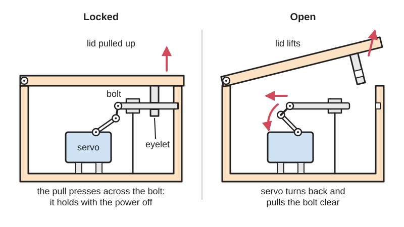

<figure class="eoc-pic eoc-pic-main"><picture><source media="(prefers-reduced-motion: reduce)" srcset="../media/drawn/servo-or-motorised-latch.svg"></picture><figcaption><strong>Animation.</strong> Diagram drawn for the encyclopaedia from the research notes. ⚑ Needs confirming: a drawing can simplify or get details wrong; a real photo or a better diagram is welcome.</figcaption></figure>

A small electric motor, usually a hobby servo, turns a cam, arm or hook that pushes a bolt into a catch (keeper) or pulls it out, so a microcontroller can lock or unlock something, and because the load pushes across the bolt rather than along it, the lock stays shut with no power.

**In plain words:** A small motor or hobby servo hidden inside a box, door or drone that slides a bolt or swings a hook to lock it, and stays locked after it is switched off. **Proper term:** Motorised latch (servo latch, motor-driven lock [actuator](../glossary.md#actuator)).

**Also called:** servo latch / servo lock / servo-operated lock (maker term); motorised lock / motor lock / motor-driven bolt (electronic safe locks and commercial door locks); electronic deadbolt / smart lock (a motor turns the deadbolt's thumb-turn); door lock actuator / power door lock (cars); motor-operated lock (European door hardware, Wikipedia 'Electronic lock'); reverse geocache latch / puzzle box latch (GPS puzzle boxes); payload release / drop mechanism / servo release (drones and RC planes); servo-actuated hook (drone payload hooks).

## How it works

The motor, geared down inside the servo, turns its output shaft to one of two set angles, 'locked' and 'open'. An arm or cam on the shaft slides a bolt through a keeper on the lid or door (as in the reverse geocache box, where a servo pushes a chopstick through eyelet screws; Arduiniana), or swings a hook or lever in or out of a slot. A hobby servo finds its angle by itself: a potentiometer on the output shaft reports its position and the servo drives the motor until it matches the width of the control pulse, 1 to 2 ms repeated 50 times a second (Wikipedia, Servo (radio control)). Once in place the power can be cut: the parts are shaped so that pulling on the lid pushes across the bolt ([shear](../glossary.md#peel-vs-shear)) into the frame and does not try to turn the motor, so the lock holds indefinitely with no power (Make:, Keyless Lock Box). In spring-latched versions a spring holds the catch shut and the servo only pushes it open, then moves clear (Printables 134411; Hackaday.io Lock Box).

## Parts

A small assembly: (1) the actuator, a hobby servo (motor, gearbox and position sensor in one case) or a small gear motor, sometimes with a worm gearbox; (2) a servo horn, cam or arm on its output shaft; (3) the moving locking part: a sliding bolt, pin, dowel or chopstick, a pivoting hook or lever, or a notched disc; (4) a keeper (strike) on the other part, such as an eyelet screw, slot or bar; (5) often a return spring that holds a spring-latched version shut; (6) a controller (microcontroller, keypad, GPS or radio receiver), a battery and often a power switch; (7) optionally limit switches and a hidden emergency override. Example part list from a printed latch: MG90 or SG90 servo, 38 mm x M3 screw and nut as the pivot, a small spring, printed cam, latch lever and servo mount (Printables 134411).

## Everyday examples

- Car power door locks, where a small motor inside each door moves the lock (Wikipedia, Power door locks; a dissected door lock actuator is shown by Samarins)
- Smart locks and electronic deadbolts that turn the existing thumb-turn with a battery motor, and motor-operated door locks (Wikipedia, Electronic lock)
- Electronic safe locks, where 'a [solenoid](../glossary.md#solenoid) or motor retracts' the bolt (Locksmith Ledger, 2015)
- GPS 'reverse geocache' puzzle boxes and quiz lock boxes (Arduiniana; Hackaday, 2015)

## When to use it

Use it when something should lock or unlock on an electrical signal and then stay that way without draining a battery: puzzle and treasure boxes, keypad or RFID lock boxes, cabinets and pet feeders, drone and model-aircraft payload drops and parachute releases, escape-room props and automated doors or hatches. It is cheap (a micro servo costs a few dollars), easy to control from Arduino-type boards, and gives a long, adjustable throw compared with a solenoid.

## When not to use it

Do not use it where the lock must open if the power fails (fire exits, anything a person or animal could be trapped in); use a [fail-safe](../glossary.md#fail-safe--fail-secure) device such as an electromagnet lock or an electric strike set to open without power (Wikipedia, Electric strike). Do not use a hobby servo as real security; it can be forced, and an unpowered servo can be back-driven. For a very small, silent release use a shape-memory-alloy wire latch; for a fast, simple push-pull catch use a solenoid latch; for loads that push hard along the bolt use a worm-gear actuator or an [over-centre](../glossary.md#over-centre) latch. For very frequent cycling a solenoid or a proper lock actuator lasts longer than a cheap servo ⚑ [uncertain].

## Details

- **What it does (jobs):**
  - hold or release using power: a signal from a microcontroller, keypad, GPS, radio or app locks or unlocks it
  - join and hold: keeps a lid, door, drawer or payload shut or attached until told to let go
- **Movement:** multiple: the servo output rotates (a typical hobby servo covers about 90° to 180°, Wikipedia, Servo (radio control)); an arm or cam turns this into a sliding bolt (slide) or a swinging hook or lever (rotate)
- **Directions it can move (degrees of freedom):** 1: the bolt slides along one path, or the hook swings about one pivot, driven by the motor. When locked, the lid or door has 0 freedom in the directions the bolt blocks.
- **Special behaviour:**
  - [self-locking](../glossary.md#self-locking) (holds under load, won't back-drive): only if the parts are arranged so the load presses across the bolt, or the drive has a worm gear or a cam past its [dead point](../glossary.md#dead-point); a plain hobby servo can be turned back by hand when unpowered ('I don't think you're going to find a servo that you can't force to backtrack when you disconnect the power', Pololu forum, 2007). Arranged this way it keeps its last state when power is lost: a locked box stays locked (fail-secure) and an open one stays open
  - motion conversion (e.g. rotary to linear): the servo's rotation becomes a sliding bolt through an arm, cam or rack
  - quick-release: unlocks in a fraction of a second on command (an SG90 micro servo turns 60° in 0.12 s at 4.8 V, TowerPro)
- **How it holds:**
  - shape (the parts interlock; [form-fit](../glossary.md#form-fit--force-fit--material-bond)): a bolt, pin or hook sits in a keeper
  - friction or clamping (force-fit): friction in the servo's gear train, or a self-locking worm gear, stops the load turning the motor back (Pololu forum; Wikipedia, Worm drive)
  - spring force (a spring or springy part presses it in place): in spring-latched designs a small spring holds the catch shut and the servo only opens it (Printables 134411; Hackaday.io Lock Box)
- **Input and output:** Not a transmission, but inside it: motor rotation -> geared-down output rotation (a hobby servo, about 90-180°) -> bolt slide or hook swing through an arm, cam or rack. Back-drivable: yes for an unpowered hobby servo (Pololu forum, 2007); no for a worm gearbox with a small lead angle (Wikipedia, Worm drive). Design the latch so the load cannot push the bolt back along its travel, and the [back-driving](../glossary.md#back-driving) question no longer matters.
- **Power:** powered (needs electricity to lock and to unlock, but not to stay in either state). If power is lost it keeps its last state: the Keyless Lock Box 'can sit in a locked state for indefinite periods without any power' (Make:). Spring-latched versions stay locked. A servo that must be held by its motor (because the load pushes on it) holds only while powered and receiving pulses. Plan an emergency way in: the reverse geocache box opens after a two-minute delay when external power is plugged into a hidden jack (Arduiniana), and the Keyless Lock Box unlocks briefly if a sensor is held while power is reconnected (Make:).
- **Load:** Light to medium, set by the bolt, keeper and their mountings rather than the servo, provided the load pushes across the bolt. Strong in shear across the bolt or hook; weak if the load pushes along the bolt's travel or twists the servo horn, because a 9 g micro servo gives only about 1.8 kg·cm (0.18 N·m) stall [torque](../glossary.md#torque) (TowerPro SG90). Drone release designs let 'the printed parts hold the weight of the object taking strain off of the servo motor axle' (Printables 117198). A printed or hobby latch keeps honest people out; it is not a security lock.
- **Play and precision:** small to noticeable: a hobby servo returns to the same commanded angle each time (SG90 dead band 1 µs, TowerPro), but its plastic gears have some play. The bolt needs generous [clearance](../glossary.md#clearance) in its keeper: in one printed lock box 'the slightest bit of [misalignment](../glossary.md#misalignment) in the two latches also caused a lot of friction on the pin', and flexing parts jammed the lid (rubenwardy, 2023).
- **Taking it apart:** tool-free quick release: it opens and relocks on an electrical command; the mechanism itself is screwed or glued inside (semi-permanent), as in the Make: and Hackaday.io builds where the servo is glued in
- **How often it can be reused:** many times: it locks and unlocks over and over; life is limited by servo gear wear and the motor ⚑ [uncertain: no cycle-life figure for hobby servos found]
- **Sealing:** none: the latch does not seal; add a gasket to the lid if needed. Ordinary hobby servos are not waterproof ⚑ [uncertain]
- **Adjustable:** yes, in software: the 'open' and 'closed' servo angles are set in the code and found by experiment (Tinkernut; Arduiniana), so the throw can be tuned without re-making parts; mechanically by moving the keeper or bending the [linkage](../glossary.md#linkage)
- **Access needed:** one side only (blind): the whole latch sits inside the box or door and is worked remotely, so no keyhole shows outside. You still need a way in to change batteries or repair it, so plan an external power jack or override (Arduiniana; Make:).
- **Materials:** Servo: plastic case with plastic gears (the SG90 has a 'POM gear set', TowerPro) or metal gears (e.g. MG90-type servos). Printed cams, levers and mounts in PLA or PETG; bolts from steel rod, screws, dowels or even a chopstick; keepers from eyelet screws or bent metal (Arduiniana). The boxes are wood, acrylic or plastic. It is a mechanism, not a way of joining materials; it suits anything a keeper can be screwed or glued to.
- **Heat, cold, water and wear:** Hobby micro servos are rated for about 0-55 °C (TowerPro SG90). PLA parts soften above about 60 °C (Prusa Knowledge Base), so a PLA latch in a hot car can deform. Weak batteries make servos hunt or fail to move (SparkFun). Moisture can stop door lock actuators working (a built-in switch failing from water intrusion, Samarins). Vibration or knocks can back-drive an unpowered servo if the load presses along the bolt ⚑ [uncertain: from the Pololu forum statement that unpowered servos can be forced back].

## Making it

- **Ways to make or get it:**
  - off-the-shelf part: hobby servo or small gear motor (the actuator is always bought), or a ready-made car door lock actuator
  - 3D print (FDM): cams, latch levers, bolts, keepers and servo mounts (Printables 134411, 24182, 117198)
  - laser cut: flat arms, bolts and mounting plates in acrylic or plywood ⚑ [uncertain: no specific example opened]
  - woodwork: puzzle boxes and cabinets with a screwed-in keeper (Arduiniana; Make:)
- **Printing it in one piece (print in place):** no: the servo, pivot screw and spring are separate parts, and the printed cam, lever and mount are printed as separate pieces and assembled (the servo mount is printed separately 'which makes it stronger and easier to print' and glued on, Printables 134411)
- **Tools:** screwdriver (servo, keeper and horn screws); glue in some builds; soldering iron or crimp tools and a computer to program the microcontroller
- **Difficulty:** easy: a servo, a printed cam and a microcontroller make a working latch in an afternoon; the parts that need care are keeping the load off the servo, avoiding twitches at power-up and providing a way in if the battery dies

### 3D printing tips

Load path: shape the latch so the lid's pull goes across the bolt into the printed frame, not into the servo shaft; the camera-drop design does this so the printed parts carry the weight (Printables 117198). Spring-latched layout: in the Geocache Box Servo Latch a small spring holds a see-saw latch lever shut and the servo cam only pushes it open; 'with the servo in the latched position, the cam is not touching the latch lever', so the servo carries no load while locked (Printables 134411). [Infill](../glossary.md#infill): print the cam and latch lever at 75% infill or more and other parts at 30-45% (Printables 134411); another servo lock was printed at 80% infill without supports (Printables 24182). Orientation: print bolts, hooks and levers lying flat so the load runs along the printed [perimeters](../glossary.md#perimeters) rather than prying layers apart ⚑ [uncertain: general FDM practice, not from a tested guide]. Servo attachment: the Geocache latch cam fits the servo's 20-spline, 5 mm output shaft and is held with the normal horn screw (Printables 134411); screwing a printed arm to the supplied plastic horn is a common alternative. Clearance: leave generous clearance for the bolt, since slight misalignment made a printed pin bind (rubenwardy, 2023). Travel: set the open and closed angles in code so the servo stops short of any hard stop; driving a servo beyond its limits 'can cause damage, such as stripped gears' (SparkFun), and a servo pushing against a stop keeps drawing current. Material: PLA softens above about 60 °C (Prusa Knowledge Base), so use PETG or another heat-tolerant plastic for a box left in a car or in the sun ⚑ [uncertain: PETG temperature limit not verified here].

### Buying one (off-the-shelf parts)

Search terms: 'micro servo' (SG90, 9 g, plastic gears), 'metal gear micro servo' (MG90S), 'standard servo'; 'worm gear motor' or 'micro gear motor with worm gearbox' (self-locking drive); 'car door lock actuator' (12 V motor-driven push-pull actuator); 'servo horn'; 'eyelet screw', 'barrel bolt', 'hasp' (keepers and bolts); 'compression spring' or 'extension spring' (spring-latched versions); 'Pololu power switch' or a 'logic-level MOSFET' to cut power between uses (Arduiniana); 'microswitch' or 'limit switch' to sense lid closed or bolt thrown; 'smart lock' (ready-made motorised deadbolt).

## Rules of thumb

- Keep the load off the servo: 'The printed parts hold the weight of the object taking strain off of the servo motor axle' (Printables 117198, servo quick release for dropping a camera).
- Don't count on an unpowered hobby servo to hold against a load; 'I don't think you're going to find a servo that you can't force to backtrack when you disconnect the power'. If it must hold, use a worm drive: 'No way to back-drive it, so once it's there it can power down' (Pololu forum, 2007). Whether a worm drive is self-locking 'depends on the lead angle, the pressure angle, and the coefficient of friction', and a multi-start worm may not be (Wikipedia, Worm drive).
- Hobby servo control: pulses of 1.0 to 2.0 ms, 1.5 ms is centre, repeated at 50 Hz (Wikipedia, Servo (radio control); SparkFun Hobby Servo Tutorial).
- Current: 'A small servo with nothing attached to the shaft might draw 10 mA, while a large one turning a heavy lever might draw an Ampere or more'; give each servo its own heavy supply wires ('star power'); an under-powered servo 'hunts' and can reset the processor (SparkFun Hobby Servo Tutorial).
- A 9 g micro servo (TowerPro SG90) gives about 1.8 kg·cm stall torque at 4.8 V, moves 60° in 0.12 s, and is rated for 0-55 °C (TowerPro). At the end of a 20 mm arm that is only about 0.9 kg of push, so let the bolt, not the servo, take the load (arithmetic from the TowerPro figure).
- Battery life: cut the power completely between uses; the reverse geocache box uses a Pololu power switch that draws 0.01 µA when off and runs for only 2-3 minutes per session (Arduiniana).
- Always build in a way in: an external power jack that opens the box after a delay (Arduiniana), or an override held down while power is reconnected (Make:, Keyless Lock Box).
- Servos can twitch when power is first applied, and some jump by as much as 30° (Arduino Forum, 'Servo twitch on startup'); fixes include writing the position before calling attach(), powering the servo only after the controller has started (a P-channel MOSFET), or a 10 kΩ pull-up on the signal line (Arduino Forum threads 141489 and 187028). Arrange the latch so a twitch cannot throw the bolt open.

## Common failures

Servo stalls or strips its gears because the bolt binds or the servo is driven against a stop: add clearance, set angles short of the stops (SparkFun) and use metal-gear servos. Lock jams from misalignment or flexing printed parts (rubenwardy, 2023): print stiffer parts and loosen the fit. Servo turns too far and breaks the lock; cheap servos can misbehave (rubenwardy, 2023; the Hackaday.io lock box servos worked only as 'either at 0 degrees, or 180 degrees'). Twitch at power-up throws the bolt (Arduino Forum): write the position before attach() and power the servo after the controller starts. Battery runs flat and you are locked out: cut power between uses (Arduiniana) and add an external power jack. Load pushes the servo back when unpowered: redesign so the load acts across the bolt or use a worm drive (Pololu forum). Glue seeps into switches or mechanisms during assembly (Hackaday, 2015).

## Safety

It fails locked: if the battery dies or the electronics fail, the lid stays shut, so always provide an emergency way in (Arduiniana; Make:) and never use it on anything a person or animal could be shut inside. Servo arms and bolts can pinch fingers. Lithium batteries powering the box need proper protection ⚑ [uncertain]. It is not a security device.

## Related

- Solenoid latch: an electric coil pulls a spring-loaded bolt straight back; faster and simpler, but short [stroke](../glossary.md#stroke) and usually needs power while held open
- Shape-memory-alloy wire latch: a heated nitinol wire pulls a catch silently; tiny and light, but very short stroke and slow to reset
- Electromagnet lock (maglock): holds only while powered and opens when power fails (fail-safe)
- Electro-permanent magnet: switched on or off by a pulse and holds with no power, like a servo latch, but grips steel instead of throwing a bolt
- Worm drive: a self-locking gear stage that lets a motorised latch hold against a load with no power
- Sear and trigger: a servo can trip a sear to release a large stored force with a small movement
- Draw latch (over-centre latch): the hand-operated latch a servo can be made to throw past its dead point
- Servo horn and [spline](../glossary.md#spline) hub: how the arm or cam is fixed to the servo's output shaft

## Make it yourself

- [Servo Latch - Geocache Box Servo Latch, by Plexi](https://www.printables.com/model/134411-servo-latch-geocache-box-servo-latch): A printable spring-held see-saw latch lever opened by a cam on an MG90 or SG90 servo; needs a 38 mm x M3 screw and nut and a small spring; cam and latch at 75%+ infill (read through the Printables API) *(licence: Creative Commons Attribution (CC BY))*
- [Servo operated lock, by Tonitwn (URL from Printables API, page not opened)](https://www.printables.com/model/24182-servo-operated-lock): A printable servo lock for treasure chests, controlled by a BBC micro:bit that asks for a code; printed at 80% infill without supports (read through the Printables API) *(licence: Creative Commons Attribution-ShareAlike (CC BY-SA))*
- [Servo Quick Release for Dropping Camera, by FTWMaker (URL from Printables API, page not opened)](https://www.printables.com/model/117198-servo-quick-release-for-dropping-camera): A servo drop mechanism for drones or planes in which the printed parts carry the load so the servo only releases it; hinges made from paper clips or staples (read through the Printables API) *(licence: Creative Commons Attribution-NonCommercial-ShareAlike)*
- [Drone Payload Release Mechanism - Servo Actuated Hook System, by phytoplankton (URL from Printables API, page not opened)](https://www.printables.com/model/1770073-drone-payload-release-mechanism-servo-actuated-hoo): A servo-driven hook that locks a payload and drops it on command (read through the Printables API) *(licence: Creative Commons Public Domain)*

## Pictures, videos and models

- [Exploded Servo.jpg (Wikimedia Commons), photo by oomlout](https://commons.wikimedia.org/wiki/File:Exploded_Servo.jpg): A hobby servo taken apart, showing the motor, gear train, potentiometer and circuit board that let it turn to a set angle *(licence: CC BY-SA 2.0)*
- [The Reverse Geocache Puzzle (Mikal Hart, Arduiniana)](http://arduiniana.org/projects/the-reverse-geo-cache-puzzle/): Photos and description of a GPS puzzle box whose servo pushes a chopstick through eyelet screws to lock the lid, with its power switch and hidden back-door power jack *(licence: link only)*
- [Keyless Lock Box (Make:)](https://makezine.com/projects/keyless-lock-box/): Step-by-step build of a box locked by a screw on a servo horn that engages a metal arm in the lid, with photos; stays locked indefinitely without power *(licence: link only)*
- [3D printed Servo Latch Lock (Priyank Chouksey)](https://www.youtube.com/watch?v=jWasOv3UZrg): Video of a printed latch driven by a 9 g servo locking and unlocking (title checked with YouTube oEmbed) *(licence: YouTube standard licence; link only)*
- [Servo Actuated 3D Printed Lock (Daniel Frank)](https://www.youtube.com/watch?v=ICEQjHHbD6w): Video of a university-course printed lock mechanism driven by a servo (title checked with YouTube oEmbed) *(licence: YouTube standard licence; link only)*

## Needs confirming

⚑ marks something nobody has confirmed yet: a fact the research could not confirm from a source, a finder value that is a best guess, or an open point from the research notes. Corrections are welcome (see `research/needs-confirming.md`).

- ⚑ 8 sentences on this page marked [uncertain].
- ⚑ Finder value `power_loss` = keeps its last state (best guess): versions differ: keeps its last state, stays locked, lets go
- ⚑ Finder value `holds_for` = a person to open (best guess): carried over from the finder's old rule on entry names (R33), for "What should it do?" under "Control a movement > Stay where I leave it, and let go when I release it > Turns"
- ⚑ Finder value `powered_does` = lock or hold (best guess): set by Claude from the entry's name and power text (R33), for "What should it do?" under "Hold or let go using power"

## Sources

- <http://arduiniana.org/projects/the-reverse-geo-cache-puzzle/>
- <https://makezine.com/projects/keyless-lock-box/>
- <https://www.tinkernut.com/how-to-make-a-reverse-geocaching-puzzle-box/>
- <https://en.wikipedia.org/wiki/Servo_(radio_control)>
- <https://learn.sparkfun.com/tutorials/hobby-servo-tutorial/all>
- <https://forum.pololu.com/t/worm-gearbox-for-hobby-servo/356>
- <https://towerpro.com.tw/product/sg90-analog/>
- <https://en.wikipedia.org/wiki/Worm_drive>
- <https://en.wikipedia.org/wiki/Electronic_lock>
- <https://en.wikipedia.org/wiki/Electric_strike>
- <https://en.wikipedia.org/wiki/Power_door_locks>
- <https://www.samarins.com/glossary/door_lock_actuator.html>
- <https://www.locksmithledger.com/safes/article/12050394/safe-locks>
- <https://www.commandaccess.com/blog/motorized-vs-solenoid-locks-choosing-the-right/>
- <https://hackaday.io/project/8122-lock-box/log/26843-the-locking-mechanism>
- <https://hackaday.com/2015/11/09/trivia-lock-box-spices-up-wedding-reception/>
- <https://hackaday.com/tag/lock-box/>
- <https://hackaday.com/2020/03/30/printed-door-handle-turns-key-with-a-servo/>
- <https://blog.rubenwardy.com/2023/03/16/lockbox/>
- <https://forum.arduino.cc/t/servo-twitch-on-startup/141489>
- <https://forum.arduino.cc/t/easiest-way-to-avoid-servo-twitch-on-power-up/187028>
- <https://help.prusa3d.com/article/pla_2062>
- <https://commons.wikimedia.org/wiki/File:Exploded_Servo.jpg>
- <https://www.youtube.com/watch?v=jWasOv3UZrg (verified via YouTube oEmbed)>
- <https://www.youtube.com/watch?v=ICEQjHHbD6w (verified via YouTube oEmbed)>
- <https://www.printables.com/model/134411-servo-latch-geocache-box-servo-latch (read via https://api.printables.com/graphql/)>
- <https://www.printables.com/model/24182-servo-operated-lock (URL from Printables API, page not opened; read via https://api.printables.com/graphql/)>
- <https://www.printables.com/model/117198-servo-quick-release-for-dropping-camera (URL from Printables API, page not opened; read via https://api.printables.com/graphql/)>
- <https://www.printables.com/model/1770073-drone-payload-release-mechanism-servo-actuated-hoo (URL from Printables API, page not opened; read via https://api.printables.com/graphql/)>
- <https://api.printables.com/graphql/>
