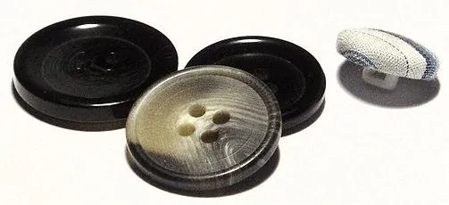
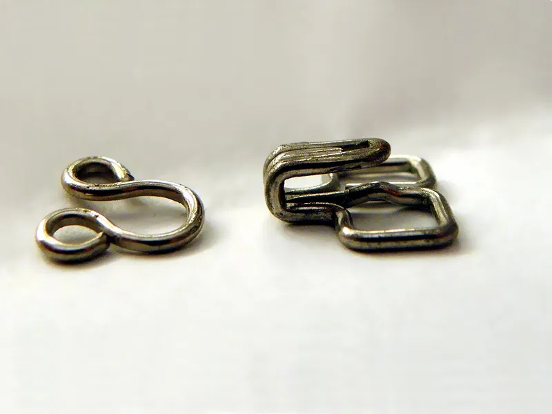

<figure class="eoc-pic eoc-pic-main"><figcaption><strong>Photo.</strong> <a href="https://commons.wikimedia.org/wiki/File:Plastic_%26_fabric_buttons_showing_holes_%26_shank.jpg">Plastic &amp; fabric buttons showing holes &amp; shank</a> by Richard Wheeler (Zephyris) 2007. ==Licensing==, <a href="https://creativecommons.org/licenses/by-sa/3.0">CC BY-SA 3.0</a>, from Wikimedia Commons.</figcaption></figure>
<figure class="eoc-pic"><figcaption><strong>Photo.</strong> <a href="https://commons.wikimedia.org/wiki/File:Hook_and_eye_clasp.JPG">Hook and eye clasp</a> by Eitan Ferman, <a href="https://creativecommons.org/licenses/by-sa/3.0">CC BY-SA 3.0</a>, from Wikimedia Commons.</figcaption></figure>

Holes, loops, slots or a thin flange designed into a rigid part let you sew it to fabric with needle and thread, so the thread loops lock the part on by shape, like a sew-on button, and it can be cut off and re-sewn later.

**In plain words:** A rigid part, often 3D printed, with small holes, loops, a slot or a thin edge built in so you can stitch it onto cloth, a strap or a costume with a needle and thread, the same way you sew on a button or a badge. **Proper term:** Sew-on part with sew-through holes (sew tabs, sewing flange).

**Also called:** sewing holes / sew holes / sew-through holes (the button term); sew tabs (Adafruit's name for printed tabs with sewing holes); sewable part, sew-on mount, sew-on patch, sew-on badge or label; sewing flange (a thin edge, often flexible filament, that you stitch straight through); shank or sewing loop (a loop on the back, as on a shank button, so stitches are hidden); sew-on snaps and sew-on hooks and eyes (hardware sold with holes for sewing); findings: a jump ring or jewellery bail glued to a print, then sewn on (cosplay term); thread shank (a short stalk of wound thread that lifts a button above thick fabric).

## How it works

Each stitch is a small loop of thread that passes through a hole in the part, through the fabric, and back, so the part is held by shape ([form-fit](../glossary.md#form-fit--force-fit--material-bond)): it can only come off if the thread breaks, the fabric tears or the thin bridge of plastic beside the hole snaps. Several holes spread round the edge share the pull and keep the part flat, and the thread ends are knotted on the inside (Adafruit's hat badges are stitched with a needle on each end of the thread and 'Tie off at each tab'). Variants: holes through the face like a sew-through button; loops or a shank on the back so stitches don't show; small holes through a thickened edge that turn a corner (one hole in the side edge meeting one in the back at 90 degrees) so the thread is hidden from the front (r/3Dprinting thread); a thin flange of flexible filament stitched straight through (Printables 'Sewable Flexible Coin Cell Holder with Flange'; 'Alti 2 N3 ... TPU Sew on Mount'); a slot or slit that a strap or elastic passes through, the strap then being sewn back on itself (Printables 'Ghost ... Mask (with Sewing Holes)'); and sew-on snaps or hooks whose other half is glued to the part (Dangerous Ladies).

## Parts

Single piece plus thread: one rigid part with sewing features (a ring of holes near the edge, loops or a shank on the back, a slot for a strap, or a thin flange), sewn with thread to the fabric. It becomes a few parts when a ready-made sew-on finding (a snap half, a hook, a jump ring or a jewellery bail) is glued to the part first and then sewn on (Dangerous Ladies). Optional extras: a reinforcing patch or fusible interfacing behind the fabric (Dangerous Ladies), pins to hold it in place while sewing (Adafruit).

## Everyday examples

- A sew-through button with two or four holes, or a shank button with a loop on the back (Wikipedia 'Button')
- Sew-on snaps and hooks and eyes on garments and bras (Wikipedia 'Snap fastener', 'Hook-and-eye closure')
- Sew-on name labels, brand labels and badges (Printables 'Sewable brand labels', 'Sew-on patches')
- A small sewable battery holder or LED board on a costume or bag, stitched through holes or a flange (Printables 'Sewable Flexible Coin Cell Holder with Flange')

## When to use it

When a rigid part has to stay on cloth, webbing or a costume through bending, wear and washing, and glue would [peel](../glossary.md#peel-vs-shear), stiffen the fabric or soak through. Good for printed badges and patches (Adafruit; Instructables), cosplay armour pieces and masks (the mask maker added sewing holes because 'the cloth was a pain to position', Printables 'Ghost ... Mask'), magnet cases sewn into curtains (Printables 'Case for 10x2mm magnet with sewing holes'), tracker and altimeter holders on bags, straps or suits (Printables 'Air Tag Holder - sew-on'; 'Alti 2 N3 ... TPU Sew on Mount'), and loops for keys inside a bag (Printables 'Sew-on Loop'). In one r/3Dprinting thread the options were ranked from 'Most janky' (hot glue) through 'Mid janky' (drill, hot-needle pierce or design holes and hand sew) to 'Least janky' (adhesive-backed hook-and-loop on the print with sew-on hook-and-loop on the cloth). Sewing is also one of the joints that suits 3D-printed clothing panels (Li and Lee 2022).

## When not to use it

Not for anything that must hold a person or a heavy, safety-critical load: use rated webbing hardware sewn by a qualified maker. Not where the part must come off often for washing or swapping: use sew-on snaps, hooks or pin backs (Dangerous Ladies) or hook-and-loop (r/3Dprinting thread). Not where there is no room for holes or the piece is tiny and light: glue it with a flexible glue (Dangerous Ladies recommends flexible superglue, or a vinyl patch as an intermediate layer). Not on very delicate printed lattices or printed 'fabrics', where sewing leaves permanent visible holes (Li and Lee 2022); printed snap buttons were quicker to assemble and reusable, though less comfortable (Li and Lee 2022). Alternatives makers compare it with: hot glue (quick but 'most janky'), contact adhesive ('works quite well'), spray adhesive, E6000 (brand) glue or diluted PVA brushed on (all r/3Dprinting thread), and printing the part straight onto an open mesh during a pause (see 'Printing onto fabric').

## Details

- **What it does (jobs):**
  - join and hold: fixes a rigid part (badge, label, armour piece, magnet case, tracker holder, mask) to fabric, a strap or a costume
- **Movement:** none: once sewn the part stays put on the fabric, although the fabric around it still bends and a part sewn at only one point can swivel
- **Directions it can move (degrees of freedom):** 0 when sewn down tightly through several holes. A part held at a single point (one central hole, one loop or one ring) can still turn or swing: Dangerous Ladies notes that one pin through one hole in the fabric 'will allow your piece to spin 360 degrees freely'.
- **Special behaviour:**
  - none: it is a plain fixed attachment; the clever part is only in where the holes go (hidden on the back, or turning a corner through a thick edge)
- **How it holds:**
  - shape (the parts interlock; form-fit): thread loops pass through holes in the part and through the fabric, so the part cannot lift off without breaking thread, plastic or fabric
  - friction or clamping (force-fit): tight stitches also press the part against the fabric so it doesn't rattle or slide (a minor effect)
  - material bond (glue, solvent or melting): only in the variant where a metal finding is glued to the part before sewing, or where glue is added under a sewn patch as a helper (Dangerous Ladies; Instructables '3D Printed Patch')
- **Input and output:** not applicable: it is a fixed joint that does not pass motion on
- **Power:** passive (no power needed)
- **Load:** Light. Fine for badges, labels, patches, cosplay armour pieces, magnet cases, small trackers and pouches. No source opened gives a strength figure; it is set by the thread, the fabric and the thin bridge of plastic beside each hole ⚑ [uncertain]. It is strongest when the pull runs along the fabric and is shared by many stitches (shear), and weakest when one edge is peeled up or a heavy piece hangs from a single loop. Back woven fabric with a non-stretch patch or interfacing when 'expecting to support the weight of larger resin or print pieces' (Dangerous Ladies). Never use a sewn-on part or a home-sewn joint to hold a person (harness, climbing, lifting or tow gear).
- **Play and precision:** Not a precision joint. Small play: thread stretches and the fabric gives, so a part sewn at one or two points can rock or turn; holes spread around the edge hold it flatter and steadier. Pin it in place while sewing, because 'for a flush fit, it helps to keep the pins in place until the knot is tied at the inside' (Adafruit). On a curved surface such as a hat, a rigid flat print only touches in places; Adafruit softens PLA in just-off-the-boil water to curve it, but 'don't expect to get more than a general curve'.
- **Taking it apart:** semi-permanent (can be undone but may damage parts): snip the threads 'with scissors or a seam ripper' to move or replace the part (Adafruit); the part can be re-sewn but the thread is not reused, and needle holes stay in the fabric. Sewing through printed 'fabric' leaves 'permanent and visible damages such as holes' (Li and Lee 2022). Sew-on snaps and hooks make the part itself removable without cutting, but leave the other half on the costume (Dangerous Ladies).
- **How often it can be reused:** a few times: each re-sew needs new thread and makes new needle holes in the fabric (Adafruit; Li and Lee 2022); with sew-on snaps the part itself can be taken on and off many times (Dangerous Ladies)
- **Sealing:** none: nothing makes it seal
- **Adjustable:** no: to move the part you cut the threads and sew it again (Adafruit)
- **Access needed:** both sides: the needle has to come out of the back of the fabric and go back again, and knots are tied on the inside (Adafruit). Holes through a thickened edge that turn a corner keep the thread hidden from the front (r/3Dprinting thread), but you still need to reach the back of the fabric.
- **Materials:** The part: PLA, PETG and TPU (flexible) prints, resin prints, wood, leather or metal. Flexible TPU can be sewn straight through, so a thin TPU flange needs no holes (Printables 'Sewable Flexible Coin Cell Holder with Flange'; 'Alti 2 N3 ... TPU Sew on Mount'); Adafruit prefers flexible filament for hat badges and uses PLA only with extra steps. For anything that will be machine-washed use PETG 'or other filaments that can withstand 60°C' (Printables 'Cloth face mask accessories (sew on)'), because PLA 'gets soft and deforms at temperatures over 60 °C' (Prusa). The fabric: woven and knit fabrics, felt, leather, vinyl and webbing; stretchy or loosely woven fabric should be stabilised with fusible interfacing or a non-stretch patch (Dangerous Ladies). Thread: ordinary sewing thread matched to the filament colour (Adafruit); one maker suggests nylon thread through hidden edge holes (r/3Dprinting thread). Findings for resin and printed parts: metal or plastic snaps, hooks, jump rings, bails and pin backs (Dangerous Ladies).
- **Heat, cold, water and wear:** Heat: PLA parts soften and deform above about 60 °C (Prusa), so avoid hot washes, tumble dryers and hot cars; PETG is fine below about 80 °C (Prusa), and makers recommend filament that withstands 60 °C for machine-washed parts (Printables 'Cloth face mask accessories (sew on)'). Washing: the patch Instructable recommends cold hand washing because a machine wash 'may be too rough'. Sunlight: PLA 'degrades under UV light' (Prusa). Flex and vibration: a stiff flat part on stretchy fabric works the stitches loose or tears the fabric around them over time; stabilise the fabric with interfacing (Dangerous Ladies). Thread can rot or fade outdoors depending on fibre ⚑ [uncertain: no thread source opened].

## Making it

- **Ways to make or get it:**
  - 3D print (FDM): the usual case; holes, loops, slots and thin flanges print with the part, and TPU flanges can be sewn straight through (Printables models listed below)
  - 3D print (resin): print the part, then glue on a metal jump ring, spade bail, snap half or hook and sew that to the fabric (Dangerous Ladies)
  - woodwork: drill small holes in a wooden badge or toggle ⚑ [uncertain: no woodwork source opened]
  - laser cut: cut sewing holes in acrylic, wood or leather shapes ⚑ [uncertain: no laser-cutting source opened]
  - off-the-shelf part: sew-on snaps, hooks and eyes, sew-through buttons and shank buttons are made for sewing (Wikipedia 'Snap fastener', 'Hook-and-eye closure', 'Button')
- **Printing it in one piece (print in place):** no: the part prints in one piece with its holes, but it is joined to the fabric afterwards by sewing (printing the plastic straight onto an open mesh during a pause is the separate entry 'Printing onto fabric')
- **Tools:** A hand-sewing needle (Adafruit uses two, one on each end of the thread), thread, scissors and pins to hold the position. A small drill bit in a rotary tool if printed holes come out too small for the needle (Adafruit). Without designed holes: a drill, or a needle heated in a flame or a soldering iron to melt holes through the plastic (r/3Dprinting thread; Printables 'Alti 2 N3 ... TPU Sew on Mount'; Edinburgh College of Art student project). A heavy-duty sewing machine helps when sewing straight through TPU (Printables 'Alti 2 N3 ... TPU Sew on Mount'). Glue for findings: superglue, or two-part epoxy for heavy pieces (Dangerous Ladies).
- **Difficulty:** easy: add a row of holes in CAD (or drill or hot-needle them afterwards) and sew by hand; basic hand-sewing is the only skill needed

### 3D printing tips

1) Hole size: makers' sewable models nearly all use about 2 mm holes (Printables 'Sewable brand labels' 2 mm holes centred 3 mm from the edge on a 1.2 mm thick label; 'Sew-on Loop' 2 mm holes; 'Sew on Velcro' 2 mm holes; Instructables '3D Printed Patch' 2 mm holes in a 1 mm backing). Ordinary hand-sewing needles are much thinner: John James Sharps run from 1.02 mm (size 1) down to 0.41 mm (size 12) in diameter, so a 2 mm hole leaves room for the needle and a doubled thread. Small holes often print undersized or partly closed, so make them a little bigger than you think or drill them out afterwards ('You may also have to drill out the sew holes with a small bit and rotary tool', Adafruit; 'Don't make the thread holes too small or else they won't print well', Printables 'Parametric Button Generator'). 2) Edge distance: leave a solid bridge of plastic between hole and edge. With a 0.4 mm nozzle one perimeter is about 0.45 mm and two about 0.9 mm, and walls thinner than one perimeter don't print (Prusa), so keep at least about 1 mm of plastic outside each hole; the label example above leaves 2 mm. 3) Orientation: print sew tabs and flanges lying flat with the holes vertical, so the pull of the thread runs along the layers; FFF prints are 'stronger in one direction than another' (Prusa). Holes through a thickened side edge (printed sideways) put the bridge across [layer lines](../glossary.md#layer-lines) and are weaker ⚑ [uncertain: inferred from Prusa's general advice]. 4) Smooth edges: sharp hole edges can fray or cut thread; [chamfer](../glossary.md#chamfer--fillet) or deburr hole mouths, and prefer chamfers to fillets on edges facing the bed, which print better (Prusa) ⚑ [uncertain: no source tests thread wear on printed holes]. 5) Hidden stitches: give the part some thickness and put small holes in the side edge meeting holes in the back at 90 degrees, so the thread turns the corner and is invisible from the front (r/3Dprinting thread); or add loops or a ridge with holes on the back (same thread). 6) Slots for straps and elastic: slits print poorly without support and are fragile; one mask needed organic supports for its 2 cm elastic slits, and the maker advises sizing the elastic so it doesn't put 'a lot of stress' on them (Printables 'Ghost ... Mask (with Sewing Holes)'). Sew the strap back on itself with a strong stitch pattern such as a box-X (Ripstop by the Roll). 7) Flexible filament: TPU parts can be sewn through directly, by machine or by hand; if the needle struggles, melt holes with a heated needle (Printables 'Alti 2 N3 ... TPU Sew on Mount'). Adafruit's hat badges use flexible filament (SemiFlex preferred; its NinjaFlex settings are 230 °C and 30 mm/s); with PLA they dip the part in just-off-the-boil water for a few seconds to curve it to the hat. 8) Washing: for washable parts print in PETG or another filament that withstands 60 °C (Printables 'Cloth face mask accessories (sew on)'); the patch Instructable recommends cold hand washing because 'machine wash may be too rough'. 9) Typical failures: holes too small or bridged over, a thin bridge snapping at a layer line, thread cut by a sharp edge, and a stiff flat part peeling away from curved or stretchy fabric.

### Buying one (off-the-shelf parts)

Search for: 'sew-on snap fastener' or 'sew-on press stud' (a stud and socket with holes round the rim; Wikipedia 'Snap fastener' says snaps can be attached by riveting, sewing or snap pliers); 'hook and eye' fasteners (Wikipedia 'Hook-and-eye closure'); 'sew-through button' and 'shank button' (Wikipedia 'Button'); jewellery 'jump ring', 'spade bail' or 'glue-on bail', and 'pin back' or 'bar pin' (Dangerous Ladies); 'sew-on hook and loop tape' (sewing-machine-friendly Velcro (brand)); 'fusible interfacing' for reinforcing fabric (Dangerous Ladies); hand-sewing needles such as Sharps, and heavier Leather/Glovers needles for leather (John James Needle Guide); strong polyester or nylon sewing thread ⚑ [uncertain: no thread maker's page opened].

## Rules of thumb

- Sewing holes about 2 mm in diameter: used by Printables 'Sewable brand labels' (2 mm holes, centres 3 mm from the edge, 1.2 mm thick), 'Sew-on Loop' (2 mm holes), 'Sew on Velcro' (2 mm holes in a 3 mm plate) and the Instructables '3D Printed Patch' (2 mm holes, 1 mm backing).
- Needles are thinner than you might think: John James Sharps are 1.02 mm (size 1) to 0.41 mm (size 12) in diameter, Tapestry needles up to 2.34 mm (John James Needle Guide), so a 2 mm hole suits ordinary sharps with doubled thread.
- Keep at least two [perimeters](../glossary.md#perimeters) (about 0.9 mm with a 0.4 mm nozzle) of plastic between a hole and the edge; walls thinner than one perimeter (about 0.45 mm) won't print (Prusa, 'Modeling with 3D printing in mind').
- Spread the load: use several holes round the edge rather than one, and back woven fabric with a non-stretch patch or fusible interfacing for heavy pieces (Dangerous Ladies).
- When stitching through thin or open features, change direction rather than sewing in one straight line, which kept the thread tauter in an Edinburgh College of Art student test; thick wool 'was too strong and broke the delicate strips' of a printed lattice, while thin thread worked best (Edinburgh College of Art, 'Sewing through Glitches', 2019).
- For a flat button on heavy fabric, wind a thread shank to raise the button above the fabric (Wikipedia 'Button').
- Washable parts: PETG or other filament that withstands 60 °C (Printables 'Cloth face mask accessories (sew on)'); PLA softens above 60 °C (Prusa).

## Common failures

Holes print too small or bridged shut: enlarge them in CAD or drill them out (Adafruit). The bridge between a hole and the edge snaps: move holes further in, thicken the part, print it flat (Prusa). Thread wears through on a sharp hole edge: chamfer or deburr the holes ⚑ [uncertain]. Thin slits for elastic break: add supports when printing and don't overtighten the elastic (Printables 'Ghost ... Mask'). The fabric tears or stretches round the stitches under a heavy piece: back it with a non-stretch patch or interfacing (Dangerous Ladies). The part rocks or spins: add more holes spread round the edge (Dangerous Ladies on single-hole spinning). The part warps or softens in a hot wash: print in PETG or a filament that withstands 60 °C (Printables 'Cloth face mask accessories'). Glue alternatives fail by peeling: one of two fabric glues tested by Li and Lee let the joined panels come apart after two days.

## Safety

Never trust a sewn-on part or home-sewn joint to hold a person (climbing, harness, lifting or tow gear). Needles and pins: prick hazard, and keep small parts and loose needles from children. Melting holes with a heated needle or a soldering iron risks burns, and melting plastic gives off fumes: emissions from melted filament 'can include a large number of ultrafine particles and volatile organic compounds' (Wikipedia, 'Health and safety hazards of 3D printing'), so work with ventilation. When gluing findings, superglue and epoxy can leak through fabric and glue layers together (Dangerous Ladies).

## Related

- Printing onto fabric (fabric embedded in a 3D print): the plastic is printed through an open mesh during a pause, so no sewing is needed, but only flat panels the size of the print bed can be made
- Snap fastener (press stud): sew-on versions are sewn through holes in their rim; makes the part removable without cutting thread (Dangerous Ladies)
- Hook-and-loop fastener: sew the soft side to the cloth and stick or glue the other to the print, for parts that come off for washing (r/3Dprinting thread)
- Basic strap and garment closures (button, toggle and loop): the sew-through button is the classic sew-on part; that entry covers closing an opening
- Load-bearing stitch patterns for straps and webbing (bar tack, box-X): how to sew a strap that passes through a slot in a part
- Sewn seams and hand stitches: the stitches themselves
- Eyelets and grommets: reinforced holes in the fabric rather than in the part
- Hot-melt adhesive (glue gun), contact adhesive and elastomeric flexible craft glue: the glue-on alternatives; faster, but they can peel, stiffen or soak through fabric
- Lacing (cord through rows of holes or eyelets): cord through holes in both pieces, adjustable and removable
- Leather and textile rivets: a permanent metal fixing through part and fabric instead of thread

## Make it yourself

- [Sewable brand labels - parametric (Printables) (URL from Printables API, page not opened)](https://www.printables.com/model/804730-sewable-brand-labels-parametric): Parametric Fusion 360 label with a sewing hole at each end: 2 mm holes centred 3 mm from the edge, 1.2 mm thick, 12 sizes *(licence: CC BY-NC-SA)*
- [Parametric Button Generator (OpenSCAD customizer, Printables) (URL from Printables API, page not opened)](https://www.printables.com/model/121324-parametric-button-generator): OpenSCAD script that makes sew-through buttons with any size, shape and number of thread holes; a starting point for any part with sewing holes *(licence: CC BY-SA)*
- [Sew-on Loop (Printables) (URL from Printables API, page not opened)](https://www.printables.com/model/657091-sew-on-loop): Small part with 2 mm sewing holes and an 8 mm loop, sewn inside a bag to hook keys onto; editable in Tinkercad *(licence: CC BY-NC)*
- [Case for 10x2mm magnet with sewing holes (Printables) (URL from Printables API, page not opened)](https://www.printables.com/model/1713973-case-for-10x2mm-magnet-with-sewing-holes): Magnet case with 4 sewing holes; the magnet is dropped in during a print pause and the case is sewn into a curtain *(licence: GNU GPL v3.0)*
- [Sew on ear plugs/gauges for fursuit heads (Printables) (URL from Printables API, page not opened)](https://www.printables.com/model/622457-sew-on-ear-plugsgauges-for-fursuit-heads): A threaded 'button' is sewn on like a normal button and decorative parts screw onto it, so the decoration is removable without cutting thread *(licence: CC BY-SA)*
- [Sewable Flexible Coin Cell Holder with Flange (Printables) (URL from Printables API, page not opened)](https://www.printables.com/model/199827-sewable-flexible-coin-cell-holder-with-flange): Flexible battery holder with a flange you stitch straight through instead of only corner holes *(licence: CC BY)*

## Pictures, videos and models

- [Custom 3D Hat Graphics (Adafruit Learning System, all pages)](https://learn.adafruit.com/custom-3d-hat-graphics.md?view=all): Photos of printed letters with built-in sew tabs being pinned and stitched to a cap with two needles, plus the PLA hot-water curving step *(licence: Adafruit Learning System guide; licence not stated on the page; link only)*
- [Attaching Resin and 3D Prints to Cosplays (Dangerous Ladies, 2025)](https://dangerousladies.ca/blogs/tutorials/attaching-resin-3d-prints-cosplay): Photos of snaps, hooks, pin backs, jump rings and a spade bail glued to prints, reinforcing patches behind fabric, and flexible-glue alternatives *(licence: Commercial tutorial; link only)*
- [Plastic and fabric buttons showing holes and shank (Wikimedia Commons)](https://commons.wikimedia.org/wiki/File:Plastic_%26_fabric_buttons_showing_holes_%26_shank.jpg): Three sew-through buttons with holes next to a shank button with a loop on the back: the two basic ways a part is made sewable *(licence: CC BY-SA 3.0 (Richard Wheeler))*
- [Hook and eye clasp (Wikimedia Commons)](https://commons.wikimedia.org/wiki/File:Hook_and_eye_clasp.JPG): A wire hook and eye, each with sewing loops, as sewn onto garments *(licence: CC BY-SA 3.0)*
- [3D Printed Patch (Instructables)](https://www.instructables.com/3D-Printed-Patch/): Step photos of a printed patch with 2 mm holes round the border being stitched over a tear in trousers *(licence: Instructables page; licence not checked; link only)*

## Needs confirming

⚑ marks something nobody has confirmed yet: a fact the research could not confirm from a source, a finder value that is a best guess, or an open point from the research notes. Corrections are welcome (see `research/needs-confirming.md`).

- ⚑ 8 sentences on this page marked [uncertain].
- ⚑ Finder value `usual_process` = sewing or leatherwork (best guess): first-listed process was "3d print (fdm): the usual case; holes, l"; knots family, so set to sewing or leatherwork
- ⚑ Finder value `cord_use` = sew or lace (best guess): carried over from the finder's old rule on entry names (R33), for "What do you need?" under "Hold two things together > Strap, cord, rope or fabric"

## Sources

- <https://arctic-shift.photon-reddit.com/api/comments/tree?link_id=t3_1e63nnr&limit=200 (archive of the r/3Dprinting thread 'How do you sew/connect cloth to a print?', July 2024; title from https://arctic-shift.photon-reddit.com/api/posts/ids?ids=1e63nnr)>
- <https://dangerousladies.ca/blogs/tutorials/attaching-resin-3d-prints-cosplay>
- <https://learn.adafruit.com/custom-3d-hat-graphics.md?view=all>
- <https://www.iastatedigitalpress.com/itaa/article/id/15845/ (Li and Lee, 'Exploring Joint Methods of 3D Printed Fabrics Used for Wearable Products', ITAA Proceedings 79(1), 2022, CC BY 4.0)>
- <https://www.iastatedigitalpress.com/itaa/article/15845/galley/14598/download/ (full text PDF of Li and Lee 2022)>
- <https://www.instructables.com/3D-Printed-Patch/ (step text read through https://www.instructables.com/json-api/showInstructableModel?urlString=3D-Printed-Patch)>
- <https://productdesign.eca.ed.ac.uk/sewing-through-glitches/ (Edinburgh College of Art student project, 2019)>
- <https://jjneedles.com/wp-content/uploads/2026/05/Needle-Guide.pdf (John James Needle Guide: needle lengths and diameters)>
- <https://en.wikipedia.org/wiki/Button>
- <https://en.wikipedia.org/wiki/Snap_fastener>
- <https://en.wikipedia.org/wiki/Hook-and-eye_closure>
- <https://en.wikipedia.org/wiki/Health_and_safety_hazards_of_3D_printing>
- <https://help.prusa3d.com/article/modeling-with-3d-printing-in-mind_164135>
- <https://help.prusa3d.com/article/pla_2062>
- <https://help.prusa3d.com/article/petg_2059>
- <https://ripstopbytheroll.com/blogs/the-grid-online-blog/4-ways-to-secure-a-buckle>
- <https://commons.wikimedia.org/wiki/File:Plastic_%26_fabric_buttons_showing_holes_%26_shank.jpg>
- <https://commons.wikimedia.org/wiki/File:Hook_and_eye_clasp.JPG>
- <https://api.printables.com/graphql/ (Printables models 980458 'Ghost Red Team 141 Operator Mask (with Sewing Holes)', 804730 'Sewable brand labels - parametric', 1713973 'Case for 10x2mm magnet with sewing holes', 130322 'Air Tag Holder - sew-on', 622457 'Sew on ear plugs/gauges for fursuit heads', 657091 'Sew-on Loop', 199827 'Sewable Flexible Coin Cell Holder with Flange', 153250 'Alti 2 N3 or Atlas Skydiving Altimeter TPU Sew on Mount', 804118 'Sew on Velcro', 27785 'Cloth face mask accessories (sew on)', 436200 'Sew-on patches - blanks', 121324 'Parametric Button Generator', 1128919 'Button - Parametric customizable OpenSCAD'; pages not opened)>
