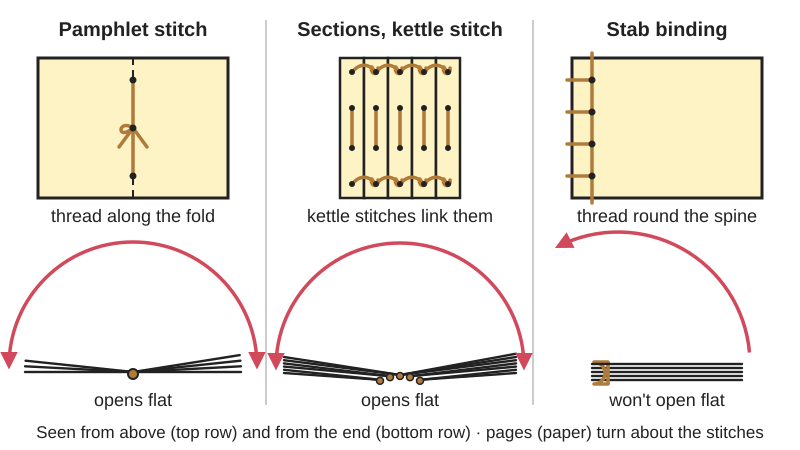
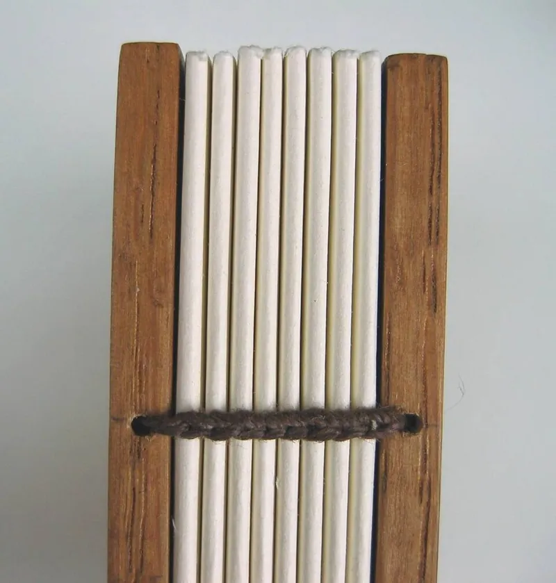
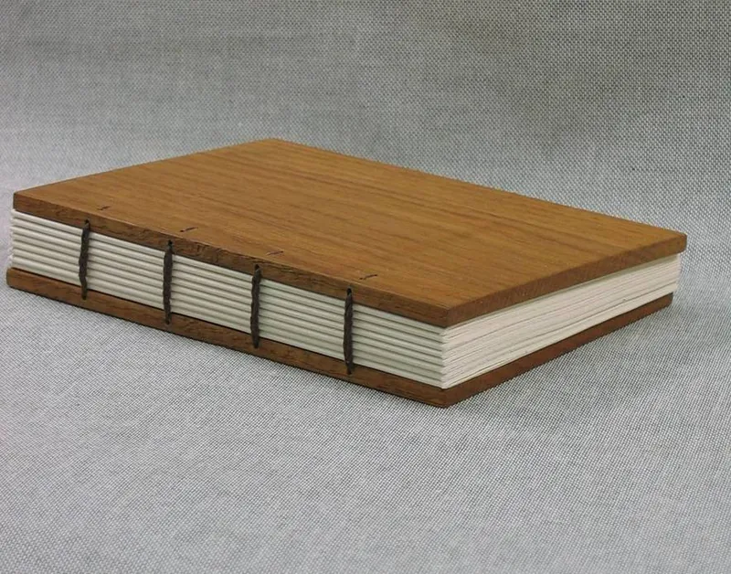

<figure class="eoc-pic eoc-pic-main"><picture><source media="(prefers-reduced-motion: reduce)" srcset="../media/drawn/sewn-book-bindings.svg"></picture><figcaption><strong>Animation.</strong> Diagram drawn for the encyclopaedia from the research notes. ⚑ Needs confirming: a drawing can simplify or get details wrong; a real photo or a better diagram is welcome.</figcaption></figure>
<figure class="eoc-pic"><figcaption><strong>How it works.</strong> <a href="https://commons.wikimedia.org/wiki/File:Coptic_sewing.jpg">Coptic sewing</a> by Ratbasket, <a href="https://creativecommons.org/licenses/by/3.0">CC BY 3.0</a>, from Wikimedia Commons.</figcaption></figure>
<figure class="eoc-pic"><figcaption><strong>Photo.</strong> <a href="https://commons.wikimedia.org/wiki/File:Coptic_flat.jpg">Coptic flat</a> by Ratbasket at English Wikipedia, <a href="https://creativecommons.org/licenses/by/2.5">CC BY 2.5</a>, from Wikimedia Commons.</figcaption></figure>

Hand sewing joins sheets of paper into a book by passing a needle and waxed thread through a row of pierced holes, either along the fold of folded sheets (a pamphlet stitch for one section, or linked kettle or Coptic stitches for many) or straight through the stack near its edge (Japanese stab binding), so the thread acts as both fastener and hinge.

**In plain words:** Sewing a book together: a needle and strong thread go through a row of small holes along the fold of folded pages, or through the whole stack near the edge, and the thread holds the pages together like a hinge so they turn. **Proper term:** Sewn bookbinding (hand sewing): pamphlet stitch, multi-section sewing through the fold with kettle stitches, Coptic (chain-stitch) binding and Japanese stab (side-stitched) binding.

**Also called:** pamphlet stitch, pamphlet sewing, single-section pamphlet, 3-hole or 5-hole pamphlet stitch (Talas; Indiana University Libraries Book Repair Manual; Paper Mouse); sewing through the fold, Smyth sewing (machine), section, gathering or signature sewing (Wikipedia 'Bookbinding'; Wikipedia 'Section (bookbinding)'); kettle stitch, catch stitch: a linking stitch at the head and tail of each section; 'Kettle' is said to come from the German word for 'chain' (University of Brighton 'The Kettle Stitch'); Coptic binding, Coptic sewing, Coptic stitch, chain-stitch binding (Wikipedia 'Coptic binding'); Japanese stab binding, stab stitch, side-stitched binding, thread binding, traditional Chinese bookbinding, xian zhuang, yotsume toji (four-hole binding) ⚑ [uncertain: the Japanese name was not seen on an opened page] (Wikipedia 'Traditional Chinese bookbinding'; Talas; Dorset History Centre); long-stitch binding (sewn straight through a slotted or punched cover) (Wikipedia 'Long-stitch bookbinding'); oversewing (loose sheets sewn with lockstitches through holes near the edge), French link stitch (Wikipedia 'Bookbinding'; Talas blog post list); saddle stitching, saddle stapling (the quick, stapled alternative through the fold) (Wikipedia 'Bookbinding'); perfect binding (glued spine, the unsewn alternative) (Wikipedia 'Bookbinding').

## How it works

Holes are pierced in a straight row, then thread is sewn in and out so it loops round the spine or along the fold and is pulled tight and knotted; the pages are held by the thread passing through them, and they turn about the line of stitches, which works as a hinge (Talas; Indiana University Libraries). Sewing through the fold, each folded section (signature) is sewn through its centre and linked to the one before at head and tail with a kettle stitch, a small loop caught behind the previous stitch, so the book opens flat (Wikipedia 'Bookbinding'; University of Brighton). Coptic binding links the sections to each other and to the boards with chain stitches across a bare spine, with no glue, so it can open 360° (Wikipedia 'Coptic binding'). Stab binding sews through the whole stack about 1-2 cm in from the edge, with the thread wrapped round the spine and the head and tail, which is simple and decorative but stops the book opening flat (Wikipedia 'Traditional Chinese bookbinding'; Dorset History Centre; Reddit r/bookbinding).

## Parts

A few parts: paper sheets (folded into sections or left flat), a cover, thread (usually waxed linen), one or two blunt needles; the holes are made first with an awl or punch, often in a piercing cradle or with a paper template (Talas; Dorset History Centre; Makezine 'Coptic Book Binding').

## Everyday examples

- A zine, exercise book or programme sewn (or stapled) through the centre fold (Talas; Wikipedia 'Bookbinding')
- A sketchbook or art journal with bare chain stitches on the spine that opens completely flat (Coptic) (Wikipedia 'Coptic binding'; Makezine)
- A guestbook or traditional Chinese, Japanese or Korean book stitched through the side with a pattern of thread on the cover (Wikipedia 'Traditional Chinese bookbinding'; Talas)
- Good-quality hardback books, whose sections are sewn through the fold (Wikipedia 'Bookbinding')

## When to use it

Use a pamphlet stitch for a single folded section such as a zine, booklet or notebook insert: it needs only an awl, needle and thread and is stronger and more archival than staples (Talas; Paper Mouse). Sew several sections through the fold with kettle stitches, or use a Coptic binding, for a sketchbook, journal or notebook that must open flat with no glue (Wikipedia 'Bookbinding'; Wikipedia 'Coptic binding'). Use stab binding for loose single sheets, prints, photos or a guestbook where the decorative stitching is part of the look and a book that doesn't open flat is acceptable (Talas; Dorset History Centre; Reddit r/bookbinding). Sewing suits one-off and small-run books made at home.

## When not to use it

Not for documents whose pages you want to add or remove: use Loose-leaf bindings (rings, discs, combs) or Chicago screw (screw-post) binding instead. Not for quick throwaway booklets: saddle stapling is faster (Wikipedia 'Bookbinding'). Not for books that must open flat if you use stab binding: sew through the fold instead (Reddit r/bookbinding). Not with heavy, stiff or coated paper that cracks when folded (Paper Mill Store); score and fold it first or use stab binding. Avoid elastic thread (Reddit r/bookbinding). Never trust a sewn stitch or knot to hold a person.

## Details

- **What it does (jobs):**
  - join and hold: binds a stack of sheets or folded sections, and the cover, into one book (Wikipedia 'Bookbinding')
  - let it move (turn, slide or bend): the sewn spine is the hinge the pages turn on (Wikipedia 'Coptic binding'; Wikipedia 'Bookbinding')
- **Movement:** flex: the pages bend and turn at the sewn edge; up to about 180° for sewing through the fold, 360° for an uncovered Coptic binding, and less than flat for stab binding (Wikipedia 'Bookbinding'; Wikipedia 'Coptic binding'; Reddit r/bookbinding).
- **Directions it can move (degrees of freedom):** 1: each page can only swing about the line of stitches (the spine); the thread stops it sliding or lifting off.
- **Special behaviour:**
  - none: the thread simply holds the pages and lets them turn; no locking, [ratchet](../glossary.md#ratchet) or spring action
- **How it holds:**
  - shape (the parts interlock; [form-fit](../glossary.md#form-fit--force-fit--material-bond)): the thread passes through the holes and loops round the spine or along the fold, so the paper can't come off without the thread breaking or the paper tearing (Wikipedia 'Bookbinding': pages 'cannot fall out unless they are ripped')
  - friction or clamping (force-fit): thread tension squeezes the stack, and waxed thread grips itself so stitches don't slip (Makezine 'Coptic Book Binding': beeswax 'helps with the string gripping to itself')
- **Input and output:** not applicable
- **Power:** passive (no power needed)
- **Load:** Light: holds the weight of the pages and normal handling. A well-sewn through-the-fold book is durable: 'Pages cannot fall out unless they are ripped', and a sewn book is 'as durable as' a hardbound one (Wikipedia 'Bookbinding'). Weak points are the paper at the holes (tears if pulled sideways at the spine) and a single thread breaking; stab binding is held only near the edge and 'doesnt open flat' (Reddit r/bookbinding). No strength figures were found ⚑ [uncertain]. A home-made knot, stitch or seam must never hold a person.
- **Play and precision:** Small: thread stretches slightly and loosens if not pulled snug; consistent tension is what makes the stitches look 'crisp' (Reddit r/bookbinding). Holes must line up through every section or the spine is crooked, which is why a template, clips or a piercing cradle are used (Dorset History Centre; Paper Mouse; Printables 706107).
- **Taking it apart:** semi-permanent (can be undone but may damage parts): cut the thread to take the book apart; the paper keeps its holes, and only books that were sewn originally can be resewn (Wikipedia 'Bookbinding'); a sewn pamphlet is called 'repairable' (bookbinding.bearblog.dev).
- **How often it can be reused:** once: thread is cut to undo it; the pages can be resewn through the same holes a few times ⚑ [uncertain].
- **Sealing:** none
- **Adjustable:** no: tension is set while sewing; a loose binding has to be resewn. Stab binding can be resewn with a different pattern or ribbon through bigger holes (Dorset History Centre).
- **Access needed:** both sides: the needle goes in and out of every hole, and for sewing through the fold you work from the inside and outside of each section (IU Libraries; Paper Mouse).
- **Materials:** Paper, card and thin board for pages and covers; covers can be card, book board, leather, cloth, plywood (Makezine used thin Plyboo drilled with a 1/16 in bit) or a 3D print (Printables 1822742). Thread: waxed linen ('Irish Linen Thread' in Talas), unwaxed linen waxed with beeswax, cotton (e.g. pearl cotton), embroidery floss split into strands, or silk cord (traditional Chinese binding) (Talas; Paper Mouse; Reddit r/bookbinding; Wikipedia 'Traditional Chinese bookbinding'). Avoid elastic thread: it is weak and the rubber breaks down (Reddit r/bookbinding). Paper must be able to fold cleanly; very heavy or coated stocks resist folding and stitching (Paper Mill Store).
- **Heat, cold, water and wear:** Damp: paper swells more across the grain than along it, so damp or wet glue causes [warping](../glossary.md#warping--shrinkage) if [grain directions](../glossary.md#grain-direction) are mixed (University of Brighton 'Grain Direction'). Linen thread is durable; staples rust and stain paper over time (Talas pamphlet). Elastic thread weakens and its rubber splits with age (Reddit r/bookbinding). Light and acidity affect paper, not the stitch ⚑ [uncertain].

## Making it

- **Ways to make or get it:**
  - hand sewing (no machine): needle, thread and an awl or punch
  - woodwork: drilled wooden covers for Coptic notebooks (Makezine)
  - laser cut: covers and hole templates ⚑ [uncertain: no laser-cut binding page opened]
  - 3D print (FDM): piercing cradles, awl guides, hole templates, bone folders and printed covers (Printables)
  - off-the-shelf part: waxed linen thread, bookbinding needles, awls, Japanese screw punch, pre-folded notebooks
- **Printing it in one piece (print in place):** no: the binding is sewn; 3D printing is only for jigs, tools and covers.
- **Tools:** Awl, needle or Japanese screw punch to make holes; blunt bookbinding needle (or curved needles for Coptic); waxed linen thread or beeswax to wax thread; bone folder to fold sections; ruler, pencil and paper template; bulldog clips or a weight to hold the stack; optionally a piercing cradle (Talas; Dorset History Centre; Paper Mouse; Makezine; IU Libraries).
- **Difficulty:** easy for a pamphlet stitch or 4-hole stab binding (a needle, thread and awl; Make: rates a Coptic notebook 'Easy', 1-2 hours) (Makezine; Talas); moderate for multi-section Coptic or kettle-stitch books, which need even tension and well-aligned holes.

### 3D printing tips

1) Piercing cradle: a V-shaped cradle holds a folded section so the awl goes straight through the fold; one 210 mm cradle (for A5 sections from A4 sheets) is bolted together with M5 button-head screws in [heat-set inserts](../glossary.md#heat-set-insert) and has an end brace to square the sections (Printables 706107, CC BY-SA). 2) Awl guides: printed bars with holes for the awl at fixed spacing; one has 3.3 mm holes at 0.25 in (6.35 mm) centres for 1/8 in awls, but its author says the measurements 'aren't accurate, just use them as a rough guide', so check spacing with a ruler (Printables 377619 and Coptic version 380385, CC BY-NC); another is sized for a 1.8-2 mm awl with tops for A5 and A6 and printed at 0.2 mm layers, 5% [infill](../glossary.md#infill), no supports (Printables 633309, CC BY). 3) Folio punch rack for 200 mm wide paper, editable in Fusion 360 (Printables 38552, CC BY). 4) Printed covers: a Coptic A6 cover printed twice, with a printed sewing guide, sewn with waxed thread through holes aligned to the sections (Printables 1822742, CC BY-SA). 5) A flat-bottomed printed bone folder for folding sections (Printables 9906, CC BY). 6) Keep printed covers thick enough near the holes that the thread doesn't cut through, and break sharp edges on the holes so they don't fray the thread ⚑ [uncertain].

### Buying one (off-the-shelf parts)

Waxed linen bookbinding thread (sold in different thicknesses, often given as a ply count ⚑ [uncertain]), unwaxed linen thread and beeswax, bookbinding needles (blunt, round-eye), curved needles for Coptic, bookbinding awl, Japanese screw punch, bone folder, piercing cradle, bookbinding tape for tape-sewn bindings, Monel (stainless) staples and long-reach stapler for saddle stapling (Talas; Paper Mouse; Makezine; Printables 633309). Search terms: 'waxed linen thread', 'bookbinding awl', 'piercing cradle', 'Japanese screw punch', 'bone folder'.

## Rules of thumb

- Odd number of holes for a pamphlet stitch: 'always some odd number, 3, 5, or 7, so there will be a center hole'; sewing 'starts inside at the center hole no matter how many holes' (IU Libraries Book Repair Manual); 'Pamphlet books are always made with an odd number of holes... at least three' (Paper Mouse).
- Pamphlet hole spacing, side by side: Talas puts holes at the centre and 'about 1 cm from the top' and bottom; bookbinding.bearblog.dev puts the end holes 15 mm from the top and bottom; Paper Mouse spaces five holes 1 inch apart on a 5.5 inch spine.
- Thread length, sources disagree, side by side: pamphlet 'about 4-5 times the height' (Talas pamphlet); 'approximately 2 1/2 times' the pamphlet length (IU Libraries); twice the distance between the end holes plus at least 6 inches (Paper Mouse); stab binding 'approximately five times the height' (Talas stab) or '5 x the width of the paper' along the bound edge (Dorset History Centre); Coptic: 'no longer than the width of your extended arms' (Printables 1822742).
- Stab-binding hole inset from the spine, side by side: 'around 1 cm' (Wikipedia 'Traditional Chinese bookbinding'); 'about 10-12mm' (Reddit r/bookbinding); '2cm in from the edge of the paper and 2cm apart' (Dorset History Centre); Talas spaces four holes 'about one inch apart'. Use about 1-2 cm depending on book size, and leave a wide inner margin (about 25 mm on A5 in the Reddit advice) because stab-bound books don't open flat.
- Hole count in stab binding: four is standard, six for important books in China, and an odd number (three or five) in Korea (Wikipedia 'Traditional Chinese bookbinding').
- Grain direction: run the paper grain from head to tail, parallel to the spine; folds against the grain are 'lumpy' and pages 'spring open' (University of Brighton 'Grain Direction'; Paper Mill Store); Talas asks for 'grain short' paper for its stab binding so 'pages open and lay flat properly without cracking'. Test by flexing the sheet both ways: it bends more easily along the grain (University of Brighton).
- Kettle stitch: use it twice at the end of multi-section sewing, and leave about 15 cm of thread at the start to kettle twice there too; the moves are 'back, behind and under' (University of Brighton). In Coptic sewing, after each new section 'count back two signatures' and kettle stitch (Makezine).
- Section size: Make: folds five sheets per section and five sections for 100 pages; a printed Coptic cover uses four A5 sheets per section and 32-64 sheets in total (Makezine; Printables 1822742).
- Wax the thread: run it through beeswax two or three times so it is evenly coated (Paper Mouse); waxed thread grips itself (Makezine).
- Saddle stapling is the quick alternative for booklets 'typically under 64 pages'; use stainless (Monel) staples, because ordinary staples 'corrode, and leave rust stains' (Paper Mill Store; Talas pamphlet).
- Knots used: square (reef) knot (ABOK #1204) to tie the two ends over the long centre stitch of a pamphlet, or to finish a Coptic book with 'two square knots' (bookbinding.bearblog.dev; Makezine; Wikipedia 'Reef knot'); a double knot over a hole for stab binding (Talas; Dorset); the kettle stitch (a stitch, not an ABOK knot) to link sections. To join on new thread, weavers use the sheet bend or weaver's knot (ABOK #1431) (Wikipedia 'Sheet bend') ⚑ [uncertain: no bookbinding source opened recommends it].

## Common failures

Thread breaks while sewing (a Reddit beginner's first stab binding failed this way): use strong linen or cotton thread, wax it, and don't saw it through sharp holes (Reddit r/bookbinding). Loose, sagging stitches: pull every stitch snug and check inside and out before knotting (IU Libraries; Reddit r/bookbinding). Crooked or misaligned holes: use a template and clips or a piercing cradle (Dorset History Centre; Printables 706107). Pages spring open or the fold cracks: paper folded against the grain (University of Brighton). Text lost in the gutter of a stab-bound book because it doesn't open flat: leave a wide inner margin (Reddit r/bookbinding). Needle splitting the thread already in a hole: take care 'not to puncture the thread already in the hole' (Dorset History Centre).

## Safety

Awls and needles are sharp: pierce holes downwards into a cutting mat, stiff foam or a piercing cradle, never towards the hand holding the paper, and keep fingers out from behind the fold you are piercing (Dorset History Centre uses stiff foam under the paper; Paper Mouse uses a cutting mat) ⚑ [uncertain: no opened page states an injury rule]. Curving needles with a flame or hot-air station, as one maker suggests, can burn (Printables 1822742). Bookbinding knots and stitches must never be used to hold a person.

## Related

- Sewn seams and hand stitches (lockstitch, saddle stitch): the fabric and leather versions; saddle stitch is also used in bookbinding (Wikipedia 'Saddle stitch')
- Lacing (cord through rows of holes or eyelets): cord through holes in a row, without the bookbinder's fold and knot patterns
- Chicago screw (binding screw): screw-post binding of loose sheets; undo it to add pages
- Loose-leaf bindings (ring binder, spiral coil, comb and wire binding, disc binding): punched-hole bindings where pages can be added or turned 360°
- Staples for wood and fabric (and desk staplers): saddle stapling through the fold is the quick alternative
- Glue stick and starch paste; Hot-melt adhesive: glued (perfect) binding and spine linings
- Score-and-fold hinge: folding and creasing the sections and covers before sewing
- Basic knots (overhand knot, half hitch, reef knot): the knots that tie off the thread
- Eyelets and grommets: reinforce holes in covers for ribbon or cord bindings

## Make it yourself

- [Piercing Cradle for Bookbinding (Norm, Printables) (URL from Printables API, page not opened)](https://www.printables.com/model/706107-piercing-cradle-for-bookbinding): A 210 mm printed piercing cradle for A5 sections, bolted with M5 screws into heat-set inserts *(licence: Creative Commons Attribution-ShareAlike)*
- [Bookbinding Awl Guide (Piercing Cradle) - A5 / A6 (derQurps, Printables) (URL from Printables API, page not opened)](https://www.printables.com/model/633309-bookbinding-awl-guide-piercing-cradle-a5-a6): Piercing cradle with A5 and A6 top guides for a 2 mm awl and bookbinding tapes; Onshape source linked *(licence: Creative Commons Attribution)*
- [Bookbinding Coptic Signature Punching Tool Guide Jig (MrRogers, Printables) (URL from Printables API, page not opened)](https://www.printables.com/model/380385-bookbinding-coptic-signature-punching-tool-guide-j): Awl guide jig for Coptic sewing stations on letter-size sheets folded in half *(licence: Creative Commons Attribution-NonCommercial)*
- [Coptic binding A6 notebook cover (valhalla, Printables) (URL from Printables API, page not opened)](https://www.printables.com/model/1822742-coptic-binding-a6-notebook-cover): Printed covers and sewing guide for an A6 Coptic notebook, with written sewing steps *(licence: Creative Commons Attribution-ShareAlike)*

## Pictures, videos and models

- [Coptic flat.jpg (Wikimedia Commons, by Ratbasket)](https://commons.wikimedia.org/wiki/File:Coptic_flat.jpg): A model Coptic binding lying open flat, with chain stitching across the bare spine *(licence: CC BY 2.5)*
- [Coptic sewing.jpg (Wikimedia Commons, by Ratbasket)](https://commons.wikimedia.org/wiki/File:Coptic_sewing.jpg): Close-up of the chain-stitch sewing that links the sections of a Coptic binding *(licence: CC BY 3.0)*
- [Traditional Chinese bookbinding for a red booklet.jpg (Wikimedia Commons, by Pauloleong2002)](https://commons.wikimedia.org/wiki/File:Traditional_Chinese_bookbinding_for_a_red_booklet.jpg): A side-stitched (stab-bound) booklet showing the thread pattern through the holes and round the spine *(licence: CC BY-SA 4.0)*
- [Build a Sturdy Notebook with Coptic Book Binding (Make:, Emily Coker)](https://makezine.com/projects/build-a-sturdy-notebook-with-coptic-book-binding/): Step-by-step photos of drilling wooden covers, folding and piercing sections and sewing a Coptic notebook with kettle stitches *(licence: link only (© Make Community LLC))*
- [Pamphlet Binding (Indiana University Libraries Book Repair Manual)](https://iu.pressbooks.pub/iulibrariesbookrepairmanual/?p=904): Photos and thread-path diagrams of 3-hole and 5-hole pamphlet sewing *(licence: link only (© Trustees of Indiana University))*

## Needs confirming

⚑ marks something nobody has confirmed yet: a fact the research could not confirm from a source, a finder value that is a best guess, or an open point from the research notes. Corrections are welcome (see `research/needs-confirming.md`).

- ⚑ 9 sentences on this page marked [uncertain].
- ⚑ Research note: *Sewn book bindings* (417): thread length for a pamphlet stitch 4-5 x the height (Talas), about 2.5 x the length (IU Libraries), twice the hole span + 6 in (Paper Mouse); stab binding 5 x the height (Talas) or 5 x the width (Dorset). Stab-binding hole inset 1 cm (Wikipedia), 10-12 mm (Reddit), 2 cm (Dorset).

## Sources

- <https://en.wikipedia.org/wiki/Bookbinding>
- <https://en.wikipedia.org/wiki/Coptic_binding>
- <https://en.wikipedia.org/wiki/Traditional_Chinese_bookbinding>
- <https://en.wikipedia.org/wiki/Section_(bookbinding)>
- <https://en.wikipedia.org/wiki/Long-stitch_bookbinding>
- <https://en.wikipedia.org/wiki/Saddle_stitch>
- <https://en.wikipedia.org/wiki/Reef_knot>
- <https://en.wikipedia.org/wiki/Sheet_bend>
- <https://blog.talasonline.com/post/a-simple-guide-to-japanese-stab-binding>
- <https://blog.talasonline.com/post/elevate-your-zines-pamphlet-stitch-alternative-binding-techniques>
- <https://news.dorsetcouncil.gov.uk/dorset-history-centre-blog/?p=1389>
- <https://blogs.brighton.ac.uk/viscommtech/bookarts/worksheets-for-bookbinders/kettle-stitch>
- <https://blogs.brighton.ac.uk/viscommtech/bookarts/worksheets-for-bookbinders/grain-direction>
- <https://makezine.com/projects/build-a-sturdy-notebook-with-coptic-book-binding/>
- <https://iu.pressbooks.pub/iulibrariesbookrepairmanual/?p=904>
- <https://www.thepapermouse.com/blogs/whats-new-at-the-paper-mouse/how-to-make-a-pamphlet-book>
- <https://bookbinding.bearblog.dev/single-section-pamphlet/>
- <https://blog.thepapermillstore.com/binding-methods-101-what-designers-need-to-know-about-paper-compatibility/>
- <https://www.reddit.com/r/bookbinding/comments/1x3l7pa/ (read via https://arctic-shift.photon-reddit.com/api/comments/search?link_id=1x3l7pa&limit=20)>
- <https://www.reddit.com/r/bookbinding/comments/1sv7nk7/ (read via https://arctic-shift.photon-reddit.com/api/comments/search?link_id=1sv7nk7&limit=20)>
- <https://commons.wikimedia.org/wiki/File:Coptic_flat.jpg>
- <https://commons.wikimedia.org/wiki/File:Coptic_sewing.jpg>
- <https://commons.wikimedia.org/wiki/File:Traditional_Chinese_bookbinding_for_a_red_booklet.jpg>
- <https://api.printables.com/graphql/ (models 706107, 377619, 380385, 633309, 38552, 1822742, 9906; no Printables pages opened)>
