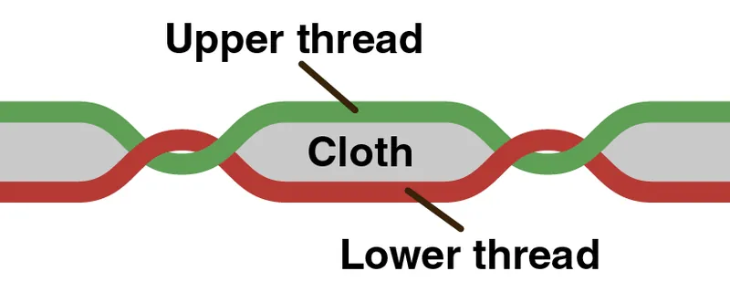
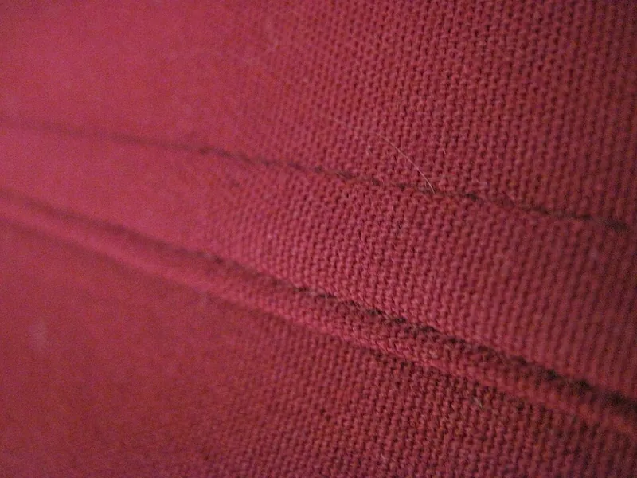
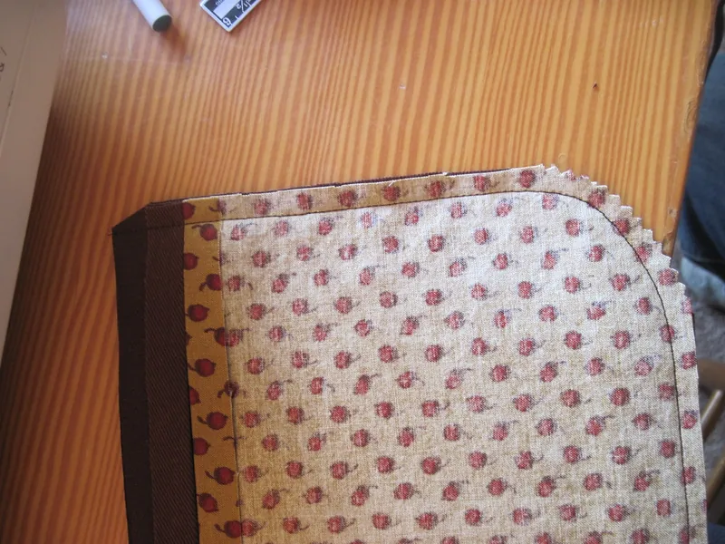

<figure class="eoc-pic eoc-pic-main"><figcaption><strong>Diagram.</strong> <a href="https://commons.wikimedia.org/wiki/File:Lockstitch_-_Anthony_Atkielski.png">Lockstitch - Anthony Atkielski</a> by Agateller (Anthony Atkielski), Public domain, from Wikimedia Commons.</figcaption></figure>
<figure class="eoc-pic"><figcaption><strong>Photo.</strong> <a href="https://commons.wikimedia.org/wiki/File:Flat_felled_seam.jpg">Flat felled seam</a> by kellyhogaboom, <a href="https://creativecommons.org/licenses/by-sa/2.0">CC BY-SA 2.0</a>, from Wikimedia Commons.</figcaption></figure>
<figure class="eoc-pic"><figcaption><strong>Photo.</strong> <a href="https://www.flickr.com/photos/11597293@N00/4613895689">Chaqueta</a> by kellyhogaboom, <a href="https://creativecommons.org/licenses/by-sa/2.0/">CC BY-SA 2.0</a>, from Flickr via Openverse.</figcaption></figure>

Two pieces of fabric or leather are held together by a line of thread stitched through both, by machine (usually a lockstitch) or by hand (running, back or saddle stitch), with the cut edges folded in, wrapped or overstitched so they can't fray.

**In plain words:** Joining two pieces of cloth or leather by passing thread back and forth through both of them, with a sewing machine or a needle by hand, and folding or wrapping the cut edges so they don't fray. **Proper term:** Sewn seam (stitched seam), made with a lockstitch, chain stitch or overlock by machine, or a running, back or saddle stitch by hand.

**Also called:** seam: 'the join where two or more layers of fabric, leather, or other materials are held together with stitches' (Wikipedia 'Seam (sewing)'); lockstitch, straight stitch, 'single needle stitching' (Wikipedia 'Lockstitch'); the FAA calls it the '301 lockstitch' and the zigzag versions stitch types 304 and 308 (FAA Parachute Rigger Handbook); chain stitch (ISO 4915 stitch 101) and double chain stitch (Wikipedia 'Chain stitch'); overlock, serging, overedging or merrowing (Wikipedia 'Overlock'); running stitch or straight stitch; basting or tacking stitch (long temporary running stitches) (Wikipedia 'Running stitch'); backstitch (Wikipedia 'Backstitch'); saddle stitch, hand stitching or two-needle stitching (a variant is ISO 4915 stitch 201) (Wikipedia; Tandy Leather); plain seam, French seam, flat or abutted seam, flat-felled seam (true flat-felled, faux flat-felled), lapped seam, bound seam, Hong Kong finish, French/felled hybrid (Wikipedia 'Seam (sewing)'; Ripstop by the Roll); seam finish: pinking, zigzag, overcasting, overlocking, bias binding (Wikipedia); seam allowance, also called inlay (Wikipedia 'Seam allowance'); casing, channel, hem tunnel, drawstring channel, pole sleeve, pole pocket (Wikipedia 'Drawstring'; Ripstop by the Roll; Banners.com); seam sealing and seam taping; seam sealers such as Seam Grip WP, FC and SIL, or SilNet (brands) (Gear Aid; Six Moon Designs); topstitch, rolled hem (Ripstop by the Roll); standard: ASTM D6193 'Standard Practice for Stitches and Seams' (Wikipedia).

## How it works

Thread passes through both layers again and again, so the layers can't slide apart without breaking or pulling out many stitches: they interlock (a [form-fit](../glossary.md#form-fit--force-fit--material-bond)). A machine lockstitch uses two threads, one from the needle and one from a bobbin underneath, which 'lock' (entwine) together inside the hole in the fabric, ideally in the middle of its thickness (Wikipedia 'Lockstitch'). A hand saddle stitch uses one thread with a needle at each end, sewn through the same line of holes from both sides, so if one side breaks only that side loosens (Wikipedia 'Saddle stitch'). The seam type decides where the raw cut edges go: a plain seam leaves them inside and needs a seam finish; French and flat-felled seams fold them inside the seam so they are fully enclosed (Wikipedia 'Seam (sewing)'). The needle holes still let water through, so seams in waterproof fabric are sealed with a liquid sealer or a heat-applied tape (Six Moon Designs; Extremtextil).

## Parts

A few parts: the two pieces of fabric or leather, the thread, and sometimes a binding strip, seam tape or seam sealer. Tools: a needle (two for saddle stitching), or a sewing machine with a needle and a bobbin; for leather an awl, pricking iron, stitching groover, mallet and stitching pony (Tandy Leather).

## Everyday examples

- The inside leg seam of jeans, a flat-felled seam made on a double-needle machine (Wikipedia 'Seam (sewing)')
- The overlocked seam edges inside shop-bought clothes: on mass-produced clothing, plain seams are 'usually finished with an overlock stitch' (Wikipedia 'Seam (sewing)')
- The saddle-stitched edge of a leather wallet, belt or dog collar (Wikipedia 'Saddle stitch')
- The casing round the top of a drawstring bag or the waist of tracksuit trousers, and the taped seams inside a rain jacket or tent fly (Wikipedia 'Drawstring'; Six Moon Designs)

## When to use it

Whenever you join fabric, leather or webbing and want the join to stay soft and flexible: bags, pouches, covers, tarps, flags, clothing, padding and fabric parts of a project. Use a machine lockstitch for long seams, hand running or back stitches for short repairs (backstitch 'strongly and permanently attaches two pieces of fabric', Wikipedia 'Backstitch'), and a saddle stitch for leather, where it ends up 'stronger than a machine stitch' and a cut thread doesn't unravel the whole line (Tandy Leather). Choose an enclosed seam (French or flat-felled) for fabrics that fray easily, things that are washed often, or outdoor gear (Ripstop by the Roll). Sew a casing or pole sleeve to carry a drawstring, elastic or a rod (Ripstop by the Roll's rolled hem 'Drawstring, channel').

## When not to use it

Not for anything that holds a person (harnesses, climbing slings, swings): use rated, professionally made gear; the FAA describes a harness that failed because cotton thread was used instead of the required nylon (FAA Parachute Rigger Handbook, p. 5-19). Not for heavy load in straps by plain seams: use a load-bearing stitch pattern (see that entry). Not for welded fabrics: plastic film and coated fabrics that must be fully airtight or watertight are better heat-sealed (see 'Heat-sealed seam'). Not directly into rigid 3D prints: use sewing holes or loops ('Sew-on part') or print onto the fabric. Where no sewing is wanted, iron-on fusible web or a flexible fabric glue can join fabric, though they can [peel](../glossary.md#peel-vs-shear) or stiffen (see those entries). Avoid a chain stitch where a broken thread must not unravel the seam (Wikipedia 'Chain stitch'). Avoid nylon thread for anything that lives in the sun (Sailrite).

## Details

- **What it does (jobs):**
  - join and hold: joins two pieces of fabric, leather or webbing along a line
  - seal it, or pass cables or fluid through: a seam-sealed or taped seam in coated fabric keeps rain out (Six Moon Designs; Gear Aid)
  - let it move (turn, slide or bend): a casing or pole sleeve is a sewn tunnel that a drawstring, elastic cord or rod slides through (Wikipedia 'Drawstring')
- **Movement:** flex: the joined fabric stays soft and bends at the seam; nothing slides, except a drawstring or pole running through a sewn casing
- **Directions it can move (degrees of freedom):** 0 between the joined edges, which are held together along the seam line; the cloth itself still bends and drapes freely.
- **Special behaviour:**
  - none: a seam simply holds. Two related points: a broken saddle stitch 'loosens only one side of the stitch' (Wikipedia 'Saddle stitch'), while a single-thread chain stitch 'is easily unravelled', which is used on purpose to close sacks that are torn open with one pull (Wikipedia 'Chain stitch')
- **How it holds:**
  - shape (the parts interlock; form-fit): the thread passes through holes in both layers and is locked in place, so the layers can't separate without the thread breaking or tearing out
  - material bond (glue, solvent or melting): only for the waterproofing step, where a seam sealer or heat-applied seam tape bonds over the stitches (Gear Aid; Six Moon Designs)
- **Input and output:** not applicable: a seam joins fabric and passes no motion on
- **Power:** passive (no power needed). A sewing machine needs power only while sewing.
- **Load:** Medium. A well-designed seam can be stronger than the fabric: for parachute canopies 'The strength of the seam needs to be greater than the strength of the fabric' (FAA Parachute Rigger Handbook, p. 2-25). It is strongest when pulled along the fabric (the stitches share the load in shear) and weakest at a single point: concentrated pulls make seams in slippery fabric 'pull apart under heavy strain' (Extremtextil). Thread strengths, side by side: the FAA lists V-T-295 nylon thread as E 8.5 lb, FF 16 lb, 3-cord 24 lb and 5-cord 40 lb (p. 3-14), but in its harness-failure example (p. 5-19) gives '45 pounds for 5-cord nylon', against about 10 lb for the cotton thread wrongly used. For dense load-bearing joints in straps, see 'Load-bearing stitch patterns'. Never use a home-sewn seam to hold a person.
- **Play and precision:** not applicable for motion, but [accuracy](../glossary.md#repeatability--accuracy) matters: a consistent seam allowance and pressing before the final stitching give a consistent finished seam (Wikipedia 'Seam (sewing)'); thread tension should place the lock in the middle of the material (Wikipedia 'Lockstitch').
- **Taking it apart:** semi-permanent: stitches can be picked out with a seam ripper (FAA Parachute Rigger Handbook lists it among the rigger's tools), but the needle holes stay in the fabric or leather; a sealed or taped seam is effectively permanent.
- **How often it can be reused:** a few times: a seam can be unpicked and resewn, but each time leaves more holes and the thread is replaced
- **Sealing:** none for an ordinary seam: the needle holes leak. French and flat-felled seams give 'enhanced' water resistance (Ripstop by the Roll), cotton-wrapped (corespun) thread swells when wet to help close the holes (Extremtextil), and the seam becomes watertight only when it is sealed with a compatible liquid sealer or seam tape (Six Moon Designs; Gear Aid).
- **Adjustable:** no: a seam is fixed once sewn. A drawstring in a sewn casing adjusts how tightly the fabric is gathered (Wikipedia 'Drawstring').
- **Access needed:** both sides: the needle passes through and back, so you need both faces of the work (under the presser foot of a machine, or reachable by hand); a hand sewing awl still needs both sides.
- **Materials:** Joins woven and knitted fabrics, canvas, leather, webbing, coated fabrics (silicone-coated silnylon and silpoly, polyurethane-coated nylon and polyester) and laminates (X-Pac, Dyneema Composite Fabric; brands). Laminates don't 'self-heal' round needle holes the way woven fabric does, so use longer stitches (Ripstop by the Roll). Thread: UV-treated polyester is 'the most common thread for outdoor applications', though it fades and loses strength in long sun; nylon is very strong but not recommended outdoors; PTFE or fluoropolymer 'lifetime' threads are unaffected by UV (Sailrite). Waxed polyester, linen or hemp thread for saddle stitching leather (Tandy Leather). Cotton thread is weak for load-bearing work (FAA). Rigid 3D prints can't be sewn through, except thin TPU; use sewing holes instead (see 'Sew-on part').
- **Heat, cold, water and wear:** Sunlight: nylon thread 'does not have the UV resistance of polyester thread and will not last as long outside'; polyester also loses 'much of its strength' after long sun exposure and its colours fade to white; PTFE lifetime threads are 'unaffected by exposure to UV rays' (Sailrite). Wet: silnylon 'stretches slightly when wet', so allow for re-tensioning (Extremtextil); cotton-wrapped thread swells to help seal holes (Extremtextil). Sealers: Seam Grip WP 'is unaffected by heat or solvents', while the water-based Seam Grip FC 'can be broken down by solvents' (Gear Aid); sealers need curing time, 8-12 hours or more in cold, humid weather (Six Moon Designs). Abrasion: cutting a groove for leather stitches keeps them flush and protects them from friction wear (Tandy Leather).

## Making it

- **Ways to make or get it:**
  - hand sewing: running, back, overcast and saddle stitches with a needle, or a lockstitch with a sewing awl
  - machine sewing: a home lockstitch machine for straight, zigzag and stretch stitches; an overlocker (serger) for seam finishes
  - off-the-shelf part: thread, needles, bias binding, seam tape and seam sealer
  - 3D print (FDM): printed sewing aids rather than the seam itself: magnetic seam guides, bias tape makers, sewing clips, hemming feet, leather stitching markers and stitching ponies (Printables models below)
- **Printing it in one piece (print in place):** no: a seam is sewn, not printed. Printed sewing aids are separate tools; a printed sewing clip uses a scrap of filament as its hinge pin and a piece of silicone as its spring (Printables 'Sewing Clip').
- **Tools:** Hand: needle, thread, scissors, pins or sewing clips. Machine: a lockstitch sewing machine (or an overlocker for finishes) and a seam ripper; an iron to press seam allowances flat (Wikipedia 'Seam (sewing)'). Leather saddle stitching: two needles, waxed thread, a stitching groover, a pricking iron and mallet, an awl and a stitching pony (Tandy Leather). A hand sewing awl makes a lockstitch by hand (Wikipedia 'Lockstitch'). Sealing: a small brush or applicator and seam sealer (Six Moon Designs).
- **Difficulty:** easy to moderate: a hand running or back stitch and a plain machine seam are beginner work ('Technical Difficulty: Beginner', Ripstop by the Roll); French seams and saddle stitching need practice; Ripstop by the Roll rates the flat-felled seam 'Pro'.

### 3D printing tips

The seam itself can't be printed, and rigid prints can't be sewn through (thin TPU is the exception); to sew fabric to a print use sewing holes, slots or loops, covered in 'Sew-on part', or print onto the fabric ('Printing onto fabric'). Useful printed aids: 1) Magnetic seam guide: a printed fence held to the machine bed by magnets keeps the seam allowance even; one uses four glued-in 8 x 3 mm magnets and a notch to clear the plate screw (Printables 'Sewing Machine Seam Guide'), another has two slots for 10 x 2 mm (or other) magnets, printed in PLA+ at 0.2 mm layers with no supports, with an OpenSCAD file to resize it (Printables 'Sewing Machine Seam Guide with Double Magnet Slot'). Check the machine maker's advice before putting magnets near an electronic machine ⚑ [uncertain: no source opened on this]. 2) Bias tape maker: pulls a fabric strip through a printed funnel to fold it into binding for bound seams; one 5 cm version prints in its saved orientation with no supports (Printables 'Bias Tape Maker 5cm'). 3) Sewing clips: hold slippery layers together without pin holes, which matters on coated fabrics, where pins should go only in the seam allowance (Extremtextil); a printed clip uses under 1 g of PLA at 0.2 mm (Printables 'Sewing Clip'). 4) Narrow hemming foot: printed 'left side down to have a smooth bottom which won't snag the textile', with supports everywhere (Printables 'Sewing Machine Narrow Hemming Foot'). 5) Leather: fixed-width stitching markers (2-5 mm) mark the stitch line like wing dividers, though a PLA tip wears (Printables 'Leather stitching marker'); a printed stitching pony works for small items, but its designer says 'you're probably better off buying a wooden one' (Printables 'Stitching Pony for Leather'); a printed sewing awl handle takes standard awl needles (Printables 'Sewing Awl'). 6) Orientation: print tools that take load so the force runs along the layers, since FFF prints 'are stronger in one direction than another' (Prusa).

### Buying one (off-the-shelf parts)

Search for: 'UV bonded polyester thread' (outdoor work), 'bonded nylon thread' (indoor upholstery), 'PTFE thread' or 'lifetime thread' (Sailrite); 'corespun thread' and 'Microtex needle' (silnylon; Extremtextil); 'waxed polyester thread', 'linen thread', 'pricking iron', 'stitching chisel', 'stitching groover', 'stitching pony', 'harness needles' (leather; Tandy Leather); 'sewing awl' (hand lockstitch); 'double-fold bias tape' (bound seams; Wikipedia); 'seam ripper'; 'seam sealer' for the matching coating (silicone or polyurethane) and 'seam tape' (Gear Aid; Six Moon Designs); 'sewing clips' (Extremtextil names Wonder Clips (brand)).

## Rules of thumb

- Seam allowance: home sewing patterns use 1/4 to 5/8 inch (6.4 to 15.9 mm); 5/8 inch (1.5 cm) makes sure fabrics that ravel easily are 'safely caught'; industry uses 1/4 inch on curves and hidden seams up to 1 inch or more where fitting is needed; curved seams take smaller allowances (Wikipedia 'Seam allowance').
- French seam, two sets of figures side by side: sew 1/4 inch (0.6 cm) wrong sides together, trim to 1/8 inch (0.3 cm), press, then sew 1/4 inch right sides together (Wikipedia 'Seam (sewing)'); Ripstop by the Roll starts with a basting stitch 1/8-1/4 inch from the edge and allows 3/4-2 inches of seam allowance.
- Which seam to choose (Ripstop by the Roll strength ranking): simple (plain) seam 'Mediocre', exposed edges; rolled hem for drawstring channels and hammocks; French seam 'Stronger that a simple seam, weaker than flat felled, and hybrid', for apparel; flat-felled seam for tarps, bags and apparel; French/felled hybrid 'Strongest', for bags and packs. On silnylon, Extremtextil found that a double flat seam 'has proven to be the best type of seam'.
- Stitch length: about 8 stitches per inch is average; use a longer stitch (about 4-8 per inch) on laminates that don't self-heal (Ripstop by the Roll); parachute repairs use 7-11 stitches per inch (FAA); 'Too many stitches per inch dramatically affects the strength of the seam by perforating the material' (FAA Parachute Rigger Handbook, p. 2-25).
- Thread and needle: the lighter the fabric, the smaller the thread and needle, so the needle doesn't damage the weave (FAA, p. 2-25); for silnylon use a thin, sharp Microtex or jeans needle, size 70 or 80 with Tex-75 corespun thread (Extremtextil). Outdoors use UV-treated polyester or PTFE thread, not nylon (Sailrite).
- Saddle stitch: cut thread 'about five times longer than the segment' to be stitched, finish with two or three backstitches, then melt polyester thread ends or set linen and hemp ends with a drop of glue (Tandy Leather). Tandy says to trim poly thread '1/8" (1 mm)' from the work; these figures don't agree (1/8 inch is about 3 mm), so treat them as 'a few millimetres'.
- Repairs: overstitch a broken seam at least 4-6 inches (100-150 mm) beyond each end of the damage (FAA Parachute Rigger Handbook, p. 7-15).
- Seam sealing: 'only one thing sticks to silicone: silicone', so silicone-coated fabric needs a silicone sealer, and polyurethane sealers and seam tapes won't stick to it (Extremtextil; Six Moon Designs). Where to seal, side by side: Extremtextil seals pure seams such as ridge seams from the outside and reinforcements from the inside; Six Moon Designs says its butt seams 'must be sealed from the outside'; Gear Aid recommends sealing from the inside 'mainly for aesthetic reasons'. A home-made silicone sealer is one part mineral spirits to one part silicone caulk, cured 8-12 hours (Six Moon Designs).
- Point loads on light fabric: eyelets are 'generally unsuitable' on silnylon because the pull can't spread; sew on webbing or ribbed tape loops 15-25 mm wide over rounded reinforcement patches instead (Extremtextil).

## Common failures

Raw edges fray and the seam pulls out: use a seam finish (overlock, zigzag, pinking, binding) or an enclosed seam (Wikipedia 'Seam (sewing)'). Seam puckers or 'draws': both thread tensions too tight; skipped stitches: machine out of time (FAA troubleshooting chart, p. 6-23). Lock not in the middle of the fabric: upper and lower tensions unbalanced (Wikipedia 'Lockstitch'). Too many stitches per inch perforate and weaken the fabric (FAA). Slippery coated fabric pulls apart at the seam: sew through several layers (rolled hem, double flat seam) and spread loads (Extremtextil). Seam leaks: seal it with the right sealer for the coating; the wrong one won't stick (Extremtextil; Six Moon Designs). One broken machine stitch lets the line unravel ('if one side of a stitch is broken the entire length of the stitch will be compromised', Tandy Leather): backstitch the ends and use a saddle stitch for leather. Thread rots in the sun: use UV-treated polyester or PTFE (Sailrite). An extra layer of fabric caught in the seam by mistake (FAA, a 'common mistake' with three panels meeting).

## Safety

Sharp tools: needles, awls, pricking irons struck with a mallet, knives and rotary cutters can stab or cut; keep fingers clear of a sewing machine's needle while it runs ⚑ [uncertain: no source opened gives sewing-machine safety rules]. Heat: melting polyester thread ends with a lighter (Tandy warns 'Be careful not to burn your project') and hot-knife cutting of synthetic fabric can burn; a hot-knife blade stays hot for minutes after use (Practical Sailor). Fumes: work in a well-ventilated area when using solvent-thinned seam sealers (Six Moon Designs uses mineral spirits). Drawstrings: drawstrings in children's clothing can catch and strangle; the US CPSC issued guidelines in 1996 after reports of deaths (Wikipedia 'Drawstring'), so don't put hood or neck drawstrings in casings on children's clothes. Magnets: printed magnetic seam guides contain small strong magnets, which are dangerous if swallowed; keep them away from small children. Never trust a home-sewn seam to hold a person.

## Related

- Load-bearing stitch patterns for straps and webbing (bar tack, box-X stitch): the dense stitch blocks for straps that carry real load
- Sew-on part (sewing holes, loops and slots on a rigid part): how to sew fabric onto a 3D-printed or rigid part
- Heat-sealed seam (heat-sealed plastic film and coated fabric): joins coated fabric or film by melting, with no needle holes to seal
- Iron-on fusible web (heat-activated adhesive web, hem tape): the no-sew way to hem or join fabric with heat
- Elastomeric solvent glue (flexible craft glue) and contact adhesive: glued fabric joins instead of stitches
- Folded seam (hem, lock seam, Pittsburgh lock): the sheet-metal version of a folded, enclosed seam
- Lacing (cord through rows of holes or eyelets): a cord through holes that can be undone and re-tightened, unlike a sewn seam
- Conductive thread (sewn circuit, e-textile stitching): stitching that carries electric current
- Cord lock (spring toggle): holds the drawstring that runs in a sewn casing
- Bead-in-groove fabric edge (keder, boltrope, screen [spline](../glossary.md#spline)): a sewn-in or welded bead that slides into a track
- Printing onto fabric (fabric embedded in a 3D print): joins plastic to fabric without sewing
- Rope-end finishing (whipping, heat-sealing, back splice, aglet): melting or hemming the end of a strap or tape to stop fraying

## Make it yourself

- [Sewing Machine Seam Guide with Double Magnet Slot (Printables) (URL from Printables API, page not opened)](https://www.printables.com/model/1194803-sewing-machine-seam-guide-with-double-magnet-slot): Printed magnetic fence that keeps the seam allowance even; STL files for several magnet sizes and an OpenSCAD file to change it *(licence: CC BY)*
- [Bias Tape Maker 5cm (Printables) (URL from Printables API, page not opened)](https://www.printables.com/model/25814-bias-tape-maker-5cm-zakladac-sikmeho-prouzku): Printed funnel that folds a fabric strip into binding for bound seams and edges; no supports *(licence: CC BY)*
- [Sewing Clip (Printables) (URL from Printables API, page not opened)](https://www.printables.com/model/799176-sewing-clip): Small printed clip for holding layers together without pins; filament-scrap hinge and silicone spring *(licence: CC BY)*
- [Sewing Machine Narrow Hemming Foot (Printables) (URL from Printables API, page not opened)](https://www.printables.com/model/1296154-sewing-machine-narrow-hemming-foot): Printed presser foot for stitching hems close to the edge *(licence: CC BY)*
- [Leather stitching marker (Printables) (URL from Printables API, page not opened)](https://www.printables.com/model/1086487-leather-stitching-marker): Fixed-width markers (2-5 mm) that scribe the stitch line along a leather edge, in place of wing dividers *(licence: CC BY-NC)*
- [Sewing Awl (Printables) (URL from Printables API, page not opened)](https://www.printables.com/model/651335-sewing-awl): Printed handle and collet for a hand sewing awl, which makes a lockstitch by hand; needs an M3 x 30 mm screw, a nut and awl needles *(licence: CC BY-SA)*

## Pictures, videos and models

- [Lockstitch (Wikimedia Commons)](https://commons.wikimedia.org/wiki/File:Lockstitch_-_Anthony_Atkielski.png): Simple diagram of the upper and bobbin threads interlocking inside the fabric *(licence: Public domain (Anthony Atkielski))*
- [Hand stitches: saddle stitch (Wikimedia Commons)](https://commons.wikimedia.org/wiki/File:Hand_Stitches_-_Saddle_Stitch_1.png): Drawing of a saddle stitch: two threads sewn through one line of holes *(licence: CC BY-SA 4.0 (Stilfehler))*
- [French seam (Wikimedia Commons)](https://commons.wikimedia.org/wiki/File:French_seam.png): Cross-section of a French seam with the raw edges enclosed *(licence: Public domain (PKM))*
- [Flat-felled seam (Wikimedia Commons)](https://commons.wikimedia.org/wiki/File:Flat_felled_seam.jpg): Photo of a flat-felled seam with its two rows of stitching *(licence: CC BY-SA 2.0 (kellyhogaboom))*
- [Stitches and Seams (Ripstop by the Roll, 2022)](https://ripstopbytheroll.com/blogs/the-grid-online-blog/stitches-and-seams): Photos and descriptions of 10 stitches and seams for outdoor gear (simple, rolled hem, French, flat-felled, hybrid), with difficulty, strength and seam allowance for each *(licence: Ripstop by the Roll content; link only)*

## Needs confirming

⚑ marks something nobody has confirmed yet: a fact the research could not confirm from a source, a finder value that is a best guess, or an open point from the research notes. Corrections are welcome (see `research/needs-confirming.md`).

- ⚑ 2 sentences on this page marked [uncertain].
- ⚑ Research note: *Sewn seams*: the FAA *Parachute Rigger Handbook* gives 5-cord nylon thread as 40 lb in its table (p. 3-14) and 45 lb in its text (p. 5-19); French seam allowances differ between Wikipedia and Ripstop by the Roll; sources differ on sealing a seam inside or outside (Extremtextil, Six Moon Designs, Gear Aid). Tandy writes a thread-end trim of '1/8" (1 mm)', though 1/8 in is about 3 mm.

## Sources

- <https://en.wikipedia.org/wiki/Seam_(sewing)>
- <https://en.wikipedia.org/wiki/Lockstitch>
- <https://en.wikipedia.org/wiki/Chain_stitch>
- <https://en.wikipedia.org/wiki/Saddle_stitch>
- <https://en.wikipedia.org/wiki/Backstitch>
- <https://en.wikipedia.org/wiki/Running_stitch>
- <https://en.wikipedia.org/wiki/Overlock>
- <https://en.wikipedia.org/wiki/Stitch_(textile_arts)>
- <https://en.wikipedia.org/wiki/Seam_allowance>
- <https://en.wikipedia.org/wiki/Drawstring>
- <https://tandyleather.com/blogs/projects/tandy-skills-saddle-stitching>
- <https://www.faa.gov/sites/faa.gov/files/regulations_policies/handbooks_manuals/aviation/prh_change1.pdf (FAA Parachute Rigger Handbook, FAA-H-8083-17A Change 1: pp. 2-25 joint efficiency, 3-14 threads, 5-19 harness thread failure, 6-18 to 6-19 sewing theory, 6-23 troubleshooting chart, 7-15 seam restitching)>
- <https://ripstopbytheroll.com/blogs/the-grid-online-blog/stitches-and-seams>
- <https://ripstopbytheroll.com/pages/ep-49-the-seams-you-need-to-know>
- <https://ripstopbytheroll.com/pages/flat-felled-seam-definition-myog-glossary>
- <https://www.sailrite.com/Selecting-the-Right-Thread-Material>
- <https://www.extremtextil.de/en/know-how/silnylon-info>
- <https://www.sixmoondesigns.com/blogs/skills/faq-seams-sealing>
- <https://www.gearaid.com/blogs/learn/which-sealant-should-i-use>
- <https://www.banners.com/c/banner-grommet-placement-explained-spacing-strength-and-installation-best-practices (fabric banners 'often use pole pockets or hemmed edges')>
- <https://www.practical-sailor.com/boat-maintenance/tools-gadgets/gonytia-hot-knife-proves-its-mettle/>
- <https://help.prusa3d.com/article/modeling-with-3d-printing-in-mind_164135>
- <https://commons.wikimedia.org/wiki/File:Lockstitch_-_Anthony_Atkielski.png>
- <https://commons.wikimedia.org/wiki/File:Hand_Stitches_-_Saddle_Stitch_1.png>
- <https://commons.wikimedia.org/wiki/File:French_seam.png>
- <https://commons.wikimedia.org/wiki/File:Flat_felled_seam.jpg>
- <https://commons.wikimedia.org/wiki/File:Bound_seam1.png>
- <https://api.printables.com/graphql/ (Printables models 208733 'Sewing Machine Seam Guide', 1194803, 25814, 799176, 1296154, 1086487, 1224263 'Stitching Pony for Leather', 651335; pages not opened)>
