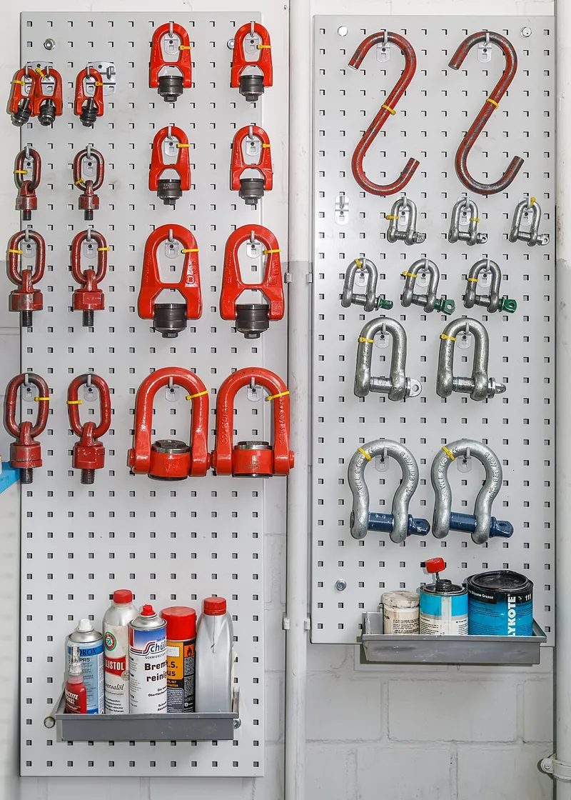

<figure class="eoc-pic eoc-pic-main"><figcaption><a href="https://commons.wikimedia.org/wiki/File:Maillon.JPG">Maillon</a> by Cj8457, Public domain, from Wikimedia Commons.</figcaption></figure>

A closed metal link (a U-shaped shackle shut by a screw pin or bolt, or an oval quick link shut by a threaded sleeve) that joins rope eyes, chain, slings, straps and anchor points; because it closes completely it can't shake off like a hook, and a rated, marked one carries very heavy in-line loads.

**In plain words:** A strong metal U closed across its open end by a screw-in pin or a bolt (or an oval chain link closed by a screw-on sleeve), used to join a rope loop, chain, strap or hook to an anchor point so nothing can slip off. **Proper term:** Shackle (D-shackle and bow shackle) and quick link (maillon).

**Also called:** shackle, shacklebolt, gyve (Wikipedia 'Shackle'); D-shackle, chain shackle: narrow, for in-line loads (Wikipedia 'Shackle'); bow shackle, anchor shackle: rounder 'O' shape that takes loads from several directions (Wikipedia 'Shackle'); screw-pin shackle, threaded shackle: the pin screws into one leg (Wikipedia 'Shackle'; Crosby); round-pin shackle: plain pin held by a cotter pin, for in-line loads only (Crosby); bolt-type shackle, safety shackle, pin shackle: bolt plus nut and cotter pin, for long-term use; in industrial jargon often called a clevis (Wikipedia 'Shackle'; Crosby); headboard shackle and twist shackle (with a 90° twist), used on sailing boats (Wikipedia 'Shackle'); quick link, maillon, maillon rapide (French maillon = link): a link closed by a threaded sleeve (Wikipedia 'Maillon'); Maillon Rapide (Péguet, brand); oval, large-opening, D (half-moon), delta (triangular), square, pear-shaped and twist quick links (Wikipedia 'Maillon'; Péguet product range); soft shackle, rope shackle, textile shackle: a loop of strong fibre rope closed by a stopper knot (Wikipedia 'Shackle'; see Rope splices); snap shackle: spring-latched and opened under load, covered in Quick-release hooks; standards: ASME B30.26 'Rigging Hardware', US Federal Specification RR-C-271 and ISO 2415 for shackles; EN 362 and EN 12275 for quick links used as personal protective equipment (Crosby G-209 page; Hanford ch. 2-26; Péguet).

## How it works

The bow or link goes through or round the things to be joined, and the pin or sleeve closes the gap, so the link becomes a solid closed ring that the load cannot pull open or lift off (Wikipedia 'Shackle', 'Maillon'). A shackle pin is held by its thread in the tapped leg, by a cotter pin, or by a nut and cotter pin; a quick link's sleeve screws over the gap until no thread shows and then carries load across the gap like the rest of the link (Crosby; Péguet instructions). It is strongest when the pull runs straight through the bow and pin (in line) or along the length of a quick link (major axis); pulling sideways bends the narrow D shape and puts the load where it is weakest, which is why bow shackles have a rounder bow for loads from several directions and why round-pin shackles must never be side-loaded (Wikipedia 'Shackle'; Crosby). A soft shackle works the same way with rope: the knot at one end pushes through the loop at the other, and the loop tightens round the neck of the knot under load (Wikipedia 'Shackle').

## Parts

A few parts. Shackle: the U-shaped body (bow) with an eye in each leg, plus a pin that either screws into one leg (screw pin), is a plain pin held by a cotter pin (round pin), or is a bolt with a nut and cotter pin (bolt type); optional mousing wire or cable tie (Wikipedia 'Shackle'; Crosby). Quick link: an open oval or D link with a thread on one end and a threaded sleeve that screws across the gap (Wikipedia 'Maillon'). Soft shackle: one length of fibre rope with a spliced loop and a stopper knot (Wikipedia 'Shackle').

## Everyday examples

- Threaded shackles mounted on the front of a fire engine or 4x4 for a winch or tow line (Wikipedia 'Shackle', photo caption)
- Shackles on a sailing boat's halyards, sails and blocks, including headboard and twist shackles (Wikipedia 'Shackle')
- A quick link making a 'fast, easy connection between two lengths of chain' or attaching accessories to chain (National Hardware quick link)
- Quick links (maillons) left on bolts as abseil anchors on climbing routes, and a small plastic shackle closing a paracord bracelet (Wikipedia 'Maillon'; Printables 'Paracord Bracelet Shackle')

## When to use it

Use a shackle or quick link whenever a rope eye, chain, strap or sling must be joined to an anchor point, eye bolt or another link more securely than a hook allows: it closes completely, so the load can't bounce or shake off, and it can be undone later. Choose a D-shackle for straight, in-line pulls, a bow shackle where the pull direction changes or two legs share it, a bolt-type shackle for anything left in place, a screw-pin shackle for temporary connections tightened before each use, and a quick link for a slim, semi-permanent link in chain or between rope and anchor that is rarely opened (Wikipedia 'Shackle', 'Maillon'; Crosby; Péguet). Use rated, marked hardware whenever a failure could hurt someone.

## When not to use it

Not for frequent clipping and unclipping: use a Spring-gate hook (carabiner), which is faster but weaker across its gate (Wikipedia 'Maillon'). Not when the load must be released while still pulling: use Quick-release hooks (snap shackle, pelican hook). Don't use round-pin shackles for side loads or to gather several sling legs, and don't use unrated, unmarked hardware-store shackles or quick links for overhead lifting, people, swings or climbing (Crosby; National Hardware). Avoid metal shackles where they will bang on and damage decks, masts or paint, or where a lost pin is a problem: a soft shackle 'can handle just about every function performed by a metal shackle' there, but it can be cut by sharp edges and weakened by heat (Wikipedia 'Shackle', quoting Sail magazine). For a pivoting joint between two rigid parts use a Clevis joint; for adjustable tension use a Turnbuckle.

## Details

- **What it does (jobs):**
  - join and hold: links a rope eye, chain, sling, strap, hook or block to an anchor point, eye bolt or another link
  - lock, and release by hand: the screw pin or sleeve is closed and opened by hand (or with a shackle key or spanner) once the load is off
- **Movement:** multiple: the closed link itself doesn't move, but the parts it joins can swing, pivot on the pin or round the bow, and slide round the bow; a twist shackle turns the joined parts through 90° (Wikipedia 'Shackle').
- **Directions it can move (degrees of freedom):** None inside the closed link. The joined parts are loosely captured: each can pivot and slide round the bow or link, but cannot come out while the pin or sleeve is closed (Wikipedia 'Shackle', 'Maillon').
- **Special behaviour:**
  - hand-release only (locks under load, releases when a person operates it): once the pin or sleeve is done up, the load cannot open it; a person unscrews it when the load is off (Wikipedia 'Maillon'; Crosby)
  - none of the other behaviours: it does not slip, click or release on its own (for release under load, see Quick-release hooks and the snap shackle)
- **How it holds:**
  - shape (the parts interlock; [form-fit](../glossary.md#form-fit--force-fit--material-bond)): the closed bow or link surrounds the rope, chain or eye, and the pin or sleeve closes the gap (Wikipedia 'Shackle', 'Maillon')
  - friction or clamping (force-fit): the screw pin or sleeve is held by its thread, tightened by hand or to a [torque](../glossary.md#torque), and backed up by mousing wire, a cable tie or a cotter pin (Crosby; Péguet instructions; Wikipedia 'Safety wire')
- **Input and output:** not applicable
- **Power:** passive (no power needed)
- **Load:** Light to very heavy, set by the rating marked on the part. Rated forged shackles: 'Working Load Limit and grade 6 permanently shown on every shackle', minimum breaking strength 6 x the WLL, proof tested to 2 x the WLL (Crosby G-209). Quick links: WLL marking based on a safety factor of 5 (Péguet); a certified 7 mm steel quick link breaks at 25 kN along its length (major axis) but only 10 kN across it (minor axis) (Petzl GO). Unrated hardware-store quick link: a 1/4 in link has an 880 lb safe working load but is marked 'Do not use for overhead lifting, support of human weight, athletic or playground equipment' (National Hardware). Strong in line (pull through the bow and across the pin, or along a quick link's length); weaker when side-loaded: screw-pin and bolt-type shackles drop to 70% of WLL at 45° and 50% at 90°, and round-pin shackles must not be side-loaded at all (Crosby; table via CUNY City Tech handout); D-shackles can 'twist or bend' under side and racking loads (Wikipedia 'Shackle'); a quick link loaded across its minor axis or with the sleeve not locked is 'dangerous' (Petzl technical notice).
- **Play and precision:** not applicable: a loose link that lets the joined parts move; it is not used to locate anything.
- **Taking it apart:** removable: screw-pin shackles and quick links undo by hand when unloaded (a shackle key or pliers helps with tight pins), bolt-type shackles with a spanner after the cotter pin is removed (Wikipedia 'Shackle'; Crosby). Quick links tightened with a spanner for 'semi-permanent connections' (Petzl technical notice) are removed with a spanner.
- **How often it can be reused:** many times for shackles, which are inspected and reused (Crosby); quick links are meant for connections that are opened 'infrequently' under EN 362, and any link that has arrested a fall or taken a major load must be replaced (Péguet instructions; Petzl technical notice); a mousing wire or cotter pin is used once.
- **Sealing:** none: nothing seals; it is an open-air link.
- **Adjustable:** no: it only joins and unjoins; it sets no position or tension (use a Turnbuckle for that).
- **Access needed:** not applicable: it is closed in the open around the parts it joins; you only need to reach the link, its pin or sleeve, and both ends of a bolt-type pin.
- **Materials:** Shackles: forged, quenched and tempered carbon steel with alloy pins, hot-dip galvanised or self-coloured (Crosby G-209); stainless steel for marine use, some stamped from flat strap (Wikipedia 'Shackle'). Quick links: steel (Petzl GO), zinc-plated steel and stainless steel (National Hardware) ⚑ [uncertain: other materials such as aluminium alloy are sold for light uses]. Soft shackles: high-strength fibre rope such as UHMWPE (Dyneema, brand), aramid or PBO (Wikipedia 'Shackle'). Joins: chain, wire-rope and fibre-rope eyes with or without thimbles, webbing and synthetic slings (which need a big enough bow to avoid pinching), eye bolts, pad eyes and other shackles (Crosby). Stainless threads can gall (seize) if overtightened or corroded (Wikipedia 'Shackle').
- **Heat, cold, water and wear:** Rated steel shackles and links: -40°F to +400°F (-40°C to 204°C) (Crosby G-209; ASME B30.26 via Hanford ch. 2-26). Salt air corrodes threads and makes stainless threads gall; a coat of lanolin or heavy grease helps (Wikipedia 'Shackle'). Steel mousing wire on a stainless shackle can cause galvanic corrosion in wet, salty places (Wikipedia 'Shackle'). Quick links should be stored dry and their threads lightly oiled after contact with water; extreme temperatures, chemicals, cuts and abrasion affect performance (Péguet instructions). Vibration loosens screw pins and sleeves, so mouse long-term pins (Crosby). Soft shackles are weakened by heat, including friction heat, can be cut or burned, and 'deteriorate in some environments' (Wikipedia 'Shackle').

## Making it

- **Ways to make or get it:**
  - off-the-shelf part: rated shackles and quick links are bought forged or machined metal
  - 3D print (FDM): decorative and very light-duty shackles and links only, e.g. paracord-bracelet shackles, scale-model shackles and a printed quick link for model-rocket recovery lines (see make_it_yourself)
  - hand-made from rope: soft shackles tied from strong fibre rope (see Rope splices and make_it_yourself)
- **Printing it in one piece (print in place):** no: metal shackles and quick links are bought; printed ones are printed as a separate body and pin or sleeve (or use a metal screw as the pin) and assembled ⚑ [uncertain for every printed design].
- **Tools:** None for a hand-tight screw pin or sleeve; a shackle key or metal marlinspike to loosen tight pins (Wikipedia 'Shackle'); a spanner for bolt-type shackle nuts and for tightening quick-link sleeves to the maker's torque (Péguet instructions); pliers, annealed iron mousing wire or a cable tie, and new cotter pins (Crosby; Wikipedia 'Shackle').
- **Difficulty:** easy to fit: thread it through, screw the pin or sleeve shut, mouse it if it stays; impossible to make safely at home for real loads (forging, heat treatment and proof testing), so buy rated, marked shackles and links; soft shackles can be tied at home but home-made ones are unrated.

### 3D printing tips

1) Printed shackles and links are for decoration, bracelets, models and very light loads only; one maker labels a printed D shackle 'DO NOT USE FOR ANYTHING BUT AESTHETICS ONLY' (Printables 'D shackle', isyork), and US rigging rules ban makeshift links in lifting (OSHA 29 CFR 1926.251). 2) Print the bow or link lying flat so the U shape is in the layer plane and the pull runs along the lines of filament, not across layers: PLA bars printed flat held 63 MPa but only 31 MPa when the layers were pulled apart (CNC Kitchen); a link printed standing up would split along a layer ⚑ [uncertain for each design]. 3) Use a metal bolt, screw or pin as the shackle pin rather than a printed one, and a nut or a [heat-set insert](../glossary.md#heat-set-insert) rather than a thread in plastic for anything reused (Hubs 'How to assemble 3D printed parts with threaded fasteners'). 4) Give the bow generous thickness at the curve and use tough materials (PETG, nylon) for links that are flexed or snapped shut ⚑ [uncertain]. 5) Proof-test a printed link well above its intended load before relying on it, and never use one where a failure could hurt anyone. 6) Printed pulleys and blocks often hang from a soft shackle instead of a metal one; one design was tested to 100 kgf for three days and broke at about 150 kgf (Printables 'Soft shackle rope pulley', printableconcrete).

### Buying one (off-the-shelf parts)

D (chain) shackles and bow (anchor) shackles in screw-pin, round-pin (with cotter) and bolt-type (bolt, nut and cotter) versions; long-D, headboard and twist shackles for sailing; captive-pin shackles; snap shackles (see Quick-release hooks); shackle key or marlinspike; annealed iron mousing wire (safety wire) and cotter pins; quick links in oval, large-opening, D (half-moon), delta, square, pear and twist shapes, in zinc-plated or stainless steel, some certified EN 362 / EN 12275; ready-made Dyneema soft shackles (Wikipedia 'Shackle', 'Maillon'; Crosby; Péguet; National Hardware). For sizes and ratings use the maker's tables, e.g. Crosby's G-209 shackle page or Péguet's quick-link range, and the WLL marked on the part.

## Rules of thumb

- Pick the pin by the job: screw-pin shackles for temporary 'pick and place' use, with the pin tightened before each lift; bolt-type shackles (always with nut and cotter) for permanent or long-term use and where the load may slide on the pin and turn it; round-pin shackles only for strictly in-line loads, never side-loaded or used to gather several sling legs (Crosby shackle warnings 2023; Crosby 2013 via CUNY City Tech handout).
- Side loading of screw-pin and bolt-type shackles: 0-5° 100% of WLL, 45° 70%, 90° 50%; side loads must be in the plane of the bow, and two sling legs on the bow may use the full WLL up to a 120° included angle (Crosby 2013 catalogue pages, via CUNY City Tech handout; the 2023 Crosby sheet says side loads must be reduced 'according to Table 1').
- Centre the load in the bow, don't put several sling legs on the pin, make the shackle bigger than the wire rope if the rope eye has no thimble, and big enough not to pinch synthetic slings (Crosby).
- Mouse screw pins in long-term or high-vibration use: annealed iron wire through the hole in the pin's collar and round the adjacent leg, ends twisted together (Crosby); a cable tie is used where easy removal is wanted, but wire can cause galvanic corrosion and nylon is not recommended where the shackle moves a lot (Wikipedia 'Shackle', 'Safety wire'). Don't let a running rope or sling roll a screw pin open (Crosby 2013 via CUNY).
- Rated shackles: minimum breaking strength 6 x WLL, proof load 2 x WLL, WLL and grade permanently marked (Crosby G-209); never load beyond the marked WLL (OSHA 29 CFR 1926.251).
- Quick links: WLL marking based on a safety factor of 5 (Péguet); screw the sleeve fully home so 'no thread must be showing' and tighten to the maker's torque, e.g. 2.5 N·m for 7 mm, 3.0 for 8 mm, 4.5 for 9 mm, 7.0 for 10 mm and 9.0 for 12 mm wire (Péguet user instructions, 2018).
- A 7 mm steel quick link: 25 kN along its length, 10 kN across it (Petzl GO); load quick links only along their recommended axis with the sleeve locked (Petzl technical notice).
- Bow shackles take loads from several directions with less side load than a D, but their larger loop reduces overall strength (Wikipedia 'Shackle').
- Soft shackles (one 2014 test, 5 each, 3/16 in UHMWPE rope rated 5,400 lbf): diamond-knot shackles averaged about 136-140% of single-line strength (the page's heading says 136%, its table 139.63%), 'better diamond' 148%, button knot 224% and big overhand 228%; a badly set knot 'can fail well below the rated strength (sometimes as low as 1,500 lbf)' (Balance Community 'A comparison of soft shackle methods').
- Temperature limits for rated shackles and links: -40°F to +400°F (-40°C to 204°C) (ASME B30.26 via Hanford ch. 2-26; Crosby G-209).

## Common failures

Pin unscrews and the shackle opens: vibration, or a rope or sling rolling the pin; tighten before each lift and mouse it, or use a bolt-type shackle with nut and cotter (Crosby). Lost pin: use a captive-pin shackle or keep the pin tied on (Wikipedia 'Shackle'). Seized (galled) stainless thread: overtightened or salty; grease the thread and loosen with a shackle key (Wikipedia 'Shackle'). Bent or twisted D-shackle: loaded sideways or by a racking load; use a bow shackle or line the load up through the bow (Wikipedia 'Shackle'; Crosby). Quick link breaks or opens: sleeve not fully closed so the load goes through the open gap, sleeve vibrated loose, or link loaded across its minor axis; close it until no thread shows, tighten to torque, check it regularly (Péguet; Petzl technical notice). Pinched or cut slings and ropes: shackle too small, or a rope eye with no thimble on a thin pin (Crosby). Soft shackle fails low: knot not set, or chafed on a sharp edge or heated by friction (Balance Community; Wikipedia 'Shackle'). Unrated hardware failing far below what it looks able to carry (National Hardware ratings).

## Safety

Use rated shackles and quick links, with the working load limit permanently marked, for any load that could hurt someone if it fell, and never exceed the marked WLL (OSHA 29 CFR 1926.251; Crosby G-209). US rigging rules ban 'makeshift fasteners, formed from bolts, rods, etc.' (OSHA 29 CFR 1926.251). Don't side-load round-pin shackles, and reduce the WLL of other shackles for side loads (Crosby). Never use hardware-store shackles or quick links, home-made soft shackles or 3D-printed links for climbing, lifting people, swings or overhead loads: hardware-store links carry a caution against 'overhead lifting, support of human weight, athletic or playground equipment' (National Hardware), certified PPE quick links (EN 362 / EN 12275) are for trained users only (Péguet), and home-made soft shackles can fail far below rating if the knot isn't set (Balance Community). Check before each use that the pin is fully screwed in or the sleeve fully closed, and retire any link that has arrested a fall, taken a major load, is cracked, bent or corroded, or whose history you don't know (Crosby; Péguet; Petzl technical notice). Stand clear of loaded lines and lifted loads.

## Related

- Spring-gate hook (carabiner, snap hook): clips on in a second with a sprung gate; weaker across the gate than a quick link, which Wikipedia calls a stronger but slower 'similar' link
- Quick-release hooks (pelican hook, snap shackle, three-ring release): can be opened while loaded
- Clevis joint (fork-and-pin joint): the same pin-through-a-fork shape, but used as a pivot between two rigid parts
- Eye bolts, screw eyes and hooks: the fixed eyes a shackle usually connects to
- Rope splices (eye splice, soft shackle): how to make the rope eye, and the soft shackle tied from rope
- Wire-rope terminations (thimble, wire-rope clip, crimped sleeve): the protected loop in wire rope that goes onto a shackle
- Turnbuckle: often shackled between an anchor and a wire to adjust tension
- Hitches to a post, rail, ring or eye (round turn and two half hitches): tie a rope straight to a ring or eye instead of using hardware
- Swivel: a rigging link that lets the joined parts rotate freely, often combined with a shackle (ASME B30.26 via Hanford ch. 2-26) (not a separate entry)

## Make it yourself

- [Micro Quick Link for Rocketry or anything really (Nerys, Printables) (URL from Printables API, page not opened)](https://www.printables.com/model/415609-micro-quick-link-for-rocketry-or-anything-really): A tiny printed quick link with a screw sleeve for light model-rocket recovery lines; the author notes twisting would probably break it *(licence: Creative Commons Attribution-ShareAlike)*
- [Paracord Bracelet Shackle (mobiobi, Printables) (URL from Printables API, page not opened)](https://www.printables.com/model/97390-paracord-bracelet-shackle): A 25 mm printed shackle clasp for paracord bracelets, printed flat without supports *(licence: Creative Commons Attribution-NonCommercial-ShareAlike)*
- [Soft shackle rope pulley for up to 6mm rope (printableconcrete, Printables) (URL from Printables API, page not opened)](https://www.printables.com/model/552267-soft-shackle-rope-pulley-for-up-to-6mm-rope): A printed pulley block that hangs from a 3 mm Dyneema soft shackle; tested to 100 kgf for three days, destructive test about 150 kgf *(licence: Creative Commons Attribution)*
- [Dyneema soft shackle with diamond knot (ACBO beginner's guide, PDF)](https://acbo.org.uk/wp-content/uploads/2023/09/Softshacklebeginner.pdf): Step-by-step photo guide with a cutting table (e.g. 120 cm of 6 mm Dyneema) for tying a soft shackle; for practice and light uses, not for people *(licence: link only (not stated))*

## Pictures, videos and models

- [Moused shackle.gif (Wikimedia Commons, New Zealand Department of Labour, 2003)](https://commons.wikimedia.org/wiki/File:Moused_shackle.gif): A D-shackle whose screw pin is moused (wired) to the body so it can't unscrew *(licence: Attribution only (free use with credit to the copyright holder))*
- [Mannheim Germany Shackles-in-a-workshop-01.jpg (Wikimedia Commons, photo by CEphoto, Uwe Aranas)](https://commons.wikimedia.org/wiki/File:Mannheim_Germany_Shackles-in-a-workshop-01.jpg): Different types and sizes of shackles hanging in a workshop, with inspection-date cable ties *(licence: CC BY-SA 4.0 (credit 'Photo by CEphoto, Uwe Aranas'))*
- [Maillon.JPG (Wikimedia Commons, by Cj8457)](https://commons.wikimedia.org/wiki/File:Maillon.JPG): A quick link (maillon) with its threaded sleeve open and closed *(licence: Public domain)*
- [Manille textile dyneema 03.jpg (Wikimedia Commons, by Pep.per de Ré)](https://commons.wikimedia.org/wiki/File:Manille_textile_dyneema_03.jpg): A closed Dyneema soft shackle locked with a diamond knot *(licence: CC BY-SA 3.0)*
- [Crosby 'Shackles: applications & warnings' (section 1, 2023)](https://www.thecrosbygroup.com/wp-content/uploads/catalog/2022/en-US/362.pdf): Diagrams of round-pin, screw-pin and bolt-type shackles, mousing a screw pin, connecting slings, and correct versus wrong loading *(licence: link only)*

## Needs confirming

⚑ marks something nobody has confirmed yet: a fact the research could not confirm from a source, a finder value that is a best guess, or an open point from the research notes. Corrections are welcome (see `research/needs-confirming.md`).

- ⚑ 4 sentences on this page marked [uncertain].
- ⚑ Research note: *Shackle and quick link*: Crosby's side-load table (70% at 45°, 50% at 90°) comes from 2013 catalogue pages in a CUNY handout; the 2023 sheet points to a Table 1 not in that PDF. Soft shackle test page (Balance Community 2014): heading 136% of line strength, table 139.63%.

## Sources

- <https://en.wikipedia.org/wiki/Shackle>
- <https://en.wikipedia.org/wiki/Maillon>
- <https://en.wikipedia.org/wiki/Safety_wire>
- <https://www.thecrosbygroup.com/wp-content/uploads/catalog/2022/en-US/362.pdf>
- <https://openlab.citytech.cuny.edu/stageriggingspring2015/files/2015/05/Hardware-Handout.pdf>
- <https://kitocrosby.com/product/crosby-g-209-s-209-screw-pin-anchor-shackles/>
- <https://www.osha.gov/laws-regs/regulations/standardnumber/1926/1926.251>
- <https://www.hanford.gov/files.cfm/HR_2-26_Rigging_Hardware.pdf>
- <https://peguet.com/peguet-maillons-rapides>
- <https://www.safetyliftingear.com/file/download/9000>
- <https://www.petzl.com/US/en/Professional/Connectors/GO>
- <https://cdn.shopify.com/s/files/1/0923/3012/files/technical-notice-MAILLONS-RAPIDES_1__compressed.pdf>
- <https://www.national-hardware.com/p/3150-quick-links>
- <https://www.balancecommunity.com/blogs/slack-science/a-comparison-of-soft-shackle-methods>
- <https://acbo.org.uk/wp-content/uploads/2023/09/Softshacklebeginner.pdf>
- <https://cnckitchen.com/blog/stop-printing-flat-the-45-secret-for-stronger-parts>
- <https://www.hubs.com/knowledge-base/how-assemble-3d-printed-parts-threaded-fasteners/>
- <https://commons.wikimedia.org/wiki/Category:Shackles>
- <https://commons.wikimedia.org/wiki/File:Moused_shackle.gif>
- <https://commons.wikimedia.org/wiki/File:Mannheim_Germany_Shackles-in-a-workshop-01.jpg>
- <https://commons.wikimedia.org/wiki/File:Maillon.JPG>
- <https://commons.wikimedia.org/wiki/File:Manille_textile_dyneema_03.jpg>
- <https://api.printables.com/graphql/>
