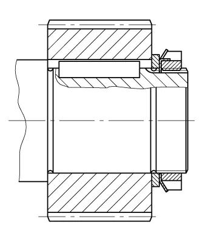
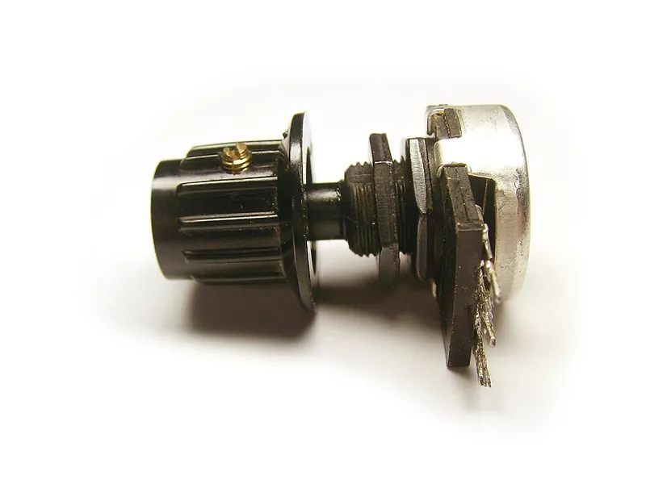

<figure class="eoc-pic eoc-pic-main"><figcaption><strong>Diagram.</strong> <a href="https://commons.wikimedia.org/wiki/File:Parallel_keys.png">Parallel keys</a> by No machine-readable author provided. SuperBo~commonswiki assumed (based on copyright claims)., <a href="http://creativecommons.org/licenses/by-sa/3.0/">CC BY-SA 3.0</a>, from Wikimedia Commons.</figcaption></figure>
<figure class="eoc-pic"><figcaption><strong>Photo.</strong> <a href="https://commons.wikimedia.org/wiki/File:Potentiometer_knob_with_set_screw.jpg">Potentiometer knob with set screw</a> by Petteri Aimonen, Public domain, from Wikimedia Commons.</figcaption></figure>

The hub of a gear, pulley or wheel is locked to its shaft, either by shape (a key, a flat, a hex or a pin) or by squeezing (a [set screw](../glossary.md#set-screw) or a clamp), so turning force passes between them; the same methods make a collar that stops things sliding along a shaft and a rigid coupling that joins two shaft ends.

**In plain words:** The everyday ways to lock a gear, pulley, wheel or knob onto a rod so they turn together, to stop parts sliding along the rod, or to join two rods end to end so they turn as one. **Proper term:** Shaft-hub connection (shaft-to-hub joint): key, set screw, D-flat or hex shaft, clamp hub; plus shaft collar and rigid shaft coupling.

**Also called:** keyed joint / key and keyway / keyseat (Wikipedia); parallel key / square key / feather key / Woodruff key / [taper](../glossary.md#taper) key / gib-head key; [shear](../glossary.md#peel-vs-shear) key (a deliberately weak key, e.g. brass, that breaks on overload); set screw / grub screw / blind screw / setscrew (cup, cone, flat, dog and knurled-cup points); D-shaft / D-flat / flatted shaft / D-profile shaft / D-bore; double-D / double-flat shaft (round shaft with two flats; Shaft Buddy generator supports one or two flats); hex shaft / hex bore (common in robotics kits, e.g. 5 mm hex, gm0; 1/2 in hex); rounded-hex shaft (hex shaft turned round where it runs in bearings, gm0); clamp hub / clamping hub / split hub / clamp-style bore; pinned hub / cross-pinned shaft / roll pin or spring pin through hub and shaft; Scotch key / Dutch pin; shaft collar / set collar / stop collar / locking collar / clamp collar / quick-clamping collar (lever) / Stellring (German); rigid coupling / rigid shaft coupling / shaft coupler (maker term); sleeve coupling / box coupling / muff coupling; clamp coupling / split-muff coupling / one-piece, two-piece and three-piece clamp couplings; flange coupling (flanged rigid coupling); step-bore coupling (joins two different shaft sizes); Welle-Nabe-Verbindung (German: shaft-hub connection).

## How it works

Turning force ([torque](../glossary.md#torque)) has to get from the shaft into the hub. With a shape lock, something sits in the way: a key sits half in a slot in the shaft and half in a slot in the hub, a flat or hex on the shaft matches a flat or hex in the hub, or a pin passes through both, so the parts cannot turn relative to each other (Wikipedia 'Key'). With a friction lock, a screw presses on the shaft: a set screw's point bites into one spot, while a clamp hub or clamp collar has a slot that its screw squeezes shut, gripping all the way round the shaft and holding up to about twice as well without marking it (Machine Design; Wikipedia 'Shaft collar'). A shaft collar uses the same set-screw or clamp grip to act as a stop or spacer on a shaft, and a rigid coupling grips (or keys onto) two shaft ends at once so they turn as one piece.

## Parts

A few parts: the shaft (round, flatted, keyed or hex), the hub (the thick centre of the gear, pulley or wheel) and a locking part: a key in matching slots, one or two set screws in a threaded hole, a clamp screw across a slotted hub, or a pin through both. A shaft collar is a ring with a set screw or clamp screw; a rigid coupling is a sleeve (one piece, or two or three bolted pieces) that clamps or keys onto both shaft ends.

## Everyday examples

- A volume or potentiometer knob held on its shaft by a small set screw (Wikipedia 'Set screw' photo)
- The GT2 pulley on a 3D printer's stepper motor, gripped by grub screws on the motor's D-flat shaft
- Shaft collars on foosball table rods, home gym equipment and coat racks (Wikipedia 'Shaft collar')
- A lawnmower or machine pulley on a keyed shaft; some use a soft brass shear key so an overload shears the key instead of the shaft (Wikipedia 'Key')

## When to use it

Every time a rotating part must turn with its shaft or a shaft must be joined end to end. Use a set screw for light, low-cost jobs such as knobs and small pulleys on a D-flat shaft; a clamp hub or clamp collar when you want strong grip, easy adjustment and no shaft damage (gm0 and Machine Design recommend clamping over set screws); a key for heavy, reversing or shock loads with a fixed angle; a hex or D shaft for robots and printed parts (Slocum calls a hex shaft the simplest [spline](../glossary.md#spline) for a robot contest); a pin where torque must be positive and cheap; shaft collars to stop shafts and parts sliding and to hold bearings in place; and a rigid coupling to join two well-aligned shafts with zero [backlash](../glossary.md#backlash) (PIB). For a pin, SPIROL rates a coiled spring pin the best choice for most hub and shaft joints, because it absorbs shock and extends the life of the assembly (SPIROL white paper 'How to Select the Proper Pin for your Application'). For a hub that must never come off a steel shaft, it can also be welded or soldered on. In a 2025 maker forum thread about welding a flange onto a gearmotor shaft because set screws didn't hold, replies advised taking the shaft out of the gearbox first (the asker managed to), or clamping the welder's earth (ground) to the part next to the weld so the current doesn't pass through the bearings, disconnecting the motor from other electronics, and using small tack welds rather than a full bead so the heat doesn't spread inside; others said welding was overkill and suggested soldering, a D-flat, a key, a roll pin or retaining compound instead (Reddit r/robotics thread, read through the Arctic Shift archive; forum advice, not tested).

## When not to use it

Don't rely on a plain set screw for drivetrains, reversing loads or anything important: it loosens and marks the shaft (Slocum; gm0); use a clamp hub, key, hex or spline instead, or at least seat the screw in a drilled dimple and add thread-locker. Don't use a rigid coupling between a motor and a shaft that are not perfectly aligned (e.g. a stepper motor and a lead screw in a printed frame): use a flexible (beam, jaw or Oldham) coupling instead. Don't press a printed hub onto a smooth shaft for lasting torque ([creep](../glossary.md#creep), EngineerDog). Don't use a set screw on a shaft as hard as the screw (it cannot bite, Machine Design). For overload protection use a proper shear pin or slip clutch rather than hoping a set screw slips.

## Details

- **What it does (jobs):**
  - join and hold: fixes a gear, pulley, wheel, cam or knob to a shaft, or joins two shafts end to end
  - line parts up exactly: shaft collars act as stops, spacers and bearing faces that hold parts at a set place along a shaft (Wikipedia 'Shaft collar')
  - slip or let go when overloaded (shear-key and spring-pin versions only): a deliberately weak key or pin breaks to protect the rest of the machine (Wikipedia 'Key')
- **Movement:** none: once tightened, the hub and shaft (or the two coupled shafts) turn together as one part; the whole assembly turns continuously in its own bearings. A feather key or hex shaft can be made to let the hub slide along the shaft while still turning with it (Wikipedia 'Key'), which is really a sliding spline.
- **Directions it can move (degrees of freedom):** 0 between the hub and the shaft (they are locked together); a key alone, a D-flat or a hex still leaves the hub free to slide along the shaft (1), so a set screw, collar, shoulder or retaining ring is added to stop that
- **Special behaviour:**
  - [fail-safe](../glossary.md#fail-safe--fail-secure) or breakaway (shear keys and spring pins only): a key made of weaker material (e.g. brass in a steel shaft and pulley) or a hollow spring pin shears off under excessive torque, leaving the pulley spinning freely instead of breaking something costlier (Wikipedia 'Key')
  - quick-release (lever collars only): quick-clamping shaft collars open and close with a lever instead of a screw, with no tools (Wikipedia 'Shaft collar')
  - none for ordinary keys, set screws, clamp hubs and rigid couplings: they simply hold
- **How it holds:**
  - shape (the parts interlock; [form-fit](../glossary.md#form-fit--force-fit--material-bond)): keys, Woodruff keys, D-flats, hex shafts, splines and cross pins
  - friction or clamping (force-fit): clamp hubs, clamp collars and clamp couplings, and set screws on a plain round shaft
  - material bond (glue, solvent or melting): optional; a retaining compound or thread-locker is often added (Slocum; gm0), see the anaerobic adhesive entry
- **Input and output:** Continuous rotation -> the same rotation, 1:1 (no change of speed or turning force). Arrangement: in line (the hub is on the shaft; a rigid coupling joins two shafts on the same axis). Efficiency: no losses of its own, because nothing slides inside the joint. Back-drivable: yes, torque passes both ways. A rigid coupling has zero backlash and very high torsional [stiffness](../glossary.md#stiffness) but cannot take up any [misalignment](../glossary.md#misalignment) (PIB Sales Rigid Couplings Guide; Wikipedia 'Coupling').
- **Power:** passive (no power needed)
- **Load:** Light to heavy. Strongest to weakest in turning (twist): [interference fit](../glossary.md#interference-fit), spline, circumferential clamp, key, pin, and last the set screw (Slocum's ranking). Along the shaft (pull or push), a key or flat holds nothing by itself; the set screw, collar or clamp takes that load. Clamp collars hold well under steady loads but can creep along the shaft under shock loads, so a shaft groove ([undercut](../glossary.md#undercut)) with a two-piece collar is used where impacts occur (Machine Design; Wikipedia 'Shaft collar'). Example set screw figures (Unbrako, soft shafts Rc 15-35, plain round shaft): an M3 cup-point set screw holds about 0.71 kN along the shaft and about 1.8 N·m of torque on a 5 mm shaft; an M4 about 1.7 kN and 4.3 N·m on 5 mm. Printed hubs are much weaker, limited by the plastic around the nut or thread (EngineerDog).
- **Play and precision:** Play: none for a tight clamp hub or clamp coupling (zero backlash, PIB); small for keys (a worn keyway adds play, Wikipedia 'Coupling' on taper locks); none for a set screw until it slips, then sudden and large; small to noticeable for printed D-flat and hex bores. [Repeatability](../glossary.md#repeatability--accuracy): keys, flats and hexes always return to the same angle; clamps and plain set screws do not. Misalignment: a rigid coupling tolerates essentially none; any angular or parallel misalignment is forced into the shafts and bearings, so rigid couplings are used only where alignment is precise (PIB; Wikipedia 'Coupling'); use a flexible coupling otherwise.
- **Taking it apart:** removable for clamp hubs, clamp collars, clamp couplings and keys; semi-permanent for set screws on round shafts (the point raises a burr that makes the hub hard to slide off or move, Machine Design; Wikipedia 'Shaft collar') and for printed hubs pressed onto knurled shafts (cannot be disassembled, EngineerDog)
- **How often it can be reused:** many times for clamp-style hubs, collars and couplings (infinitely adjustable, Machine Design) and for keys; a few times for set screws (each time it bites into the shaft or flat; knurled cup-point set screws should not be reused at all, Wikipedia 'Set screw'); once for pressed-on printed hubs
- **Sealing:** none: these joints do not seal anything
- **Adjustable:** yes for clamp hubs, clamp collars and clamp couplings: loosen, slide or turn to any position and re-tighten, with no shaft damage (Machine Design). Set-screw hubs and collars can be moved only until the point has marked the shaft; after that the screw tends to pull back into its old mark (Machine Design). Keyed and D-flat hubs can slide along the shaft but always sit at the same angle.
- **Access needed:** end of a tube or shaft for one-piece hubs, set-screw collars, one-piece clamp collars and one-piece couplings, which must slide on over a free shaft end; two-piece clamp collars and two-piece couplings can be fitted from the side without removing other parts, and three-piece couplings let one shaft be removed on its own (Machine Design; PIB Sales)
- **Materials:** Shafts: steel (for set-screw grip the shaft should be softer than the screw; Machine Design says point penetration drops when the hardness difference is under 10 HRC), stainless steel, aluminium; hex and D-shafts in robotics kits. Hubs, collars and couplings: steel, stainless steel, aluminium, plastics; printed hubs in PLA, PETG, nylon with a captive steel nut or [heat-set insert](../glossary.md#heat-set-insert) for the screw (EngineerDog). Keys: steel, or brass as a deliberate shear key (Wikipedia 'Key'). Set screws: case-hardened alloy steel (Wikipedia 'Set screw'). Stainless couplings use patched or coated screws to avoid [galling](../glossary.md#galling--fretting) (PIB).
- **Heat, cold, water and wear:** Vibration and reversing loads loosen set screws and clamp screws; use thread-locker (gm0) or knurled-cup set screws, which resist vibration but must not be reused (Wikipedia), and quality couplings with nylon-patched screws (PIB). Shock loads can make clamp collars creep along the shaft (Machine Design). Printed hubs creep under constant clamp or press load and lose grip over time (EngineerDog); PLA softens above 60 C and PETG is fine below 80 C (Prusa). Stainless screws in stainless couplings can gall (seize) without a coated or patched thread (PIB). Corrosion can weld a key or collar to a steel shaft over time ⚑ [uncertain].

## Making it

- **Ways to make or get it:**
  - off-the-shelf part: set-screw and clamp shaft collars, clamping hubs, rigid couplings (one-, two- and three-piece, step-bore), pre-keyed shafts, keys and D- or hex shafts
  - 3D print (FDM): hubs with D-flat, hex or square bores, captive-nut set-screw hubs, printed clamp collars and couplers (usually with metal screws and nuts)
  - 3D print (resin): small hubs and knobs with D-flat bores ⚑ [uncertain]
  - CNC: turning hubs, milling flats and keyways, drilling cross-pin holes
  - woodwork: wooden wheels and hubs pinned or wedged onto dowel axles (pinned shape lock)
- **Printing it in one piece (print in place):** no: the hub is printed as part of the gear, pulley or wheel and then fitted to a metal shaft with a screw, nut or pin; printed collars and couplers are assembled with metal screws (one printed clamp-collar kit on Printables is a [print-in-place](../glossary.md#print-in-place) hinge-and-screw collar, but it still needs a bolt)
- **Tools:** Hex keys (Allen keys) for socket set screws and clamp screws; screwdriver for slotted set screws; a file or grinder to put a flat on a round shaft (hackaday.io comment; Wikipedia 'Set screw'); a drill (ideally drilling hub and shaft together) for cross pins (Slocum); a broach, keyseater, slotting tool or mill to cut keyways (Wikipedia 'Key'); thread-locker for set screws (gm0); a hacksaw to cut steel shafts (gm0)
- **Difficulty:** easy for set screws, clamp hubs, collars and couplings bought ready-made, and for printed D-flat or hex bores with a [captive nut](../glossary.md#captive-nut); moderate for pinned hubs (drill hub and shaft together); hard for keyways (need a broach, slotting tool or mill), so buy pre-keyed parts

### 3D printing tips

1) Prefer shape over friction: a D-flat, double flat, hex or square bore transmits torque far better than a round hole with a screw; a plain press fit on a smooth printed bore loosens as the plastic creeps (EngineerDog). 2) Holes print undersize: oversize the bore by about 0.13 mm (0.005 in) across, or ream it (EngineerDog); test-print a short ring first. 3) Set screws: don't thread a set screw straight into plastic (the thread strips); trap a nut in a square or hex pocket beside the bore, or use a heat-set insert, and make the hub wall thick, because tightening the screw can split the hub (EngineerDog). Matthew Mead's captive-nut hub for a stepper-motor GT2 gear used an M3 set screw: he measured the nut at 5.44 mm across flats, 6.18 mm across corners and 2.24 mm thick, made the pocket 5.8 x 6.6 x 2.6 mm (about 0.4 mm extra in width and height, 0.2 mm in depth) and the screw hole 3.6 mm, then paused the print to drop the nut in (keep it level with or below the top surface so the nozzle cannot hit it). 4) Aim the set screw at the shaft's flat; Machine Design notes a flat adds little holding but locates the screw, and two screws in line along the shaft almost double the grip, while two screws 60 degrees apart give about 1.75 times. 5) Clamp hubs print well: slot the hub and squeeze it with a screw and nut placed across the slot; keep the screw axis parallel to the layers so it compresses the layers rather than pulling them apart (km98's three-bolt and one-bolt printed [collets](../glossary.md#collet) on hackaday.io). 6) For shafts that came with a pressed-on metal pinion, print a gear-shaped socket with zero [clearance](../glossary.md#clearance) and press it over the pinion (hackaday.io). 7) For high torque on a motor shaft, fit one half of a metal jaw (spider) coupling and model a matching socket into the printed part (Hackaday). 8) Use thread-locker on set screws (gm0), but check it is safe for the plastic. 9) PLA hubs soften above 60 C and PETG is fine below 80 C (Prusa), so avoid PLA hubs on warm motors.

### Buying one (off-the-shelf parts)

Set-screw shaft collars and one-piece, two-piece and quick-clamping (lever) clamp collars, including D-bore and hex-bore collars (Wikipedia 'Shaft collar'); clamping hubs (robotics kits: goBILDA, Actobotics, REV (brands), gm0); rigid couplings: set-screw, one-piece clamp, two-piece clamp, three-piece and step-bore couplings, and double-wide collars used as couplings (PIB Sales; Ruland (brand)); socket set screws (grub screws) with cup, cone, flat, dog and knurled-cup points (ISO 4029 for knurled cup, Wikipedia); parallel keys, Woodruff keys and key stock; keyed shafts, D-shafts and hex or rounded-hex shafts (gm0 glossary); spring (roll) pins and dowel pins; keyless locking bushes and taper-lock bushes (see those entries).

## Rules of thumb

- Set screw size: diameter about half the shaft diameter (Machine Design, 'Setscrews').
- Two set screws: in line along the shaft about doubles holding power; directly opposite (180 degrees) adds only about 30%; 60 degrees apart gives about 1.75 times one screw (Machine Design).
- A flat on the shaft adds only about 6% torsional holding power and does little to stop small slips, though it helps locate the screw; cone points dig in most and oval points least; point penetration adds up to about 15% (Machine Design).
- Slotted set screws hold about 45% less than socket set screws because less tightening torque can be applied (Machine Design).
- Thread engagement for set screws: 1-1.5 x screw diameter in brass, cast iron and aluminium; 0.75-1 x in steel (Machine Design).
- Typical metric cup-point set screw values on soft shafts (Rc 15-35), no flat: M3 seating torque 0.87 N·m, [axial](../glossary.md#axial--radial) hold 0.71 kN; M4 2.2 N·m, 1.7 kN; M5 4.6 N·m, 2.5 kN; torque hold is roughly axial hold x shaft radius (e.g. M3 on 5 mm shaft about 1.8 N·m) (Unbrako Socket Set Screws - Metric spec sheet; use a safety factor).
- Clamp collars grip with up to about twice the holding power of set-screw collars; two-piece clamp collars grip slightly more than one-piece (Machine Design, 'Clamp Collars Hold Tight Without Harming Shafts'; Wikipedia 'Shaft collar').
- Key with a set screw: make the set-screw diameter equal to the key width; the screw then only holds the hub along the shaft and the key carries the torque (Machine Design).
- Key size: Wikipedia gives key width about d/4 and height about 2d/3 of shaft diameter d, but flags both formulas '[clarification needed]'; use standard key tables (Wikipedia 'Key (engineering)') ⚑ [uncertain].
- Key or pin torque capacity = shear area of the key (or both sides of the pin) x shaft radius x shear strength of the key or pin material; drill cross-pin holes through hub and shaft together, and pin only near a shaft end where there is little bending (Slocum, FUNdaMENTALs Topic 5 p. 5-27).
- Preference order for attaching a part to a shaft: interference fit, spline, circumferential clamp, key, pin, and last the plain set screw, which 'could be your worst nightmare if it loosens' (Slocum Topic 5 p. 5-27).
- Tighten paired clamp screws a little at a time, alternating, so the clamp grips evenly (PIB Sales rigid couplings guide).
- Cross pin choice: for pinning a collar, hub or gear to a shaft, SPIROL recommends a coiled spring pin, because it flexes to absorb shock and vibration and so prevents hole damage; solid pins 'do not absorb shock and dynamic loads' but pass them on to the holes, which can stretch (elongate) until the joint fails early. Use light-duty coiled pins in soft or [brittle](../glossary.md#brittle--ductile) material, standard in mild steel and non-ferrous metals, and heavy-duty in hardened parts (SPIROL white papers 'How to Select the Proper Pin for your Application', p. 2, and 'How To Choose Fasteners That Maximize Assembly Life', pp. 1-2).

## Common failures

1) Set screw loosens or slips under vibration or reversing torque, even with a flat (Slocum's student quote): use a clamp, key, hex or pin, or dimple the shaft and use thread-locker. 2) Raised burr from the set screw point stops the hub or collar sliding off, and later adjustments snap back to the old mark: file the burr, or use clamp-style parts (Machine Design; Wikipedia). 3) Stripped plastic threads or a split printed hub when tightening a set screw: use a captive nut or insert and a thicker hub (EngineerDog). 4) Stripped hex or D bore (the bore wears round, gm0 'stripping the bore'): use metal hubs for high torque or a larger shaft. 5) Clamp collar creeping along the shaft under shock: add a shaft groove (undercut) with a two-piece collar (Machine Design). 6) Rigid coupling on misaligned shafts overloading bearings or cracking the coupling: align carefully or use a flexible coupling (PIB; Wikipedia 'Coupling'). 7) Worn keyway giving play: fit a new key or use a taper-lock bush, which removes keyway play (Wikipedia 'Coupling'). 8) Uneven clamping from tightening one screw fully before the other: tighten alternately in small steps (PIB).

## Safety

Rotating shafts, collars and couplings can catch hair, clothing and gloves; projecting set screws, bolts and keys make this much worse (OSHA machine guarding: rotating motion), which is why modern collars use recessed hex-socket set screws instead of the early square-head screws that dragged workers into line shafting (Wikipedia 'Shaft collar'). Guard exposed couplings and keep screws flush. A set screw that works loose can let a gear or pulley slip suddenly, dropping a load. Metal burrs raised by set screws are sharp. Welding a hub onto a motor or gearbox shaft can send the welding current through the bearings; take the shaft out, or put the earth clamp on the part being welded (maker forum advice; replies disagreed on whether the current harms the motor). Welding and soldering bring their own hazards (arc light, fumes, burns, fire and electric shock): see the Welded metal joint and Soldered metal joint entries.

## Related

- Keyless locking bush (taper-lock bush, shaft locking device): clamps a hub with wedging rings, with no keyway, and centres it
- Taper fit (Morse taper): a cone-in-cone fit that locks and centres by friction
- Press fit (interference fit): the strongest and simplest-looking, but needs accurate sizes and is hard to undo
- Spline shaft (sliding spline): many keys at once; transmits high torque and can let the hub slide
- Servo horn and spline hub: the fine-toothed spline and screw used on hobby servos
- Collet and keyless chuck: clamp a round shaft with a slotted, tightened sleeve
- Retaining ring ([circlip](../glossary.md#circlip), E-clip): snaps into a groove to stop sliding, a smaller alternative to a collar (gm0)
- Shear-pin coupling (breakaway link): a deliberately weak pin, like a shear key, to protect the machine
- Jaw coupling, Oldham coupling, flexible beam coupling and Schmidt coupling: flexible alternatives to a rigid coupling that tolerate misalignment
- Anaerobic adhesive ([threadlocker](../glossary.md#threadlocker), retaining compound): glue that locks set screws or bonds hubs to shafts
- Captive nut pocket and heat-set threaded insert: how printed hubs get a strong thread for their set screw
- [Tolerance](../glossary.md#tolerance) ring (wavy-band press fit): a springy band that makes a press fit forgiving
- Drive-in fixing pins: roll pins, coiled spring pins, dowels and taper pins driven through hub and shaft; a positive, cheap lock, and a coiled pin protects the holes under shock
- Welded metal joint: welds a hub or flange to a steel shaft for good; take the shaft out of a motor or gearbox first
- Brazed joint: a strong permanent joint made below the melting point of the parts, for steel, brass and copper hubs and shafts
- Soldered metal joint: a lower-temperature permanent option, but soft solder is weak, so only for small hubs and light torque

## Make it yourself

- [Customizable Shaft Buddy: A shaft coupler/adapter generator (Tyler Bletsch, Printables) (URL from Printables API, page not opened)](https://www.printables.com/model/36584-customizable-shaft-buddy-a-shaft-coupleradapter-ge): OpenSCAD generator for printed couplers and adapters between hex, square, round (with set screws) and single- or double-flat shafts, male or female on each end *(licence: CC BY)*
- [Parametric Shaft Collar - Clamp Collar (MSB, Printables) (URL from Printables API, page not opened)](https://www.printables.com/model/490175-parametric-shaft-collar-clamp-collar): Fusion 360 parametric two-piece clamp collar using M3 cap screws and square nuts, printed in PETG *(licence: CC BY-NC)*
- [5mm to 8mm Stepper / 775 Motor Z Axis Shaft Coupler / Coupling (BuildModHack, Printables) (URL from Printables API, page not opened)](https://www.printables.com/model/272446-5mm-to-8mm-stepper-775-motor-z-axis-shaft-coupler-): Printed clamp-style coupler joining a 5 mm D-shaft motor to an 8 mm lead screw with two M3 screws and lock nuts *(licence: CC BY-NC)*
- [Stepper motor shafts: Connecting gears/pulleys (hackaday.io project)](https://hackaday.io/project/174013-stepper-motor-shafts-connecting-gearspulleys): Three tested printed ways to attach parts to motor shafts: a zero-clearance press-on socket over a factory pinion, and three-bolt and one-bolt printed clamp collets for smooth shafts *(licence: not stated)*

## Pictures, videos and models

- [Parallel keys.png (Wikimedia Commons, by B. Gieseler)](https://commons.wikimedia.org/wiki/File:Parallel_keys.png): Technical drawing of parallel keys and a keyed shaft-hub joint in cross-section *(licence: CC BY-SA 3.0 / GFDL 1.2+ (multi-licensed))*
- [Stellring.svg (Wikimedia Commons, by Biezl)](https://commons.wikimedia.org/wiki/File:Stellring.svg): Drawing of a one-piece shaft collar secured with a set screw *(licence: Public domain)*
- [Potentiometer knob with set screw.jpg (Wikimedia Commons, by Petteri Aimonen)](https://commons.wikimedia.org/wiki/File:Potentiometer_knob_with_set_screw.jpg): Photo of a knob fixed to a potentiometer shaft by a set screw *(licence: Public domain)*
- [Shaft Retention (Game Manual 0)](https://gm0.org/en/latest/docs/common-mechanisms/power-transmission/shaft-retention.html): Pictures of a set-screw collar, a clamping collar and a shaft with an E-clip, with pros and cons for robots *(licence: link only)*
- [Types of Shaft Keys - Introduction with Animation - Machine Design (Solidworks Fun, YouTube; title verified via YouTube oEmbed)](https://www.youtube.com/watch?v=F3c6GPAFZMI): CAD animation of the main types of shaft keys and how they fit in keyways *(licence: link only)*

## Needs confirming

⚑ marks something nobody has confirmed yet: a fact the research could not confirm from a source, a finder value that is a best guess, or an open point from the research notes. Corrections are welcome (see `research/needs-confirming.md`).

- ⚑ 3 sentences on this page marked [uncertain].
- ⚑ Finder value `made_of` = 3D prints, plastic sheet, tube or moulded parts, wood, metal (best guess): proposed from the words in the research text (R37); not yet checked
- ⚑ Research note: *Shaft-to-hub joints* (266): forum replies disagree on whether welding current harms a motor; brazing a hub on has no opened source, so it is only a cross-link.

## Sources

- <https://en.wikipedia.org/wiki/Key_(engineering)>
- <https://en.wikipedia.org/wiki/Set_screw>
- <https://en.wikipedia.org/wiki/Shaft_collar>
- <https://en.wikipedia.org/wiki/Coupling>
- <https://commons.wikimedia.org/wiki/File:Parallel_keys.png>
- <https://commons.wikimedia.org/wiki/File:Stellring.svg>
- <https://commons.wikimedia.org/wiki/File:Potentiometer_knob_with_set_screw.jpg>
- <https://commons.wikimedia.org/wiki/Category:Keys_and_keyways>
- <https://www.machinedesign.com/fastening-joining/article/21834719/setscrews>
- <https://machinedesign.com/what039s-inside/clamp-collars-hold-tight-without-harming-shafts>
- <https://www.unbrakousa.com/images/pdf/Socket_Set_Screws_Metric_Spec_Sheet.pdf>
- <https://pibsales.com/power-transmission/rigid-couplings-guide/>
- <https://pergatory.mit.edu/resources/FUNdaMENTALs%20Book%20pdf/FUNdaMENTALs%20Topic%205.PDF>
- <https://gm0.org/en/latest/docs/common-mechanisms/power-transmission/shaft-retention.html>
- <https://gm0.org/en/latest/_sources/docs/common-mechanisms/power-transmission/shaft-retention.rst.txt>
- <https://gm0.org/en/latest/docs/hardware-components/kit-and-hardware-guide/kit-glossary.html>
- <https://engineerdog.com/2017/01/07/a-practical-guide-to-fdm-3d-printing-gears/>
- <http://matthewtmead.com/blog/captive-nut-technique/>
- <https://hackaday.io/project/174013-stepper-motor-shafts-connecting-gearspulleys>
- <https://hackaday.com/2019/09/02/misuse-this-part-to-attach-3d-printed-stuff-to-a-shaft/>
- <https://www.osha.gov/etools/machine-guarding/introduction/hazardous-motions-actions>
- <https://help.prusa3d.com/article/pla_2062>
- <https://help.prusa3d.com/article/petg_2059>
- <https://www.youtube.com/watch?v=F3c6GPAFZMI>
- <https://api.printables.com/graphql/>
- <https://uk.spirol.com/assets/files/cldp-wp-how-to-select-the-proper-pin-for-your-application-uk.pdf>
- <https://uk.spirol.com/assets/files/pins-wp-how-to-choose-fasteners-that-maximize-assembly-life-us.pdf>
- <https://arctic-shift.photon-reddit.com/api/posts/ids?ids=1kcikdx>
- <https://arctic-shift.photon-reddit.com/api/comments/tree?link_id=1kcikdx&limit=200>
