<figure class="eoc-pic eoc-pic-main"><picture><source media="(prefers-reduced-motion: reduce)" srcset="../media/drawn/shape-memory-alloy-wire-latch.svg"></picture><figcaption><strong>Animation.</strong> Diagram drawn for the encyclopaedia from the research notes. ⚑ Needs confirming: a drawing can simplify or get details wrong; a real photo or a better diagram is welcome.</figcaption></figure>

A spring holds a small catch shut, and a thin nickel-titanium wire hooked to the catch shortens by a few percent when an electric current heats it, pulling the catch free so the lid, door or pin is released without a sound.

**In plain words:** A hair-thin metal wire that shrinks a little when electricity warms it, tugging a spring-held catch open silently, with no motor or coil. **Proper term:** Shape-memory-alloy (SMA) wire latch release (nitinol [actuator](../glossary.md#actuator) wire latch).

**Also called:** muscle wire / 'muscle wire latch'; nitinol wire / NiTi wire / nickel-titanium actuator wire; memory metal / memory wire / smart metal (Wikipedia, Shape-memory alloy); SMA actuator / SMA latch release / SMA trigger release; Flexinol (brand, Dynalloy); BioMetal (brand); Muscle Wires (brand); SMA pin puller (spacecraft release devices); ThinLock (brand, Miga Motor Company SMA latch release); 'Titanmuscle' latch (unbranded ready-made muscle-wire latches sold online, Printables 1740874).

## How it works

Nitinol, an alloy of roughly equal parts nickel and titanium, has two crystal forms. Below its transformation temperature it is soft and a small load can stretch it about 4-5%; heated above that temperature it changes back and shortens by the same 4-5%, pulling with a stress of at least 172 MPa (Dynalloy, Flexinol technical data). Passing a current through the wire heats it by its own electrical resistance, so it shortens in about a second, silently. In a latch the wire only moves the catch: a spring keeps the catch engaged, the wire pulls it clear, and the lid's own spring, gravity or the user then opens it. When the current stops the wire cools (about 2 s for a 0.15 mm wire in still air), the bias spring stretches it back to length and the catch re-engages ready for next time. NASA's SMA pin puller works the same way: the SMA 'serves as a trigger to release potential energy stored in the driver spring' (NASA Tech Briefs, LEW-16511).

## Parts

A few parts: (1) the SMA wire, often 0.1-0.25 mm thick, with a crimp at each end that is both the mechanical anchor and the electrical contact; (2) the catch (a latch, [pawl](../glossary.md#pawl), slider, ball-detent release or pin) that the wire pulls; (3) a return spring (bias spring) that keeps the catch engaged and stretches the wire back out as it cools; (4) the frame with anchor posts, a guide and an end stop; (5) the driver: a battery or supply, a switch such as a MOSFET, and a timer that limits how long current flows. Ready-made modules combine the wire, spring and driver circuit (Miga S125: 3-wire interface, 'Power, Ground, and Enable', nitinolactuators.com).

## Everyday examples

- The Microsoft Surface Book laptop, whose detachable screen is held by a spring-loaded lock that a loop of nitinol wire pulls open (Hackaday, 2015)
- The 2014 Chevrolet Corvette, which used SMA actuators instead of heavier motors for its hatch vent (Wikipedia, Shape-memory alloy)
- Smartphone cameras, where SMA wire actuators drive image stabilisation and autofocus (Wikipedia, Shape-memory alloy; Nickel titanium), the same actuator used as a mover rather than a latch
- Car glovebox releases: the Miga ThinLock SMA release was 'originally designed as an automotive glovebox release mechanism' ⚑ [uncertain: seen only in a search summary of the Miga video]

## When to use it

Use it when you need a tiny, light, silent electric release in a tight space: hidden latches in puzzle boxes and gadgets, releasing a tablet or panel, drone and model payload drops, trigger releases for spring-loaded mechanisms, and battery-powered devices that release only occasionally. Dynalloy lists mechanical latches, spring-loaded releases, electronic locks, remote latches and door openers among its applications, and spacecraft use SMA pin pullers as a resettable replacement for explosive releases (NASA Tech Briefs).

## When not to use it

Avoid it when you need fast repeated cycling (each reset waits for the wire to cool), a long [stroke](../glossary.md#stroke) without levers, a large pulling force, precise positioning, or low power use; use a servo or motorised latch for long throws, a [solenoid](../glossary.md#solenoid) latch for fast simple push-pull, or an electro-permanent magnet for no-bolt holding. Avoid it in hot places near the wire's transformation temperature. For a one-off release that never needs resetting, a burn-wire release is simpler. Never let the wire carry the latch's load itself.

## Details

- **What it does (jobs):**
  - hold or release using power: an electrical pulse releases the catch
  - join and hold: the spring-held catch keeps a lid, tablet, panel or payload in place until released
- **Movement:** slide: the wire pulls in a straight line by about 3-5% of its length (about 3-4 mm from 100 mm of wire with an ordinary bias spring, Dynalloy); a lever usually turns this into a small rotation of the catch, and a 6:1 lever gives about 30% of the wire length in movement at one sixth of the force (Dynalloy stroke table)
- **Directions it can move (degrees of freedom):** 1: the catch slides or swings along one path, pulled by the wire one way and pushed back by the spring the other way
- **Special behaviour:**
  - quick-release: the catch lets go about a second after current is applied (Dynalloy sizes its current table for a 1 second contraction)
  - [self-locking](../glossary.md#self-locking) (holds under load, won't back-drive): with no power the spring-held catch carries the load; the wire only triggers the release
  - motion conversion (e.g. rotary to linear): electrical heating is converted directly into a straight pull with no motor or gears; the movement is 'silent, smooth, and powerful' (Dynalloy)
- **How it holds:**
  - shape (the parts interlock; [form-fit](../glossary.md#form-fit--force-fit--material-bond)): a catch, pawl or ball [detent](../glossary.md#detent) sits in a notch
  - spring force (a spring or springy part presses it in place): a bias spring keeps the catch engaged and re-stretches the cooled wire
- **Input and output:** Not a transmission. As an actuator: electric current (heat) -> straight pull of about 3-4% of the wire length with a normal bias spring, about 4% with a hanging weight, and up to about 7% with a leaf spring whose force falls as the wire shortens (Dynalloy). Pull force at the recommended 172 MPa: about 80 g for 0.076 mm wire, 330 g for 0.15 mm and 930 g for 0.25 mm (Dynalloy). Energy efficiency is 'relatively low' compared with conventional actuators (Wikipedia, Shape-memory alloy). Back-drivable: yes when cool (the bias spring stretches it, which is how it resets); forcing it backwards while it is hot and pulling can overstress and damage the wire (Dynalloy).
- **Power:** powered (needs a pulse of current to release; no power to stay locked). Typical drive: about 410 mA for 1 s for 0.15 mm Flexinol, about 320 mA for 0.13 mm (Dynalloy). If power is lost it stays latched, because the spring holds the catch (Surface Book: 'held in place by a spring, with the mechanism being unlocked by a piece of muscle wire', Hackaday, 2015). If the latch must stay open, the wire must be kept hot, which Dynalloy suggests doing with a larger heating current followed by a smaller holding current.
- **Load:** The wire's pull is light, from grams to about 2 kg for 0.25-0.38 mm wire (Dynalloy table), but the latch can hold light to medium loads because the load goes into the catch and frame, not the wire. Keep the catch's friction under load well below the wire's pull, or it will not release; ready-made SMA latch modules range from about 0.25 lb to 125 lb of force (nitinolactuators.com), and the Miga S125 module pulls up to 2.0 lb over 3.2 mm (Miga).
- **Play and precision:** Not a locating joint. The wire's length depends on its temperature, so its position is not precise unless temperature is controlled with feedback (Dynalloy). Give the catch a clear margin of overlap and the wire spare stroke, because the stroke can shrink slightly with use (Dynalloy; functional [fatigue](../glossary.md#fatigue), Wikipedia, Shape-memory alloy).
- **Taking it apart:** tool-free quick release: it opens on an electrical pulse and relatches by itself; the wire is crimped in and can be replaced
- **How often it can be reused:** many times: 'repeatable motion from the wire for tens of millions of cycles is reasonable' at suitable stress and temperature, but at higher stresses or strains 'good motion may be obtained for only hundreds or a few thousands of cycles' (Dynalloy)
- **Sealing:** none: the mechanism is open; the wire itself resists corrosion (Dynalloy)
- **Adjustable:** yes, a little: stroke and force depend on the wire length, diameter, bias spring and lever ratio, and screw anchor posts let you take up slack; the heating current and pulse length are set in software or by the driver circuit
- **Access needed:** one side only (blind): the latch hides completely inside and is triggered electrically; no hole or keyhole is needed. Plan a way in if the battery or wire fails.
- **Materials:** Nickel-titanium alloy wire (about 50-51 atomic % nickel, Wikipedia, Nickel titanium), with brass or copper crimps. Parts touching the wire must handle more than 100 °C and must not conduct electricity; Dynalloy suggests silicone rubber, Kapton, ceramics and glass. Catches and frames can be metal or plastic, but PLA softens above about 60 °C (Prusa Knowledge Base), so keep printed parts from touching the hot wire. It is a release mechanism, not a way of joining materials.
- **Heat, cold, water and wear:** Standard Flexinol starts to transform at about 70 °C ('LT') or 90 °C ('HT') (Dynalloy); nitinol can be made to transform anywhere from about -20 to +110 °C (Wikipedia, Nickel titanium), so check the wire's rating against the hottest place the latch will be. Cooling, and therefore relatching, is slower in warm, still air and faster with airflow or heat sinks (Dynalloy). The wire resists corrosion (Dynalloy). Over many cycles SMA can lose some of its movement ('functional fatigue', Wikipedia, Shape-memory alloy). Printed PLA parts near the wire soften above about 60 °C (Prusa Knowledge Base).

## Making it

- **Ways to make or get it:**
  - off-the-shelf part: SMA actuator wire, or a ready-made SMA latch or actuator module
  - 3D print (FDM): frame, catch, lever and anchor posts (e.g. a printed mount for ready-made muscle-wire latches, Printables 1740874)
  - laser cut: flat frames, levers and catches in acrylic or plywood ⚑ [uncertain: no specific example opened]
- **Printing it in one piece (print in place):** no: the frame and catch are printed as parts, and the wire, crimps and a bias spring are fitted afterwards; a single printed [flexure](../glossary.md#flexure) catch that also acts as the return spring is possible in principle ⚑ [uncertain: no tested design found]
- **Tools:** crimping tool and crimps (not solder or glue), hard wire cutters for stainless-steel wire (Flexinol 'will damage' copper-wire cutters, Dynalloy), screwdriver; soldering iron for the driver circuit
- **Difficulty:** moderate: the parts are cheap and simple, but crimping hair-thin wire, sizing the current so the wire is not burned out, and getting enough movement from a 3-5% contraction take care and testing

### 3D printing tips

Layout: run the wire straight between two anchor posts and pull the catch through a lever, because the wire only shortens by 3-5% of its length; a 6:1 lever gives about 30% stroke at one sixth of the force (Dynalloy). Longer wire gives more stroke, so fold the path around smooth posts only if you must ⚑ [uncertain: friction around posts not quantified]. Anchors: crimp the wire; 'the wires expand inside the crimps and hold more firmly', while glue or solder 'tends to work itself loose' (Dynalloy); screw-and-nut anchors let you adjust slack (Hobbizine). Heat: the wire runs above 100 °C (Dynalloy), and PLA softens above about 60 °C (Prusa Knowledge Base), so do not let the wire touch printed plastic; guide it through heat-tolerant, non-conductive material such as silicone rubber, Kapton or ceramic (Dynalloy), and print frames in a more heat-tolerant plastic than PLA ⚑ [uncertain: specific plastic not tested]. Bias spring: choose a spring that stretches the cooled wire with about 70 MPa (for 0.15 mm wire, about 128 g, Dynalloy), and no more than the wire can pull when hot. Overstress: add an end stop (strain relief) so the catch cannot be pulled further than the wire's safe stroke, and make sure the catch cannot jam while the wire is pulling ('if the device gets stuck and cannot move or is forced backwards while operating' the wire can be damaged, Dynalloy). Catch: make the catch faces smooth and lightly engaged so the wire's small force can slide it out under load; test release with the full load on the latch. Wiring: do not run release currents through a breadboard; at 700 mA contact resistance stopped a muscle-wire release from working (Arduino Forum).

### Buying one (off-the-shelf parts)

Search terms: 'nitinol actuator wire', 'muscle wire', 'shape memory alloy wire' or 'Flexinol' (LT 70 °C or HT 90 °C start temperature; 0.1-0.25 mm suits hobby latches); 'crimp terminal', 'ring crimp', brass tube, or 'N-scale rail joiners' (suggested by Roger Gilbertson, author of the Muscle Wires Project Book, via Hobbizine); 'logic-level N-channel MOSFET' (e.g. DMN2056U, fully on at 2.5 V gate, Arduino Forum) or a 'ULN2003' driver for thin wires (Hobbizine); 'LiPo cell'; 'compression spring' or 'extension spring' (bias spring); ready-made 'SMA actuator' or 'SMA latch release' modules (Miga S125, 3.2 mm stroke, up to 2.0 lb, 3-12 V, Miga; 'Titanmuscle' latch, Printables 1740874).

## Rules of thumb

- Stroke: use no more than 4-5% cyclic strain; the natural limit is about 8% and going beyond it causes non-reversible deformation (Dynalloy, Section 5). Expect about 3% with a normal bias spring, 4% with a dead weight and 7% with a leaf spring (Dynalloy stroke table).
- Force: the listed pull forces use 172 MPa, 'for many applications the maximum safe stress'; for best repeat cycling stay at or below 138 MPa (Dynalloy). Start the bias (cooling deformation) force at about 70 MPa (Dynalloy).
- Cycle life: below 103 MPa, permanent stretch stays under 0.5% 'even after hundreds of thousands of cycles'; at 138 MPa perhaps 1% after 100,000 cycles (Dynalloy). Damaging fatigue usually shows up as elongation or reduced stroke 'within the first few hundred strokes', so do life tests (Dynalloy).
- Current for a 1 s pull (Dynalloy): 0.076 mm wire 150 mA, 0.10 mm 200 mA, 0.13 mm 320 mA, 0.15 mm 410 mA, 0.20 mm 660 mA, 0.25 mm 1050 mA. Wires 0.15 mm or thinner can usually be left on at that current without overheating; thicker wires cannot.
- Voltage from Ohm's law: 0.15 mm wire has about 55 ohm per metre (Dynalloy), so 100 mm of it (5.5 ohm) needs about 2.3 V for 410 mA (arithmetic from the Dynalloy table). Too short a wire on the same voltage burns it out: 2 inches of 0.005 in wire on 3 V would draw 1.58 A 'and likely destroy the Flexinol' (Hobbizine).
- Overheating check: if the wire does not start to relax 'promptly, when the power is cut, then the wire has been needlessly overheated' (Dynalloy, Section 3).
- Reset time is cooling time: about 0.8 s for 0.076 mm, 2.0 s for 0.15 mm and 5.4 s for 0.25 mm LT wire in still air (Dynalloy); thinner wire, higher-temperature wire, or forced air (about 4 times faster) cools faster (Dynalloy cooling table).
- Attach by crimping, not solder or glue (Dynalloy, Section 4; Hobbizine).
- Size for margin: 'The best rule of thumb is to use enough Flexinol actuator wire to be sure one is well within the parameters in which it can work' (Dynalloy); use several thin wires in parallel for more force with fast cooling (Dynalloy).

## Common failures

Wire overheated and permanently stretched, so it no longer pulls far enough: reduce current or pulse time and check that it relaxes as soon as power is cut (Dynalloy). Wire overstressed by a jammed or forced catch: add an end stop and strain relief (Dynalloy). Wire slips out of solder or glue joints: crimp it (Dynalloy; Hobbizine). Not enough stroke to clear the catch: use longer wire or a lever, and allow for small stroke loss over time (Dynalloy). Catch friction under load is more than the wire can pull: reduce catch overlap and friction, or use thicker or parallel wires. Slow or no reset: bias spring too weak, or the wire cannot cool. Release fails from voltage drop in breadboard contacts at high current (Arduino Forum). Wire gradually loses its memory over many heating cycles (Hackaday comments on the Surface Book latch; Wikipedia, functional fatigue).

## Safety

The wire runs hotter than 100 °C (Dynalloy) and can burn skin or melt plastic if left powered; always limit how long current can flow, with a timer or pulse in software plus a hardware limit ⚑ [uncertain: hardware limit is a common-sense suggestion]. Release currents of hundreds of milliamps to over an ampere from lithium cells can overheat wiring if shorted ⚑ [uncertain]. It fails locked: if power fails the latch stays shut, so never use it on anything a person or animal could be trapped in, and provide a way in. Hard wire ends are sharp and springy.

## Related

- Solenoid latch: an electric coil pulls a bolt; faster and simpler to drive, but bigger, heavier and noisier for the same work (Dynalloy claims SMA wire is far smaller than solenoids for the same work)
- Servo or motorised latch: long, adjustable throw and holds either state without power, but bulkier and audible
- Thermal actuators (bimetal strip, wax motor): also move by heat, but are usually heated by their surroundings and move more slowly
- Burn-wire and fusible-link release: a one-shot electrical release that must be rebuilt after each use, whereas an SMA latch resets itself
- Electro-permanent magnet: holds steel with no power and releases on a pulse, with no moving catch
- Sear and trigger: an SMA wire can serve as the trigger that trips a sear holding a large stored force
- Ball-lock pin and pin puller: spacecraft SMA pin pullers release a spring-driven pin by freeing ball detents (NASA Tech Briefs)

## Make it yourself

- ['Titanmuscle' Titanium Muscle Wire Latch Mount, by dvd604 (URL from Printables API, page not opened)](https://www.printables.com/model/1740874-titanmuscle-titanium-muscle-wire-latch-mount): A simple two-piece printed mount for the cheap ready-made muscle-wire latches sold online as 'Titanmuscle' latches (read through the Printables API) *(licence: Creative Commons Attribution-ShareAlike (CC BY-SA))*
- [Robot Design - Flexinol and other Nitinol Muscle Wires (Hobbizine)](http://robotics.hobbizine.com/flexinol.html): A hobbyist how-to on crimping, powering, biasing and levering muscle wire, with Dynalloy's current table and worked Ohm's-law examples *(licence: link only)*

## Pictures, videos and models

- [Shape Memory Alloy Latch-And-Release Mechanism Demonstration (Science In Society)](https://www.youtube.com/watch?v=xAyZ7eHKWlA): A demonstration of an SMA wire latch holding and then releasing (title checked with YouTube oEmbed) *(licence: YouTube standard licence; link only)*
- [Miga ThinLock Shape Memory Alloy Release Mechanism (Miga Motor Company)](https://www.youtube.com/watch?v=M-rr9LGpCuw): A commercial thin SMA-wire latch release opening a catch (title checked with YouTube oEmbed) *(licence: YouTube standard licence; link only)*
- [Nitinol Wire/Shape Memory Alloy - How to Use it (RimstarOrg)](https://www.youtube.com/watch?v=4Yi4epJ83EE): Hands-on demonstration of heating nitinol wire with a flame and with electric current (title checked with YouTube oEmbed) *(licence: YouTube standard licence; link only)*
- [Microsoft Surface Book Teardown Reveals Muscle Wire Mechanism (Hackaday, Richard Baguley, 2015)](https://hackaday.com/2015/11/04/microsoft-surface-book-teardown-reveals-muscle-wire-mechanism/): Teardown photos of a real product's spring-held lock released by a loop of nitinol wire *(licence: link only)*
- [Nitinol draht.jpg (Wikimedia Commons), photo by Petermaerki](https://commons.wikimedia.org/wiki/File:Nitinol_draht.jpg): Photo of nitinol wires *(licence: CC BY-SA 3.0)*

## Needs confirming

⚑ marks something nobody has confirmed yet: a fact the research could not confirm from a source, a finder value that is a best guess, or an open point from the research notes. Corrections are welcome (see `research/needs-confirming.md`).

- ⚑ 7 sentences on this page marked [uncertain].
- ⚑ Finder value `powered_does` = lock or hold (best guess): set by Claude from the entry's name and power text (R33), for "What should it do?" under "Hold or let go using power"

## Sources

- <https://dynalloy.com/wp-content/uploads/2025/03/TCF1140.pdf>
- <http://robotics.hobbizine.com/flexinol.html>
- <https://en.wikipedia.org/wiki/Shape-memory_alloy>
- <https://en.wikipedia.org/wiki/Nickel_titanium>
- <https://hackaday.com/2015/11/04/microsoft-surface-book-teardown-reveals-muscle-wire-mechanism/>
- <https://hackaday.com/tag/muscle-wire/>
- <https://nitinolactuators.com/latch-release>
- <https://www.techbriefs.com/component/content/article/28406-lew-16511>
- <https://www.migarobotics.com/product-page/miga-s125-008-sma-actuator>
- <https://forum.arduino.cc/t/recommend-mosfet-for-muscle-wire/627291>
- <https://help.prusa3d.com/article/pla_2062>
- <https://commons.wikimedia.org/wiki/File:Nitinol_draht.jpg>
- <https://www.youtube.com/watch?v=xAyZ7eHKWlA (verified via YouTube oEmbed)>
- <https://www.youtube.com/watch?v=M-rr9LGpCuw (verified via YouTube oEmbed)>
- <https://www.youtube.com/watch?v=4Yi4epJ83EE (verified via YouTube oEmbed)>
- <https://www.printables.com/model/1740874-titanmuscle-titanium-muscle-wire-latch-mount (URL from Printables API, page not opened; read via https://api.printables.com/graphql/)>
- <https://api.printables.com/graphql/>
