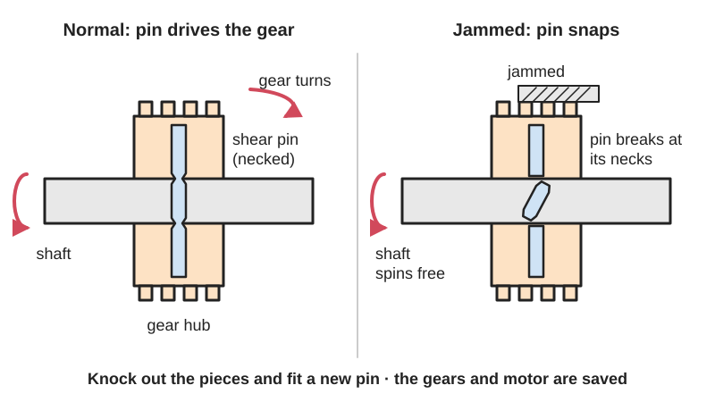
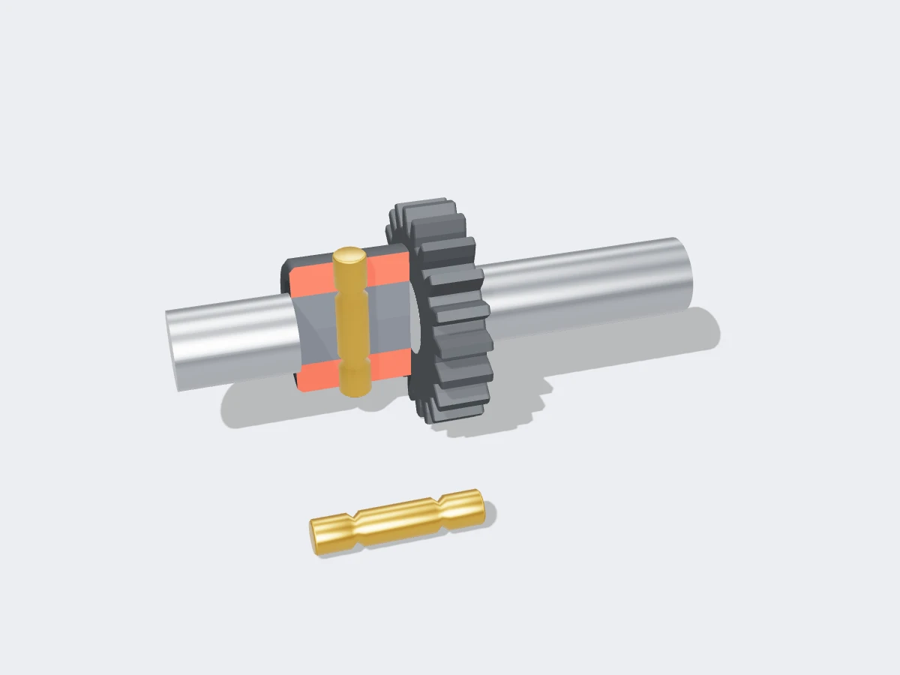

<figure class="eoc-pic eoc-pic-main"><figcaption>Diagram drawn for the encyclopaedia from the research notes. ⚑ Needs confirming: a drawing can simplify or get details wrong; a real photo or a better diagram is welcome.</figcaption></figure>
<figure class="eoc-pic"><figcaption><strong>Cut-away render.</strong> A 3D model made for the encyclopaedia, not a photo: a stand-in until a good real photo is found. ⚑ Needs confirming: a model can simplify or get details wrong; a real photo is welcome.</figcaption></figure>

A pin, bolt or thin section sized to break at a set force or [torque](../glossary.md#torque), so it disconnects the drive (or lets a joint go) before anything more valuable is damaged, and is replaced afterwards, like an electrical fuse.

**In plain words:** A deliberately weak pin or thin link that carries the drive normally but snaps cleanly when something jams, so the cheap pin breaks instead of the expensive gears; afterwards you fit a new pin. **Proper term:** Shear-pin coupling (shear-pin torque limiter, mechanical fuse).

**Also called:** [shear](../glossary.md#peel-vs-shear) pin; shear bolt (snowblower augers); shear-pin coupling; shear-pin hub; shear-pin sprocket; roller chain shear pin coupling; breakaway link; weak link; mechanical fuse; sacrificial pin (sacrificial part); fuse pin (aircraft engine mountings); nylon shear pin / shear screw (model rocketry); safety pin (as some snowblower owners call the auger shear bolt); frangible link (a related one-shot breaking part).

## How it works

The pin passes through both parts, for example a propeller hub and its shaft, so it locks them together by shape and carries all the turning force across one or two cut planes (it is loaded in shear). Its diameter, neck and material are chosen so it breaks at a known force that is lower than what the gears, shaft or motor can take. When a jam or impact exceeds that force the pin cuts cleanly, the two parts are free to turn separately (an outboard engine races with no thrust), and the rest of the machine is saved; the broken pieces are knocked out and a new pin is fitted. The same trick is used to hold something until a set force is reached, such as nylon screws holding a rocket's nose cone on until the ejection charge fires, or the plastic seal on a fire extinguisher's pull pin.

## Parts

A few parts: a hub or collar and a shaft (or two coupling halves or flanges) with holes that line up, the shear pin or shear bolt (often with a narrowed neck or groove where it should break), and a keeper such as a split (cotter) pin, nut or [circlip](../glossary.md#circlip). A breakaway link can also be a single printed or moulded part with a deliberately thin neck

## Everyday examples

- The shear bolts on a snowblower's auger, which snap if it hits a rock or ice chunk (Wikipedia 'Shear pin'; YouRepair)
- The shear pin behind an outboard motor's propeller: hit something and the engine revs with no thrust (JLM Marine)
- The brass shear pin inside a stand-mixer pasta-roller attachment that breaks if the rollers jam (Printables repair model)
- The plastic seal that holds a fire extinguisher's pull pin until you tug it (Wikipedia 'Shear pin'), and the nylon screws that hold a model rocket's nose cone on until the ejection charge fires (Apogee)

## When to use it

When overloads are rare but would be expensive (a rock in an auger, a propeller strike, a robot arm crash), when you want the drive fully disconnected on overload, and when you need a cheap, compact, very simple protector that transmits the normal load with no slip or [backlash](../glossary.md#backlash). Also when something must hold firmly until a clear force is reached and then let go completely: rocket nose cones, tamper seals, breakaway mounts, and printed weak links that protect an expensive servo or gearbox

## When not to use it

Not when overloads happen often, because every trip means stopping and fitting a new pin (use a friction slip clutch or a resettable ball-detent torque limiter). Not in a lifting or load-holding path where losing the drive would let a load fall or run back, unless that is safe. Not with vibrating or repeatedly reversing loads near the limit, which [fatigue](../glossary.md#fatigue) the pin so it breaks early. Not where an operator is likely to 'fix' repeated breaking by fitting a stronger bolt

## Details

- **What it does (jobs):**
  - slip or let go when overloaded: it breaks and disconnects the drive at a set torque or force (one time only)
  - join and hold: until it breaks it is simply a solid pin joint (it can also be used to hold parts together until a set force releases them)
- **Movement:** none: a rigid joint until the pin breaks; afterwards the parts rotate (or separate) freely until a new pin is fitted
- **Directions it can move (degrees of freedom):** 0 while intact (the hub and shaft are locked together); after breaking, 1 for a rotating coupling (free rotation) or the parts come apart completely for a straight-pull breakaway link
- **Special behaviour:**
  - [fail-safe](../glossary.md#fail-safe--fail-secure) or breakaway: breaks at a set load to protect the rest of the machine, like an electrical fuse
  - torque-limiting: one-shot, and it disconnects completely rather than slipping (Wikipedia lists it as a 'disconnect type' torque limiter)
- **How it holds:**
  - shape (the parts interlock; [form-fit](../glossary.md#form-fit--force-fit--material-bond)): the pin through both parts carries the load
- **Input and output:** continuous rotation -> the same rotation, ratio 1:1, with no slip and close to 100% efficiency until the pin breaks; afterwards no drive at all (little or no torque reaches the load). Shafts in line (shear-pin coupling) or a hub on a shaft (sprocket, propeller, auger, pulley). Back-drivable: yes while intact (it is a rigid joint)
- **Power:** passive (no power needed)
- **Load:** Light to heavy depending on the pin: one 2-56 nylon rocketry pin breaks at roughly 21 lb (about 95 N) (Apogee: three pins take 64.24 lb); industrial roller-chain shear pin couplings are rated from 738 to 66,504 in-lb (about 83 to 7,500 N·m) (Dalton). Strong in twist up to its breaking torque; it is loaded in shear, and the hub and shaft carry any bending or side loads
- **Play and precision:** Little or no play if the pin fits its holes closely; it keeps the exact angular position until it breaks. The breaking torque can be quite accurate when the neck diameter and material are closely controlled (Dalton), but fatigue, wear, corrosion and material batch all shift it. It tolerates no [misalignment](../glossary.md#misalignment), since it is a rigid joint
- **Taking it apart:** removable: the pin is held by a split pin, nut or circlip and is knocked out and replaced; the pin itself is single-use
- **How often it can be reused:** once: each pin works only once and must be replaced after it breaks (the hub or coupling around it is reused many times)
- **Sealing:** none
- **Adjustable:** no: to change the breaking load you fit a different pin (diameter, neck size, material) or a different number of pins
- **Access needed:** both sides: the pin passes right through the hub and shaft and the broken pieces have to be driven out from one side to the other (screw-in nylon rocket pins need only one side)
- **Materials:** Pins: metals chosen and tempered to be [brittle](../glossary.md#brittle--ductile) (so they snap rather than bend) and resistant to fatigue (Wikipedia 'Shear pin'), such as brass (a 6 mm brass pin in a stand-mixer pasta-roller attachment, per a Printables repair model), stainless steel (316 for salt water, JLM Marine), specified low-strength bolts (snowblowers), and nylon screws (rocketry). Hubs and coupling halves are made harder than the pin; Dalton hardens its coupling halves to 45-50 HRC. Printed breakaway links: PLA snaps cleanly but softens with heat; PETG and nylon tend to bend before breaking ⚑ [uncertain]
- **Heat, cold, water and wear:** Fatigue from repeated loads lowers the breaking force, which is why pins are made fatigue-resistant (Wikipedia 'Shear pin'). Corrosion can weaken a pin or seize it in its hole; stainless (316) pins and marine grease are used on boats (JLM Marine). Printed PLA links soften above about 60 °C (Prusa) and [creep](../glossary.md#creep) under steady load. Nylon changes strength as it absorbs moisture, and plastics become more brittle in the cold ⚑ [uncertain]

## Making it

- **Ways to make or get it:**
  - off-the-shelf part: shear pins and shear bolts made for the machine, outboard propeller shear pins, nylon shear screws, shear-pin hubs and sprockets, shear-pin couplings
  - drilling (metal or woodwork): cross-drill the hub and shaft together so the holes line up
  - CNC or lathe: pins with an accurately turned neck
  - 3D print (FDM): printed weak links, breakaway arms and test pins
  - laser cut: thin breakaway tabs in acrylic or plywood ⚑ [uncertain]
- **Printing it in one piece (print in place):** no: the pin is a separate, replaceable part by design. A one-piece printed breakaway link (a part with a deliberately thin neck) is possible, but then the whole part is reprinted after it breaks
- **Tools:** Pliers for the split pin, a spanner for the prop or bolt nut, and a hammer and punch to drive out the broken pieces (JLM Marine; YouRepair); a drill (and sometimes a tap) to make the cross hole; a thread tap for screw-in nylon rocket shear pins in hard tubes (Apogee)
- **Difficulty:** easy to make (drill a cross hole and fit a softer pin, or print a part with a thin neck) but hard to calibrate: the breaking load of small pins and printed parts varies, so make spares and test-break several

### 3D printing tips

A printed part can be the weak link, e.g. a printed PLA servo saver made at 100% [infill](../glossary.md#infill) that is designed to break at a marked point on impact and was tested to do so (Printables servo saver for a DT-03 buggy), or a printed pin through a metal hub. Print orientation decides where it breaks: layers are the weakest direction, so either put the intended break across the layers deliberately, or print pins lying down and put the weak neck in the geometry. In a shear test of upright-printed 10 mm PLA pins, pins built from concentric [perimeters](../glossary.md#perimeters) broke predictably at about 46 MPa shear stress, while zig-zag infill gave random failures (Birosz et al., Polymers 2022), so use concentric infill or all perimeters for repeatable pins. Keep the same material, printer and settings for every copy, test-break at least a few, and keep printed spares. PLA softens above about 60 °C (Prusa) and creeps under steady load, so a PLA link can break early in a hot place or after long loading. Do not swap a machine's specified metal shear pin for a printed one on powered equipment (a Printables snowblower shear bolt printed in PLA exists) unless you have tested that it breaks at the right load, because a pin that is too weak breaks in normal use and one that is too strong protects nothing

### Buying one (off-the-shelf parts)

Shear pin, shear bolt (snowblower auger shear bolts, commonly 1/4 in or 5/16 in, per YouRepair), outboard propeller shear pin with split (cotter) pin, shear-pin hub, shear-pin sprocket, roller chain shear pin coupling, nylon shear pins (2-56 nylon machine screws for rocketry), split pins, nylon-insert lock nuts; replacement shear pins are sold for each shear-pin hub size

## Rules of thumb

- Average shear stress in a pin cut on two planes (double shear) is F / (2 x pi x d^2 / 4) (Engineers Edge, 'Bolt or Pin in Double Shear'); so a pin through a shaft of radius r breaks at roughly torque = 2 x (pi x d^2 / 4) x (shear strength of the pin material) x r (derived from that formula)
- An accurate release torque comes from precision machining of the pin's neck diameter and from the pin material; the coupling halves are hardened (45-50 HRC) so only the pin breaks (Dalton Gear, roller chain shear pin coupling)
- Choose and temper the pin so it is brittle (snaps rather than bends) and resists fatigue, otherwise it may break early in normal running (Wikipedia 'Shear pin')
- Never replace a shear pin or shear bolt with a stronger pin or ordinary hardened bolt; use the part the manufacturer specifies (JLM Marine; YouRepair)
- Three 2-56 nylon shear pins need about 64 lb (about 285 N) in total to shear, i.e. roughly 21 lb (95 N) each; they are consumable and replaced after every flight (Apogee Components)
- Upright-printed 10 mm PLA pins sheared at about 46 MPa; concentric infill gave more predictable failure than zig-zag infill (Birosz, Andó and Safranyik, 'Layer Adhesion Test of Additively Manufactured Pins: A Shear Test', Polymers 14(1):55, 2022)

## Common failures

Breaks too early in normal running because of fatigue, corrosion, a notch or scratch, or worn oval holes (Wikipedia on fatigue; the worn-hole cause is ⚑ [uncertain]). Never breaks because a stronger bolt was fitted, so the gearbox or shaft is damaged instead (YouRepair; JLM Marine). Bends instead of snapping if the pin is too ductile, which can jam the hub (Wikipedia on brittleness). Printed pins vary with print settings and orientation (Birosz et al.). Avoid these by using the specified pin, keeping spares, greasing against corrosion, and testing printed links

## Safety

When the pin breaks the drive suddenly runs free: the motor races, and anything it was holding can drop or run back. Stop the engine or motor and remove the spark plug lead or unplug it before replacing a pin (JLM Marine; YouRepair). Never fit a stronger bolt in place of a shear pin: it removes the protection and can wreck the gearbox or bend the auger (YouRepair; JLM Marine). Pieces can fly when testing pins to failure, so wear eye protection ⚑ [uncertain]. Rocketry shear pins are part of a pyrotechnic system; follow rocketry safety rules

## Related

- Friction slip clutch (slip coupling, slipper clutch): slips and keeps going, then resets by itself; nothing to replace, but less exact and gets hot if it slips for long
- Ball-detent torque limiter: disconnects or clicks at a set torque and resets itself, so it suits frequent overloads, but it costs more and is bigger
- Torque-limiting gear with flexing spring arms (compliant slip hub) and the RC servo saver: plastic springs that give or slip instead of breaking
- Magnetic coupling: slips with no contact and resets automatically; lower torque
- Tamper-evident breakaway bridge (frangible link): thin bridges that break the first time a cap is opened, to show it has been opened rather than to protect a machine
- Breakaway clasp (e.g. a printed safety lanyard clasp that pulls apart at about 20 lb and clips back together): a reusable, snap-apart cousin

## Make it yourself

- [Servo saver for Tamiya Neo Fighter DT 03 Buggy (DT07, Printables model id 858648)](https://api.printables.com/graphql/): Printable one-piece PLA servo saver (100% infill) designed to break at marked points on impact, tested by the designer; a printed breakaway link protecting a servo (read through the Printables public API; the web page could not be opened here) *(licence: CC BY-NC)*
- [Kitchenaid Pasta Roller shear pin replacement (Flex, Printables model id 1298480)](https://api.printables.com/graphql/): Repair model for a stand-mixer pasta-roller attachment, whose 6 mm brass shear pin breaks before the mixer does if the rollers jam; explains how the original pin works and a bolt-based repair (read through the Printables public API) *(licence: CC BY-NC-SA)*
- [Small Nylon Shear Pins, 20 pack (Apogee Components)](https://www.apogeerockets.com/Building-Supplies/Misc-Hardware/Nylon-Shear-Pins-20-pack): Ready-made 2-56 x 1/4 in nylon screws used as shear pins, with step-by-step fitting instructions and the force to shear three pins; a cheap way to try shear pins *(licence: link only (product page))*

## Pictures, videos and models

- [Shear pin (Wikipedia)](https://en.wikipedia.org/wiki/Shear_pin): Plain explanation of shear pins as mechanical fuses and as 'hold until a set force' devices (snowblowers, propellers, aircraft fuse pins, fire extinguishers), with a photo of a sailor measuring a shear pin *(licence: text CC BY-SA 4.0 (reuse with credit); photo public domain)*
- [US Navy photo: machinery repairman checks the outside diameter of a shear pin (Wikimedia Commons)](https://commons.wikimedia.org/wiki/File:US_Navy_110406-N-OY799-152_Machinery_Repairman_3rd_Class_Heather_Fogle,_from_Midlothian,_Texas,_checks_the_outside_diameter_of_a_shear_pin_in_the_m.jpg): Photo of a machined shear pin being measured with a micrometer in a ship's machine shop *(licence: public domain (US Navy work))*
- [Shear pin, Unit 24, Gorge Powerhouse (Historic American Engineering Record photo, Wikimedia Commons)](https://commons.wikimedia.org/wiki/File:SHEAR_PIN,_UNIT_24_GORGE_POWERHOUSE._THE_WICKET_GATES_ON_THE_TURBINE_ARE_EACH_EQUIPPED_WITH_A_SHEAR_PIN_AND_OIL_PRESSURE_GAUGE._IF_A_GATE_JAMS,_THE_PIN_SMEARS_AND_THE_CHANGE_HAER_WASH,37-NEHA.V,1-B-18.tif): Photo of a shear pin on a hydro turbine's wicket-gate linkage; each gate has a shear pin so a jammed gate breaks its pin instead of the linkage *(licence: public domain (US National Park Service / HAER))*
- [Safety clutch 1 (Nguyen Duc Thang, YouTube thang010146)](https://youtu.be/IUZAmjjQ7MA): CAD animation: a toggle-operated blade shears a soft pin so that clamping jaws open and release an excessive load *(licence: link only (YouTube, all rights reserved))*
- [Safety clutch 2 (Nguyen Duc Thang, YouTube thang010146)](https://youtu.be/trfFKC7xnTw): CAD animation: two bars fixed together by a bolt; when the slider crashes the bolt breaks and the bars become a free pivot, protecting the other parts *(licence: link only (YouTube, all rights reserved))*

## Needs confirming

⚑ marks something nobody has confirmed yet: a fact the research could not confirm from a source, a finder value that is a best guess, or an open point from the research notes. Corrections are welcome (see `research/needs-confirming.md`).

- ⚑ 5 sentences on this page marked [uncertain].
- ⚑ Finder value `printable` = no (best guess): set by Claude (R33) as the follow-up answer after the check gave this entry the answer before it

## Sources

- <https://en.wikipedia.org/wiki/Shear_pin>
- <https://en.wikipedia.org/wiki/Torque_limiter>
- <https://commons.wikimedia.org/wiki/File:US_Navy_110406-N-OY799-152_Machinery_Repairman_3rd_Class_Heather_Fogle,_from_Midlothian,_Texas,_checks_the_outside_diameter_of_a_shear_pin_in_the_m.jpg>
- <https://commons.wikimedia.org/wiki/File:SHEAR_PIN,_UNIT_24_GORGE_POWERHOUSE._THE_WICKET_GATES_ON_THE_TURBINE_ARE_EACH_EQUIPPED_WITH_A_SHEAR_PIN_AND_OIL_PRESSURE_GAUGE._IF_A_GATE_JAMS,_THE_PIN_SMEARS_AND_THE_CHANGE_HAER_WASH,37-NEHA.V,1-B-18.tif>
- <https://catalog.daltongear.com/viewitems/-overload-safety-devices-torque-limiters-couplings/dalton-roller-chain-shear-pin-coupling-rcspc->
- <https://jlmmarine.com/blogs/outboard-101/sheared-propeller-pin-how-to-replace-it-on-the-water>
- <https://www.yourepair.com/730/how-to-replacing-snow-blower-shear-pin-blade-shaft-bolts.html>
- <https://www.engineersedge.com/material_science/bolt_double_shear_calcs.htm>
- <https://www.apogeerockets.com/Building-Supplies/Misc-Hardware/Nylon-Shear-Pins-20-pack>
- <https://pmc.ncbi.nlm.nih.gov/articles/PMC8747663/>
- <https://help.prusa3d.com/article/pla_2062>
- <https://cs448m.github.io/lectures/machines/doc/3.pdf>
- <https://youtu.be/IUZAmjjQ7MA>
- <https://youtu.be/trfFKC7xnTw>
- <https://youtu.be/YJbl6bSFY4U>
- <https://api.printables.com/graphql/>
