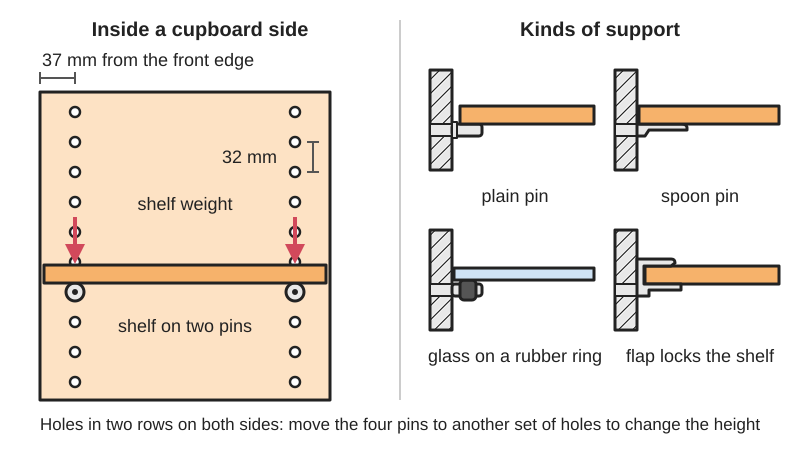
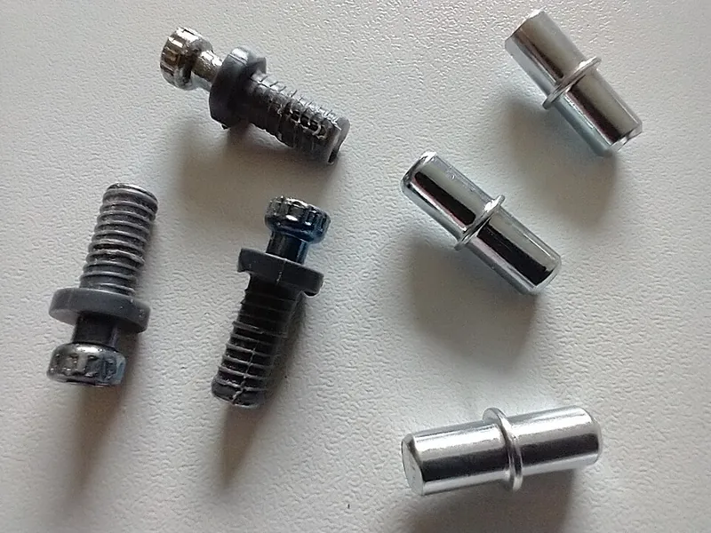
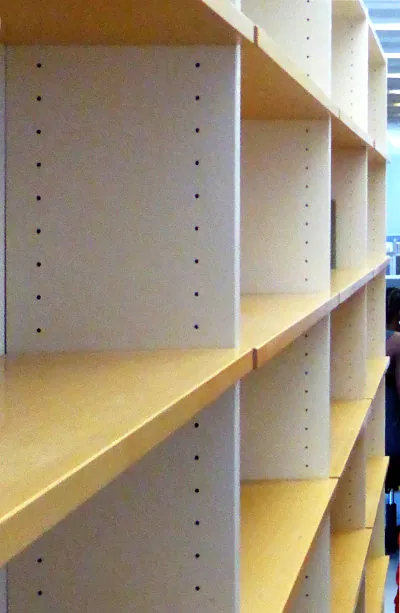

<figure class="eoc-pic eoc-pic-main"><figcaption>Diagram drawn for the encyclopaedia from the research notes. ⚑ Needs confirming: a drawing can simplify or get details wrong; a real photo or a better diagram is welcome.</figcaption></figure>
<figure class="eoc-pic"><figcaption><strong>Photo.</strong> <a href="https://commons.wikimedia.org/wiki/File:Sektion_support_shelf_pins_and_Utrusta_standard_shelf_pins.jpg">Sektion support shelf pins and Utrusta standard shelf pins</a> by Stilfehler, <a href="https://creativecommons.org/licenses/by-sa/4.0">CC BY-SA 4.0</a>, from Wikimedia Commons.</figcaption></figure>
<figure class="eoc-pic"><figcaption><strong>How it works.</strong> <a href="https://commons.wikimedia.org/wiki/File:2017_UEF_Joensuu_library_06_shelf.jpg">2017 UEF Joensuu library 06 shelf</a> by File:2017 UEF Joensuu library 06.jpg: Nemo bis derivate work: User:Westbahnhof, <a href="https://creativecommons.org/licenses/by-sa/3.0">CC BY-SA 3.0</a>, from Wikimedia Commons.</figcaption></figure>

Shelf pins are small pegs pushed into matching rows of holes drilled in the inside faces of a cabinet, usually 5 mm or 1/4 in holes spaced 32 mm apart, so a loose shelf rests on four of them and can be moved to another height in seconds; glass shelves use supports with a rubber ring or pad, or a locking clamp, so the glass can't slide or tip.

**In plain words:** Little pegs you push into a row of holes inside a cupboard or bookcase so a loose shelf can sit on them, and be moved up or down by moving the pegs; glass shelves sit on versions with a rubber pad so the glass can't slide. **Proper term:** Shelf pins and shelf supports (adjustable shelf supports; shelf pegs; 32 mm system holes).

**Also called:** shelf pin, shelf peg, shelf support peg, shelf stud, shelf support pin, shelf holder, shelf clip, cabinet shelf clip (Woodcraft; Printables model titles); pin support: a plain cylindrical peg (Woodcraft); L-shaped support, bracket-style shelf support (Woodcraft); paddle support or flat spoon-style support, spoon pin, spoon shelf pin (Woodcraft); sleeve and pin, shelf pin sleeve, brass pin sleeve (Woodcraft; Rockler); locking shelf support, shelf lock support, shelf locking clip: a plastic support with a bendable flap that clicks over the shelf (Hunker; Rockler); glass shelf support, glass shelf pin with rubber ring or transparent pad (Hranipex/Riex JC42); two-part glass shelf support with tightening element (Häfele); pilaster and clip (shelf standard, track): a metal strip with slots that clips hook into (Woodcraft); 32 mm system, System 32, line boring, system holes, 'Lochreihe' (German, hole row) (Wikipedia '32 mm cabinetmaking system'; Printables 813556); shelf pin jig, shelf pin drilling jig, hole-row template (Kreg; Printables); Kreg Shelf Pin Jig (brand) (Kreg manual).

## How it works

Each pin fits snugly in a hole and sticks out of the cabinet side; the shelf rests on top of four pins, so its weight pushes straight down and the pins carry it in [shear](../glossary.md#peel-vs-shear), like little [cantilever](../glossary.md#cantilever) beams (Woodcraft). Rows of evenly spaced holes, usually 32 mm apart and 37 mm from the front edge in the European system, let you move the pins and shelf in small steps (Wikipedia '32 mm cabinetmaking system'). Flat spoon, paddle and L-shaped supports spread the load over a larger area than a round pin; sleeves line the hole so it does not wear oval (Woodcraft). Locking supports have a flap or a pressed-in element that catches the top of the shelf, so the shelf can't tip or be lifted out by accident (Hunker; Häfele).

## Parts

A few parts: the rows of drilled holes in the two cabinet sides, four pins (or supports) per shelf, and the loose shelf. Variants add a metal sleeve pressed into each hole, a rubber ring or clear plastic pad for glass, or a two-part support with a locking element. Drilling the holes needs a drill, a shelf pin jig or template and a drill bit with a stop collar.

## Everyday examples

- the rows of small holes and pegs inside flat-pack bookcases, wardrobes and kitchen wall cupboards (Wikipedia notes IKEA uses elements of the 32 mm system)
- glass shelves in a display cabinet or curio cabinet resting on pins with clear rubber pads (Hranipex; WOODWEB)
- glass shelves in a fridge resting on moulded supports (Printables 626862 'Refrigerator Glass Shelf Support Pin' and 617318)
- library and office shelving with rows of 5 mm holes (Wikimedia Commons, 2017 UEF Joensuu library photo)

## When to use it

Whenever a shelf inside a cabinet, bookcase or display case should be movable without tools: bookcases, kitchen and bathroom cupboards, wardrobes, display cabinets, tool cabinets and printed storage units. Drilling rows at 32 mm lets the same holes also take hinge plates and drawer slides (Kreg manual; Wikipedia). Choose plain pins for light loads, spoon, paddle, sleeved or L-shaped supports for heavier books and tools, rubber-ring or padded supports for glass and acrylic, and locking supports where a shelf could be knocked upwards or tipped, e.g. in a cupboard that is moved, or a shelf people lean on (Woodcraft; Häfele; Hunker).

## When not to use it

On an open wall with no cabinet sides: use brackets, a French cleat or keyhole hangers (see Hang-on mounts) or a hidden floating-shelf support (steel rods drilled into the back edge of the shelf). For very heavy or long shelves, add a centre support, a fixed shelf glued or screwed into a groove, metal brackets, or a pilaster track (Woodcraft; WOODWEB). Where the shelf adds [stiffness](../glossary.md#stiffness) to the cabinet (stops it racking), at least one shelf should be fixed, not on pins ⚑ [uncertain]. Glass shelves on plain metal pins: use supports made for glass, with a pad or ring (Hranipex). Shelves that must not lift out in a moving vehicle, caravan or boat: use locking supports or screws (Häfele).

## Details

- **What it does (jobs):**
  - join and hold: a loose shelf rests on four pins in the cabinet sides
  - lock, and release by hand: locking supports have a flap or locking element that stops the shelf tipping or lifting until you press it to release (Hunker; Häfele)
- **Movement:** none: the shelf stays put; it can be lifted off and moved to another row of holes, in steps of the hole spacing (usually 32 mm)
- **Directions it can move (degrees of freedom):** 0 once loaded: gravity holds the shelf down on the pins and the cabinet sides stop it moving sideways; a plain shelf can still be lifted straight up, which a locking support prevents.
- **Special behaviour:**
  - quick-release: lift the shelf off and pull the pins out by hand to move it; no tools needed (Woodcraft)
  - none for plain pins; locking supports add a 'hand-release only' catch: a bendable flap or locking element holds the shelf down until you press it (Hunker; Häfele)
- **How it holds:** shape (the parts interlock; [form-fit](../glossary.md#form-fit--force-fit--material-bond)): the pins sit in holes and the shelf rests on them under gravity; friction (force-fit) keeps a pin from falling out of its hole, ribbed pins grip harder (Hranipex); spring force (a springy part presses it in place) in locking supports with a bendable flap (Hunker)
- **Input and output:** not applicable
- **Power:** passive (no power needed)
- **Load:** Light to medium, mostly downward. Each pin carries its quarter of the shelf load as a short cantilever in shear; the shelf usually sags long before good pins fail. Woodcraft rates plain pins 'light to moderate', paddle and sleeved pins 'moderate to high', L-shaped supports 'high' and all-plastic supports 'light'. A pair of Sugatsune glass shelf supports is rated 20-25 kg (44-55 lb) at the centre of a tempered glass shelf up to 500 mm between supports and 300 mm deep (Sugatsune data sheet 2881/2885). Weak against lifting and tipping: a plain shelf lifts off if pushed up at the front or if a heavy load sits on the overhanging edge; use locking supports where that matters (Häfele; Hunker). In soft chipboard the hole edges can crush and the pin tilts down under heavy loads ⚑ [uncertain].
- **Play and precision:** Small play: pins fit snugly but a worn or oversize hole lets the pin tilt and the shelf wobble; fix with slightly larger pins or plastic sleeves (Woodcraft). The shelf only sits level if all four holes are at exactly the same height, so drill every row from the same reference end of the jig or with the same spacer board; even a little error makes shelves 'tilt or wobble' (Kreg manual; Woodsmith).
- **Taking it apart:** tool-free quick release: lift the shelf and pull the pins out; screw-fixed glass supports need a screwdriver (Häfele)
- **How often it can be reused:** many times: pins can be moved again and again, but plain holes in chipboard or softwood gradually wear oversize, which sleeves prevent (Woodcraft)
- **Sealing:** none
- **Adjustable:** yes: move all four pins to other holes to change the shelf height, in steps of the hole spacing (32 mm in the European system, Wikipedia); the shelf can also be turned over to hide sag (Sagulator page tips) ⚑ [uncertain]
- **Access needed:** one side only (blind): pins push into blind holes in the inside face of each cabinet side; screw-fixed glass supports are also fixed from inside (Häfele)
- **Materials:** Pins and supports: brass, nickel-plated steel or stainless steel, zinc alloy, or plastic (often clear for glass), with rubber rings, rubber or plastic pads for glass (Woodcraft; Hranipex; Häfele). Cabinet sides: plywood, solid wood, MDF, chipboard and melamine board all take drilled holes; 3D-printed cabinet sides can have the holes printed in. Shelves: wood, plywood, MDF, chipboard, glass (tempered recommended, Sugatsune), acrylic and printed shelves. Glass and acrylic shelves need supports with a soft pad or ring, never bare metal (Hranipex; Woodcraft). Printed pins: PETG, ASA, ABS or nylon resist [creep](../glossary.md#creep) better than PLA (Printables 1611854).
- **Heat, cold, water and wear:** Moisture swells chipboard and MDF round the holes so pins loosen or the edges crumble ⚑ [uncertain]. Wood shelves sag about 50% more over time than when first loaded (Sagulator). Printed PLA pins creep under a constant load, so use PETG, ASA, ABS or nylon (Printables 1611854). Rubber rings and pads can harden or perish with age and sunlight and then let glass slide ⚑ [uncertain]. Vibration can shuffle a plain shelf forward off its pins; locking supports prevent this (Häfele).

## Making it

- **Ways to make or get it:**
  - off-the-shelf part: metal and plastic shelf pins, sleeves, glass shelf supports and locking supports
  - woodwork: drill hole rows with a shelf pin jig, a template or a line-boring machine (Kreg manual; Wikipedia)
  - CNC: hole rows can be drilled by a CNC router when the panels are cut, as in 32 mm system furniture (Wikipedia '32 mm cabinetmaking system')
  - 3D print (FDM): replacement pins, L-shaped heavy-duty pins, glass shelf supports and drilling jigs (Printables 1611854, 346020, 1209889, 808582)
  - laser cut: a flat hole-row template can be laser cut from plywood or acrylic ⚑ [uncertain]
- **Printing it in one piece (print in place):** no: pins are printed as single parts and pushed into holes; drilling jigs are single parts (some take ball bearings as drill bushings, Printables 813556)
- **Tools:** To fit and move: none (a rubber mallet helps with tight pins, Woodcraft). To make the holes: a drill, a brad-point or jig drill bit of the hole size with a stop collar so the bit can't go through the cabinet side, a shelf pin jig or template, a clamp and a spacer board to set the same start height on both sides (Kreg manual; Woodsmith). Screw-fixed glass supports: a screwdriver (Häfele).
- **Difficulty:** easy: push-in pins need no tools; drilling neat, level hole rows is easy with a jig and a stop collar, and both pins and jigs can be 3D printed

### 3D printing tips

Orientation matters most: print pins lying flat on their side, not standing up, so the filament runs along the peg and the layers can't snap off in shear; the designer of an L-shaped 5 mm pin recommends 4-6 walls (which makes a 5 mm peg effectively solid), 0.16-0.20 mm layers, and nylon, ASA, ABS or PETG to prevent creep under continuous load (Printables 1611854). Simple PLA pegs 'can take a good bit of weight', but print them stronger (thicker layers, 75% or more [infill](../glossary.md#infill)) or buy metal if the load is critical; if a 5 mm printed pin is too tight, shave it with a die or use a 4 mm version (Printables 346020). L-shaped or flat-topped designs spread the load over more of the shelf and hole than a round peg (Printables 1611854; Woodcraft). For glass shelves print a support with a wide flat top and add a rubber or silicone pad ⚑ [uncertain]. Jigs: a parametric jig lets you set pin diameter, hole spacing, material thickness and edge distance, includes a depth-stop jig and an 'insertTolerance' setting so the pin is 'a bit hard while still possible to remove by hand' (Printables 808582); a 32 mm / 5 mm jig uses four 625 ball bearings as hard drill guides so the bit doesn't wear the plastic (Printables 813556). In a printed cabinet, print the 5 mm hole rows in and check them with a test pin first.

### Buying one (off-the-shelf parts)

Search terms: '5 mm shelf pin', '1/4 inch shelf pin' (Woodcraft: most pins fit 1/4 in or 5 mm holes), 'spoon shelf pin', 'paddle shelf support', 'L-shaped shelf support', 'shelf support with sleeve' or 'brass shelf pin sleeve', 'locking shelf support' or 'shelf lock clip', 'glass shelf support pin with rubber ring' or 'transparent pad' (e.g. Riex JC42, Hranipex), 'screw-fixing glass shelf support' (Häfele 282.13.701 for 6/8/10 mm glass, 282.13.702 for 8/10/12 mm), 'M4 sleeve for 5 mm hole', 'shelf pin jig' or 'shelf pin drilling jig' (e.g. Kreg KMA3232 for 1/4 in or 5 mm holes at 32 mm), '5 mm brad point bit with stop collar', 'shelf standard and clips' or 'pilaster and bracket'. Check the catalogue page for the hole diameter and the glass thickness range before buying; links: https://www.hranipex.com/en/product/riex-jc42-glass-shelf-support-pin-transparent-pad-fwf002552, https://files.hafele.co.uk/CatalogFiles/www/23T7-146.pdf.

## Rules of thumb

- 32 mm system: holes 5 mm in diameter, 12-14 mm deep, 32 mm apart in a row, first row 37 mm from the front edge; shelf pins 15-16 mm long with a flange of about 7 mm (Wikipedia, https://en.wikipedia.org/wiki/32_mm_cabinetmaking_system). The Kreg jig's guide holes are 37 mm from the sides of the jig with 32 mm between holes (Kreg manual, https://cdn-content.kregtool.com/root/shared/manuals/KMA3232_Global.pdf).
- Hole size: 'Most shelf pins fit into 1/4" or 5 mm holes; however, you should always double-check your shelving unit' (Woodcraft, https://www.woodcraft.com/blog_entries/all-about-shelf-support).
- Drilling: set the stop collar first so the bit can't go through the cabinet side, clamp the jig ('It is dangerous to hold the workpiece in place by hand'), bring the drill up to speed before the bit touches the wood to avoid tear-out, and 'Use the same reference end of the jig while drilling all shelf pin holes' (Kreg manual, https://cdn-content.kregtool.com/root/shared/manuals/KMA3232_Global.pdf); register the jig on a spacer board so both cabinet sides start at the same height (Woodsmith, https://www.woodsmith.com/article/fast-foolproof-kreg-shelf-pin-jig/).
- Shelf sag (often the real limit): aim for 0.02 in per foot (1.7 mm per m) of sag or less, because the eye notices about 1/32 in per foot and wood shelves sag about 50% more over time; a fully loaded bookshelf weighs 20-40 lb per running foot (9-18 kg per 305 mm) (Sagulator, https://www.woodbin.com/calcs/sagulator/).
- Glass shelves on end supports carry very little over long spans: a chart from Wood magazine (March 2004), as quoted on WOODWEB, gives 5 lb for 1/4 in annealed glass at a 36 in span, 18 lb for 3/8 in and 33 lb for 1/2 in; a 1/2 in shelf carries 345 lb at 12 in span but 81 lb at 24 in. Add a centre support or a frame for long spans (WOODWEB, https://woodweb.com/knowledge_base/Bearing_Capacity_of_Glass_Shelves.html). These are second-hand figures for annealed glass only.
- Glass shelf supports from a hardware maker: 20-25 kg (44-55 lb) per pair at the centre of the glass, with no more than 500 mm between supports and glass no deeper than 300 mm, 6-10 mm glass, 'Tempered Glass Recommended' (Sugatsune 2881/2885 data sheet, https://www.sugatsune.com/content/site-assets/501_PDF/2881_2885.pdf).
- Glass shelf pins with a rubber ring fit standard 5 mm holes and the ring 'prevents the glass shelf from slipping'; a ribbed pin version grips better in wooden panels (Hranipex Riex JC42, https://www.hranipex.com/en/product/riex-jc42-glass-shelf-support-pin-transparent-pad-fwf002552). Two-part locking glass supports suit 6/8/10 mm or 8/10/12 mm glass and stop the shelf tipping or being lifted out (Häfele, https://files.hafele.co.uk/CatalogFiles/www/23T7-146.pdf).

## Common failures

(1) Shelf wobbles or rocks: a pin not pushed fully home or holes too large; use slightly larger pins or plastic sleeves (Woodcraft). (2) Shelf tilts: the four holes are not at the same height because the jig was registered from different ends or edges on the two sides; always use the same reference end and a spacer board (Kreg manual; Woodsmith). (3) Shelf sags: too long, too thin or too heavily loaded; add more pins, a centre support or a stiffer shelf with an edging strip (Woodcraft; Sagulator). (4) Holes drilled right through the cabinet side: no stop collar or it slipped (Kreg manual; Woodsmith). (5) Tear-out round holes: dull bit, jig not clamped, or bit started while touching the wood (Kreg manual). (6) Pins too tight to move: lubricate the holes or sand the pin (Woodcraft); printed pins can be shaved with a die (Printables 346020). (7) Printed pins snap off at a layer line because they were printed standing up (Printables 1611854). (8) A glass shelf slides forward or off: plain pins with no pad, or perished rubber; use proper glass supports or locking supports (Hranipex; Häfele). (9) A shelf tips up when a heavy item sits on the front edge: use locking supports (Häfele; Hunker).

## Safety

GLASS SHELVES: use supports made for glass, with a rubber ring or pad so the glass can't slip off and isn't touching bare metal (Hranipex), and stay inside the load limit for the glass thickness and span: thin annealed glass over a long span carries only a few kilograms (WOODWEB), and makers rate their glass supports per pair for a set maximum span and depth and recommend tempered glass (Sugatsune). A falling glass shelf breaks into sharp pieces and can bring everything below it down. Do not lean on, stand on or let children climb shelves; tall bookcases must be fixed to the wall against tipping over ⚑ [uncertain]. DRILLING: clamp the jig and the work, keep hands clear of the bit and the clamp, and remember the bit can be hot after repeated holes (Kreg manual). Wood dust from drilling and sanding is a health hazard; use a dust mask or extraction (Kreg manual).

## Related

- Glass and mirror edge clips and clamps (glass shelf bracket): grip a glass shelf by its edge from a wall, where there are no cabinet sides to drill
- Hang-on mounts (keyhole slot, French cleat): hang a whole shelf or cabinet on a wall
- Metal brackets and plates (angle bracket): fixed support under a shelf on a wall
- Locating pins and hole-and-slot: pins that line up parts exactly rather than carry a loose shelf
- Drive-in fixing pins (dowel pin): pins glued or driven in permanently
- Knock-down cam-lock and cross-dowel connectors: the other fittings that use the 32 mm system holes in flat-pack furniture
- Dowel and biscuit joints, and housed (dado) shelves: fixed shelves glued into the sides, stronger and stiffer but not adjustable
- Aluminium-extrusion connectors (T-slot nuts and brackets): adjustable shelves on slotted aluminium frames instead of wooden cabinet sides
- Panel standoff: holds a glass or acrylic sheet off a wall on bolts through drilled holes

## Make it yourself

- [Heavy Duty 5mm Shelf Pin / Peg (L-Shape Support Bracket) metric (Printables 1611854; URL from Printables API, page not opened)](https://www.printables.com/model/1611854-heavy-duty-5mm-shelf-pin-peg-l-shape-support-brack): Printable L-shaped 5 mm shelf pin in several metric sizes, with print-orientation and material advice for shear strength and creep *(licence: CC BY-NC (Creative Commons Attribution-NonCommercial))*
- [Shelf Support Pegs (4 & 5mm pins) (Printables 346020; URL from Printables API, page not opened)](https://www.printables.com/model/346020-shelf-support-pegs-4-5mm-pins): Quick replacement shelf pegs in 4 and 5 mm, printed without supports *(licence: CC BY-SA (Creative Commons Attribution-ShareAlike))*
- [Glass shelf support (Printables 1209889; URL from Printables API, page not opened)](https://www.printables.com/model/1209889-glass-shelf-support): A printable support for a glass shelf inside a cabinet *(licence: CC BY (Creative Commons Attribution))*
- [Parametric Shelf Pin Jig (Printables 808582; URL from Printables API, page not opened)](https://www.printables.com/model/808582-parametric-shelf-pin-jig): Fully parametric (Onshape) drilling jig, pins and depth-stop jig: set pin diameter, number of holes, material thickness, edge distance and fit tolerance *(licence: CC BY (Creative Commons Attribution))*
- [Shelf Pin Jig 5mm - Lochreihenschablone 32mm / 5mm (Printables 813556; URL from Printables API, page not opened)](https://www.printables.com/model/813556-shelf-pin-jig-5mm-lochreihenschablone-32mm-5mm): A 32 mm-spacing, 5 mm hole-row drilling jig that uses four 625 ball bearings as drill guides *(licence: CC BY-NC (Creative Commons Attribution-NonCommercial))*
- [Shelf Pin Drilling Jig (Printables 292441; URL from Printables API, page not opened)](https://www.printables.com/model/292441-shelf-pin-drilling-jig): Drilling jig for 1/4 in and 5 mm shelf pins and for 7/32 in and 9/32 in pin sleeves, with the Fusion 360 file *(licence: CC BY-ND (Creative Commons Attribution-NoDerivatives))*

## Pictures, videos and models

- [2017 UEF Joensuu library 06 shelf.jpg (Wikimedia Commons, by Westbahnhof from a photo by Nemo bis)](https://commons.wikimedia.org/wiki/File:2017_UEF_Joensuu_library_06_shelf.jpg): An empty frameless library shelf unit with rows of holes matching the 32 mm cabinetmaking system *(licence: CC BY-SA 3.0 (reuse with credit))*
- [Two stainless steel shelf supports 2017.jpg (Wikimedia Commons, by Fructibus)](https://commons.wikimedia.org/wiki/File:Two_stainless_steel_shelf_supports_2017.jpg): Photo of two stainless steel shelf supports (the file page does not say which style) *(licence: CC0 1.0 (public domain dedication))*
- [Häfele Ixconnect screw-fixing shelf supports for glass (catalogue page, PDF)](https://files.hafele.co.uk/CatalogFiles/www/23T7-146.pdf): Drawings of a two-part glass shelf support and how the tightening element is pressed in to stop the glass tipping or lifting *(licence: link only (copyright Häfele U.K. Ltd))*
- [Fast & Foolproof Kreg Shelf Pin Jig (Woodsmith)](https://www.woodsmith.com/article/fast-foolproof-kreg-shelf-pin-jig/): Step-by-step photos of setting the stop collar, registering the jig on a spacer board and drilling 32 mm hole rows *(licence: link only)*
- [The Ultimate Guide to Shelf Pins: Types, Tips and Installation (Woodcraft)](https://www.woodcraft.com/blog_entries/all-about-shelf-support): The main shelf pin types (L-shaped, small bracket, pin, paddle, all-plastic, sleeve and pin, pilaster) with load ratings *(licence: link only)*

## Needs confirming

⚑ marks something nobody has confirmed yet: a fact the research could not confirm from a source, a finder value that is a best guess, or an open point from the research notes. Corrections are welcome (see `research/needs-confirming.md`).

- ⚑ 8 sentences on this page marked [uncertain].
- ⚑ Research note: *Shelf pins and shelf supports* (447): the Wood magazine glass-span chart is quoted second-hand through WOODWEB and labelled so.

## Sources

- <https://en.wikipedia.org/wiki/32_mm_cabinetmaking_system>
- <https://www.woodcraft.com/blog_entries/all-about-shelf-support>
- <https://rockler.com/hardware/cabinet-hardware/shelving/shelf-pins-and-supports>
- <https://www.hranipex.com/en/product/riex-jc42-glass-shelf-support-pin-transparent-pad-fwf002552>
- <https://files.hafele.co.uk/CatalogFiles/www/14CFC15.PDF>
- <https://files.hafele.co.uk/CatalogFiles/www/23T7-146.pdf>
- <https://www.hunker.com/13402822/how-to-remove-cabinet-shelves-held-with-plastic-shelf-lock-supports>
- <https://cdn-content.kregtool.com/root/shared/manuals/KMA3232_Global.pdf>
- <https://www.woodsmith.com/article/fast-foolproof-kreg-shelf-pin-jig/>
- <https://www.woodbin.com/calcs/sagulator/>
- <https://woodweb.com/knowledge_base/Bearing_Capacity_of_Glass_Shelves.html>
- <https://www.sugatsune.com/content/site-assets/501_PDF/2881_2885.pdf>
- <https://commons.wikimedia.org/wiki/File:2017_UEF_Joensuu_library_06_shelf.jpg>
- <https://commons.wikimedia.org/wiki/File:Two_stainless_steel_shelf_supports_2017.jpg>
- <https://commons.wikimedia.org/wiki/Category:Shelf_supports>
- <https://commons.wikimedia.org/wiki/Category:System_32>
- <https://api.printables.com/graphql/>
