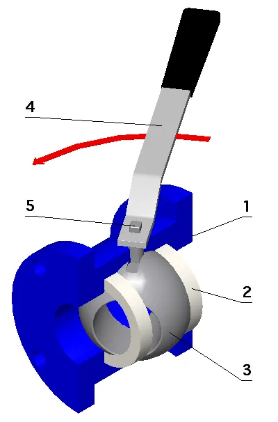

<figure class="eoc-pic eoc-pic-main"><picture><source media="(prefers-reduced-motion: reduce)" srcset="../media/drawn/shut-off-valve.svg"></picture><figcaption><strong>Animation.</strong> Diagram drawn for the encyclopaedia from the research notes. ⚑ Needs confirming: a drawing can simplify or get details wrong; a real photo or a better diagram is welcome.</figcaption></figure>
<figure class="eoc-pic"><figcaption><strong>Cross-section.</strong> <a href="https://commons.wikimedia.org/wiki/File:Ball.PNG">Ball</a> by Ruben Castelnuovo (myself), <a href="http://creativecommons.org/licenses/by-sa/3.0/">CC BY-SA 3.0</a>, from Wikimedia Commons.</figcaption></figure>

A hand-operated valve fitted into a pipe or tube that is normally either fully open or fully shut: turning the handle swings a drilled ball or plug a quarter turn, or screws a gate or a rubber-faced plug down onto a seat, so you can turn a water, air, gas or vacuum line on and off or isolate part of a system for repair.

**In plain words:** A handle on a pipe or tube that you turn to let water, air or gas through, or to stop it completely. On the most common kind (a ball valve) a short lever turns only a quarter of a turn, and you can see at a glance whether it is on: lever along the pipe means open, lever across the pipe means shut. **Proper term:** Shut-off valve (isolation valve, stop valve); the main kinds are the ball valve, plug valve (stopcock), gate valve and globe valve.

**Also called:** tap (UK and most of the Commonwealth), faucet (US), spigot; outdoor versions: sillcock, hose bib, bibcock, wall hydrant (Wikipedia 'Tap (valve)'); stopcock (any valve meant to stop the flow completely, e.g. the water stopcock under the kitchen sink; Wikipedia 'Stopcock'); stop valve, stop tap, isolating valve or isolation valve, service valve; quarter-turn valve (ball, plug and butterfly valves; Wikipedia 'Valve'); ball valve (also called a cone valve; Wikipedia); full-bore (full-port), reduced-bore (reduced-port), V-port, vented (self-venting), trunnion and floating ball valves; three-way L-port and T-port ball valves; plug valve, plug cock, taper-plug cock (UK), cone valve, gas tap or gas cock (Wikipedia 'Plug valve'; 'Tap (valve)'); laboratory stopcock (ground-glass or PTFE plug in a glass body), burette stopcock, three-way stopcock (lab and medical use; Wikipedia 'Stopcock'); gate valve, also called a sluice valve; knife gate valve for slurries; rising-stem and non-rising-stem gate valves (Wikipedia 'Gate valve'); globe valve, screw-down tap, screw-down stop valve, angle valve, Y-globe valve (Wikipedia 'Globe valve'; Tameson); blast gate (a sliding-gate or ball-type shut-off for workshop dust-extraction pipes; Printables models); not the same as a 'ballcock' (the float valve in a toilet cistern) or a 'ball [check valve](../glossary.md#check-valve)' (a one-way valve) (Wikipedia 'Ball valve').

## How it works

A shut-off valve puts a movable blocking part into the flow path. In a ball or plug valve, the handle turns a ball or tapered plug with a hole drilled through it: when the hole lines up with the pipe the fluid flows, and a quarter turn (90 degrees) turns the solid side to face the flow, pressed against soft seats, so the flow stops (Wikipedia 'Ball valve'; 'Plug valve'). In a gate valve, several turns of a handwheel screw a flat or wedge-shaped gate down across the pipe, and in a globe valve (the old-style screw-down tap) they screw a plug or rubber washer down onto a ring-shaped seat (Wikipedia 'Gate valve'; 'Globe valve'; 'Tap (valve)'). Quarter-turn valves are quick, and their handle shows whether they are open; multi-turn valves close slowly, and globe valves also allow fine control of the flow (Tameson).

## Parts

A small assembly that acts as one unit. Ball valve: body, ball with a hole (bore) through it, two seats (rings, usually PTFE), stem with a seal, and a lever handle (Wikipedia 'Ball valve'; Commons diagram 'Esquema valvula de bola'). Gate valve: handwheel, stem, gasket, bonnet, body, flange and gate (Tameson gate valve guide). Globe valve or screw-down tap: handwheel, threaded stem, bonnet with packing, plug or disc (often with a rubber washer) and a ring-shaped seat (Wikipedia 'Globe valve'; Tameson globe valve guide). Plug valve or stopcock: a tapered plug with a hole through it, the body, and a retainer (a spring, clip, or washer and nut) (Wikipedia 'Plug valve'; 'Stopcock').

## Everyday examples

- The stopcock under the kitchen sink or by the water meter that shuts off the water to the house (Wikipedia 'Stopcock')
- An old-style screw-down bath or basin tap, which is a globe valve with a rubber washer (Wikipedia 'Tap (valve)')
- The quarter-turn gas tap on a cooker or gas pipe, whose handle lies along the pipe when it is on (Wikipedia 'Tap (valve)'; 'Plug valve')
- The little quarter-turn isolation valves on the pipes to a washing machine or toilet, and the outdoor garden tap (hose bib) (Wikipedia 'Tap (valve)'; Printables models)

## When to use it

Use a shut-off valve wherever you need to turn a flow on and off by hand, or to isolate part of a system: at the inlet of a machine, pump or soft-robot air supply so you can work on it; on each branch of a workshop air line; on a water line before a filter or pump; and on the drain or outlet of a tank (HSE HSG39 paras 83-88; Wikipedia 'Stopcock'). Pick a ball valve for most jobs: it is quick, shows its state, seals well, has little flow resistance and still shuts after years of disuse (Wikipedia 'Ball valve'; Tameson). Pick a gate valve where the pipe must be completely clear (slurries, thick liquids, large pipes) and slow closing helps prevent [water hammer](../glossary.md#water-hammer), and a globe valve where you also want to set the flow (Tameson). Three-way L- or T-port ball valves switch a flow between two outlets by hand (Wikipedia 'Ball valve'). In workshop dust extraction, ball-type or sliding blast gates open and shut each machine's duct (Printables models).

## When not to use it

Don't use a ball or gate valve to set a flow or a cylinder's speed: use a needle (speed-control) valve, a globe valve or a V-port ball valve (Tameson). Don't use one to switch a flow automatically: use a switching ([solenoid](../glossary.md#solenoid) or directional) valve or an actuated ball valve. To stop backflow automatically, use a check valve; to cap the pressure, use a pressure [regulator](../glossary.md#regulator) or relief valve. For soft tubing at low pressure, a pinch clamp or pinch valve that squeezes the tube shut is simpler (Wikipedia 'Pinch valve'). A plain gate valve is a poor choice where a perfect seal matters ('rarely gives a perfect seal', Wikipedia 'Tap (valve)'), and a three-way T-port valve is risky where all ports must be cut off, because the 45-degree 'all shut' position 'leaves no margin for error' (Wikipedia 'Ball valve'). Never use a 3D-printed valve on mains water, gas, compressed-air tanks or any line holding stored pressure.

## Details

- **What it does (jobs):**
  - seal it, or pass cables or fluid through: lets air, water, gas or vacuum along a pipe when open, and seals the pipe shut when closed, e.g. to isolate a machine or a branch of pipework for repair (Wikipedia 'Stopcock'; HSE HSG39 para 83)
  - slow it, stop it or keep its speed steady: shutting the supply stops whatever the fluid was driving, and a part-open globe valve (or, coarsely, a part-open ball valve) turns the flow down; for fine speed control a needle (speed-control) valve is better (Tameson globe valve and ball valve handle guides)
- **Movement:** rotate (ball, plug and butterfly valves: the handle and ball turn a quarter turn, 90 degrees, between open and shut) or rotate+slide (gate and globe valves: the handwheel turns several full turns and a screw thread moves the gate or plug straight up and down) (Wikipedia 'Valve'; Tameson gate valve guide)
- **Directions it can move (degrees of freedom):** 1: the ball, plug, gate or disc can only move between open and shut, either by turning about the stem (ball and plug valves) or by sliding along it, with the screw thread linking turning to sliding (gate and globe valves)
- **Special behaviour:**
  - indexing (clicks into set positions), loosely: a quarter-turn valve has end stops at open and shut, 90 degrees apart, and the lever's direction shows the state (along the pipe = open, across = shut) (Wikipedia 'Ball valve'; Tameson). Plug valves often have a stop limiting the handle to a quarter turn, but glass stopcocks don't (Wikipedia 'Plug valve'). Three-way L-port and T-port ball valves have several working positions (Wikipedia 'Ball valve')
  - self-aligning or self-centring: in a floating ball valve the line pressure pushes the ball slightly downstream, squeezing it onto the downstream seat, which tightens the seal (Wikipedia 'Ball valve')
  - [fail-safe](../glossary.md#fail-safe--fail-secure) (vented ball valves and three-port isolating valves only): closing the valve also lets the trapped pressure on the outlet side escape through a small vent, so tools and cylinders downstream are left harmless (Tameson vented ball valves; HSE HSG39 para 85)
- **How it holds:**
  - shape ([form-fit](../glossary.md#form-fit--force-fit--material-bond)): the solid side of the ball, plug or gate physically blocks the bore (Wikipedia 'Ball valve'; 'Gate valve')
  - friction or clamping (force-fit): soft seats are squeezed against the ball, a screw thread presses a globe valve's rubber washer onto its seat, and a wedge-shaped gate is forced into its seat (Wikipedia 'Globe valve'; 'Gate valve')
  - suction or air pressure: the line pressure pushes a floating ball onto its downstream seat (Wikipedia 'Ball valve'); a glass laboratory stopcock can even be held in its socket by vacuum (Wikipedia 'Stopcock')
- **Input and output:** not applicable (it opens or closes a flow path rather than passing motion on). Inside gate and globe valves a screw thread turns handwheel rotation into a straight up-and-down movement of the gate or plug (Tameson)
- **Power:** passive (no power needed): turned by hand with a lever, T or butterfly handle, handwheel, removable key or screwdriver slot (Tameson ball valve handle guide; Wikipedia 'Tap (valve)'). Versions driven by an air, hydraulic or electric [actuator](../glossary.md#actuator) also exist (Wikipedia 'Ball valve'); those are covered under the switching valve
- **Load:** rated by pressure, not by mechanical load: from low-pressure plastic and printed valves up to industrial ball valves for about 1,000 bar (Wikipedia 'Ball valve'). For example, a small push-in ball valve for 6 mm air tubing is rated to 9 bar and to vacuum (-1 bar) (Tameson). It is not a structural part: ball valves must be well supported, because an unsupported body twists when the handle is turned and can crack the joints (GF Piping Systems manual, p. 35)
- **Play and precision:** not applicable (it doesn't locate parts or pass on motion). The flow through a ball valve is not proportional to the handle angle, so small movements near closed change the flow a lot (Tameson ball valve handle guide)
- **Taking it apart:** removable: threaded, union, push-in, compression, flanged or barbed ends can be undone and the valve taken out (Tameson; GF Piping Systems manual). Solvent-welded plastic valves are permanent unless they have 'true union' nuts that let the valve body come out of the line (GF Piping Systems manual, pp. 35-37)
- **How often it can be reused:** many times: ball valves keep working 'after many cycles' and close securely even after long disuse (Wikipedia 'Ball valve'); globe-valve washers and seats wear and need renewing (Wikipedia 'Tap (valve)'); threaded and union-ended valves can be fitted and removed many times if their seals are renewed
- **Sealing:** airtight or pressure when shut: a ball valve's plastic seats press against the polished ball to give 'an airtight seal' (Wikipedia 'Ball valve'); a globe valve squeezes a rubber washer onto its seat; a plain gate valve 'rarely gives a perfect seal' (Wikipedia 'Tap (valve)'). Soft-seated valves (ball, plug, butterfly, diaphragm) are much less likely to leak when shut, while hard-seated ones (gate, globe) are more durable (Wikipedia 'Valve'). Seals or packing round the stem stop leaks out past the handle (Tameson), and glass stopcocks need grease to be airtight (Wikipedia 'Plug valve')
- **Adjustable:** yes, partly: a part-open valve reduces the flow. Globe valves are made for this; ball and gate valves are poor at it, because the flow changes most just before closing, and part-open gates vibrate and wear (Tameson; Wikipedia 'Gate valve'). For a steady low flow, use a needle valve, a globe valve or a V-port ball valve. Many ball-valve handles can be taken off and refitted the other way round (Tameson)
- **Access needed:** end of a tube or shaft: it is fitted in line where a pipe or tube is cut, or screwed onto a tank port, and its handle has to stay reachable and needs room to swing (Tameson: a lever 'requires space to turn'; HSE HSG39 para 168: check that access to stop valves is maintained)
- **Materials:** Bodies: brass, bronze, stainless steel, chrome, titanium, PVC, CPVC or PFA-lined metal for ball valves (Wikipedia 'Ball valve'); cast iron, [ductile](../glossary.md#brittle--ductile) iron, gunmetal and steels for gate valves (Wikipedia 'Gate valve'); brass for most taps (Wikipedia 'Tap (valve)'); glass or PTFE for laboratory stopcocks (Wikipedia 'Stopcock'). Balls are often chrome-plated; seats are virgin or reinforced PTFE, Delrin (acetal), nylon, PEEK, UHMWPE, Viton or metal (Wikipedia 'Ball valve'). A typical small pneumatic ball valve has a PBT plastic body with a nickel-plated brass ball (Tameson). Printed valves: test in PLA, then use a tougher material; one maker printed a replacement valve cap in ABS at 100% [infill](../glossary.md#infill) (Printables models)
- **Heat, cold, water and wear:** Freezing: a shut ball valve traps water in the cavity round the ball, which can crack the body when it freezes; insulate it, use heat tape or buy a freeze-tolerant valve with a sacrificial freeze plug (Wikipedia 'Ball valve'). Heat: PVC valves are limited to 60 C (140 F), where their pressure rating falls to 22% of the room-temperature value; CPVC reaches 99 C (210 F) (GF Piping Systems manual); a typical small push-in pneumatic ball valve is rated 0-60 C with no freezing (Tameson). Sunlight: UV slowly degrades the surface of PVC, reducing impact strength but not the pressure rating (GF Piping Systems manual, p. 40). Corrosion and disuse: check valves in corrosive surroundings and operate rarely used gate valves now and then so they don't seize (Tameson). Sediment and residue: dirt collects in the cavity round a part-open ball (Wikipedia 'Ball valve'), and a particle caught between seat and disc makes a shut valve leak (Wikipedia 'Valve'). Wear: rubber washers and seats wear and corrode over time (Wikipedia 'Tap (valve)'). Printed valves: no tested temperature limits found; one maker used his printed ABS valve cap only on cold water (Printables) ⚑ [uncertain].

## Making it

- **Ways to make or get it:**
  - off-the-shelf part: brass, stainless, PVC and push-in ball valves, gate and globe valves, gas taps and laboratory stopcocks (Wikipedia; Tameson)
  - 3D print (FDM): low-pressure [print-in-place](../glossary.md#print-in-place) water ball valves, ball-type dust-collection blast gates, and replacement handles for quarter-turn valves (Printables models)
  - 3D print (resin): a 4-way selector valve has been resin-printed in one block together with a gear pump and relief valve for a small water and oil hydraulic demo (Indeterminate Design, via Hackaday)
- **Printing it in one piece (print in place):** yes for small low-pressure designs: MarkoJ's 'Simple Water Ball Valve, Hose and Gardena Fittings (print in place)' prints already assembled, with 0.3 mm [clearances](../glossary.md#clearance) and no assembly (Printables API). No for larger designs: ball-type blast gates are printed as separate parts (two case halves, ball 'rotator', lever) and joined with screws and nuts, sometimes with a bearing (PeterH1500 and Dreklord, Printables API)
- **Tools:** None to operate, apart from valves with a removable 'loose key' (sillcock key) or a screwdriver slot (Wikipedia 'Tap (valve)'; Tameson). To fit: pipe wrenches or spanners plus PTFE tape or pipe sealant for threaded ends (Tameson gate valve guide); nothing for push-in mini ball valves, where you push the tube in (Tameson); solvent cement and hand-tightening only for PVC union valves (GF Piping Systems manual)
- **Difficulty:** easy to buy and fit: cheap brass, plastic and push-in mini ball valves screw or push into the line (Tameson). Moderate to print a working one: low-pressure print-in-place water ball valves and ball-type blast gates for dust collection exist, but they only suit low-pressure water, air or dust ducts and need the right clearance and some sealing (Printables models)

### 3D printing tips

1) Use printed valves only for low-pressure water, air or dust ducts; MarkoJ describes his as an 'emergency low-pressure water ball valve' (Printables). Never use one on mains water, gas, an air tank or anything holding stored pressure. 2) Print-in-place clearance: MarkoJ used 0.3 mm between the ball and its housing, printed it standing on the fitting face with the valve cavity pointing up, with supports touching the build plate only, and tested in PLA before using 'mechanically resistant materials' (Printables). 3) Assembled valves: Dreklord advises no less than 0.5 mm between the ball and the housing (he could already feel friction at 0.5 mm), printing the ball with supports so it comes out round, and sealing the valve into the pipe with silicone; 3 walls with no infill was strong enough for the ball (Printables). 4) Mark which way is open: PeterH1500 added arrows to the ball and lever bearing because users were confused about which way to fit the lever (Printables). 5) Seal joints with [O-rings](../glossary.md#o-ring): Gardena-style hose fittings need two O-rings (MarkoJ, Printables). 6) Replacement handles and caps are the most common and safest printed valve part: jcjames_13009 added end stops so a printed toilet-valve knob turns exactly a quarter turn (PLA, 0.20 mm layers, 3 [perimeters](../glossary.md#perimeters), 25% gyroid infill, supports under the base), and DocWeebl printed a washing-machine isolation-valve cap at 100% infill in ABS 'so it didn't snap', with a 0.3 mm air gap under a support column, and used it only on the cold-water valve, unsure how PLA would last on hot water (Printables). 7) A hobby servo can turn a printed ball valve to make an automatic blast gate (The Brumberjack, Printables).

### Buying one (off-the-shelf parts)

Lever-handle brass ball valves (full bore or reduced bore; BSP or NPT threads, male or female); mini ball valves with T or butterfly handles; push-in (push-to-connect) mini ball valves for 4-8 mm pneumatic tubing; PVC and CPVC true-union ball valves; three-way L-port and T-port ball valves; vented (self-venting) ball valves; lockable ball valves and valve lockout devices; V-port (characterised) ball valves for flow control; gate valves with rising or non-rising stems; globe valves, angle valves and screw-down stop taps; plug cocks and gas taps; laboratory stopcocks (glass or PTFE) and three-way stopcocks; garden hose shut-off valves and sillcocks; quarter-turn isolation valves for washing machines and toilets; butterfly valves and blast gates; motorised and air-actuated ball valves; spare handles, stem packing and seat kits (Wikipedia 'Ball valve', 'Gate valve', 'Plug valve', 'Stopcock', 'Tap (valve)'; Tameson; HSE HSG39)

## Rules of thumb

- Ball-valve handle along the pipe = open; across the pipe = shut. The shut position may be a quarter turn either way (Wikipedia 'Ball valve'; Tameson ball valve handle guide)
- Use ball, plug and gate valves fully open or fully shut. To set a flow, use a globe valve, a needle valve or a V-port (characterised) ball valve: part-open gates wear and vibrate, and part-open standard ball valves risk cavitation and erosion (Tameson gate valve guide; Tameson ball valve handle guide; Wikipedia 'Gate valve')
- Flow resistance when fully open, as an equivalent length of straight pipe in pipe diameters (L/D): about 3 for ball and butterfly valves, 8 for gate valves, 55 for angle globe valves, 150 for Y-globe valves and 340 for standard globe valves (Tameson globe valve guide)
- A full-bore ball valve's hole is the same size as the pipe; a reduced-bore valve's is about one pipe size smaller, so the fluid speeds up through it (Wikipedia 'Ball valve')
- Close valves on long liquid lines slowly: GF recommends closure times 'considerably greater than 2L/c' (L = pipe length; c = speed of the pressure wave, taken as 4,720 ft/s), treats about 5 ft/s (1.5 m/s) as a safe water speed in plastic pipe, and says operating pressure plus water-hammer surge should never exceed 150% of the system's pressure rating (GF Piping Systems manual, pp. 9-10). Wikipedia also cites pipe-sizing charts that keep water speed at or below 1.5 m/s to limit water hammer ('Hydraulic shock')
- PVC pressure ratings fall as it warms: multiply the rating at 73 F (23 C) by 0.75 at 90 F, 0.50 at 110 F and 0.22 at 140 F (60 C), which is the highest temperature PVC is used at; CPVC goes up to 210 F (99 C) (GF Piping Systems manual, pp. 4 and 12)
- Support ball valves so that turning the handle can't twist the pipe joints. Hand-tighten PVC union nuts (sizes 3/8 to 1 1/2 in need nothing more before a pressure test), go at most 1/8 turn further on larger sizes with a strap wrench, and use no lubricant on the threads and no metal tools (GF Piping Systems manual, pp. 35-37)
- Threaded valves: wrap PTFE tape the same way as the thread, start the valve by hand to avoid cross-threading, then tighten with a wrench without overtightening; check for leaks by turning the supply on slowly (Tameson gate valve guide)
- Compressed air: fit stop valves so the whole pipework and each branch can be isolated, make each lockable in the closed position, use three-port or self-venting ball valves so isolating also vents the downstream side, and check every six months that each valve shuts off, opens fully and turns freely (HSE HSG39 paras 83-85 and 168)
- Operate rarely used gate valves now and then so they don't seize (Tameson gate valve guide); ball valves are known for closing securely even after long disuse (Wikipedia 'Ball valve')
- Glass stopcocks need stopcock grease to seal and to stop the plug seizing; PTFE plugs are at most lightly oiled (Wikipedia 'Stopcock')
- Printed ball valves: about 0.3 mm clearance for print-in-place and at least 0.5 mm for assembled designs (MarkoJ and Dreklord, Printables)

## Common failures

1) Dripping screw-down tap: the rubber washer and seat of a globe valve wear and corrode until it no longer seals; renew the washer or resurface the seat, or fit a ceramic-disc cartridge (Wikipedia 'Tap (valve)'). 2) Leak round the stem: the stem packing or seal needs renewing (Tameson). 3) Seized valve after years unused, especially gate valves: operate valves now and then; Tameson suggests spraying a lubricant such as WD-40 where the handle meets the valve, waiting 20 minutes, then tapping gently (Tameson). 4) Frost-cracked body from water trapped round the ball (Wikipedia 'Ball valve'). 5) Gate valve that never quite shuts, or vibrates and wears when left part-open (Wikipedia 'Gate valve'; 'Tap (valve)'). 6) Leaks or cracks at plastic union joints from [misalignment](../glossary.md#misalignment), dirt on the O-ring, using the nut to pull a gap closed, or an unsupported valve twisting when turned (GF Piping Systems manual). 7) Broken or rusted handle: replace it, or the whole valve if no handle fits (Tameson). 8) Glass stopcock seized solid for lack of grease (Wikipedia 'Stopcock'). 9) Printed valves that bind (too little clearance between ball and housing) or leak at the joints; give at least 0.5 mm clearance and use O-rings or silicone (Dreklord and MarkoJ, Printables).

## Safety

1) Water hammer: a quarter-turn valve can be shut in a fraction of a second, and suddenly stopping a moving column of water sends a pressure surge along the pipe that can burst pipes and fittings; 'water hammers have caused accidents and fatalities' (Wikipedia 'Ball valve'; 'Hydraulic shock'). Close valves on long water pipes slowly. 2) Shutting a valve doesn't remove pressure that is already downstream: before undoing a pipe, cylinder or tool, isolate it and vent it to atmosphere completely (HSE HSG39 para 169), ideally with a vented ball valve or three-port valve (para 85). A cylinder held by two shut valves can still move when one of its pipes is undone, because the trapped air on the other side expands (HSE HSG39 para 139). 3) Levers get knocked: lever-operated stop valves 'can be inadvertently moved to the open position', so during maintenance lock them shut or take the handle off (HSE HSG39 para 87). 4) Mark grouped or hidden valves with what they control (HSE HSG39 para 86). 5) Three-way valves: check which ports connect in each position before relying on one, since a T-port valve has no fully shut position with any margin (Wikipedia 'Ball valve'). 6) Gas: a gas tap is a ball or plug valve (Wikipedia 'Tap (valve)'); leave work on gas pipes to qualified fitters ⚑ [uncertain: local rules not checked]. 7) Never trust a 3D-printed valve to hold pressure, gas or hot water.

## Related

- Check valve (one-way valve): opens and shuts by itself depending on flow direction and can't be turned off by hand; a 'ball check valve' is not a ball valve (Wikipedia 'Ball valve')
- Switching valve (directional control or solenoid valve): routes or switches flow on command, by electricity, air or a lever, rather than just isolating a line
- Speed-control valve (needle valve, flow control valve): an adjustable narrow gap for setting a flow or a cylinder's speed, not for full shut-off
- Iris valve and pinch valve: shut a soft sleeve or tube by twisting or squeezing it, so the fluid touches only the tube (Wikipedia 'Pinch valve')
- Butterfly valve and blast gate: also quarter-turn, but a disc stays in the flow and causes a pressure drop even when open; cheaper and lighter in big sizes (Wikipedia 'Butterfly valve')
- Diaphragm valve: a flexible membrane is pressed onto a seat; soft-seated like ball and plug valves (Wikipedia 'Valve')
- Float valve (ballcock): shuts a water inlet automatically when a tank is full; not the same as a ball valve (Wikipedia 'Ball valve')
- Pressure regulator and pressure relief valve: control or cap the pressure automatically instead of simply opening or shutting the line
- Quick couplers for tubes and hoses: some shut themselves off on the supply side when unplugged, and HSE asks for self-venting sockets on larger air hoses (HSE HSG39 para 101)
- Hose barb, compression fitting and O-ring seal: the fittings and seals used to connect a valve into a line

## Make it yourself

- [Simple Water Ball Valve, Hose and Gardena Fittings (print in place) (MarkoJ, Printables) (URL seen in search results; page details read through the Printables API)](https://www.printables.com/model/294860-simple-water-ball-valve-hose-and-gardena-fittings-): Low-pressure water ball valve that prints already assembled with 0.3 mm clearances, with hose and Gardena-style fittings (the Gardena ones need two O-rings) *(licence: CC BY)*
- [100mm / 4" Truncated & Full-Size Ball Valve Type Non-Clog Blast Gate for Workshop Dust Extraction Network (PeterH1500, Printables) (URL from Printables API, page not opened)](https://www.printables.com/model/137790-100mm-4-truncated-full-size-ball-valve-type-non-cl): Popular printed ball-valve blast gate for 100 mm dust-extraction hose; case halves, ball rotator and lever joined with M4 screws, with arrows showing the open position *(licence: CC BY-NC-SA)*
- [Parametric Ball valve (Dreklord, Printables) (URL from Printables API, page not opened)](https://www.printables.com/model/393151-parametric-ball-valve): Parametric remix of the 100 mm ball-valve blast gate: set the pipe diameter and the ball-to-housing tolerance (at least 0.5 mm advised) *(licence: CC BY-NC)*
- [Servo Mounted Ball Valve Blast Gate (The Brumberjack, Printables) (URL from Printables API, page not opened)](https://www.printables.com/model/310335-servo-mounted-ball-valve-blast-gate): The printed ball-valve blast gate driven by a hobby servo, to open and close parts of an air system automatically *(licence: CC Public Domain)*
- [Replacement handle for WC 1/4 turn water valve (jcjames_13009, Printables) (URL from Printables API, page not opened)](https://www.printables.com/model/271584-replacement-handle-for-wc-14-turn-water-valve): Printed replacement knob with built-in end stops so a toilet isolation valve turns exactly a quarter turn; includes the Fusion 360 file *(licence: CC BY-NC-SA)*

## Pictures, videos and models

- [Ball.PNG (Ruben Castelnuovo; Wikimedia Commons)](https://commons.wikimedia.org/wiki/File:Ball.PNG): Cutaway of a simple manual ball valve with its body, seat/head, ball, lever handle and stem labelled *(licence: CC BY-SA 3.0 (also GFDL 1.2 and CC BY-SA 2.5, 2.0, 1.0))*
- [Esquema valvula de bola 1-6.svg (Sthidraulica, SVG by Sunspeanzler; Wikimedia Commons)](https://commons.wikimedia.org/wiki/File:Esquema_valvula_de_bola_1-6.svg): Section through a ball valve: 1 ball, 2 stem, 3 compression seal fitting, 4 lever, 5 dead space, 6 seat *(licence: GFDL 1.2 or CC BY-SA 1.0-4.0 (your choice))*
- [3-way.svg (Ruben Castelnuovo, SVG by Actam; Wikimedia Commons)](https://commons.wikimedia.org/wiki/File:3-way.svg): Schematic of the flow paths of three-way ball valves with T-shaped and L-shaped bores in each handle position *(licence: GFDL 1.2 or CC BY-SA 1.0-4.0 (your choice))*
- [Gatevalve.ogg (Jihei; Wikimedia Commons)](https://commons.wikimedia.org/wiki/File:Gatevalve.ogg): 14-second animation of a gate valve's handwheel screwing the gate down across the pipe and back up *(licence: CC BY-SA 3.0)*
- [Globe valve diagram.svg (Petteri Aimonen; Wikimedia Commons)](https://commons.wikimedia.org/wiki/File:Globe_valve_diagram.svg): Cross-section of a globe valve with the stem, bonnet, plug and body labelled *(licence: Public domain)*

## Needs confirming

⚑ marks something nobody has confirmed yet: a fact the research could not confirm from a source, a finder value that is a best guess, or an open point from the research notes. Corrections are welcome (see `research/needs-confirming.md`).

- ⚑ 2 sentences on this page marked [uncertain].
- ⚑ Finder value `load_max` = medium (best guess): no light/medium/heavy band in `load`; defaulted to medium

## Sources

- <https://en.wikipedia.org/wiki/Ball_valve>
- <https://en.wikipedia.org/wiki/Gate_valve>
- <https://en.wikipedia.org/wiki/Globe_valve>
- <https://en.wikipedia.org/wiki/Plug_valve>
- <https://en.wikipedia.org/wiki/Tap_(valve)>
- <https://en.wikipedia.org/wiki/Stopcock>
- <https://en.wikipedia.org/wiki/Valve>
- <https://en.wikipedia.org/wiki/Butterfly_valve>
- <https://en.wikipedia.org/wiki/Pinch_valve>
- <https://en.wikipedia.org/wiki/Hydraulic_shock>
- <https://tameson.com/pages/ball-valve-handle>
- <https://tameson.com/pages/gate-valve>
- <https://tameson.com/pages/globe-valve>
- <https://tameson.com/collections/vented-ball-valves>
- <https://tameson.com/products/6mm-6mm-union-elbow-2-way-ball-valve-series-20>
- <https://www.hse.gov.uk/pubns/priced/hsg39.pdf>
- <https://kebechem.com/fiches_techniques/Fiche_technique_pvc_cpvc.pdf (GF Piping Systems, 'Schedule 80 PVC and CPVC, Schedule 40 PVC Piping Systems Technical Manual', manufacturer manual on a distributor site)>
- <https://hackaday.com/2024/06/29/building-a-hydraulic-system-with-3d-printed-sla-resin-parts/>
- <https://api.printables.com/graphql/>
- <https://www.printables.com/model/294860-simple-water-ball-valve-hose-and-gardena-fittings->
- <https://www.printables.com/model/137790-100mm-4-truncated-full-size-ball-valve-type-non-cl>
- <https://www.printables.com/model/393151-parametric-ball-valve>
- <https://www.printables.com/model/310335-servo-mounted-ball-valve-blast-gate>
- <https://www.printables.com/model/271584-replacement-handle-for-wc-14-turn-water-valve>
- <https://www.printables.com/model/281610-washing-machine-isolation-valve-tap>
- <https://commons.wikimedia.org/wiki/File:Ball.PNG>
- <https://commons.wikimedia.org/wiki/File:Esquema_valvula_de_bola_1-6.svg>
- <https://commons.wikimedia.org/wiki/File:3-way.svg>
- <https://commons.wikimedia.org/wiki/File:Gatevalve.ogg>
- <https://commons.wikimedia.org/wiki/File:Globe_valve_diagram.svg>
- <https://commons.wikimedia.org/wiki/File:Tap.png>
