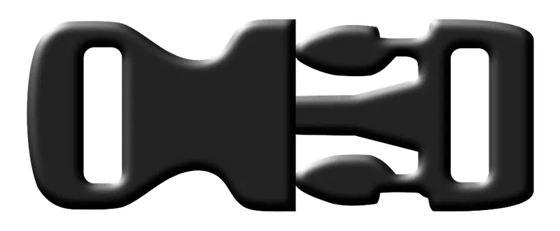
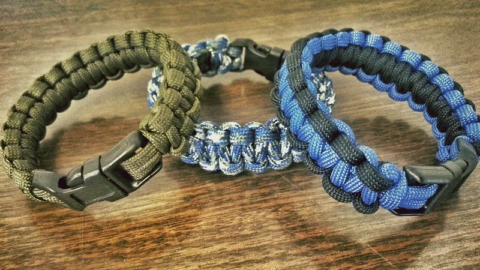
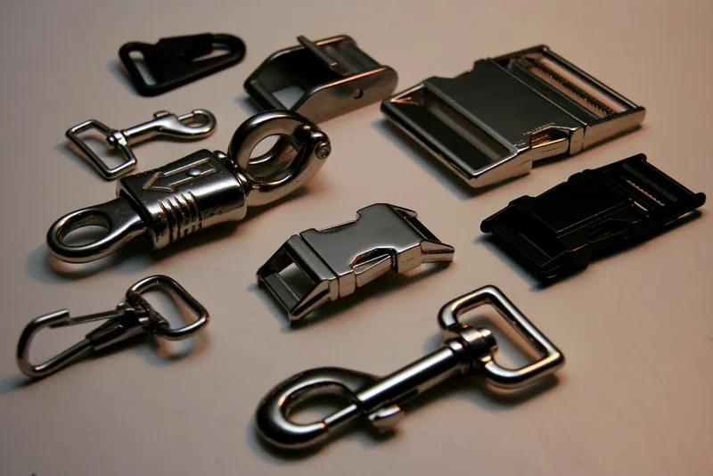

<figure class="eoc-pic eoc-pic-main"><figcaption><strong>Diagram.</strong> <a href="https://commons.wikimedia.org/wiki/File:Boucle_rapide.svg">Boucle rapide</a> by Jean Paul GIBERT, <a href="https://creativecommons.org/licenses/by-sa/4.0">CC BY-SA 4.0</a>, from Wikimedia Commons.</figcaption></figure>
<figure class="eoc-pic"><figcaption><strong>Photo.</strong> <a href="https://www.flickr.com/photos/29053927@N05/9721202956">Paracord Bracelets</a> by GA-Kayaker, <a href="https://creativecommons.org/licenses/by/2.0/">CC BY 2.0</a>, from Flickr via Openverse.</figcaption></figure>
<figure class="eoc-pic"><figcaption><strong>Photo.</strong> <a href="https://www.flickr.com/photos/99304940@N00/361277758">Hardware</a> by mikest, <a href="https://creativecommons.org/licenses/by/2.0/">CC BY 2.0</a>, from Flickr via Openverse.</figcaption></figure>

A two-part plastic buckle in which two springy arms on the male half flex inward as it is pushed into the female half, then click outward into side windows so it cannot pull out, until you pinch both arms through the windows to let it go.

**In plain words:** The plastic backpack clip: a pronged half that clicks into a hollow half, and comes apart when you pinch the two sides. **Proper term:** Side-release buckle (plastic snap-fit buckle).

**Also called:** side release buckle / SRB; quick-release buckle; parachute buckle; Fastex buckle (Fastex is an ITW brand name, used as a generic name); clip buckle / clip; snap-fit buckle / snap buckle; male and female buckle; latch and body (ACW); plug and socket (patent wording); curved or contoured side-release buckle; dual-adjust side-release buckle (variants); Klickschnalle / Steckschnalle (German); boucle rapide (French).

## How it works

As you push the male half in, sloped faces on the arm heads hit the mouth of the housing and bend the two arms inward ([cantilever](../glossary.md#cantilever) snap fits). When the heads reach the side windows, the arms spring back out and the flat back faces of the heads catch on the window edges with a click, so a pull on the straps cannot separate them. The stiff centre tongue slides in a channel to line the halves up and resist twisting, and it also stops the arms being bent too far. To open, you press both heads inward through the windows at once and slide the male half out; pressing only one side does not release it.

## Parts

A few parts (two moulded pieces). Male half (latch or plug): a strap bar, a stiff centre tongue (guide post) and two springy arms with hooked heads. Female half (body or socket): a hollow housing with an open mouth, a guide channel for the tongue, two side windows the heads snap into, and a strap bar. One or both halves may carry a ladder-lock adjuster. Metal versions add pivoting arms and a separate spring.

## Everyday examples

- backpack hip belts and chest (sternum) straps, some with a whistle built into the buckle
- pet collars and harnesses
- life jackets, luggage straps and camera bags
- sandal and boot straps

## When to use it

When two strap ends must be joined and separated quickly, often and one-handed, with no tools and a clear 'click' that shows it is shut: backpacks, bags, pet collars, life jackets, straps on gear, and do-it-yourself sewn projects. Light, cheap, rust-free and available in standard webbing widths. Pick an adjustable (ladder-lock) version when the strap length must change.

## When not to use it

Not for climbing, fall arrest, lifting or other life-safety loads: use rated metal hardware (carabiners, rated buckles) instead. Not where a sudden shock load could snap the plastic, such as a strong dog lunging (use a metal side-release buckle or a metal buckle with a prong). Not where things pressing on the sides could open it by accident (use a buckle with a release guard or a different latch). Not in deep cold with cheap or unknown plastics. For a flat, low-profile hook-on use a G-hook; to cinch a strap tight often, use a cam buckle.

## Details

- **What it does (jobs):**
  - join and hold: connects two strap ends
  - lock, and release by hand: stays shut under strap tension until you pinch both sides
  - tighten and hold tension (adjustable versions only): a built-in ladder lock lets you pull the strap tight
- **Movement:** slide: the male half slides straight in and out of the housing (about the length of the arms); the arms flex a millimetre or two sideways as it snaps
- **Directions it can move (degrees of freedom):** 0 when latched (the two halves are locked together). While being joined or released, 1: sliding in and out along the strap.
- **Special behaviour:**
  - quick-release: joins with one push and opens with one pinch, even one-handed
  - hand-release only (locks under load, releases when a person operates it): strap tension cannot open it; a person must squeeze both arms together
  - self-aligning or self-centring: the centre tongue runs in a guide channel that centres the male half as it goes in and helps resist twisting loads
  - tensioning (takes up slack and holds): only on versions with a built-in ladder-lock adjuster
- **How it holds:** shape (the parts interlock; [form-fit](../glossary.md#form-fit--force-fit--material-bond)): hooked heads catch on the edges of side windows, held there by spring force (the arms' own springiness, a compliant cantilever)
- **Input and output:** not applicable
- **Power:** passive (no power needed)
- **Load:** light to medium, and it varies widely by maker. American Cord & Webbing (ACW) states its 1-inch MSR side-release buckle has a tensile strength of 300 lb (about 1.3 kN) and a 1-inch high-strength design (T-1 Bullet) about 500 lb (about 2.2 kN), and warns that there is 'no single strength rating' and that buckles of the same width from different makers can differ greatly. Strong in a straight pull along the straps. Weaker under combined twisting and straight loads (the arms can unlatch or break, patent US5737810), under sudden shock loads such as a lunging pet (patent US6378466), and under side pressure on the arms, which releases it. Thin, flat ones for 20 mm binding tape 'will break under high tension' (Zpacks).
- **Play and precision:** small: a little looseness in and out and side to side once latched; the centre tongue and channel keep the halves lined up. Not a precision locating joint.
- **Taking it apart:** tool-free quick release: the two halves separate by hand; the straps are usually sewn round each half's bar (semi-permanent), or threaded through an adjuster
- **How often it can be reused:** many times: made to be opened and closed daily, but the arms bend every time and can eventually crack from [fatigue](../glossary.md#fatigue) (patent US6378466 notes the arms 'may break' after many [flexures](../glossary.md#flexure))
- **Sealing:** none
- **Adjustable:** yes on adjustable versions: one or both halves have a ladder-lock bar so the strap length can be changed; plain versions have fixed sewn loops
- **Access needed:** not applicable: it hangs on a strap; to open it you need finger and thumb on both side arms at once
- **Materials:** Usually acetal (POM), which is stiff, keeps its spring and gives a clear click, or tough nylon (polyamide), which resists impact but absorbs water so its [stiffness](../glossary.md#stiffness) changes; polyolefin (polypropylene-type) for cheap, low-duty buckles; heat-stabilised plastics for fire-resistant gear; die-cast zinc, aluminium or steel for metal versions. The original patent names 'a tough resilient plastic material such as nylon or Delrin' (acetal). Webbing: nylon, polyester or polypropylene matched to the buckle width. 3D-printed versions: PETG (most common), ASA for sun and heat, nylon for the flexible male part; PLA works for light duty but is less springy.
- **Heat, cold, water and wear:** ITW Nexus quotes a service temperature of -40 °F to 140 °F (-40 °C to 60 °C) for its acetal buckles. Nylon absorbs water, so it is stronger but less impact-resistant when dry, and weaker but tougher when wet. Polyolefin (polypropylene-type) buckles lose properties in the cold. One strap maker says name-brand buckles work from -30 to +30 degrees in sea air or desert and that cheap knock-off plastics are what fail (degree scale not stated) ⚑ [uncertain]. For printed buckles, ASA or PETG is advised in sun and heat. Sand, grit or ice packed into the housing may jam the arms ⚑ [uncertain: not confirmed on an opened page]. Arms that stay bent or under constant load [creep](../glossary.md#creep) and lose their spring (Protolabs Network, on snap fits in general).

## Making it

- **Ways to make or get it:**
  - off-the-shelf part (most common)
  - 3D print (FDM): two-part printable designs and parametric OpenSCAD generators exist
  - 3D print (SLS/MJF nylon), recommended by Protolabs Network for snap fits that are opened and closed many times
  - injection moulding (how commercial buckles are made; not a home process)
  - die casting / machining (metal buckles; not a typical home process)
- **Printing it in one piece (print in place):** no: the male and female halves are printed separately and snapped together; the female half usually needs [support material](../glossary.md#support-material) inside
- **Tools:** none to use. Fitting: needle and thread or sewing machine to sew strap loops; none for adjustable ends. Printed versions of some designs use an M3 screw as a strap pin (Allen key)
- **Difficulty:** easy to buy and fit (cheap, sold by webbing width); moderate to 3D print: the springy arms need a tough material, printing flat, and careful [clearances](../glossary.md#clearance), and the hollow female half needs supports cleaned out

### 3D printing tips

Print the male half flat on the bed so the springy arms are made of long strands in the X-Y plane (Appropedia: 'print with prongs flat on bed'; Protolabs Network/Hubs: avoid snap-fit arms built vertically in Z, because layer bonding makes them weaker). The female half can be printed flat with support 'everywhere' (Appropedia), or standing up with supports (one Printables remix). Clear every trace of support from inside the housing, or the buckle will be hard to use. Materials: PETG is the usual choice. One designer uses ASA or PETG for outdoor use in heat and strong sunlight. The outer (female) part should be the stiffer one, and the inner (male) part needs to be 'somewhat flexible' (ASA, nylon or PETG). PLA works for normal use but is less springy and less UV-resistant. Settings used on tested designs: 0.2 mm layers, 0.4 mm nozzle, 4 [perimeters](../glossary.md#perimeters) and 100% [infill](../glossary.md#infill) for strength (a Printables 24 mm buckle); or 30% infill and PLA at 210 °C for a light-duty parametric buckle (Appropedia). Mouse-ear brims help the thin arm tips stick. General snap-fit rules from Protolabs Network: leave about 0.5 mm clearance between mating parts for FDM; add a [fillet](../glossary.md#chamfer--fillet) at the root of each arm of at least half the arm's thickness; [taper](../glossary.md#taper) the arm towards its tip; make it at least 5 mm wide; and make sure the arm is only bent while clicking in, not all the time. Scaling a 25 mm design to 80% width made it fit 20 mm straps. Designers warn that printed buckles are untested for 'life or death' uses.

### Buying one (off-the-shelf parts)

Search for 'side release buckle' by webbing width (commercial ranges include 5/8 in, 3/4 in, 1 in, 1-1/4 in, 1-1/2 in and 2 in, i.e. about 15-50 mm); variants: 'contoured' or 'curved side release buckle', 'dual adjust side release buckle', 'split-bar side release buckle' ⚑ [uncertain: fitting without sewing], 'sternum strap buckle with whistle', 'metal side release buckle' (zinc, aluminium or steel), 'acetal' versus 'nylon' buckles, 'fire-resistant buckles'. Supplier product-line names you may see: Fastex, Classic SR, GTSR (ITW Nexus, brands); Mojave (Duraflex, brand); MSR, T-1 Bullet (ACW, brand).

## Rules of thumb

- There is no single strength rating: check the maker's figure and never assume one 1-inch buckle is as strong as another; for safety-critical uses, test the whole strap-and-buckle assembly under the real (dynamic) load (ACW, https://acw1.com/side-release-buckles/).
- Example ratings: ACW's 1-inch MSR side-release buckle is rated at 300 lb tensile and its 1-inch T-1 Bullet at 500 lb (ACW, https://acw1.com/side-release-buckles/).
- Choose acetal for a crisp click that keeps its spring after many releases, and nylon for impact toughness and flex; nylon hooks can 'creep open' after long use (My Fave Straps, https://myfavestraps.com/blogs/technical/plastic-hardware-defined; ACW, see above; ITW Nexus materials, https://na.itwnexus.com/content/general-material-descriptions-0).
- For FDM snap arms: about 0.5 mm clearance, a fillet at the arm root of at least 0.5 times the root thickness, a taper towards the tip, at least 5 mm width, and no arms printed upright in Z (Protolabs Network/Hubs, https://www.hubs.com/knowledge-base/how-design-snap-fit-joints-3d-printing/).
- Print the male half with its prongs flat on the bed; print the female half with support and clear it out fully (Appropedia, https://www.appropedia.org/Parametric_quick_release_buckles).
- Combined straight and twisting loads can make the arms unlatch or break; a centre guide post in a channel and larger latching shoulders were patented to resist this (US5737810, https://image-ppubs.uspto.gov/dirsearch-public/print/downloadPdf/5737810).

## Common failures

(1) The arms crack or snap from fatigue after many openings, or from cold, shock loads or a cheap resin (a Wikimedia Commons photo shows a backpack buckle with fatigue fractures in three places); buy good-quality acetal or nylon and replace cracked buckles. (2) It releases under load when twisting and pulling forces combine and push the arms inward; choose designs with a strong centre guide and deep latching shoulders. (3) Only one arm clicks in, or it is not fully latched; listen and feel for both clicks and tug to check. (4) It is hard to open or jams because of dirt, sand or support material left inside a printed one; clean it out. (5) Printed arms split along [layer lines](../glossary.md#layer-lines); print them flat and use PETG, ASA or nylon. (6) The strap slips in an adjustable version; see the ladder lock entry (thread it correctly and use webbing of the right thickness).

## Safety

A plastic buckle can break suddenly under a shock load; one patent gives the example of a lunging pet. Printable designs are labelled not for 'life or death' use. Loaded straps can whip back if a buckle fails. Children's and pets' gear may need breakaway designs, which are a different product ⚑ [uncertain]. The small parts are a choking hazard.

## Related

- Cantilever snap fit: the general principle; the side-release buckle is two cantilever snap fits working as a pair
- Ladder lock buckle / tri-glide: adjusts strap length; often built into one or both halves of a side-release buckle
- Magnetic-assisted buckle: magnets pull and line the halves together, and a catch takes the load
- Cam buckle: cinches a strap tight and releases with a lever, but does not separate into two halves
- G-hook: a flat hook that hooks into a webbing loop; lower profile, less secure when the strap goes slack ⚑ [uncertain]
- Belt buckle with prong (conventional buckle): metal, strong, stepped adjustment, slower to open
- Seat-belt style centre-release buckle: a push-button releases a metal tongue; for higher, safety-rated loads
- Spring button lock (snap button): the same 'spring pops into a hole, press to release' idea used on tubes

## Make it yourself

- [Parametric quick release buckles (Appropedia, Michigan Tech open-source 3D printing course, 2016)](https://www.appropedia.org/Parametric_quick_release_buckles): Fully parametric OpenSCAD side-release buckle with print settings (PLA, 0.2 mm, 30% infill, male prongs flat, female with supports); design files linked on YouMagine *(licence: Page CC BY-SA 4.0; design files ⚑ [uncertain])*
- [Side Release Buckle (Printables 30499, remix of a Thingiverse design; URL from Printables API, page not opened)](https://www.printables.com/model/30499-side-release-buckle): 25 mm side-release buckle printed in PETG with built-in supports; male half flat, female half standing; scale to 80% width for 20 mm straps *(licence: CC BY-SA (Creative Commons Attribution-ShareAlike))*
- [Side-Release Buckle - Pin & Ladder Lock - 24 mm - fully printable (Printables 928812; URL from Printables API, page not opened)](https://www.printables.com/model/928812-side-release-buckle-pin-ladder-lock-24-mm-fully-pr): Fully printable 24 mm buckle in two strap-fixing styles: a printed pin that fits a closed strap loop without sewing, or a ladder-lock male half; PETG, 100% infill, detailed settings *(licence: CC BY-NC-SA (Creative Commons Attribution-NonCommercial-ShareAlike))*
- [Parametric Side-Release Buckle 10-60mm (MakerWorld; seen in search results, page blocked and not opened)](https://makerworld.com/en/models/3018896-parametric-side-release-buckle-10-60mm): Parametric buckle generator for webbing 10-60 mm wide, customised in MakerWorld's OpenSCAD customizer (according to the search result) *(licence: ⚑ [uncertain])*
- [SOL75 customizable parametric quick release buckle](https://www.sol75.com/customizer/lp/buckle_if): Web-based parametric quick-release buckle generator with 3D preview; outputs STL, editable OpenSCAD source and a PDF handbook; some downloads are paid *(licence: SOL75 licence agreement (proprietary; basic use free, some downloads paid))*

## Pictures, videos and models

- [Boucle rapide.svg (Wikimedia Commons, by Jean Paul Gibert, 2016)](https://commons.wikimedia.org/wiki/File:Boucle_rapide.svg): Drawing of the male and female halves of a side-release buckle *(licence: CC BY-SA 4.0 (reuse with credit))*
- [Klickschnalle 03 (fcm).jpg (Wikimedia Commons, photo by Frank C. Müller, 2014)](https://commons.wikimedia.org/wiki/File:Klickschnalle_03_(fcm).jpg): Photo of a closed side-release buckle on webbing, with adjusters on both halves *(licence: CC BY-SA 4.0 (reuse with credit))*
- [Rygsækspænde med brud.JPG (Wikimedia Commons, by Arc1977, 2013)](https://commons.wikimedia.org/wiki/File:Rygs%C3%A6ksp%C3%A6nde_med_brud.JPG): Photo of a plastic backpack buckle with fatigue fractures, useful for the 'how it fails' section *(licence: CC BY-SA 3.0 (reuse with credit))*
- [How to Thread, Tighten, and Release your Plastic Side Release Buckle (Strapworks, YouTube; title confirmed via YouTube oEmbed)](https://www.youtube.com/watch?v=CCYB_KHfF_I): Video of threading webbing into a side-release buckle, tightening it and releasing it *(licence: link only)*
- [US4150464A - Buckle (Richard J. Tracy, Illinois Tool Works, filed 1977, granted 1979)](https://patents.google.com/patent/US4150464A/en): Patent drawings of the modern side-release buckle: the resilient arms with locking tabs, the centre arm with stop wings, and the receptacle with locking slots *(licence: link only (patent document; drawings shown on Google Patents))*

## Needs confirming

⚑ marks something nobody has confirmed yet: a fact the research could not confirm from a source, a finder value that is a best guess, or an open point from the research notes. Corrections are welcome (see `research/needs-confirming.md`).

- ⚑ 7 sentences on this page marked [uncertain].

## Sources

- <https://en.wikipedia.org/wiki/Buckle>
- <https://patents.google.com/patent/US4150464A/en>
- <https://image-ppubs.uspto.gov/dirsearch-public/print/downloadPdf/5737810>
- <https://image-ppubs.uspto.gov/dirsearch-public/print/downloadPdf/6378466>
- <https://acw1.com/side-release-buckles/>
- <https://acw1.com/faqs/>
- <https://na.itwnexus.com/content/general-material-descriptions-0>
- <https://na.itwnexus.com/content/ladderloc>
- <https://myfavestraps.com/blogs/technical/plastic-hardware-defined>
- <https://zpacks.com/products/mini-cord-lock-5-pack>
- <https://milspecmonkey.com/store/hardware-diy/369-itw-g-hook-flat.html>
- <https://www.hubs.com/knowledge-base/how-design-snap-fit-joints-3d-printing/>
- <https://www.appropedia.org/Parametric_quick_release_buckles>
- <https://www.appropedia.org/%22Backpack%22_Snap-fit_Clips>
- <https://www.sol75.com/customizer/lp/buckle_if>
- <https://commons.wikimedia.org/wiki/Category:Snap-fit_buckles>
- <https://commons.wikimedia.org/wiki/File:Boucle_rapide.svg>
- <https://commons.wikimedia.org/wiki/File:Boucle_rapide_avec_sifflet_d%27alerte.svg>
- <https://commons.wikimedia.org/wiki/File:Klickschnalle_01_(fcm).jpg>
- <https://commons.wikimedia.org/wiki/File:Klickschnalle_03_(fcm).jpg>
- <https://commons.wikimedia.org/wiki/File:Rygs%C3%A6ksp%C3%A6nde_med_brud.JPG>
- <https://api.printables.com/graphql/>
- <https://www.youtube.com/watch?v=CCYB_KHfF_I (verified via YouTube oEmbed)>
