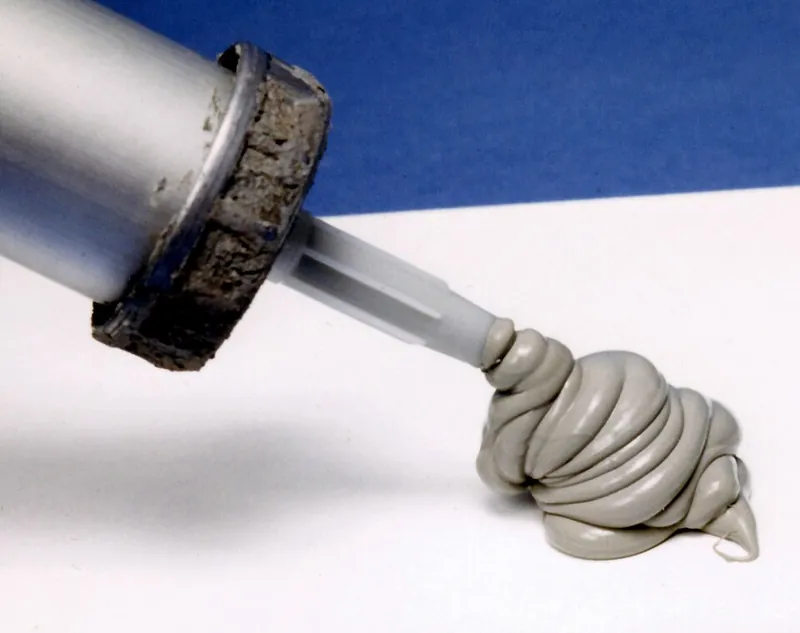
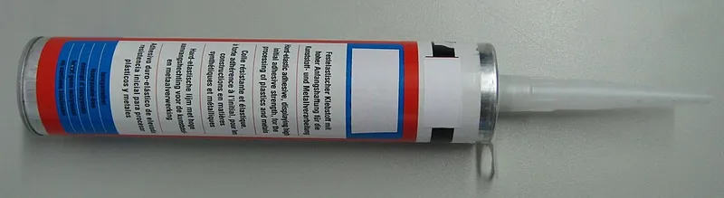

<figure class="eoc-pic eoc-pic-main"><figcaption><strong>Photo.</strong> <a href="https://commons.wikimedia.org/wiki/File:Caulking.jpg">Caulking</a> by Achim Hering, <a href="https://creativecommons.org/licenses/by/3.0">CC BY 3.0</a>, from Wikimedia Commons.</figcaption></figure>
<figure class="eoc-pic"><figcaption><strong>Photo.</strong> <a href="https://commons.wikimedia.org/wiki/File:Adhesive_sealant_in_aluminium_cartridge_packaging.jpg">Adhesive sealant in aluminium cartridge packaging</a> by Cjp24, <a href="https://creativecommons.org/licenses/by-sa/3.0">CC BY-SA 3.0</a>, from Wikimedia Commons.</figcaption></figure>

Silicone and MS-polymer adhesive sealants are one-part pastes that [cure](../glossary.md#cure) from moisture in the air into flexible rubber, filling and sealing gaps against water while holding parts together with a bond that stretches and absorbs movement.

**In plain words:** A thick paste squeezed from a caulk-gun tube that skins over in minutes and, overnight, turns into soft, stretchy rubber by soaking up moisture from the air; it seals gaps against water and holds parts together flexibly, like the 'silicone' round a bath, or the newer paintable 'hybrid' or 'MS polymer' glue-and-seal tubes. **Proper term:** Moisture-curing elastomeric adhesive sealants: RTV silicone and silyl-modified polymer (MS polymer, hybrid polymer).

**Also called:** silicone sealant, silicone caulk, 'silicone'; technically a silicone joint filler is called a sealant rather than a caulk (Wikipedia 'Caulk'); RTV silicone (room-temperature vulcanising); acetoxy or acid-cure silicone (smells of vinegar) versus neutral-cure silicone (alkoxy or oxime) (Wikipedia 'Silicone rubber'; Loctite design guide); RTV gasket maker, flange sealant, e.g. Loctite 5900 (brand) 'heavy body RTV silicone' (Loctite design guide); aquarium silicone (Wikipedia 'Silicone'); MS polymer, SMP (silyl- or silane-modified polymer), STP or STPE (silane-terminated polyether), 'modified silicone', hybrid polymer, SMX polymer (Wikipedia 'Silyl modified polymers'; Kaneka; Soudal); adhesive sealant, polymer adhesive, 'mounting' or grab adhesive, e.g. Soudal Fix ALL, Pattex One for All (brands) (Soudal data sheet; Prusa); DOWSIL 732 (brand), a classic general-purpose acetoxy silicone adhesive sealant (Dow data sheet); silicone mouldable glue, e.g. Sugru (brand), a silicone rubber that is moulded by hand and hardens at room temperature (Wikipedia 'Silicone').

## How it works

The paste is made of long, flexible polymer chains whose ends carry reactive silicon groups. Moisture from the air reacts with those end groups, which then link to one another (hydrolysis then condensation) and cross-link the chains into a rubber, giving off a small by-product: acetic acid (vinegar smell) from acetoxy silicones, alcohols from alkoxy silicones, an oxime from oxime silicones, and methanol from MS polymers (Loctite design guide, p. 11; Wikipedia 'Silicone'; Wikipedia 'Silyl modified polymers'). Silicones have a silicon-oxygen (siloxane) backbone, which gives them heat and UV resistance, while MS polymers have a polyether backbone with silyl ends, which makes them paintable, stronger and isocyanate-free (Loctite design guide; Wikipedia 'Silyl modified polymers'). Because moisture has to soak in from the surface, a skin forms in minutes and the cure then works inward at about 3 mm per day, so thick or enclosed beads cure very slowly (Dow data sheet; Soudal data sheet). The cured rubber stretches (hundreds of percent), so the joint can take movement and vibration without cracking, but it is much weaker than a rigid glue (Dow data sheet; Wikipedia 'Sealant').

## Parts

Single piece: one paste in a cartridge or tube, no mixing (two-part and UV-curing versions exist for industry). You also need a caulking gun for cartridges, a nozzle cut to size, and a smoothing (tooling) tool (Dow data sheet; GE Sealants; Loctite design guide).

## Everyday examples

- The bead of sealant around a bath, shower tray or kitchen sink; household bathroom caulk is usually acetoxy-cure silicone (Wikipedia 'Silicone rubber')
- Glass aquariums, whose panes are joined only with silicone sealant (Wikipedia 'Silicone')
- Window glazing and glass building facades held by structural silicone (Wikipedia 'Silicone'; Wikipedia 'Sealant')
- RTV 'gasket maker' squeezed onto car engine flanges instead of a cut gasket (Loctite design guide: oxime silicones in automotive gasketing)

## When to use it

Use it when a joint has to be waterproof and flexible at the same time: sealing seams, lids and cable holes in enclosures, bonding glass, mirrors, tiles or panels where parts expand and contract differently, and [damping](../glossary.md#damping) vibration or rattles (Wikipedia 'Sealant'; Loctite design guide; Soudal data sheet). Choose silicone for heat (up to about 180 °C), strong sunlight, wet areas and glass (Dow data sheet; Wikipedia 'Silicone'). Choose MS/hybrid polymer when you need a stronger, faster-grabbing bond, want to paint over it, are gluing to damp or porous building materials, or want to avoid isocyanates and vinegar smell (Soudal data sheet; Wikipedia 'Silyl modified polymers').

## When not to use it

Don't use it where the joint must be stiff or carry high loads: use epoxy, CA or screws (Loctite design guide: low cohesive strength). Don't use it on PE, PP or PTFE (Dow data sheet; Soudal data sheet), or silicone on acrylic (Wikipedia 'Silicone'). Don't use plain silicone where it will be painted (use MS polymer or acrylic caulk) (Soudal data sheet; Sashco). Avoid acetoxy silicone on copper, brass, bare steel or electronics, especially in closed boxes; use neutral cure (Dow data sheet; Loctite design guide). Avoid very thick or fully enclosed beads that air can't reach (Dow Corning technical manual; Loctite design guide), gas-tight or vacuum seals (Wikipedia 'Silicone'), and, for the MS sealant tested, continuous underwater use, aquariums and glazing (Soudal data sheet). For reusable, pressure-proof seals on printed parts, use an [O-ring](../glossary.md#o-ring) (Prusa watertight printing, part 2).

## Details

- **What it does (jobs):**
  - glue or bond: flexible, gap-filling bonds between glass, metal, ceramic, wood, stone and many plastics (Dow data sheet; Soudal data sheet)
  - seal it, or pass cables or fluid through: fills and seals gaps and seams against water, draughts and dust, e.g. around baths, windows and enclosure lids, or round a cable where it passes through a wall (Wikipedia 'Sealant'; Wikipedia 'Silicone')
- **Movement:** flex: the cured rubber bead lets the joined parts shift slightly relative to each other; the Soudal hybrid sealant allows ±20% distortion of the joint (Soudal data sheet). It is not a hinge, just a forgiving joint
- **Directions it can move (degrees of freedom):** 0 in intended use (the parts stay put), but the rubbery layer gives a little in every direction, which is what lets it absorb vibration, knocks and heat expansion
- **Special behaviour:**
  - none: it has none of the listed behaviours. Its own tricks are sealing and bonding in one step, curing from air moisture without mixing, and staying rubbery so the joint moves with the parts instead of cracking (Wikipedia 'Sealant'; Wikipedia 'Silyl modified polymers')
- **How it holds:**
  - [material bond](../glossary.md#form-fit--force-fit--material-bond) (glue, solvent or melting): the cured rubber sticks to both surfaces
- **Input and output:** not applicable
- **Power:** passive (no power needed): it cures at room temperature from moisture in the air (Loctite design guide; Dow data sheet).
- **Load:** light to medium: silicones have 'low cohesive strength', which limits them as structural adhesives (Loctite design guide, p. 11). A typical silicone reaches about 2.3 MPa tensile strength at 540% elongation (Dow data sheet); on plastics, a heavy-bodied RTV silicone gave about 1.0-1.7 MPa shear on ABS, polycarbonate, nylon, PET and PVC, 0.1 MPa on acrylic and under 0.3 MPa on PE and PP (Loctite design guide, pp. 17-69). MS/hybrid polymers are stronger and harder: about 3.2 MPa maximum tension and 65 Shore A (Soudal data sheet). Spread over a large area, these soft glues are still strong enough to hold aquarium glass under water pressure and to fix glass on building facades (Wikipedia 'Silicone'). They are good in [peel](../glossary.md#peel-vs-shear), vibration and impact because they stretch, and weak where [stiffness](../glossary.md#stiffness) is needed.
- **Play and precision:** not applicable for locating: the soft layer doesn't hold parts in an exact position, so hold or fixture them while it cures (high-tack MS polymers reduce the need for support, Soudal data sheet). It tolerates uneven gaps well: Soudal gives 2-10 mm bond widths and 5-30 mm sealing joints (Soudal data sheet), and Dow recommends at least 6 mm (1/4 in) width and depth for weather seals (Dow Corning technical manual).
- **Taking it apart:** semi-permanent (can be undone but may damage parts): the rubber can be sliced through with a knife or wire and scraped or peeled off; silicone remover and isopropyl alcohol clean off the residue (Dow Corning technical manual; GE Sealants; Sashco).
- **How often it can be reused:** once: the cured bead can't be reused, but the parts can usually be cut apart, cleaned and sealed again. Dow says fresh silicone sticks to freshly cut cured silicone without [primer](../glossary.md#primer) (Dow Corning technical manual), while Sashco says nothing, 'not even silicone', sticks to old silicone (Sashco); the safest course is to remove old silicone completely ⚑ [uncertain]: the two sources disagree.
- **Sealing:** watertight: the rubber bead fills the gap and sticks to both sides, keeping out water, draughts and dust (Wikipedia 'Sealant'; Wikipedia 'Caulk': silicone sealant is water-, mould- and mildew-resistant). Silicone rubber is very permeable to gases (about 400 times more than butyl rubber for oxygen), so it can't make gas-tight seals for high-pressure gas or vacuum (Wikipedia 'Silicone'). For a printed enclosure that must stay dry under water pressure, an O-ring in a groove is more reliable (Prusa watertight printing, part 2).
- **Adjustable:** briefly: parts can be moved and the bead smoothed until a skin forms, about 5-10 minutes (GE Sealants; Soudal data sheet: skin in about 5 minutes; Dow data sheet: skins over in 7 minutes, tack-free in 20). After curing, the rubber lets parts shift slightly but can't be adjusted; cut it out and redo it.
- **Access needed:** one side only (blind) for sealing: a bead is run along the visible side of a seam or gap. For bonding, the paste goes on one face before assembly (Dow data sheet).
- **Materials:** Silicone bonds well without primer to glass, metals, ceramics and most engineering plastics (Dow data sheet); in Loctite's tests an RTV silicone did best on ABS, polycarbonate, nylon and PET (about 1.0-1.7 MPa) (Loctite design guide). It sticks poorly to PTFE, polyethylene, polypropylene and related plastics (Dow data sheet; Loctite design guide), and has no long-term adhesion to acrylic (PMMA), which is why acrylic aquariums aren't made with it (Wikipedia 'Silicone'). Acetoxy silicone can corrode some metals, especially when enclosed, and oxime silicone can stain copper and brass (Dow data sheet; Loctite design guide). MS/hybrid polymers bond most building materials, wood, MDF, metals, PVC and plastics, even on slightly damp surfaces, but not PE, PP, PTFE, bitumen, copper or brass, and they can lose adhesion next to plasticiser-releasing rubbers such as EPDM, neoprene and butyl (Soudal data sheet). 3D-printing plastics such as PLA and PETG were not in these tests ⚑ [uncertain]; test first.
- **Heat, cold, water and wear:** Heat and cold: general-purpose silicone stays flexible from -60 °C to +180 °C, with short peaks to 205 °C, or to 230 °C for the black grade (Dow data sheet); MS/hybrid about -40 °C to +90 °C (Soudal data sheet). Sunlight: silicone has 'extreme UV resistance' and is used on roofs for decades (Wikipedia 'Silicone'); MS polymers have good UV resistance but can discolour after long exposure (Soudal data sheet; Wikipedia 'Silyl modified polymers'). Water: silicone is water-, mould- and mildew-resistant (Wikipedia 'Caulk'); the MS sealant tested resists salt water but is not for continuous immersion (Soudal data sheet). Chemicals: silicones are swelled by non-polar solvents (Loctite design guide); MS polymer resists water, aliphatic solvents, alcohols and dilute acids but not aromatic solvents, concentrated acids or chlorinated solvents (Soudal data sheet). Curing needs humidity; cold and dry air slow it (Dow data sheet). Silicone rubber lets gases through, so it is not gas-tight (Wikipedia 'Silicone'). Soap residue and dirt on bathroom joints encourage mould (Soudal data sheet). Lifetime: about 20 years for a good silicone building joint (Dow Corning technical manual).

## Making it

- **Ways to make or get it:**
  - off-the-shelf part: cartridges and tubes of silicone, MS/hybrid polymer and gasket-maker sealants
  - 3D print (FDM): sealing seams and cable holes in printed enclosures, bonding prints flexibly to glass, metal or wood, and casting custom gaskets in printed moulds (Prusa watertight printing, part 2); large prints glued with a polymer construction adhesive (Prusa gluing guide)
  - woodwork and building: sealing and bonding panels, trim, glazing, baths and kitchens (Soudal data sheet; Wikipedia 'Sealant')
  - electronics and model making: potting, sealing and flexible mounting; use neutral-cure (alkoxy) silicone near electronics because acetic acid can corrode (Loctite design guide)
  - CNC and metalwork: RTV silicone as a formed-in-place gasket on flanges (Loctite design guide)
- **Printing it in one piece (print in place):** no: it is applied to parts after printing, although you can print a two-part mould and cast a silicone gasket in it (Prusa watertight printing, part 2).
- **Tools:** A caulking gun (for cartridges), a utility knife to cut the nozzle at about 45° to suit the joint width, masking tape, isopropyl alcohol and a lint-free cloth for cleaning, a smoothing (tooling) spatula, and for removal a scraper or remover tool and silicone remover (GE Sealants; Dow data sheet; Soudal data sheet). Gloves and ventilation, especially for vinegar-smelling acetoxy silicones.
- **Difficulty:** easy: one tube, no mixing and a forgiving gap fill. The only skills are cutting the nozzle, laying a steady bead and smoothing it before it skins, and giving thick beads days to cure (GE Sealants; Dow data sheet).

### 3D printing tips

1) Use it as a seal, not a structural glue: for load-bearing printed joints use CA, epoxy or screws, and let silicone or MS polymer do the waterproofing or vibration damping (Loctite design guide: silicones have low cohesive strength). 2) Design a groove or recess for the bead so that it is at least a few millimetres wide and deep, and keep it open to the air: one-part sealants need air moisture and cure only about 3 mm per day from the exposed surface, and at most about 9.5-12.7 mm deep in a reasonable time (Dow data sheet; Soudal data sheet; Loctite design guide, p. 11). A bead sealed inside a closed box may never fully cure. 3) Clean prints with isopropyl alcohol and let them dry; lightly roughen smooth faces (Dow data sheet; GE Sealants). 4) Mask the edges with tape, apply a steady bead, smooth it within 5-10 minutes before it skins, and pull the tape while the bead is still wet (GE Sealants; Dow Corning technical manual). 5) For electronics, choose a neutral-cure (alkoxy or 'electronics grade') silicone rather than vinegar-smelling acetoxy, whose acetic acid can corrode copper contacts, especially in a closed box (Dow data sheet; Loctite design guide). 6) Printed flexible (TPU) gaskets didn't seal in Prusa's tests; instead print a two-piece mould, fill it with silicone caulk and demould after curing, or better, design for a standard O-ring and grease it with silicone grease (Prusa watertight printing, part 2). 7) Silicone doesn't stick to PP or PE prints (Dow data sheet), which also means PP or PE-lined moulds release silicone easily ⚑ [uncertain]. 8) If you want to paint the part afterwards, use MS/hybrid polymer, which takes water-based paint, not silicone, which paint won't stick to (Soudal data sheet; Sashco). 9) Keep silicone off surfaces you still need to glue or paint, because its residue stops later adhesion (Sashco).

### Buying one (off-the-shelf parts)

Search for 'RTV silicone sealant' or 'silicone adhesive sealant' (acetoxy / general purpose, e.g. DOWSIL 732, brand), 'neutral cure silicone' or 'electronics-grade RTV' for metal and electronics, 'aquarium-safe silicone', 'high-temperature RTV gasket maker' or 'flange sealant' (e.g. Loctite 5900, brand), 'MS polymer' or 'hybrid polymer adhesive sealant' (e.g. Soudal Fix ALL, CT1, Pattex One for All, brands), 'high-tack' grab adhesive, 'silicone primer' (e.g. DOWSIL 1200 OS, brand), 'backer rod' and 'bond-breaker tape' for wide joints, a 'caulking gun', 'caulk smoothing tool' and 'silicone remover' (Dow data sheet; Loctite design guide; Soudal data sheet; Dow Corning technical manual; GE Sealants).

## Rules of thumb

- Cure speed: skin in about 5-10 minutes; about 3 mm cured depth per 24 hours at 23 °C and 50% humidity; slower when cold or dry (Dow 732 data sheet; Soudal Fix ALL High Tack data sheet). Moisture-cure silicones are tack-free in 5-60 minutes, thick sections take up to 72 hours, and full adhesion can keep building for 1-2 weeks (Loctite 'Design Guide for Bonding Plastics', vol. 6, p. 11).
- Maximum practical cure depth is about 0.375-0.5 in (9.5-12.7 mm) for moisture-cure silicones (Loctite design guide, p. 11).
- Joint shape for sealing: make the bead about twice as wide as it is deep (2:1), shaped like an hourglass; at least 1/4 in (6 mm) wide and deep for weather seals; over 1 in (25 mm) wide, keep the depth at about 3/8-1/2 in (9-12 mm) (Dow Corning Americas Technical Manual, pp. 49-50; Soudal data sheet: 'joint width = 2 x joint depth').
- Avoid three-sided adhesion (sticking to the bottom of the joint as well as both sides): put in a backer rod or bond-breaker tape, otherwise the joint can take only about ±15% movement before tearing (Dow Corning Americas Technical Manual, p. 50).
- Hybrid bonding bead: 2-10 mm wide for bonding; sealing joints 5-30 mm wide and at least 5 mm deep (Soudal Fix ALL High Tack data sheet).
- Temperature range: general-purpose silicone about -60 to +180 °C, with short peaks to 205 °C (Dow 732 data sheet); MS/hybrid about -40 to +90 °C (Soudal data sheet).
- A properly designed and installed silicone building joint typically lasts about 20 years (Dow Corning Americas Technical Manual, p. 68).

## Common failures

The bead peels off because the surface was dirty, greasy or damp, or was PE, PP, PTFE or old silicone residue; clean with isopropyl alcohol, remove old silicone completely, and use a primer where the maker recommends one (Dow data sheet; Sashco; Soudal data sheet). The middle of a thick or enclosed bead stays soft because air moisture can't reach it; keep beads shallow and open to air (Loctite design guide; Dow Corning technical manual). The bead tears when the joint moves, because it stuck to the bottom of the joint as well as the sides (three-sided adhesion), or the joint was too narrow or too deep (Dow Corning technical manual). Lumpy or wrinkled finish from tooling after the skin had formed; smooth within 5-10 minutes and pull masking tape while wet (GE Sealants; Dow Corning technical manual). Green corrosion or failed electronics under acetoxy silicone in a closed box (Dow data sheet). Paint beading up or peeling on silicone (Sashco). Black mould on bathroom joints from soap and dirt (Soudal data sheet). Discolouration and loss of grip next to EPDM, neoprene or butyl rubber (Soudal data sheet). Using it as a structural glue and finding the joint too weak or springy (Loctite design guide).

## Safety

Acetoxy silicones give off acetic acid (vinegar) while curing, which irritates eyes and lungs, so ventilate; it can also corrode metals and electronics (Wikipedia 'Silicone'; Dow data sheet). Oxime-cure silicones give off methyl ethyl ketoxime (MEKO) (Loctite design guide), which the EU has classified as a presumed carcinogen ⚑ [uncertain]: reported in search results, not verified on an opened page. MS polymers give off small amounts of methanol as they cure (Wikipedia 'Silyl modified polymers' reaction), but contain no isocyanates, unlike polyurethane sealants (Wikipedia 'Silyl modified polymers'; Soudal data sheet). Keep uncured sealant off skin and out of eyes, and read the label and safety data sheet (Soudal data sheet: 'Dangerous. Respect the precautions for use'). Not all silicones are safe for fish or food: use aquarium-safe or food-contact grades where needed (Wikipedia 'Silicone'; Dow data sheet: FDA 177.2600 compliance).

## Related

- Polyurethane sealant and polyurethane construction adhesive: also moisture-curing, strong and paintable, but they contain isocyanates and have poorer UV resistance than MS polymers (Wikipedia 'Silyl modified polymers'; Wikipedia 'List of polyurethane applications')
- Polyurethane glue (foaming): rigid-ish, strong wood glue that foams; not a sealant
- O-ring seal: a rubber ring in a groove; the most reliable reusable seal for printed enclosures (Prusa watertight printing, part 2)
- Gasket (flat, cord or cast-in-place): a separate soft layer squeezed between parts; silicone can be cast into a printed mould to make one (Prusa watertight printing, part 2)
- Two-part epoxy: rigid, much stronger, gap-filling, but cracks if the parts move differently
- Contact adhesive and elastomeric solvent glues: flexible glues for sheets, rubber and fabric that don't need air moisture, but give off solvent
- Double-sided foam tape: an instant, flexible, clean bond for mounting, but not a gap-filling seal
- Silicone mouldable glue (e.g. Sugru, brand): silicone rubber you shape by hand like clay, which hardens at room temperature and sticks to glass and aluminium (Wikipedia 'Silicone')
- Melted plastic weld: for a watertight printed tank or box, makers suggest welding the printed seams first (e.g. with a soldering iron) and then sealing the whole thing, warning that 'silicone on its own might not be enough' (r/3Dprinting thread read through the Arctic Shift archive)

## Make it yourself

- [Silicone Ring Gasket Molding (eried, Printables) (URL from Printables API, page not opened)](https://www.printables.com/model/33362-silicone-ring-gasket-molding): A printable mould for casting a ring gasket from silicone, made for a bathroom repair; the method Prusa recommends over printing gaskets in TPU. Read through the Printables public API. *(licence: CC BY (Creative Commons Attribution))*
- [Caulking tools (Miguel Silveira, Printables) (URL from Printables API, page not opened)](https://www.printables.com/model/531799-caulking-tools): A set of printable smoothing tools modelled on commercial caulking tools, printed flat in PLA without supports. Read through the Printables public API. *(licence: CC BY (Creative Commons Attribution))*
- [Silicone / Acrylic / Caulk Smoothing Tools (Vladimir Mincev, Printables) (URL from Printables API, page not opened)](https://www.printables.com/model/1093421-silicone-acrylic-caulk-smoothing-tools): Two printable finishing tools with labelled chamfered (5, 9, 11 mm) and filleted (4, 8, 10 mm) edges for shaping sealant beads of different sizes. Read through the Printables public API. *(licence: CC BY-NC (Creative Commons Attribution-NonCommercial))*
- [Caulking Gun Nozzle Unblocker (apembo, Printables) (URL from Printables API, page not opened)](https://www.printables.com/model/497778-caulking-gun-nozzle-unblocker): A corkscrew-like printed tool that winds into a used nozzle and pulls out the plug of cured sealant so a half-used tube can be reused (the plug Dow's data sheet says forms in the tip). Read through the Printables public API. *(licence: CC BY-NC (Creative Commons Attribution-NonCommercial))*
- [Silicone Caulking Nozzle with Integrated Smoother (Micha Hainz, Printables) (URL from Printables API, page not opened)](https://www.printables.com/model/1358983-silicone-caulking-nozzle-with-integrated-smoother): A push-on printed nozzle that lays and smooths the bead in one pass on standard cartridges. Read through the Printables public API. *(licence: CC BY-SA (Creative Commons Attribution-ShareAlike))*

## Pictures, videos and models

- [Caulking.jpg (Wikimedia Commons, by Achim Hering)](https://commons.wikimedia.org/wiki/File:Caulking.jpg): Photo of silicone sealant being squeezed from a caulking gun into a joint *(licence: CC BY 3.0)*
- [Adhesive sealant in aluminium cartridge packaging.jpg (Wikimedia Commons, by Cjp24)](https://commons.wikimedia.org/wiki/File:Adhesive_sealant_in_aluminium_cartridge_packaging.jpg): Photo of an MS-polymer adhesive sealant in a 310 ml aluminium cartridge with a screw-on nozzle *(licence: CC BY-SA 3.0)*
- [CrosslinkedSilicone.svg (Wikimedia Commons, by Smokefoot)](https://commons.wikimedia.org/wiki/File:CrosslinkedSilicone.svg): Chemical diagram highlighting a cross-link between silicone chains, the link formed when the sealant cures *(licence: CC BY-SA 4.0)*
- [Watertight 3D printing part 2: Airtight closable models (Prusa Research blog)](https://blog.prusa3d.com/watertight-3d-printing-part-2_53638/): Photos of printed underwater housings, printed moulds for casting silicone-caulk gaskets, and O-ring seals, with results of bucket and 30 m depth tests *(licence: link only)*
- [How To Get The Perfect Finish To A Silicone Sealant Bead (YouTube, 3C Sealants)](https://www.youtube.com/watch?v=ajXmnBRQ5yI): Video of laying and finishing a silicone sealant bead (title and channel checked via YouTube oEmbed; not watched) *(licence: link only (standard YouTube licence))*

## Needs confirming

⚑ marks something nobody has confirmed yet: a fact the research could not confirm from a source, a finder value that is a best guess, or an open point from the research notes. Corrections are welcome (see `research/needs-confirming.md`).

- ⚑ 4 sentences on this page marked [uncertain].
- ⚑ Finder value `bonds_well` = PETG, ABS or ASA, nylon, silicone, acrylic or polycarbonate, metal, glass or ceramic (source uncertain): `materials` is marked ⚑ [uncertain] here: "…t). 3D-printing plastics such as PLA and PETG were not in these tests ⚑ [uncertain]; test first.…"
- ⚑ Finder value `bonds_poorly` = PLA, slippery plastics (PE or PP), PVC, wood, rubber (source uncertain): `materials` is marked ⚑ [uncertain] here: "…t). 3D-printing plastics such as PLA and PETG were not in these tests ⚑ [uncertain]; test first.…"

## Sources

- <https://www.ellsworth.com/globalassets/literature-library/manufacturer/henkel-loctite/henkel-loctite-design-guide-plastic-bonding.pdf>
- <https://ecommapi.krayden.com/Content/pdf/datasheet/dow_732_tds.pdf>
- <https://www.soudal.co.uk/sites/default/files/soudal_api/document/34053/F0034053_0001.pdf>
- <https://www.fleetwoodusa.net/Documents_Guide/Products/_General/Sealant-Technical-Manual.pdf>
- <https://gesealants.com/projects-howtos/how-to-quickly-apply-silicone-sealant-without-sacrificing-quality/>
- <https://www.sashco.com/will-my-new-caulk-stick-to-silicone/>
- <https://www.kaneka.co.jp/en/business/material/pms_002.html>
- <https://en.wikipedia.org/wiki/Silyl_modified_polymers>
- <https://en.wikipedia.org/wiki/Silicone>
- <https://en.wikipedia.org/wiki/Silicone_rubber>
- <https://en.wikipedia.org/wiki/Sealant>
- <https://en.wikipedia.org/wiki/Caulk>
- <https://en.wikipedia.org/wiki/List_of_polyurethane_applications>
- <https://blog.prusa3d.com/watertight-3d-printing-part-2_53638/>
- <https://blog.prusa3d.com/the-great-guide-to-gluing-and-assembling-3d-prints_44908/>
- <https://commons.wikimedia.org/wiki/File:Caulking.jpg>
- <https://commons.wikimedia.org/wiki/File:Adhesive_sealant_in_aluminium_cartridge_packaging.jpg>
- <https://commons.wikimedia.org/wiki/File:CrosslinkedSilicone.svg>
- <https://www.youtube.com/watch?v=ajXmnBRQ5yI>
- <https://api.printables.com/graphql/>
- <https://arctic-shift.photon-reddit.com/api/posts/ids?ids=1g4byc1>
- <https://arctic-shift.photon-reddit.com/api/comments/tree?link_id=t3_1g4byc1&limit=200>
