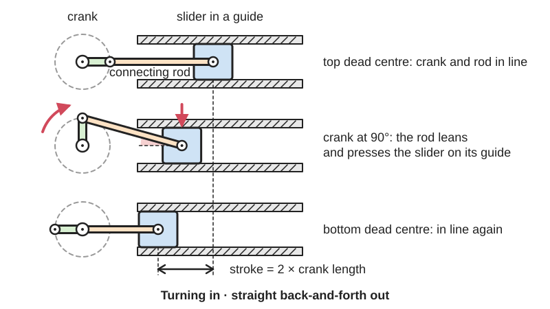

<figure class="eoc-pic eoc-pic-main"><figcaption>Diagram drawn for the encyclopaedia from the research notes. ⚑ Needs confirming: a drawing can simplify or get details wrong; a real photo or a better diagram is welcome.</figcaption></figure>

A [crank](../glossary.md#crank) turns, and a connecting rod joins the crank's outer end to a slider (such as a piston) that moves only in a straight line, turning rotation into back-and-forth sliding or, in an engine, back-and-forth pushes into rotation.

**In plain words:** A turning arm joined by a rod to a block or piston that can only slide in a straight line, so turning the arm pushes the block back and forth, and pushing the block can turn the arm, as in a car engine. **Proper term:** Slider-crank [linkage](../glossary.md#linkage) (crank and connecting rod, crank-slider mechanism).

**Also called:** crank-slider mechanism; crank and connecting rod (conrod); crank and piston / piston and crankshaft; crank and pitman ('pitman' is an old word for the connecting rod; 507 Mechanical Movements); ordinary crank motion (507 Mechanical Movements no. 92); RRRP linkage: three revolute (pin) joints and one prismatic (sliding) joint (Wikipedia); in-line slider-crank / offset slider-crank; its inversions: oscillating-cylinder engine, Whitworth quick return and rotary engine, hand pump and bull engine (Wikipedia); 曲柄滑块机构 (Chinese).

## How it works

The crank turns and its pin goes round in a circle. The connecting rod links that pin to the slider, which is held in a straight guide, so the slider is pulled and pushed back and forth. When the slider's line passes through the crank's centre (in-line), the [stroke](../glossary.md#stroke) is exactly twice the crank length and the slider's position is x = r cos(a) + sqrt(l^2 - r^2 sin^2(a)) (Wikipedia): close to, but not exactly, a sine wave, because the rod leans to the side as it moves. Pushing the slider can drive the crank round, which is how an engine works, except at the two dead centres, where rod and crank are in line and a push gives no turning force; a flywheel or a second crank set at another angle carries it through (Wikipedia).

## Parts

A few parts: a crank (a disc, arm or crankshaft) on a fixed shaft; a crank pin; a connecting rod with a pivot at each end; a slider or piston with its own pin (wrist pin or gudgeon pin); a straight guide or cylinder for the slider; a frame. Often a flywheel as well.

## Everyday examples

- Car, motorbike and lawnmower engines: pistons, connecting rods and a crankshaft (Wikipedia 'Slider-crank linkage' and 'Connecting rod')
- Air compressors and [reciprocating](../glossary.md#reciprocating) pumps; old hand pumps use one of its inversions (Wikipedia)
- Steam locomotive wheels, whose rods on each side are set at different angles so the engine can always start (Wikipedia)
- Toggle clamps and presses that use the near-dead-centre position to squeeze hard (Nguyen Duc Thang animations)

## When to use it

Use it when a motor should push something back and forth in a straight line and you want simple pin joints that wear slowly: pumps, saw or file drives, shakers, pushers and feeders, push-rods in automata, the piston of a model engine. Also use it when a straight push (a piston or linear [actuator](../glossary.md#actuator)) must turn a shaft round and round. It is cheap, compact and copes with high loads and speeds (almost every engine uses it), and the stroke is fixed simply by the crank length. Near the end of its stroke it multiplies force enormously, which makes it good for presses and clamps.

## When not to use it

Avoid it when you need a pure sine-wave motion in the smallest space (use a Scotch yoke), a pause at the ends of the stroke (use a [cam and follower](../glossary.md#cam-and-follower)), a long stroke from a small mechanism (use a rack and pinion, a belt or a lead screw), or stopping anywhere and holding under load (use a lead screw or a linear actuator). When the slider is the driver, avoid it if the machine must start by itself from any position, since it can stop on a dead centre unless you add a second crank or a flywheel. Avoid very short rods (less than about 3 x crank), which cause large side forces.

## Details

- **What it does (jobs):**
  - change the kind of motion: rotation into straight back-and-forth sliding, or back-and-forth pushing into rotation (engines, pumps, compressors)
  - change speed or turning force: near the ends of the stroke (the toggle positions) a small turning force on the crank gives a very large push, which presses and toggle clamps use (Nguyen Duc Thang, 'Toggle clamp 1a')
- **Movement:** rotate+slide: the crank rotates continuously (unlimited turns) and the slider moves back and forth over a stroke of 2 x crank length in the in-line version
- **Directions it can move (degrees of freedom):** 1: the crank angle fixes the positions of the rod and the slider; a single loop of four one-freedom joints has mobility 1 (Wikipedia 'Linkage (mechanical)')
- **Special behaviour:**
  - motion conversion (e.g. rotary to linear): rotation into straight back-and-forth motion and back again; an offset slider line gives a quick return, moving faster one way than the other (Wikipedia)
  - [over-centre](../glossary.md#over-centre) (snaps past a point and stays): at the dead centres the crank and rod line up, where the force gain becomes very large; toggle clamps and presses use this to squeeze hard and lock (Thang, 'Toggle clamp 1a'), and Carnegie Mellon's mechanism notes point out that [dead points](../glossary.md#dead-point) can be useful for holding work
- **How it holds:**
  - not a holding joint (it moves or passes on motion); used at its dead centre in a toggle clamp it holds by over-centre locking against a stop
- **Input and output:** Continuous rotation <-> straight back-and-forth (reciprocating) motion. In-line stroke = 2 x crank length (Wikipedia); an offset slider gives a quick return with time ratio Q = (180° + b)/(180° - b), where b is the imbalance angle (Wikipedia 'Four-bar linkage'). The motion is a distorted sine wave: the shorter the rod compared with the crank, the more distorted it is and the higher the peak accelerations, which is why the rod should be at least 3 x the crank (Wikipedia). Efficiency: no reliable figure found; one mechanism-demo site quotes 85-92% ⚑ [uncertain]; losses come from the three pivot bearings and from the slider being pressed sideways against its guide, a force that grows with the rod's angle (Wikipedia 'Connecting rod'). Shaft arrangement: crank shaft at right angles to the plane of motion; the slider moves in that plane. Back-drivable: yes, that is how engines work, except at the two dead centres, where a flywheel, a second crank at another angle, or momentum is needed (Wikipedia).
- **Power:** passive (no power needed); driven by a motor or hand crank, or by a piston (steam, gas, air or hydraulic). If power is lost it simply stops; it does not lock, and a load on the slider can drive the crank back unless the crank sits exactly at a dead centre
- **Load:** Light to very heavy: from printed toys to car engines, compressors and presses. The rod carries the load mainly as a push or pull along its length and the crank in bending; the pivots carry it in [shear](../glossary.md#peel-vs-shear) and bearing pressure. The angled rod also presses the slider sideways against its guide, which in engines wears cylinders into an oval shape (Wikipedia 'Connecting rod'). Very large forces arise near the dead centres when it is used as a toggle press. Weak against loads that twist the slider in its guide.
- **Play and precision:** Small if the pivots have good bearings, but each of the three pivots and the slide adds its own [clearance](../glossary.md#clearance), and that play shows up as a knock where the force reverses near the ends of the stroke ⚑ [uncertain]. The end positions repeat exactly each turn. All pivot axes must be parallel and the guide in line with the crank's plane; linkage parts that are not stacked in the same plane bind (Collin_Builds' pantograph notes), and a short slider guide can jam (igus 2:1 rule).
- **Taking it apart:** removable: pins, bolts or shoulder screws at the pivots; engine connecting rods have a bolted cap on the big end so they can be taken off the crankshaft ⚑ [uncertain]
- **How often it can be reused:** many times: taking the pivots apart does not harm them; life is limited by bearing and guide wear
- **Sealing:** none: the linkage itself does not seal; in engines, pumps and compressors the piston rings or seals seal the cylinder, not the linkage
- **Adjustable:** Not in its basic form: the stroke is fixed by the crank length. Variants: a crank with several holes or an adjustable pin changes the stroke, and a rod whose length can be changed with a screw moves where the stroke sits (Thang, 'Slider-crank mechanism for adjusting stroke position 1').
- **Access needed:** not applicable: it is a mechanism built in a frame, reached wherever the frame opens
- **Materials:** Steel, cast iron or aluminium cranks and rods, with plain (bushed) or rolling bearings and hardened steel pins, in engines, compressors and pumps ⚑ [uncertain: specific alloys not researched]. PLA, PETG, plywood or acrylic for models and light hobby drives, usually with metal screws or pins at the pivots (rackjabbit_'s printed slider-crank uses M3 bolts and nuts at the joints).
- **Heat, cold, water and wear:** Printed PLA softens above about 60 °C and degrades in UV light, so use PETG or ASA near motors, heat or sunlight (Prusa). Inertia forces grow with the square of speed (Wikipedia 'Connecting rod'), so fast printed linkages shake and loosen their screws; slow them down or balance them. Pivot bearings need [lubrication](../glossary.md#lubrication): in engines, rod-bearing failure is usually a lubrication problem (Wikipedia 'Connecting rod'). Dust or grit on the slide speeds up wear ⚑ [uncertain].

## Making it

- **Ways to make or get it:**
  - 3D print (FDM): many printable demos and model engines; parts print flat
  - laser cut: ⚑ [uncertain] flat cranks, rods and frames suit acrylic or plywood; no tested example was opened
  - woodwork: ⚑ [uncertain] traditional in wooden automata and treadle machines (507 Mechanical Movements no. 158 shows a treadle driving a crank)
  - CNC: for metal cranks, rods and guides
  - off-the-shelf part: buy the pivot pins (shoulder screws), bearings, rod ends, linear bearings and guide rods; complete model-engine crankshafts and pistons also exist ⚑ [uncertain]
- **Printing it in one piece (print in place):** no: normally printed as separate flat parts and joined with screws, pins or snap pins; [print-in-place](../glossary.md#print-in-place) pin joints need about 0.3 mm or more clearance (Prusa) but no tested print-in-place slider-crank was opened ⚑ [uncertain]
- **Tools:** A screwdriver or hex key and a spanner for the pivot bolts and lock nuts; [circlip](../glossary.md#circlip) pliers if retaining rings are used; none for press-fit printed demos; oil or grease for the pivots and slide
- **Difficulty:** easy: a crank, a rod and a slider print or cut flat and join with screws; the care needed is in making the slider's guide long and smooth enough not to jam, and the pivots free without wobble

### 3D printing tips

1) Print the crank, rod and slider flat on the bed, so the layers run along the rod's length; FDM parts are much weaker between layers than along them (Prusa). 2) Pivots: use metal screws, shoulder screws or dowels through printed holes rather than printed pins, put a washer between moving parts, and use lock nuts (nylon-insert) set just loose enough to turn freely (Collin_Builds' printed pantograph uses M5 bolts, washers and nyloc nuts; rackjabbit_'s slider-crank uses M3 bolts and nuts). For long life press a sleeve bearing (bushing) or small ball bearing into the printed hole. 3) Clearance: at least 0.3 mm for printed moving parts (Prusa), 0.5 mm to be safe on FDM (Hubs); holes tend to print a little small, so drill or ream them to size ⚑ [uncertain]. 4) Slider: make it long and keep the rod's push within about twice the guide bearing's length (igus 2:1 rule), or run the slider on steel rods with linear bearings. A printed piston in a printed cylinder needs generous clearance and smooth walls and will not seal ⚑ [uncertain]. 5) Make the rod at least 3 x the crank length (Wikipedia): less sideways push on the slider and smoother motion. A rod equal to the crank doubles the stroke to 4 x crank but can flip unpredictably unless extra gears guide it (Thang, 'Slider crank mechanism of equal crank and conrod length 1'). 6) If the slider drives (a model engine, a pneumatic cylinder), add a flywheel to carry it through the dead centres (Wikipedia). 7) PLA is fine indoors; use PETG or ASA near motors, heat or sunlight (Prusa). 8) Lubricate the slide and pivots; a dry printed slide squeaks and wears ⚑ [uncertain]. 9) Try the geometry first in a simulator (MechSimulator, PMKS+, Linkage) or generate a printable model with Print a Motion.

### Buying one (off-the-shelf parts)

Crankshaft or crank disc; connecting rod; piston, slider or crosshead; wrist pin (gudgeon pin); shoulder screws (shoulder bolts) as pivot pins; ball-joint rod ends or clevis rod ends for rods whose length can be adjusted; sleeve bearings (bushings) and flanged sleeve bearings; ball bearings (e.g. 608, 624); linear ball bearings on smooth rods, plain linear bearings, or a guide rail and carriage for the slider; nylon-insert lock nuts and washers; retaining rings; gear motor. Names as used in the McMaster-Carr catalogue.

## Rules of thumb

- In-line stroke = 2 x crank length (Wikipedia 'Slider-crank linkage'; MechSimulator).
- Make the connecting rod at least 3 x the crank length (Wikipedia 'Slider-crank linkage'); engines typically use a rod-to-crank ratio n = l/r of about 2.5 to 5 (MechSimulator). With l = 3r the rod never leans more than about 19.5 degrees (the angle whose sine is 1/3), which keeps the sideways push on the slider modest (own calculation from the geometry).
- The sideways force on the slider is proportional to the rod's angle, so longer rods reduce side force and wear (Wikipedia 'Connecting rod').
- Dead centres are at 0 and 180 degrees: there a push on the slider gives no [torque](../glossary.md#torque) on the crank. If the slider drives, add a flywheel or a second crank set at a different angle, as on steam locomotives (Wikipedia 'Slider-crank linkage').
- Offsetting the slider's line from the crank centre gives a quick return; time ratio Q = (180° + b)/(180° - b), where b is the imbalance angle (Wikipedia 'Four-bar linkage').
- Equal crank and rod lengths give a stroke of 4 x crank but have unstable positions when the crank axis and the slider pivot line up (Nguyen Duc Thang, 'Slider crank mechanism of equal crank and conrod length 1').
- Guide the slider so the driving force or load acts no further from the guide bearing than about twice the bearing's length, or it may bind or chatter (igus '2:1 rule').
- Printed moving parts: at least 0.3 mm clearance (Prusa); 0.5 mm for FDM interlocking parts (Hubs).

## Common failures

1) It stalls on a dead centre when the slider is the driver (Wikipedia): add a flywheel or a second crank at another angle. 2) The slider jams in a guide that is too short (igus 2:1 rule), or the cylinder or guide wears oval from the rod's side thrust (Wikipedia 'Connecting rod'): use a longer rod and a longer guide. 3) Printed pivot holes wear oval and the linkage starts to knock ⚑ [uncertain]: use metal pins with bushings or bearings. 4) Rods break from [fatigue](../glossary.md#fatigue) or in tension at high speed, and bearings fail through poor lubrication (Wikipedia 'Connecting rod'). 5) With a crank and rod of equal length the linkage can flip the wrong way at the line-up position (Thang). 6) Pivot nuts loosen from vibration: use lock nuts ⚑ [uncertain].

## Safety

Pinch and shear points between crank, rod and frame and at the ends of the slider's stroke, where the force is multiplied near dead centre and can crush a finger ⚑ [uncertain]; guard motor-driven builds. A flywheel stores energy and keeps turning after the power is cut ⚑ [uncertain].

## Related

- Scotch yoke: gives a pure sine-wave motion with fewer parts in less space, but the pin slides in a slot and wears faster (Wikipedia 'Scotch yoke')
- Four-bar linkage: the slider-crank is a four-bar in which the output rocker is replaced by a slide, as if the rocker were infinitely long (Carnegie Mellon notes; Wikipedia)
- Quick-return mechanism (Whitworth, crank and slotted lever): an inversion of the slider-crank chain that returns faster than it works
- Over-centre linkage (toggle linkage) and toggle clamp: use the dead-centre position to lock and to multiply force
- Cam and follower: any motion shape, including pauses
- Rack and pinion: continuous straight motion instead of a fixed back-and-forth stroke
- Swashplate and wobble plate: drive several pistons parallel to a shaft instead of across it

## Make it yourself

- [Slider-Crank Mechanism simulator (MechSimulator)](https://mechsimulator.com/tools/slider-crank/): Interactive simulator: set crank radius, rod length and offset, switch between the four inversions, and see position, speed, acceleration and torque graphs, stroke, rod ratio and time ratio *(licence: link only (no licence stated))*
- [Print a Motion (Saltire Software, web app)](https://printamotion.com/): Define a crank-rocker, crank-slider or inverted crank-slider and download a 3D model of it to print *(licence: not stated ⚑ [uncertain])*
- [PMKS+ (Planar Mechanism Kinematic Simulator, web app, WPI)](https://pmksplus.com/): Free, open-source browser tool for designing and simulating planar linkages with kinematic and force analysis *(licence: free and open source (licence not named on the page) ⚑ [uncertain])*
- [Linkage mechanism designer and simulator (David Rector, Windows program)](https://blog.rectorsquid.com/linkage-mechanism-designer-and-simulator/): Free program to sketch and animate linkages with pivots and sliding connectors, export images, video and 1:1 printouts *(licence: free to use (licence not stated) ⚑ [uncertain])*
- [Slider crank mechanism (MarcinPaska, Printables) (URL from Printables API, page not opened)](https://www.printables.com/model/864144-slider-crank-mechanism): Simple printable slider-crank demonstration model *(licence: Creative Commons Public Domain (as listed by Printables))*
- [Slider-Crank Linkage (Cookie Clicker irl cheat code) (rackjabbit_, Printables) (URL from Printables API, page not opened)](https://www.printables.com/model/283697-slider-crank-linkage-cookie-clicker-irl-cheat-code): A 12 V motor-driven slider-crank that pushes a metal shaft back and forth, assembled with M3 bolts and nuts *(licence: CC BY)*
- [Mechanical mechanism library (HUANGYAN920, web app; listed as 曲柄滑块机构)](https://huangyan920.github.io/Mechanical/): Browser library of 257 parametric mechanism animations with presets for standard and offset (quick-return) slider-cranks *(licence: MIT (per the GitHub README))*

## Pictures, videos and models

- [Crank Slider.gif (Wikimedia Commons, by Pasimi)](https://commons.wikimedia.org/wiki/File:Crank_Slider.gif): Animated offset crank-slider, simulated in MeKin2D *(licence: CC BY-SA 4.0)*
- [Steam engine in action.gif (Wikimedia Commons, by Panther)](https://commons.wikimedia.org/wiki/File:Steam_engine_in_action.gif): Animated steam engine: piston, connecting rod, crank and flywheel working together *(licence: GFDL 1.2+ or CC BY-SA 3.0 / 2.5 / 2.0 / 1.0 (choose one))*
- [4-Stroke-Engine.gif (Wikimedia Commons, by UtzOnBike)](https://commons.wikimedia.org/wiki/File:4-Stroke-Engine.gif): Animated four-stroke engine showing the piston, connecting rod and crankshaft through intake, compression, power and exhaust *(licence: GFDL 1.2+ or CC BY-SA 3.0)*
- [507 Mechanical Movements, No. 92: ordinary crank motion](https://507movements.com/mm_092.html): 1868 drawing, with an animated version, of the basic crank and connecting rod *(licence: Book public domain; website animation link only)*
- [Slider-crank mechanism (Nguyen Duc Thang, YouTube thang010146)](https://www.youtube.com/watch?v=OltIA-Rl86A): CAD animation of a slider-crank; Thang's channel has dozens of variants (adjustable stroke, dwells, equal crank and rod, toggle clamps) *(licence: link only (standard YouTube licence))*

## Needs confirming

⚑ marks something nobody has confirmed yet: a fact the research could not confirm from a source, a finder value that is a best guess, or an open point from the research notes. Corrections are welcome (see `research/needs-confirming.md`).

- ⚑ 19 sentences on this page marked [uncertain].
- ⚑ Research note: *Scotch yoke* and *Slider-crank*: their `uncertain` lists missed some marked fields; fixed on 2026-09-29 (lists only; no text changed).

## Sources

- <https://en.wikipedia.org/wiki/Slider-crank_linkage>
- <https://en.wikipedia.org/wiki/Connecting_rod>
- <https://en.wikipedia.org/wiki/Four-bar_linkage>
- <https://en.wikipedia.org/wiki/Linkage_(mechanical)>
- <https://en.wikipedia.org/wiki/Scotch_yoke>
- <https://commons.wikimedia.org/wiki/File:Crank_Slider.gif>
- <https://commons.wikimedia.org/wiki/File:Steam_engine_in_action.gif>
- <https://commons.wikimedia.org/wiki/File:4-Stroke-Engine.gif>
- <https://507movements.com/mm_092.html>
- <https://507movements.com/mm_158.html>
- <https://507movements.com/toc.html>
- <https://www.cs.cmu.edu/~rapidproto/mechanisms/chpt5.html>
- <https://mechsimulator.com/mechanisms/>
- <https://mechsimulator.com/tools/slider-crank/>
- <https://www.igus.com/company/linear-guides-the-2-1-rule-ca>
- <https://help.prusa3d.com/article/modeling-with-3d-printing-in-mind_164135>
- <https://help.prusa3d.com/article/pla_2062>
- <https://www.hubs.com/knowledge-base/how-design-interlocking-joints-fastening-3d-printed-parts/>
- <https://www.mcmaster.com/products/rod-ends/>
- <https://www.mcmaster.com/products/shoulder-bolts/>
- <https://www.mcmaster.com/products/sleeve-bearings/>
- <https://www.mcmaster.com/products/linear-bearings/>
- <https://printamotion.com/>
- <https://pmksplus.com/>
- <https://blog.rectorsquid.com/linkage-mechanism-designer-and-simulator/>
- <https://huangyan920.github.io/Mechanical/>
- <https://raw.githubusercontent.com/HUANGYAN920/Mechanical/main/README.md>
- <https://api.printables.com/graphql/>
- <https://www.youtube.com/watch?v=OltIA-Rl86A>
- <https://www.youtube.com/watch?v=oGlPbZPI2bQ>
- <https://www.youtube.com/watch?v=JMIEaNwuMEk>
- <https://www.youtube.com/watch?v=dA_j05ut0FE>
- <https://cs448m.github.io/lectures/machines/doc/2.pdf>
- <https://cs448m.github.io/lectures/machines/doc/4.pdf>
