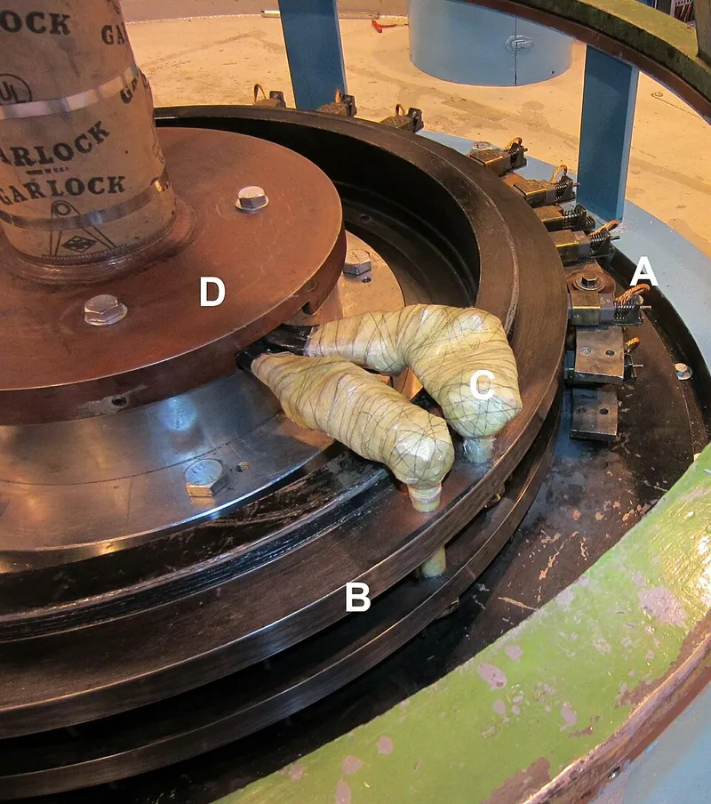

<figure class="eoc-pic eoc-pic-main"><picture><source media="(prefers-reduced-motion: reduce)" srcset="../media/drawn/slip-ring-and-rotary-union.svg"></picture><figcaption><strong>Animation.</strong> Diagram drawn for the encyclopaedia from the research notes. ⚑ Needs confirming: a drawing can simplify or get details wrong; a real photo or a better diagram is welcome.</figcaption></figure>
<figure class="eoc-pic"><figcaption><strong>Photo.</strong> <a href="https://commons.wikimedia.org/wiki/File:Sliprings_annotated.jpg">Sliprings annotated</a> by Wtshymanski, <a href="https://creativecommons.org/licenses/by-sa/3.0">CC BY-SA 3.0</a>, from Wikimedia Commons.</figcaption></figure>

A slip ring passes electric power and signals from a stationary part to a continuously rotating one through springy contacts (brushes) rubbing on rings, and a rotary union does the same for liquids, air or vacuum through seals between a fixed housing and a turning shaft, so the rotating part can turn forever without its cables or hoses winding up.

**In plain words:** A turning joint with rings and sliding contacts inside (or sealed channels, for liquids and air) that lets electricity, signals or fluid pass from a fixed part to a part that keeps spinning, so the wires or hoses never get twisted up. **Proper term:** Slip ring (rotary electrical joint) and rotary union (rotary joint for fluids).

**Also called:** slip ring, collector ring, rotary electrical interface, rotating electrical connector, collector, swivel, electrical rotary joint, electric swivel (Wikipedia; Moog); capsule slip ring (small closed unit on the end of a shaft), through-bore or hollow-shaft slip ring (with a hole down the middle), pancake slip ring (rings on a flat disc) (Wikipedia; TME Systems); mercury-wetted slip ring (contacts wetted by liquid metal; Mercotac (brand)) (Wikipedia); fibre-brush slip ring (Wikimedia Commons); wireless or contactless slip ring, rotary transformer (passes power and data through a magnetic field) (Wikipedia); fibre optic rotary joint, FORJ (for high-speed data; Moog); rotary union, rotating union, rotary joint, rotating joint, swivel union, rotary coupling, rotorseal, pneumatic or air rotary union, hydraulic coupling, coolant union, water swivel ⚑ [uncertain] (Wikipedia, Rotary union); one-way-flow and two-way-flow rotary joints, rotary joint manifold (McMaster-Carr family names); clock spring, spiral cable (the limited-turn alternative in car steering wheels; Wikipedia, Clockspring); cord untangler (telephone handset cord swivel; Wikimedia Commons), detangler or gyro (BMX brake-cable swivel; Wikipedia, Detangler).

## How it works

In a slip ring each circuit has its own continuous metal ring on the turning part, and a stationary brush (graphite or metal) is pressed against it by a spring; the current flows through the sliding contact, so the connection holds at any angle and for any number of turns (Wikipedia). More circuits are simply more rings stacked along the shaft. A rotary union works the same way for fluid: the fluid enters a fixed housing, passes into a groove or chamber that runs all the way round the shaft, and flows into a hole drilled in the turning shaft, while seals either side stop it leaking out; multi-passage unions have several chambers separated by seals (Wikipedia, Rotary union). Wireless versions replace the rubbing contacts with facing coils (a rotary transformer), which don't wear but carry much less power (Wikipedia, Slip ring).

## Parts

A small assembly that acts as one unit. Slip ring: a rotor carrying a stack of insulated metal rings (e.g. brass, gold-plated), a stator carrying one spring-loaded brush or wire contact per ring, bearings, a housing, and colour-coded lead wires on each side (Wikipedia; Hackaday teardown article; Adafruit). Rotary union: a housing with inlet port(s), a shaft with passages, one or more bearings, and one or more seals (face seals, lip seals or [O-rings](../glossary.md#o-ring)) (Wikipedia, Rotary union). Combined units stack slip rings, fluid passages and fibre optic joints in one body (Moog; Wikipedia).

## Everyday examples

- Car alternators, wound-rotor motors, wind turbines and generators, which feed the spinning part through slip rings (Wikipedia, Slip ring; Wikimedia Commons hydroelectric generator photo)
- Ferris wheels, aerodrome beacons, radio telescopes and rotating signs (Wikipedia, Slip ring; McMaster-Carr)
- Automatic car washes, whose spinning brushes are fed detergent water through rotary unions (Wikipedia, Rotary union)
- A car's steering-wheel clock spring, a spiral flat cable that does the same job for a limited number of turns (Wikipedia, Clockspring)
- The swivel 'untangler' on a telephone handset cord (Wikimedia Commons)

## When to use it

Use a slip ring when something must keep turning the same way while powered or sending signals: robot turrets and spinning lidar heads, camera motion-control rigs, motorised turntables with lights, spinning clocks and displays, cable reels that stay connected while unwinding (Hackaday; Adafruit; Printables 950300). Use a rotary union when a liquid, air or vacuum has to reach a turning part: car-wash brushes and spinners, coolant or air through a machine-tool spindle, rotary index tables and chucks, swivelling hose connectors (Wikipedia, Rotary union; GTI Spindle; Printables 386782). They avoid the weight, bulk and [fatigue](../glossary.md#fatigue) of cable loops (TME Systems).

## When not to use it

If the part only turns part of a revolution, or a few turns back and forth, use a cable loop, clock-spring (spiral) cable or a bidirectional cable chain; they are cheaper and have no sliding contacts to wear or add noise (Chief Delphi; Wikipedia, Clockspring). For very high speed or fast data, use a contactless (inductive) coupler or a fibre optic rotary joint (Wikipedia, Rotary transformer; Moog). Don't feed high motor currents through tiny capsule rings (2 A per ring; Adafruit). For a battery-powered rotating part that only needs occasional data, put the battery on the rotating side and use a wireless link instead ⚑ [uncertain]. A clockspring is 'a flat multicore cable wound in a spiral shape' inside a drum, which winds and unwinds as the part turns, as behind a car's steering wheel (Wikipedia 'Clockspring'); a car's clockspring typically gives about five full turns from one end stop to the other and must be fitted at the middle of its travel, or the ribbon stretches and breaks at full lock (YouCanic).

## Details

- **What it does (jobs):**
  - seal it, or pass cables or fluid through: carries power, signals or fluid across a turning joint
  - let it move (turn, slide or bend): lets the joint keep turning in the same direction without limit
- **Movement:** rotate: continuous, unlimited turns in either direction (hobby capsule slip rings are rated 0-300 rpm; Adafruit; SRC012/SRC022 data sheets)
- **Directions it can move (degrees of freedom):** 1: rotation about the shaft; the unit's own small bearings keep the rings centred but are not meant to carry the machine's loads (Canyon Components; Hackaday comments)
- **Special behaviour:**
  - none: its clever trick, endless turning without twisting the wires or hoses, isn't one of the listed behaviours (Wikipedia: a slip ring allows unlimited rotations, whereas a slack cable can only be twisted a few times before it binds)
- **How it holds:**
  - not a holding joint (it moves or passes on motion): it passes current or fluid across a turning joint
  - spring force (a spring or springy part presses it in place): the brushes are pressed onto the rings by springs (Wikipedia; Hackaday: 'gold-plated spring contacts')
- **Input and output:** not applicable: it passes electricity, signals or fluid rather than motion; it adds a little drag (starting and running [torque](../glossary.md#torque)) that the drive motor must overcome (TME Systems)
- **Power:** passive (no power needed): it carries power and signals but needs none to work; if the supply is lost, the rotating side simply loses power
- **Load:** light: carries current and signals, not mechanical load. A hobby capsule ring carries 2 A per circuit at up to 240 V (Adafruit, SRC022/SRC012 data sheets), though Hackaday's review of a teardown called a small unit's mains-voltage claim 'wishful thinking'. Robot-size rings with 30 A per contact exist (Chief Delphi). The rings' own bearings should not carry side loads: mount the rotating part on its own bearing and let the slip ring only follow it (Canyon Components for rotary O-ring seals; Hackaday reader comments).
- **Play and precision:** small: capsule units have little play but must be mounted on the axis of rotation; mounting one off-centre makes the leads flex every turn (Chief Delphi). Electrical 'noise' (resistance change while turning) is under 0.01 ohm for hobby capsules (SRC022 data sheet). Rotary unions need low runout: side-loading from stiff hoses or a mismatched mounting face causes runout and seal wear (GTI Spindle); O-ring rotary seals allow only about 0.002-0.003 in of eccentricity (Canyon Components).
- **Taking it apart:** removable: capsule slip rings are held by a flange with screws and their leads go to connectors or terminals; rotary unions screw onto the shaft end and their hoses unscrew
- **How often it can be reused:** many times
- **Sealing:** airtight or pressure (rotary union: seals hold liquid, air or vacuum; industrial unions reach 1,000 bar and 40,000 rpm, Moog; a small amount of leakage is normal in some designs, GTI Spindle). Slip rings themselves range from unsealed hobby capsules to IP65/IP67 sealed units for dust and water (TME Systems)
- **Adjustable:** no
- **Access needed:** end of a tube or shaft: capsule slip rings and most rotary unions fit on the end of the axis of rotation; through-bore slip rings slide over a shaft or round a central hose (TME Systems)
- **Materials:** Slip rings: precious-metal (gold-plated) contacts, brass or copper rings, graphite or metal brushes, engineering-plastic housings, FEP-insulated silver-plated leads (SRC012/SRC022 data sheets; Wikipedia; Hackaday). Rotary unions: stainless steel or aluminium housings, ball or tapered roller bearings or bronze or graphite bushings, and elastomer, face or lip seals chosen for the fluid, pressure, speed and temperature (Wikipedia, Rotary union; Moog). DIY: copper pipe rings with motor carbon brushes (Printables 1071530), ball bearings used as rotating contacts (Printables 103824, 162154), copper sheet and guitar-string wipers (Hackaday).
- **Heat, cold, water and wear:** Hobby capsule slip rings: -20 to +80 °C, 0-300 rpm (SRC012/SRC022 data sheets); running faster shortens life and adds noise (Adafruit). Dust wears brush contacts and industrial units need IP65/IP67 sealing in dusty or wet places (TME Systems). Mercury-wetted rings freeze at about -40 °C (Wikipedia). Rotary union life falls with speed, pressure, heat, dirty fluid and pressure pulses (GTI Spindle); O-ring rotary seals are not usually used below -40 °C or above 121 °C (Canyon Components). Printed parts: PLA gives at about 60 °C and PETG at about 80 °C (CNC Kitchen); friction in rotary seals generates heat (Canyon Components).

## Making it

- **Ways to make or get it:**
  - off-the-shelf part: capsule and through-bore slip rings (6 to 36 circuits), pneumatic and water rotary unions, combined electrical and pneumatic units
  - 3D print (FDM): housings, ring carriers and mounts for DIY slip rings (with copper pipe rings, brushes or ball bearings), mounts for bought slip rings, swivelling low-pressure hose adapters (e.g. vacuum hose swivels)
  - CNC: machined shafts and housings for rotary unions ⚑ [uncertain]
- **Printing it in one piece (print in place):** no: printed slip rings combine printed carriers with metal rings, brushes, bearings and wires, assembled by press-fitting and soldering (Printables 103824; Printables 1071530)
- **Tools:** Screwdriver or hex keys for the flange; soldering iron or crimp tool for the lead wires; spanners and thread sealant for rotary union ports ⚑ [uncertain]. DIY slip rings: pipe cutter, soldering iron and a press or hammer for press-fitting (Printables 103824).
- **Difficulty:** moderate: a bought capsule slip ring is easy to fit (screw on the flange, solder the leads), but designing the turning joint round it and making your own reliable contacts or a leak-free fluid union is hard

### 3D printing tips

1) Buy the contacts: hobby capsule slip rings are cheap and well-sealed compared with DIY contacts; print a mount that holds the rotating part on its own bearing and lets the slip ring only follow it (Hackaday reader comments: a capsule unit has no hole for an axle, so either use it as the axle end or mount it on a hollow shaft or in the hole of a lazy-Susan bearing). 2) Mount it exactly on the axis; a ring mounted off-centre makes its leads flex on every turn (Chief Delphi). 3) DIY rings: 3/4 in copper pipe cut into 4 mm rings on a pipe cutter, pressed onto a printed bush, work as ring contacts; solder the wires to the copper before press-fitting, because soldering afterwards distorts the plastic (Printables 103824). Using ball bearings' outer races as contacts with plain wire or screw contacts works for light duty but loses contact under vibration (Printables 103824). Copper pipe with small motor brushes makes a simple two-conductor ring (Printables 1071530). Copper sheet with guitar-string wipers worked but with noticeable friction (Hackaday, double pendulum). 4) For a few low-current circuits, a quality audio jack and plug can act as a slip ring (Hackaday, 2020 and 2025). 5) Rotary union: seal a turning shaft with O-rings in grooves either side of a groove fed by the inlet; support the shaft on bearings, because the O-ring groove shouldn't act as a bearing; keep the O-ring squeeze low (0-11% for 0.070 in section) and the surface speed low (Canyon Components). Print the sealing bore smooth and grease the O-rings, as for other printed O-ring seals (Prusa blog, Watertight 3D printing part 2); printed rotary unions for real pressure weren't found ⚑ [uncertain]. 6) Low-pressure air such as dust extraction can simply use a printed swivel collar (Printables 386782: a 360° swivelling vacuum connector, best in PETG).

### Buying one (off-the-shelf parts)

Search for: 'slip ring', 'capsule slip ring', 'miniature slip ring 12 wire', 'slip ring with flange 22 mm' (Adafruit), 'through bore slip ring' or 'hollow shaft slip ring', 'pancake slip ring', 'Ethernet slip ring', 'USB slip ring', 'fibre optic rotary joint (FORJ)' (Moog), 'mercury slip ring' (Mercotac (brand)), 'contactless slip ring' or 'inductive rotary coupler'. Fluid: 'rotary union', 'rotary joint', 'pneumatic rotary union', 'one-way-flow rotary joint', 'two-way-flow rotary joint', 'rotary joint manifold' (McMaster-Carr), 'electro-pneumatic slip ring' or combined slip ring and rotary union (Moog offers combined units) ⚑ [uncertain]. Alternatives: 'clock spring' (steering wheel), 'bidirectional cable chain' or 'twister chain' for turrets (Chief Delphi; Printables 919579).

## Rules of thumb

- Hobby capsule slip rings (Prosper SRC012 and SRC022 series, sold by Adafruit): 2 A per ring, 240 V AC/DC rated, 0-300 rpm, electrical noise under 0.01 ohm, -20 to +80 °C, AWG 26-28 leads; the 12-circuit, 22 mm unit is 28 mm long, the 12 mm miniature is 19.5 mm long (Adafruit product pages; SRC012 and SRC022 data sheets).
- Do you really need endless rotation? To point in any direction a turret only needs +/-180°, which halves the cable length needed for a simple service loop (Chief Delphi, 'Service Loop for Turret').
- Rate every ring for the full current of its circuit; FRC rules require the whole electrical path, slip ring included, to be rated for the breaker, and a 2015 FRC answer accepted two 30 A slip-ring legs in parallel on a 40 A breaker (Chief Delphi, 'Slip Rings', quoting FRC rule R58 and Q&A 85).
- Keep motor power circuits apart from signal circuits in the slip ring, shield feedback signals, and allow for voltage drop across the contacts (TME Systems guide). For fast data (Ethernet, video) use slip rings made for it or a fibre optic rotary joint (Moog; TME Systems).
- Rotary O-ring seals: surface speed (ft/min) = 0.26 x shaft diameter (in) x rpm; for a 0.070 in cross-section O-ring the limit is 200-1500 ft/min, for 0.103 in 200-600, for 0.139 in 200-400; squeeze only 0-11%; [clearances](../glossary.md#clearance) assume 80 Shore A O-rings and no more than 800 psi; not usually for below -40 °C or above 121 °C (Canyon Components, rotary groove guide).
- Rotary unions wear out through their seals: filter the fluid to 50 microns or finer, avoid side-loading from hoses, pressure spikes, running dry or over the rated rpm, and expect a little leakage by design in some types (GTI Spindle, citing Advanced Machine and Engineering).
- Mercury-wetted slip rings stop working below about -40 °C, when mercury freezes, and bring toxicity concerns (Wikipedia, Slip ring).
- Wireless (inductive) slip rings don't wear but carry far less power than a contact ring of the same size (Wikipedia, Slip ring).

## Common failures

Brush and ring wear causing electrical noise, flickering or data errors, especially with dust or at high speed (TME Systems; Wikipedia, Rotary transformer: slip rings suffer friction, wear and intermittent contact). DIY contacts losing touch under vibration (Printables 103824) or rubbing with high friction (Hackaday, double pendulum). Low-current contacts flickering: one maker found the more current flowing, the more even the contact, so too few LEDs flickered (Printables 47896) ⚑ [uncertain]. Lead wires fatiguing when the slip ring is mounted off-axis (Chief Delphi). A slip ring used as the axle and bent by side loads (Hackaday comments). Rotary unions: worn seals from dirty fluid, side-loaded hoses, running dry or overspeed, then leaks (GTI Spindle).

## Safety

Mains voltage through a small capsule slip ring is risky: Hackaday called one small unit's mains rating 'wishful thinking'; use extra-low voltage where you can and enclose DIY rings with exposed copper contacts ⚑ [uncertain]. Mercury-wetted slip rings contain toxic mercury (Wikipedia). Rotating machinery has pinch and entanglement points, and a turret with endless rotation can wrap loose cables round itself if wired wrongly ⚑ [uncertain]. Pressurised rotary unions can leak or spray the working fluid (GTI Spindle).

## Related

- Cable through a hinge: a service loop, a cable along the pivot axis, or a clockspring (spiral flat cable) for joints that turn less than a full turn or only a few turns; cheaper, with no sliding contacts (Chief Delphi; Wikipedia, Clockspring)
- Bidirectional (twisting) cable chain: guides cables round a turret for limited rotation (Printables 919579; Chief Delphi)
- Rotary transformer (contactless slip ring): passes power and data through coils without wear, but less power (Wikipedia)
- Fibre optic rotary joint: passes light signals for very fast data (Moog)
- Audio jack and plug used as a slip ring: a cheap hack for a few low-current circuits (Hackaday)
- Turntable bearing (lazy Susan, slewing ring): carries the turning platform's load; its large centre hole is where a through-bore slip ring or rotary union often sits
- Cable [gland](../glossary.md#gland): seals a cable where it passes through a fixed wall, rather than a turning joint
- Detangler: the mechanical (cable-pull) equivalent for BMX brake cables (Wikipedia)
- Flat flexible cable and latching connector: thin flat cable made for places where wiring flexes again and again; a clockspring is a flat multicore cable wound into a spiral (Wikipedia, Flexible flat cable; Clockspring)

## Make it yourself

- [Slip Ring (Glenn, Printables; URL from search results, details read through the Printables API)](https://www.printables.com/model/1071530-slip-ring): A printed two-conductor slip ring made with 1/2 in copper pipe and small motor brushes; OpenJSCAD source on GitHub (gharris012/SlipRing) *(licence: CC BY)*
- [Robust 2 pole Slip ring - Horizontal mount (Flex, Printables) (URL from Printables API, page not opened)](https://www.printables.com/model/103824-robust-2-pole-slip-ring-horizontal-mount): A vibration-resistant DIY slip ring using ball bearings and 3/4 in copper pipe rings on a printed bush, with build notes *(licence: CC BY-SA)*
- [2-4 Pole slip ring - horizontal and vertical mount (Flex, Printables) (URL from Printables API, page not opened)](https://www.printables.com/model/162154-2-4-pole-slip-ring-horizontal-and-vertical-mount): An upgraded 2-4 pole version using 20 mm copper pipe electrodes and 18x12x4 mm bearings that also acts as the load bearing *(licence: CC BY-SA)*
- [Bidirectional Cable Chain for Rotational Systems (Lndnny, Printables) (URL from Printables API, page not opened)](https://www.printables.com/model/919579-bidirectional-cable-chain-for-rotational-systems): A printable twisting cable chain for turrets with limited rotation, the main alternative to a slip ring (used by FRC teams, Chief Delphi) *(licence: CC BY-NC-SA)*
- [90° swivel vacuum connector for Dewalt miter saw (Maarten Vlug, Printables) (URL from Printables API, page not opened)](https://www.printables.com/model/386782-90deg-swivel-vacuum-connector-for-dewalt-miter-saw): A printed 360° swivelling hose connector, the simplest low-pressure 'rotary union' for dust extraction; STEP files included *(licence: CC BY-SA)*

## Pictures, videos and models

- [File:Sliprings annotated.jpg (Wikimedia Commons)](https://commons.wikimedia.org/wiki/File:Sliprings_annotated.jpg): Slip rings on a hydroelectric generator: spring-loaded graphite brushes on steel rings, labelled *(licence: CC BY-SA 3.0 (Wtshymanski))*
- [File:Slip-rings-fiber-brush.png (Wikimedia Commons)](https://commons.wikimedia.org/wiki/File:Slip-rings-fiber-brush.png): Illustration of a fibre-brush slip ring: bundles of fine wires rubbing on a stack of rings *(licence: CC BY-SA 4.0 (Servotecnica))*
- [File:Rotary-union-components.jpg (Wikimedia Commons)](https://commons.wikimedia.org/wiki/File:Rotary-union-components.jpg): The components that make up a rotary union *(licence: CC BY-SA 4.0 (Hotshot6902))*
- [6-circuit slip-ring teardown (YouTube, bigclivedotcom; title confirmed through YouTube oEmbed, video not watched; described in Hackaday's 'What's In A Slip Ring?')](https://www.youtube.com/watch?v=XTPcSdeAd2Q): Teardown of a small capsule slip ring: a rotor with six brass rings on small bearings and a set of gold-plated spring contacts *(licence: link only (standard YouTube licence))*
- [Slip Ring with Flange - 22mm diameter, 12 wires, max 240V @ 2A (Adafruit)](https://www.adafruit.com/product/1196): Photos and a video of a typical hobby capsule slip ring, with ratings and data sheet *(licence: link only)*

## Needs confirming

⚑ marks something nobody has confirmed yet: a fact the research could not confirm from a source, a finder value that is a best guess, or an open point from the research notes. Corrections are welcome (see `research/needs-confirming.md`).

- ⚑ 9 sentences on this page marked [uncertain].
- ⚑ Finder value `connects` = wires (best guess): worked out from its name, but joining parts is not one of its two main jobs
- ⚑ Finder value `electrical_band` = not applicable (best guess): tagged electrical, but `load` does not start with the fixed electrical lead-in
- ⚑ Finder value `tools` = soldering iron, crimper, press or vice, hand tools (source uncertain): `tools_needed` is marked ⚑ [uncertain] here: "…or the lead wires; spanners and thread sealant for rotary union ports ⚑ [uncertain]. DIY slip rings: pipe cutter…"
- ⚑ Research note: **For a later pass:** *Slip ring and rotary union* (135) and *Genderless connector* (286) are tagged with the electrical family, but their `load` doesn't start with the fixed electrical lead-in. *Anti-twister mechanism* (291) still lists `materials` in `uncertain` without a marker (noted earlier). The underwriter's knot in *Cable gland and strain relief* (134) is described without tying steps, under the mains rule.

## Sources

- <https://en.wikipedia.org/wiki/Slip_ring>
- <https://en.wikipedia.org/wiki/Rotary_union>
- <https://en.wikipedia.org/wiki/Clockspring>
- <https://en.wikipedia.org/wiki/Rotary_transformer>
- <https://en.wikipedia.org/wiki/Detangler>
- <https://www.adafruit.com/product/1196>
- <https://www.adafruit.com/product/1195>
- <https://cdn-shop.adafruit.com/datasheets/SRC012.pdf>
- <https://cdn-shop.adafruit.com/datasheets/SRC022A-6.pdf>
- <https://hackaday.com/2023/06/19/whats-in-a-slip-ring/>
- <https://hackaday.com/2019/11/15/double-pendulum-uses-custom-slip-rings/>
- <https://hackaday.com/tag/slip-ring/>
- <https://hackaday.com/tag/slip-rings/>
- <https://www.chiefdelphi.com/t/slip-rings/160095>
- <https://www.chiefdelphi.com/t/service-loop-for-turret/375005>
- <https://www.chiefdelphi.com/t/turret-cable-managment/514135>
- <https://sliprings.com.au/blog/selecting-a-slip-ring-for-robotic-arm-applications-a-technical-guide/>
- <https://www.moog.com/products/slip-rings.html>
- <https://www.moog.com/products/fluid-rotary-union.html>
- <https://gtispindle.com/blog/monitoring-rotary-unions-avoid-spindle-failure/>
- <https://www.canyoncomponents.com/dynamic-rotary-design>
- <https://www.mcmaster.com/products/rotary-unions/>
- <https://www.mcmaster.com/products/slip-rings/>
- <https://blog.prusa3d.com/watertight-3d-printing-part-2_53638/>
- <https://www.cnckitchen.com/blog/comparing-pla-petg-amp-asa-feat-prusament>
- <https://commons.wikimedia.org/wiki/Category:Slip_rings>
- <https://commons.wikimedia.org/wiki/File:Sliprings_annotated.jpg>
- <https://commons.wikimedia.org/wiki/File:Slip-rings-fiber-brush.png>
- <https://commons.wikimedia.org/wiki/File:Rotary-union-components.jpg>
- <https://commons.wikimedia.org/wiki/File:Untangler.jpg>
- <https://www.youtube.com/watch?v=XTPcSdeAd2Q>
- <https://api.printables.com/graphql/>
- <https://www.youcanic.com/properly-set-a-new-clock-spring/>
- <https://en.wikipedia.org/wiki/Flexible_flat_cable>
