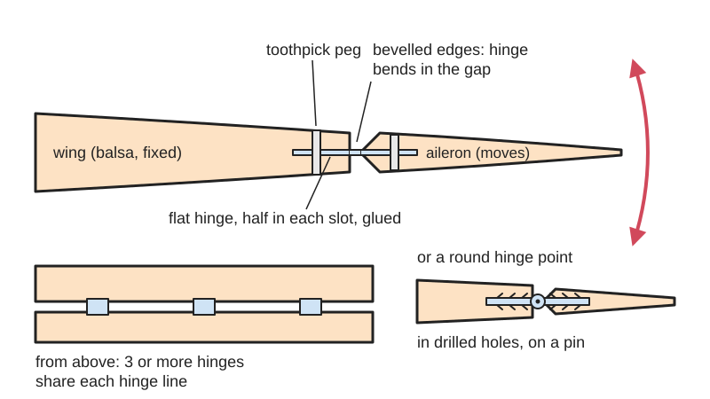
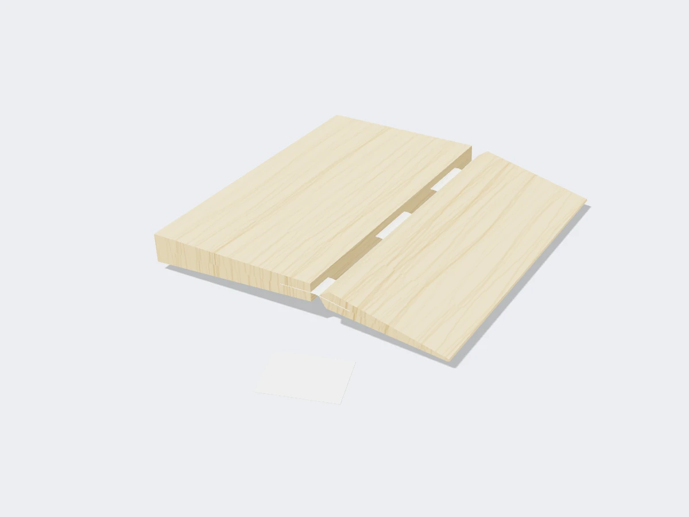
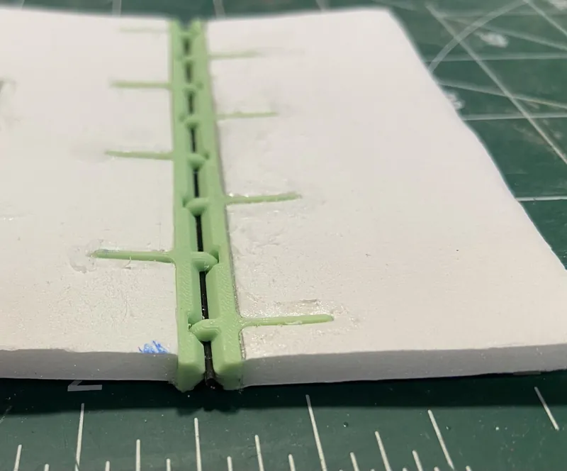
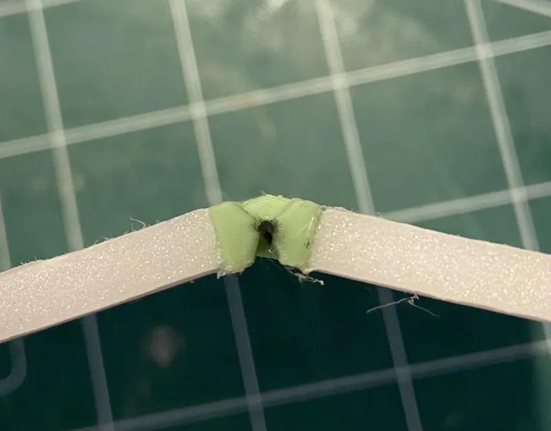

<figure class="eoc-pic eoc-pic-main"><picture><source media="(prefers-reduced-motion: reduce)" srcset="../media/drawn/slot-in-model-hinge.svg"></picture><figcaption><strong>Animation.</strong> Diagram drawn for the encyclopaedia from the research notes. ⚑ Needs confirming: a drawing can simplify or get details wrong; a real photo or a better diagram is welcome.</figcaption></figure>
<figure class="eoc-pic"><figcaption><strong>Cut-away render.</strong> A 3D model made for the encyclopaedia, not a photo: a real one is shown below. ⚑ Needs confirming: a model can simplify or get details wrong.</figcaption></figure>
<figure class="eoc-pic"><figcaption><strong>How it works.</strong> <a href="https://www.printables.com/model/1335388-dtf-control-surface-hinge-for-rc-airplanes">DTF Control Surface Hinge for R/C Airplanes</a> by Uenbzsto, <a href="https://creativecommons.org/licenses/by/4.0/">CC BY 4.0</a>, from Printables.</figcaption></figure>
<figure class="eoc-pic"><figcaption><strong>How it works.</strong> <a href="https://www.printables.com/model/1335388-dtf-control-surface-hinge-for-rc-airplanes">DTF Control Surface Hinge for R/C Airplanes</a> by Uenbzsto, <a href="https://creativecommons.org/licenses/by/4.0/">CC BY 4.0</a>, from Printables.</figcaption></figure>

Hinges for radio-controlled model planes that are pushed into matching slits or drilled holes along the edges of a wing (or tail) and its moving flap and glued in, giving a hidden, screw-free pivot along the hinge line.

**In plain words:** Little flat or round hinges pushed into slits or holes cut into the edge of a model plane's wing and its flap, then glued, so the flap swings with no screws and the hinge is hidden inside. **Proper term:** Slot-in model hinge (flat hinge, CA hinge, pinned hinge, hinge point).

**Also called:** CA hinge (cyanoacrylate hinge): a fibre- or paper-covered Mylar flat hinge glued with thin superglue (Airfield Models); flat hinge; pinned hinge / pin hinge / pinned nylon hinge: a flat hinge with a real metal pin, 'much like door hinges' (Flite Test); hinge point / round hinge point / barbed hinge point: a round hinge set in drilled holes; 'Robart Hinge Point' (brand); poly hinge or polypropylene hinge (a one-piece flat hinge with a stamped flex line; also called 'live' hinge in model shops); Du-Bro pinned hinges, Hayes poly hinges (brands); control-surface hinge, aileron hinge, elevator hinge, rudder hinge; pegged or pinned-in hinge (a hinge locked in with a toothpick through it).

## How it works

Each hinge has two halves, one buried in the fixed surface (wing, tailplane or fin) and one in the moving control surface (aileron, elevator or rudder), with the bend or pin exactly on the gap between them. A CA hinge is a strip of Mylar with thin cloth or paper laminated to each side; thin superglue soaks (wicks) into the porous covering and the surrounding wood and locks it in, and the Mylar itself bends as the hinge (Airfield Models). Pinned flat hinges and round hinge points turn on a real pin, so the line they turn about can be set into the surface like on a full-size plane (Airfield Models). Because many small hinges share the load along the hinge line, the surface stays on even if one weakens, and a toothpick or pin pushed through each leaf means the hinge 'will never pull out without taking other parts with it' (Airfield Models).

## Parts

A few parts: a row of 3 or more small hinges along each hinge line, each one either a flat leaf (CA hinge, poly hinge or pinned nylon hinge) or a round barbed 'hinge point' with a pin in the middle, plus the glue (thin CA, slow epoxy or a purpose-made hinge glue) and sometimes a toothpick or pin through each leaf to lock it in.

## Everyday examples

- the ailerons, elevator and rudder of a balsa or foam radio-controlled model plane
- the flaps on a ready-to-fly (ARF) kit plane, where the hinges come pre-installed in slits
- rudders on model boats and moving flaps on models, using the same small hinges ⚑ [uncertain]

## When to use it

For control surfaces on balsa, plywood, foam and printed model planes where you want a neat, hidden, screw-free hinge line. Choose hinge points for thick balsa surfaces (Airfield Models' favourite: 'strong, reliable and very easy to use'), pinned flat hinges for thin or tapered surfaces and fun-fly planes with lots of power and vibration (Model Airplane News), and CA hinges where speed and very thin slots matter (Airfield Models: the slot can be made just by pushing in a hobby knife).

## When not to use it

On very thin surfaces too thin for a flat hinge, use film, sewn or tape hinges instead (Airfield Models; see Tape hinge). On narrow, highly tapered surfaces hinge points may break through the skin (Airfield Models). On light foam electric models a tape hinge or the foam's own cut 'live' hinge is lighter and simpler (Flite Test; Model Aviation). Where the surface must come off for transport, use a removable long hinge pin or a screwed hinge (Stunt Hangar forum; see Knuckle hinge). Airfield Models advises against CA hinges altogether because of their failure record and flex.

## Details

- **What it does (jobs):**
  - let it move (turn, slide or bend): it lets a control surface swing up and down or side to side
  - join and hold: it also holds the moving surface onto the wing or tail
  - glue or bond: each hinge is glued into its slot or hole
- **Movement:** rotate; typically up to about +/-45 to 50 degrees of flap swing, set by the hinge and the bevel cut on the edges (e.g. the printable DTF hinge allows 'more than 50 degrees in both directions') ⚑ [uncertain]
- **Directions it can move (degrees of freedom):** 1: the flap turns about the hinge line; CA and poly hinges also let the flap flex slightly up and down if the gap is wide (Airfield Models), which is unwanted
- **Special behaviour:**
  - none: it is a plain pivot with no lock, clicks or spring; stiff poly hinges add a little centring [stiffness](../glossary.md#stiffness) and CA hinges a little spring-back (Airfield Models; Stunt Hangar forum)
- **How it holds:**
  - [material bond](../glossary.md#form-fit--force-fit--material-bond) (glue, solvent or melting): the hinge leaf is glued into its slot or hole with thin CA, slow epoxy or a purpose-made hinge glue
  - shape (the parts interlock; form-fit): the barbs on hinge points, the holes through pinned hinges and any toothpick peg through the leaf key the hinge mechanically into the glue and wood (Airfield Models; Flite Test)
  - not a holding joint (it moves or passes on motion): the pin or bending strip itself is the pivot
- **Input and output:** not applicable
- **Power:** passive (no power needed)
- **Load:** light: carries the air loads on a model's control surfaces. Strong in the plane of the surface (pull-out and [shear](../glossary.md#peel-vs-shear)) when properly glued and pegged; weakest in pull-out if badly glued, and CA hinges can delaminate or break (Airfield Models). No published pull-out figures found ⚑ [uncertain]
- **Play and precision:** small for pinned hinges and hinge points ('slop-free', Gator RC on Du-Bro pinned hinges); noticeable flex for CA hinges, which need a wider gap that lets the surface move up and down (Airfield Models). The hinges must all sit on one straight centred line or the surface binds; hinges glued into both sides at once nearly always end up misaligned (Airfield Models)
- **Taking it apart:** permanent: CA bonds so hard to nylon hinges that 'the hinges cannot be removed without taking out wood with 'em' (Stunt Hangar forum); old hinge points have to be dug out with a knife (Airfield Models). Some builders use one long removable wire hinge pin so a surface can come off (Stunt Hangar forum)
- **How often it can be reused:** once (glued in); the hinge itself flexes thousands of times in use
- **Sealing:** none: the hinge line leaks air unless it is sealed with a strip of tape or iron-on film along one side (Airfield Models)
- **Adjustable:** no: the hinge line is fixed once glued; throw is adjusted at the control horn and pushrod instead
- **Access needed:** both sides: the edges of both the fixed and the moving surface must be open to cut slots or drill holes before the surfaces are joined; CA wicking holes are drilled from the face of the surface
- **Materials:** Hinges: Mylar with cloth or paper (CA hinges; Gator RC sells woven-paper ones 0.3 mm thick), polypropylene (poly hinges), nylon with a steel pin (pinned hinges), nylon or plastic hinge points with a metal pin. Surfaces it suits: balsa and light plywood (the classic use), foam (EPO, EPP, Depron, foam board) with foam-safe glue, and 3D-printed or LW-PLA surfaces with printed slots. Glue: thin CA wicks into balsa and CA hinges; ordinary CA can 'eat through' foam, so use foam-safe CA on foam (Motion RC; BSI says even its flexible CA 'can not be used on white foam' (EPS)); slow epoxy for hinge points, but epoxy does not stick to the plastic of hinge points and holds only by the barbs (Airfield Models); Foam-Tac (brand, a flexible contact glue) for EPO, EPP and Depron but not EPS according to Motion RC (Model Aviation's tester found it did not dissolve EPS or XPS)
- **Heat, cold, water and wear:** Glue limits apply: ordinary CA attacks foam (Motion RC; foldnfly), CA is [brittle](../glossary.md#brittle--ductile) on flexing joints (Motion RC), and tape hinges lose adhesion with age and are not fuel-proof (Flite Test; Model Aviation). Engine vibration loosens weak hinges, which is why pinned hinges are recommended for powerful fun-fly planes (Model Airplane News). Torn foam 'live' hinges stiffen and tear further; Foam-Tac stays flexible when cured, while epoxy or CA there gives 'a brittle and fragile hinge' (Model Aviation).

## Making it

- **Ways to make or get it:**
  - off-the-shelf part: CA hinges, poly hinges, pinned nylon hinges and hinge points are bought ready-made
  - woodwork: slots cut with a hobby knife or forked slot cutter, holes drilled with a pin vice or drill press in balsa
  - hand work in foam: slits cut with a hobby knife in EPO, Depron or foam board, glued with foam-safe glue
  - 3D print (FDM): printed hinges with tabs that slot into foam board and a carbon-rod pin (DTF Control Surface Hinge, Printables)
- **Printing it in one piece (print in place):** partly: printable model-plane hinges such as the DTF Control Surface Hinge print as two identical leaves that need a 1 mm carbon rod added as the pin; the tabs then go into slots in the foam and are glued (Printables API)
- **Tools:** hobby knife or a hinge slotting tool set (forked slot cutter and clean-out pick) for flat hinges; a pin vice or drill press and a hinge drill guide for hinge points (Airfield Models); a 1/16 in drill for CA wicking holes (BSI); thin CA with a micro tip, slow epoxy or hinge glue; petroleum jelly or light oil for the pin; toothpicks; a small square or triangle to check alignment
- **Difficulty:** moderate: the hinges are cheap and bought ready-made, but every slot or hole must be centred and in line, and the glue kept out of the pivot (Airfield Models: hinging 'must be done accurately' and is 'a skill')

### 3D printing tips

1) A printed hinge with long flat tabs works like a pinned flat hinge: print two copies of the same leaf, turn one round 180 degrees, and use a metal or carbon rod as the pin (DTF Control Surface Hinge uses 1 mm pultruded carbon rod for 4.7 mm foam board) (Printables API). 2) Print the leaves flat so the layers run along the tab; tabs printed upright split between layers ⚑ [uncertain]. 3) Give the pin a [clearance](../glossary.md#clearance) hole so it turns freely, and keep glue off the knuckles (same rule as bought hinges; Airfield Models). 4) For printed (LW-PLA or PLA) wings, design the slots into the print, centred on the hinge line, rather than cutting them later; check the slots line up before gluing (Model Airplane News CA Hinging Help). 5) Superglue fogs and grabs instantly; for printed parts, slow epoxy gives time to align (Airfield Models' reason for using slow epoxy).

### Buying one (off-the-shelf parts)

CA hinges (cloth-, fibre- or paper-covered Mylar, sold in sheets or pre-cut), pinned nylon hinges (e.g. Du-Bro small, medium and large, brand), polypropylene hinges (e.g. Hayes, brand), barbed hinge points (Robart, brand; '1/2A' small size), hinge slotter tool sets, hinge-point drill guides, thin and flexible CA (e.g. BSI Insta-Flex, brand), foam-safe CA and activator, slow-cure epoxy, purpose-made hinge glue (Zap/Pacer hinge glue, discontinued; Zap Canopy Glue as substitute, per Model Airplane News), Foam-Tac (Beacon, brand), hinge-gap sealing tape

## Rules of thumb

- Use at least 3 hinges per surface on a powered sport plane and often 4; 'Two hinges is not enough as if one fails, you will lose the entire surface in flight' (Model Airplane News, Gerry Yarrish)
- Insert a flat hinge to about its halfway point in each side, the typical installation depth (Model Airplane News CA Hinging Help); about 3/4 in deep slots for 1/2 in Du-Bro hinges (Model Airplane News, Gerry Yarrish)
- Drill a 1/16 in hole in the centre of each CA hinge slot so the thin CA saturates the hinge (BSI Insta-Flex product page; also Model Airplane News CA Hinging Help)
- Peg flat hinges: after the glue sets, drill 3/32 in through surface and hinge, push in a round toothpick, trim flush and add a drop of thin CA (Airfield Models); Flite Test describes the same pegging for pin hinges
- Glue the hinges into the control surface first and let the glue [cure](../glossary.md#cure), then glue them into the fixed surface; gluing both in one go 'almost guarantees misaligned hinges' (Airfield Models)
- Use slow-drying epoxy for hinge points, not 5-minute epoxy or CA, and never thin it; put the glue in the hole, not on the hinge (Airfield Models)
- Hinge points need a hole of the right size, e.g. 3/32 in for Robart 1/2A hinge points; don't trust a hinge point cut down to 2 barbs (Airfield Models)
- First bevel the edges to be joined (Model Airplane News, How to Hinge Foamies); leave an even gap set with 1/16 in balsa spacers: too little binds, too much flaps (Model Aviation FAQ, about tape hinges)

## Common failures

1) Glue gets into the pivot and locks the hinge: put glue in the slot, not on the hinge, wipe any ooze away from the pin, and coat the pin area with petroleum jelly or light oil (Airfield Models; Stunt Hangar forum). 2) Misaligned or off-centre slots make the surface bind or sit offset: mark centre lines, sight down the hinge line (Model Airplane News CA Hinging Help), cut both slots together or align with dummy dowels or toothpicks (Airfield Models). 3) CA does not reach deep into the slot, so the hinge pulls out: use fresh thin CA and drill 1/16 in wicking holes (Model Airplane News; BSI). 4) Hinge moves before glue sets: tack it with medium CA, check the mark, then saturate (search result, not opened ⚑ [uncertain]). 5) Too much thin CA wicks into the hinge barrel and ruins it (Stunt Hangar forum). 6) Flutter from loose hinges and wide gaps: keep gaps tight and slots neat (Model Airplane News). 7) CA hinge laminate delaminates or the hinge breaks (Airfield Models). 8) Ordinary CA melts the foam around the slot: use foam-safe glue (Motion RC).

## Safety

A hinge that pulls out in flight loses control of the model, which can then crash into people or property: use at least three hinges per surface (Model Airplane News), peg flat hinges (Airfield Models), and before flying pull firmly on each control surface to check every hinge holds ⚑ [uncertain: common pre-flight check, no opened source]. Thin CA bonds skin instantly and gives off irritating fumes; keep debonder or acetone nearby (Stunt Hangar forum). Hobby knives and slot cutters are sharp. Drill hinge holes with a pin vice for control; a power drill 'drills through balsa so fast that mistakes can be made in the blink of an eye' (Airfield Models).

## Related

- Knuckle hinge (butt hinge): the same kind of pin hinge, but screwed or riveted to the faces of the parts instead of buried in slots
- [Living hinge](../glossary.md#living-hinge): a moulded or cut thin web that bends; foam planes often use the foam's own cut 'live' hinge
- Tape hinge and taped seam: clear or medical tape across the hinge line, lighter but loses grip over time
- Pinned glue joint (pinning): pegging a hinge with a toothpick is the same trick
- Cyanoacrylate (superglue) and Two-part epoxy: the glues used to set the hinges
- Plain pivot (pin in hole): the bare principle behind hinge points
- Cable through a hinge: for wires crossing a hinge line

## Make it yourself

- [DTF Control Surface Hinge for R/C Airplanes (Uenbzsto, Printables) (URL from Printables API, page not opened)](https://www.printables.com/model/1335388-dtf-control-surface-hinge-for-rc-airplanes): Printable slot-in hinge for 4.7 mm foam-board planes in lengths from 100 to 500 mm, with tabs that go into the foam and a 1 mm carbon rod as the pin; more than 50 degrees each way; cutting template included *(licence: CC BY)*
- [Flaps and Alierons hinges for RC Planes (stecrev, Printables) (URL from Printables API, page not opened)](https://www.printables.com/model/1771898-flaps-and-alierons-hinges-for-rc-planes): Printable hinge left hollow so a wire or fishing line can be pushed through as the pin *(licence: CC BY-NC-ND)*

## Pictures, videos and models

- [Hinges for Model Aircraft (Airfield Models, Paul K. Johnson)](https://airfieldmodels.com/information_source/model_aircraft_hardware/hinges.htm): Photo of a Robart hinge point, Du-Bro pinned hinge and Hayes poly hinge side by side; text on CA, pinned, poly and film hinges, sealing gaps and pinning hinges with toothpicks *(licence: link only)*
- [Aligning and Gluing Robart Hinge Points in any Control Surface (Airfield Models)](https://airfieldmodels.com/information_source/how_to_articles_for_model_builders/construction/hinge_points/05.htm): Step-by-step photos: dropping slow epoxy into hinge holes with a toothpick, pushing hinges in, checking them square with a triangle *(licence: link only)*
- [Tips for Installing Strong Hinges (Model Airplane News)](https://www.modelairplanenews.com/installing-hinges-made-easy-tips-from-gerrys-workshop/): Photos of cutting hinge slots with a forked slotter, cleaning them out, recessing the leading edge and fitting pinned hinges *(licence: link only)*
- [RC Plane Hinge Types (Flite Test, 2012)](https://www.flitetest.com/articles/RC_Plane_Hinge_Types): Pin, iron-on and tape hinges explained, including pegging a pin hinge with a toothpick; comments describe CA hinges slotted into foam or balsa *(licence: link only)*
- [Repairing Foam Hinges (Model Aviation)](https://www.modelaviation.com/Repairing-Foam-Hinges): Photos of a torn foam rudder hinge on an EPO plane repaired with flexible foam glue, and why hard glues make brittle hinges *(licence: link only)*

## Needs confirming

⚑ marks something nobody has confirmed yet: a fact the research could not confirm from a source, a finder value that is a best guess, or an open point from the research notes. Corrections are welcome (see `research/needs-confirming.md`).

- ⚑ 6 sentences on this page marked [uncertain].
- ⚑ Research note: *Slot-in model hinge* (426): Airfield Models advises against CA hinges while others use them; Foam-Tac does not work on EPS (Motion RC) versus did not dissolve EPS (Model Aviation's tester). The tug test is [uncertain] (HobbyKing page 403).

## Sources

- <https://www.flitetest.com/articles/RC_Plane_Hinge_Types>
- <https://www.modelairplanenews.com/articles/how-to-hinge-foamies>
- <https://www.modelairplanenews.com/articles/ca-hinging-help>
- <https://www.modelairplanenews.com/installing-hinges-made-easy-tips-from-gerrys-workshop/>
- <https://airfieldmodels.com/information_source/model_aircraft_hardware/hinges.htm>
- <https://airfieldmodels.com/information_source/how_to_articles_for_model_builders/construction/hinge_points/02.htm>
- <https://airfieldmodels.com/information_source/how_to_articles_for_model_builders/construction/hinge_points/03.htm>
- <https://airfieldmodels.com/information_source/how_to_articles_for_model_builders/construction/hinge_points/04.htm>
- <https://airfieldmodels.com/information_source/how_to_articles_for_model_builders/construction/hinge_points/05.htm>
- <https://www.modelaviation.com/Repairing-Foam-Hinges>
- <https://library.modelaviation.com/article/frequently-asked-questions-201002>
- <https://www.motionrc.com/blogs/motion-rc-blog/benchcraft-accessories>
- <https://rcvisions.com/products/bsi-insta-flex%e2%84%a2-flexible-ca-3-8oz>
- <https://www.gator-rc.com/products/gator-rc-ca-hinges-white-paper-10-pcs-20x15x0-3mm>
- <https://www.gator-rc.com/products/dubro-small-pinned-nylon-hinges-pack-of-6-dub118>
- <https://stunthanger.com/smf/building-techniques/installing-hinges/>
- <https://stunthanger.com/smf/building-techniques/ca-hinge-installation>
- <https://www.foldnfly.com/lounge/foam-core-tools-techniques.php>
- <https://api.printables.com/graphql/>
