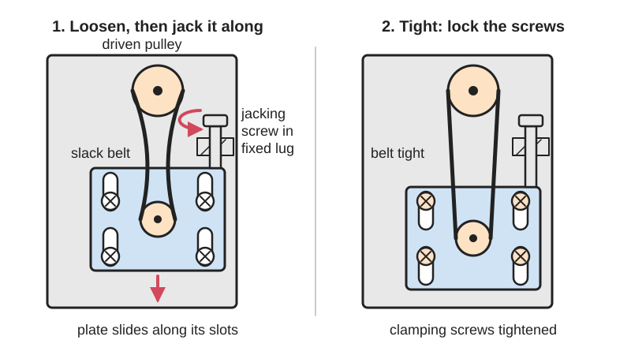
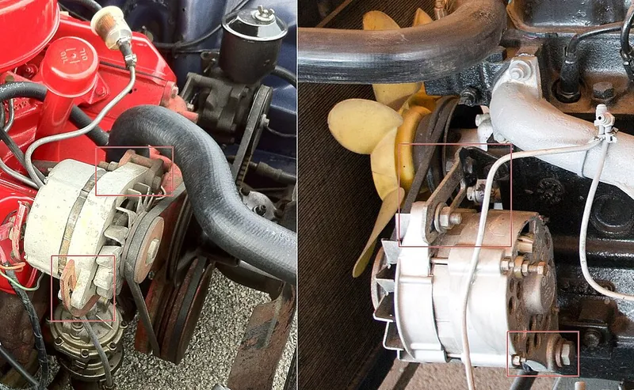
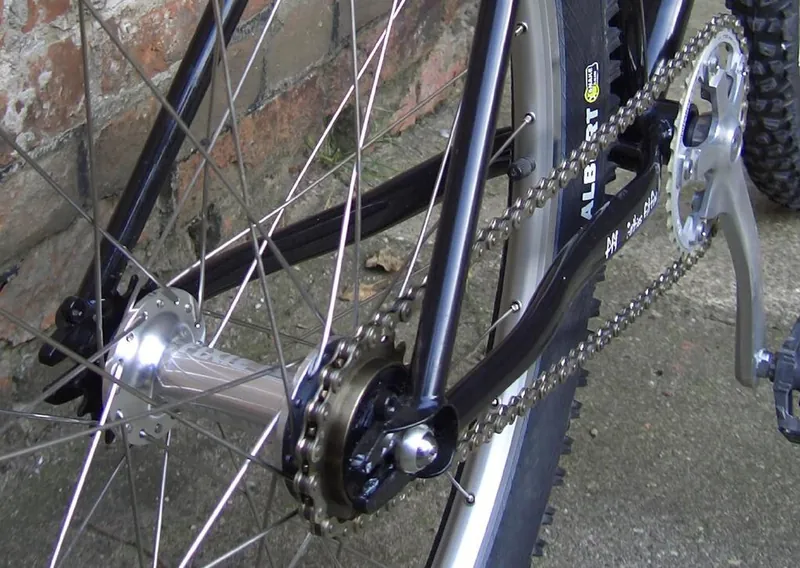

<figure class="eoc-pic eoc-pic-main"><picture><source media="(prefers-reduced-motion: reduce)" srcset="../media/drawn/slotted-adjustment-with-a-jacking-screw.svg"></picture><figcaption><strong>Animation.</strong> Diagram drawn for the encyclopaedia from the research notes. ⚑ Needs confirming: a drawing can simplify or get details wrong; a real photo or a better diagram is welcome.</figcaption></figure>
<figure class="eoc-pic"><figcaption><strong>How it works.</strong> <a href="https://commons.wikimedia.org/wiki/File:Tendeur_courroie_alternateur_automobile.jpg">Tendeur courroie alternateur automobile</a> by CZmarlin — Christopher Ziemnowicz, releases all rights but a photo credit would be appreciated if this image is used any, <a href="https://creativecommons.org/licenses/by-sa/3.0">CC BY-SA 3.0</a>, from Wikimedia Commons.</figcaption></figure>
<figure class="eoc-pic"><figcaption><strong>Photo.</strong> <a href="https://commons.wikimedia.org/wiki/File:Surly_forkends.JPG">Surly forkends</a> by Christoph Laue, Public domain, from Wikimedia Commons.</figcaption></figure>

A part is fixed with screws through slots instead of round holes, so it can be slid to set a belt or chain tension or line it up, usually pushed by a separate adjusting (jacking) screw, and is then locked by tightening the screws.

**In plain words:** Screw holes stretched into slots, so a part such as a motor can be slid along a little and then clamped tight; often a separate screw pushes or pulls it along, so you can tighten a belt or chain and line it up before locking it. **Proper term:** Slotted adjustment with a jacking screw (slotted mount, sliding motor plate, adjustable centres).

**Also called:** slotted holes, slotted mounting holes, elongated holes, oblong slots, short-slotted and long-slotted holes (structural steel terms, RCSC); slotted mount, slotted bracket, sliding motor plate, adjustable motor mount, motor tensioner (3D-printer and robot-kit term); motor slide rails, slide base, adjustable motor base (industrial; automatic motor bases add a spring); jacking screw, jack bolt, jackbolt, pusher screw, adjusting screw, tensioning screw, draw bolt; adjustable centres, adjustable centre distance, take-up, centre-distance allowance (belt and chain drive terms, Gates); chain tug, chain tensioner screw, 'banjo bolt' (BMX), chain adjuster (motorcycles); horizontal dropout, track fork end, rear-facing forkend (bicycles: the axle slides in a slot); pivoting motor plate with an arc slot, alternator adjusting bracket (a hinge plus a curved slot).

## How it works

The clamping screws pass through slots, so while they are loose the part can slide along the slot but not sideways. A jacking screw, threaded through a fixed lug, pushes or pulls the part along a little for each turn, giving a fine, controlled move and stopping it from springing back while you work. When the belt or chain is tight enough, or the part is lined up, the clamping screws are tightened and friction under their heads locks it; the jacking screw also acts as a backstop against the belt's pull. On Prusa's MK3/MK4 X axis you slightly release the motor screws so 'the motor must be able to move', turn the screw at the back of the X-end to tension the belt, then tighten the motor screws again.

## Parts

A few parts: a base, plate or rails with slots (or a part with slotted feet), clamping screws or bolts with washers through the slots, a fixed lug, block or nut with a threaded hole for the jacking screw, the jacking screw itself (often with a lock nut), and sometimes a scale or index marks. The moving part is a motor, an [idler](../glossary.md#idler) pulley, a bearing block or a wheel axle.

## Everyday examples

- a 3D printer's X-axis motor that is slid along to tighten its belt (Prusa MK3/MK4)
- a single-speed or track bike whose rear wheel slides in horizontal fork ends, pulled back by chain tugs (Sheldon Brown glossary)
- a motorcycle's rear axle moved by two adjusting bolts to set chain slack (Honda owner's manual)
- an older car's alternator, swung on a hinge and locked by a bolt in a curved slot to tension the fan belt (Wikimedia Commons photo)

## When to use it

When a belt or chain needs setting up once and re-tightening now and then as it stretches, and you can move one of the shafts (Gates prefers moving a shaft to adding an idler; the Belt tensioner entry agrees); when parts made with loose [tolerances](../glossary.md#tolerance) must be lined up on assembly; when you need more travel than an eccentric bush can give (the Eccentric adjuster entry suggests a slot when you need more than about twice the offset); for prototypes, where you don't yet know the exact centre distance. A jacking screw is worth adding whenever the part is heavy, the belt pull is strong, or you need fine, controlled moves.

## When not to use it

When tension must stay right on its own as a belt stretches or the load changes: use a spring-loaded idler (Belt tensioner) or an automatic spring motor base (IronHorse). When a part must come back to exactly the same place every time: use locating pins or a hole-and-slot pair. For a very compact adjustment, an eccentric adjuster is neater. For setting tilt or height rather than sliding, use locking adjustment screws, shims or levelling feet. For continuous, powered movement use a lead screw. Avoid relying on friction alone along a slot under shock or vibration; add the jacking screw as a stop.

## Details

- **What it does (jobs):**
  - tighten and hold tension: sets the tension of a belt or chain by moving a motor, idler or axle, then holds it
  - line parts up exactly: lines up pulleys, sprockets, shafts or a sensor before clamping
  - join and hold: once clamped it is an ordinary screwed joint
- **Movement:** slide while adjusting, over the length of the slot (typically a few millimetres to a few centimetres) ⚑ [uncertain: no typical figure opened]; none once clamped. Pivoting versions rotate a few degrees about a hinge bolt while a bolt slides in an arc slot (Wikimedia Commons alternator tensioner photo)
- **Directions it can move (degrees of freedom):** 0 once clamped. While adjusting, 1 (along the slot) if the slots and screws guide it well; with only one screw or wide slots it can also twist, so 2, which is why two jacking screws or a guide edge are used.
- **Special behaviour:**
  - tensioning (takes up slack and holds): moving the motor or axle takes up belt or chain slack, then the clamping screws hold that setting; it is set by hand, not automatic
  - [self-locking](../glossary.md#self-locking) (holds under load, won't back-drive): the jacking screw's thread doesn't turn back under the belt's pull, because screw threads are self-locking (Wikipedia 'Jackscrew'), so it holds the setting even while the clamping screws are loose
- **How it holds:** friction or clamping (force-fit): the clamping screws squeeze the part onto its base; plus shape ([form-fit](../glossary.md#form-fit--force-fit--material-bond)) where the jacking screw butts against the part or lug and stops it sliding back along the slot. Structural practice notes that a load along a slot is carried only by friction (a slip-critical joint), whereas a load across the slot bears on the bolt (UMD notes on RCSC 2000)
- **Input and output:** An adjuster, not a drive: turning the jacking screw -> a small straight movement of one thread [pitch](../glossary.md#pitch) per turn (0.5 mm for M3, 0.7 mm for M4, 0.8 mm for M5 coarse threads, Wikipedia 'ISO metric screw thread'); arrangement in line with the slot. Back-drivable: no, thread friction holds it (Wikipedia 'Jackscrew').
- **Power:** passive (no power needed)
- **Load:** Light to heavy, depending on the screws: from M3 screws on a printer motor to steel slide rails under large electric motors (US Motors; Soco). Strong across the slot, where the bolts bear on the slot sides; along the slot it holds only by clamping friction unless the jacking screw or a stop backs it up (UMD notes on RCSC 2000: slotted holes are normally placed with the slot across the load). Shock or vibration along the slot can make it [creep](../glossary.md#creep).
- **Play and precision:** No play once clamped. Fine resolution with a jacking screw: an M3 screw moves 0.5 mm per turn, so a quarter turn is about 0.12 mm (arithmetic from the thread pitch). The part can twist in its slots while loose and may shift a little as the clamping screws are tightened, so check alignment after locking ⚑ [uncertain: no figure opened]. Belt drives tolerate only small [misalignment](../glossary.md#misalignment) (Gates: synchronous belts no more than 1/4 degree or 1/16 in per foot). Not a repeatable locator: use pins or a hole-and-slot pair when the part must return to exactly the same place.
- **Taking it apart:** removable: undo the clamping screws and slide the part out; the setting is lost unless you mark it or leave the jacking screw where it is
- **How often it can be reused:** effectively unlimited with metal screws in metal threads or nuts; fewer when the jacking screw turns in a printed thread, which wears (use inserts or [captive nuts](../glossary.md#captive-nut), Hubs)
- **Sealing:** none
- **Adjustable:** yes: that is its purpose. Loosen the clamping screws, turn the jacking screw (or slide by hand), re-tighten; re-adjust as belts and chains stretch (Tsubaki: chain elongates 0.05 to 0.1 % early in use, so adjustment is required)
- **Access needed:** one side only (blind) when the clamping screws go into tapped holes, T-slot nuts or captive nuts; both sides when through-bolts and nuts are used; the jacking screw needs room for a hex key or spanner along its axis
- **Materials:** Steel or aluminium plates and rails (industrial slide rails are fabricated galvanised steel, Soco), printed brackets in PETG, ASA or ABS (Printables 338646 is printed in ABS or ASA), plywood or MDF bases with slots routed or cut; steel screws with washers. Hard materials hold best; soft wood and plastics need large washers because the screw heads sink in and creep.
- **Heat, cold, water and wear:** Vibration can loosen clamping and jacking screws; use lock nuts or thread-locker (general practice) ⚑ [uncertain: no source opened for slotted mounts specifically]. Printed slotted brackets near warm motors creep and soften, PLA above about 60 °C (Prusa PLA page; Thrinter creep test). Outdoors, plain steel slides and screws rust and seize; galvanised or stainless parts last longer (industrial slide rails are galvanised steel, Soco). Rail tubes on automatic motor bases need greasing every 6 months (IronHorse instructions).

## Making it

- **Ways to make or get it:**
  - 3D print (FDM): slotted motor brackets and tensioners with captive nuts or [heat-set inserts](../glossary.md#heat-set-insert)
  - laser cut: slotted plates in acrylic, plywood or metal
  - CNC: milled slots in aluminium or steel plates
  - woodwork: routed or drilled-and-joined slots in a wooden base
  - sheet metal: slotted brackets and bent lugs for the jacking screw
  - off-the-shelf part: motor slide rails and bases, adjustable motor mounts, chain tugs
- **Printing it in one piece (print in place):** partly: a slotted bracket with its jacking-screw lug prints as one piece, but it needs screws, washers and nuts or threaded inserts before it works (Printables 338646 needs two M3x40 screws and two M3 heat-set inserts)
- **Tools:** hex key or spanner (Prusa uses a 2.5 mm hex key for all its belt adjustments); a straightedge or laser tool to check pulley alignment (IronHorse motor base instructions); optionally a belt-tension gauge or phone app
- **Difficulty:** easy: slots print, laser-cut or rout easily and need only ordinary screws, washers and a nut or insert for the jacking screw

### 3D printing tips

Print slotted plates lying flat so the slots are formed in the XY plane, where outlines are most accurate and the clamping force runs along the layers rather than prising them apart (QIDI blog on clamping force direction; Prusa on orientation and tolerances) ⚑ [uncertain: no source tests slots specifically]. Make the slot as wide as a normal [clearance](../glossary.md#clearance) hole for the screw and as long as the travel you need plus spare for belt stretch (Gates tensioning allowance). Put a washer under every screw head on a slot; one designer of a slotted NEMA 17 bracket notes it is 'probably a good idea to add washers' (Printables 217277), and washers stop heads sinking into plastic (QIDI blog). Don't let the jacking screw cut its own thread in the print: use a heat-set insert or a captive nut (Printables 338646 uses brass threaded inserts), with at least one screw diameter of plastic round it and a nut pocket about 0.2 mm larger than the nut (Hubs). Give the lug the jacking screw pushes against plenty of [perimeters](../glossary.md#perimeters) and [infill](../glossary.md#infill), because it carries the full belt pull. Use PETG, ASA or ABS rather than PLA near warm motors: PLA softens above about 60 °C and creeps under constant load (Prusa PLA page; Thrinter creep test). Re-check tension after a few hours of use, because printed parts and new belts settle.

### Buying one (off-the-shelf parts)

Search terms: 'adjustable motor mount', 'slotted motor mount', 'NEMA 17 motor bracket slotted', 'motor slide rails', 'motor slide base', 'adjustable motor base', 'automatic motor base' (spring-loaded), 'belt tensioner screw', 'jack bolt' or 'jacking screw', 'chain tug' or 'chain tensioner' (bicycle), 'track fork ends' or 'horizontal dropouts', 'idler pulley with slotted bracket', 'T-slot nut' (for sliding along aluminium extrusion), 'flat washer', 'heat-set insert', 'nylon-insert lock nut'.

## Rules of thumb

- Always leave room to move: Gates says fixed-centre belt drives are not recommended and gives a minimum centre-distance allowance for installing and for tensioning; for a synchronous belt 500 to 1000 mm long it is 1.8 mm shorter to fit the belt (sprockets removed) and 0.8 mm longer to tension it, with extra if the belt must go over flanged sprockets (Gates PowerGrip GT2 Drive Design Manual, Table 4, https://static.chipdip.ru/lib/569/DOC010569405.pdf).
- If you must use fixed centres, Gates limits them to lightly loaded or motion-transfer drives and says the centre distance must be held within about 0.05 to 0.08 mm, because belt tension can vary by a factor of 3 or more from tolerance stack-up (same manual, section 11).
- Keep pulleys lined up while sliding: synchronous belt misalignment should not exceed 1/4 degree or 1/16 in per foot (Gates, same manual); move the motor with the adjusting screw only to keep its alignment (IronHorse automatic motor base instructions, https://cdn.automationdirect.com/static/manuals/ironhorsemotorbases/ihautobaseinstall.pdf); with two adjusters, turn both an equal number of turns and check the index marks match (Honda CB400 owner's manual p. 60, https://www.bike-parts.fr/thumbs/pdf_url/img/owner_manuals/CB400B/2500_2500/0063.pdf).
- Chains: set slack to about 4 % of the span (32 mm on an 800 mm span), or about 2 % for vertical drives, spans over 1 m, heavy frequent starts or reversing; re-adjust as the chain stretches 0.05 to 0.1 % early on (Tsubaki Installation & Maintenance Guide p. 15, https://catalog.ustsubaki.com/view/303394094/15/).
- Put slots across the main load where you can; a load along the slot is held only by friction, which is why structural codes treat such joints as slip-critical and use washers over slots (UMD lecture notes summarising RCSC 2000, https://user.eng.umd.edu/~ccfu/ref/Bolt%26Weld.pdf). For a belt pull along the slot, let the jacking screw act as the backstop.
- Use jack bolts rather than a hammer to shift a machine sideways, place them where they let you pivot the machine, and back them off once the hold-down bolts are tight (Ludeca, https://ludeca.com/blog/alignment/10070/using-jack-bolts-for-horizontal-correction-when-performing-shaft-alignment/).
- Use the minimum belt tension that transmits the power without slipping; more shortens belt and bearing life (IronHorse instructions, as above).

## Common failures

(1) The part creeps back along the slot under belt pull and the belt goes slack: add or tighten the jacking screw as a backstop, use washers, and tighten the clamping screws properly (UMD/RCSC notes on slip along slots). (2) The part twists while the screws are tightened, misaligning the belt and wearing it on one edge: tighten evenly, move it with the adjusting screw only, turn twin adjusters by equal amounts and check marks (IronHorse; Honda; Gates on misalignment). (3) Not enough slot length left after the belt or chain stretches: design in the tensioning allowance (Gates; Tsubaki). (4) The printed thread for the jacking screw strips: use an insert or captive nut (Hubs; Printables 338646). (5) Screw heads sink into plastic or wood and the joint loosens: washers, harder material, re-tighten after settling (QIDI blog; Printables 217277). (6) Jack bolts left pressing after the hold-down bolts are tight, preloading the machine: back them off (Ludeca). (7) Over-tightened belts wear bearings (IronHorse).

## Safety

Belt and chain drives trap fingers, hair and clothing: switch off and unplug before adjusting, keep tools outside guards and refit guards afterwards (IronHorse instructions: 'Keep hands, tools, and clothing clear of any moving parts'). Over-tensioning overloads shafts and bearings (Gates; IronHorse). On road vehicles the axle adjusters also set wheel alignment; Honda says chain adjustment 'requires special tools' and to have it done by a dealer, so follow the vehicle's manual.

## Related

- Eccentric adjuster (eccentric nut, spacer or bushing): a compact turning adjustment with less travel
- Belt tensioner (spring-loaded idler): keeps tension automatically instead of set-and-lock
- Locking adjustment screws (push-pull screws, spring-loaded levelling screws): set tilt or height with opposing screws rather than sliding
- Shims, spacers and standoffs: fixed packing to set a gap with no screw adjustment
- Lead screw and nut: the same screw idea used to drive a part continuously
- Turnbuckle: sets tension in a rod or cable by screwing
- Locating pins and hole-and-slot: a slot used to locate a part exactly, not to adjust it
- Aluminium-extrusion connectors (T-slot nuts and brackets): a continuous slot, so a mount can be slid anywhere along the extrusion and clamped
- Dovetail slide with gib strip: a guided slide for parts that must move straight, with play taken up by a gib
- Ordinary screw joint (bolt and nut): what it becomes once the screws are tightened

## Make it yourself

- [Nema 17 Stepper Motor - Bracket / Mount & Belt Tensioner (Printables 338646; URL from Printables API, page not opened)](https://www.printables.com/model/338646-nema-17-stepper-motor-bracket-mount-belt-tensioner): Two-part printed NEMA 17 bracket with a built-in screw tensioner (two M3x40 screws in brass inserts); Tinkercad source linked *(licence: CC BY)*
- [Adjustable Motor Mount 2020 Extrusion Perpendicular Nema 17 (Printables 217277; URL from Printables API, page not opened)](https://www.printables.com/model/217277-adjustable-motor-mount-2020-extrusion-perpendicula): Simple motor mount for 2020 extrusion with slotted M3 screw holes for adjustment *(licence: CC BY)*
- [Simple Prusa i3 MK4 s Y-Axis belt tensioner (Printables 575521; URL from Printables API, page not opened)](https://www.printables.com/model/575521-simple-prusa-i3-mk4-s-y-axis-belt-tensioner-3-mm-a): Screw-driven sliding idler tensioner with a large travel, built from M3 screws, nuts and a lock nut *(licence: GPL v2.0)*
- [Ender 3 - XY Belt Tensioner (Printables 302473; URL from Printables API, page not opened)](https://www.printables.com/model/302473-ender-3-xy-belt-tensioner): Printed screw-pulled idler tensioners for a common printer, using an M5x30 screw as the puller *(licence: CC BY-NC)*
- [Voron V2.4 Z-Drive Motor Tensioner Mod (Printables 838991; URL from Printables API, page not opened)](https://www.printables.com/model/838991-voron-v24-z-drive-motor-tensioner-mod-top-and-bott): A sliding-motor belt tensioner modification for a kit printer's Z drives *(licence: GPL v3.0)*

## Pictures, videos and models

- [Tendeur courroie alternateur automobile.jpg (Wikimedia Commons)](https://commons.wikimedia.org/wiki/File:Tendeur_courroie_alternateur_automobile.jpg): Car alternator belt tensioners: the alternator swings on a hinge and its position is set by a bolt sliding in an oblong slot *(licence: CC BY-SA 3.0 / GFDL (reuse with credit))*
- [Kettenspanner für Singlespeed-Räder.jpg (Wikimedia Commons)](https://commons.wikimedia.org/wiki/File:Kettenspanner_f%C3%BCr_Singlespeed-R%C3%A4der.jpg): A screw chain tensioner (chain tug) for bikes without derailleur gears *(licence: Public domain)*
- [Surly forkends.JPG (Wikimedia Commons)](https://commons.wikimedia.org/wiki/File:Surly_forkends.JPG): Rear-facing track fork ends on a single-speed mountain bike: the axle slides in a slot to set chain tension *(licence: Public domain)*
- [Adjusting belt tension (MK4/S, MK3.9/S, MK3.5/S, MK3/S/+) (Prusa Knowledge Base)](https://help.prusa3d.com/article/adjusting-belt-tension-mk4-s-mk3-9-s-mk3-5-s-mk3-s_112380): Step photos of loosening the motor screws, turning the tensioning screw and re-tightening on a 3D printer *(licence: link only)*
- [Using Jack Bolts for Horizontal Correction When Performing Shaft Alignment (Ludeca)](https://ludeca.com/blog/alignment/10070/using-jack-bolts-for-horizontal-correction-when-performing-shaft-alignment/): Figures of correct and incorrect jack-bolt positions on a motor base *(licence: link only)*

## Needs confirming

⚑ marks something nobody has confirmed yet: a fact the research could not confirm from a source, a finder value that is a best guess, or an open point from the research notes. Corrections are welcome (see `research/needs-confirming.md`).

- ⚑ 4 sentences on this page marked [uncertain].
- ⚑ Finder value `motion` = slide (source uncertain): `motion` is marked ⚑ [uncertain] here: "…length of the slot (typically a few millimetres to a few centimetres) ⚑ [uncertain:…"
- ⚑ Finder value `connects` = wall, rail, desk or grid (best guess): worked out from its name, but joining parts is not one of its two main jobs
- ⚑ Finder value `adjusts` = set and hold (best guess): carried over from the finder's old rule on entry names (R33), for "What do you need?" under "Line parts up exactly, or adjust and level them"

## Sources

- <https://help.prusa3d.com/article/adjusting-belt-tension-mk4-s-mk3-9-s-mk3-5-s-mk3-s_112380>
- <https://en.wikipedia.org/wiki/Jackscrew>
- <https://en.wikipedia.org/wiki/ISO_metric_screw_thread>
- <https://static.chipdip.ru/lib/569/DOC010569405.pdf>
- <https://catalog.ustsubaki.com/view/303394094/15/>
- <https://cdn.automationdirect.com/static/manuals/ironhorsemotorbases/ihautobaseinstall.pdf>
- <https://acim.nidec.com/motors/usmotors/TechDocs/ProFacts/Slide-Rails>
- <https://soco.co.nz/electric-motors/motor-components/slide-rails>
- <https://ludeca.com/blog/alignment/10070/using-jack-bolts-for-horizontal-correction-when-performing-shaft-alignment/>
- <https://user.eng.umd.edu/~ccfu/ref/Bolt%26Weld.pdf>
- <https://www.bike-parts.fr/thumbs/pdf_url/img/owner_manuals/CB400B/2500_2500/0063.pdf>
- <https://www.sheldonbrown.com/gloss_ch.html>
- <https://www.sheldonbrown.com/gloss_e-f.html>
- <https://www.hubs.com/knowledge-base/how-assemble-3d-printed-parts-threaded-fasteners/>
- <https://qidi3d.com/blogs/print-lab/gopro-mounts-cyclists>
- <https://help.prusa3d.com/article/modeling-with-3d-printing-in-mind_164135>
- <https://help.prusa3d.com/article/pla_2062>
- <http://thrinter.com/creep-abs-pla-petg-alloy-910/>
- <https://commons.wikimedia.org/wiki/File:Tendeur_courroie_alternateur_automobile.jpg>
- <https://commons.wikimedia.org/wiki/File:Kettenspanner_f%C3%BCr_Singlespeed-R%C3%A4der.jpg>
- <https://commons.wikimedia.org/wiki/File:Surly_forkends.JPG>
- <https://commons.wikimedia.org/wiki/File:Horizontal_rear_dropout.jpg>
- <https://api.printables.com/graphql/>
