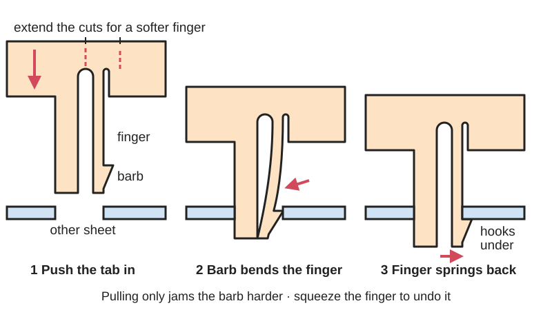
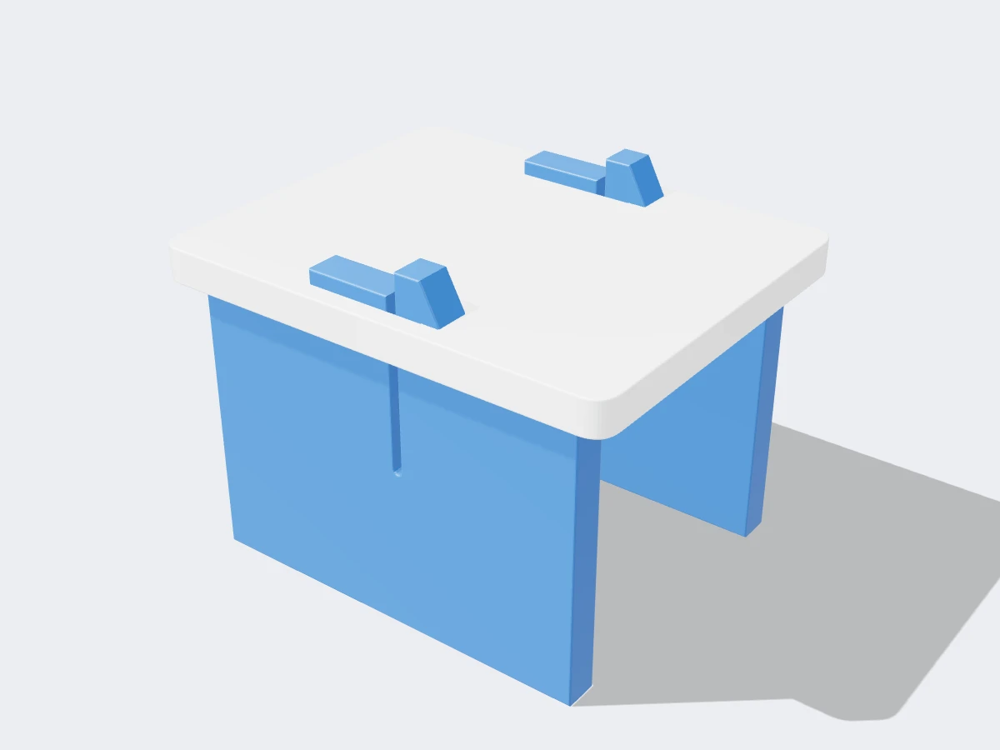

<figure class="eoc-pic eoc-pic-main"><figcaption>Diagram drawn for the encyclopaedia from the research notes. ⚑ Needs confirming: a drawing can simplify or get details wrong; a real photo or a better diagram is welcome.</figcaption></figure>
<figure class="eoc-pic"><figcaption><strong>Render.</strong> A 3D model made for the encyclopaedia, not a photo: a stand-in until a good real photo is found. ⚑ Needs confirming: a model can simplify or get details wrong; a real photo is welcome.</figcaption></figure>

Tabs cut into a flat sheet carry a small barb or a springy finger that bends as the tab goes through a slot and then springs back to catch, so flat parts click together and stay together without fasteners or glue.

**In plain words:** Flat tabs cut with a little hook (barb) or a thin springy finger beside them, so when you push the tab through a slot in the other sheet it bends aside and then clicks back, holding the sheets together with no screws or glue, like an all-acrylic Raspberry Pi case that clips together. **Proper term:** Snap-fit tab joint for sheet material (integral [cantilever](../glossary.md#cantilever) clip; barbed tab).

**Also called:** laser-cut clip or laser-cut elastic clip (DefProc, 'Laser-Cut Elastic-Clips'); snap joint or snap-lock assembly (What Make Art; YouTube 'laser-cut snap-lock assembly'); dragon claws (Adafruit's name for the flexing acrylic clips on its Pi Box case); clip tab and clip hole (lasercut.scad OpenSCAD library, clips / clip_holes); tab insert and interlocking joint profiles (Joinery tool by Clement Zheng, for barbed tabs in paper, film, felt and leather); cantilever-based joints and mounts (springFit, Hasso Plattner Institute); spring clip key joint (What Make Art: a key that is squeezed to fit and springs back); barbed tab, locking tab, tab lock or lock tab (cardboard packaging, e.g. 'tab lock tuck top' boxes); button-punch snap lock or snaplock seam (sheet-metal air-duct seam where punched bumps snap into a folded pocket; Mestek; Sheet Metal Connectors); cantilever snap fit (the general engineering term for the moulded or printed version).

## How it works

Cutting a long, thin strip into the sheet leaves a finger that can bend sideways like a diving board (a cantilever spring). As the tab is pushed through the slot, the sloped front of the barb pushes the finger aside; once the barb has passed through the other sheet the finger springs back and the barb's flat back hooks behind the far face (What Make Art; DefProc). Pulling back only presses the barb harder against the sheet, so the joint stays shut until someone squeezes the finger to unhook it, or the pull is large enough to bend the finger out of the way (DefProc calls this the pull-through force). The finger must only ever bend within the springy (elastic) range of the material, which is why it is long, thin and often tapered, and why a stop can limit how far it bends (DefProc). A variant (springFit) puts a springy finger beside a plain tab or slot so it presses the parts together and soaks up differences in laser [kerf](../glossary.md#kerf).

## Parts

Single piece per part: each sheet has the springy tab or finger (with its hook or barb and the relief cut that frees it) and the mating sheet has a plain slot; there are no extra parts. Optional: a stop that limits how far the finger can bend, and 'grip' marks or a button to press when releasing it (DefProc; Adafruit).

## Everyday examples

- All-acrylic laser-cut Raspberry Pi cases that clip together with no screws, such as Adafruit's Pi Box with its 'Dragon Claws' and DefProc's Clip-R-Pi (Adafruit 'Laser-Cut Enclosure Design'; DefProc)
- Cardboard mailer boxes with a locking tab that tucks into a slot so no tape is needed (e.g. 'tab lock tuck top' boxes; PakFactory)
- Rectangular metal air-conditioning ducts whose corner seams snap together (button-punch snap lock; Mestek; Sheet Metal Connectors)
- Laser-cut paper, film and felt models and bags joined with barbed tabs (Joinery examples) ⚑ [uncertain as an everyday object]

## When to use it

Use it when you want flat parts to click together with nothing extra to buy, count or lose: kits and cases that should assemble in seconds by hand (Adafruit designed the Pi Box so the kit is just six acrylic pieces in a bag), boxes you want to open again, and models in card, film or felt. It is also useful when you will share a laser-cut design, because a springy finger copes with other people's lasers cutting slightly wider or narrower than yours, where a tight press fit would be too tight or fall out (springFit). It can be assembled from one side only.

## When not to use it

Avoid it for heavy or structural loads, for parts that are pulled hard in the direction opposite to the hook (SendCutSend), and for [brittle](../glossary.md#brittle--ductile) or layered sheet: plywood barbs tear and MDF barb heads snap (DefProc); use a T-slot joint (screw and [captive nut](../glossary.md#captive-nut)), a tab-and-slot joint with glue, or a key or wedge through the tab instead. Avoid it where the finger would stay bent all the time (plastics [creep](../glossary.md#creep); Hubs) and where you cannot spare the space for a long finger (springFit notes that the extra cuts need room and can weaken the part). For thin sheet metal that you do not need to reopen, bent or twisted tabs are simpler. For watertight joints use a seal.

## Details

- **What it does (jobs):**
  - join and hold: clips flat parts (boxes, cases, cardboard models, duct seams) together without screws or glue
  - lock, and release by hand: a clip you can reach can be squeezed open to take the parts apart again (DefProc Clip-R-Pi 'quick and easy to disassemble / reassemble')
- **Movement:** none: the joined parts do not move; only the springy finger flexes briefly while assembling or releasing
- **Directions it can move (degrees of freedom):** 0 once clicked in: the tab and slot stop sliding and twisting and the barb stops pulling out. Under a large pull the finger can bend and let go (DefProc pull-through force).
- **Special behaviour:**
  - hand-release only: it holds against a pull because the barb hooks behind the sheet, but lets go when a person presses the finger aside (DefProc; What Make Art). Barbs that cannot be reached from outside are effectively permanent
- **How it holds:**
  - shape (the parts interlock; [form-fit](../glossary.md#form-fit--force-fit--material-bond)): the barb hooks behind the far face of the slotted sheet
  - spring force (a spring or springy part presses it in place): the springy finger pushes the barb back into place and, in springFit-style joints, presses the parts together
- **Input and output:** not applicable
- **Power:** passive (no power needed)
- **Load:** light: DefProc's example clip in 3 mm acrylic needs about 2.5 N to press and about 31 N pulling before it unclips; springFit's plywood and acrylic springs pushed with about 5 N. Strongest in the direction the barb hooks and in [shear](../glossary.md#peel-vs-shear) when combined with tabs; weak against pulling in the opposite direction to the hook (SendCutSend 'Hooks: weak against loads opposite of hooking direction') and against prying the finger open. springFit joints 'come apart more easily than their press fit counterparts'.
- **Play and precision:** small: the tabs and slots locate the parts, and a spring finger takes up small differences in cut size, so the fit stays snug even when a different laser removes more or less material (springFit tested kerfs of 0.12 and 0.20 mm; its springs allowed at least 1 mm of [deflection](../glossary.md#deflection)). Repeatable position; tolerates little [misalignment](../glossary.md#misalignment) while the barb is being pushed through ⚑ [uncertain].
- **Taking it apart:** removable: most clips can be released by squeezing the finger by hand or with a small screwdriver (DefProc Clip-R-Pi is designed to be taken apart and reassembled); barbs hidden inside a closed box are effectively permanent, and in card or felt the barbs deform after release.
- **How often it can be reused:** many times in acrylic when the clip is designed to stay well below the material's yield stress (DefProc sized its acrylic clip at about one-eighth of the yield stress, and every Clip-R-Pi case was assembled and taken apart before packing); only a few times in card, MDF or plywood, where the barbs tear or crush ⚑ [uncertain]. The springFit authors note that long-term repeated assembly was not tested.
- **Sealing:** none: the laser-cut and cardboard versions leave gaps. The sheet-metal duct version (button-punch snap lock) is rated for low-pressure air ducts up to about plus or minus 4 in water gauge (about 1 kPa), with screws added at the duct ends at that pressure (Sheet Metal Connectors 'Snaplock'); extra sealant is often used ⚑ [uncertain].
- **Adjustable:** no
- **Access needed:** one side only (blind): the barb is pushed through and catches on the far side with no tool behind (the Joinery tool notes tab inserts 'can be entirely assembled from one side'). Releasing it needs access to the finger, which is often on the far side.
- **Materials:** Works best in springy sheet that bends a long way before breaking: acrylic (PMMA) 3 mm (DefProc; Adafruit), thin plastic films and paper-like sheets such as mylar drafting film, Yupo synthetic paper and polyethylene sheet, plus felt and leather (Joinery), and cardboard and card stock for tab-lock boxes. MDF works but the small barb head can snap off; plywood is poor because the barb head tears between the layers (DefProc), although springFit's side springs worked in both plywood and acrylic. Sheet-metal versions use galvanised steel duct sheet (button-punch snap lock, 20 to 28 gauge; Mestek) and spring steel ⚑ [uncertain]. Also 3D-printed flat plates in ABS, PETG or nylon (Hubs recommends ABS, nylon and TPU for FDM snap fits).
- **Heat, cold, water and wear:** Acrylic softens above its glass transition (about 105 C for plain PMMA, 85 to 165 C for commercial grades; Wikipedia PMMA) and laser-cut acrylic edges are stressed and can craze (crack finely) when they meet solvents, even glass cleaner (Wikipedia PMMA), so do not clean clip-together acrylic cases with solvent cleaners. Plastic fingers left bent slowly relax (creep) and lose grip (Hubs). MDF can swell or break when wet and warp in humid air (Wikipedia MDF). Cold makes acrylic more brittle, so clips are more likely to snap in the cold ⚑ [uncertain]. Vibration resistance is not documented ⚑ [uncertain].

## Making it

- **Ways to make or get it:**
  - laser cut: the main maker method, in acrylic, card, film, felt or leather (DefProc; Adafruit; Joinery)
  - 3D print (FDM): flat printed plates with barbed tabs, printed lying down
  - 3D print (resin): possible, but standard resins are brittle for repeated snapping (Hubs)
  - sheet metal: roll-formed or punched duct seams (button-punch snap lock) and spring-steel tabs ⚑ [uncertain for spring-steel tabs]
  - CNC: rarely, because the cutter's radius limits the fine relief cuts and barbs ⚑ [uncertain]
- **Printing it in one piece (print in place):** no: the two sheets are made separately and clicked together afterwards (each part is one piece with no added hardware).
- **Tools:** none to assemble: push the tab through by hand. A small flat screwdriver or fingernail helps release clips; a rubber mallet is not needed and can crack acrylic ⚑ [uncertain].
- **Difficulty:** moderate: nothing to buy and it cuts in one pass, but the finger length, thickness and barb size need test cuts for each material and laser; What Make Art notes snap joints 'usually require a bit of trial and error'

### 3D printing tips

1) Print the plates lying flat so the finger bends within the layers; do not let snap fingers stand upright in Z, where [layer lines](../glossary.md#layer-lines) make them weak (Hubs 'avoid snap-fit cantilevers built vertically in the Z direction'). 2) Use tougher materials: Hubs recommends ABS, nylon and TPU for FDM snap fits; SLA resins are relatively brittle. PETG is a common maker choice ⚑ [uncertain]. 3) [Clearance](../glossary.md#clearance) around tabs and barbs: Hubs suggests 0.5 mm for FDM snap fits and 0.3 mm for SLA, SLS and MJF. 4) [Taper](../glossary.md#taper) the finger from a thicker root to a thinner tip, round the root with a [fillet](../glossary.md#chamfer--fillet) at least half the finger's thickness, and keep the finger at least 5 mm wide (Hubs). 5) Design it so the finger is only bent while clicking in, not while assembled: plastics creep under constant load and the clip will slowly lose grip (Hubs). 6) Print a few versions with slightly different barb sizes and finger lengths and test them before printing the real parts.

### Buying one (off-the-shelf parts)

None are needed; the clips are cut into the parts. Related hardware if you would rather buy a clip: spring-steel push-on fasteners (push nut, speed nut), plastic push rivets and fir-tree clips, and snap pins. For sheet-metal ductwork, button-punch snap-lock seams are made on roll-forming machines (Lockformer is a brand; Mestek).

## Rules of thumb

- Worked example in 3 mm acrylic: tapered finger 4 mm deep at the root and 2 mm at the tip, 25 mm long, with a 2 mm barb/deflection: about 2.46 N to press, 7.68 MPa peak stress (well below acrylic's roughly 60 MPa yield) and about 31 N pull-through force (DefProc, 'So What's a Practical Laser-Cut Clip Size?', 2013).
- Extend the relief cut about 5 mm past the root of the finger so the end of the cut is not at the point of highest stress, where acrylic clips otherwise snap (DefProc, 2013).
- Taper the finger: a thicker root keeps bending stress low and a thinner tip keeps the pressing force low; clips in acrylic need to be long and thin (DefProc 'Laser-Cut Elastic-Clipped Comb-Joints'; Hubs).
- Material choice: the DefProc clip works in acrylic and MDF (but the MDF head breaks before the pull-through force is reached) and not in plywood, where the head shears between layers (DefProc, 2013). The lasercut.scad clip is about 11 sheet thicknesses long and is described as 'good for acrylic, mdf but maybe not plywood' (bmsleight/lasercut README).
- Spring [stiffness](../glossary.md#stiffness) rises with the cube of thickness and falls with the cube of length: doubling the finger's thickness or halving its length makes it 8 times stiffer; a longer, thicker finger can have the same stiffness but tolerate more size variation (springFit, UIST 2019).
- springFit springs that worked in both plywood and acrylic were at least 3 mm thick at the base, allowed at least 1 mm of deflection and pushed with about 5 N; curved plywood springs were about half as stiff as straight ones (springFit, UIST 2019).
- Hooks through slots: the notch in the hook equals the sheet thickness, and the slot must be long enough for the whole hook to pass (SendCutSend 'How to Join Laser Cut Parts Without Fasteners').
- Barbed tabs in thin film or paper: the Joinery tool's 'grip' is the interference between the insert and its slot; its tab-insert default is 0.7 mm grip for 1 mm sheet, and a bigger grip holds tighter but is harder to assemble (Joinery Instructable and joints.js).
- FDM snap fits: 0.5 mm clearance, root fillet at least 0.5 times the base thickness, width at least 5 mm (Hubs 'How do you design snap-fit joints for 3D printing?').
- Sheet-metal duct snap lock: punched buttons about every 2 in (50 mm) on the male edge snapping into a hemmed pocket; used for duct seams up to about plus or minus 4 in water gauge (Sheet Metal Connectors 'Snaplock'); strength and leakage tested comparable to the hammered Pittsburgh lock (Mestek).

## Common failures

1) Finger snaps at its root when first pressed: the end of the relief cut is a stress raiser at the point of highest stress; extend the cut about 5 mm further (DefProc) and taper the finger. 2) Barb head shears off: plywood tears between layers, MDF heads break (DefProc); use acrylic or a springier material. 3) Clip too stiff to press, or the part cracks while assembling: finger too short or thick; lengthen or thin it (springFit: halving the length makes it 8 times stiffer). 4) Joint falls apart or rattles: barb too small, finger too weak, or the laser cut wider than expected; springFit notes spring joints come apart more easily than hammered press fits. 5) Springs placed in load-bearing areas make the model more prone to breaking (springFit). 6) 3D-printed fingers standing upright snap along the layers (Hubs). 7) Clip loosens over time because the finger stays bent and creeps (Hubs). 8) Card and film barbs crumple or tear if the grip (interference) is too large (Joinery).

## Safety

Acrylic clips that are over-bent can snap suddenly and leave sharp edges ⚑ [uncertain]. Sheet-metal hooks and tabs have sharp edges; SendCutSend advises rounding the outside of hooks 'to avoid sharp edges that could lead to accidental injuries'. Otherwise none known.

## Related

- Cantilever snap fit: the same springy-finger-and-hook idea in a moulded or 3D-printed part rather than cut from flat sheet
- Tab-and-slot joint (self-fixturing sheet joint): plain tabs without barbs; they locate the parts but need glue, a press fit or fasteners to stop them pulling out
- T-slot joint (captive nut and bolt joint): holds sheets with a screw and nut instead; stronger and fully removable, but needs hardware
- Bent or twisted tab through a slot (lanced tab): the tab is bent or twisted over after going through, for thin metal; stronger but meant to stay put (SendCutSend 'Bent Tabs')
- Folded seam (hem, lock seam, Pittsburgh lock): the hammered sheet-metal seam that the button-punch snap lock replaces without the hammer-over step (Mestek)
- Crush ribs and spring-fit features (compliant press fit): springy ribs or fingers that press parts snugly but have no hook, so they rely on friction
- Mortise and tenon (incl. wedged, drawbored and tusk tenons): a key or wedge through the protruding tab locks it instead of a barb; SendCutSend notes a flexible key can itself be designed to snap in
- Spring-steel push-on fasteners (push nut, speed nut, U-nut): a separate springy metal clip that does the same job on studs and panels

## Make it yourself

- [lasercut.scad: clips and clip_holes (OpenSCAD library by bmsleight)](https://raw.githubusercontent.com/bmsleight/lasercut/master/lasercut.scad): OpenSCAD module for laser-cut parts; the clips option cuts a long springy clip tab (about 11 sheet thicknesses) and clip_holes cuts the matching slot, loosely based on DefProc's clip *(licence: BSD 2-Clause)*
- [Joinery: parametric joint generator for laser-cut assemblies (Clement Zheng)](https://clementzheng.github.io/joinery/): Free web tool that adds joints to the edges of an SVG cutting pattern, including barbed 'tab insert' and 'interlocking' profiles for paper, film, felt and leather, with adjustable grip and tolerance (instructions in the Instructable 'Joinery: Joints for Laser Cut Assemblies', CC BY-NC-SA 4.0) *(licence: MIT (source code))*
- [Laser-Cut Elastic-Clips by DefProc (Thingiverse)](https://www.thingiverse.com/thing:53032): Downloadable clip profile and a demonstration box in three configurations for 3 mm acrylic, from the DefProc blog posts; page title confirmed, details not readable by automated access *(licence: not visible ⚑ [uncertain])*

## Pictures, videos and models

- [So What's a Practical Laser-Cut Clip Size? (Deferred Procrastination, Patrick Fenner, 2013)](http://marksabino.com/defproc/blog/2013/so-whats-a-practical-laser-cut-clip-size/): Diagrams of a tapered laser-cut acrylic clip with its dimensions, the clip-together box and Clip-R-Pi case, and the extended relief cut that moves the stress point *(licence: link only)*
- [Laser-Cut Elastic-Clipped Comb-Joints (DefProc)](http://www.deferredprocrastination.co.uk/blog/2013/laser-cut-elastic-clipped-comb-joints/): How a springy clip is cut into acrylic to lock a finger (comb) joint, with the bending equations for straight and tapered clips *(licence: link only)*
- [springFit: Joints and Mounts that Fabricate on Any Laser-Cutter (Hasso Plattner Institute, UIST 2019)](https://hpi.de/baudisch/projects/springfit.html): Figures of cantilever-spring versions of finger joints, cross (notch) joints and T-joints in plywood and acrylic, how they assemble, and why they tolerate kerf changes; links the paper PDF and demo video *(licence: link only)*
- [laser-cut snap-lock assembly (YouTube, Amy Makes Stuff)](https://www.youtube.com/watch?v=vDdfib7CqlI): Video of a laser-cut snap-lock assembly clicking together; title and channel confirmed via YouTube oEmbed, video not watched *(licence: link only (standard YouTube licence))*
- [Laser-Cut Enclosure Design (Adafruit Learning System, Phillip Burgess)](https://cdn-learn.adafruit.com/downloads/pdf/laser-cut-enclosure-design.pdf): Guide with photos including the case study of the all-acrylic Pi Box held together by flexing 'Dragon Claws' with no hardware *(licence: link only)*

## Needs confirming

⚑ marks something nobody has confirmed yet: a fact the research could not confirm from a source, a finder value that is a best guess, or an open point from the research notes. Corrections are welcome (see `research/needs-confirming.md`).

- ⚑ 13 sentences on this page marked [uncertain].
- ⚑ Finder value `tools` = none, hand tools (source uncertain): `tools_needed` is marked ⚑ [uncertain] here: "…ps release clips; a rubber mallet is not needed and can crack acrylic ⚑ [uncertain].…"
- ⚑ Finder value `made_of` = 3D prints, plastic sheet, tube or moulded parts, wood, metal, paper or card, fabric, leather or cord (best guess): proposed from the words in the research text (R37); not yet checked

## Sources

- <http://marksabino.com/defproc/blog/2013/so-whats-a-practical-laser-cut-clip-size/>
- <http://www.deferredprocrastination.co.uk/blog/2013/laser-cut-elastic-clipped-comb-joints/>
- <https://www.defproc.co.uk/projects/clip-r-pi/>
- <https://hackaday.com/2013/02/27/acrylic-enclosures-use-integrated-clips-to-do-away-with-fasteners/>
- <https://hpi.de/baudisch/projects/springfit.html>
- <https://hpi.de/oldsite/fileadmin/user_upload/fachgebiete/baudisch/projects/springFit/Roumen-Shigeyama-springfit-joints-and-mounts-that-fabricate-on-any-laser-cutter-UIST2019>
- <https://www.youtube.com/watch?v=NO_UBPPEX1c>
- <https://www.youtube.com/watch?v=vDdfib7CqlI>
- <https://cdn-learn.adafruit.com/downloads/pdf/laser-cut-enclosure-design.pdf>
- <https://whatmakeart.com/digital-fabrication/laser-cutting/laser-cut-joints/>
- <https://raw.githubusercontent.com/bmsleight/lasercut/master/lasercut.scad>
- <https://raw.githubusercontent.com/bmsleight/lasercut/master/README.md>
- <https://raw.githubusercontent.com/bmsleight/lasercut/master/LICENSE>
- <https://clementzheng.github.io/joinery/>
- <https://raw.githubusercontent.com/clementzheng/joinery/master/js/joints.js>
- <https://raw.githubusercontent.com/clementzheng/joinery/master/LICENSE.md>
- <https://www.instructables.com/Joinery-Joints-for-Laser-Cut-Assemblies/>
- <https://www.instructables.com/json-api/showInstructableModel?urlString=Joinery-Joints-for-Laser-Cut-Assemblies>
- <https://www.thingiverse.com/thing:53032>
- <https://sendcutsend.com/blog/how-to-join-laser-cut-parts-without-fasteners/>
- <https://blog.mestekmachinery.com/news-and-updates/the-methods-of-making-duct-locks>
- <https://www.smcduct.com/definitions/snaplock/>
- <https://pakfactory.com/tab-lock-tuck-top-boxes.html>
- <https://www.hubs.com/knowledge-base/how-design-snap-fit-joints-3d-printing/>
- <https://en.wikipedia.org/wiki/Snap-fit>
- <https://en.wikipedia.org/wiki/Poly(methyl_methacrylate)>
- <https://en.wikipedia.org/wiki/Medium-density_fibreboard>
