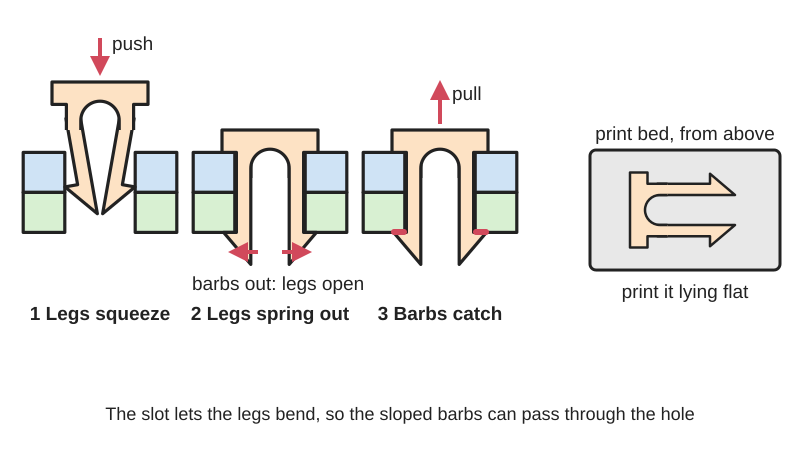
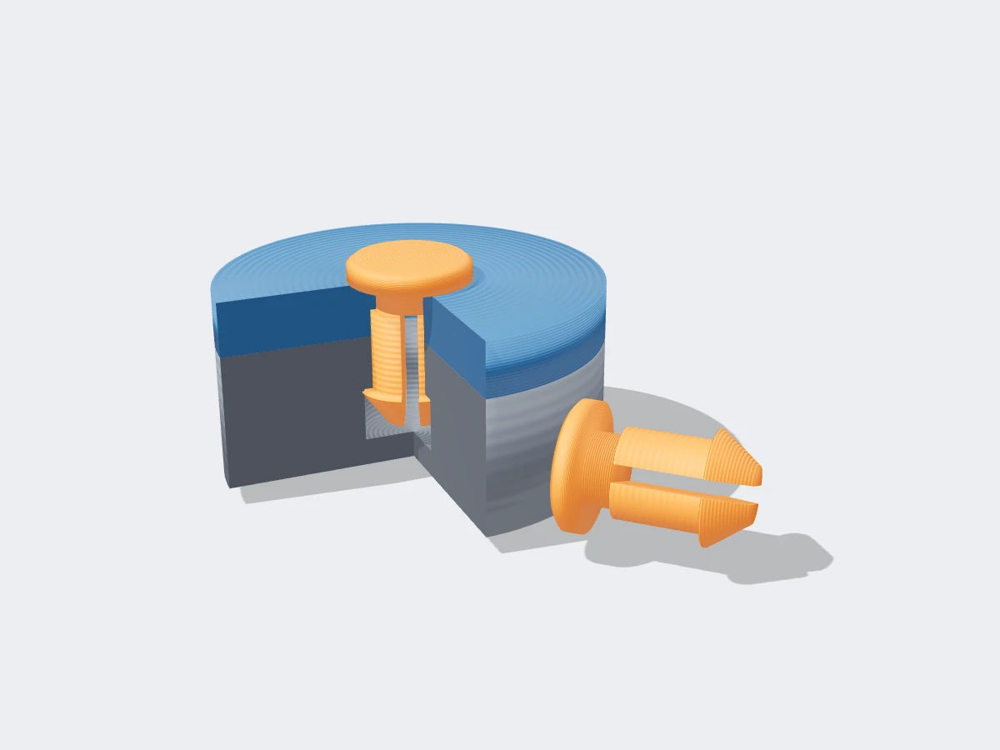

<figure class="eoc-pic eoc-pic-main"><figcaption>Diagram drawn for the encyclopaedia from the research notes. ⚑ Needs confirming: a drawing can simplify or get details wrong; a real photo or a better diagram is welcome.</figcaption></figure>
<figure class="eoc-pic"><figcaption><strong>Cut-away render.</strong> A 3D model made for the encyclopaedia, not a photo: a stand-in until a good real photo is found. ⚑ Needs confirming: a model can simplify or get details wrong; a real photo is welcome.</figcaption></figure>

A separate peg whose split, springy legs squeeze through a hole and spring open behind it, so barbs on the legs hold two parts together, either fixed or as a pivot.

**In plain words:** A small plastic peg with a slit up its end: the two halves squeeze together as you push it through a hole, then spring apart so a little lip on each half catches on the far side and holds the parts together. **Proper term:** Snap pin (split-leg snap-fit pin).

**Also called:** snap pin / snap-fit pin / snap-fit peg; split-leg push-in pin / split pin connector (not the same as a metal split cotter pin); pin connector / parametric snap pins (3D-printing names, e.g. Emmett Lalishe's 'Parametric Snap Pins' on Thingiverse, which BOSL2's snap_pin() is based on); rabbit clip (BOSL2 name for the flat, rectangular version with two flexible 'ears'); slotted snap-fit (DuPont) / discontinuous annular snap joint (Covestro); pin-pivot (a snap pin used as a hinge pin; Maker Club); snap rivet / push-in fastener / arrow clip (commercial nylon versions; some snap rivets are two-piece); HEYClip (brand; Heyco's slotted-leg nylon push-in fasteners).

## How it works

As you push the pointed tip into the hole, the sloped barbs ride on the hole's edge and squeeze the two legs towards each other across the slot, each leg bending like a small [cantilever](../glossary.md#cantilever). When the barbs pass the far edge of the hole (or reach a wider pocket inside a socket), the legs spring apart and the barbs' back faces catch, so the pin can't pull back out. Covestro notes that slitting a round snap joint makes the load mainly bending, so each leg is designed as a cantilever snap arm (Covestro, p. 5), and DuPont notes that slots allow much deeper [undercuts](../glossary.md#undercut) at the cost of [holding force](../glossary.md#holding-force) (DuPont, pp. 73-74). Double-ended printed pins have legs at both ends and snap into a socket in each part; a small '[preload](../glossary.md#preload)' makes the pin slightly short so it pulls the two parts tight, and a flat-walled socket stops it turning while a round one lets it spin as a pivot (BOSL2 joiners.scad). The flat 'rabbit clip' works the same way but is a curved strip that can be made very thin (BOSL2).

## Parts

Single piece (the pin), used with holes or sockets in the two parts. In plain words: a head or collar (or a second set of legs, on double-ended pins); a round or flat-sided shank split by a slot into two springy legs (tines); a barb, lip or nub near each leg tip with a sloped front and a steeper back; often a pointed tip. The parts have a hole, or a socket with a wider pocket or shoulder inside, for the barbs to catch behind.

## Everyday examples

- White nylon push-in clips and snap-in supports that hold circuit boards and thin panels in electronics (Heyco HEYClip push-in fasteners)
- Printed pins that join modular storage baseplates, e.g. snap-lock pins for Gridfinity baseplates (Printables 585701)
- Snap-together toys and printed articulated models whose limbs pivot on split pins (Maker Club pin-pivots)
- LEGO Technic pins, slotted pegs that click into beam holes ⚑ [uncertain: the snapping detail was not confirmed in an opened source]

## When to use it

Use it to join separately printed parts (a big model split to fit the printer, a box and its hinge, modular tiles) without glue or screws, when you might want to take them apart again, or to make a quick hinge pin that snaps in and turns. Commercial nylon versions suit fixing thin panels, boards and covers into punched or drilled holes by hand in seconds. Good for light loads, low cost and fast assembly.

## When not to use it

Avoid it for heavy loads or strong pulling along the pin, for parts that must be very precisely aligned, and for joints that must be taken apart many times a day: use screws with [heat-set inserts](../glossary.md#heat-set-insert), dowel pins with screws, a quick-release (ball-lock) pin, or a clevis pin with a split pin or R-clip. Avoid snap pins where you can't reach the far side to squeeze the legs if you will need to remove them. For panels and car trim where the back isn't reachable, use a push-in plastic rivet (fir-tree clip or push-type retainer). For a permanent join of printed parts, heat staking, glue or a pressed-in pin may be simpler.

## Details

- **What it does (jobs):**
  - join and hold: pins two printed or panel parts together
  - let it move (turn, slide or bend): in a round socket or hole it becomes a hinge or pivot pin (BOSL2 fixed=false; Maker Club pin-pivots)
- **Movement:** none in a flat-walled (fixed) socket; rotate, a full 360 degrees, when used as a pivot in a round socket; the legs themselves flex only while the pin is pushed in or out
- **Directions it can move (degrees of freedom):** 0 in a fixed socket; 1 (turning about the pin) when used as a pivot; plus a little end float if the pin is longer than the parts it joins
- **Special behaviour:**
  - self-aligning or self-centring: the pointed tip and sloped barbs guide the pin into the hole and squeeze the legs as it goes in (kaje, Printables 262409)
  - tensioning (takes up slack and holds): with a preload the pin is slightly short, so the springy legs pull the two parts together (BOSL2 snap_pin preload)
  - none otherwise: it simply holds
- **How it holds:**
  - shape (the parts interlock; [form-fit](../glossary.md#form-fit--force-fit--material-bond)): the barbs catch behind the edge of the hole
  - spring force (a spring or springy part presses it in place): the springy legs push the barbs outward
- **Input and output:** not applicable: it holds or pivots but doesn't pass on motion
- **Power:** passive (no power needed)
- **Load:** Light. Strong sideways ([shear](../glossary.md#peel-vs-shear)), because the shank fills the hole; much weaker when the parts are pulled apart along the pin, because only the barbs and bending legs resist, and slots trade holding force for easier fitting (DuPont, pp. 73-74). A Maker Club pivot pin could be unclipped with 'a bit of push on the tip'. Printed legs are weakest if their layers run across the bending direction.
- **Play and precision:** Small: BOSL2's default [clearance](../glossary.md#clearance) is 0.2 mm; kaje used a hole 2% bigger than the peg (10.2 mm for 10 mm); a Maker Club pivot pin used a 0.5 mm gap all round so it turns freely. Printed pins with flat sides have a little extra sideways play in one direction ⚑ [uncertain]. Pins locate parts reasonably well but not precisely; use dowels for exact alignment.
- **Taking it apart:** removable: squeeze the legs together from the far side and push the pin back out, or pry under the head (a small flat screwdriver behind the cap is used for Printables 585701). With square (90 degree) barb backs or BOSL2's locking flanges it becomes semi-permanent (can be undone but may damage parts): BOSL2 says lock=true makes the clip 'very hard or impossible to remove', and DuPont says a 90 degree [return angle](../glossary.md#return-angle) makes a snap fit permanent
- **How often it can be reused:** a few times: removable designs in tough plastics can be reused (Heyco's nylon push-in fasteners 'may be disassembled and reused'), but printed legs slowly lose their spring and barbs wear ⚑ [uncertain: no cycle counts found]
- **Sealing:** none
- **Adjustable:** no: tightness is set by the design. BOSL2 says to make pins tighter increase `preload` and/or decrease `clearance`
- **Access needed:** both sides: a through-pin is pushed in from one side, but removing it needs the far side to squeeze the legs. Double-ended pins in blind sockets are fitted between the parts and end up hidden, with no access needed after assembly (but no easy removal either)
- **Materials:** 3D printed: PETG, ABS or nylon are best for snap fits, while PLA and standard resins are [brittle](../glossary.md#brittle--ductile) (Hubs); PLA works for test pieces (kaje, Printables 262409) and occasional use. Commercial: nylon 6/6 (Heyco HEYClip, rated 0 to 85 degrees C). Joins printed parts to each other, and thin sheets of metal, plastic, composite or wood (Heyco).
- **Heat, cold, water and wear:** Nylon push-in fasteners are rated for about 0 to 85 degrees C (Heyco HEYClip). Nylon absorbs moisture, which changes its size and springiness (DuPont Table 10.06 gives different strain limits dry and at 50% relative humidity). Plastic parts held under constant load [creep](../glossary.md#creep) and relax (DuPont, p. 36), so a preloaded pin slowly loses its grip. PLA pins soften in heat, such as a hot car ⚑ [uncertain: no temperature figure verified]; Heyco describes its nylon fasteners as vibration-, abrasion- and corrosion-resistant.

## Making it

- **Ways to make or get it:**
  - 3D print (FDM): the usual maker method; pins are printed separately, lying on a flat side
  - 3D print (SLS or MJF nylon): the most durable printed snap-fit material (Hubs)
  - 3D print (resin): tough resins only; standard resins are brittle (Hubs) ⚑ [uncertain: no resin snap pin example found]
  - injection moulding: commercial nylon push-in fasteners and snap rivets
  - off-the-shelf part: nylon slotted-leg push-in fasteners (Heyco)
- **Printing it in one piece (print in place):** no: the pin is printed as its own part, lying flat, and pushed in afterwards; the holes or sockets are printed into each part (BOSL2 snap_pin and snap_pin_socket)
- **Tools:** none to fit (finger pressure; a vice or clamp helps with stiff pins); to remove, fingers or small pliers to squeeze the legs from the far side, or a small flat screwdriver under the head
- **Difficulty:** easy to moderate: pins print in minutes and parametric libraries such as BOSL2 generate matching pins and sockets, but the fit depends on your printer and filament, so print a test pair first

### 3D printing tips

Orientation: print the pin lying on its side, not standing up, so the layers run along the legs and the bending never pulls layers apart. That is why printable snap pins have two flat sides: BOSL2's pins 'have flat sides so they can be printed', and Maker Club flattened the whole bottom of the pin for bed adhesion and the top of the legs to simplify printing (Hubs gives the same rule for snap arms: avoid building them in Z). Sockets: print them with the pin axis vertical; BOSL2's socket can include two thin fins as supports when printed tip-up, and has flat walls (fixed=true) so the pin can't turn, or a round shape (fixed=false) for a pivot. Shape: make the tip pointed so it guides the pin in and pre-squeezes the legs, and consider splitting the peg in only one place with barbs on just two small sections for a stronger peg (kaje, Printables 262409). Clearance: start from BOSL2's 0.2 mm, or a hole about 2% bigger than the pin (kaje), and 0.5 mm [radial](../glossary.md#axial--radial) gap for a pin that must turn freely (Maker Club); tighten by adding preload or reducing clearance (BOSL2). Barbs: a 30 degree lead-in eases entry; a 45 degree back face lets the pin be removed, 90 degrees makes it permanent (DuPont, p. 73). Keep the leg strain within the frequent-use limit if you will take it apart often (DuPont Table 10.06). Material: PETG, ABS or nylon for repeated use; PLA for one-off tests. Typical failures: legs snap at the root on the first insertion (print on the side, add a [fillet](../glossary.md#chamfer--fillet), make the slot and barbs shallower, use PETG or nylon); pin too loose or falls out (add preload, reduce clearance, deepen the barbs); pin won't go in (more clearance, check [elephant's foot](../glossary.md#elephants-foot) at the socket mouth); pin works loose as a pivot (use a head on both ends or a locking clip).

### Buying one (off-the-shelf parts)

Nylon push-in fasteners with slotted legs (search 'HEYClip' (brand), 'push-in fastener', 'nylon snap rivet', 'arrow clip', 'snap-in circuit board support'); two-piece 'snap rivet' (halves snap together). Related metal parts with different names: 'split pin' or 'cotter pin' (legs bent open by hand), 'hitch pin' and 'R-clip', 'spring pin' (roll pin, held by friction), 'quick-release pin' (ball-lock pin).

## Rules of thumb

- BOSL2 standard snap pin sizes (length / diameter / snap (barb height) / leg thickness): standard or large 10.8 / 7 / 0.5 / 1.8 mm; medium 8 / 4.6 / 0.45 / 1.4 mm; small 6 / 3.2 / 0.4 / 1.0 mm; tiny 4 / 2.5 / 0.25 / 0.8 mm; default clearance 0.2 mm and preload 0.1-0.2 mm (BOSL2 joiners.scad, snap_pin()).
- Rabbit clip: make the socket about 0.4 mm deeper than the clip; defaults are 0.1 mm 'compression' (ears made over-wide so the clip is snug) and 0.1 mm clearance (BOSL2 joiners.scad, rabbit_clip()).
- A slotted round snap joint is dimensioned as a set of cantilever arms (Covestro, Snap-Fit Joints for Plastics, p. 5); for frequent separation use about 60% of the one-time strain limit, e.g. 4% for polycarbonate one-time (Covestro Table 2, p. 12).
- Slots allow much deeper undercuts, usually at the sacrifice of retaining force; a 45 degree return bevel suits most separable joints, a 90 degree return makes a permanent joint (the hole must then be open at the far end), and a 30 degree lead-in bevel eases entry (DuPont, General Design Principles, Module I, pp. 73-74).
- Allowable strain for snap legs, used once / used frequently: acetal Delrin 100 8% / 2-4%; nylon Zytel 101 dry 4% / 2%, at 50% RH 6% / 3% (DuPont Table 10.06, p. 75).
- Printed snap-fit peg that worked: 10 mm peg in a 10.2 mm hole (1.02 x for clearance), 0.8 mm thick retainers, a single split forming a 60 degree gap, 4 mm long point (kaje, Printables 262409).
- Printed pivot pin: pin radius 1.5 mm in a 2 mm radius hole (0.5 mm gap all round), split gap about 1.2 mm at its widest narrowing to zero, head radius 2.4 mm versus 2.2 mm at the barbs (Maker Club, 2015).
- 3D-printed snap features: 0.5 mm clearance for FDM (0.3 mm for SLA, SLS and MJF), minimum 5 mm width for snap arms, root fillet at least 0.5 x thickness, don't build flexing arms in Z (Hubs).
- Commercial nylon 6/6 slotted-leg push-in fasteners cover panels up to 6.4 mm (0.25 in) thick and mounting holes of 0.089 to 0.260 in (about 2.3 to 6.6 mm), rated 0 to 85 degrees C (Heyco HEYClip).

## Common failures

Legs crack or snap off at the root, often on the first insertion (layers across the legs, too much squeeze, brittle PLA): print pins on their flat side, use PETG, ABS or nylon, make the barb or undercut smaller, and add a fillet. Pin is loose or falls out (too much clearance, barbs too shallow, legs relaxed over time): add preload, reduce clearance, deepen the barbs or use a fixed socket. Pin pops out when pushed on the tip, especially pivot pins (Maker Club): put the pin where the tip can't be pushed, or use a head on both ends. Pin won't go in: too little clearance or elephant's foot at the hole mouth; chamfer the hole.

## Safety

Small pins are a choking hazard: Maker Club warns its pins are a swallowing hazard for children under three. Otherwise low hazard.

## Related

- Cantilever snap fit: the same bending hook, but moulded onto one of the parts instead of on a separate pin
- Annular snap fit: a continuous bead all round, with no slots; stronger but needs much smaller undercuts
- Push-in plastic rivet (fir-tree clip, push rivet): pushes into a blind hole from one side and grips with ribs or legs spread by a centre pin; used for car trim
- Split pin (cotter pin): a metal pin whose legs you bend open by hand after fitting; for locking bolts and clevis pins
- Hitch pin and R-clip: a plain pin held in by a springy wire clip; quick to remove by hand
- Quick-release pin (ball-lock pin): a metal pin with spring-loaded balls and a release button; strong and made for frequent removal
- Heat staking: a plastic post melted over into a rivet head; permanent
- Dowel pin (press-fit pin): a plain pin held by friction, for accurate alignment
- Filament rivet: a piece of 3D-printer filament with its ends melted into heads, used as a printed pivot (Hackaday)

## Make it yourself

- [BOSL2 OpenSCAD library: snap_pin(), snap_pin_socket() and rabbit_clip()](https://github.com/BelfrySCAD/BOSL2/wiki/joiners.scad): Parametric OpenSCAD modules that generate matching snap pins, sockets and flat rabbit clips in preset sizes, with clearance, preload, locking and fixed or rotating sockets (source read at https://raw.githubusercontent.com/BelfrySCAD/BOSL2/master/joiners.scad) *(licence: BSD 2-clause (BOSL2); snap pin geometry based on CC BY-SA Thingiverse designs)*
- [Snap Fit Peg Concept - Proof of Concept Test Model, by kaje (URL from Printables API, page not opened)](https://www.printables.com/model/262409-snap-fit-peg-concept-proof-of-concept-test-model): A test print of a single-split, pointed snap-fit peg with the maker's dimensions and OnShape/STEP files (read through the Printables API) *(licence: Creative Commons Public Domain (CC0))*
- [Snap-lock Pin for Gridfinity Screw Together Baseplate, by Gad_Gad (URL from Printables API, page not opened)](https://www.printables.com/model/585701-snap-lock-pin-for-gridfinity-screw-together-basepl): Printable snap-lock pins that join two Gridfinity baseplates through their holes and can be popped out with a small flathead (read through the Printables API) *(licence: Creative Commons Attribution (CC BY))*
- [Quick snap pin connectors, by Stillpointx (URL from Printables API, page not opened)](https://www.printables.com/model/232869-quick-snap-pin-connectors): Snap pin connectors to add to your own models so printed parts snap together (read through the Printables API) *(licence: Creative Commons Attribution-NonCommercial-ShareAlike (CC BY-NC-SA))*

## Pictures, videos and models

- [BOSL2 wiki: joiners.scad (snap_pin, snap_pin_socket, rabbit_clip)](https://github.com/BelfrySCAD/BOSL2/wiki/joiners.scad): Rendered images of snap pins upright and laid flat for printing, sockets with and without fins (one cut open to show the inside), and rabbit clips and sockets including locking and double versions *(licence: BOSL2 code and documentation BSD 2-clause; the pin design is based on Emmett Lalishe's Thingiverse pins under CC BY-SA (per the BOSL2 source))*
- [How to Design a Stronger Snap-Fit Pin for 3D Printing (Send to Print)](https://www.youtube.com/watch?v=wXB3VfBBcdU): Video on designing snap-fit pins for 3D printing ⚑ [uncertain: title and channel checked with YouTube oEmbed; video content not viewed] *(licence: YouTube standard licence; link only)*
- [Maker Club: pin-pivots to improve snap-together 3D printed parts (2015)](http://www.mkrclub.com/2015/04/pin-pivots-to-improve-snap-together-3d.html): Blog post with pictures of a split snap pin used as a pivot, including the flattened print-ready shape and its dimensions *(licence: link only)*
- [DuPont, General Design Principles for Engineering Polymers (Module I)](https://www.distrupol.com/General_Design_Principles_for_Engineering_Polymers.pdf): Fig. 10.13 (p. 74): a slotted snap-fit; Fig. 10.12 and Table 10.05 (p. 73): cylindrical snap-fit terms and lead and return angles *(licence: link only (manufacturer's design guide))*
- [HEYClip Nylon Push-In Fasteners (Heyco)](https://www.heyco.com/products/heyware/circuit-board-supports/heyclip-nylon-push-in-fasteners/): Product page with pictures of one-piece nylon push-in fasteners whose slotted legs compress through a hole and spring back *(licence: link only)*

## Needs confirming

⚑ marks something nobody has confirmed yet: a fact the research could not confirm from a source, a finder value that is a best guess, or an open point from the research notes. Corrections are welcome (see `research/needs-confirming.md`).

- ⚑ 6 sentences on this page marked [uncertain].

## Sources

- <https://raw.githubusercontent.com/BelfrySCAD/BOSL2/master/joiners.scad>
- <https://raw.githubusercontent.com/BelfrySCAD/BOSL2/master/LICENSE>
- <https://github.com/BelfrySCAD/BOSL2/wiki/joiners.scad>
- <https://solutions.covestro.com/-/media/covestro/solution-center/brands/downloads/imported/1557218421.pdf>
- <https://www.distrupol.com/General_Design_Principles_for_Engineering_Polymers.pdf>
- <https://www.hubs.com/knowledge-base/how-design-snap-fit-joints-3d-printing/>
- <http://www.mkrclub.com/2015/04/pin-pivots-to-improve-snap-together-3d.html>
- <https://www.heyco.com/products/heyware/circuit-board-supports/heyclip-nylon-push-in-fasteners/>
- <https://www.assemblymag.com/articles/85900-fastening-christmas-trees-ain-t-just-for-december>
- <https://en.wikipedia.org/wiki/Split_pin>
- <https://brickset.com/article/65112/a-look-at-this-year-s-new-technic-pins>
- <https://hackaday.com/tag/rivet/>
- <https://www.youtube.com/watch?v=wXB3VfBBcdU (title verified via YouTube oEmbed)>
- <https://www.printables.com/model/262409-snap-fit-peg-concept-proof-of-concept-test-model (read via https://api.printables.com/graphql/)>
- <https://www.printables.com/model/585701-snap-lock-pin-for-gridfinity-screw-together-basepl (read via https://api.printables.com/graphql/)>
- <https://www.printables.com/model/232869-quick-snap-pin-connectors (read via https://api.printables.com/graphql/)>
- <https://api.printables.com/graphql/>
