<figure class="eoc-pic eoc-pic-main"><picture><source media="(prefers-reduced-motion: reduce)" srcset="../media/drawn/soft-pneumatic-bending-actuator.svg"></picture><figcaption><strong>Animation.</strong> Diagram drawn for the encyclopaedia from the research notes. ⚑ Needs confirming: a drawing can simplify or get details wrong; a real photo or a better diagram is welcome.</figcaption></figure>

A finger cast in silicone or printed in TPU with a network of air chambers along one side and a stretch-resistant layer along the other, so that pumping air in makes it curl and wrap gently round an object, and letting the air out makes it straighten and let go.

**In plain words:** A rubbery finger with a row of hollow air pockets along its back and a stiff strip along its belly; pump air in and the pockets swell and push against each other so the finger curls round and grips, let the air out and it straightens again. **Proper term:** Soft pneumatic bending [actuator](../glossary.md#actuator) (pneumatic network actuator, PneuNet; also fibre-reinforced soft bending actuator).

**Also called:** PneuNet, pneu-net, pneumatic network actuator (Whitesides group, Harvard; Mosadegh et al. 2014); slow PneuNet (sPN, chambers joined by one channel) and fast PneuNet (fPN, with gaps between chamber walls) (Mosadegh et al. 2014); fibre-reinforced soft actuator, fiber-reinforced elastomeric enclosure (FREE), boa-type actuator (Galloway et al. 2016; Habibian 2019 thesis); fabric-reinforced soft pneumatic actuator (Yap et al. 2017); monolithic bending PneuNet (MBP), 3D-printed soft actuator, TPU soft actuator (Stano et al. 2020); fluidic elastomer actuator, pneumatic silicone actuator (Wikipedia 'Soft robotics'); soft robotic gripper, soft gripper finger, air-powered soft finger, squishy robot (Science Buddies); hydraulic soft actuator when driven by water or oil instead of air (Galloway et al. 2016 drove theirs hydraulically under the sea).

## How it works

Rubber balloons out wherever it is thinnest and stretchiest. In a PneuNet the stretchy top layer is full of chambers, while the bottom layer contains a sheet that does not stretch. When the chambers are pumped up they swell and push on their neighbours, so the top gets longer while the bottom cannot, and the whole finger curls towards the stiff side; without the stiff bottom layer it would simply get longer (Stano et al. 2020). Letting the air out lets the rubber spring back straight. A fibre-reinforced actuator does the same with a tube: thread wound round it stops it ballooning outwards, and a strain-limiting strip along one side makes it bend; changing the winding angle of the thread makes such a tube extend, contract or twist instead (Habibian 2019 thesis; Galloway et al. 2016). Because the finger is soft, it wraps round objects of uncertain size, shape and [stiffness](../glossary.md#stiffness) and spreads the grip gently over them (Galloway et al. 2016).

## Parts

A small assembly that acts as one unit. The finger itself is one rubbery piece (or two cast halves bonded together) containing: a stretchy top layer with a row of chambers joined by an air channel, a stiffer bottom layer with a strain-limiting sheet (paper, fabric or fibre) moulded in, and an air inlet. Fibre-reinforced versions add thread wound round a tube-shaped bladder and an outer silicone skin (Galloway et al. 2016). To work it needs an air supply (squeeze bulb, syringe, small pump or compressor), tubing and fittings, and usually valves, a pressure sensor or [regulator](../glossary.md#regulator) and a relief valve (Science Buddies; Soft-Handy project on Hackaday.io).

## Everyday examples

- soft robot grippers that pick up fragile things, such as the deep-reef grippers used for the first non-destructive sampling of fragile seabed animals by a robot in the deep sea (Galloway et al. 2016)
- soft robotic rehabilitation gloves that bend a weak hand's fingers with air-filled fingers (Yap et al. 2017)
- the school 'squishy robot' gripper cast from silicone and pumped with a squeeze bulb (Science Buddies)
- the inflatable robot arm at Carnegie Mellon that inspired Baymax in Big Hero 6 (Wikipedia 'Soft robotics'; an inflatable arm rather than a PneuNet finger)

## When to use it

When you need to grip delicate, oddly shaped or unpredictable objects gently (fruit, eggs, soft toys, sea creatures) without careful positioning or force sensing; when the gripper must be safe if it bumps into people; for wearable devices that bend fingers; for soft walking or crawling robots; when you want a cheap, light finger with no hinges, gears or bearings to wear or jam; or as an engaging way to learn about pneumatics and moulding.

## When not to use it

Not for heavy loads, high grip forces or precise positioning: use a motor- or servo-driven gripper, a parallel-jaw gripper or a tendon-driven finger. Not for holding something for long periods without power: a mechanical latch or a [self-locking](../glossary.md#self-locking) gripper holds with no air. Not near sharp or hot objects that can puncture or melt it. Not where you have no safe, pressure-limited air supply; for passive gentle grippers use a fin-ray finger, and for flat smooth objects a vacuum suction gripper is simpler.

## Details

- **What it does (jobs):**
  - hold or release using power: grips while it is pressurised and lets go when the air is released (soft grippers and rehabilitation gloves; Galloway et al. 2016; Yap et al. 2017)
  - change the kind of motion: turns air (or liquid) pressure into a curling, bending movement with no hinges, gears or [linkages](../glossary.md#linkage) (Galloway et al. 2016: 'no moving parts such as pin joints, gears, or linkages')
  - let it move (turn, slide or bend): the whole finger bends like a [flexure](../glossary.md#flexure), so it can also be used as a powered bending joint (e.g. walking soft robots; Science Buddies)
- **Movement:** flex: curls in one plane when pressurised. A 10 cm silicone fast PneuNet bends from a straight rod into an approximate circle (Mosadegh et al. 2014); a home-cast silicone finger bent more than 90 degrees (Tazer Technical, via CircuitDigest); FDM-printed TPU fingers bent 41-73 degrees at 4 bar (Stano et al. 2020). Fibre-reinforced tubes can also be made to extend, contract or twist (Habibian 2019 thesis)
- **Directions it can move (degrees of freedom):** 1 controlled movement per air channel: bending in one plane, set by the pressure. But because it is soft it can also be pushed sideways, twisted or squashed by the object it holds, so in practice it is a compliant finger with many passive directions of give. Fingers with three chambers round a central axis can bend in any direction when the chambers are pressurised in turn (Galloway et al. 2016, describing Suzumori's early grippers)
- **Special behaviour:**
  - motion conversion: turns air pressure into bending (pressure in, curl out)
  - self-aligning or self-centring (in a loose sense): a ring of soft fingers closes round an object and conforms to its shape, so it tolerates uncertainty in size, shape and position (Galloway et al. 2016)
  - none of the locking behaviours: it only holds while pressure is kept in it
- **How it holds:** powered hold (it grips only while pressurised) plus friction or clamping (the curled fingers squeeze the object and friction stops it slipping out; Yap et al. 2017 measured both the squeezing 'normal' grip and the 'frictional' grip)
- **Input and output:** air (or water or oil) pressure -> bending. Typical working pressures: about 70-170 kPa for cast silicone fingers (Galloway et al. 2016: bellows type up to 70 kPa unreinforced, 170 kPa with lace reinforcement; Yap et al. 2017: full finger bending at 120 kPa), up to about 345 kPa for very fast silicone PneuNets (full curl in 50 ms; Mosadegh et al. 2014), and about 400 kPa (4 bar) for FDM-printed TPU fingers (Stano et al. 2020). Efficiency is low and depends on design: a slow PneuNet needs about 3 times the pressure, 8 times the air volume and 35 times the energy of a fast PneuNet for the same bend (Mosadegh et al. 2014). Back-drivable: yes, it is soft and can be bent by hand or by the object ('natural compliance and back drivability'; Galloway et al. 2016)
- **Power:** powered: needs a supply of compressed air (a squeeze bulb, syringe, small diaphragm pump or compressor) or of pressurised liquid, plus valves to fill and vent it. When power is lost it depends on the valves: if the air is trapped by a closed valve the finger stays curled until it leaks; if the air can escape (vent valve open, or back through a stopped pump) it straightens and lets go
- **Load:** Light. A fabric-reinforced silicone finger pushed with a maximum blocked tip force of about 9 N at 120 kPa (Yap et al. 2017); typical home-made grippers lift small, light objects (Science Buddies; Hackaday 2025). It grips well round an object and is gentle on fragile ones (deep-sea biological sampling; Galloway et al. 2016), but it is weak against sideways pushes, twisting and heavy pulling, and sharp objects can puncture it
- **Play and precision:** noticeable: the finger's position depends on pressure, on what it is touching and on the rubber's [hysteresis](../glossary.md#hysteresis) (the pressure-volume curve on the way up differs from the way down; Mosadegh et al. 2014), and on how fast it is filled (fast filling curls the tip first; Mosadegh et al. 2014). It is repeatable enough for gripping but not for precise positioning. It tolerates large [misalignment](../glossary.md#misalignment) of the object, which is the point of using it
- **Taking it apart:** removable: the air tube is pushed into the inlet or onto a barb or quick-disconnect fitting, and the finger is clamped or screwed to a palm or mount (Science Buddies; Galloway et al. 2016 gave each finger a quick-disconnect fitting 'for easy actuator installation and removal'). Pushing a tube into a new hole in the rubber makes a leak, so re-use the same hole (Science Buddies)
- **How often it can be reused:** many times for connecting and disconnecting. The finger's own life varies hugely with design and build quality: slow PneuNets burst after about 126 full bends on average (at most 990), mostly because of air bubbles in the wall, while fast PneuNets ran for more than a million cycles (Mosadegh et al. 2014)
- **Sealing:** airtight or pressure: the rubber body itself is the sealed chamber. Leaks usually come from the bonded seam between cast halves, the tube connection, air bubbles in thin walls, or gaps between extruded lines in printed TPU (Galloway et al. 2016; Stano et al. 2020; Mosadegh et al. 2014)
- **Adjustable:** Yes, by pressure: more pressure gives more bend and more grip force, so a regulator or a pump controlled by a pressure sensor sets how hard it grips (Yap et al. 2017 used a PID-controlled valve; Soft-Handy project on Hackaday.io). The shape and stiffness of the finger are fixed once cast or printed
- **Access needed:** not applicable: it is a self-contained actuator; you only need to reach its base to fit the air tube and fixing
- **Materials:** Cast versions: soft two-part platinum-cure silicone rubber, e.g. Ecoflex 00-30 or 00-50 (brand) for the stretchy layer and a stiffer silicone such as Dragon Skin 20 (brand) or Elastosil M4601 (brand) for the bottom or skin (Smooth-On; Mosadegh et al. 2014; Galloway et al. 2016); strain-limiting layer of paper, fabric or fibre (one maker reports carbon-fibre fabric worked better than paper; Printables 'PneuNet actuator molds'); reinforcing thread such as Kevlar (Habibian 2019 thesis, citing Connolly et al.). Printed versions: TPU filament, e.g. TPU 95A for stiff parts and TPU 80A for the bending part (Stano et al. 2020) or NinjaFlex (brand) (Printables 'Pillow Soft Robotic Actuator'). Simple FREEs: latex tubing wound with cotton thread and coated in latex (Habibian 2019 thesis). Moulds: ABS or PLA prints; avoid resin (UV photopolymer) moulds, which can stop silicone curing, and porous laser-sintered nylon (Science Buddies)
- **Heat, cold, water and wear:** Heat and cold: cured Ecoflex and Dragon Skin silicones are rated for -53 to +232 degC (Smooth-On). Printed TPU softens at much lower temperatures than silicone ⚑ [uncertain: no TPU heat data found on the opened pages]. Wear: silicone has generally poor tear and abrasion resistance (Pooley), so rough or sharp objects nick it and nicks grow into tears. [Fatigue](../glossary.md#fatigue): life ranges from about a hundred to over a million bends depending on design and bubbles (Mosadegh et al. 2014). Water: works underwater and even at 800 m depth when filled with liquid (Galloway et al. 2016). [Cure](../glossary.md#cure): silicone left near latex, sulfur clays or some resins may never cure properly (Smooth-On). Air quality: dirty or wet compressed air causes corrosion and blocked valves (HSE HSG39).

## Making it

- **Ways to make or get it:**
  - 3D print (FDM): moulds in ABS or PLA for casting silicone (Science Buddies; Printables 'PneuNet actuator molds'), or the whole actuator printed in TPU with its air connector built in (Stano et al. 2020)
  - 3D print (resin): not recommended for moulds, because UV photopolymers can leave silicone sticky and uncured (Science Buddies); direct printing of soft actuators in elastomeric resins or silicone inks exists in research (Wikipedia 'Soft robotics' on direct ink writing)
  - casting (moulding) two-part silicone rubber in printed moulds, then bonding the halves with a thin layer of fresh silicone (Science Buddies)
  - off-the-shelf part: the silicone kit, TPU filament, tubing, fittings, pump, valves, regulator and relief valve are bought
- **Printing it in one piece (print in place):** yes for the TPU version: a monolithic bending PneuNet with its embedded air connector prints in one go on a dual-extruder FDM printer (Stano et al. 2020). The more common cast silicone version is 'partly': the moulds are printed, but the finger is cast, bonded and fitted with tubing by hand
- **Tools:** To make: a 3D printer (for moulds or for printing TPU directly), mixing cups and sticks, vinyl or latex-free gloves (latex gloves stop platinum silicone curing), scissors, optionally a vacuum chamber to remove bubbles and a toaster oven for faster curing (Smooth-On Ecoflex technical bulletin; Science Buddies). To fit and run: push-in or barbed fittings, tubing, and a pump or squeeze bulb; a pressure gauge or sensor and a regulator are strongly advised
- **Difficulty:** moderate: casting a silicone finger in a printed mould is a well-documented school project (Science Buddies), but getting it leak-free and bubble-free takes practice, and printing an airtight TPU finger needs tuned over-extrusion and thick walls. You also need a safe air supply with pressure control

### 3D printing tips

Cast silicone route: 1) Print the moulds in ABS or PLA; resin moulds can stop the silicone curing (sticky surface) and laser-sintered nylon is too rough to release it; Smooth-On suggests spraying a clear acrylic lacquer on doubtful moulds (Science Buddies). 2) Mix 1 part A to 1 part B; Ecoflex 00-30 gives about 45 minutes of [working time](../glossary.md#pot-life--working-time) and cures in 4 hours at room temperature (00-50: 18 minutes and 3 hours); don't cure below 18 degC; warmth speeds curing (Smooth-On Ecoflex bulletin; Science Buddies cures in 10 minutes at 150 degF, about 65 degC, if the mould can take it). 3) Wear vinyl or latex-free gloves: latex, sulfur clays and some other materials stop platinum silicone curing (Smooth-On). 4) Get rid of bubbles (vacuum degas, or pop them with a pin): bubbles in the thin top wall were the main reason slow PneuNets burst, after about 126 cycles on average (Mosadegh et al. 2014). 5) Add vent holes to the mould so air is not trapped (Tazer Technical, via CircuitDigest). 6) Bond the top and bottom halves with an even layer of fresh silicone about 1 mm thick: too much clogs the chambers, too little leaks; then seal round the edge (Science Buddies). The bonded seam is where most moulded actuators fail (Galloway et al. 2016). 7) Mould a sheet of paper or fabric into the bottom layer so it cannot stretch (Hackaday 2025; Printables 'PneuNet actuator molds'), or make the bottom from a stiffer silicone (Science Buddies: Ecoflex 00-50 bottom, 00-30 top). 8) Choose soft silicone: one maker found Shore 25A too stiff and 10A worked, with fewer ribs and thinner walls (Tazer Technical, via CircuitDigest). 9) Leave gaps between the chamber walls (fast PneuNet): it bends with about one tenth of the volume change, less strain and far longer life (Mosadegh et al. 2014). Printed TPU route: 10) Make every pressurised wall at least 4-5 extruded lines thick (1.6 mm with 0.4 mm lines; 1 mm walls worked only with a 0.25 mm nozzle and 0.2 mm line width) (Stano et al. 2020). 11) Over-extrude (flow 106-120%), use 100% [infill](../glossary.md#infill) and print a little hotter than recommended (TPU 80A raised from 230 to 240 degC) so the lines fuse airtight; print with the stiff layer flat on the bed (Stano et al. 2020); one maker of a printed NinjaFlex actuator needed about 140% flow and a lowered nozzle (Printables 'Pillow Soft Robotic Actuator'). 12) Print the air connector into the part, upright, and make it about 0.5 mm wider than a standard connector so the tube seals (Stano et al. 2020). 13) Test every actuator under water with low pressure to find leaks (Stano et al. 2020 checked for bubbles in a water bath). 14) Expect printed TPU to need much more pressure than silicone for less bend (about 41-73 degrees at 4 bar versus almost 70 degrees at about 2.5 bar for a moulded one; Stano et al. 2020), so pay extra attention to the safety notes.

### Buying one (off-the-shelf parts)

Two-part platinum-cure silicone rubber (Ecoflex 00-30 and 00-50, Dragon Skin 10 and 20 (brands, Smooth-On); Elastosil M4601 (brand, Wacker)); flexible TPU filament in Shore 80A-95A (e.g. NinjaFlex (brand)); polyethylene tubing 1/16 in inside diameter and silicone rubber tubing 1/8 in inside diameter (Science Buddies parts list, McMaster-Carr 5181K15 and 5236K83); squeeze bulb (camera lens blower) for hand power (Science Buddies); miniature diaphragm air pump; [solenoid](../glossary.md#solenoid) inlet and outlet valves and an air pressure sensor (Soft-Handy project); pressure regulator and pressure relief valve; barbed, push-in or quick-disconnect fittings (Galloway et al. 2016); Kevlar or polyester thread for fibre reinforcement; paper, cotton or fibreglass fabric for the strain-limiting layer

## Rules of thumb

- Printed TPU walls must be at least 4-5 adjacent extrusion lines thick to be airtight (1.6 mm at 0.4 mm line width); airtightness depends on the number of lines, not just the wall thickness (Stano et al. 2020, https://pmc.ncbi.nlm.nih.gov/articles/PMC7281577/).
- For airtight TPU, over-extrude (flow 106-120%), use 100% infill and print hotter (TPU 80A at 240 degC instead of 230 degC) (Stano et al. 2020, https://pmc.ncbi.nlm.nih.gov/articles/PMC7281577/).
- Working pressures: cast silicone fingers roughly 70-170 kPa (Galloway et al. 2016, https://pmc.ncbi.nlm.nih.gov/articles/PMC4997628/; full finger bending at 120 kPa with about 9 N blocked tip force, Yap et al. 2017, https://www.ebi.ac.uk/europepmc/webservices/rest/PMC5640819/fullTextXML); printed TPU about 400 kPa (Stano et al. 2020). Use the lowest pressure that works and limit it with a regulator and relief valve.
- Fast PneuNet design (gaps between chamber walls, thinner inner walls): about one tenth of the volume change; the slow design needs about 3 times the pressure, 8 times the volume and 35 times the energy, and lasted about 126 cycles on average versus more than a million (Mosadegh et al. 2014, https://dash.harvard.edu/server/api/core/bitstreams/7312037d-a1d3-6bd4-e053-0100007fdf3b/content).
- Silicone handling: mix 1A:1B; Ecoflex 00-30 pot life 45 min, cure 4 h, elongation at break 900%; Dragon Skin 20 pot life 25 min, cure 4 h, Shore 20A, elongation 620%; useful temperature -53 to +232 degC; don't cure below 18 degC (Smooth-On, https://www.smooth-on.com/tb/files/ECOFLEX_SERIES_TB.pdf and https://www.smooth-on.com/tb/files/DRAGON_SKIN_SERIES_TB.pdf).
- Bond cast halves with a fresh silicone layer about 1 mm thick (Science Buddies, https://www.sciencebuddies.org/science-fair-projects/project-ideas/Robotics_p020/robotics/squishy-robots-build-an-air-powered-soft-robotic-gripper).
- Fibre winding angle: a fibre-wound tube switches from getting longer to getting shorter at a winding angle of about 54.7 degrees in theory (about 45-50 degrees in finite-element models of real FREEs) (Habibian 2019 thesis, https://arxiv.org/pdf/1912.07380).

## Common failures

1) Bursting or ballooning ('aneurysm') at a thin spot or air bubble: degas the silicone, make walls even and add fibre or lace reinforcement (Mosadegh et al. 2014; Galloway et al. 2016: lacing raised the safe pressure from 70 to 170 kPa). 2) Seam peeling between cast halves: use an even 1 mm bonding layer and seal the edge (Science Buddies; Galloway et al. 2016). 3) Leak at the tube: re-use the original hole, or use an embedded connector made 0.5 mm oversize (Science Buddies; Stano et al. 2020). 4) Porous printed walls: use 4-5 lines, over-extrusion and higher temperature (Stano et al. 2020). 5) Sticky, uncured silicone: cure inhibition by resin moulds or latex gloves (Science Buddies; Smooth-On). 6) Doesn't bend enough: silicone too stiff (25A instead of 10A), walls too thick or no strain-limiting layer (Tazer Technical, via CircuitDigest; Stano et al. 2020). 7) Tearing when removing from the mould: [peel](../glossary.md#peel-vs-shear) gently from the outside of each finger inwards (Science Buddies). 8) Fatigue cracks after many cycles: use the fast PneuNet layout, which strains the rubber less (Mosadegh et al. 2014).

## Safety

Stored pressure: 'vessels containing compressed air, even at comparatively low pressure, can explode violently once their integrity is lost' (HSE HSG39); an over-inflated finger bursts, and printed TPU fingers run at around 4 bar, so keep pressures as low as possible, fit a pressure regulator and a relief valve set below the actuator's safe pressure (HSE HSG39 para. 91), wear safety glasses while testing, and never store pressurised air in a 3D-printed part. A burst hose can whip and snake (HSE HSG39). Never point compressed air at skin or at a person: 'even air at a pressure of 15 psig can cause serious injury' (FRC Zero, Pneumatic Safety); compressed air can enter the body through openings, with severe or fatal results (HSE HSG39). Materials: wear gloves when handling uncured silicone, which can irritate skin; work with ventilation; check the mould plastic can take oven heat before oven curing (Science Buddies; Smooth-On). Carbon-fibre fabric used as a strain layer needs proper protective equipment (Printables 'PneuNet actuator molds'). Ordinary home grippers are soft and low-force, so pinching is a minor risk.

## Related

- Pneumatic artificial muscle (McKibben muscle): a rubber tube in a braided sleeve that gets shorter and pulls when pumped up, instead of curling
- Bellows and inflatable actuators (air bag, air spring): grow longer or lift when inflated; a bellows finger is one form of soft bending actuator
- Vacuum-driven artificial muscle: works by sucking air out, which is safer than pressurising
- Fin-ray gripper: a printed finger that wraps round an object passively when pushed against it, with no air needed
- Vacuum (suction) gripper and Granular jamming gripper: other air-powered ways to hold things, by suction or by grains locking up
- Compliant gripper and force amplifier: one-piece printed grippers that close by bending flexures, usually driven by a motor or tendon
- Elastic band and elastic cord springs: the tendon-plus-elastic way to bend and straighten printed fingers without air
- Diaphragm pump and squeeze bulb, Pressure regulator, Pressure relief valve, Switching valve: the parts that supply and control the air

## Make it yourself

- [Squishy Robots: Build an Air-Powered Soft Robotic Gripper (Science Buddies)](https://www.sciencebuddies.org/science-fair-projects/project-ideas/Robotics_p020/robotics/squishy-robots-build-an-air-powered-soft-robotic-gripper): Beginner project with downloadable STL moulds (big and mini gripper), materials list (Ecoflex 00-30, tubing, squeeze bulb) and full casting instructions *(licence: photos CC BY-NC-SA; licence of the STL files not stated)*
- [PneuNet actuator molds (danya, Printables) (URL from Printables API, page not opened)](https://www.printables.com/model/232284-pneunet-actuator-molds): Printable moulds for casting PneuNet bending fingers in silicone, based on the Soft Robotics Toolkit instructions; the maker used carbon-fibre fabric as the strain-limiting layer *(licence: CC BY-SA)*
- [Soft Robotic Gripper With Exoskeleton (FabianVeile, Printables) (URL from Printables API, page not opened)](https://www.printables.com/model/386241-soft-robotic-gripper-with-exoskeleton): One-piece mould for a 200 mm air-powered silicone gripper whose arms close towards the centre when inflated, plus an optional printed exoskeleton for mounting it on a robot *(licence: CC BY-NC-ND)*
- [Pillow Soft Robotic Actuator (Nlauer, Printables) (URL from Printables API, page not opened)](https://www.printables.com/model/11188-pillow-soft-robotic-actuator): Airtight soft actuator printed directly in NinjaFlex/Filaflex TPU (about 140% flow, 100% infill) for a peristaltic 'earthworm' robot; shows how to tune a printer for airtight flexible prints *(licence: CC BY)*

## Pictures, videos and models

- [Squishy Robots: Build an Air-Powered Soft Robotic Gripper (Ben Finio, Science Buddies)](https://www.sciencebuddies.org/science-fair-projects/project-ideas/Robotics_p020/robotics/squishy-robots-build-an-air-powered-soft-robotic-gripper): Step-by-step photos of casting a four-finger silicone gripper in a 3D-printed mould, bonding the layers, inserting the air tube and gripping objects with a squeeze bulb *(licence: photos CC BY-NC-SA (as credited on the page); page text link only)*
- [Additive Manufacturing for Soft Robotics: Design and Fabrication of Airtight, Monolithic Bending PneuNets with Embedded Air Connectors (Stano, Arleo and Percoco, Micromachines 2020)](https://pmc.ncbi.nlm.nih.gov/articles/PMC7281577/): Figures of four FDM-printed TPU PneuNet shapes, a cross-section of the chambers, the four extrusion lines that make a wall airtight, and bending-angle-versus-pressure graphs *(licence: CC BY 4.0)*
- [Soft Robotic Grippers for Biological Sampling on Deep Reefs (Galloway et al., Soft Robotics 2016)](https://pmc.ncbi.nlm.nih.gov/articles/PMC4997628/): Figures of a fibre-reinforced 'boa' finger and a bellows finger, a step-by-step fabrication diagram (moulded bladder, fibre reinforcement, outer skin) and the fingers curling under pressure *(licence: CC BY 4.0)*
- [Attempting to Make a Soft Robotic Gripper (Tazer Technical, YouTube)](https://www.youtube.com/watch?v=basxnQF3ea4): A maker's trial-and-error video of casting silicone fingers in printed moulds, with a fabric layer, reaching more than 90 degrees of bending (title and channel confirmed via YouTube oEmbed; summary from CircuitDigest; video not watched) *(licence: link only)*
- [Robot Gets A DIY Pneumatic Gripper Upgrade (Hackaday, 2025)](https://hackaday.com/2025/04/25/robot-gets-a-diy-pneumatic-gripper-upgrade/): Article and embedded video of a cast silicone gripper with fabric in its inner side and a printed air manifold, mounted on a desktop robot arm *(licence: link only)*

## Needs confirming

⚑ marks something nobody has confirmed yet: a fact the research could not confirm from a source, a finder value that is a best guess, or an open point from the research notes. Corrections are welcome (see `research/needs-confirming.md`).

- ⚑ 1 sentence on this page marked [uncertain].
- ⚑ Finder value `powered_does` = move or push something (best guess): set by Claude from the entry's name and power text (R33), for "What should it do?" under "Hold or let go using power"

## Sources

- <https://en.wikipedia.org/wiki/Soft_robotics (read as raw wikitext)>
- <https://pmc.ncbi.nlm.nih.gov/articles/PMC7281577/ (Stano, Arleo and Percoco, Micromachines 2020, CC BY 4.0; full text read via https://www.ebi.ac.uk/europepmc/webservices/rest/PMC7281577/fullTextXML)>
- <https://dash.harvard.edu/server/api/core/bitstreams/7312037d-a1d3-6bd4-e053-0100007fdf3b/content (Mosadegh et al., 'Pneumatic Networks for Soft Robotics that Actuate Rapidly', Advanced Functional Materials 2014, author manuscript in Harvard DASH)>
- <https://pmc.ncbi.nlm.nih.gov/articles/PMC4997628/ (Galloway et al., 'Soft Robotic Grippers for Biological Sampling on Deep Reefs', Soft Robotics 2016, CC BY 4.0; full text read via Europe PMC)>
- <https://www.ebi.ac.uk/europepmc/webservices/rest/PMC5640819/fullTextXML (Yap et al., 'Design and Preliminary Feasibility Study of a Soft Robotic Glove for Hand Function Assistance in Stroke Survivors', Frontiers in Neuroscience 2017, CC BY)>
- <https://arxiv.org/abs/1912.07380 and https://arxiv.org/pdf/1912.07380 (Habibian, 'Analysis and Control of Fiber-Reinforced Elastomeric Enclosures (FREEs)', Bucknell University master's thesis 2019)>
- <https://www.sciencebuddies.org/science-fair-projects/project-ideas/Robotics_p020/robotics/squishy-robots-build-an-air-powered-soft-robotic-gripper>
- <https://www.smooth-on.com/tb/files/ECOFLEX_SERIES_TB.pdf (Smooth-On Ecoflex Series technical bulletin)>
- <https://www.smooth-on.com/tb/files/DRAGON_SKIN_SERIES_TB.pdf (Smooth-On Dragon Skin Series technical bulletin)>
- <https://www.pooleyinc.com/wp-content/uploads/Common-Properties-of-Rubber-Elastomers.pdf (silicone tear and abrasion resistance)>
- <https://www.hse.gov.uk/pubns/priced/hsg39.pdf (HSE HSG39 'Compressed air safety', 2nd edition 1998)>
- <https://www.frczero.org/pneumatics/pneumatic-safety/>
- <https://hackaday.com/2025/04/25/robot-gets-a-diy-pneumatic-gripper-upgrade/>
- <https://hackaday.io/project/14880-soft-handy>
- <https://circuitdigest.com/news/build-a-functional-soft-robotic-gripper-using-3d-printed-mold-and-silicone (summary of the Tazer Technical video)>
- <https://www.youtube.com/watch?v=basxnQF3ea4 (title and channel confirmed via YouTube oEmbed)>
- <https://api.printables.com/graphql/ (Printables API: models 232284, 386241, 11188)>
